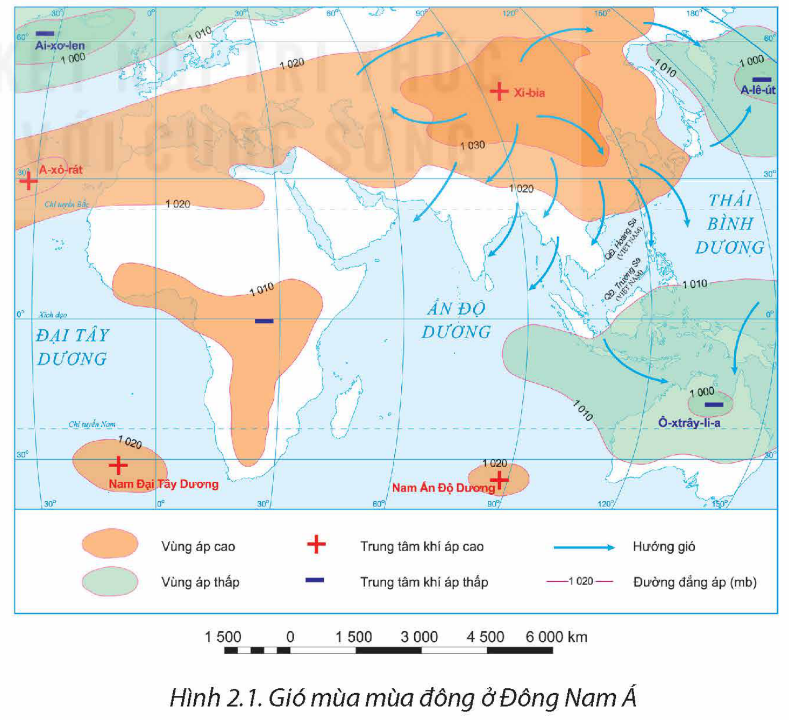
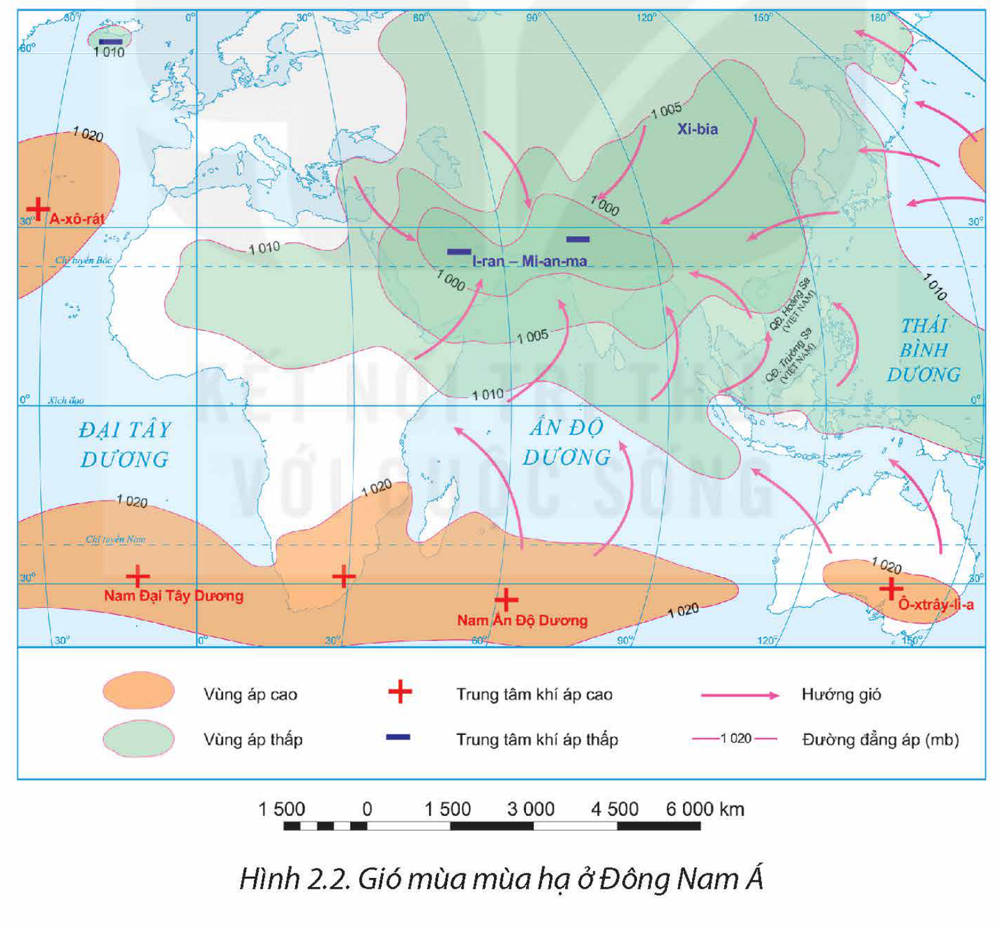
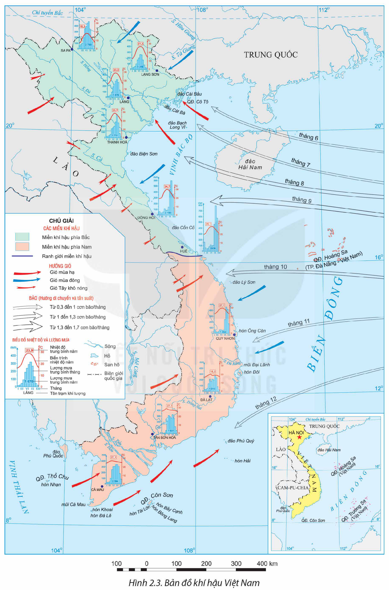
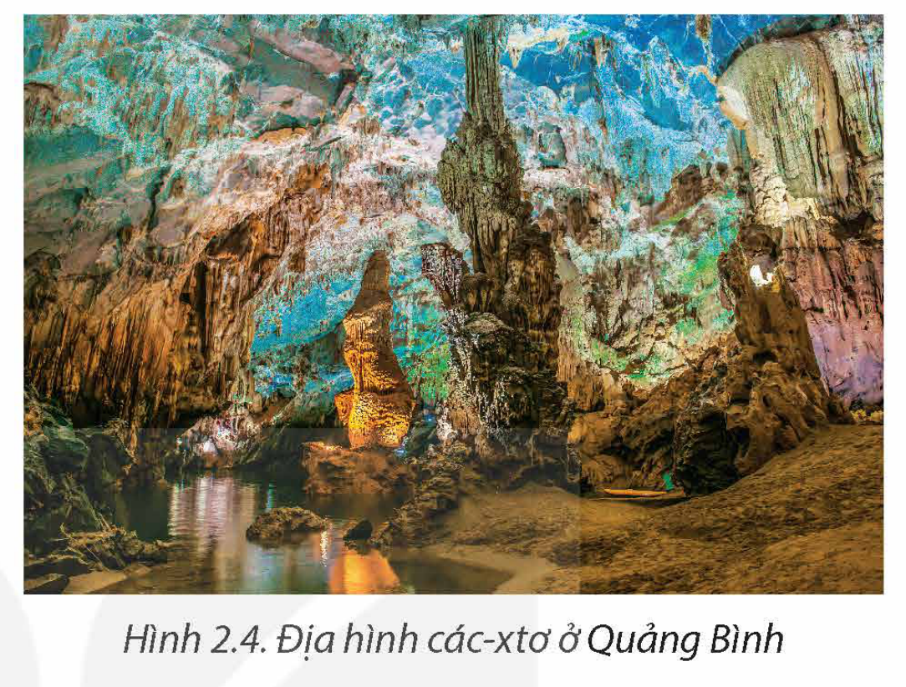

<!-- pdf:12 -->

# BÀI 2: THIÊN NHIÊN NHIỆT ĐỚI ẨM GIÓ MÙA

## 🔴 Mở đầu

Đặc điểm cơ bản của thiên nhiên Việt Nam là tính chất nhiệt đới ẩm gió mùa. Tính chất nhiệt đới ẩm gió mùa biểu hiện trong khí hậu và các thành phần tự nhiên khác như thế nào? Tính chất đó có ảnh hưởng đến sản xuất và đời sống ra sao?

## I. BIỂU HIỆN CỦA THIÊN NHIÊN NHIỆT ĐỚI ẨM GIÓ MÙA

Thiên nhiên nhiệt đới ẩm gió mùa ở nước ta thể hiện rõ rệt ở tất cả các thành phần tự nhiên.

### 1. Khí hậu

Biểu hiện của khí hậu nhiệt đới ẩm gió mùa của nước ta thể hiện qua các yếu tố:

– Lượng bức xạ mặt trời lớn và nhiệt độ trung bình năm cao

<!-- term: Khí hậu nhiệt đới ẩm gió mùa -->
Toàn bộ lãnh thổ nước ta nhận được lượng bức xạ mặt trời lớn, cán cân bức xạ quanh năm dương. Nhiệt độ trung bình năm trên cả nước đều trên 20°C (trừ vùng núi cao), tổng số giờ nắng năm dao động từ 1 400 – 3 000 giờ tuỳ từng nơi.

Bảng 2.1. CHỈ SỐ NHIỆT ĐỘ TRUNG BÌNH NĂM VÀ TỔNG SỐ GIỜ NẮNG Ở MỘT SỐ TRẠM KHÍ TƯỢNG

| Trạm khí tượng | Nhiệt độ trung bình năm *(°C)* | Tổng số giờ nắng *(giờ/năm)* |
| --- | --- | --- |
| Lạng Sơn (Lạng Sơn) | 21,3 | 1 561 |
| Láng (Hà Nội) | 23,9 | 1 489 |
| Huế (Thừa Thiên Huế) | 25,1 | 1 916 |
| Quy Nhơn (Bình Định) | 27,1 | 2 445 |
| Cà Mau (Cà Mau) | 27,1 | 2 186 |

*(Nguồn: Quy chuẩn kĩ thuật Quốc gia số liệu điều kiện tự nhiên dùng trong xây dựng)*

– Lượng mưa, độ ẩm lớn

<!-- term: Khí hậu nhiệt đới ẩm gió mùa -->
Lượng mưa trung bình năm ở nước ta từ 1 500 – 2 000 mm, ở những vùng núi cao và các sườn núi chắn gió, lượng mưa có thể đạt 3 500 – 4 000 mm. Độ ẩm tương đối của không khí trung bình hằng năm từ 80 – 85%, cân bằng ẩm luôn dương.

<!-- pdf:13 -->

Bảng 2.2. LƯỢNG MƯA VÀ ĐỘ ẨM TƯƠNG ĐỐI CỦA KHÔNG KHÍ TRUNG BÌNH NĂM Ở MỘT SỐ TRẠM KHÍ TƯỢNG

| Trạm khí tượng | Lượng mưa trung bình năm *(mm)* | Độ ẩm tương đối của không khí trung bình năm *(%)* |
| --- | --- | --- |
| Lạng Sơn (Lạng Sơn) | 1 318 | 83 |
| Láng (Hà Nội) | 1 670 | 81 |
| Huế (Thừa Thiên Huế) | 2 936 | 84 |
| Cà Mau (Cà Mau) | 2 394 | 83 |
<!-- ocr-ok: Bảng 2.2 gồm 3 cột số liệu đã đối chiếu khớp 100% ảnh trang p013.png -->

*(Nguồn: Quy chuẩn kĩ thuật Quốc gia số liệu điều kiện tự nhiên dùng trong xây dựng)*

– Gió mùa

<!-- term: Tín phong bán cầu Bắc -->
Do nằm trong khu vực nội chí tuyến bán cầu Bắc nên Việt Nam có Tín phong hoạt động quanh năm. Đồng thời, nước ta nằm trong khu vực gió mùa châu Á, chịu tác động của các khối khí hoạt động theo mùa là gió mùa đông và gió mùa hạ.

+ Gió mùa đông (từ tháng 11 đến tháng 4 năm sau)

<!-- term: Gió mùa Đông Bắc -->
Miền Bắc nước ta chịu tác động của khối khí lạnh từ áp cao Xi-bia di chuyển theo hướng đông bắc nên thường gọi là gió mùa Đông Bắc. Gió mùa Đông Bắc di chuyển về nước ta không liên tục mà theo từng đợt.

> 💡 EM CÓ BIẾT?
>
> Bản chất của gió mùa Đông Bắc là sự di chuyển của khối không khí cực đới lục địa từ vùng áp cao Xi-bia thổi về. Áp cao Xi-bia nằm ở khoảng vĩ độ 50°B. Tại trung tâm này, không khí rất lạnh và khô, nhiệt độ trung bình mùa đông khoảng –40°C đến –15°C, trị số áp suất lên tới 1 040 – 1 060 mb.

<!-- term: Gió mùa Đông Bắc -->
Nửa đầu mùa đông, gió mùa Đông Bắc tạo nên một mùa đông lạnh với thời tiết lạnh khô cho miền Bắc, nửa sau mùa đông gây nên thời tiết lạnh ẩm, có mưa phùn ở vùng ven biển và đồng bằng sông Hồng.

*Hình 2.1. Gió mùa mùa đông ở Đông Nam Á*

<!-- pdf:14 -->

<!-- term: Tín phong bán cầu Bắc -->
Khi di chuyển xuống phía nam, gió mùa Đông Bắc suy yếu dần và hầu như bị ngăn lại ở dãy Bạch Mã. Từ Đà Nẵng (16°B) trở vào, Tín phong bán cầu Bắc chiếm ưu thế, gây mưa cho khu vực ven biển Trung Bộ và là nguyên nhân tạo nên mùa khô ở Tây Nguyên và Nam Bộ.

+ Gió mùa hạ (từ tháng 5 đến tháng 10)

<!-- term: Gió mùa Tây Nam -->
<!-- term: Gió Tây khô nóng -->
Đầu mùa hạ, khối khí nhiệt đới ẩm từ Bắc Ấn Độ Dương qua vịnh Ben-gan di chuyển theo hướng tây nam vào nước ta, gây mưa lớn cho Nam Bộ và Tây Nguyên. Khi vượt qua dãy Trường Sơn và các dãy núi chạy dọc biên giới Việt – Lào, tràn xuống đồng bằng ven biển Trung Bộ và phần phía nam vùng Tây Bắc, khối khí này trở nên khô nóng (gió phơn Tây Nam hay còn gọi là gió Tây khô nóng hoặc gió Lào). Vào giữa và cuối mùa hạ, gió mùa Tây Nam xuất phát từ áp cao cận chí tuyến bán cầu Nam hoạt động mạnh, gây ra mưa lớn và kéo dài cho các vùng đón gió ở Nam Bộ và Tây Nguyên. Ở đồng bằng sông Hồng có gió đông nam từ biển thổi vào.

Hoạt động của gió mùa Tây Nam cùng với dải hội tụ nhiệt đới và bão gây mưa vào mùa hạ trên cả nước.

*Hình 2.2. Gió mùa mùa hạ ở Đông Nam Á*

Như vậy, sự luân phiên của các khối khí hoạt động theo mùa khác nhau cả về hướng và về tính chất đã tạo nên sự phân mùa của khí hậu Việt Nam. Miền Bắc có hai mùa khí hậu là mùa đông lạnh, ít mưa và mùa hạ nóng ẩm, mưa nhiều; giữa hai mùa có thời kì chuyển tiếp. Miền Nam có mùa mưa và mùa khô rõ rệt. Giữa Tây Nguyên và đồng bằng ven biển Trung Bộ có sự đối lập về mùa mưa và mùa khô.

<!-- pdf:15 -->

*Hình 2.3. Bản đồ khí hậu Việt Nam*

<!-- pdf:16 -->

> ❓ Dựa vào thông tin mục 1, hình 2.1, 2.2, 2.3 và kiến thức đã học, hãy:
> – Trình bày các biểu hiện của khí hậu nhiệt đới ẩm gió mùa ở nước ta.
> – Giải thích tại sao nước ta có khí hậu nhiệt đới ẩm gió mùa.

### 2. Địa hình

<!-- term: Địa hình các-xtơ -->
– Do đặc điểm nóng ẩm của khí hậu nhiệt đới, các quá trình phong hoá diễn ra mạnh mẽ làm cho bề mặt địa hình bị thay đổi. Ở một số khu vực đá vôi hình thành địa hình các-xtơ với các dạng hang động, thung khô và các cánh đồng các-xtơ như ở Quảng Bình, Hà Giang, Ninh Bình,...

– Quá trình xâm thực – bồi tụ là quá trình chính trong sự hình thành địa hình Việt Nam.

*Hình 2.4. Địa hình các-xtơ ở Quảng Bình*

+ Xâm thực mạnh ở miền đồi núi: Ở miền đồi núi, quá trình xâm thực diễn ra mạnh mẽ. Địa hình bị cắt xẻ, bào mòn, hiện tượng sạt lở đất diễn ra trên các sườn đồi, sườn núi vào mùa mưa lũ khá phổ biến.

+ Bồi tụ ở vùng đồng bằng: Hệ quả của quá trình xâm thực, bào mòn mạnh mẽ bề mặt địa hình ở miền đồi núi là sự bồi tụ, hình thành các đồng bằng hạ lưu sông. Đồng bằng sông Hồng và đồng bằng sông Cửu Long có những khu vực hằng năm mở rộng ra biển từ vài chục đến hàng trăm mét như vùng Kim Sơn (Ninh Bình),...

> ❓ Dựa vào thông tin mục 2, hãy trình bày biểu hiện của địa hình nhiệt đới ẩm gió mùa ở nước ta.

### 3. Sông ngòi

Tính chất nhiệt đới ẩm gió mùa thể hiện ở mạng lưới sông ngòi dày đặc, nhiều nước, giàu phù sa, chế độ nước sông theo mùa.

– Mạng lưới sông ngòi dày đặc, phân bố rộng khắp trên đất liền. Nước ta có khoảng 2 360 con sông có chiều dài trên 10 km. Tổng lượng nước của sông ngòi nước ta khoảng 839 tỉ m³/năm. Tổng lượng phù sa của các hệ thống sông khoảng 200 triệu tấn/năm.

– Chế độ nước theo mùa: Nước ta có chế độ mưa mùa nên chế độ nước sông trong năm chia hai mùa với một mùa lũ và một mùa cạn. Mùa lũ trùng với mùa mưa, mùa cạn trùng với mùa khô. Chế độ mưa thất thường làm cho chế độ dòng chảy cũng thay đổi thất thường.

<!-- pdf:17 -->

> ❓ Dựa vào thông tin mục 3, hãy trình bày biểu hiện nhiệt đới ẩm gió mùa qua sông ngòi ở nước ta.

### 4. Đất và sinh vật

– Đất

<!-- term: Quá trình feralit -->
<!-- term: Đất feralit đỏ vàng -->
+ Trong vùng khí hậu nhiệt đới ẩm, quá trình hình thành đất đặc trưng là quá trình feralit. Điều kiện nhiệt, ẩm cao làm cho các quá trình phong hoá diễn ra mạnh mẽ, tạo ra một lớp đất dày. Mưa nhiều làm rửa trôi các chất badơ dễ tan (Ca²⁺, Mg²⁺, Na⁺, K⁺) làm đất chua và tích tụ ôxit sắt (Fe₂O₃) và ôxit nhôm (Al₂O₃), tạo ra màu đỏ vàng nên loại đất này được gọi là đất feralit đỏ vàng.

+ Quá trình feralit diễn ra mạnh ở vùng đồi núi thấp trên đá mẹ a-xít, do đó đất feralit là loại đất chính ở vùng đồi núi nước ta. Một số nơi ở trung du và miền núi có sự phân hoá mùa mưa – mùa khô sâu sắc, làm tăng cường thêm quá trình tích tụ ôxit sắt, ôxit nhôm tạo thành các tầng kết von hoặc đá ong.

– Sinh vật

+ Thảm thực vật rừng có lượng sinh khối lớn và năng suất sinh học cao. Trong rừng, các thành phần thực vật, động vật nhiệt đới chiếm ưu thế. Thực vật phổ biến là các loài thuộc các họ cây nhiệt đới như họ Đậu, Vang, Dâu tằm, Dầu,... Động vật trong rừng là các loài chim, thú nhiệt đới như công, trĩ, gà lôi, vẹt, khỉ, vượn, nai, hoẵng,...

+ Hệ sinh thái rừng nguyên sinh phổ biến ở nước ta là rừng rậm nhiệt đới ẩm lá rộng thường xanh. Do ảnh hưởng của gió mùa nên nước ta có các loại rừng nhiệt đới gió mùa khác nhau, từ rừng nhiệt đới gió mùa thường xanh, rừng gió mùa nửa rụng lá, rừng thưa khô rụng lá, trảng cỏ, cây bụi,...

> ❓ Dựa vào thông tin mục 4, hãy trình bày biểu hiện của đất và sinh vật nhiệt đới ẩm gió mùa ở nước ta.

## II. ẢNH HƯỞNG CỦA THIÊN NHIÊN NHIỆT ĐỚI ẨM GIÓ MÙA ĐẾN HOẠT ĐỘNG SẢN XUẤT VÀ ĐỜI SỐNG

### 1. Ảnh hưởng đến hoạt động sản xuất

– Thiên nhiên nhiệt đới ẩm gió mùa có ảnh hưởng trực tiếp đến các hoạt động sản xuất nông nghiệp.

+ Lượng nhiệt, ẩm, ánh sáng, nguồn nước dồi dào và đất màu mỡ, tạo điều kiện để nước ta phát triển nền nông nghiệp nhiệt đới. Cây trồng, vật nuôi sinh trưởng quanh năm, tạo điều kiện để tăng vụ, tăng năng suất, tạo tiền đề cho sản xuất nông nghiệp hàng hoá, đáp ứng cho nhu cầu trong nước và xuất khẩu.

<!-- pdf:18 -->

+ Khí hậu nhiệt đới ẩm gió mùa, có sự phân hoá tạo nên cơ cấu mùa vụ, cơ cấu cây trồng, vật nuôi ở các vùng lãnh thổ khác nhau; bên cạnh các cây trồng nhiệt đới còn phát triển các cây có nguồn gốc cận nhiệt và ôn đới như chè, hồi, lê, mận,... và các cây dược liệu quý.

+ Tuy nhiên, tính thất thường của thời tiết gây khó khăn cho hoạt động canh tác, kế hoạch mùa vụ, phòng chống thiên tai, phòng chống dịch bệnh,... trong sản xuất nông nghiệp.

– Thiên nhiên nhiệt đới ẩm gió mùa tạo thuận lợi cho nước ta phát triển các ngành kinh tế khác như lâm nghiệp, thuỷ sản, giao thông vận tải, du lịch,... và các hoạt động khai thác, xây dựng,... Tuy nhiên, các ngành và các hoạt động này đều chịu ảnh hưởng trực tiếp của thiên tai, các hiện tượng thời tiết cực đoan và sự phân mùa khí hậu. Thiên nhiên nhiệt đới ẩm gió mùa với độ ẩm cao cũng gây khó khăn cho việc bảo dưỡng máy móc, thiết bị và bảo quản các sản phẩm nông nghiệp, công nghiệp,...

### 2. Ảnh hưởng đến đời sống

– Thiên nhiên nhiệt đới ẩm gió mùa nhìn chung thuận lợi cho đời sống con người. Các hoạt động sinh hoạt của người dân có thể diễn ra quanh năm. Lượng mưa lớn là nguồn cung cấp nước quan trọng cho đời sống và sinh hoạt.

– Tuy nhiên, thiên nhiên nhiệt đới ẩm gió mùa cũng gây ra nhiều khó khăn cho đời sống.

+ Các thiên tai và hiện tượng thời tiết cực đoan thường xuyên diễn ra, tác động của biến đổi khí hậu ảnh hưởng rất lớn cho đời sống, gây thiệt hại về người và tài sản,...

+ Khí hậu nhiệt đới ẩm gió mùa với nền nhiệt, ẩm cao là môi trường thuận lợi cho các bệnh nhiệt đới phát triển, gây ra những dịch bệnh ảnh hưởng tới sức khoẻ và đời sống con người.

> ❓ Dựa vào thông tin mục II, hãy phân tích ảnh hưởng của thiên nhiên nhiệt đới ẩm gió mùa đến sản xuất và đời sống ở nước ta.

## ✏️ Luyện tập và vận dụng

- Phân tích tác động của vị trí địa lí và hình dạng lãnh thổ tới đặc điểm khí hậu nước ta.
- Tìm hiểu về ảnh hưởng của thiên nhiên nhiệt đới ẩm gió mùa đến sản xuất và đời sống ở nơi em sống.

## 📷 Danh sách hình trong bài

| Mã hình | Trang PDF | Vị trí trong bài | Chú thích gốc |
| --- | --- | --- | --- |
| H12-dia-b02-01 | 13 | Mục I.1 | Hình 2.1. Gió mùa mùa đông ở Đông Nam Á |
| H12-dia-b02-02 | 14 | Mục I.1 | Hình 2.2. Gió mùa mùa hạ ở Đông Nam Á |
| H12-dia-b02-03 | 15 | Mục I.1 | Hình 2.3. Bản đồ khí hậu Việt Nam |
| H12-dia-b02-04 | 16 | Mục I.2 | Hình 2.4. Địa hình các-xtơ ở Quảng Bình |
