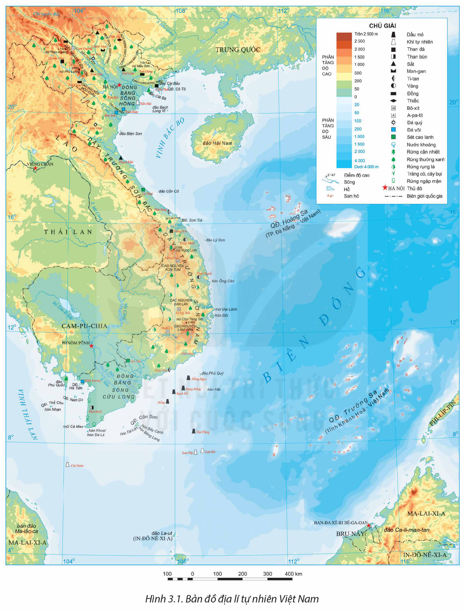
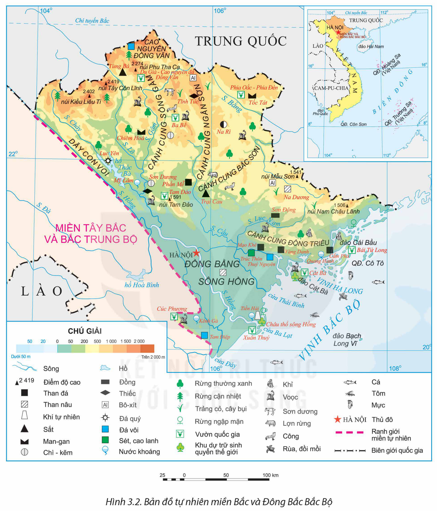
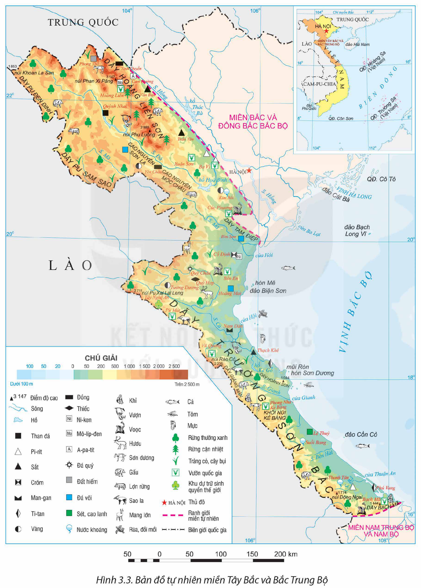
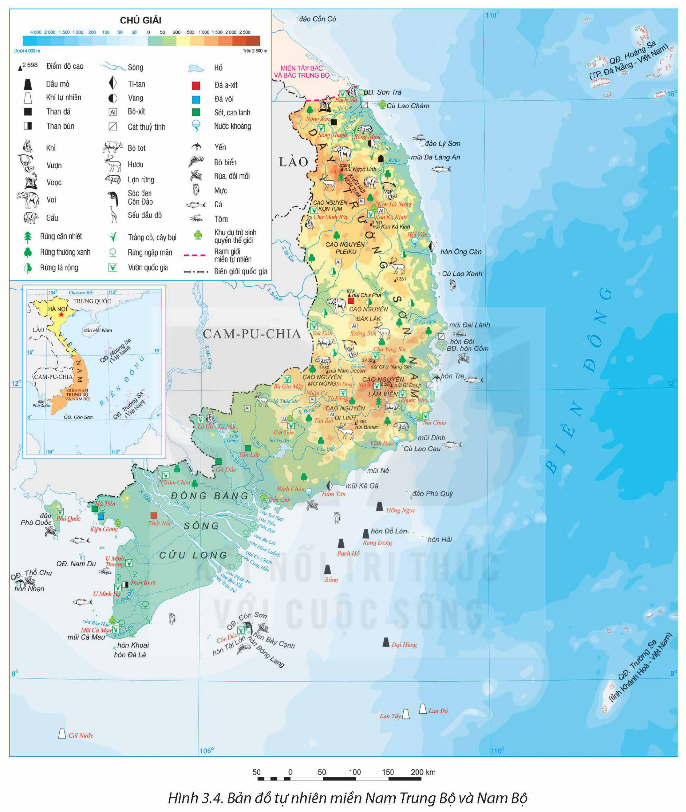

<!-- pdf:19 -->

# BÀI 3: SỰ PHÂN HOÁ ĐA DẠNG CỦA THIÊN NHIÊN

## 🔴 Mở đầu

Thiên nhiên Việt Nam nổi bật với tính chất nhiệt đới ẩm gió mùa nhưng có sự phân hoá khác nhau theo bắc – nam, theo đông – tây và theo độ cao, hình thành các miền địa lí tự nhiên khác nhau. Sự phân hoá đó diễn ra như thế nào và có ảnh hưởng gì tới sự phát triển kinh tế – xã hội của nước ta?

## I. SỰ PHÂN HOÁ ĐA DẠNG CỦA THIÊN NHIÊN

### 1. Thiên nhiên phân hoá theo chiều bắc – nam

Phân hoá thiên nhiên theo chiều bắc – nam ở nước ta thể hiện rõ nhất ở sự chênh lệch nhiệt độ và cảnh quan thiên nhiên giữa phần lãnh thổ phía Bắc và phần lãnh thổ phía Nam.

– Phần lãnh thổ phía Bắc (toàn bộ lãnh thổ phía Bắc tới dãy núi Bạch Mã)

<!-- term: Phần lãnh thổ phía Bắc -->
+ Khí hậu đặc trưng là khí hậu nhiệt đới ẩm gió mùa có một mùa đông lạnh. Nhiệt độ trung bình năm trên 20°C. Do ảnh hưởng của gió mùa Đông Bắc nên có một mùa đông lạnh với 2 – 3 tháng nhiệt độ trung bình dưới 18°C, biên độ nhiệt độ trung bình năm cao.

<!-- term: Phần lãnh thổ phía Bắc -->
+ Cảnh quan thiên nhiên tiêu biểu là đới rừng nhiệt đới gió mùa, tuỳ thuộc vào điều kiện khí hậu và đất ở các khu vực mà có các hệ sinh thái rừng khác nhau, như rừng nhiệt đới ẩm lá rộng thường xanh, rừng ngập mặn,... Ngoài ra, còn có các hệ sinh thái rừng cận nhiệt đới như rừng cận nhiệt lá rộng thường xanh, rừng lá kim núi cao,... Trong rừng, thành phần loài nhiệt đới chiếm ưu thế, ngoài ra còn có các loài thực vật cận nhiệt đới (dẻ, re,...) và ôn đới (sa mộc, đỗ quyên,...) cùng các loài thú có lông dày như gấu, chồn,...

– Phần lãnh thổ phía Nam (từ dãy núi Bạch Mã trở vào phía Nam)

<!-- term: Phần lãnh thổ phía Nam -->
+ Khí hậu mang sắc thái của khí hậu cận xích đạo gió mùa, có nền nhiệt độ cao, trung bình năm trên 25°C, biên độ nhiệt độ không quá 4 – 5°C. Khí hậu phân thành hai mùa: mưa và khô.

<!-- term: Phần lãnh thổ phía Nam -->
+ Cảnh quan thiên nhiên tiêu biểu là đới rừng cận xích đạo gió mùa. Thành phần thực vật và động vật phần lớn thuộc vùng Xích đạo và nhiệt đới có nguồn gốc Ma-lai-xi-a – In-đô-nê-xi-a di cư lên hoặc từ Ấn Độ – Mi-an-ma di cư sang. Trong rừng xuất hiện nhiều loài cây chịu hạn, rụng lá vào mùa khô như các loài cây thuộc họ Dầu; có nơi hình thành rừng thưa nhiệt đới khô, nhiều nhất ở Tây Nguyên (rừng khộp). Động vật tiêu biểu là các loài thú lớn như voi, hổ, báo, bò rừng,... Vùng đầm lầy có trăn, rắn, cá sấu,...

Ở vùng ven biển, vùng cửa sông của đồng bằng sông Cửu Long phát triển rừng ngập mặn và rừng tràm (bán đảo Cà Mau, rừng U Minh,...). Trong rừng, hệ động vật trên cạn và dưới nước rất đa dạng.

<!-- pdf:20 -->

*Hình 3.1. Bản đồ địa lí tự nhiên Việt Nam*

> ❓ Dựa vào thông tin mục 1 và hình 3.1, hãy chứng minh sự phân hoá thiên nhiên nước ta theo chiều bắc – nam.

<!-- pdf:21 -->

### 2. Thiên nhiên phân hoá theo chiều đông – tây

Từ đông sang tây (từ biển vào đất liền), thiên nhiên nước ta có sự phân hoá thành ba dải rõ rệt.

– Vùng biển và thềm lục địa

Vùng biển nước ta có diện tích rộng lớn, gấp 3 lần diện tích phần đất liền. Đặc điểm thiên nhiên vùng biển nước ta có lượng ẩm rất dồi dào, có sự hoạt động thường xuyên của các hoàn lưu gió mùa, Tín phong,... Thiên nhiên đa dạng, giàu có, tiêu biểu cho thiên nhiên vùng biển nhiệt đới ẩm gió mùa. Thềm lục địa mở rộng ở vịnh Bắc Bộ, vùng biển Nam Bộ và vịnh Thái Lan; thềm lục địa phần còn lại thu hẹp, nhất là ở đoạn ven biển Nam Trung Bộ.

– Vùng đồng bằng

Thiên nhiên vùng đồng bằng nước ta thay đổi tuỳ nơi phản ánh mối quan hệ giữa vùng đồi núi với vùng biển và thềm lục địa.

Hai đồng bằng châu thổ rộng lớn là đồng bằng sông Hồng và đồng bằng sông Cửu Long được bồi tụ, mở rộng với các bãi triều thấp, phẳng, thềm lục địa rộng, nông. Địa hình thấp, tương đối bằng phẳng, có nhiều ô trũng. Dải đồng bằng ven biển Trung Bộ hẹp ngang bị chia cắt thành những đồng bằng nhỏ, đường bờ biển khúc khuỷu, địa hình cồn cát, đầm phá khá phổ biến, đất kém màu mỡ hơn hai đồng bằng châu thổ.

– Vùng đồi núi

Sự phân hoá thiên nhiên theo đông – tây ở vùng núi chủ yếu do tác động của gió mùa và hướng của các dãy núi.

Dãy Hoàng Liên Sơn tạo nên sự khác biệt giữa vùng núi Tây Bắc với vùng núi Đông Bắc. Trong khi vùng núi Đông Bắc mang sắc thái cận nhiệt đới gió mùa thì vùng núi thấp Tây Bắc có cảnh quan nhiệt đới ẩm gió mùa và vùng núi cao cảnh quan giống như vùng ôn đới.

Dãy Trường Sơn tạo nên sự khác biệt giữa vùng đông Trường Sơn và tây Trường Sơn. Do đón gió từ biển vào nên đông Trường Sơn có một mùa mưa vào thu đông, trong khi Tây Nguyên lại là mùa khô. Khi Tây Nguyên vào mùa mưa thì sườn đông Trường Sơn nhiều nơi chịu tác động của gió Tây khô nóng.

> ❓ Dựa vào thông tin mục 2 và hình 3.1, hãy chứng minh sự phân hoá của thiên nhiên nước ta theo chiều đông – tây.

### 3. Thiên nhiên phân hoá theo độ cao

Theo độ cao, thiên nhiên ở nước ta được phân hoá thành ba đai cao:

– Đai nhiệt đới gió mùa

<!-- term: Đai nhiệt đới gió mùa -->
+ Ở miền Bắc, đai nhiệt đới gió mùa có độ cao trung bình từ khoảng 600 – 700 m trở xuống, ở miền Nam từ khoảng 900 – 1 000 m trở xuống.

<!-- term: Đai nhiệt đới gió mùa -->
+ Khí hậu nhiệt đới gió mùa biểu hiện rõ: tổng nhiệt độ hoạt động trung bình năm trên 7 500°C, mùa hạ nóng (nhiệt độ trung bình tháng trên 25°C), độ ẩm thay đổi tuỳ nơi.

<!-- pdf:22 -->

<!-- term: Đai nhiệt đới gió mùa -->
+ Đất có hai nhóm chính là nhóm đất phù sa ở vùng đồng bằng, bao gồm đất phù sa sông, đất phèn, đất mặn, đất cát,... và nhóm đất feralit ở vùng đồi núi thấp, phần lớn là đất feralit đỏ vàng, đất feralit nâu đỏ phát triển trên đá badan, đá vôi.

<!-- term: Đai nhiệt đới gió mùa -->
+ Sinh vật gồm các hệ sinh thái rừng nhiệt đới lá rộng thường xanh hình thành ở những vùng núi thấp, mưa nhiều, ẩm ướt; các hệ sinh thái rừng nhiệt đới gió mùa (rừng thường xanh, rừng nửa rụng lá, rừng nhiệt đới khô,...); các hệ sinh thái khác phát triển trên các loại thổ nhưỡng đặc biệt (rừng nhiệt đới thường xanh trên đá vôi, rừng ngập mặn trên đất ngập mặn ven biển,...).

– Đai cận nhiệt đới gió mùa trên núi

<!-- term: Đai cận nhiệt đới gió mùa trên núi -->
+ Ở miền Bắc, đai cận nhiệt đới gió mùa trên núi bắt đầu từ độ cao khoảng 600 – 700 m đến 2 600 m, ở miền Nam từ khoảng 900 – 1 000 m đến 2 600 m.

<!-- term: Đai cận nhiệt đới gió mùa trên núi -->
+ Khí hậu mát mẻ, tổng nhiệt độ dao động từ 4 500°C đến 7 500°C, mùa hè mát (nhiệt độ trung bình tháng dưới 25°C), mưa nhiều (trên 2 000 mm), độ ẩm cao.

<!-- term: Đai cận nhiệt đới gió mùa trên núi -->
+ Đất: Do nhiệt độ giảm làm hạn chế quá trình phân huỷ chất hữu cơ nên hình thành các loại đất feralit mùn (ở độ cao 600 – 700 m đến 1 600 – 1 700 m), đất xám mùn trên núi (ở độ cao trên 1 600 – 1 700 m).

<!-- term: Đai cận nhiệt đới gió mùa trên núi -->
+ Sinh vật phổ biến là các loài cận nhiệt đới, xen kẽ một số loài nhiệt đới. Trong rừng xuất hiện các loài chim, thú cận nhiệt đới như gấu, sóc,...

– Đai ôn đới gió mùa trên núi

<!-- term: Đai ôn đới gió mùa trên núi -->
+ Đai ôn đới gió mùa trên núi có độ cao từ 2 600 m trở lên (có ở dãy Hoàng Liên Sơn).

<!-- term: Đai ôn đới gió mùa trên núi -->
+ Khí hậu mang tính chất ôn đới, tổng nhiệt độ hoạt động dưới 4 500°C, quanh năm nhiệt độ dưới 15°C, mùa đông nhiệt độ xuống dưới 5°C.

<!-- term: Đai ôn đới gió mùa trên núi -->
+ Đất chủ yếu là đất mùn núi cao.

<!-- term: Đai ôn đới gió mùa trên núi -->
+ Thực vật ôn đới chiếm ưu thế như đỗ quyên, lãnh sam, thiết sam với rừng trúc lùn, rừng rêu mưa mù trên núi phát triển.

> ❓ Dựa vào thông tin mục 3 và hình 3.1, hãy chứng minh sự phân hoá thiên nhiên theo độ cao ở nước ta.

## II. CÁC MIỀN ĐỊA LÍ TỰ NHIÊN

### 1. Miền Bắc và Đông Bắc Bắc Bộ

<!-- term: Miền Bắc và Đông Bắc Bắc Bộ -->
– Phạm vi, ranh giới: bao gồm vùng đồi núi Đông Bắc và đồng bằng sông Hồng cùng vùng biển đảo phía đông. Ranh giới phía tây – tây nam của miền dọc theo bờ phải của sông Hồng và rìa phía tây, tây nam đồng bằng sông Hồng.

<!-- term: Miền Bắc và Đông Bắc Bắc Bộ -->
– Địa hình và đất: Địa hình đa dạng, đồi núi thấp chiếm ưu thế, hướng của các dãy núi theo hướng vòng cung, cao ở phía bắc, thấp dần về phía nam. Đồng bằng tương đối rộng và bằng phẳng. Địa hình các-xtơ khá phổ biến, tiêu biểu ở Hà Giang, Lạng Sơn, Cao Bằng,... Bờ biển đa dạng: nơi thấp phẳng, nơi nhiều vịnh, đảo như vùng biển tỉnh Quảng Ninh.

Đất có nhiều loại khác nhau, tiêu biểu là đất feralit trên các loại đá mẹ ở vùng đồi núi thấp, đất phù sa ở đồng bằng sông Hồng, ngoài ra còn có đất phèn, đất mặn ở vùng ven biển.

<!-- pdf:23 -->

*Hình 3.2. Bản đồ tự nhiên miền Bắc và Đông Bắc Bắc Bộ*

<!-- term: Miền Bắc và Đông Bắc Bắc Bộ -->
– Khí hậu: Miền chịu ảnh hưởng trực tiếp và sâu sắc của gió mùa Đông Bắc tạo nên một mùa đông lạnh, khi các đợt không khí lạnh tràn xuống liên tục có thể dẫn đến tình trạng rét đậm, rét hại. Chính vì thế, miền Bắc và Đông Bắc Bắc Bộ là miền địa lí tự nhiên có mùa đông lạnh điển hình nhất nước ta.

<!-- pdf:24 -->

– Sông ngòi: Các sông lớn như sông Hồng, sông Chảy,... chảy theo hướng tây bắc – đông nam. Khu vực Đông Bắc có các sông như sông Lô, sông Gâm, sông Lục Nam,... chảy theo hướng vòng cung.

– Sinh vật phong phú và đặc sắc thuộc khu hệ thực vật Việt Bắc – Hoa Nam, có tới 50% thành phần loài bản địa. Nhiều loài động vật quý hiếm như voọc đầu trắng, voọc quần đùi trắng, công,... còn được bảo tồn tại các vườn quốc gia (Ba Bể, Tam Đảo, Cát Bà,...). Cảnh quan thiên nhiên có sự thay đổi theo mùa, theo khu vực.

– Khoáng sản đa dạng như than đá ở Quảng Ninh, Thái Nguyên; than nâu ở đồng bằng sông Hồng; sắt ở Thái Nguyên,...; chì – kẽm ở Bắc Kạn; thiếc ở Cao Bằng; khí tự nhiên ở bể Sông Hồng,...

> ❓ Dựa vào thông tin mục 1 và hình 3.2, hãy trình bày đặc điểm tự nhiên của miền Bắc và Đông Bắc Bắc Bộ.

### 2. Miền Tây Bắc và Bắc Trung Bộ

<!-- term: Miền Tây Bắc và Bắc Trung Bộ -->
– Phạm vi, ranh giới: gồm khu vực Tây Bắc và Bắc Trung Bộ và vùng biển duyên hải Bắc Trung Bộ từ Thanh Hoá đến Thừa Thiên Huế. Ranh giới từ bờ phải sông Hồng tới dãy núi Bạch Mã.

> 💡 EM CÓ BIẾT?
>
> Miền Tây Bắc và Bắc Trung Bộ là miền duy nhất ở bước ta có địa hình núi cao với đầy đủ ba đai cao.
>
> Độ cao của đỉnh núi Phan Xi Păng công bố năm 1909 bằng phương pháp đo áp kế là 3 143 m. Hiện nay, Cục Đo đạc, Bản đồ và Thông tin địa lí Việt Nam đã công bố độ cao của đỉnh núi là 3 147 m.
<!-- ocr-ok: Hộp EM CÓ BIẾT? đặt song song cột văn bản nên OCR đọc lẫn dòng, đã đối chiếu khớp 100% ảnh trang p024.png -->

<!-- term: Miền Tây Bắc và Bắc Trung Bộ -->
– Địa hình và đất: Địa hình núi cao và núi trung bình chiếm ưu thế, bị chia cắt mạnh và hiểm trở nhất nước ta. Các dãy núi xen kẽ các thung lũng theo hướng tây bắc – đông nam, có nhiều bề mặt sơn nguyên, cao nguyên, lòng chảo,.... Ven biển có nhiều cồn cát, đầm phá, nhiều bãi tắm đẹp, nhiều nơi có thể xây dựng cảng biển. Đồng bằng nhỏ và bị chia cắt.

Nhóm đất feralit trên đá vôi và feralit trên các loại đá khác phổ biến ở vùng đồi núi; đất phù sa chủ yếu ở các đồng bằng Thanh Hoá, Nghệ An và dải đồng bằng nhỏ hẹp ven biển Hà Tĩnh, Quảng Bình, Thừa Thiên Huế.

<!-- term: Miền Tây Bắc và Bắc Trung Bộ -->
– Khí hậu: Đặc trưng về khí hậu của miền là sự giảm sút ảnh hưởng của gió mùa Đông Bắc, nhiệt độ trung bình năm tăng dần và biên độ nhiệt độ giảm. Dãy Hoàng Liên Sơn ngăn cản sự xâm nhập trực tiếp của gió mùa Đông Bắc vào khu vực Tây Bắc làm cho mùa đông ở Tây Bắc ấm và ngắn hơn Đông Bắc. Do tác động bức chắn của dãy Trường Sơn Bắc, hình thành gió Tây khô nóng ở Bắc Trung Bộ vào đầu mùa hạ.

<!-- pdf:25 -->

– Sông ngòi: Các sông lớn như sông Đà, sông Mã, sông Cả,... chảy theo hướng tây bắc – đông nam; những sông nhỏ, dốc, bắt nguồn từ vùng núi phía tây đổ ra Biển Đông.

*Hình 3.3. Bản đồ tự nhiên miền Tây Bắc và Bắc Trung Bộ*

<!-- pdf:26 -->

– Sinh vật: Miền Tây Bắc và Bắc Trung Bộ có sự hội tụ của nhiều luồng sinh vật, đặc biệt là luồng Hi-ma-lay-a – Vân Quý, Ấn Độ – Mi-an-ma và Ma-lai-xi-a – In-đô-nê-xi-a. Rừng còn tương đối nhiều ở vùng núi Nghệ An, Hà Tĩnh, thành phần thực vật phương Nam chiếm ưu thế ở khu vực Trường Sơn Bắc.

– Khoáng sản có sắt ở Hà Tĩnh; đồng ở Sơn La, Lào Cai; a-pa-tít ở Lào Cai; crôm ở Thanh Hoá; thiếc ở Nghệ An; vật liệu xây dựng ở nhiều địa phương,...

> ❓ Dựa vào thông tin mục 2 và hình 3.3, hãy trình bày đặc điểm tự nhiên của miền Tây Bắc và Bắc Trung Bộ.

### 3. Miền Nam Trung Bộ và Nam Bộ

<!-- term: Miền Nam Trung Bộ và Nam Bộ -->
– Phạm vi, ranh giới: gồm khu vực Nam Trung Bộ và Nam Bộ cùng vùng biển rộng lớn với nhiều đảo, quần đảo. Ranh giới của miền từ dãy núi Bạch Mã trở vào nam.

<!-- term: Miền Nam Trung Bộ và Nam Bộ -->
– Địa hình và đất: Địa hình khá phức tạp, gồm các dãy núi, các cao nguyên badan xếp tầng, đồng bằng châu thổ rộng lớn và đồng bằng nhỏ hẹp ven biển. Trường Sơn Nam là dãy núi lớn, hình cánh cung có sự bất đối xứng giữa sườn đông và sườn tây. Các cao nguyên badan tập trung chủ yếu ở Tây Nguyên và rìa Đông Nam Bộ với diện tích lớn, địa hình tương đối bằng phẳng. Đồng bằng sông Cửu Long rộng lớn, có hệ thống kênh rạch chằng chịt, nhiều vùng trũng bị ngập nước vào mùa lũ. Dải đồng bằng ven biển Nam Trung Bộ nhỏ hẹp, bị chia cắt bởi các nhánh núi lấn ra biển. Vùng biển với thềm lục địa rộng lớn, giàu tài nguyên.

Đất ở vùng núi và cao nguyên chủ yếu là đất feralit trên đá badan và đất feralit trên các loại đá khác. Vùng đồng bằng sông Cửu Long ngoài đất phù sa sông màu mỡ còn có đất phèn, đất mặn; dải đồng bằng ven biển miền Trung có đất phù sa nhưng kém màu mỡ hơn. Ngoài ra trong miền còn có đất cát và đất xám trên phù sa cổ.

<!-- term: Miền Nam Trung Bộ và Nam Bộ -->
– Khí hậu: Miền có khí hậu cận xích đạo gió mùa với nền nhiệt độ cao quanh năm, biên độ nhiệt độ nhỏ. Khí hậu có hai mùa: mưa và khô rõ rệt, mùa khô kéo dài và gay gắt.

– Sông ngòi: Nam Trung Bộ phần lớn là sông nhỏ, ngắn bắt nguồn từ vùng núi Trường Sơn Nam đổ ra Biển Đông. Ở đồng bằng sông Cửu Long, sông Tiền và sông Hậu phân chia thành nhiều chi lưu đổ ra biển.

– Cảnh quan thiên nhiên điển hình là đới rừng cận xích đạo gió mùa. Ở vùng Tây Nguyên có kiểu rừng nhiệt đới gió mùa nửa rụng lá và rụng lá. Ở vùng đồng bằng sông Cửu Long phát triển rừng ngập mặn và rừng tràm.

– Khoáng sản nổi bật là dầu mỏ, khí tự nhiên ở thềm lục địa, bô-xít ở Tây Nguyên và Đông Nam Bộ.

<!-- pdf:27 -->

*Hình 3.4. Bản đồ tự nhiên miền Nam Trung Bộ và Nam Bộ*

> ❓ Dựa vào thông tin mục 3 và hình 3.4, hãy trình bày đặc điểm tự nhiên của miền Nam Trung Bộ và Nam Bộ.

<!-- pdf:28 -->

## III. ẢNH HƯỞNG CỦA SỰ PHÂN HOÁ ĐA DẠNG THIÊN NHIÊN ĐẾN PHÁT TRIỂN KINH TẾ – XÃ HỘI

Thiên nhiên phân hoá đa dạng và phức tạp có ảnh hưởng lớn đến sự phát triển kinh tế – xã hội của nước ta.

– Sự phân hoá thiên nhiên theo chiều bắc – nam, đặc biệt là phân hoá của khí hậu có ảnh hưởng tới quy hoạch, hướng chuyên môn hoá sản xuất, nhất là sản xuất nông nghiệp giữa phần lãnh thổ phía Bắc và phần lãnh thổ phía Nam. Phần lãnh thổ phía Bắc do khí hậu có một mùa đông lạnh nên có thể phát triển những vùng trồng cây công nghiệp, cây ăn quả cận nhiệt đới (chè, hồi, quế, đào, lê,...). Phần lãnh thổ phía Nam với khí hậu cận xích đạo và ưu thế về đất phù hợp phát triển các vùng chuyên canh cây công nghiệp nhiệt đới (cà phê, cao su, hồ tiêu,...).

– Sự phân hoá đông – tây của thiên nhiên cũng ảnh hưởng tới hướng phát triển kinh tế – xã hội. Vùng ven biển và thềm lục địa hướng tới việc phát triển tổng hợp kinh tế biển (khai thác, nuôi trồng hải sản; du lịch biển; giao thông vận tải biển;...). Vùng đồng bằng phát triển cây lương thực (nhất là lúa), chăn nuôi lợn, gia cầm; đây cũng là nơi thuận lợi cho việc định cư, tập trung các thành phố, trung tâm thương mại, đầu mối giao thông vận tải. Vùng đồi núi có nhiều thế mạnh về khoáng sản, lâm sản,... thích hợp phát triển nông lâm kết hợp, phát triển các vùng chuyên canh cây công nghiệp, chăn nuôi gia súc lớn; khai thác khoáng sản, phát triển thuỷ điện; du lịch;... Tuy nhiên, vùng đồi núi do địa hình cao, cắt xẻ gây ra nhiều khó khăn, trở ngại cho giao thông vận tải, giao lưu kinh tế, phân bố dân cư, phát triển y tế, giáo dục,...

– Sự phân hoá của thiên nhiên theo độ cao cũng tạo nên những nét độc đáo trong các ngành sản xuất và đời sống. Các đai cao có sự khác nhau về khí hậu, đất, sinh vật tạo nên các thế mạnh khác nhau trong phát triển kinh tế, đồng thời dẫn tới sự phân bố dân cư khác nhau.

> ❓ Dựa vào thông tin mục III và kiến thức đã học, hãy phân tích ảnh hưởng của sự phân hoá đa dạng thiên nhiên đến phát triển kinh tế – xã hội.

## ✏️ Luyện tập và vận dụng

- 1. So sánh đặc điểm khí hậu và cảnh quan thiên nhiên phần lãnh thổ phía Bắc và phần lãnh thổ phía Nam nước ta.
- 2. Lập bảng tóm tắt đặc điểm của các đai cao ở nước ta về độ cao, khí hậu, đất và sinh vật.
- Sưu tầm thông tin, tìm hiểu ảnh hưởng của sự phân hoá thiên nhiên đến ngành nông nghiệp hoặc du lịch ở nước ta.

## 📷 Danh sách hình trong bài

| Mã hình | Trang PDF | Vị trí trong bài | Chú thích gốc |
| --- | --- | --- | --- |
| H12-dia-b03-01 | 20 | Mục I.1 | Hình 3.1. Bản đồ địa lí tự nhiên Việt Nam |
| H12-dia-b03-02 | 23 | Mục II.1 | Hình 3.2. Bản đồ tự nhiên miền Bắc và Đông Bắc Bắc Bộ |
| H12-dia-b03-03 | 25 | Mục II.2 | Hình 3.3. Bản đồ tự nhiên miền Tây Bắc và Bắc Trung Bộ |
| H12-dia-b03-04 | 27 | Mục II.3 | Hình 3.4. Bản đồ tự nhiên miền Nam Trung Bộ và Nam Bộ |
