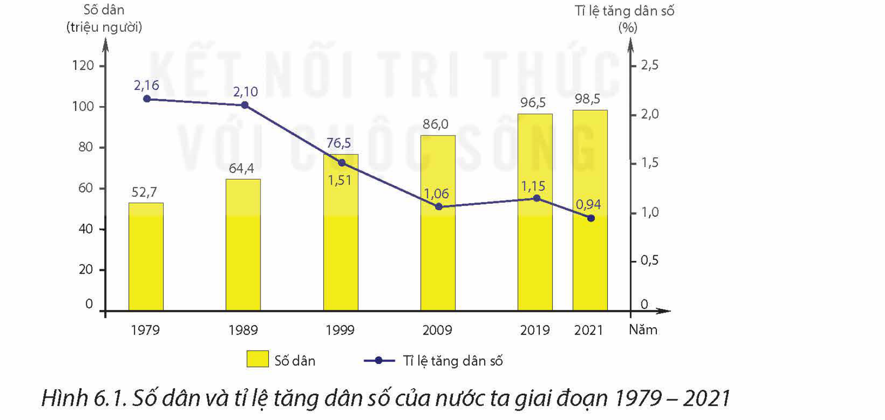
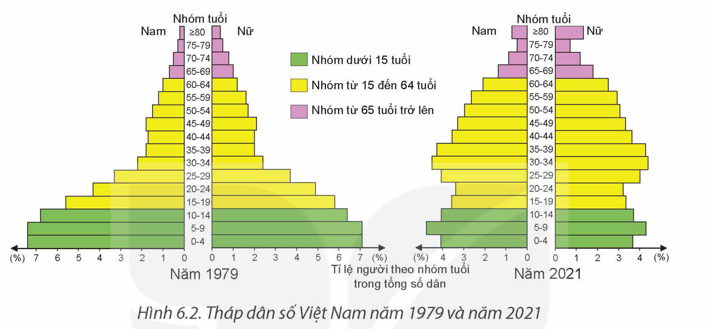
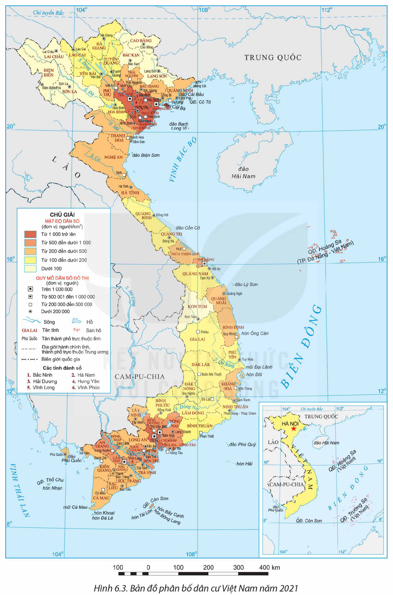

<!-- pdf:34 -->

# BÀI 6: DÂN SỐ VIỆT NAM

## 🔴 Mở đầu

Dân số là nhân tố quan trọng hàng đầu trong sự nghiệp xây dựng và bảo vệ Tổ quốc. Dân số Việt Nam có đặc điểm gì và những đặc điểm này có ảnh hưởng như thế nào đến sự phát triển kinh tế – xã hội của nước ta?

## I. ĐẶC ĐIỂM DÂN SỐ

### 1. Quy mô và gia tăng dân số

<!-- term: Quy mô và gia tăng dân số Việt Nam -->
Năm 2021, Việt Nam có 98,5 triệu người, đứng thứ 3 trong khu vực Đông Nam Á, thứ 8 ở châu Á và thứ 15 trên thế giới. Hiện có hàng triệu người Việt Nam định cư ở nước ngoài, luôn hướng về Tổ quốc. Quy mô dân số nước ta lớn, tiếp tục tăng lên nhưng có xu hướng tăng chậm lại, tỉ lệ tăng dân số giảm dần.

> 💡 EM CÓ BIẾT?
>
> Theo dự báo của Tổng cục Thống kê, số dân nước ta tiếp tục tăng chậm và đạt quy mô lớn nhất là 117 triệu người vào năm 2066, sau đó sẽ giảm dần.

*Hình 6.1. Số dân và tỉ lệ tăng dân số của nước ta giai đoạn 1979 – 2021*
*(Nguồn: Tổng cục Thống kê)*

> ❓ Dựa vào thông tin mục 1, hãy trình bày quy mô và gia tăng dân số của nước ta.

### 2. Cơ cấu dân số

– Cơ cấu dân số theo giới tính

<!-- term: Cơ cấu dân số theo giới tính -->
Cơ cấu dân số theo giới tính của Việt Nam khá cân bằng. Năm 2021, tỉ lệ nam, nữ trong tổng dân số là 49,84% và 50,16% (hay cứ 100 nữ, tương ứng trung bình có 99,4 nam).

<!-- pdf:35 -->

<!-- term: Mất cân bằng giới tính khi sinh -->
Tuy nhiên, hiện nay nước ta có tình trạng mất cân bằng giới tính khi sinh. Trong số trẻ được sinh ra năm 2021, cứ 100 bé gái, tương ứng bình quân có 112 bé trai.

– Cơ cấu dân số theo tuổi

<!-- term: Cơ cấu dân số theo tuổi -->
Do mức sinh giảm, tuổi thọ tăng nên cơ cấu dân số theo tuổi của nước ta biến đổi nhanh theo hướng giảm tỉ lệ nhóm trẻ em, tăng tỉ lệ nhóm cao tuổi. Việt Nam đang có cơ cấu dân số vàng nhưng cũng đã bước vào thời kì già hoá dân số.

*Hình 6.2. Tháp dân số Việt Nam năm 1979 và năm 2021*
*(Nguồn: Tổng cục Thống kê)*

– Cơ cấu dân số theo dân tộc

<!-- term: Cơ cấu dân số theo dân tộc -->
Nước ta có 54 dân tộc anh em, trong đó dân tộc Kinh chiếm khoảng 85% tổng số dân, các dân tộc thiểu số chiếm gần 15%. Các dân tộc sinh sống đan xen nhau khá phổ biến trên các vùng miền của Tổ quốc. Các dân tộc Việt Nam có truyền thống đoàn kết, cùng nhau bảo vệ và xây dựng đất nước.

– Cơ cấu dân số theo trình độ học vấn

<!-- term: Cơ cấu dân số theo trình độ học vấn -->
Trình độ học vấn của người dân Việt Nam được nâng cao dần. Năm 2021, tỉ lệ dân số từ 15 tuổi trở lên biết chữ đạt 95,7%. Số năm đi học trung bình của dân số từ 25 tuổi trở lên là 9,1 năm. Tuy nhiên, trình độ học vấn có sự khác biệt đáng kể giữa thành thị với nông thôn và giữa các vùng.

> ❓ Dựa vào thông tin mục 2, hãy trình bày cơ cấu dân số của nước ta.

### 3. Phân bố dân cư

<!-- term: Phân bố dân cư Việt Nam -->
Năm 2021, mật độ dân số nước ta là 297 người/km², cao gấp 5 lần mức trung bình thế giới và có sự chênh lệch giữa các vùng. Trong khi vùng Đồng bằng sông Hồng có mật độ dân số lên tới 1 091 người/km² thì vùng Tây Nguyên mật độ dân số chỉ có 111 người/km². Dân cư nước ta chủ yếu sinh sống ở nông thôn. Năm 2021, tỉ lệ dân nông thôn là 62,9%, tỉ lệ dân thành thị là 37,1% tổng số dân.

<!-- pdf:36 -->

*Hình 6.3. Bản đồ phân bố dân cư Việt Nam năm 2021*

<!-- pdf:37 -->

> ❓ Dựa vào thông tin mục 3 và hình 6.3, hãy:
> – Trình bày tình hình phân bố dân cư của nước ta.
> – Xác định một số tỉnh, thành phố có mật độ dân số dưới 100 người/km² và một số tỉnh, thành phố có mật độ dân số từ 1 000 người/km² trở lên (năm 2021).

## II. THẾ MẠNH VÀ HẠN CHẾ VỀ DÂN SỐ

### 1. Thế mạnh

– Dân số là nguồn lực quan trọng để phát triển đất nước. Quy mô dân số lớn dẫn đến nhu cầu về hàng hoá, dịch vụ lớn, tạo động lực phát triển kinh tế – xã hội và tăng sức hấp dẫn thu hút đầu tư cả trong nước và nước ngoài. Người Việt Nam ở nước ngoài là nguồn lực quan trọng, đóng góp cho sự nghiệp xây dựng, phát triển và bảo vệ Tổ quốc.

– Quy mô dân số lớn, cơ cấu dân số vàng nên nước ta có nguồn lao động dồi dào, đáp ứng đủ yêu cầu về nhân lực để phát triển nền kinh tế đa ngành và bảo vệ vững chắc Tổ quốc.

– Mức sinh thấp, dân số tăng chậm tạo điều kiện thuận lợi nâng cao chất lượng dân số và chất lượng cuộc sống dân cư.

### 2. Hạn chế

– Quy mô dân số lớn và tăng lên hằng năm nảy sinh thách thức về an ninh lương thực, năng lượng; đảm bảo việc làm, giáo dục, y tế; sử dụng tài nguyên, bảo vệ môi trường,...

– Số lượng và tỉ lệ người cao tuổi ngày càng lớn, đòi hỏi tăng chi phí cho an sinh xã hội, dịch vụ y tế,...

– Phân bố dân cư chênh lệch lớn gây ra nhiều thách thức. Ở những khu vực dân cư tập trung, mật độ quá cao gây sức ép đến việc sử dụng tài nguyên thiên nhiên, bảo vệ môi trường; quá tải trong việc đáp ứng nhu cầu về việc làm, dịch vụ y tế, giáo dục,... Ngược lại, những khu vực dân cư thưa thớt, thiếu lao động để khai thác tài nguyên thiên nhiên, khó khăn trong việc xây dựng cơ sở hạ tầng, phát triển kinh tế – xã hội.

> ❓ Dựa vào thông tin mục II, hãy phân tích các thế mạnh và hạn chế về dân số của nước ta.

## III. CHIẾN LƯỢC DÂN SỐ CỦA VIỆT NAM

### 1. Mục tiêu của chiến lược

Nước ta có chiến lược dân số thích hợp với từng thời kì. Hiện nay, chiến lược dân số ở nước ta có mục tiêu sau:

<!-- term: Mức sinh thay thế -->
<!-- term: Chiến lược dân số của Việt Nam -->
– Duy trì vững chắc mức sinh thay thế (bình quân 2,1 con/một phụ nữ trong độ tuổi sinh đẻ), giảm chênh lệch mức sinh giữa các vùng, đối tượng.

<!-- term: Chiến lược dân số của Việt Nam -->
> 💡 EM CÓ BIẾT?
>
> Nước ta đã ban hành các chiến lược dân số như sau:
> – Chiến lược dân số – kế hoạch hoá gia đình đến năm 2000.
> – Chiến lược Dân số Việt Nam giai đoạn 2001 – 2010.
> – Chiến lược Dân số – Sức khoẻ sinh sản Việt Nam giai đoạn 2011 – 2020.
> – Chiến lược Dân số Việt Nam đến năm 2030.
> Các chiến lược dân số đã góp phần giảm sinh, nâng cao chất lượng dân số, phát triển kinh tế, xã hội, bảo vệ tài nguyên, môi trường.

<!-- pdf:38 -->

– Bảo vệ và phát triển dân số các dân tộc thiểu số có dưới 10 nghìn người, đặc biệt là những dân tộc thiểu số rất ít người.

– Đưa tỉ số giới tính khi sinh về mức cân bằng tự nhiên, phấn đấu duy trì cơ cấu tuổi ở mức hợp lí.

<!-- term: Chiến lược dân số của Việt Nam -->
– Nâng cao chất lượng dân số: tăng tuổi thọ bình quân, nâng cao thể trạng người dân Việt Nam; phát huy tối đa lợi thế cơ cấu dân số vàng, tạo động lực mạnh mẽ cho sự phát triển đất nước nhanh, bền vững.

– Thúc đẩy phân bố dân số hợp lí và bảo đảm quốc phòng an ninh.

– Hoàn thành xây dựng và vận hành cơ sở dữ liệu quốc gia về dân cư, đẩy mạnh lồng ghép các yếu tố dân số vào xây dựng và thực hiện kế hoạch phát triển kinh tế – xã hội.

### 2. Giải pháp

Để đạt được các mục tiêu trong chiến lược dân số, nước ta thực hiện đồng thời các giải pháp, như:

– Hoàn thiện chính sách, pháp luật về dân số.

– Đẩy mạnh giáo dục, truyền thông về dân số và phát triển.

– Phát triển mạng lưới dịch vụ nâng cao chất lượng dân số: tư vấn, khám sức khoẻ trước hôn nhân, kế hoạch hoá gia đình, tầm soát trước sinh và sơ sinh, chăm sóc sức khoẻ nhân dân, sức khoẻ người cao tuổi, phát triển giáo dục và đào tạo,...

– Bảo đảm đủ nguồn lực cho công tác dân số từ ngân sách Nhà nước và huy động nguồn lực xã hội.

> ❓ Dựa vào thông tin mục III, hãy nêu mục tiêu và giải pháp của chiến lược dân số ở nước ta hiện nay.

## ✏️ Luyện tập và vận dụng

**Luyện tập**

Dựa vào hình 6.1, hãy nhận xét và giải thích sự biến động số dân và tỉ lệ tăng dân số của nước ta giai đoạn 1979 – 2021.

**Vận dụng**

Tìm hiểu, viết báo cáo ngắn về đặc điểm dân số (quy mô, cơ cấu, phân bố dân cư) ở địa phương em.

## 📷 Danh sách hình trong bài

| Mã hình | Trang PDF | Vị trí trong bài | Chú thích gốc |
| --- | --- | --- | --- |
| H12-dia-b06-01 | 34 | Mục I.1 | Hình 6.1. Số dân và tỉ lệ tăng dân số của nước ta giai đoạn 1979 – 2021 |
| H12-dia-b06-02 | 35 | Mục I.2 | Hình 6.2. Tháp dân số Việt Nam năm 1979 và năm 2021 |
| H12-dia-b06-03 | 36 | Mục I.3 | Hình 6.3. Bản đồ phân bố dân cư Việt Nam năm 2021 |
