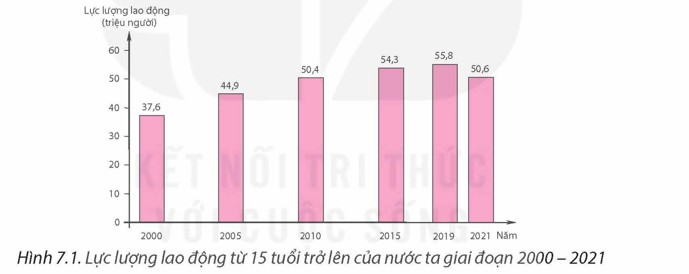
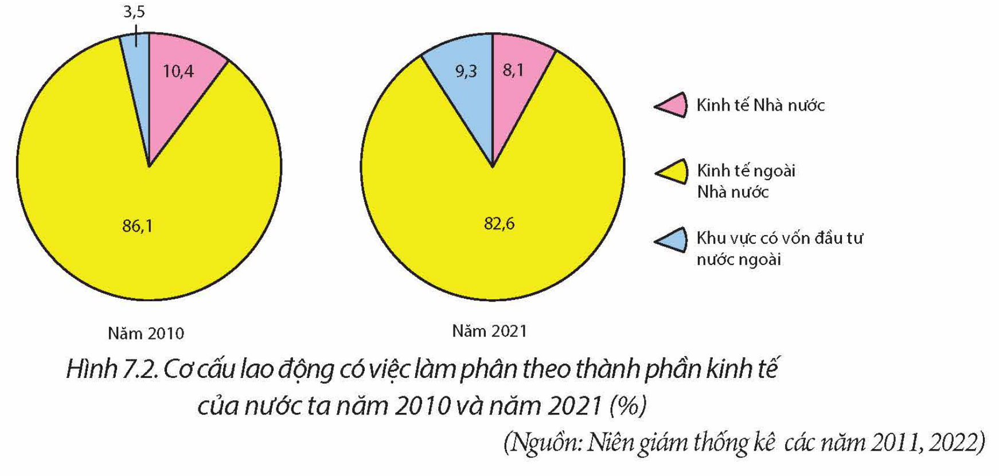

<!-- pdf:39 -->

# BÀI 7: LAO ĐỘNG VÀ VIỆC LÀM

## 🔴 Mở đầu

Lao động và việc làm có vai trò đặc biệt quan trọng đối với sự phát triển của cả xã hội. Lao động nước ta có đặc điểm gì? Việc sử dụng lao động hiện nay ra sao? Giải pháp nào để giải quyết việc làm cho người lao động ở nước ta?

## I. ĐẶC ĐIỂM NGUỒN LAO ĐỘNG

### 1. Số lượng

<!-- term: Lực lượng lao động -->
Nước ta có nguồn lao động dồi dào. Năm 2021, lực lượng lao động (dân số hoạt động kinh tế) của nước ta là 50,6 triệu người, chiếm 51,3% tổng số dân. Mỗi năm, nguồn lao động nước ta tăng thêm khoảng 1 triệu người.

<!-- term: Lực lượng lao động -->
> 💡 EM CÓ BIẾT?
>
> Bộ Luật Lao động năm 2019 của Việt Nam quy định:
> – Độ tuổi lao động tối thiểu của người lao động là đủ 15 tuổi.
> – Tuổi nghỉ hưu đang được điều chỉnh tăng dần để đến năm 2028, lao động nam về hưu khi đủ 62 tuổi; lao động nữ từ năm 2035 về hưu khi đủ 60 tuổi.

*Hình 7.1. Lực lượng lao động từ 15 tuổi trở lên của nước ta giai đoạn 2000 – 2021*
*(Nguồn: Niên giám thống kê các năm 2001, 2011, 2016, 2022)*

### 2. Chất lượng lao động

<!-- term: Chất lượng lao động Việt Nam -->
– Lao động nước ta cần cù, sáng tạo, có nhiều kinh nghiệm sản xuất trong các ngành nông nghiệp, lâm nghiệp, thuỷ sản, tiểu thủ công nghiệp,...

<!-- term: Chất lượng lao động Việt Nam -->
– Chất lượng lao động ngày càng được nâng lên nhờ những thành tựu phát triển kinh tế, y tế, văn hoá, giáo dục – đào tạo. Tuy nhiên, so với yêu cầu công nghiệp hoá, hiện đại hoá, lao động nước ta còn hạn chế về thể lực; trình độ chuyên môn kĩ thuật và tác phong lao động công nghiệp. Năm 2021, tỉ lệ lao động được đào tạo từ sơ cấp trở lên ở nước ta đạt 26,2%. Chất lượng lao động có sự phân hoá theo vùng. Đồng bằng sông Hồng có tỉ lệ lao động từ 15 tuổi trở lên đã qua đào tạo cao nhất cả nước (37% năm 2021).

– Lao động Việt Nam năng động, dễ dàng tiếp thu khoa học – công nghệ hiện đại trong sản xuất, góp phần nâng cao năng suất lao động và hội nhập với quốc tế.

<!-- pdf:40 -->

### 3. Phân bố lao động

<!-- term: Phân bố lao động Việt Nam -->
– Năm 2021, lao động ở nông thôn nước ta là hơn 32 triệu người, lao động ở thành thị là hơn 18 triệu người.

<!-- term: Phân bố lao động Việt Nam -->
– Đồng bằng sông Hồng có số lượng lao động lớn nhất cả nước (chiếm 22,5% tổng số lao động cả nước năm 2021), tiếp theo là vùng Bắc Trung Bộ và Duyên hải miền Trung (20,7%), Đông Nam Bộ (19,6%).

> ❓ Dựa vào thông tin mục I, hãy trình bày đặc điểm nguồn lao động của nước ta.

## II. SỬ DỤNG LAO ĐỘNG

### 1. Theo ngành kinh tế

<!-- term: Cơ cấu lao động theo ngành kinh tế -->
Theo ngành kinh tế, cơ cấu lao động nước ta có sự chuyển dịch phù hợp với đường lối phát triển kinh tế – xã hội đất nước theo hướng công nghiệp hoá, hiện đại hoá: giảm tỉ lệ lao động trong khu vực nông nghiệp, lâm nghiệp và thuỷ sản; tăng tỉ lệ lao động trong khu vực công nghiệp và xây dựng, dịch vụ.

**Bảng 7.1. CƠ CẤU LAO ĐỘNG TỪ 15 TUỔI TRỞ LÊN ĐANG LÀM VIỆC HẰNG NĂM PHÂN THEO NGÀNH KINH TẾ CỦA NƯỚC TA GIAI ĐOẠN 2000 – 2021**

*(Đơn vị: %)*

| Ngành \ Năm | 2000 | 2010 | 2015 | 2021 |
| --- | --- | --- | --- | --- |
| Nông nghiệp, lâm nghiệp và thuỷ sản | 65,1 | 48,4 | 43,6 | 29,1 |
| Công nghiệp và xây dựng | 13,1 | 20,9 | 23,0 | 33,1 |
| Dịch vụ | 21,8 | 30,7 | 33,4 | 37,8 |

*(Nguồn: Niên giám Thống kê các năm 2001, 2011, 2016, 2022)*

### 2. Theo thành phần kinh tế

<!-- term: Cơ cấu lao động theo thành phần kinh tế -->
Việt Nam phát triển nền kinh tế thị trường định hướng xã hội chủ nghĩa, nhiều thành phần kinh tế. Cơ cấu lao động theo thành phần kinh tế có sự thay đổi theo hướng giảm tỉ lệ lao động khu vực kinh tế Nhà nước, tăng tỉ lệ lao động khu vực có vốn đầu tư nước ngoài.

*Hình 7.2. Cơ cấu lao động có việc làm phân theo thành phần kinh tế của nước ta năm 2010 và năm 2021 (%)*
*(Nguồn: Niên giám thống kê các năm 2011, 2022)*

<!-- pdf:41 -->

### 3. Theo thành thị và nông thôn

<!-- term: Cơ cấu lao động theo thành thị và nông thôn -->
Bước sang thế kỉ XXI, đô thị hoá khá nhanh, tỉ trọng lực lượng lao động khu vực nông thôn giảm mạnh.

**Bảng 7.2. CƠ CẤU LAO ĐỘNG TỪ 15 TUỔI TRỞ LÊN ĐANG LÀM VIỆC HẰNG NĂM PHÂN THEO THÀNH THỊ VÀ NÔNG THÔN CỦA NƯỚC TA GIAI ĐOẠN 2000 – 2021**

*(Đơn vị: %)*

| Khu vực \ Năm | 2000 | 2010 | 2015 | 2021 |
| --- | --- | --- | --- | --- |
| Nông thôn | 76,9 | 71,7 | 68,8 | 63,3 |
| Thành thị | 23,1 | 28,3 | 31,2 | 36,7 |
<!-- ocr-ok: đã đối chiếu ảnh p041.png, bảng số liệu Bảng 7.2 chính xác -->

*(Nguồn: Niên giám thống kê các năm 2001, 2011, 2016, 2022)*

<!-- term: Cơ cấu lao động theo thành thị và nông thôn -->
Tỉ lệ lao động đã qua đào tạo ở nông thôn thường thấp hơn ở thành thị (năm 2021, tỉ lệ lao động đã qua đào tạo ở nông thôn là 17,5% và ở thành thị là 41,1%). Trình độ lao động ở nông thôn nước ta có xu hướng tăng lên nhờ quá trình công nghiệp hoá, hiện đại hoá và chuyển dịch cơ cấu kinh tế ở nông thôn.

> ❓ Dựa vào thông tin mục II, hãy phân tích tình hình sử dụng lao động theo ngành kinh tế, theo thành phần kinh tế, theo thành thị và nông thôn ở nước ta.

## III. VẤN ĐỀ VIỆC LÀM VÀ HƯỚNG GIẢI QUYẾT

### 1. Vấn đề việc làm

<!-- term: Vấn đề việc làm ở Việt Nam -->
Việc làm có vai trò đặc biệt quan trọng đối với cuộc sống của mỗi cá nhân, mỗi gia đình và toàn xã hội. Vì vậy, Nhà nước đã ban hành nhiều chính sách tạo điều kiện, hỗ trợ, khuyến khích, thu hút mọi thành phần kinh tế đầu tư tạo việc làm. Hầu hết lao động nước ta có việc làm, tỉ lệ thất nghiệp và tỉ lệ thiếu việc làm khá thấp. Khu vực thành thị thường có tỉ lệ thất nghiệp cao hơn khu vực nông thôn.

**Bảng 7.3. TỈ LỆ THẤT NGHIỆP VÀ THIẾU VIỆC LÀM CỦA LỰC LƯỢNG LAO ĐỘNG TRONG ĐỘ TUỔI PHÂN THEO THÀNH THỊ, NÔNG THÔN CỦA NƯỚC TA GIAI ĐOẠN 2010 – 2021**

*(Đơn vị: %)*

| Năm | | 2010 | 2015 | 2021 |
| --- | --- | --- | --- | --- |
| Tỉ lệ thất nghiệp | Thành thị | 4,29 | 3,37 | 4,33 |
| | Nông thôn | 2,35 | 1,82 | 2,50 |
| Tỉ lệ thiếu việc làm | Thành thị | 1,82 | 0,84 | 3,33 |
| | Nông thôn | 4,26 | 2,39 | 2,96 |

*(Nguồn: Niên giám thống kê các năm 2011, 2016, 2022)*

<!-- pdf:42 -->

<!-- term: Vấn đề việc làm ở Việt Nam -->
Việc làm vẫn là một vấn đề kinh tế – xã hội lớn ở nước ta hiện nay. Các việc làm giản đơn còn phổ biến, những việc làm này có năng suất thấp, thu nhập không cao. Trong những năm gần đây, việc hội nhập sâu rộng vào nền kinh tế quốc tế đem lại cho người lao động ở nước ta nhiều cơ hội việc làm, nâng cao tay nghề và chất lượng lao động. Sự phát triển mạnh mẽ của khoa học – công nghệ tạo ra những thay đổi mang tính đột phá về việc làm.

### 2. Hướng giải quyết việc làm

Để đảm bảo đầy đủ việc làm và việc làm có thu nhập cao cho người lao động, nước ta cần thực hiện các giải pháp chủ yếu sau:

– Hoàn thiện chính sách, luật pháp về lao động nhằm khuyến khích, hỗ trợ, huy động mọi nguồn lực đầu tư tạo việc làm.

– Đẩy mạnh việc đào tạo, dạy nghề nâng cao chất lượng lao động, bao gồm cả trình độ chuyên môn kĩ thuật, kĩ năng làm việc, tác phong công nghiệp.

– Phát triển hệ thống tư vấn, thông tin về thị trường lao động, việc làm để kết nối thông tin lao động – việc làm nhanh nhất, giao dịch lành mạnh và hiệu quả.

– Xây dựng và thực hiện tốt hệ thống bảo hiểm xã hội, bảo hiểm thất nghiệp, hỗ trợ tích cực để người mất việc sớm trở lại làm việc.

– Đẩy mạnh hợp tác quốc tế về lao động.

> ❓ Dựa vào thông tin mục III, hãy:
> – Phân tích vấn đề việc làm ở nước ta.
> – Nêu các hướng giải quyết việc làm ở nước ta.

## ✏️ Luyện tập và vận dụng

**Luyện tập**

Dựa vào bảng 7.1, vẽ biểu đồ thể hiện cơ cấu lao động từ 15 tuổi trở lên đang làm việc hằng năm phân theo ngành kinh tế của nước ta năm 2000 và năm 2021. Nêu nhận xét.

**Vận dụng**

Sưu tầm thông tin, tìm hiểu về một số ngành nghề mới có nhiều cơ hội việc làm ở nước ta.

## 📷 Danh sách hình trong bài

| Mã hình | Trang PDF | Vị trí trong bài | Chú thích gốc |
| --- | --- | --- | --- |
| H12-dia-b07-01 | 39 | Mục I.1 | Hình 7.1. Lực lượng lao động từ 15 tuổi trở lên của nước ta giai đoạn 2000 – 2021 |
| H12-dia-b07-02 | 40 | Mục II.2 | Hình 7.2. Cơ cấu lao động có việc làm phân theo thành phần kinh tế của nước ta năm 2010 và năm 2021 (%) |
