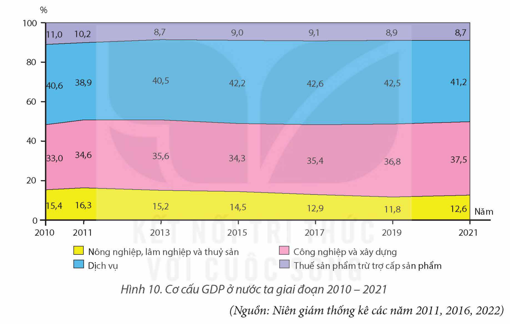

<!-- pdf:47 -->

# BÀI 10: CHUYỂN DỊCH CƠ CẤU KINH TẾ

## 🔴 Mở đầu

Cơ cấu kinh tế nước ta chuyển dịch theo hướng công nghiệp hoá, hiện đại hoá phù hợp với xu hướng phát triển của nền kinh tế thế giới. Chuyển dịch cơ cấu kinh tế có ý nghĩa gì đối với sự phát triển kinh tế – xã hội của đất nước? Cơ cấu kinh tế nước ta có sự chuyển dịch như thế nào?

## I. Ý NGHĨA CỦA SỰ CHUYỂN DỊCH CƠ CẤU KINH TẾ

Việc xác định cơ cấu kinh tế hợp lí và thúc đẩy sự chuyển dịch cơ cấu kinh tế có ý nghĩa chiến lược đối với đất nước.

– Phát huy các lợi thế so sánh, khai thác và sử dụng hợp lí các nguồn lực của đất nước, tái cơ cấu nền kinh tế theo hướng hiệu quả hơn.

– Tăng cường cập nhật, áp dụng khoa học – công nghệ, tạo nên các phương thức quản lí mới, hiện đại. Qua đó, nâng cao trình độ lao động, tăng năng suất và hiệu quả lao động, góp phần nâng cao chất lượng cuộc sống của dân cư.

– Thúc đẩy tăng trưởng kinh tế, bảo vệ môi trường và phát triển bền vững. Tạo ra năng lực sản xuất hàng hoá với khối lượng lớn, chất lượng cao, tham gia vào các chuỗi giá trị toàn cầu, tăng năng lực cạnh tranh của nền kinh tế, góp phần đẩy nhanh quá trình hội nhập với khu vực và thế giới.

> ❓ Dựa vào thông tin mục I, hãy phân tích ý nghĩa của sự chuyển dịch cơ cấu kinh tế ở nước ta.

## II. CHUYỂN DỊCH CƠ CẤU KINH TẾ

### 1. Chuyển dịch theo hướng công nghiệp hoá, hiện đại hoá

<!-- term: Chuyển dịch cơ cấu kinh tế theo hướng công nghiệp hoá, hiện đại hoá -->
Chuyển dịch cơ cấu kinh tế theo hướng công nghiệp hoá, hiện đại hoá là quá trình chuyển đổi toàn diện nền kinh tế và đời sống xã hội, dựa chủ yếu vào sự phát triển của công nghiệp và dịch vụ trên nền tảng áp dụng khoa học – công nghệ, đổi mới sáng tạo, phù hợp với quá trình hội nhập và phát triển bền vững của đất nước.

– Khu vực công nghiệp và dịch vụ có vai trò quan trọng và tỉ trọng ngày càng tăng trong cơ cấu kinh tế. Từ đó, cơ cấu lao động cũng được chuyển dịch theo hướng gia tăng lực lượng lao động có kĩ thuật và trình độ cao hơn.

– Cùng với chuyển dịch cơ cấu ngành kinh tế là sự chuyển dịch cơ cấu theo thành phần kinh tế và theo lãnh thổ, hướng đến khai thác tốt hơn nguồn lực của đất nước, của các địa phương, đồng thời tăng cường mối liên kết giữa các ngành, giữa các địa phương và với quốc tế.

<!-- pdf:48 -->

– Chuyển dịch cơ cấu kinh tế theo hướng công nghiệp hoá, hiện đại hoá không chỉ đạt được mục tiêu tăng trưởng mà còn hướng đến sự phát triển bền vững.

> ❓ Dựa vào thông tin mục 1, hãy chứng minh và giải thích sự chuyển dịch cơ cấu kinh tế theo hướng công nghiệp hoá, hiện đại hoá ở nước ta.

### 2. Chuyển dịch cơ cấu kinh tế theo ngành, theo thành phần kinh tế và theo lãnh thổ

**a) Chuyển dịch cơ cấu kinh tế theo ngành**

Cơ cấu kinh tế theo ngành có sự chuyển dịch theo hướng: giảm tỉ trọng nhóm ngành nông nghiệp, lâm nghiệp và thuỷ sản; tăng tỉ trọng nhóm ngành công nghiệp và xây dựng, dịch vụ. Công nghiệp trở thành động lực chính trong tăng trưởng kinh tế của đất nước.

*Hình 10. Cơ cấu GDP ở nước ta giai đoạn 2010 – 2021*
*(Nguồn: Niên giám thống kê các năm 2011, 2016, 2022)*

Trong mỗi nhóm ngành đang chuyển dịch cơ cấu theo hướng tăng tỉ trọng các ngành có hiệu quả kinh tế và hàm lượng khoa học – công nghệ cao, giảm tỉ trọng của các ngành có hiệu quả kinh tế thấp, sử dụng nhiều tài nguyên và lao động.

– Đối với nhóm ngành nông nghiệp, lâm nghiệp và thuỷ sản, cơ cấu dịch chuyển theo hướng tăng tỉ trọng của ngành thuỷ sản, giảm tỉ trọng của ngành nông nghiệp. Giá trị các sản phẩm nông nghiệp được nâng cao qua việc liên kết với công nghiệp chế biến, các dịch vụ nông nghiệp, theo chuỗi giá trị: sản xuất – chế biến – tiêu thụ.

– Ngành công nghiệp chuyển dịch theo hướng giảm tỉ trọng nhóm ngành công nghiệp khai khoáng, tăng tỉ trọng nhóm ngành công nghiệp chế biến, chế tạo. Trong đó, chú trọng những ngành ứng dụng công nghệ cao, công nghiệp hỗ trợ từng bước được hình thành và phát triển.

<!-- pdf:49 -->

– Nhóm ngành dịch vụ phát triển theo hướng đa dạng, dựa trên nền tảng công nghệ hiện đại, tăng cường chuyển đổi số, đặc biệt là trong các lĩnh vực thương mại điện tử, tài chính ngân hàng, bảo hiểm, y tế, giáo dục, logistics, du lịch,...

Sự chuyển dịch cơ cấu kinh tế như trên là kết quả của công cuộc Đổi mới, thực hiện công nghiệp hoá, hiện đại hoá đất nước của Nhà nước; sự tác động của các yếu tố về khoa học – công nghệ, xu hướng khu vực hoá và quốc tế hoá.

> ❓ Dựa vào thông tin mục a, hãy chứng minh và giải thích sự chuyển dịch cơ cấu kinh tế theo ngành ở nước ta.

**b) Chuyển dịch theo thành phần kinh tế**

– Cơ cấu kinh tế theo thành phần kinh tế của nước ta có sự chuyển dịch theo hướng giảm tỉ trọng của kinh tế Nhà nước, tăng tỉ trọng của kinh tế ngoài Nhà nước và khu vực có vốn đầu tư nước ngoài.

**Bảng 10. CƠ CẤU GDP PHÂN THEO THÀNH PHẦN KINH TẾ CỦA NƯỚC TA GIAI ĐOẠN 2010 – 2021**

*(Đơn vị: %)*

| Cơ cấu GDP \ Năm | 2010 | 2015 | 2021 |
| --- | --- | --- | --- |
| Kinh tế Nhà nước | 29,3 | 22,8 | 21,2 |
| Kinh tế ngoài Nhà nước | 43,0 | 50,6 | 50,1 |
| Khu vực có vốn đầu tư nước ngoài | 15,2 | 17,5 | 20,0 |
| Thuế sản phẩm trừ trợ cấp sản phẩm | 12,5 | 9,1 | 8,7 |

*(Nguồn: Niên giám thống kê các năm 2011, 2016, 2022)*

Sự chuyển dịch cơ cấu theo thành phần kinh tế là kết quả của đường lối phát triển nền kinh tế nhiều thành phần; tăng cường mở cửa, hội nhập với nền kinh tế của thế giới; áp dụng cơ chế thị trường theo định hướng xã hội chủ nghĩa.

– Vai trò của các thành phần kinh tế

+ Kinh tế Nhà nước giữ vai trò chủ đạo, nắm giữ những ngành then chốt và những lĩnh vực trọng yếu của nền kinh tế. Kinh tế Nhà nước có vai trò quan trọng trong việc ổn định kinh tế vĩ mô, định hướng phát triển kinh tế – xã hội chung của đất nước.

+ Khu vực kinh tế ngoài Nhà nước được khuyến khích phát triển ở tất cả các ngành, lĩnh vực mà pháp luật cho phép, nhất là trong lĩnh vực sản xuất, kinh doanh, dịch vụ. Đây là thành phần kinh tế phát huy nguồn lực trong nhân dân, tạo động lực thúc đẩy sự phát triển kinh tế của các địa phương và cả nước.

+ Kinh tế có vốn đầu tư nước ngoài được hình thành và phát triển trong vài thập kỉ gần đây, song giữ vai trò quan trọng trong nền kinh tế quốc dân. Đặc biệt, có vai trò lớn

<!-- pdf:50 -->

trong thu hút vốn đầu tư, công nghệ, phương thức quản lí hiện đại, góp phần thúc đẩy quá trình tham gia vào chuỗi giá trị sản xuất toàn cầu và hội nhập quốc tế của nước ta.

> ❓ Dựa vào thông tin mục b, hãy:
> – Chứng minh và giải thích sự chuyển dịch cơ cấu kinh tế theo thành phần kinh tế ở nước ta.
> – Đánh giá vai trò của các thành phần kinh tế trong nền kinh tế nước ta hiện nay.

**c) Chuyển dịch cơ cấu kinh tế theo lãnh thổ**

Cơ cấu kinh tế theo lãnh thổ chuyển dịch đồng thời với sự chuyển dịch cơ cấu ngành và cơ cấu theo thành phần kinh tế.

– Trên phạm vi cả nước, đã hình thành 6 vùng kinh tế – xã hội (theo Nghị quyết số 81/2023/QH15 của Quốc hội khoá XV). Các hình thức lãnh thổ khác như khu kinh tế, khu kinh tế ven biển, khu kinh tế cửa khẩu, hành lang kinh tế,... được hình thành ở nhiều địa phương, góp phần thúc đẩy sự phát triển kinh tế – xã hội của cả nước.

– Các ngành kinh tế cũng có sự chuyển dịch theo hướng khai thác lãnh thổ có hiệu quả hơn.

+ Trong nông nghiệp, các hình thức tổ chức lãnh thổ có hiệu quả được hình thành và ngày càng mở rộng như các vùng chuyên canh, các vùng sản xuất nông nghiệp tập trung, các vùng nông nghiệp ứng dụng công nghệ cao, trang trại,...

+ Trong công nghiệp là sự hình thành và phát triển của các khu công nghiệp, khu chế xuất, khu công nghiệp công nghệ cao, sự mở rộng các trung tâm công nghiệp,... với vai trò là động lực của quá trình công nghiệp hoá, hiện đại hoá đất nước.

+ Trong dịch vụ, các cơ sở dịch vụ được mở rộng và phát triển theo hướng hiện đại, phục vụ tốt hơn cho các ngành sản xuất vật chất và đáp ứng nhu cầu của nhân dân như giao thông vận tải, thương mại, du lịch,...

– Sự chuyển dịch cơ cấu kinh tế theo lãnh thổ là kết quả của sự chuyển dịch cơ cấu kinh tế theo ngành và theo thành phần kinh tế ở nước ta. Sự chuyển dịch này hướng đến mục tiêu khai thác tốt hơn lợi thế của các lãnh thổ khác nhau, huy động được các nguồn lực cả về tài nguyên, lao động, nguồn vốn, khoa học – công nghệ,... để mang lại hiệu quả cao cả về kinh tế – xã hội và bảo vệ môi trường.

> ❓ Dựa vào thông tin mục c, hãy:
> – Chứng minh sự chuyển dịch cơ cấu kinh tế theo lãnh thổ ở nước ta.
> – Giải thích sự chuyển dịch cơ cấu kinh tế theo lãnh thổ ở nước ta.

## ✏️ Luyện tập và vận dụng

**Luyện tập**

- Dựa vào bảng 10, vẽ biểu đồ thể hiện cơ cấu GDP phân theo thành phần kinh tế của nước ta năm 2010 và năm 2021. Nêu nhận xét.

**Vận dụng**

- Sưu tầm thông tin, tìm hiểu vai trò của một hình thức tổ chức lãnh thổ kinh tế (khu kinh tế ven biển, khu kinh tế cửa khẩu, khu công nghiệp,...) ở nước ta.

## 📷 Danh sách hình trong bài

| Mã hình | Trang PDF | Vị trí trong bài | Chú thích gốc |
| --- | --- | --- | --- |
| H12-dia-b10-01 | 48 | Mục II.2.a | Hình 10. Cơ cấu GDP ở nước ta giai đoạn 2010 – 2021 |
