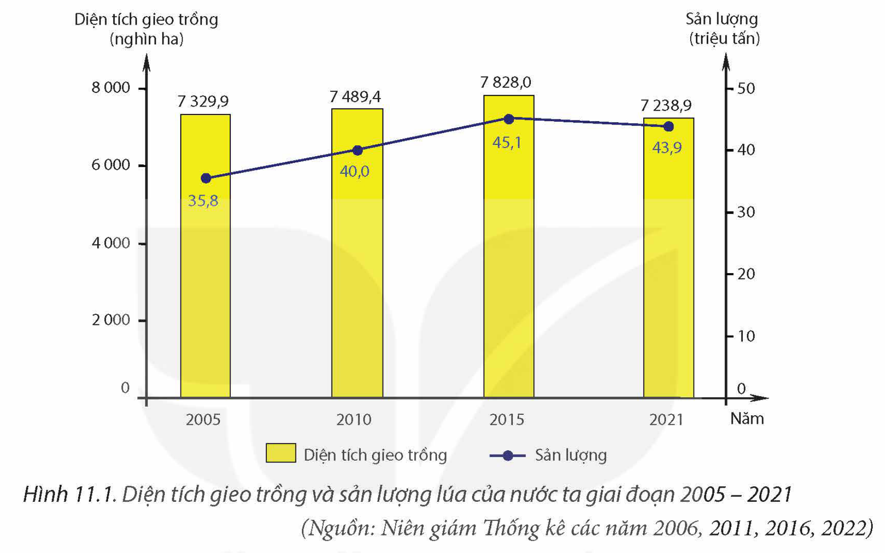
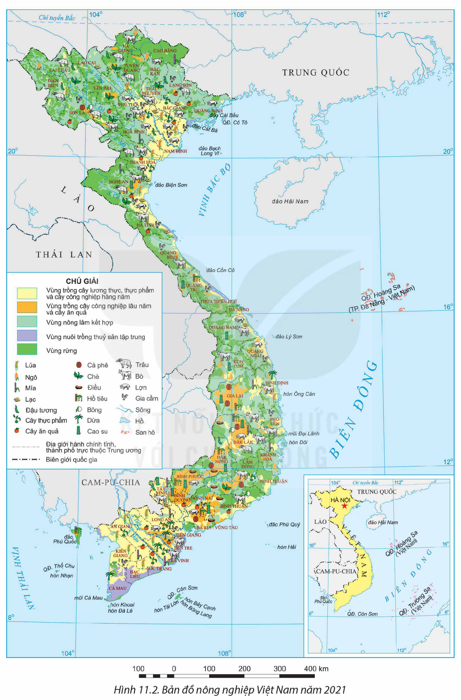

<!-- pdf:51 -->

# BÀI 11: VẤN ĐỀ PHÁT TRIỂN NGÀNH NÔNG NGHIỆP

## 🔴 Mở đầu

Nông nghiệp là ngành có vai trò quan trọng đối với nền kinh tế nước ta trong bối cảnh dân số ngày càng đông, nền kinh tế thế giới có nhiều biến động. Phát triển nông nghiệp góp phần đảm bảo cho sự ổn định và phát triển bền vững của đất nước. Ngành nông nghiệp nước ta dựa trên thế mạnh nào, phát triển và phân bố ra sao?

## I. THẾ MẠNH VÀ HẠN CHẾ ĐỐI VỚI PHÁT TRIỂN NÔNG NGHIỆP

### 1. Điều kiện tự nhiên và tài nguyên thiên nhiên

**a) Thế mạnh**

– Địa hình và đất: Nước ta có 3/4 diện tích là đồi núi, chủ yếu là đồi núi thấp, một số vùng có các cao nguyên (Trung du và miền núi Bắc Bộ, Tây Nguyên). Khu vực này có đất feralit là chủ yếu, thuận lợi cho trồng cây công nghiệp, cây ăn quả; có các đồng cỏ lớn thích hợp để phát triển chăn nuôi gia súc lớn.

Khu vực đồng bằng chiếm 1/4 diện tích với đồng bằng châu thổ sông Hồng, sông Cửu Long và các đồng bằng ven biển. Đất ở các đồng bằng châu thổ chủ yếu là đất phù sa có độ phì cao, màu mỡ, rất thích hợp cho việc trồng cây lương thực, thực phẩm, tạo thuận lợi cho chăn nuôi lợn và gia cầm.

– Khí hậu: Nước ta có khí hậu nhiệt đới ẩm gió mùa, phân hoá theo chiều bắc – nam, theo độ cao địa hình và theo mùa, tạo nên đặc điểm khí hậu khác nhau giữa các vùng, miền. Đặc điểm khí hậu tạo thuận lợi cho phát triển nền nông nghiệp nhiệt đới; cơ cấu cây trồng, vật nuôi đa dạng, phát triển quanh năm và cho năng suất cao; đồng thời là điều kiện thuận lợi để quy hoạch các vùng chuyên canh, chuyên môn hoá sản xuất nông nghiệp.

– Nguồn nước: Nước ta có mạng lưới sông ngòi dày đặc, nhiều hồ, đầm tự nhiên và nhân tạo, lượng mưa hằng năm tương đối lớn, nguồn nước ngầm phong phú, cung cấp nước cho sản xuất nông nghiệp. Các hệ thống sông còn có vai trò bồi đắp phù sa cho các đồng bằng châu thổ.

– Sinh vật: Nước ta có hệ động, thực vật phong phú, đa dạng về giống và chủng loại, là cơ sở để thuần dưỡng, lai tạo nhiều giống cây trồng, vật nuôi, tạo ra các loại đặc sản vùng miền, có giá trị kinh tế cao.

**b) Hạn chế**

– Việt Nam nằm trong khu vực chịu nhiều tác động của thiên tai, dịch bệnh, biến đổi khí hậu,... ảnh hưởng đến năng suất, sản lượng và gây rủi ro cho sản xuất nông nghiệp.

– Bình quân đất tự nhiên và đất sản xuất nông nghiệp trên đầu người ở nước ta thấp, hạn chế việc mở rộng nông nghiệp hàng hoá.

<!-- pdf:52 -->

<!-- pdf:53 -->

> ❓ Dựa vào thông tin mục 1, hãy:
> – Phân tích các thế mạnh của điều kiện tự nhiên và tài nguyên thiên nhiên đối với phát triển nông nghiệp ở nước ta.
> – Nêu một số khó khăn của điều kiện tự nhiên và tài nguyên thiên nhiên đối với phát triển nông nghiệp ở nước ta.

### 2. Điều kiện kinh tế – xã hội

**a) Thế mạnh**

– Dân cư và nguồn lao động: Nước ta có số dân đông, là thị trường tiêu thụ sản phẩm nông nghiệp lớn. Lực lượng lao động nông nghiệp dồi dào, có kinh nghiệm trong sản xuất nông nghiệp. Trình độ của người lao động ngày càng được nâng cao, thuận lợi cho việc áp dụng khoa học – công nghệ mới vào sản xuất.

– Khoa học – công nghệ và cơ sở vật chất – kĩ thuật: Khoa học – công nghệ được ứng dụng trong nhiều khâu sản xuất: lai tạo giống cây trồng, vật nuôi có năng suất, chất lượng cao; kĩ thuật tiên tiến được sử dụng trong canh tác, thu hoạch, chế biến và bảo quản sản phẩm,... tạo ra các sản phẩm an toàn, có giá trị cao.

Cơ sở vật chất – kĩ thuật trong nông nghiệp ngày càng được hoàn thiện như các công trình thuỷ lợi, kênh, mương dẫn nước phục vụ sản xuất nông nghiệp. Các cơ sở chế biến nông sản và các dịch vụ nông nghiệp ngày càng được mở rộng, thúc đẩy sự phát triển sản xuất nông nghiệp hàng hoá, quy mô lớn.

– Thị trường tiêu thụ nông sản: Thị trường trong và ngoài nước được mở rộng đã thúc đẩy sản xuất, đa dạng hoá sản phẩm nông nghiệp. Nhiều sản phẩm nông nghiệp Việt Nam đã đáp ứng được tiêu chuẩn toàn cầu, có mặt ở các thị trường lớn như Hoa Kỳ, EU, Nhật Bản,...

– Chính sách phát triển nông nghiệp: Nhà nước ban hành nhiều chính sách thúc đẩy nông nghiệp phát triển như: thu hút vốn đầu tư, cho vay vốn ưu đãi, tái cơ cấu nông nghiệp; phát triển nông nghiệp hữu cơ, nông nghiệp công nghệ cao; chuyển từ tư duy sản xuất nông nghiệp sang kinh tế nông nghiệp, tham gia vào chuỗi giá trị toàn cầu,...

**b) Hạn chế**

– Cơ sở vật chất – kĩ thuật ở một số vùng còn hạn chế, chưa hoàn thiện và đồng bộ. Công nghiệp chế biến ở một số vùng chưa phát triển, công nghệ còn lạc hậu nên giá trị sản phẩm không cao.

– Thị trường tiêu thụ sản phẩm nông nghiệp biến động, việc đáp ứng tiêu chuẩn toàn cầu còn hạn chế.

> ❓ Dựa vào vào thông tin mục 2, hãy phân tích các thế mạnh và hạn chế về điều kiện kinh tế – xã hội đối với phát triển nông nghiệp ở nước ta.

## II. SỰ CHUYỂN DỊCH CƠ CẤU NÔNG NGHIỆP

<!-- term: Chuyển dịch cơ cấu nông nghiệp -->
Cơ cấu nông nghiệp đang có sự chuyển dịch theo hướng giảm tỉ trọng ngành trồng trọt, tăng tỉ trọng ngành chăn nuôi và dịch vụ nông nghiệp.

<!-- pdf:54 -->

**Bảng 11.1. CƠ CẤU GIÁ TRỊ SẢN XUẤT NGÀNH NÔNG NGHIỆP CỦA NƯỚC TA GIAI ĐOẠN 2010 – 2021**

*(Đơn vị: %)*

| Năm | Các ngành: Trồng trọt | Các ngành: Chăn nuôi | Các ngành: Dịch vụ nông nghiệp |
| --- | --- | --- | --- |
| 2010 | 73,4 | 25,1 | 1,5 |
| 2015 | 66,9 | 30,7 | 2,4 |
| 2021 | 60,8 | 34,7 | 4,5 |

*(Nguồn: Tổng cục Thống kê)*

<!-- term: Chuyển dịch cơ cấu nông nghiệp -->
Nông nghiệp nước ta đang phát triển mạnh theo hướng sản xuất hàng hoá tập trung, quy mô lớn; hướng tới nông nghiệp thông minh; nông nghiệp bền vững, tham gia ngày càng sâu vào chuỗi giá trị toàn cầu, dựa trên việc tăng cường áp dụng khoa học – công nghệ và thu hút sự đầu tư của các doanh nghiệp vào các hoạt động nông nghiệp.

Phân bố sản xuất nông nghiệp thay đổi phù hợp với điều kiện sinh thái, dưới tác động của khoa học – công nghệ và thu hút đầu tư.

> ❓ Dựa vào thông tin mục II, hãy trình bày sự chuyển dịch cơ cấu nông nghiệp của nước ta.

## III. HIỆN TRẠNG PHÁT TRIỂN VÀ PHÂN BỐ

### 1. Trồng trọt

<!-- term: Ngành trồng trọt ở Việt Nam -->
Trồng trọt là ngành chiếm tỉ trọng lớn trong cơ cấu giá trị sản xuất nông nghiệp ở nước ta. Hiện nay, ngành trồng trọt đang ứng dụng khoa học – công nghệ vào sản xuất như cơ giới hoá, tự động hoá, các mô hình canh tác mới,... nên hiệu quả sản xuất trên 1 đơn vị diện tích ngày càng được nâng cao. Nhiều sản phẩm ngành trồng trọt là mặt hàng xuất khẩu có giá trị cao. Cơ cấu cây trồng đang có sự chuyển đổi từ cây trồng có giá trị kinh tế và hiệu quả không cao sang cây trồng khác cho giá trị kinh tế và hiệu quả cao hơn, đáp ứng nhu cầu thị trường.

<!-- term: Ngành trồng trọt ở Việt Nam -->
Cơ cấu cây trồng nước ta đa dạng, bao gồm: cây lương thực, cây công nghiệp, cây ăn quả, cây thực phẩm và các cây trồng khác.

**Bảng 11.2. DIỆN TÍCH GIEO TRỒNG CÁC NHÓM CÂY TRỒNG CỦA NƯỚC TA GIAI ĐOẠN 2010 – 2021**

*(Đơn vị: triệu ha)*

| Năm | Tổng số | Cây lương thực có hạt | Cây công nghiệp | Cây ăn quả | Cây khác |
| --- | --- | --- | --- | --- | --- |
| 2010 | 14,06 | 8,61 | 2,81 | 0,78 | 1,86 |
| 2015 | 14,94 | 9,01 | 2,83 | 0,82 | 2,28 |
| 2021 | 14,43 | 8,14 | 2,63 | 1,17 | 2,49 |

*(Nguồn: Niên giám thống kê các năm 2011, 2016, 2022)*

<!-- pdf:55 -->

– Cây lương thực

+ Tổng diện tích gieo trồng cây lương thực có hạt năm 2021 chiếm 56,4% tổng diện tích gieo trồng các loại cây trồng. Sản xuất lương thực đã đảm bảo an ninh lương thực và tạo nguồn hàng lớn cho xuất khẩu. Trong cơ cấu cây lương thực, cây lúa chiếm vị trí chủ đạo (chiếm 88,9% diện tích gieo trồng cây lương thực có hạt). Diện tích gieo trồng lúa tuy có xu hướng giảm những năm gần đây, song nhờ việc áp dụng khoa học – công nghệ mới nên năng suất lúa không ngừng tăng lên.

*Hình 11.1. Diện tích gieo trồng và sản lượng lúa của nước ta giai đoạn 2005 – 2021*
*(Nguồn: Niên giám Thống kê các năm 2006, 2011, 2016, 2022)*

Ngoài lúa, các cây lương thực khác như: ngô, sắn, khoai lang,... cũng được phát triển ở nhiều địa bàn trên cả nước, tạo nguồn nguyên liệu quan trọng cho công nghiệp chế biến và nguồn thức ăn cho chăn nuôi.

+ Đồng bằng sông Cửu Long là vùng sản xuất lương thực lớn nhất, chiếm 53,8% diện tích gieo trồng và 55,5% sản lượng lúa cả nước (năm 2021). Đồng bằng sông Hồng là vùng sản xuất lương thực lớn thứ hai của nước ta.

– Cây công nghiệp

+ Ngành trồng cây công nghiệp ở nước ta đang được phát triển theo chiều sâu, gắn với công nghiệp chế biến và tiêu thụ sản phẩm, nhiều sản phẩm có sức cạnh tranh cao trên thị trường trong nước và quốc tế. Tổng diện tích gieo trồng cây công nghiệp nước ta năm 2021 là hơn 2,6 triệu ha.

+ Cây công nghiệp lâu năm có diện tích khoảng 2,2 triệu ha. Một số cây công nghiệp lâu năm có giá trị ngày càng được mở rộng, hình thành các vùng chuyên canh quy mô lớn như: cà phê, cao su, hồ tiêu, điều ở Tây Nguyên và Đông Nam Bộ; chè ở Trung du và miền núi Bắc Bộ, Tây Nguyên. Việt Nam là quốc gia xuất khẩu cà phê, hồ tiêu và điều hàng đầu thế giới.

<!-- pdf:56 -->

*Hình 11.2. Bản đồ nông nghiệp Việt Nam năm 2021*

<!-- pdf:57 -->

**Bảng 11.3. DIỆN TÍCH MỘT SỐ CÂY CÔNG NGHIỆP LÂU NĂM CỦA NƯỚC TA GIAI ĐOẠN 2010 – 2021**

*(Đơn vị: nghìn ha)*

| Năm \ Loại cây | Điều | Cao su | Cà phê | Chè | Hồ tiêu |
| --- | --- | --- | --- | --- | --- |
| 2010 | 379,3 | 748,7 | 554,8 | 129,9 | 51,3 |
| 2015 | 290,5 | 985,6 | 643,3 | 133,6 | 101,6 |
| 2021 | 314,4 | 930,5 | 710,5 | 123,6 | 125,6 |

*(Nguồn: Niên giám thống kê các năm 2011, 2016, 2022)*

+ Cây công nghiệp hàng năm của nước ta phát triển không ổn định, diện tích có xu hướng giảm. Các cây công nghiệp hàng năm chủ yếu là mía, đậu tương, lạc, bông, đay, cói, dâu tằm,... Trên cả nước đã hình thành một số vùng trồng tập trung như mía ở Đồng bằng sông Cửu Long, Đông Nam Bộ, Bắc Trung Bộ và Duyên hải miền Trung; lạc ở khu vực đồng bằng của Bắc Trung Bộ; đậu tương ở Trung du và miền núi Bắc Bộ,...

– Cây ăn quả có diện tích tăng nhanh, đạt 1 171,5 nghìn ha năm 2021. Các loại cây ăn quả được trồng tập trung là cam, chuối, xoài, nhãn, vải thiều, chôm chôm, dứa, sầu riêng,... Trong đó, nhiều loại được phát triển thành các vùng đặc sản có chỉ dẫn địa lí (nhãn lồng Hưng Yên, vải thiều Lục Ngạn – Bắc Giang, bưởi Phúc Trạch – Hà Tĩnh, sầu riêng Cai Lậy – Tiền Giang,...). Các mô hình trồng cây ăn quả hữu cơ, VietGAP, công nghệ cao được áp dụng rộng rãi để nâng cao chất lượng và giá trị sản phẩm. Cây ăn quả được trồng tập trung ở ba vùng: Đồng bằng sông Cửu Long, Trung du và miền núi Bắc Bộ, Đông Nam Bộ.

– Cây thực phẩm và các cây trồng khác

+ Diện tích trồng cây thực phẩm (rau, đậu,...) ngày càng tăng, đáp ứng nhu cầu tiêu dùng trong nước và một phần để xuất khẩu. Cây thực phẩm được trồng rộng khắp, tập trung nhất ở Đồng bằng sông Cửu Long, Đồng bằng sông Hồng. Xu hướng phát triển các vành đai cây thực phẩm ven các thành phố lớn đang được đẩy mạnh, áp dụng các kĩ thuật canh tác theo hướng công nghệ cao, tạo ra sản phẩm an toàn, có chất lượng.

+ Các cây trồng khác như cây dược liệu cũng được chú ý phát triển, tạo nên các sản phẩm đặc thù ở một số địa phương.

> ❓ Dựa vào thông tin mục 1 và hình 11.2, hãy trình bày sự phát triển và phân bố ngành trồng trọt của nước ta (cây lương thực, cây công nghiệp, cây ăn quả, cây thực phẩm).

<!-- pdf:58 -->

### 2. Chăn nuôi

<!-- term: Ngành chăn nuôi ở Việt Nam -->
Giá trị sản xuất và tỉ trọng chăn nuôi trong cơ cấu giá trị sản xuất của ngành nông nghiệp ngày càng tăng. Năm 2021, giá trị sản xuất của ngành chiếm 34,7% tổng giá trị sản xuất ngành nông nghiệp.

<!-- term: Ngành chăn nuôi ở Việt Nam -->
Ngành chăn nuôi đã có những chuyển biến tích cực, kĩ thuật và công nghệ tiên tiến được áp dụng vào các mô hình trang trại; phát triển phương thức chăn nuôi theo hướng hữu cơ, xây dựng vùng nuôi an toàn để kiểm soát dịch bệnh; chế biến sâu, gắn với phát triển thị trường sản phẩm chăn nuôi công nghiệp.

**Bảng 11.4. SỐ LƯỢNG GIA SÚC, GIA CẦM NƯỚC TA GIAI ĐOẠN 2010 – 2021**

*(Đơn vị: triệu con)*

| Năm \ Vật nuôi | Trâu | Bò | Lợn | Gia cầm |
| --- | --- | --- | --- | --- |
| 2010 | 2,9 | 5,9 | 27,3 | 301,9 |
| 2015 | 2,6 | 5,7 | 28,9 | 369,5 |
| 2021 | 2,2 | 6,3 | 23,1 | 524,1 |
<!-- ocr-ok: Đã đối chiếu ảnh p058.png, bảng 11.4 chính xác -->

*(Nguồn: Niên giám thống kê các năm 2011, 2016, 2022)*

– Chăn nuôi lợn, gia cầm

+ Lợn là vật nuôi lấy thịt quan trọng nhất ở nước ta. Năm 2021, đàn lợn có khoảng 23,1 triệu con, cung cấp trên 62% sản lượng thịt các loại. Chăn nuôi lợn hiện nay không chỉ gắn với vùng sản xuất lương thực mà còn dựa vào nguồn thức ăn công nghiệp với việc phát triển mô hình trang trại tập trung. Các vùng chăn nuôi lợn nhiều nhất nước ta là Trung du và miền núi Bắc Bộ (chiếm 23,8% tổng số lượng đàn lợn cả nước) và Đồng bằng sông Hồng (chiếm 20,6%).

+ Chăn nuôi gia cầm: Do sự phát triển mạnh của công nghiệp chế biến thức ăn nên số lượng gia cầm ở nước ta tăng nhanh. Năm 2021, tổng đàn gia cầm là 524,1 triệu con. Gà được nuôi nhiều ở vùng Đồng bằng sông Hồng và Đồng bằng sông Cửu Long với tỉ trọng lần lượt khoảng 23% và 22% tổng số lượng đàn gà cả nước (năm 2021). Vịt được nuôi nhiều nhất ở vùng Đồng bằng sông Cửu Long.

– Chăn nuôi trâu, bò

+ Số lượng đàn trâu những năm qua có xu hướng giảm. Hai vùng nuôi trâu nhiều nhất ở nước ta là Trung du và miền núi Bắc Bộ, Bắc Trung Bộ và Duyên hải miền Trung, chiếm lần lượt là 55,0% và 33,1% tổng số lượng đàn trâu của cả nước (năm 2021).

+ Số lượng đàn bò nước ta tăng nhanh trong thời gian gần đây và được nuôi theo hướng chuyên môn hoá. Bò lấy sữa được nuôi nhiều trên các vùng cao nguyên với quy mô lớn, công nghệ chăn nuôi hiện đại, gắn với chế biến sữa thành phẩm.

<!-- pdf:59 -->

Chăn nuôi bò thịt cũng phát triển mạnh theo hướng tập trung, trong đó con giống, nguồn thức ăn, dịch vụ thú y được chú trọng đầu tư, đảm bảo tiêu chuẩn chất lượng. Các vùng nuôi bò nhiều ở nước ta là Bắc Trung Bộ và Duyên hải miền Trung, Trung du và miền núi Bắc Bộ, chiếm lần lượt là 37,7% và 19,0% tổng số lượng đàn bò cả nước (năm 2021).

Ngoài ra, chăn nuôi dê, cừu,... cũng đang được phát triển trong những năm gần đây ở một số địa phương.

> ❓ Dựa vào thông tin mục 2 và hình 11.2, hãy trình bày thực trạng phát triển và phân bố của ngành chăn nuôi nước ta.

## IV. XU HƯỚNG PHÁT TRIỂN

Nông nghiệp Việt Nam trong xu hướng phát triển mới được cấu thành bởi ba thành tố có quan hệ mật thiết, gắn bó, không thể tách rời là nông nghiệp, nông dân và nông thôn. Trong đó, nông dân là chủ thể, là trung tâm của quá trình phát triển nông nghiệp, kinh tế nông thôn và xây dựng nông thôn mới. Công nghiệp hoá, hiện đại hoá nông nghiệp, nông thôn là một trong những nhiệm vụ quan trọng hàng đầu của quá trình công nghiệp hoá, hiện đại hoá đất nước.

<!-- term: Nông nghiệp xanh -->
– Phát triển nông nghiệp hiệu quả, bền vững, tích hợp đa giá trị theo hướng nâng cao năng lực cạnh tranh. Sản xuất gắn với bảo quản sau thu hoạch, đẩy mạnh công nghiệp chế biến và phát triển thị trường nông sản cả trong và ngoài nước; bảo đảm an toàn thực phẩm, an ninh lương thực quốc gia, bảo vệ môi trường sinh thái, thích ứng với biến đổi khí hậu; khuyến khích phát triển nông nghiệp xanh, nông nghiệp hữu cơ,...

– Chuyển tư duy từ sản xuất nông nghiệp sang phát triển kinh tế nông nghiệp gắn với nhu cầu thị trường. Phát huy lợi thế vùng, miền, địa phương, tổ chức sản xuất kinh doanh nông nghiệp theo chuỗi giá trị, dựa trên nền tảng khoa học – công nghệ và đổi mới sáng tạo.

– Phát triển nông nghiệp gắn với xây dựng nông thôn mới, hiện đại với quá trình đô thị hoá, có cơ sở hạ tầng, dịch vụ xã hội đồng bộ và tiệm cận với khu vực đô thị; gắn kết chặt chẽ giữa phát triển công nghiệp, dịch vụ với nông nghiệp, giữa phát triển nông thôn bền vững với quá trình đô thị hoá theo hướng "nông nghiệp sinh thái, nông thôn hiện đại, nông dân văn minh".

> ❓ Dựa vào thông tin mục IV, hãy nêu xu hướng phát triển của nông nghiệp nước ta.

## ✏️ Luyện tập và vận dụng

**Luyện tập**

1. Nêu ví dụ về một nhân tố ảnh hưởng đến sự phát triển ngành nông nghiệp ở nước ta.

2. Dựa vào bảng 11.4, hãy nhận xét và giải thích sự phát triển số lượng đàn gia súc, gia cầm nước ta giai đoạn 2010 – 2021.

**Vận dụng**

- Sưu tầm thông tin, tìm hiểu xu hướng phát triển trồng trọt của nước ta hiện nay.

## 📷 Danh sách hình trong bài

| Mã hình | Trang PDF | Vị trí trong bài | Chú thích gốc |
| --- | --- | --- | --- |
| H12-dia-b11-01 | 55 | Mục III.1 | Hình 11.1. Diện tích gieo trồng và sản lượng lúa của nước ta giai đoạn 2005 – 2021 |
| H12-dia-b11-02 | 56 | Mục III.1 | Hình 11.2. Bản đồ nông nghiệp Việt Nam năm 2021 |
