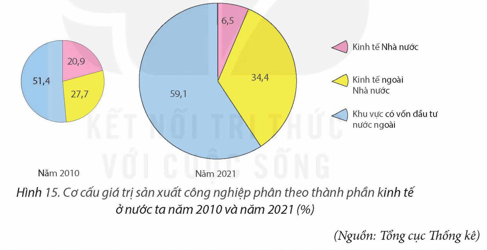

<!-- pdf:69 -->

# BÀI 15: CHUYỂN DỊCH CƠ CẤU NGÀNH CÔNG NGHIỆP

## 🔴 Mở đầu

Cơ cấu ngành công nghiệp bao gồm cơ cấu công nghiệp theo ngành, cơ cấu công nghiệp theo thành phần kinh tế và cơ cấu công nghiệp theo lãnh thổ. Cơ cấu ngành công nghiệp của nước ta chuyển dịch như thế nào? Tại sao có sự chuyển dịch đó?

## I. CHUYỂN DỊCH CƠ CẤU CÔNG NGHIỆP THEO NGÀNH

> 💡 **EM CÓ BIẾT?**
>
> Theo Quyết định số 27/2018/QĐ-TTg ngày 6 – 7 – 2018 của Thủ tướng Chính phủ về việc ban hành hệ thống ngành kinh tế Việt Nam, ngành công nghiệp (cấp 1) gồm 4 nhóm với 34 ngành (cấp 2). Đó là các nhóm công nghiệp khai khoáng (5 ngành); nhóm công nghiệp chế biến, chế tạo (24 ngành); nhóm công nghiệp sản xuất và phân phối điện, khí đốt, nước nóng, hơi nước và điều hoà không khí (1 ngành) và nhóm công nghiệp cung cấp nước, hoạt động quản lí và xử lí rác thải, nước thải (4 ngành).

<!-- term: Chuyển dịch cơ cấu công nghiệp theo ngành -->
– Cơ cấu ngành công nghiệp nước ta hiện nay tương đối đa dạng, có sự chuyển dịch theo hướng giảm tỉ trọng nhóm ngành khai khoáng, tăng tỉ trọng của nhóm ngành chế biến, chế tạo. Xu hướng này phù hợp với chiến lược phát triển kinh tế theo hướng công nghiệp hoá, hiện đại hoá, kinh tế tri thức của nước ta.

Bảng 15.1. CƠ CẤU GIÁ TRỊ SẢN XUẤT CÔNG NGHIỆP THEO NHÓM NGÀNH Ở NƯỚC TA GIAI ĐOẠN 2010 – 2021

*(Đơn vị: %)*

| Nhóm ngành \ Năm | 2010 | 2015 | 2021 |
| --- | --- | --- | --- |
| Khai khoáng | 10,2 | 5,3 | 3,0 |
| Chế biến, chế tạo | 86,2 | 90,7 | 93,0 |
| Sản xuất và phân phối điện, khí đốt, nước nóng, hơi nước và điều hoà không khí | 3,0 | 3,3 | 3,3 |
| Cung cấp nước, hoạt động quản lí và xử lí rác thải, nước thải | 0,6 | 0,7 | 0,7 |

*(Nguồn: Tổng cục Thống kê)*

<!-- term: Chuyển dịch cơ cấu công nghiệp theo ngành -->
<!-- term: Công nghiệp hỗ trợ -->
Trong nội bộ nhóm ngành có sự phát triển theo hướng tiếp cận công nghệ tiên tiến, hiện đại với sự chuyển dịch từ các ngành và công nghệ sản xuất sử dụng nhiều lao động sang các ngành công nghiệp công nghệ cao (công nghiệp sản xuất sản phẩm điện tử, máy vi tính,...). Trong từng ngành có sự chuyển dịch từ các công đoạn có giá trị gia tăng thấp sang các công đoạn có giá trị gia tăng cao trong chuỗi giá trị toàn cầu (trong ngành sản xuất ô tô chuyển từ lắp ráp sang sản xuất), chuyển dịch theo hướng tăng tỉ trọng năng lượng tái tạo trong công nghiệp sản xuất điện. Công nghiệp hỗ trợ như sản xuất nguyên liệu, vật liệu, linh kiện và phụ tùng hình thành và phát triển góp phần nâng cao tỉ lệ nội địa hoá trong các ngành công nghiệp.

<!-- pdf:70 -->

– Chuyển dịch cơ cấu công nghiệp theo ngành hiện nay là kết quả của quá trình tái cấu trúc, nội địa hoá sản phẩm, phát triển công nghiệp xanh, hội nhập quốc tế. Sự chuyển dịch này gắn với đổi mới mô hình tăng trưởng theo hướng công nghiệp hoá, hiện đại hoá, nâng cao năng suất lao động, giảm phụ thuộc vào khai thác tài nguyên của Việt Nam, hướng tới phát triển bền vững.

> ❓ Dựa vào thông tin mục I, hãy trình bày và giải thích về sự chuyển dịch cơ cấu công nghiệp theo ngành của nước ta.

## II. CHUYỂN DỊCH CƠ CẤU CÔNG NGHIỆP THEO THÀNH PHẦN KINH TẾ

<!-- term: Chuyển dịch cơ cấu công nghiệp theo thành phần kinh tế -->
– Cơ cấu công nghiệp theo thành phần kinh tế chuyển dịch theo hướng giảm tỉ trọng khu vực kinh tế Nhà nước, tăng tỉ trọng khu vực kinh tế ngoài Nhà nước, đặc biệt là khu vực có vốn đầu tư nước ngoài.

*Hình 15. Cơ cấu giá trị sản xuất công nghiệp phân theo thành phần kinh tế ở nước ta năm 2010 và năm 2021 (%)*

*(Nguồn: Tổng cục Thống kê)*

<!-- term: Chuyển dịch cơ cấu công nghiệp theo thành phần kinh tế -->
– Sự chuyển dịch cơ cấu công nghiệp theo thành phần kinh tế ở nước ta là phù hợp với chính sách phát triển kinh tế mở, kinh tế thị trường theo định hướng xã hội chủ nghĩa.

> ❓ Dựa vào thông tin mục II, hãy trình bày sự chuyển dịch cơ cấu công nghiệp theo thành phần kinh tế của nước ta. Vì sao có sự chuyển dịch đó?

## III. CHUYỂN DỊCH CƠ CẤU CÔNG NGHIỆP THEO LÃNH THỔ

<!-- term: Chuyển dịch cơ cấu công nghiệp theo lãnh thổ -->
– Cơ cấu công nghiệp theo lãnh thổ ở nước ta có sự chuyển dịch. Sự chuyển dịch thể hiện rõ ở sự thay đổi giá trị sản xuất công nghiệp giữa các vùng, sự hình thành và phát triển các hình thức tổ chức lãnh thổ công nghiệp mới và có hiệu quả hơn như khu công nghiệp, khu chế xuất, khu công nghệ cao,...

<!-- pdf:71 -->

Giá trị sản xuất công nghiệp theo vùng kinh tế có sự thay đổi rõ rệt, nhất là ở các vùng đóng góp lớn về giá trị sản xuất công nghiệp với cả nước.

Bảng 15.2. CƠ CẤU GIÁ TRỊ SẢN XUẤT CÔNG NGHIỆP PHÂN THEO CÁC VÙNG KINH TẾ Ở NƯỚC TA GIAI ĐOẠN 2010 – 2021

*(Đơn vị: %)*

| Năm \ Vùng | Trung du và miền núi Bắc Bộ | Đồng bằng sông Hồng | Bắc Trung Bộ và Duyên hải miền Trung | Tây Nguyên | Đông Nam Bộ | Đồng bằng sông Cửu Long |
| --- | --- | --- | --- | --- | --- | --- |
| 2010 | 3,3 | 28,6 | 8,7 | 1,0 | 48,9 | 9,5 |
| 2015 | 9,5 | 32,6 | 8,6 | 0,9 | 39,3 | 9,1 |
| 2021 | 11,7 | 37,9 | 9,7 | 0,8 | 31,7 | 8,2 |
<!-- ocr-ok: Bảng 15.2 đã đối chiếu trực tiếp ảnh trang p071.png -->

*(Nguồn: Tổng cục Thống kê)*

Các hình thức tổ chức lãnh thổ công nghiệp đã được hình thành và phát triển vài thập kỉ trước đây như khu công nghiệp, khu công nghệ cao ngày càng được mở rộng; nhiều trung tâm công nghiệp mới nổi lên nhờ phát huy thế mạnh, nhất là thu hút vốn đầu tư nước ngoài.

Bên cạnh các địa phương có lịch sử phát triển công nghiệp lâu đời như: Hà Nội, Thành phố Hồ Chí Minh, Hải Phòng, Đồng Nai,... đã xuất hiện một số địa phương phát triển mạnh công nghiệp những năm gần đây như: Bắc Ninh, Thái Nguyên, Bắc Giang, Bình Dương, Quảng Ngãi,...

– Sự chuyển dịch cơ cấu công nghiệp theo lãnh thổ là kết quả tác động của hàng loạt nhân tố, phù hợp với sự chuyển dịch cơ cấu ngành, cơ cấu theo thành phần kinh tế và các chính sách phát triển công nghiệp, thu hút vốn đầu tư nước ngoài, khoa học – công nghệ, cải thiện cơ sở hạ tầng,... Định hướng đến 2030, tầm nhìn 2045, phân bố không gian công nghiệp nước ta hướng đến phù hợp với yêu cầu cơ cấu lại các ngành công nghiệp, phát triển tập trung, không dàn đều, đảm bảo bảo vệ môi trường, quốc phòng an ninh.

> ❓ Dựa vào thông tin mục III, hãy trình bày và giải thích sự chuyển dịch cơ cấu công nghiệp theo lãnh thổ ở nước ta.

## ✏️ Luyện tập và vận dụng

**Luyện tập**

Tóm tắt lại hướng chuyển dịch cơ cấu công nghiệp ở nước ta theo ngành, theo thành phần kinh tế, theo lãnh thổ.

**Vận dụng**

Sưu tầm thông tin, tìm hiểu về sự chuyển dịch cơ cấu công nghiệp theo ngành hoặc theo thành phần kinh tế ở địa phương em.

## 📷 Danh sách hình trong bài

| Mã hình | Trang PDF | Vị trí trong bài | Chú thích gốc |
| --- | --- | --- | --- |
| H12-dia-b15-01 | 70 | Mục II | Hình 15. Cơ cấu giá trị sản xuất công nghiệp phân theo thành phần kinh tế ở nước ta năm 2010 và năm 2021 (%) |
