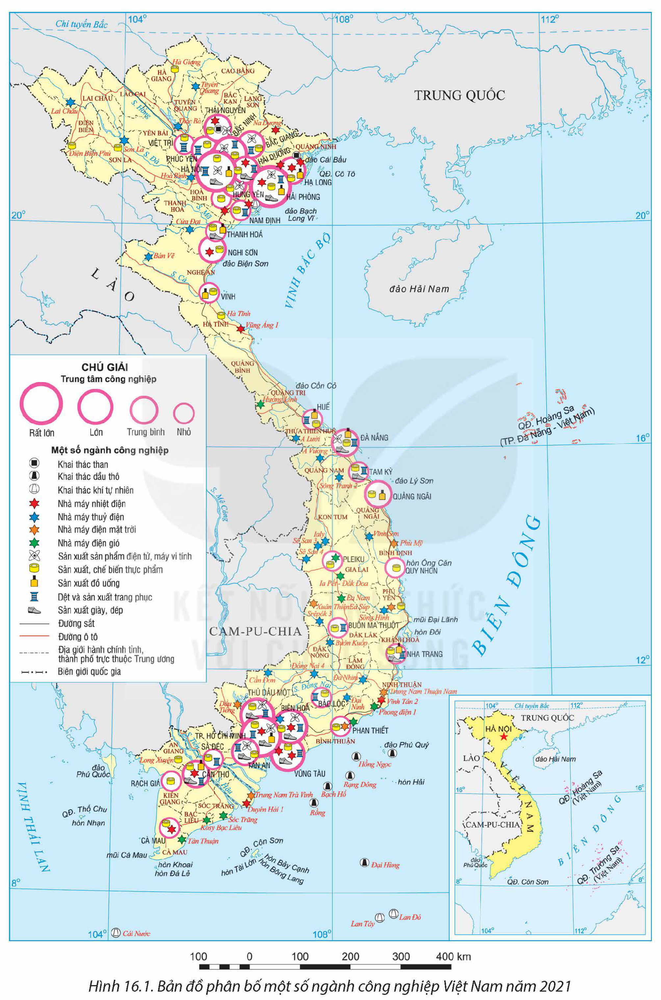
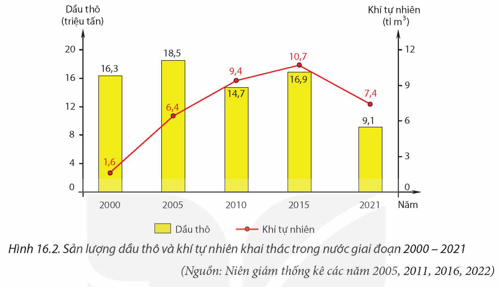
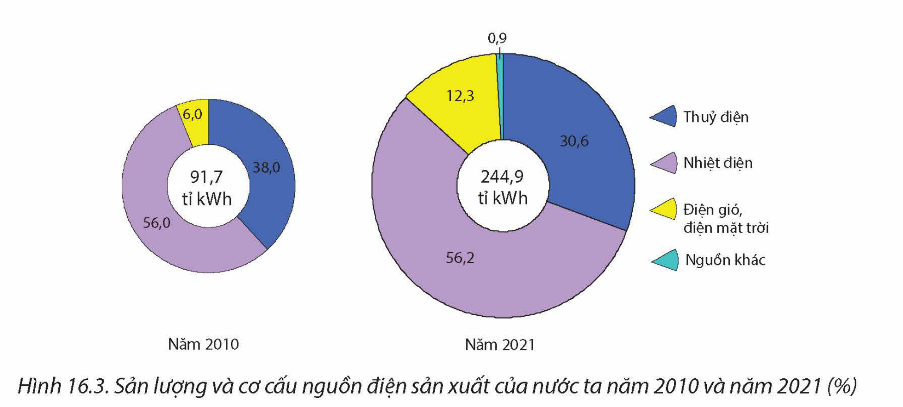
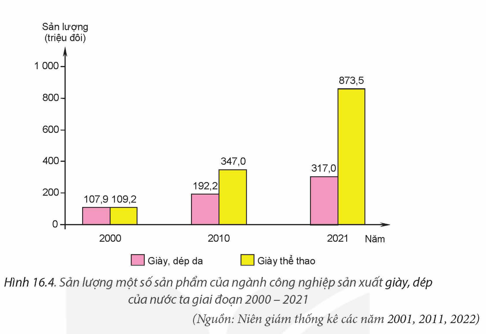

<!-- pdf:72 -->

# BÀI 16: MỘT SỐ NGÀNH CÔNG NGHIỆP

## 🔴 Mở đầu

Nước ta có điều kiện thuận lợi để hình thành và phát triển một nền công nghiệp có cơ cấu ngành đa dạng. Sự phát triển của mỗi ngành công nghiệp phụ thuộc vào nhiều yếu tố khác nhau trong từng giai đoạn nhất định. Các ngành công nghiệp nước ta phát triển và phân bố như thế nào?

## I. CÔNG NGHIỆP KHAI THÁC THAN, DẦU, KHÍ

### 1. Công nghiệp khai thác than

<!-- term: Công nghiệp khai thác than -->
Nước ta có lịch sử khai thác than từ đầu thế kỉ XIX. Ngày nay, ngành than đã được đầu tư, áp dụng công nghệ mới tiên tiến, hiện đại, cơ giới hoá, tự động hoá đồng bộ, nâng cao năng suất lao động, chất lượng sản phẩm, hạn chế tác động đến môi trường.

> 💡 **EM CÓ BIẾT?**
>
> Than trên phần đất liền Việt Nam phân bố ở 6 bể than chính là Đông Bắc, An Châu (Bắc Giang), Lạng Sơn, Sông Hồng, Nông Sơn (Quảng Nam), sông Cửu Long, trong đó bể than Đông Bắc có trữ lượng 5,1 tỉ tấn, bể than Sông Hồng có trữ lượng 41,9 tỉ tấn.
>
> (Nguồn: Tập đoàn Than – Khoáng sản Việt Nam)

Bảng 16.1. SẢN LƯỢNG THAN KHAI THÁC Ở NƯỚC TA GIAI ĐOẠN 2000 – 2021

*(Đơn vị: triệu tấn)*

| Năm | 2000 | 2010 | 2015 | 2021 |
| --- | --- | --- | --- | --- |
| Sản lượng than | 11,6 | 44,8 | 41,7 | 48,3 |

*(Nguồn: Niên giám thống kê các năm 2005, 2011, 2016, 2022)*

<!-- term: Công nghiệp khai thác than -->
Than được khai thác tập trung chủ yếu ở Quảng Ninh, ngoài ra còn được khai thác ở các tỉnh như Lạng Sơn, Thái Nguyên, Bắc Giang,... Than khai thác chủ yếu phục vụ công nghiệp nhiệt điện và xuất khẩu.

> ❓ Dựa vào thông tin mục 1 và hình 16.1, hãy trình bày đặc điểm phát triển và phân bố của công nghiệp khai thác than ở nước ta.

<!-- pdf:73 -->

*Hình 16.1. Bản đồ phân bố một số ngành công nghiệp Việt Nam năm 2021*

<!-- pdf:74 -->

### 2. Công nghiệp khai thác dầu mỏ, khí tự nhiên

Ngành công nghiệp dầu khí có lịch sử phát triển muộn hơn công nghiệp khai thác than. Sản lượng dầu thô và khí tự nhiên khai thác trong những năm gần đây có biến động.

*Hình 16.2. Sản lượng dầu thô và khí tự nhiên khai thác trong nước giai đoạn 2000 – 2021*

*(Nguồn: Niên giám thống kê các năm 2005, 2011, 2016, 2022)*

<!-- term: Công nghiệp khai thác dầu mỏ, khí tự nhiên -->
Nhiều công nghệ mới, tiên tiến trong khai thác dầu khí đã được áp dụng như: công nghệ khai thác dầu trong đá móng, công nghệ làm lạnh sâu dòng khí nguyên liệu, công nghệ nén khí thiên nhiên,... góp phần làm gia tăng giá trị sản phẩm, giảm thất thoát tài nguyên và ô nhiễm môi trường. Trong tương lai, ngành công nghiệp dầu khí của nước ta sẽ phát triển theo hướng tăng cường chế biến sâu để đảm bảo nguồn năng lượng quốc gia.

<!-- term: Công nghiệp khai thác dầu mỏ, khí tự nhiên -->
Dầu thô được khai thác chủ yếu ở thềm lục địa phía nam với các mỏ Rồng, Bạch Hổ, Rạng Đông, Hồng Ngọc,... Khí tự nhiên được khai thác chủ yếu ở các bể Cửu Long, Nam Côn Sơn, Thổ Chu – Malay – Thổ Chu,...

Những năm gần đây, nước ta có triển khai đầu tư khai thác dầu khí ở nước ngoài. Năm 2021, sản lượng khai thác dầu thô ở nước ngoài đạt 1,9 triệu tấn.

> ❓ Dựa vào thông tin mục 2 và hình 16.1, hãy:
>
> – Trình bày đặc điểm phát triển và phân bố của công nghiệp khai thác dầu, khí ở nước ta.
>
> – Xác định một số mỏ dầu, khí của nước ta trên bản đồ.

## II. CÔNG NGHIỆP SẢN XUẤT ĐIỆN

<!-- term: Công nghiệp sản xuất điện -->
Ngành công nghiệp sản xuất điện ở nước ta được hình thành và bắt đầu phát triển từ lâu, hiện nay có sự tăng trưởng nhanh chóng để đáp ứng nhu cầu điện năng cho đất nước. Sản lượng điện nước ta tăng mạnh, đến năm 2021 đạt 244,9 tỉ kWh. Cơ cấu nguồn điện ở nước ta gồm: thuỷ điện, nhiệt điện (than, khí, dầu), điện mặt trời, điện gió và nguồn khác. Các thành tựu khoa học – công nghệ hiện đại, thông minh được ứng dụng hiệu quả trong sản xuất, vận hành, quản lí hệ thống lưới điện,...

<!-- pdf:75 -->

*Hình 16.3. Sản lượng và cơ cấu nguồn điện sản xuất của nước ta năm 2010 và năm 2021 (%)*

*(Nguồn: Tập đoàn Điện lực Việt Nam)*

> 💡 **EM CÓ BIẾT?**
>
> Nhà máy thuỷ điện Sơn La có công suất 2 400 MW là nhà máy thuỷ điện lớn nhất Đông Nam Á, được khởi công xây dựng vào tháng 12 – 2005 và đưa vào hoạt động tháng 12 – 2012. Nhà máy có vị trí nằm trên sông Đà thuộc địa phận xã Ít Ong, huyện Mường La, tỉnh Sơn La. Ngoài cung cấp điện, thuỷ điện Sơn La còn góp phần chống lũ, chống hạn cho hạ lưu và tăng khả năng phát điện cho nhà máy thuỷ điện Hoà Bình.

– Về thuỷ điện: Các nhà máy thuỷ điện nước ta phân bố gắn liền với những vùng có tiềm năng thuỷ điện lớn như: Hoà Bình (công suất 1 920 MW), Sơn La (2 400 MW), Lai Châu (1 200 MW) (ở Trung du và miền núi Bắc Bộ); Ialy (720 MW), Sê San 3 (260 MW), Sê San 4 (360 MW), Đồng Nai 4 (340 MW) (ở Tây Nguyên); Đại Ninh (400 MW) (ở Bắc Trung Bộ và Duyên hải miền Trung); Trị An (400 MW), Cần Đơn (77,6 MW) (ở Đông Nam Bộ),...

– Về nhiệt điện: Nhiệt điện nước ta gồm có nhiệt điện than và nhiệt điện khí. Một số nhà máy nhiệt điện than có công suất lớn hiện nay là Phả Lại 2 (600 MW), Quảng Ninh 1 (600 MW), Mông Dương 1 (1 080 MW), Hải Phòng 1 (600 MW), Duyên Hải 1 (1 245 MW), Vũng Áng 1 (1 200 MW), Vĩnh Tân 2 (1 244 MW),... Các nhà máy nhiệt điện khí lớn chủ yếu ở phía Nam điển hình như: Phú Mỹ 1 có công suất lớn nhất (1 140 MW), Cà Mau 1 (771 MW), Nhơn Trạch 2 (750 MW), Ô Môn 1 (660 MW),...

– Điện mặt trời, điện gió và nguồn khác: Điện mặt trời, điện gió phát triển chủ yếu ở Duyên hải Nam Trung Bộ, Tây Nguyên và Đồng bằng sông Cửu Long. Các địa phương có các nhà máy điện mặt trời lớn hiện nay là Ninh Thuận, Đắk Lắk,... Các địa phương phát triển điện gió mạnh là Đắk Lắk, Bạc Liêu, Cà Mau,... Gần đây, nước ta đã xây dựng và vận hành một số nhà máy điện rác thải ở: Hà Nội, Thành phố Hồ Chí Minh, Cần Thơ,...

Để thực hiện mục tiêu giảm phát thải CO₂, bên cạnh việc cải tiến kĩ thuật, nâng cấp công nghệ, tăng khả năng vận hành, ngành điện nước ta đang từng bước thực hiện chuyển dịch cơ cấu sang các nguồn năng lượng sạch, năng lượng tái tạo khác.

> ❓ Dựa vào thông tin mục II và hình 16.1, hãy trình bày đặc điểm phát triển và phân bố của ngành công nghiệp sản xuất điện ở nước ta.

<!-- pdf:76 -->

## III. CÔNG NGHIỆP SẢN XUẤT SẢN PHẨM ĐIỆN TỬ, MÁY VI TÍNH

<!-- term: Công nghiệp sản xuất sản phẩm điện tử, máy vi tính -->
Công nghiệp sản xuất sản phẩm điện tử, máy vi tính là ngành xuất hiện muộn hơn so với các ngành công nghiệp khác. Cơ cấu của ngành rất đa dạng, gồm các lĩnh vực như sản xuất linh kiện điện tử, sản xuất máy vi tính, điện thoại di động, thiết bị điện dân dụng,...

Bảng 16.2. SẢN LƯỢNG MỘT SỐ SẢN PHẨM CỦA NGÀNH CÔNG NGHIỆP SẢN XUẤT ĐIỆN TỬ, MÁY VI TÍNH NƯỚC TA GIAI ĐOẠN 2010 – 2021

*(Đơn vị: triệu cái)*

| Sản phẩm \ Năm | 2010 | 2015 | 2021 |
| --- | --- | --- | --- |
| Điện thoại di động | 37,5 | 235,6 | 183,3 |
| Ti vi lắp ráp | 2,8 | 5,5 | 20,6 |
| Tủ lạnh, tủ đông dùng trong gia đình | 1,5 | 1,6 | 2,7 |

*(Nguồn: Niên giám thống kê các năm 2011, 2016, 2022)*

Nhờ áp dụng công nghệ hiện đại (trí tuệ nhân tạo, tự động hoá, dữ liệu lớn,...) nên ngành có tốc độ tăng trưởng cao, đem lại giá trị kinh tế lớn và có tác động mạnh mẽ đến sự chuyển dịch cơ cấu ngành công nghiệp của nước ta.

<!-- term: Công nghiệp sản xuất sản phẩm điện tử, máy vi tính -->
Công nghiệp sản xuất sản phẩm điện tử, máy vi tính được phát triển và phân bố ở các địa phương có nhiều lợi thế về nguồn lao động, cơ sở hạ tầng và thu hút đầu tư nước ngoài như: Hà Nội, Bắc Ninh, Hải Phòng, Thái Nguyên, Bắc Giang, Thành phố Hồ Chí Minh, Đồng Nai, Bình Dương.

Định hướng phát triển của ngành là tăng cường thu hút đầu tư nước ngoài, tham gia sâu vào chuỗi cung ứng toàn cầu, gia tăng giá trị nội địa,...

> ❓ Dựa vào thông tin mục III và hình 16.1, hãy trình bày đặc điểm phát triển và phân bố của ngành công nghiệp sản xuất sản phẩm điện tử, máy vi tính ở nước ta.

## IV. CÔNG NGHIỆP SẢN XUẤT, CHẾ BIẾN THỰC PHẨM

<!-- term: Công nghiệp sản xuất, chế biến thực phẩm -->
Sản xuất, chế biến thực phẩm là ngành được phát triển từ lâu đời dựa vào nguồn nguyên liệu dồi dào, đáp ứng nhu cầu trong nước và xuất khẩu. Sản lượng các sản phẩm của ngành nhìn chung tăng lên trong giai đoạn 2010 – 2021.

Bảng 16.3. SẢN LƯỢNG MỘT SỐ SẢN PHẨM CỦA NGÀNH CÔNG NGHIỆP SẢN XUẤT, CHẾ BIẾN THỰC PHẨM NƯỚC TA GIAI ĐOẠN 2010 – 2021

| Sản phẩm \ Năm | 2010 | 2015 | 2021 |
| --- | --- | --- | --- |
| Thuỷ sản ướp đông *(triệu tấn)* | 1,27 | 1,66 | 2,07 |
| Dầu thực vật tinh luyện *(triệu tấn)* | 0,56 | 0,96 | 1,38 |
| Sữa tươi *(triệu lít)* | 520,6 | 1 027,9 | 1 288,2 |
| Gạo xay xát *(triệu tấn)* | 33,47 | 40,77 | 39,54 |

*(Nguồn: Niên giám thống kê các năm 2011, 2016, 2022)*

<!-- pdf:77 -->

Chất lượng sản phẩm của ngành ngày càng được nâng cao, đảm bảo an toàn vệ sinh thực phẩm nhờ đẩy mạnh áp dụng các công nghệ mới vào sản xuất như công nghệ sinh học, công nghệ xử lí nhiệt, công nghệ bao bì và đóng gói,...

<!-- term: Công nghiệp sản xuất, chế biến thực phẩm -->
Ngành công nghiệp sản xuất, chế biến thực phẩm phân bố rộng khắp cả nước dựa trên cơ sở nguồn nguyên liệu tại chỗ. Các trung tâm công nghiệp chế biến thực phẩm lớn ở nước ta là Thành phố Hồ Chí Minh, Hà Nội, Bình Dương, Đồng Nai, Hải Phòng, Đà Nẵng, Cần Thơ,...

Định hướng phát triển của ngành là thu hút đầu tư; chú trọng công nghệ tự động hoá, quản lí chất lượng; phát triển chuỗi sản phẩm theo hướng nâng cao giá trị gia tăng; đa dạng hoá sản phẩm cho thị trường nội địa; mở rộng thị trường xuất khẩu, chủ động hội nhập quốc tế.

> ❓ Dựa vào thông tin mục IV và hình 16.1, hãy trình bày đặc điểm phát triển và phân bố của ngành công nghiệp sản xuất, chế biến thực phẩm ở nước ta.

## V. CÔNG NGHIỆP SẢN XUẤT ĐỒ UỐNG

Công nghiệp sản xuất đồ uống là một trong những ngành có truyền thống lâu đời ở nước ta. Những năm gần đây, công nghệ mới đã được áp dụng trong sản xuất (công nghệ chiết lạnh vô trùng, tự động hoá,...) nên chất lượng sản phẩm đồ uống được cải thiện, giữ được thị phần trong nước và bước đầu xuất khẩu ra thị trường nước ngoài.

Bảng 16.4. SẢN LƯỢNG MỘT SỐ SẢN PHẨM CỦA NGÀNH CÔNG NGHIỆP SẢN XUẤT ĐỒ UỐNG NƯỚC TA GIAI ĐOẠN 2010 – 2021

*(Đơn vị: triệu lít)*

| Sản phẩm \ Năm | 2010 | 2015 | 2021 |
| --- | --- | --- | --- |
| Nước khoáng | 458,5 | 877,3 | 1 036,7 |
| Nước tinh khiết | 1 342,9 | 2 390,1 | 2 729,0 |
<!-- ocr-ok: Bảng 16.4 đã đối chiếu trực tiếp ảnh trang p077.png -->

*(Nguồn: Niên giám thống kê các năm 2011, 2016, 2022)*

Các cơ sở sản xuất đồ uống phân bố tập trung ở các đô thị lớn như Hà Nội, Thành phố Hồ Chí Minh, Đà Nẵng, Hạ Long,...

Định hướng phát triển của ngành là sản xuất theo hướng bền vững như: sử dụng các nguồn nguyên liệu hữu cơ, tái sử dụng – tái chế chất thải hoặc sản phẩm dư thừa từ quá trình sản xuất của ngành,...

> ❓ Dựa vào thông tin mục V và hình 16.1, hãy trình bày đặc điểm phát triển và phân bố của ngành công nghiệp sản xuất đồ uống ở nước ta.

<!-- pdf:78 -->

## VI. CÔNG NGHIỆP DỆT, SẢN XUẤT TRANG PHỤC

<!-- term: Công nghiệp dệt, sản xuất trang phục và sản xuất giày, dép -->
– Ngành công nghiệp dệt, sản xuất trang phục ở nước ta được hình thành từ sớm và trở thành một trong những ngành công nghiệp quan trọng của nước ta hiện nay. Các sản phẩm chính của ngành là sợi, vải, quần áo,... có sản lượng tăng liên tục.

Bảng 16.5. SẢN LƯỢNG MỘT SỐ SẢN PHẨM CỦA NGÀNH CÔNG NGHIỆP DỆT, SẢN XUẤT TRANG PHỤC NƯỚC TA GIAI ĐOẠN 2010 – 2021

| Sản phẩm \ Năm | 2010 | 2015 | 2020 | 2021 |
| --- | --- | --- | --- | --- |
| Sợi *(triệu tấn)* | 0,81 | 1,90 | 3,27 | 3,52 |
| Vải *(triệu m²)* | 1 176,9 | 1 525,6 | 2 377,0 | 2 520,7 |
| Quần, áo mặc thường *(triệu cái)* | 2 604,5 | 4 320,0 | 5 406,8 | 5 539,5 |
<!-- ocr-ok: Bảng 16.5 đã đối chiếu trực tiếp ảnh trang p078.png -->

*(Nguồn: Niên giám thống kê các năm 2011, 2016, 2022)*

Nhiều sản phẩm đã đáp ứng nhu cầu thị hiếu của khách hàng trong và ngoài nước về chất lượng và mẫu mã nhờ công nghệ và kĩ thuật hiện đại. Đặc biệt công nghệ in 3D đã được áp dụng vào quá trình sản xuất từ phương pháp kéo sợi, nguyên liệu sợi đến hiệu ứng dệt, công nghệ nhuộm, may mặc, đóng gói,...

<!-- term: Công nghiệp dệt, sản xuất trang phục và sản xuất giày, dép -->
Công nghiệp dệt, sản xuất trang phục được phát triển mạnh ở các địa phương như Hà Nội, Hải Phòng, Thành phố Hồ Chí Minh, Đồng Nai, Bà Rịa – Vũng Tàu, Cần Thơ, Thừa Thiên Huế, Đà Nẵng,...

Định hướng phát triển của ngành là chuyển từ gia công sang các hình thức sản xuất đòi hỏi năng lực cao hơn về quản lí chuỗi cung ứng, chuỗi giá trị, thiết kế và xây dựng thương hiệu trên cơ sở công nghệ phù hợp đến hiện đại, gắn với hệ thống quản lí chất lượng, quản lí lao động và bảo vệ môi trường theo chuẩn mực quốc tế.

> ❓ Dựa vào thông tin mục VI và hình 16.1, hãy trình bày đặc điểm phát triển và phân bố của ngành công nghiệp dệt, sản xuất trang phục ở nước ta.

## VII. CÔNG NGHIỆP SẢN XUẤT GIÀY, DÉP

<!-- term: Công nghiệp dệt, sản xuất trang phục và sản xuất giày, dép -->
Từ năm 2000 đến nay, công nghiệp sản xuất giày, dép ở nước ta phát triển nhanh, các sản phẩm giày, dép trở thành một trong những mặt hàng xuất khẩu chủ lực của đất nước.

<!-- pdf:79 -->

*Hình 16.4. Sản lượng một số sản phẩm của ngành công nghiệp sản xuất giày, dép của nước ta giai đoạn 2000 – 2021*

*(Nguồn: Niên giám thống kê các năm 2001, 2011, 2022)*

Công nghiệp sản xuất giày, dép được đẩy mạnh tự động hoá, tích hợp hệ thống trong sản xuất, thay đổi phương thức cung ứng nguyên, phụ liệu để phù hợp với chuỗi cung ứng toàn cầu.

<!-- term: Công nghiệp dệt, sản xuất trang phục và sản xuất giày, dép -->
Các cơ sở sản xuất giày, dép tập trung ở Hà Nội và các tỉnh phía Nam, đặc biệt là Thành phố Hồ Chí Minh, Bình Dương, Đồng Nai,...

Định hướng phát triển của ngành là phát triển hiệu quả, bền vững theo mô hình kinh tế tuần hoàn; hoàn thiện chuỗi giá trị sản xuất trong nước, tham gia hiệu quả vào chuỗi giá trị toàn cầu; phát triển được một số thương hiệu mang tầm khu vực và thế giới.

> ❓ Dựa vào thông tin mục VII và hình 16.1, hãy trình bày đặc điểm phát triển và phân bố của ngành công nghiệp sản xuất giày, dép ở nước ta.

## ✏️ Luyện tập và vận dụng

**Luyện tập**

Lập bảng tóm tắt tình hình phát triển và phân bố của một ngành công nghiệp đã học.

**Vận dụng**

Sưu tầm thông tin, tìm hiểu về một ngành công nghiệp quan trọng đối với địa phương em.

## 📷 Danh sách hình trong bài

| Mã hình | Trang PDF | Vị trí trong bài | Chú thích gốc |
| --- | --- | --- | --- |
| H12-dia-b16-01 | 73 | Mục I.1 | Hình 16.1. Bản đồ phân bố một số ngành công nghiệp Việt Nam năm 2021 |
| H12-dia-b16-02 | 74 | Mục I.2 | Hình 16.2. Sản lượng dầu thô và khí tự nhiên khai thác trong nước giai đoạn 2000 – 2021 |
| H12-dia-b16-03 | 75 | Mục II | Hình 16.3. Sản lượng và cơ cấu nguồn điện sản xuất của nước ta năm 2010 và năm 2021 (%) |
| H12-dia-b16-04 | 79 | Mục VII | Hình 16.4. Sản lượng một số sản phẩm của ngành công nghiệp sản xuất giày, dép của nước ta giai đoạn 2000 – 2021 |
