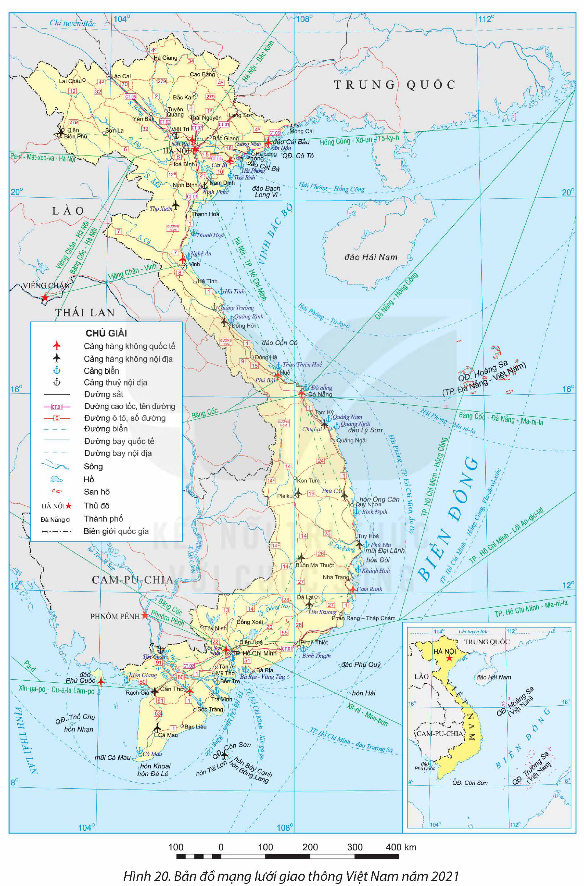

<!-- pdf:87 -->

# BÀI 20: GIAO THÔNG VẬN TẢI VÀ BƯU CHÍNH VIỄN THÔNG

## 🔴 Mở đầu

Giao thông vận tải và bưu chính viễn thông là ngành hạ tầng thiết yếu của đất nước, tác động rất lớn đến sự phát triển của nền kinh tế. Giao thông vận tải và bưu chính viễn thông ở nước ta phát triển và phân bố như thế nào?

## I. GIAO THÔNG VẬN TẢI

<!-- term: Mạng lưới giao thông vận tải Việt Nam -->
Nước ta có đầy đủ các loại hình giao thông vận tải: đường ô tô, đường sắt, đường sông, đường biển, đường hàng không và đường ống. Mạng lưới giao thông vận tải phân bố rộng khắp và kết nối với một số tuyến đường quốc tế, như đường sắt, đường bộ xuyên Á,... Các đầu mối giao thông lớn như Hà Nội, Đà Nẵng, Thành phố Hồ chí Minh trở thành cửa ngõ quốc tế, tăng cường khả năng hội nhập của đất nước.

Trong những năm gần đây, dịch vụ vận tải ngày càng đa dạng, chất lượng được nâng cao, cự li vận chuyển xa hơn. Khối lượng hàng hoá, hành khách vận chuyển có xu hướng tăng, đáp ứng nhu cầu sản xuất và đời sống của nhân dân.

Bảng 20.1. KHỐI LƯỢNG HÀNG HOÁ VẬN CHUYỂN PHÂN THEO NGÀNH VẬN TẢI CỦA NƯỚC TA GIAI ĐOẠN 2010 – 2021

*(Đơn vị: nghìn tấn)*

| Năm | Đường ô tô | Đường sắt | Đường sông | Đường biển | Đường hàng không |
| --- | --- | --- | --- | --- | --- |
| 2010 | 587 014 | 7 862 | 144 227 | 61 593 | 190 |
| 2015 | 882 628 | 6 707 | 201 531 | 60 800 | 229 |
| 2019 | 1 319 853 | 5 205 | 268 026 | 77 088 | 446 |
| 2021 | 1 303 328 | 5 660 | 242 366 | 69 961 | 284 |
<!-- ocr-ok: Bảng 20.1 đã đối chiếu trực tiếp ảnh trang p087.png -->

*(Nguồn: Niên giám thống kê các năm 2011, 2016, 2022)*

### 1. Đường ô tô

<!-- term: Đường ô tô và đường sắt ở Việt Nam -->
Đường ô tô là loại hình giao thông quan trọng nhất ở nước ta, phát triển mạnh cả về số lượng và chất lượng. Khối lượng hàng hoá vận chuyển bằng đường ô tô cao nhất trong cơ cấu vận tải nước ta và có xu hướng tăng. Chất lượng vận tải và dịch vụ ngày càng được cải thiện, hiệu quả kinh tế của vận tải bằng đường ô tô được nâng lên.

<!-- pdf:88 -->

<!-- term: Đường ô tô và đường sắt ở Việt Nam -->
Mạng lưới đường ô tô ở nước ta ngày càng phát triển, trải rộng khắp các địa phương đảm bảo kết nối hiệu quả với các loại hình giao thông khác và kết nối vùng, miền, quốc tế. Các tuyến đường bắc – nam là trục giao thông quan trọng nhất của nước ta như: quốc lộ 1, đường Hồ Chí Minh và đường cao tốc Bắc – Nam. Các tuyến đường xuyên Á, cao tốc tạo động lực phát triển kinh tế các vùng và cả nước như đường cao tốc Bắc – Nam, cao tốc Hà Nội – Lào Cai, Hà Nội – Hải Phòng, Hải Phòng – Quảng Ninh – Móng Cái,...

### 2. Đường sắt

Vận tải đường sắt chủ yếu là vận chuyển hàng hoá. Hệ thống đường sắt hiện có được đầu tư cải tạo, nâng cấp nên chất lượng hạ tầng được nâng lên, tốc độ và an toàn đường sắt được cải thiện. Đường sắt tốc độ cao và đường sắt đô thị (ở Hà Nội và Thành phố Hồ Chí Minh) đang được quan tâm phát triển.

<!-- term: Đường ô tô và đường sắt ở Việt Nam -->
Tuyến đường sắt dài và quan trọng nhất ở nước ta là tuyến Bắc – Nam (Thống Nhất), chạy gần như song song với quốc lộ 1. Các tuyến khác tập trung ở phía bắc, trong đó ba tuyến quan trọng là Hà Nội – Hải Phòng, Hà Nội – Lào Cai, Hà Nội – Lạng Sơn,...

### 3. Đường sông

Vận tải đường sông nước ta đảm nhận các chức năng: chuyên chở hàng hoá nội địa, kết nối với các cảng biển trong việc vận chuyển hàng hoá xuất nhập khẩu. Đường sông hỗ trợ vận chuyển công-te-nơ từ cảng biển vào sâu trong nội địa và tăng cường kết nối với loại hình vận tải khác,...

Giao thông đường sông được phát triển chủ yếu trên một số hệ thống sông lớn như: hệ thống sông Hồng, hệ thống sông Thái Bình, hệ thống sông Đồng Nai, hệ thống sông Cửu Long. Các tuyến vận tải có lưu lượng vận chuyển lớn là các tuyến liên vùng, như Quảng Ninh – Việt Trì, Sài Gòn – Cà Mau,... Một số cảng sông quan trọng ở nước ta là Việt Trì (Phú Thọ), Tân Châu (An Giang),...

### 4. Đường biển

Vận tải đường biển nước ta tăng cường kết nối với các phương thức vận tải khác, ứng dụng công nghệ vận tải tiên tiến, phát triển vận tải đa phương thức và dịch vụ logistics.

<!-- term: Đường biển và đường hàng không ở Việt Nam -->
Cả nước có 34 cảng biển với 296 bến cảng (năm 2021). Hệ thống cảng biển nước ta là cửa ngõ giao thương hàng hoá xuất, nhập khẩu, thúc đẩy sự phát triển kinh tế của vùng và cả nước. Hai cảng loại đặc biệt là Hải Phòng và Bà Rịa – Vũng Tàu. Một số bến cảng quan trọng là Vân Phong (thuộc cảng Khánh Hoà), Cái Mép (thuộc cảng Bà Rịa – Vũng Tàu), Đình Vũ (thuộc cảng Hải Phòng),... Các tuyến đường biển nội địa tạo mối liên kết giữa các vùng trong nước, như: Hải Phòng – Đà Nẵng, Đà Nẵng – Thành phố Hồ Chí Minh,... Các tuyến đường biển quốc tế kết nối với các quốc gia và châu lục khác, như: Hải Phòng – Hồng Công, Thành phố Hồ Chí Minh – Xin-ga-po,... Việt Nam đã thiết lập các tuyến tàu xa đi Bắc Mỹ, châu Âu.

<!-- pdf:89 -->

*Hình 20. Bản đồ mạng lưới giao thông Việt Nam năm 2021*

<!-- pdf:90 -->

### 5. Đường hàng không

Vận tải hàng không ở nước ta có tốc độ phát triển và hiện đại hoá nhanh. Năng lực vận chuyển ngày càng cao nhờ ứng dụng khoa học – công nghệ, tăng cường đội tàu bay và mở rộng mạng lưới đường bay.

<!-- term: Đường biển và đường hàng không ở Việt Nam -->
Đến năm 2021, Việt Nam có 22 cảng hàng không, trong đó có 10 cảng quốc tế. Các cảng hàng không Nội Bài, Đà Nẵng và Tân Sơn Nhất là cửa ngõ quốc tế và đầu mối vận tải hàng không lớn của nước ta. Các tuyến đường bay nội địa ngày càng được mở rộng. Một số tuyến đường bay quốc tế quan trọng là Hà Nội – Tô-ky-ô, Đà Nẵng – Hồng Công, Thành phố Hồ Chí Minh – Lốt An-giơ-lét,... Việt Nam đã thiết lập những chuyến bay thẳng đi Bắc Mỹ, châu Âu, châu Phi.

### 6. Đường ống

Đường ống chủ yếu vận chuyển xăng dầu và khí, phục vụ hiệu quả cho ngành khai thác, chế biến và phân phối dầu khí tại Việt Nam. Đường ống nước ta có một số hệ thống chính: đường ống vận chuyển xăng dầu từ Bãi Cháy – Hạ Long tới các tỉnh vùng Đồng bằng sông Hồng, đường ống dẫn khí Cà Mau – Phú Mỹ,...

> ❓ Dựa vào thông tin mục I và hình 20, hãy trình bày sự phát triển và phân bố ngành giao thông vận tải ở nước ta.

## II. BƯU CHÍNH VIỄN THÔNG

Ngành bưu chính viễn thông gồm 2 hoạt động: bưu chính và viễn thông. Các hoạt động bưu chính viễn thông ở nước ta đang phát triển theo hướng chuyển đổi số và liên kết chặt chẽ với các hoạt động dịch vụ khác như thương mại, giao thông vận tải,...

Bảng 20.2. MỘT SỐ CHỈ SỐ PHÁT TRIỂN NGÀNH BƯU CHÍNH VIỄN THÔNG NƯỚC TA GIAI ĐOẠN 2010 – 2021

| Năm | 2010 | 2015 | 2020 | 2021 |
| --- | --- | --- | --- | --- |
| Doanh thu dịch vụ bưu chính *(nghìn tỉ đồng)* | 6,0 | 11,0 | 25,0 | 26,8 |
| Doanh thu dịch vụ viễn thông *(nghìn tỉ đồng)* | 177,8 | 284,0 | 321,2 | 316,4 |
| Số thuê bao điện thoại *(triệu thuê bao)* | 125,9 | 129,4 | 126,8 | 125,8 |
| – Trong đó: Di động | 111,6 | 123,9 | 123,6 | 122,6 |
| Số thuê bao internet băng rộng cố định *(triệu thuê bao)* | 3,7 | 7,6 | 16,6 | 19,3 |

*(Nguồn: Niên giám thống kê 2011, 2016, 2022)*

### 1. Bưu chính

<!-- term: Bưu chính -->
Doanh thu bưu chính nước ta còn thấp nhưng tốc độ tăng trưởng rất nhanh, năm 2021 đạt gần 27 nghìn tỉ đồng. Dịch vụ bưu chính đa dạng, phát triển theo hướng hiện đại và nâng cao hiệu quả kinh tế. Các dịch vụ truyền thống như: chuyển, nhận thư, bưu kiện,... từng bước chuyển sang dịch vụ số. Các dịch vụ hỗ trợ sản xuất kinh doanh được mở rộng, đảm bảo chất lượng vận chuyển đã nâng cao hiệu quả kinh tế của dịch vụ bưu chính.

<!-- pdf:91 -->

Mạng lưới bưu chính phân bố rộng khắp. Một số trung tâm dịch vụ bưu chính đã tăng cường ứng dụng công nghệ hiện đại, tạo cơ sở cho việc xây dựng kinh tế số, xã hội số, như Hà Nội, Đà Nẵng, Thành phố Hồ Chí Minh.

<!-- term: Bưu chính -->
Ngành bưu chính phát triển theo hướng hiện đại hoá cơ sở hạ tầng thông tin và truyền thông, cung cấp dịch vụ bưu chính số và hợp tác với các khâu sản xuất và dịch vụ khác: ngân hàng, logistics, vận tải,...

### 2. Viễn thông

> 💡 **EM CÓ BIẾT?**
>
> Mạng di động đầu tiên xuất hiện ở Việt Nam vào năm 1993. Đến năm 1997, nước ta chính thức hoà mạng internet. Hiện nay, điện thoại di động và internet đã trở thành một phần không thể thiếu được trong cuộc sống của hàng chục triệu dân Việt Nam, nhất là đối với giới trẻ.

<!-- term: Viễn thông -->
Doanh thu viễn thông năm 2021 đạt 316,4 nghìn tỉ đồng. Các dịch vụ viễn thông ngày càng đa dạng bao gồm: dịch vụ điện thoại, internet, dịch vụ mạng và các dịch vụ khai thác công nghệ. Thời gian qua, ở nước ta, số thuê bao điện thoại khá ổn định, số thuê bao internet tăng nhanh, liên tục.

<!-- term: Viễn thông -->
Mạng lưới viễn thông được mở rộng và phát triển nhanh. Hạ tầng viễn thông được triển khai đến mọi vùng miền và kết nối với toàn thế giới qua hệ thống băng thông quốc tế. Việt Nam đang sở hữu 2 vệ tinh viễn thông và 7 tuyến cáp quang biển quốc tế tăng cường kết nối với mạng lưới viễn thông quốc tế. Nước ta đã hình thành các trung tâm viễn thông hiện đại, như Hà Nội, Thành phố Hồ Chí Minh,...

Hướng phát triển ngành viễn thông nước ta là đẩy mạnh chuyển đổi số, đầu tư vào công nghệ cao và đảm bảo an ninh mạng.

> ❓ Dựa vào thông tin mục II, hãy trình bày sự phát triển và phân bố ngành bưu chính viễn thông nước ta.

## ✏️ Luyện tập và vận dụng

**Luyện tập**

Dựa vào hình 20, hãy xác định 3 tuyến đường ô tô, cảng biển, cảng hàng không quan trọng của nước ta.

**Vận dụng**

Tìm hiểu và trình bày về một hoạt động bưu chính viễn thông mà em quan tâm.

## 📷 Danh sách hình trong bài

| Mã hình | Trang PDF | Vị trí trong bài | Chú thích gốc |
| --- | --- | --- | --- |
| H12-dia-b20-01 | 89 | Mục I.4 | Hình 20. Bản đồ mạng lưới giao thông Việt Nam năm 2021 |
