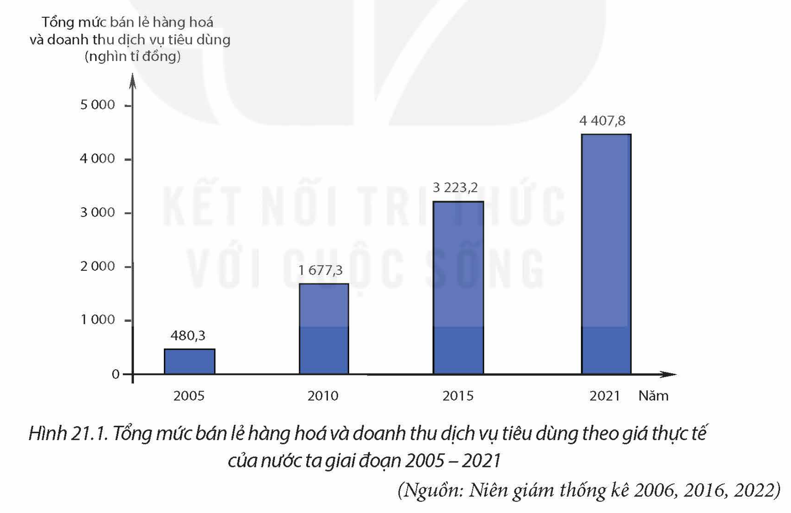
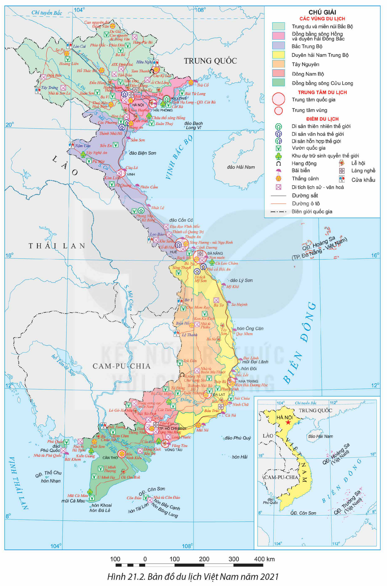

<!-- pdf:92 -->

# BÀI 21: THƯƠNG MẠI VÀ DU LỊCH

## 🔴 Mở đầu

Thương mại và du lịch là một trong những động lực tăng trưởng kinh tế ở nước ta, góp phần quảng bá hình ảnh đất nước, con người Việt Nam ra thế giới. Sự phát triển của hai ngành này có ảnh hưởng sâu rộng tới các ngành kinh tế khác và đời sống người dân. Thương mại và du lịch của nước ta đang phát triển và phân bố như thế nào?

## I. THƯƠNG MẠI

### 1. Nội thương

Tổng mức bán lẻ hàng hoá và doanh thu dịch vụ tiêu dùng của nước ta tăng nhanh và liên tục. Dự báo trong thời gian tới, mức tăng sẽ nhanh hơn do thị trường trong nước lớn và sức mua tăng lên.

*Hình 21.1. Tổng mức bán lẻ hàng hoá và doanh thu dịch vụ tiêu dùng theo giá thực tế của nước ta giai đoạn 2005 – 2021*

*(Nguồn: Niên giám thống kê 2006, 2016, 2022)*

<!-- term: Nội thương -->
Thương mại trong nước phát triển với đa dạng các loại hình: chợ truyền thống, chợ đầu mối, cửa hàng tiện ích, siêu thị, trung tâm thương mại,... Hệ thống bán buôn, bán lẻ mở rộng và hiện đại hoá, các trung tâm thương mại có vốn đầu tư nước ngoài xuất hiện tại một số đô thị.

<!-- term: Nội thương -->
Phương thức buôn bán hiện đại được mở rộng. Thương mại điện tử tăng trưởng nhanh, trở thành kênh phân phối quan trọng, phát huy hiệu quả chuỗi cung ứng và lưu thông hàng hoá trong nước. Tuy nhiên, sự phát triển các loại hình thương mại hiện đại (sàn giao dịch hàng hoá, trung tâm đấu giá,...) còn hạn chế.

<!-- pdf:93 -->

> 💡 **EM CÓ BIẾT?**
>
> Việt Nam thuộc nhóm quốc gia có thị trường bán lẻ hấp dẫn nhất toàn cầu. Quy mô bán lẻ và thương mại điện tử cao thứ 3 trong ASEAN (sau In-đô-nê-xi-a và Thái Lan). Tốc độ tăng trưởng thương mại điện tử vào loại cao nhất thế giới và trong nhóm 3 quốc gia hàng đầu ASEAN (cùng với In-đô-nê-xi-a và Phi-líp-pin).
>
> (Nguồn: Chiến lược Phát triển thương mại trong nước giai đoạn đến năm 2030, tầm nhìn đến năm 2045)

<!-- term: Nội thương -->
Hoạt động nội thương khác nhau giữa các vùng, khu vực. Buôn bán trong nước sôi động nhất ở những vùng kinh tế phát triển như: Đông Nam Bộ và Đồng bằng sông Hồng. Hà Nội và Thành phố Hồ Chí Minh là hai trung tâm buôn bán trong nước lớn nhất.

> ❓ Dựa vào thông tin mục 1, hãy trình bày sự phát triển và phân bố hoạt động nội thương ở nước ta.

### 2. Ngoại thương

<!-- term: Ngoại thương -->
Trị giá xuất khẩu, nhập khẩu hàng hoá tăng nhanh, năm 2021 đạt 669,0 tỉ USD. Cán cân thương mại có xu hướng cân bằng hơn. Năm 2021, nước ta xuất siêu 3,2 tỉ USD.

Bảng 21.1. TRỊ GIÁ XUẤT KHẨU, NHẬP KHẨU HÀNG HOÁ CỦA NƯỚC TA GIAI ĐOẠN 2010 – 2021

*(Đơn vị: tỉ USD)*

| Trị giá \ Năm | 2010 | 2012 | 2015 | 2021 |
| --- | --- | --- | --- | --- |
| Xuất khẩu | 72,2 | 114,5 | 162,0 | 336,1 |
| Nhập khẩu | 84,8 | 113,7 | 165,7 | 332,9 |

*(Nguồn: Niên giám thống kê các năm 2011, 2016, 2022)*

<!-- term: Ngoại thương -->
– Về xuất khẩu: Năm 2021, trị giá xuất khẩu chiếm 50,2% trong tổng trị giá xuất khẩu nhập khẩu. Mặt hàng xuất khẩu đa dạng, một số nhóm hàng có vị trí cao trên thị trường thế giới là nông sản, thuỷ sản, dệt may, da giày, đồ gỗ và hàng điện tử. Cơ cấu hàng hoá xuất khẩu chuyển dịch tích cực. Tỉ trọng nhóm hàng sơ chế, nguyên liệu thô giảm, tỉ trọng nhóm hàng chế biến tăng. Xu hướng này tạo điều kiện để hàng hoá Việt Nam tham gia sâu hơn vào chuỗi sản xuất và cung ứng toàn cầu.

Thị trường xuất khẩu ngày càng mở rộng. Nước ta khai thác hiệu quả các hiệp định thương mại tự do để xuất khẩu vào các thị trường lớn như Hoa Kỳ, Trung Quốc, EU,... Các thị trường tiềm năng như Liên bang Nga, Đông Âu, Bắc Âu,... được đẩy mạnh khai thác.

– Về nhập khẩu: Năm 2021, trị giá nhập khẩu chiếm 49,8% trong tổng trị giá xuất nhập khẩu. Mặt hàng nhập khẩu chủ yếu là máy móc, thiết bị hiện đại để nâng cao năng lực sản xuất, chất lượng và sức cạnh tranh của hàng hoá Việt Nam. Hàng điện tử, máy tính và linh kiện có trị giá nhập khẩu lớn nhất (năm 2021). Thị trường nhập khẩu của nước ta chủ yếu là các nước có trình độ khoa học – công nghệ tiên tiến như: Trung Quốc, Hàn Quốc, Nhật Bản, Hoa Kỳ,...

<!-- pdf:94 -->

> ❓ Dựa vào thông tin mục 2, hãy trình bày sự phát triển hoạt động ngoại thương ở nước ta.

## II. DU LỊCH

### 1. Sự phát triển ngành du lịch

Du lịch nước ta được xác định ngành kinh tế mũi nhọn, tạo động lực thúc đẩy các ngành kinh tế khác. Doanh thu và số khách du lịch tăng nhanh trong giai đoạn 2000 – 2019. Sau khó khăn do dịch bệnh trên toàn cầu, từ năm 2022, doanh thu và số khách du lịch đang dần phục hồi.

Bảng 21.2. DOANH THU VÀ SỐ LƯỢT KHÁCH DU LỊCH NƯỚC TA GIAI ĐOẠN 2000 – 2022

| Chỉ số \ Năm | 2000 | 2010 | 2019 | 2022 |
| --- | --- | --- | --- | --- |
| Doanh thu của các cơ sở lữ hành *(nghìn tỉ đồng)* | 1,19 | 13,73 | 44,67 | 35,45 |
| Khách trong nước do các cơ sở lữ hành phục vụ *(triệu lượt người)* | 0,94 | 5,41 | 11,79 | 7,38 |
| Khách quốc tế do các cơ sở lữ hành phục vụ *(triệu lượt người)* | 1,36 | 2,38 | 5,73 | 2,6 |
<!-- ocr-ok: Bảng 21.2 đã đối chiếu trực tiếp ảnh trang p094.png -->

*(Nguồn: Niên giám thống kê các năm 2001, 2011, 2022)*

Một số loại hình du lịch nổi bật của nước ta là du lịch biển đảo, du lịch văn hoá, du lịch sinh thái. Các loại hình du lịch cộng đồng, du lịch tham quan, nghỉ dưỡng, du lịch đô thị và du lịch khám phá đang phát triển nhanh.

Thị trường khách quốc tế của Việt Nam ngày càng mở rộng, quan trọng nhất là từ Đông Bắc Á, Đông Nam Á, châu Đại Dương. Các thị trường mới, nhiều tiềm năng đang được quan tâm phát triển như Trung Đông, Nam Âu, Nam Á.

Nước ta chú trọng phát triển du lịch bền vững, sử dụng hiệu quả tài nguyên thiên nhiên đồng thời phát huy giá trị và bản sắc văn hoá dân tộc. Quá trình chuyển đổi số trong du lịch, phát triển du lịch thông minh,... cũng được đẩy mạnh.

### 2. Phân hoá lãnh thổ du lịch

<!-- term: Phân hoá lãnh thổ du lịch Việt Nam -->
Tổ chức lãnh thổ du lịch nước ta gồm 7 vùng du lịch, các khu du lịch quốc gia, điểm du lịch quốc gia, đô thị du lịch,... Các trung tâm du lịch lớn của cả nước là Hà Nội, Huế, Đà Nẵng và Thành phố Hồ Chí Minh. Tổ chức không gian du lịch tạo động lực thúc đẩy phát triển du lịch cho các vùng và cả nước.

<!-- pdf:95 -->

Bảng 21.3. VÙNG DU LỊCH VÀ SẢN PHẨM DU LỊCH ĐẶC TRƯNG

| Vùng du lịch | Sản phẩm du lịch đặc trưng |
| --- | --- |
| Trung du và miền núi Bắc Bộ | Du lịch về nguồn (Đền Hùng, Điện Biên Phủ,...), tham quan tìm hiểu bản sắc văn hoá dân tộc, hệ sinh thái núi cao, hang động (Hà Giang, Sa Pa, Mộc Châu,...), nghỉ dưỡng núi, nghỉ cuối tuần (Mẫu Sơn, Hoà Bình,...), thể thao, khám phá, du lịch biên giới gắn với thương mại cửa khẩu (Lào Cai, Đồng Đăng). |
| Đồng bằng sông Hồng và duyên hải Đông Bắc | Du lịch văn hoá gắn với văn minh lúa nước sông Hồng, biển đảo (Hạ Long – Cát Bà, Vân Đồn,...), sinh thái nông nghiệp nông thôn, du lịch cuối tuần, vui chơi giải trí cao cấp. |
| Bắc Trung Bộ | Tham quan di sản, di tích lịch sử văn hoá (Cố đô Huế, Thành Nhà Hồ, Kim Liên,...), biển đảo (Sầm Sơn, Cửa Lò, Lăng Cô – Cảnh Dương,...), tham quan, nghiên cứu hệ sinh thái (Bến En, Bạch Mã, Phong Nha – Kẻ Bàng), du lịch biên giới gắn với các cửa khẩu (Cầu Treo, Lao Bảo). |
| Duyên hải Nam Trung Bộ | Du lịch biển đảo (Sơn Trà, Nha Trang, Phú Quý,...), tham quan di tích (Hội An, Mỹ Sơn) kết hợp du lịch nghiên cứu bản sắc văn hoá (văn hoá Chăm, các dân tộc thiểu số ở đông Trường Sơn). |
| Tây Nguyên | Tham quan tìm hiểu bản sắc văn hoá các dân tộc Tây Nguyên, nghỉ dưỡng núi, tham quan nghiên cứu hệ sinh thái cao nguyên (Đà Lạt, Yok Đôn), du lịch biên giới gắn với cửa khẩu và tam giác phát triển (Bờ Y, Măng Đen, Ialy). |
| Đông Nam Bộ | Du lịch văn hoá, lễ hội, giải trí, nghỉ dưỡng biển (Long Hải, Phước Hải, Côn Đảo), giải trí cuối tuần (Cần Giờ, Vũng Tàu), thể thao (núi Bà Đen), mua sắm, du lịch biên giới gắn với cửa khẩu (Mộc Bài). |
| Đồng bằng sông Cửu Long | Du lịch sinh thái (Tràm Chim, U Minh,...), biển đảo (Phú Quốc, Hà Tiên), văn hoá, lễ hội. |

*(Nguồn: Quyết định số 201/QĐ-TTg của Thủ tướng Chính phủ Phê duyệt "Quy hoạch tổng thể phát triển du lịch Việt Nam đến năm 2020, tầm nhìn đến năm 2030")*

<!-- pdf:96 -->

*Hình 21.2. Bản đồ du lịch Việt Nam năm 2021*

<!-- pdf:97 -->

> ❓ Dựa vào thông tin mục 1, 2 và hình 21.2, hãy trình bày sự phát triển và phân hoá lãnh thổ du lịch nước ta.

### 3. Du lịch với sự phát triển bền vững

<!-- term: Du lịch bền vững -->
Phát triển du lịch bền vững nhằm đáp ứng các yêu cầu về phát triển kinh tế – xã hội và bảo vệ môi trường, đảm bảo hài hoà lợi ích của các bên tham gia và không làm tổn hại đến nhu cầu du lịch trong tương lai.

– Du lịch tác động tổng hợp đến kinh tế, xã hội, môi trường. Du lịch tạo động lực thúc đẩy phát triển kinh tế – xã hội, góp phần phát huy lợi thế của địa phương và tăng cường liên kết vùng. Du lịch làm tăng giá trị di sản văn hoá dân tộc, quảng bá hình ảnh đất nước, con người Việt Nam. Du lịch thúc đẩy nâng cao chất lượng lao động, đảm bảo an sinh và giải quyết các vấn đề xã hội. Du lịch góp phần gìn giữ và sử dụng hiệu quả tài nguyên sinh thái, di sản thiên nhiên và đa dạng sinh học.

– Phát triển bền vững giúp du lịch phát triển hiệu quả, lâu dài. Kinh tế phát triển, chất lượng cuộc sống người dân tăng lên, thúc đẩy nhu cầu và hiện đại hoá ngành du lịch. Các giá trị văn hoá, nghệ thuật dân gian, sự đa dạng sinh thái được bảo tồn làm đa dạng hoá sản phẩm và tăng giá trị hoạt động du lịch. Môi trường xanh, sạch góp phần phát triển du lịch xanh, du lịch bền vững.

> ❓ Dựa vào thông tin mục 3, hãy cho biết mối quan hệ giữa du lịch và sự phát triển bền vững ở nước ta.

## ✏️ Luyện tập và vận dụng

**Luyện tập**

Tóm tắt nội dung ngành ngoại thương theo các ý sau: trị giá, cán cân xuất khẩu, nhập khẩu, hoạt động xuất khẩu, hoạt động nhập khẩu.

**Vận dụng**

Viết bài quảng bá sản phẩm du lịch đặc trưng tại vùng du lịch nơi em sống.

## 📷 Danh sách hình trong bài

| Mã hình | Trang PDF | Vị trí trong bài | Chú thích gốc |
| --- | --- | --- | --- |
| H12-dia-b21-01 | 92 | Mục I.1 | Hình 21.1. Tổng mức bán lẻ hàng hoá và doanh thu dịch vụ tiêu dùng theo giá thực tế của nước ta giai đoạn 2005 – 2021 |
| H12-dia-b21-02 | 96 | Mục II.2 | Hình 21.2. Bản đồ du lịch Việt Nam năm 2021 |
