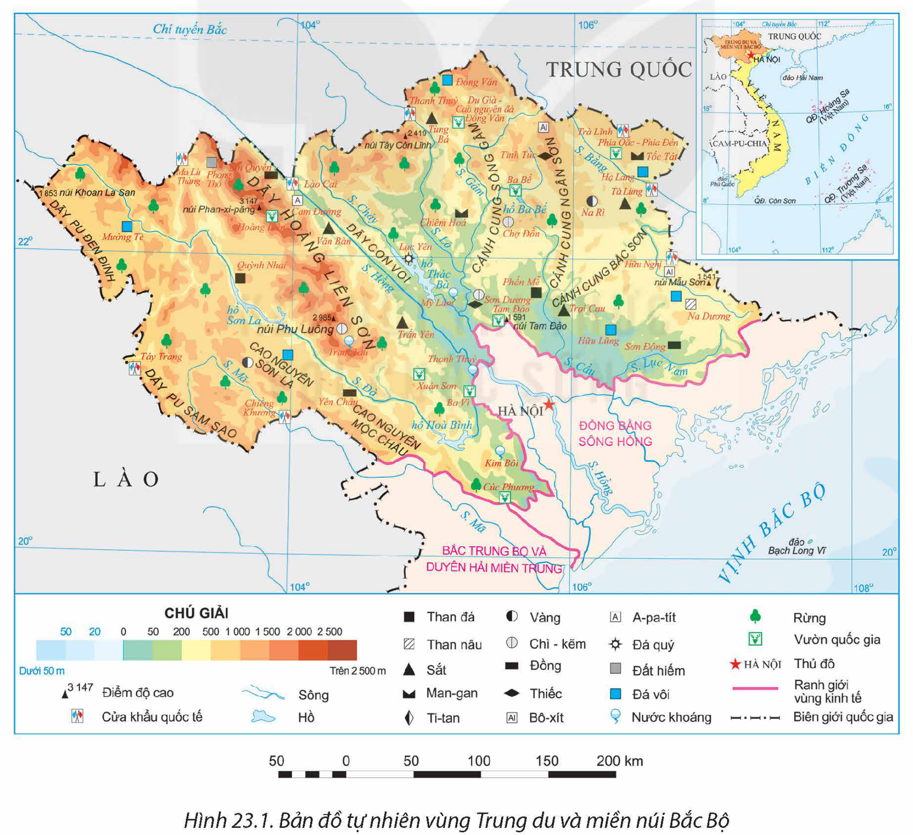
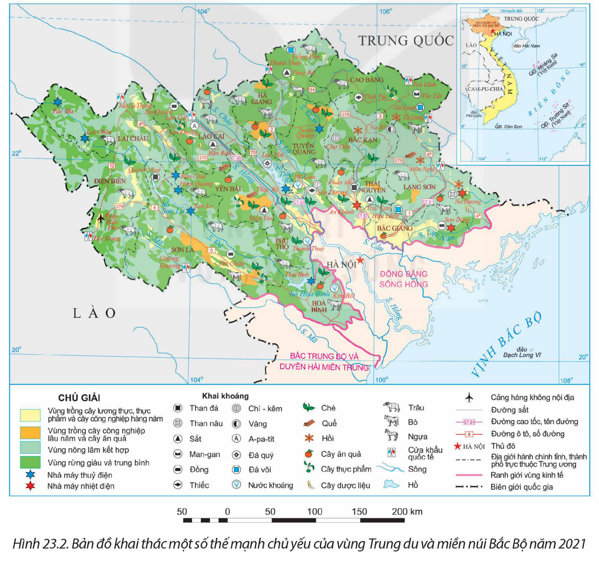
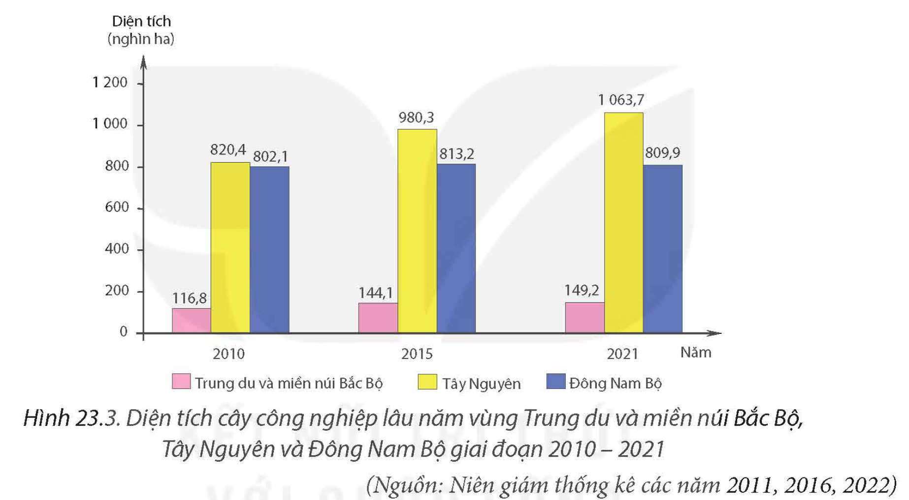

<!-- pdf:99 -->

# BÀI 23: KHAI THÁC THẾ MẠNH Ở TRUNG DU VÀ MIỀN NÚI BẮC BỘ

## 🔴 Mở đầu

Trung du và miền núi Bắc Bộ (Trung du và miền núi phía Bắc) nằm ở phía bắc đất nước. Vùng có thiên nhiên phong phú, giàu bản sắc văn hoá,... là những thế mạnh để phát triển kinh tế. Vùng đã khai thác các thế mạnh đó như thế nào? Việc phát triển kinh tế – xã hội có ý nghĩa gì đối với quốc phòng an ninh?

## I. KHÁI QUÁT

### 1. Vị trí địa lí và phạm vi lãnh thổ

<!-- term: Trung du và miền núi Bắc Bộ -->
Vùng Trung du và miền núi Bắc Bộ bao gồm 14 tỉnh: Lai Châu, Điện Biên, Sơn La, Hoà Bình; Lào Cai, Yên Bái, Phú Thọ, Hà Giang, Tuyên Quang, Cao Bằng, Lạng Sơn, Bắc Kạn, Thái Nguyên, Bắc Giang. Diện tích của vùng năm 2021 là 95,2 nghìn km². Vùng tiếp giáp với hai nước láng giềng là Trung Quốc, Lào; giáp vùng Đồng bằng sông Hồng, vùng Bắc Trung Bộ và Duyên hải miền Trung.

Trung du và miền núi Bắc Bộ có vị trí đặc biệt quan trọng, có nhiều cửa khẩu quốc tế thông thương với các nước láng giềng; tiếp giáp với hai vùng kinh tế, tạo điều kiện hỗ trợ và trao đổi hàng hoá.

> ❓ Dựa vào thông tin mục 1, hãy trình bày đặc điểm vị trí địa lí và phạm vi lãnh thổ vùng Trung du và miền núi Bắc Bộ.

### 2. Dân số

<!-- term: Dân số vùng Trung du và miền núi Bắc Bộ -->
Năm 2021, số dân trong vùng là 12,9 triệu người, tỉ lệ tăng dân số tự nhiên là 1,05%, cao hơn so với mức trung bình chung của cả nước (0,93%).

<!-- term: Dân số vùng Trung du và miền núi Bắc Bộ -->
Mật độ dân số trung bình là 136 người/km², thấp hơn so với trung bình của cả nước (297 người/km²). Dân cư chủ yếu sinh sống ở nông thôn, tỉ lệ dân thành thị là 20,5% (cả nước là 37,1% năm 2021).

<!-- term: Dân số vùng Trung du và miền núi Bắc Bộ -->
Trung du và miền núi Bắc Bộ có nhiều dân tộc sinh sống như: Kinh, Thái, Mường, HMông, Tày, Nùng, Dao,...

> ❓ Dựa vào thông tin mục 2, hãy trình bày một số đặc điểm về dân số vùng Trung du và miền núi Bắc Bộ.

<!-- pdf:100 -->

## II. KHAI THÁC THẾ MẠNH ĐỂ PHÁT TRIỂN KINH TẾ

### 1. Khai thác và chế biến khoáng sản

**a) Thế mạnh**

<!-- term: Khai thác và chế biến khoáng sản ở Trung du và miền núi Bắc Bộ -->
– Trung du và miền núi Bắc Bộ giàu tài nguyên khoáng sản nhất nước ta. Một số loại khoáng sản có trữ lượng tương đối lớn, có khả năng khai thác với quy mô công nghiệp như than ở Lạng Sơn, Thái Nguyên; sắt ở Yên Bái, Lào Cai, Hà Giang; đồng ở Sơn La, Bắc Giang; đồng – vàng ở Lào Cai; thiếc ở Cao Bằng, Thái Nguyên; đất hiếm ở Lai Châu; a-pa-tít ở Lào Cai; đá vôi, đá xây dựng có ở nhiều tỉnh trong vùng; nước khoáng ở Hoà Bình, Phú Thọ, Tuyên Quang.

– Cơ sở hạ tầng và cơ sở vật chất – kĩ thuật ngày càng hoàn thiện, các yếu tố khoa học – công nghệ mới, tiên tiến được ứng dụng giúp cho khai thác và chế biến khoáng sản thuận lợi hơn.

*Hình 23.1. Bản đồ tự nhiên vùng Trung du và miền núi Bắc Bộ*

<!-- pdf:101 -->

**b) Hiện trạng khai thác và chế biến khoáng sản**

<!-- term: Khai thác và chế biến khoáng sản ở Trung du và miền núi Bắc Bộ -->
Một số loại khoáng sản chủ yếu được khai thác trong vùng như: than (Thái Nguyên, Lạng Sơn), a-pa-tít (Lào Cai), đá vôi (Hoà Bình, Hà Giang), nước khoáng (Phú Thọ, Yên Bái, Hoà Bình). Một số khoáng sản được khai thác với quy mô nhỏ như: chì – kẽm (Bắc Kạn), thiếc (Cao Bằng),...

<!-- term: Khai thác và chế biến khoáng sản ở Trung du và miền núi Bắc Bộ -->
Khoáng sản được khai thác là nguyên liệu cho công nghiệp sản xuất điện và các ngành công nghiệp khác. Trong vùng có một số nhà máy nhiệt điện than như Na Dương (Lạng Sơn) công suất 110 MW, Sơn Động (Bắc Giang) công suất 220 MW, An Khánh (Thái Nguyên) công suất 120 MW. Các sản phẩm của công nghiệp chế biến khoáng sản nổi bật là xi măng, phân bón,...

Khai thác khoáng sản trong vùng có tác động đến môi trường. Do đó, trong quá trình khai thác cần hạn chế tác động xấu tới môi trường cũng như đối với các ngành khác mà vùng có nhiều tiềm năng.

*Hình 23.2. Bản đồ khai thác một số thế mạnh chủ yếu của vùng Trung du và miền núi Bắc Bộ năm 2021*

<!-- pdf:102 -->

> ❓ Dựa vào thông tin mục a và hình 23.1, 23.2, hãy:
> – Nêu thế mạnh về khoáng sản ở vùng Trung du và miền núi Bắc Bộ.
> – Trình bày hiện trạng khai thác, chế biến khoáng sản của vùng.

### 2. Phát triển thuỷ điện

**a) Thế mạnh**

<!-- term: Thuỷ điện ở Trung du và miền núi Bắc Bộ -->
Trung du và miền núi Bắc Bộ có tiềm năng thuỷ điện lớn nhất nước ta. Riêng hệ thống sông Hồng chiếm trên 30% trữ lượng thuỷ năng của cả nước (11 triệu kW), trong đó sông Đà gần 6 triệu kW. Ngoài ra, vùng có nhiều sông, suối, thuận lợi để xây dựng các nhà máy thuỷ điện có công suất vừa và nhỏ.

Nhu cầu về điện trong nước ngày càng tăng, khoa học – công nghệ tiên tiến, chính sách phát triển phù hợp, nguồn vốn đầu tư lớn là động lực thúc đẩy ngành phát triển.

**b) Khai thác thế mạnh**

<!-- term: Thuỷ điện ở Trung du và miền núi Bắc Bộ -->
Trung du và miền núi Bắc Bộ đã xây dựng nhiều nhà máy thuỷ điện có công suất lớn. Trên sông Đà, ba nhà máy thuỷ điện lớn nhất cả nước đã được xây dựng là nhà máy thuỷ điện Lai Châu (1 200 MW), nhà máy thuỷ điện Sơn La (2 400 MW), nhà máy thuỷ điện Hoà Bình (1 920 MW). Các nhà máy thuỷ điện đáng kể khác là Huội Quảng (520 MW), Tuyên Quang (342 MW), Bản Chát (220 MW), Thác Bà (110 MW). Ngoài ra, trên các sông suối nhỏ đã xây dựng nhiều nhà máy thuỷ điện có công suất vừa và nhỏ.

Việc phát triển thuỷ điện góp phần khai thác thế mạnh, cung cấp năng lượng cho vùng và cả nước, tạo động lực mới cho sự phát triển của vùng.

Phát triển thuỷ điện ở vùng cần chú ý đến việc giải quyết hài hoà vấn đề khai thác, sử dụng nguồn nước giữa thuỷ điện và thuỷ lợi; quản lí và sử dụng hiệu quả tài nguyên nước, ứng phó với thiên tai và biến đổi khí hậu; khai thác hiệu quả vùng lòng hồ, phát triển nuôi trồng thuỷ sản, du lịch; bảo vệ rừng đầu nguồn để giữ nguồn nước cho các hồ thuỷ điện,...

> ❓ Dựa vào thông tin mục 2 và hình 23.1, 23.2, hãy:
> – Chứng minh thế mạnh về thuỷ điện của vùng Trung du và miền núi Bắc Bộ.
> – Trình bày việc khai thác thế mạnh và hướng phát triển thuỷ điện của vùng.

### 3. Phát triển cây công nghiệp, rau quả có nguồn gốc cận nhiệt và ôn đới

**a) Thế mạnh**

<!-- term: Cây công nghiệp và rau quả cận nhiệt, ôn đới ở Trung du và miền núi Bắc Bộ -->
– Trung du và miền núi Bắc Bộ có địa hình phần lớn là đồi núi, xen kẽ các cao nguyên có bề mặt tương đối bằng phẳng. Địa hình cao nguyên và các khu vực đồi núi thấp có đất feralit chiếm diện tích lớn, tạo điều kiện hình thành các vùng chuyên canh cây công nghiệp, cây ăn quả và rau tập trung. Khí hậu nhiệt đới ẩm gió mùa có mùa đông lạnh, phân hoá theo độ cao thuận lợi cho trồng cây công nghiệp, cây ăn quả và các loại rau nhiệt đới, cận nhiệt, ôn đới. Nguồn nước dồi dào cung cấp nước tưới cho cây công nghiệp và cây ăn quả.

<!-- pdf:103 -->

<!-- pdf:104 -->

– Nguồn lao động: người dân trong vùng có nhiều kinh nghiệm trong trồng và canh tác cây công nghiệp, cây ăn quả trên đất dốc. Các chính sách nông nghiệp theo hướng phát triển nông nghiệp hàng hoá, nông nghiệp hữu cơ; ứng dụng khoa học – công nghệ trong trồng, chế biến sản phẩm cây công nghiệp, cây ăn quả. Thị trường tiêu thụ sản phẩm được mở rộng cả trong nước và nước ngoài là những thuận lợi để thúc đẩy phát triển cây công nghiệp và rau quả.

**b) Hiện trạng phát triển**

Cơ cấu cây trồng của Trung du và miền núi Bắc Bộ đa dạng, gồm cây công nghiệp, cây ăn quả và các loại rau.

<!-- term: Cây công nghiệp và rau quả cận nhiệt, ôn đới ở Trung du và miền núi Bắc Bộ -->
– Cây công nghiệp: Trung du và miền núi Bắc Bộ là vùng chuyên canh cây công nghiệp lớn thứ ba cả nước (sau Tây Nguyên và Đông Nam Bộ). Các loại cây công nghiệp lâu năm được trồng trong vùng là chè, cà phê, hồi, quế,...

*Hình 23.3. Diện tích cây công nghiệp lâu năm vùng Trung du và miền núi Bắc Bộ, Tây Nguyên và Đông Nam Bộ giai đoạn 2010 – 2021*

*(Nguồn: Niên giám thống kê các năm 2011, 2016, 2022)*

<!-- term: Cây công nghiệp và rau quả cận nhiệt, ôn đới ở Trung du và miền núi Bắc Bộ -->
Chè là cây công nghiệp quan trọng số một của vùng. Năm 2021, diện tích chè đạt trên 90 nghìn ha, chiếm hơn 70% diện tích chè cả nước. Các tỉnh trồng chè nhiều nhất là Thái Nguyên, Phú Thọ, Hà Giang. Các cơ sở chế biến chè ngày càng phát triển đã nâng cao giá trị và chất lượng sản phẩm. Sản phẩm chè được xuất khẩu sang nhiều thị trường lớn như: Đức, Pháp, Anh,...

Cà phê được trồng ở khu vực Tây Bắc chủ yếu ở Sơn La và Điện Biên.

<!-- term: Cây công nghiệp và rau quả cận nhiệt, ôn đới ở Trung du và miền núi Bắc Bộ -->
– Cây ăn quả phát triển mạnh, cơ cấu đa dạng. Các cây ăn quả được phát triển mạnh là xoài, nhãn, mận (Sơn La), vải (Bắc Giang), đào, lê (Lai Châu, Điện Biên), cam, quýt, bưởi (Hà Giang, Tuyên Quang, Phú Thọ). Vùng đã tích cực áp dụng khoa học – công nghệ trong trồng, chăm sóc, chế biến sản phẩm cây ăn quả.

<!-- term: Cây công nghiệp và rau quả cận nhiệt, ôn đới ở Trung du và miền núi Bắc Bộ -->
– Rau và các cây khác: Trung du và miền núi Bắc Bộ có diện tích rau cận nhiệt và ôn đới khá lớn. Các loại rau được trồng chủ yếu như su su, bắp cải, cà chua, súp lơ, cải thảo,... Các tỉnh có diện tích rau lớn như Lào Cai, Yên Bái, Sơn La,... Một số tỉnh còn trồng dưới tán rừng các cây dược liệu quý (đương quy, đỗ trọng, tam thất, sâm Lai Châu) như Lai Châu, Cao Bằng, Yên Bái, Lào Cai,...

<!-- pdf:105 -->

Hướng phát triển: sản xuất nông nghiệp hàng hoá, an toàn, phát triển nông nghiệp hữu cơ; tăng diện tích cây ăn quả, phát triển cây dược liệu gắn với công nghiệp chế biến.

> ❓ Dựa vào thông tin mục 3 và hình 23.2, 23.3, hãy:
> – Chứng minh thế mạnh để phát triển cây trồng có nguồn gốc cận nhiệt và ôn đới của vùng Trung du và miền núi Bắc Bộ.
> – Trình bày việc khai thác thế mạnh và hướng phát triển cây trồng có nguồn gốc cận nhiệt và ôn đới của vùng.

### 4. Phát triển chăn nuôi gia súc lớn

**a) Thế mạnh**

– Vùng có một số cao nguyên khá bằng phẳng như Mộc Châu, Sơn La,... nhiều đồng cỏ tự nhiên thuận lợi cho chăn nuôi gia súc. Các điều kiện về khí hậu, nguồn nước thuận lợi cho phát triển chăn nuôi trong vùng.

– Các cơ sở chế biến thức ăn gia súc, chuồng trại chăn nuôi, cơ sở chế biến sản phẩm chăn nuôi đã được đầu tư ngày càng đồng bộ và hiện đại hơn. Nhiều công nghệ mới được ứng dụng trong chăn nuôi và chế biến các sản phẩm chăn nuôi. Thị trường tiêu thụ sản phẩm không ngừng được mở rộng.

**b) Khai thác thế mạnh**

Trong vùng đã ứng dụng khoa học – công nghệ trong chăn nuôi, hình thức chăn nuôi đa dạng hơn, chăn nuôi công nghiệp và bán công nghiệp được phát triển rộng rãi. Các loại gia súc lớn phổ biến trong vùng là trâu, bò, ngựa.

– Đàn trâu trong vùng có số lượng lớn nhất cả nước. Các tỉnh nuôi nhiều trâu là Hà Giang, Điện Biên, Sơn La.

Bảng 23. SỐ LƯỢNG TRÂU, BÒ CỦA VÙNG TRUNG DU VÀ MIỀN NÚI BẮC BỘ VÀ TỈ LỆ SO VỚI CẢ NƯỚC GIAI ĐOẠN 2010 – 2021

| Năm | 2010 — Số lượng *(nghìn con)* | 2010 — Tỉ lệ so với cả nước *(%)* | 2015 — Số lượng *(nghìn con)* | 2015 — Tỉ lệ so với cả nước *(%)* | 2021 — Số lượng *(nghìn con)* | 2021 — Tỉ lệ so với cả nước *(%)* |
| --- | --- | --- | --- | --- | --- | --- |
| Trâu | 1 618,2 | 56,2 | 1 467,5 | 55,9 | 1 245,3 | 55,0 |
| Bò | 993,7 | 17,1 | 989,4 | 17,2 | 1 213,3 | 19,0 |
<!-- ocr-ok: bảng có tiêu đề gộp cột/hàng đã đối chiếu ảnh gốc -->

*(Nguồn: Tổng cục Thống kê)*

– Đàn bò (lấy thịt và lấy sữa) có xu hướng tăng. Các tỉnh có số lượng bò lớn là Sơn La, Bắc Giang, Hà Giang,... trong đó, Sơn La có số lượng bò lớn nhất vùng với 373,3 nghìn con, chiếm 30,8% tổng đàn bò của cả vùng (năm 2021). Bò sữa được nuôi tập trung ở cao nguyên Mộc Châu (Sơn La).

<!-- pdf:106 -->

– Chăn nuôi ngựa là nét đặc trưng ở vùng. Các tỉnh có số lượng ngựa nhiều nhất là Hà Giang, Lào Cai,...

Hướng phát triển: phát triển vùng chăn nuôi tập trung, an toàn dịch bệnh với quy mô phù hợp, hiệu quả cao dựa trên lợi thế của vùng; đầu tư xây dựng cơ sở chế biến thức ăn để chủ động nguồn thức ăn, tăng cường ứng dụng khoa học – công nghệ trong chăn nuôi, đẩy mạnh công nghiệp chế biến, đa dạng hoá các sản phẩm chăn nuôi.

> ❓ Dựa vào thông tin mục 4 và hình 23.1, 23.2, hãy:
> – Chứng minh Trung du và miền núi Bắc Bộ có thế mạnh để phát triển chăn nuôi gia súc lớn.
> – Trình bày việc khai thác thế mạnh và hướng phát triển chăn nuôi gia súc lớn ở vùng.

## III. Ý NGHĨA CỦA PHÁT TRIỂN KINH TẾ – XÃ HỘI ĐỐI VỚI QUỐC PHÒNG AN NINH

– Trung du và miền núi Bắc Bộ là vùng có diện tích rộng lớn. Việc phát triển kinh tế của vùng không chỉ có ý nghĩa về kinh tế mà còn củng cố được sức mạnh quốc phòng an ninh.

– Vùng tiếp giáp với Trung Quốc và Lào, có nhiều cửa khẩu thông thương. Đẩy mạnh phát triển kinh tế của vùng, xây dựng các khu kinh tế cửa khẩu, tạo nên sự gắn kết chặt chẽ giữa phát triển kinh tế với củng cố quốc phòng an ninh.

– Trung du và miền núi Bắc Bộ là nơi cư trú của nhiều dân tộc thiểu số, là căn cứ địa cách mạng, phát triển kinh tế góp phần nâng cao đời sống vật chất và tinh thần cho nhân dân, tăng cường khối đại đoàn kết giữa các dân tộc; đồng thời thực hiện được chủ trương của Đảng về đền ơn đáp nghĩa, uống nước nhớ nguồn. Qua đó, ổn định an ninh xã hội, góp phần đảm bảo quốc phòng an ninh.

> ❓ Dựa vào thông tin mục III, hãy cho biết ý nghĩa của phát triển kinh tế – xã hội đối với quốc phòng an ninh ở vùng Trung du và miền núi Bắc Bộ.

## ✏️ Luyện tập và vận dụng

**Luyện tập**

Dựa vào bảng 23, hãy nhận xét về số lượng đàn trâu và đàn bò của vùng Trung du và miền núi Bắc Bộ so với cả nước.

**Vận dụng**

Sưu tầm thông tin, tìm hiểu về một sản phẩm thế mạnh của vùng Trung du và miền núi Bắc Bộ.

## 📷 Danh sách hình trong bài

| Mã hình | Trang PDF | Vị trí trong bài | Chú thích gốc |
| --- | --- | --- | --- |
| H12-dia-b23-01 | 100 | Mục II.1.a | Hình 23.1. Bản đồ tự nhiên vùng Trung du và miền núi Bắc Bộ |
| H12-dia-b23-02 | 101 | Mục II.1.b | Hình 23.2. Bản đồ khai thác một số thế mạnh chủ yếu của vùng Trung du và miền núi Bắc Bộ năm 2021 |
| H12-dia-b23-03 | 104 | Mục II.3.b | Hình 23.3. Diện tích cây công nghiệp lâu năm vùng Trung du và miền núi Bắc Bộ, Tây Nguyên và Đông Nam Bộ giai đoạn 2010 – 2021 |
