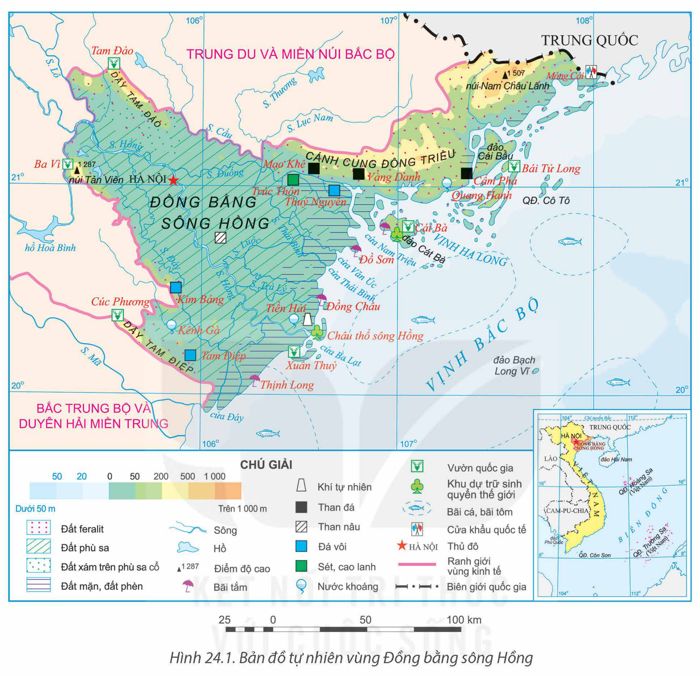
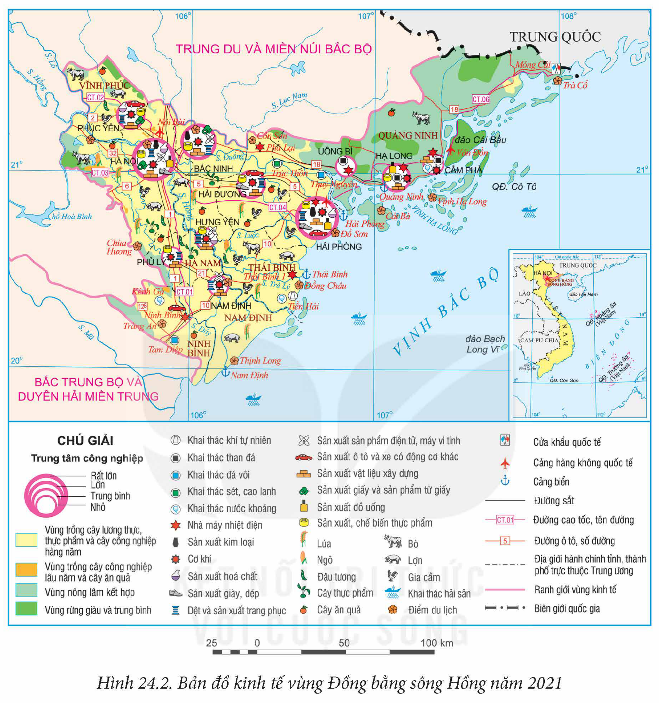

<!-- pdf:107 -->

# BÀI 24: PHÁT TRIỂN KINH TẾ – XÃ HỘI Ở ĐỒNG BẰNG SÔNG HỒNG

## 🔴 Mở đầu

Đồng bằng sông Hồng là vùng có lịch sử khai thác lãnh thổ lâu đời, nhiều thế mạnh để phát triển kinh tế – xã hội nhưng cũng có những hạn chế nhất định. Thế mạnh và hạn chế của vùng như thế nào? Vấn đề phát triển công nghiệp, dịch vụ của vùng ra sao?

## I. KHÁI QUÁT

### 1. Vị trí địa lí và phạm vi lãnh thổ

<!-- term: Đồng bằng sông Hồng -->
Đồng bằng sông Hồng bao gồm 2 thành phố trực thuộc Trung ương là Hà Nội, Hải Phòng và 9 tỉnh: Hải Dương, Hà Nam, Nam Định, Thái Bình, Hưng Yên, Ninh Bình, Vĩnh Phúc, Bắc Ninh và Quảng Ninh. Diện tích của vùng là 21,3 nghìn km² (năm 2021).

Vùng giáp với nước láng giềng Trung Quốc, vùng Trung du và miền núi Bắc Bộ, Bắc Trung Bộ và Duyên hải miền Trung. Vùng có Thủ đô Hà Nội là trung tâm chính trị, kinh tế, văn hoá của cả nước. Đồng bằng sông Hồng có vùng biển rộng lớn thuộc vịnh Bắc Bộ với nhiều đảo, quần đảo như Cô Tô, Cái Bầu (Quảng Ninh), Cát Bà, Bạch Long Vĩ (Hải Phòng),...

Vùng có cửa khẩu thông thương với Trung Quốc, có các tuyến đường ô tô, đường sắt, đường biển, đường hàng không thuận lợi để phát triển kinh tế, thu hút đầu tư và giao lưu, hợp tác trong và ngoài nước. Vùng là địa bàn chiến lược về kinh tế, chính trị, quốc phòng an ninh.

### 2. Dân số

<!-- term: Đồng bằng sông Hồng -->
Đồng bằng sông Hồng có số dân đông nhất cả nước. Năm 2021, số dân của vùng là 23,2 triệu người, tỉ lệ tăng dân số tự nhiên là 1,07%.

<!-- term: Đồng bằng sông Hồng -->
Đồng bằng sông Hồng có mật độ dân số cao nhất cả nước, năm 2021 là 1 091 người/km², gấp 3,7 lần so với trung bình cả nước. Tỉ lệ dân thành thị cao hơn mức trung bình của cả nước, đạt 37,6% năm 2021.

Đồng bằng sông Hồng có nhiều dân tộc sinh sống như Kinh, Dao, Tày, Sán Dìu, Mường,...

> ❓ Dựa vào thông tin mục I và hình 24.1, hãy:
> – Trình bày đặc điểm vị trí địa lí và phạm vi lãnh thổ của vùng Đồng bằng sông Hồng.
> – Nêu một số đặc điểm về dân số của vùng.

<!-- pdf:108 -->

## II. CÁC THẾ MẠNH VÀ HẠN CHẾ ĐỐI VỚI SỰ PHÁT TRIỂN KINH TẾ – XÃ HỘI

### 1. Điều kiện tự nhiên và tài nguyên thiên nhiên

**a) Thế mạnh**

– Địa hình và đất: Phần lớn diện tích của vùng là địa hình đồng bằng được bồi đắp bởi hệ thống sông Hồng và sông Thái Bình, có đất phù sa màu mỡ thuận lợi để quy hoạch vùng chuyên canh cây lương thực, thực phẩm. Vùng còn có địa hình đồi núi ở phía bắc, rìa phía tây và tây nam, với đất feralit thuận lợi cho phát triển cây công nghiệp, cây ăn quả. Vùng biển Quảng Ninh, Hải Phòng có nhiều đảo, quần đảo với cảnh quan đa dạng, thuận lợi để phát triển du lịch. Khu vực ven biển có diện tích mặt nước thuận lợi cho nuôi trồng thuỷ sản.

– Khí hậu: Vùng có khí hậu nhiệt đới ẩm gió mùa, nhiệt độ trung bình năm cao, lượng mưa trung bình năm từ 1 500 đến 2 000 mm; trong năm có một mùa đông lạnh (2 đến 3 tháng nhiệt độ dưới 18°C), thuận lợi để phát triển nông nghiệp nhiệt đới và trồng cây ưa lạnh trong vụ đông.

– Nguồn nước: Mạng lưới sông ngòi dày đặc, có nhiều hệ thống sông lớn, nguồn nước ngầm khá phong phú, cung cấp nước cho sản xuất và sinh hoạt. Vùng có nguồn nước khoáng ở Quang Hanh (Quảng Ninh), Tiền Hải (Thái Bình), Kênh Gà (Ninh Bình),... thuận lợi cho phát triển du lịch nghỉ dưỡng.

– Rừng: Diện tích rừng trong vùng là 487,4 nghìn ha, tập trung chủ yếu ở Quảng Ninh và các khu vực đồi núi ở rìa phía tây, tây nam của vùng và trên các đảo, ven biển có rừng ngập mặn. Trong vùng có các vườn quốc gia như: Ba Vì (Hà Nội), Cát Bà (Hải Phòng), Tam Đảo (Vĩnh Phúc),... và các khu dự trữ sinh quyển Cát Bà, Châu thổ sông Hồng.

– Khoáng sản: Vùng có một số loại khoáng sản có giá trị để phát triển công nghiệp. Than có trữ lượng lớn nhất, chiếm trên 90% trữ lượng than cả nước. Than đá phân bố ở Quảng Ninh, than nâu ở các tỉnh phía nam của vùng. Ngoài ra, đá vôi có ở Ninh Bình, Hà Nam, Vĩnh Phúc...; sét, cao lanh ở Hải Dương, Quảng Ninh,...

– Biển là thế mạnh của Đồng bằng sông Hồng trong phát triển kinh tế. Vùng có đường bờ biển dài từ Quảng Ninh đến Ninh Bình, có nhiều bãi tắm, trên biển có nhiều đảo, đặc biệt quần thể vịnh Hạ Long và quần đảo Cát Bà là di sản thiên nhiên thế giới tạo thuận lợi để phát triển du lịch. Diện tích vùng biển rộng, nhiều vịnh, nhiều cửa sông, có ngư trường trọng điểm Hải Phòng – Quảng Ninh thuận lợi để nuôi trồng, khai thác thuỷ sản và phát triển giao thông vận tải biển.

**b) Hạn chế**

– Hằng năm, vùng chịu ảnh hưởng của nhiều thiên tai, nhất là bão, lũ.

– Tác động của biến đổi khí hậu đến vùng ngày càng phức tạp hơn.

– Vấn đề ô nhiễm môi trường ở nhiều nơi, đặc biệt ở các đô thị lớn đang trở thành sức ép trong phát triển bền vững.

<!-- pdf:109 -->

*Hình 24.1. Bản đồ tự nhiên vùng Đồng bằng sông Hồng*

> ❓ Dựa vào thông tin mục 1 và hình 24.1, hãy phân tích các thế mạnh và hạn chế về điều kiện tự nhiên và tài nguyên thiên nhiên đối với việc phát triển kinh tế – xã hội của vùng Đồng bằng sông Hồng.

### 2. Điều kiện kinh tế – xã hội

**a) Thế mạnh**

– Dân cư và nguồn lao động: Đồng bằng sông Hồng có số dân đông, nguồn lao động dồi dào. Lực lượng lao động từ 15 tuổi trở lên chiếm khoảng 50% tổng số dân của vùng, tỉ lệ lao động đã qua đào tạo cao nhất cả nước (37,0% tổng lao động của vùng năm 2021). Nguồn lao động dồi dào, trình độ cao, thuận lợi cho thu hút đầu tư, ứng dụng khoa học – công nghệ trong sản xuất và phát triển đa ngành kinh tế.

<!-- pdf:110 -->

– Cơ sở hạ tầng và cơ sở vật chất – kĩ thuật thuộc loại tốt nhất cả nước. Giao thông vận tải có nhiều loại hình, mạng lưới bưu chính viễn thông phát triển rộng khắp, khả năng cung cấp điện, nước và các điều kiện cơ sở vật chất – kĩ thuật của các ngành kinh tế tốt là điều kiện thuận lợi thúc đẩy sự phát triển kinh tế – xã hội.

– Chính sách phát triển kinh tế: Đồng bằng sông Hồng thực hiện chủ trương tái cơ cấu nền kinh tế, đẩy mạnh phát triển kinh tế số, kinh tế xanh, kinh tế tuần hoàn,... góp phần thúc đẩy kinh tế của vùng tăng trưởng nhanh và hướng đến phát triển bền vững.

<!-- term: Vùng động lực phía bắc -->
– Vốn đầu tư: Đồng bằng sông Hồng có vùng động lực phía bắc với tam giác là Hà Nội – Hải Phòng – Quảng Ninh, có sức thu hút nguồn vốn đầu tư trong và ngoài nước lớn. Năm 2022, vùng chiếm 33,6% tổng số dự án đầu tư trực tiếp nước ngoài và 30,2% tổng số vốn đăng kí của cả nước. Đây là điều kiện thuận lợi thúc đẩy kinh tế của vùng phát triển nhanh.

– Lịch sử – văn hoá: Vùng có truyền thống văn hoá và lịch sử lâu đời nhất nước ta. Trong vùng, có nhiều di sản văn hoá thế giới, nhiều di tích lịch sử – văn hoá, các giá trị văn hoá truyền thống, lễ hội,... thuận lợi để phát triển kinh tế, đặc biệt là du lịch.

**b) Hạn chế**

– Số dân đông, mật độ dân số cao gây khó khăn cho giải quyết việc làm, sử dụng tài nguyên thiên nhiên và bảo vệ môi trường.

– Cơ sở hạ tầng ở một số nơi quá tải, ảnh hưởng đến phát triển kinh tế – xã hội.

> ❓ Dựa vào thông tin mục 2, hãy phân tích các thế mạnh và hạn chế của điều kiện kinh tế – xã hội đối với sự phát triển kinh tế – xã hội của vùng Đồng bằng sông Hồng.

## III. MỘT SỐ VẤN ĐỀ PHÁT TRIỂN KINH TẾ – XÃ HỘI

### 1. Vấn đề phát triển công nghiệp

<!-- term: Công nghiệp ở Đồng bằng sông Hồng -->
Công nghiệp của Đồng bằng sông Hồng phát triển sớm. Giá trị sản xuất công nghiệp cao và tăng nhanh, chiếm trên 37% giá trị sản xuất công nghiệp của cả nước (năm 2021).

Công nghiệp phát triển theo hướng hiện đại, công nghệ cao, ít phát thải khí nhà kính, có khả năng cạnh tranh, giá trị gia tăng cao, tham gia sâu, toàn diện vào vào mạng lưới sản xuất, chuỗi giá trị toàn cầu.

<!-- term: Công nghiệp ở Đồng bằng sông Hồng -->
Cơ cấu ngành công nghiệp khá đa dạng. Một số ngành công nghiệp nổi bật của vùng là: công nghiệp sản xuất sản phẩm điện tử, máy vi tính; sản xuất ô tô và xe có động cơ khác; sản xuất, chế biến thực phẩm; dệt, sản xuất trang phục; nhiệt điện và khai thác than.

– Công nghiệp sản xuất sản phẩm điện tử, máy vi tính phát triển nhanh. Các sản phẩm chủ yếu là máy tính, thiết bị điện tử, điện tử tiêu dùng và thiết bị viễn thông. Các cơ sở sản xuất phân bố chủ yếu ở Bắc Ninh, Hà Nội, Vĩnh Phúc,...

<!-- pdf:111 -->

*Hình 24.2. Bản đồ kinh tế vùng Đồng bằng sông Hồng năm 2021*

– Công nghiệp sản xuất ô tô và xe có động cơ khác có sự tham gia của các doanh nghiệp FDI, tham gia vào chuỗi cung ứng toàn cầu, phân bố chủ yếu ở Hà Nội, Hải Phòng, Vĩnh Phúc, Ninh Bình,...

– Công nghiệp sản xuất, chế biến thực phẩm có vị trí quan trọng trong cơ cấu công nghiệp của vùng, phân bố chủ yếu ở Hà Nội, Hải Phòng, Quảng Ninh,...

– Công nghiệp dệt, sản xuất trang phục phát triển dựa trên cơ sở nguồn lao động dồi dào, thị trường tiêu thụ rộng lớn. Các cơ sở lớn tập trung ở Hà Nội, Nam Định, Hưng Yên.

– Nhiệt điện: Vùng có nhiều nhà máy nhiệt điện có công suất lớn, nguồn nhiên liệu chủ yếu là than như: Phả Lại (Hải Dương), Cẩm Phả, Mông Dương,... (Quảng Ninh), Hải Phòng 1 và 2 (Hải Phòng), Thái Bình 1 và 2 (Thái Bình),...

<!-- pdf:112 -->

<!-- term: Công nghiệp ở Đồng bằng sông Hồng -->
– Công nghiệp khai thác than tập trung chủ yếu ở Quảng Ninh. Sản lượng than khai thác của vùng năm 2021 là 45,3 triệu tấn (chiếm hơn 90% của cả nước). Hiện nay, việc khai thác than có sự thay đổi, một số mỏ lộ thiên đã dừng khai thác đồng thời tăng cường ứng dụng công nghệ cao để giảm thất thoát tài nguyên và hạn chế ô nhiễm môi trường.

<!-- term: Công nghiệp ở Đồng bằng sông Hồng -->
Đồng bằng sông Hồng có mức độ tập trung công nghiệp cao nhất cả nước. Các khu công nghiệp tập trung chủ yếu ở Hà Nội, Vĩnh Phúc, Bắc Ninh, Hải Phòng, Quảng Ninh,... Các trung tâm công nghiệp của vùng là Hà Nội, Hải Phòng, Bắc Ninh, Hạ Long.

Định hướng phát triển: đẩy mạnh ứng dụng công nghệ hiện đại, ít phát thải khí nhà kính, có khả năng cạnh tranh, tham gia toàn diện vào chuỗi giá trị toàn cầu; ưu tiên phát triển một số ngành công nghiệp mới như sản xuất chíp, bán dẫn, rô-bốt, vật liệu mới,...

> ❓ Dựa vào thông tin mục 1 và hình 24.2, hãy phân tích vấn đề phát triển công nghiệp ở Đồng bằng sông Hồng.

### 2. Vấn đề phát triển dịch vụ

<!-- term: Dịch vụ ở Đồng bằng sông Hồng -->
Đồng bằng sông Hồng có ngành dịch vụ phát triển mạnh, đóng góp 42,1% vào GRDP của vùng (năm 2021).

<!-- term: Dịch vụ ở Đồng bằng sông Hồng -->
Cơ cấu ngành đa dạng và đang phát triển theo hướng hiện đại, hội nhập. Một số ngành dịch vụ nổi bật của vùng là giao thông vận tải, thương mại, du lịch, tài chính ngân hàng, bưu chính viễn thông,...

**a) Giao thông vận tải**

Giao thông vận tải ở Đồng bằng sông Hồng phát triển nhanh, đồng bộ, hiện đại, với đầy đủ các loại hình giao thông.

– Đường ô tô phát triển nhanh cả về mạng lưới và chất lượng. Các tuyến cao tốc (Hà Nội – Hải Phòng, Hải Phòng – Móng Cái, Hà Nội – Lào Cai,...), các tuyến quốc lộ 5 (Hà Nội – Hải Phòng), quốc lộ 10 (Ninh Bình – Hải Phòng), quốc lộ 18 (Hà Nội – Bắc Ninh – Hải Dương),... giúp kết nối các địa phương trong vùng và cả nước cũng như quốc tế.

– Hệ thống đường sắt phát triển. Thủ đô Hà Nội là đầu mối đường sắt lớn nhất cả nước. Từ Hà Nội, có các tuyến đường sắt đi Thành phố Hồ Chí Minh, Lào Cai, Lạng Sơn, Hải Phòng, Thái Nguyên. Tuyến đường sắt trên cao (Cát Linh – Hà Đông, Nhổn – ga Hà Nội) góp phần giải quyết tình trạng ùn tắc giao thông ở Hà Nội.

– Giao thông đường hàng không phát triển nhanh. Đồng bằng sông Hồng có 3 cảng hàng không quốc tế là Nội Bài (Hà Nội), Cát Bi (Hải Phòng) và Vân Đồn (Quảng Ninh).

– Giao thông đường biển trong vùng phát triển mạnh. Vùng có 4 cảng biển, với nhiều bến cảng, trong đó cảng Hải Phòng là cảng đặc biệt, cảng Quảng Ninh là cảng loại I. Các tuyến đường biển quốc tế quan trọng là từ Hải Phòng đi Hồng Công, Thượng Hải, Tô-ky-ô, Vla-đi-vô-xtốc,...; các tuyến đường biển nội địa từ Hải Phòng đi Đà Nẵng, Thành phố Hồ Chí Minh,...

– Các tuyến giao thông đường sông như sông Hồng, sông Đuống, sông Luộc, sông Đáy, sông Thái Bình,... có vai trò quan trọng trong vận chuyển hàng hoá ở vùng.

<!-- pdf:113 -->

Đồng bằng sông Hồng có khối lượng hàng hoá, hành khách vận chuyển lớn, chiếm tỉ trọng cao so với cả nước. Năm 2021, vùng chiếm 44,9% khối lượng hành khách vận chuyển và 36,4% khối lượng hàng hoá vận chuyển của cả nước. Thủ đô Hà Nội và thành phố Hải Phòng là hai đầu mối giao thông quan trọng nhất của vùng.

**b) Thương mại**

Đồng bằng sông Hồng phát triển mạnh, cả nội thương và ngoại thương.

– Hoạt động nội thương phát triển mạnh ở các địa phương, hàng hoá phong phú, không ngừng nâng cao về chất lượng và mẫu mã sản phẩm. Hình thức buôn bán đa dạng và ngày càng hiện đại hơn (chợ, siêu thị, trung tâm thương mại, thương mại điện tử,... Tổng mức bán lẻ hàng hoá và doanh thu dịch vụ tiêu dùng tăng nhanh, năm 2021 chiếm 25,9% so với cả nước. Hà Nội là trung tâm thương mại lớn nhất vùng.

– Trị giá xuất khẩu tăng nhanh và chiếm tỉ trọng cao trong cả nước. Năm 2021, vùng chiếm gần 35% trị giá xuất khẩu của cả nước. Các địa phương có trị giá xuất khẩu cao nhất trong vùng là Bắc Ninh, Hải Phòng, Hà Nội, Hải Dương.

**c) Du lịch**

Du lịch là ngành kinh tế mũi nhọn của vùng, phát triển dựa trên tài nguyên du lịch tự nhiên và tài nguyên du lịch văn hoá phong phú. Loại hình du lịch trong vùng rất đa dạng, trong đó du lịch biển đảo, du lịch văn hoá là thế mạnh. Doanh thu du lịch lữ hành chiếm tỉ trọng cao trong cả nước. Các điểm du lịch nổi tiếng là vịnh Hạ Long, Tràng An, Cát Bà, Cúc Phương,... Các trung tâm du lịch lớn là Hà Nội, Hạ Long, Hải Phòng.

**d) Các ngành dịch vụ khác**

Tài chính ngân hàng phát triển mạnh do kinh tế vùng phát triển. Ngành đang ứng dụng nhiều phương thức mới trong kinh doanh như: phát triển các mô hình ngân hàng số, gia tăng tiện ích,... Hà Nội là trung tâm tài chính ngân hàng lớn nhất vùng. Bưu chính viễn thông ngày càng được hiện đại hoá, tạo điều kiện thúc đẩy việc chuyển đổi số trong các hoạt động sản xuất và sinh hoạt. Các lĩnh vực dịch vụ khác như: giáo dục – đào tạo, y tế, logistics,... cũng phát triển mạnh.

> ❓ Dựa vào thông tin mục 2 và hình 24.2, hãy phân tích vấn đề phát triển dịch vụ ở vùng Đồng bằng sông Hồng.

## ✏️ Luyện tập và vận dụng

**Luyện tập**

Lập sơ đồ thể hiện thế mạnh đối với phát triển kinh tế – xã hội của vùng Đồng bằng sông Hồng.

**Vận dụng**

Viết đoạn văn ngắn (khoảng 200 từ), giới thiệu tiềm năng phát triển du lịch của vùng Đồng bằng sông Hồng.

## 📷 Danh sách hình trong bài

| Mã hình | Trang PDF | Vị trí trong bài | Chú thích gốc |
| --- | --- | --- | --- |
| H12-dia-b24-01 | 109 | Mục II.1.b | Hình 24.1. Bản đồ tự nhiên vùng Đồng bằng sông Hồng |
| H12-dia-b24-02 | 111 | Mục III.1 | Hình 24.2. Bản đồ kinh tế vùng Đồng bằng sông Hồng năm 2021 |
