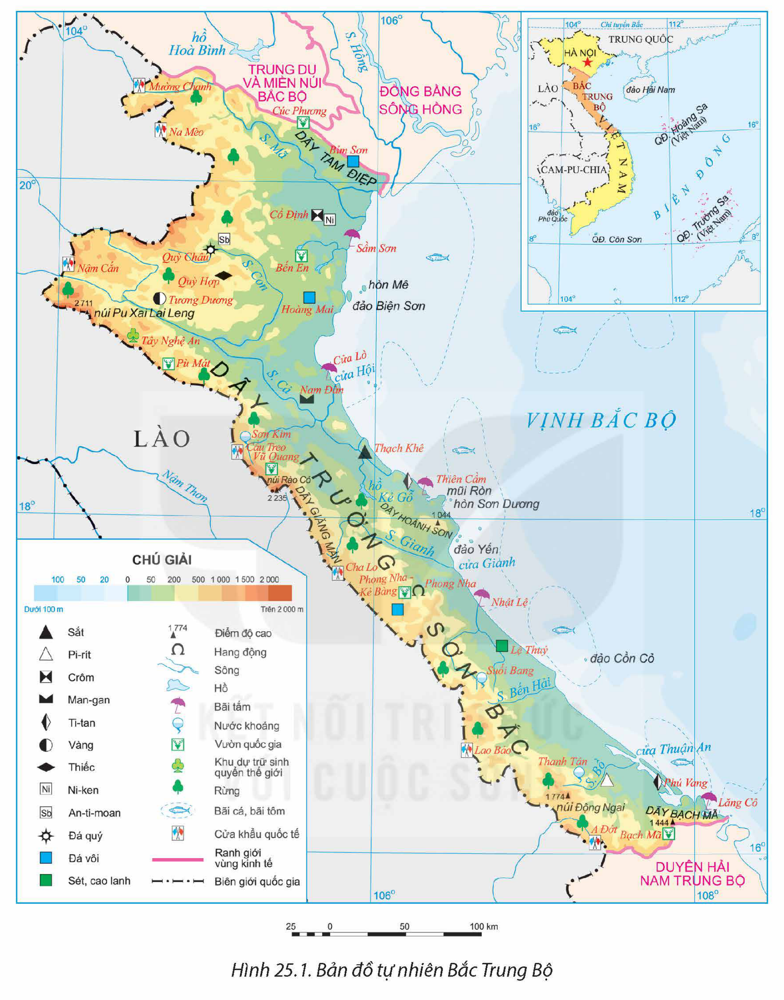
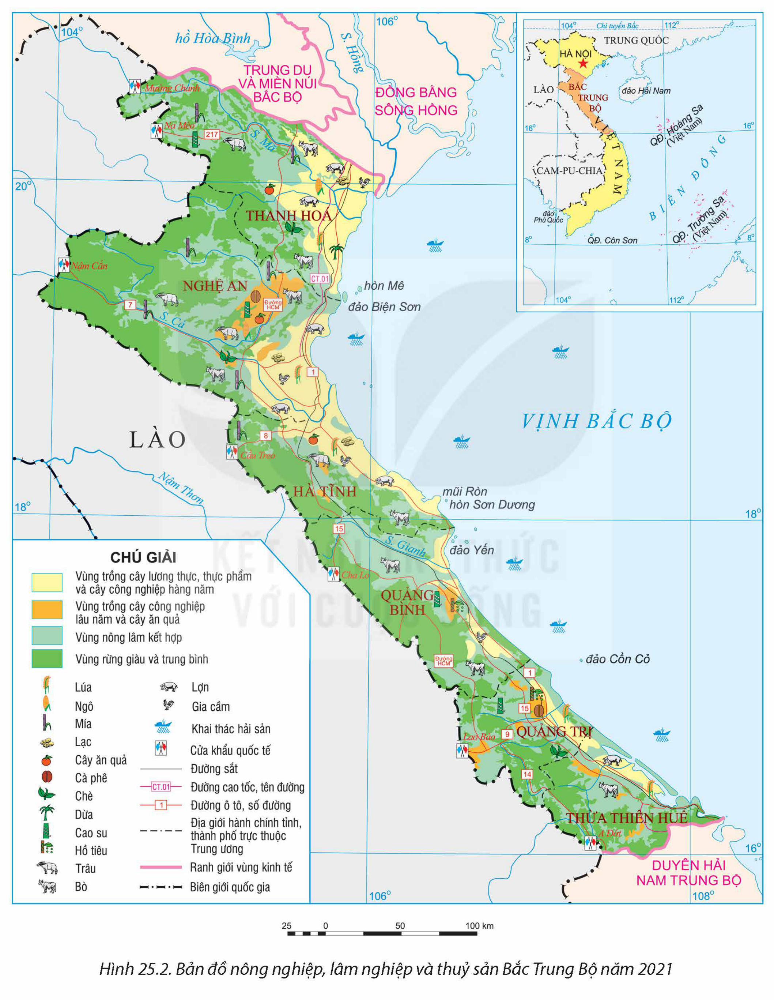
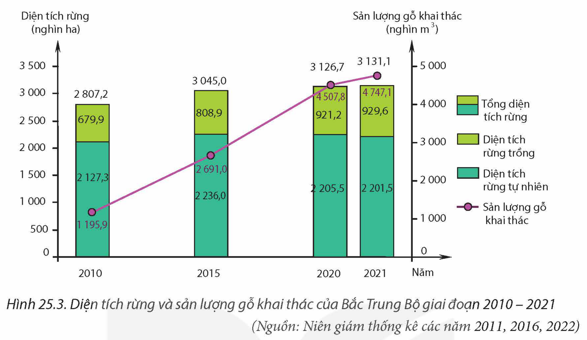
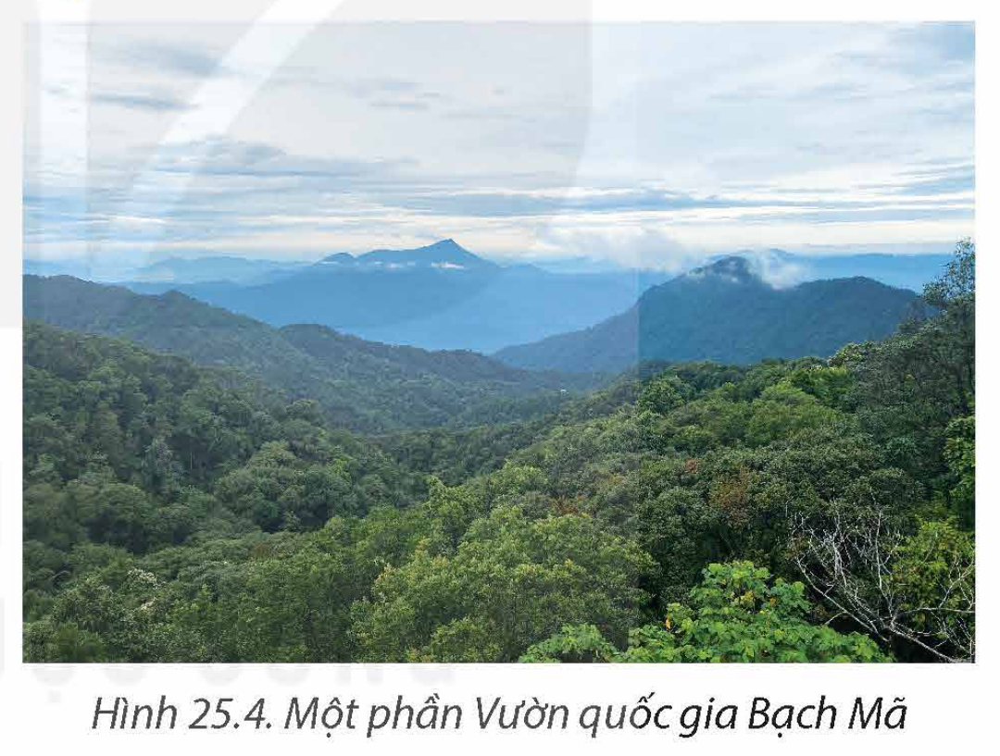

<!-- pdf:114 -->

# BÀI 25: PHÁT TRIỂN NÔNG NGHIỆP, LÂM NGHIỆP VÀ THUỶ SẢN Ở BẮC TRUNG BỘ

## 🔴 Mở đầu

Bắc Trung Bộ là một bộ phận lãnh thổ của vùng Bắc Trung Bộ và Duyên hải miền Trung. Bắc Trung Bộ có thế mạnh để phát triển toàn diện nông nghiệp, lâm nghiệp và thuỷ sản. Việc hình thành và phát triển nông nghiệp, lâm nghiệp, thuỷ sản có ý nghĩa quan trọng đối với sự hình thành cơ cấu kinh tế. Bắc Trung Bộ có thế mạnh gì để hình thành và phát triển nông nghiệp, lâm nghiệp và thuỷ sản? Nông nghiệp, lâm nghiệp và thuỷ sản của Bắc Trung Bộ có đặc điểm gì nổi bật?

## I. KHÁI QUÁT

### 1. Vị trí địa lí và phạm vi lãnh thổ

> 💡 EM CÓ BIẾT?
>
> Theo Nghị quyết số 81/2023/QH15 ngày 09 – 01 – 2023 của Quốc hội về Quy hoạch tổng thể quốc gia thời kì 2021 – 2030, tầm nhìn đến năm 2050, nước ta được chia thành 6 vùng kinh tế: Đồng bằng sông Hồng, Trung du và miền núi Bắc Bộ, Bắc Trung Bộ và Duyên hải miền Trung, Tây Nguyên, Đông Nam Bộ, Đồng bằng sông Cửu Long. Như vậy, Bắc Trung Bộ là một bộ phận lãnh thổ thuộc vùng Bắc Trung Bộ và Duyên hải miền Trung.

<!-- term: Bắc Trung Bộ -->
Bắc Trung Bộ bao gồm 6 tỉnh là Thanh Hoá, Nghệ An, Hà Tĩnh, Quảng Bình, Quảng Trị, Thừa Thiên Huế. Lãnh thổ của vùng kéo dài theo chiều bắc nam với diện tích 51,2 nghìn km².

<!-- term: Bắc Trung Bộ -->
Bắc Trung Bộ giáp vùng Trung du và miền núi Bắc Bộ, vùng Đồng bằng sông Hồng, Duyên hải Nam Trung Bộ (thuộc vùng Bắc Trung Bộ và Duyên hải miền Trung) và nước láng giềng Lào. Phía đông của Bắc Trung Bộ có vùng biển rộng lớn, với các đảo như hòn Mê (Thanh Hoá), hòn Ngư (Nghệ An), đảo Yến (Quảng Bình), đảo Cồn Cỏ (Quảng Trị),... có ý nghĩa quan trọng đối với phát triển kinh tế – xã hội và quốc phòng an ninh.

Bắc Trung Bộ nằm trên trục giao thông huyết mạch của Việt Nam, đồng thời là một trong những cửa ngõ thông ra biển của các quốc gia trong khu vực ASEAN.

### 2. Dân số

Năm 2021, Bắc Trung Bộ có dân số hơn 11 triệu người, tỉ lệ tăng dân số tự nhiên tương đương mức trung bình cả nước (0,93%).

Mật độ dân số là 218 người/km² (năm 2021). Dân cư chủ yếu tập trung đông ở khu vực đồng bằng và ven biển. Tỉ lệ dân thành thị của Bắc Trung Bộ là khoảng 25,4% năm 2021.

Bắc Trung Bộ có nhiều dân tộc cùng sinh sống như: Kinh, Thái, Mường, HMông,...

> ❓ Dựa vào thông tin mục I và hình 25.1, hãy:
> – Trình bày đặc điểm vị trí địa lí và phạm vi lãnh thổ của Bắc Trung Bộ.
> – Nêu đặc điểm nổi bật về dân số của Bắc Trung Bộ.

<!-- pdf:115 -->

## II. THẾ MẠNH VÀ HẠN CHẾ ĐỐI VỚI VIỆC HÌNH THÀNH VÀ PHÁT TRIỂN NÔNG NGHIỆP, LÂM NGHIỆP VÀ THUỶ SẢN

### 1. Thế mạnh

**a) Điều kiện tự nhiên và tài nguyên thiên nhiên**

<!-- term: Cơ cấu kinh tế lâm nghiệp, nông nghiệp và thuỷ sản ở Bắc Trung Bộ -->
– Địa hình và đất: Lãnh thổ Bắc Trung Bộ kéo dài từ bắc xuống nam và hẹp ngang theo chiều đông tây, với trên 70% diện tích là đồi núi. Từ tây sang đông, có 3 dạng địa hình khá phổ biến: đồi núi ở phía tây, đồng bằng chuyển tiếp, biển, thềm lục địa và các đảo ở phía đông, tạo thuận lợi để Bắc Trung Bộ hình thành cơ cấu kinh tế lâm nghiệp, nông nghiệp và thuỷ sản. Trong vùng có đồng bằng Thanh Hoá, Nghệ An, Hà Tĩnh có đất phù sa phù hợp cho sản xuất lương thực; khu vực đồi núi phía tây có đất feralit phù hợp cho phát triển cây công nghiệp lâu năm, cây ăn quả và trồng rừng.

– Khí hậu nhiệt đới ẩm gió mùa có mùa đông lạnh, có sự phân hoá giữa các khu vực phía đông và khu vực phía tây cho phép Bắc Trung Bộ phát triển nền nông nghiệp nhiệt đới với cơ cấu sản phẩm đa dạng.

– Nguồn nước: Mạng lưới sông ngòi Bắc Trung Bộ khá dày với nhiều lưu vực sông như: sông Mã, sông Chu, sông Cả, sông Gianh,... có giá trị về thuỷ lợi, du lịch và giao thông vận tải. Trong vùng còn có một số hồ, đầm phá lớn như: hồ Kẻ Gỗ (Hà Tĩnh), đầm Cầu Hai (Thừa Thiên Huế),... thuận lợi cho nuôi trồng thuỷ sản nước ngọt và nước lợ.

– Rừng: Bắc Trung Bộ có diện tích rừng tự nhiên chiếm 70% tổng diện tích rừng, tỉ lệ che phủ rừng cao hơn mức trung bình của cả nước. Đặc biệt, khu vực rừng ở Bắc Trung Bộ có nhiều loại gỗ, lâm sản, các loài động vật quý nằm trong Sách đỏ Việt Nam. Ở đây có nhiều khu bảo tồn thiên nhiên, vườn quốc gia như Pù Mát, Phong Nha – Kẻ Bàng,... Đây là thế mạnh để phát triển ngành lâm nghiệp và bảo vệ môi trường.

– Biển, đảo: Vùng có đường bờ biển dài, vùng biển rộng, giàu tiềm năng về sinh vật, thuận lợi cho phát triển hoạt động khai thác và nuôi trồng hải sản.

**b) Điều kiện kinh tế – xã hội**

– Bắc Trung Bộ có lực lượng lao động dồi dào, người lao động chăm chỉ, giàu nghị lực và kinh nghiệm sản xuất.

– Cơ sở hạ tầng ngày càng hoàn thiện, hạ tầng giao thông của vùng có đầy đủ các loại hình: đường ô tô, đường sông, đường biển, đường hàng không. Trong đó đường ô tô tạo thành các trục giao thương hàng hoá theo hướng bắc – nam, đông – tây, tạo điều kiện phát triển nông nghiệp, lâm nghiệp và thuỷ sản theo hướng hàng hoá.

– Việc áp dụng các tiến bộ khoa học – công nghệ đã tạo ra nhiều đổi mới trong các hoạt động sản xuất của ngành nông nghiệp, lâm nghiệp và thuỷ sản. Bắc Trung Bộ cũng tăng cường đầu tư vốn để phát triển nông nghiệp, lâm nghiệp và thuỷ sản, đặc biệt quan tâm đầu tư vào các mô hình nông nghiệp công nghệ cao, nông nghiệp hữu cơ.

<!-- pdf:116 -->

*Hình 25.1. Bản đồ tự nhiên Bắc Trung Bộ*

### 2. Hạn chế

– Tác động của biến đổi khí hậu và thiên tai (bão, lũ, ngập lụt, sạt lở đất,...) xảy ra thường xuyên gây ảnh hưởng đến sản xuất nông nghiệp, lâm nghiệp và thuỷ sản.

– Cơ sở hạ tầng và cơ sở vật chất – kĩ thuật của Bắc Trung Bộ còn hạn chế, đặc biệt ở phía tây.

<!-- pdf:117 -->

> ❓ Dựa vào thông tin mục II và hình 25.1, hãy phân tích thế mạnh và hạn chế đối với việc hình thành và phát triển nông nghiệp, lâm nghiệp và thuỷ sản ở Bắc Trung Bộ.

## III. MỘT SỐ ĐẶC ĐIỂM NỔI BẬT VỀ NÔNG NGHIỆP, LÂM NGHIỆP VÀ THUỶ SẢN

### 1. Nông nghiệp

Nông nghiệp là ngành đóng góp phần lớn giá trị sản xuất của ngành nông nghiệp, lâm nghiệp và thuỷ sản ở Bắc Trung Bộ. Năm 2021, giá trị sản xuất của ngành chiếm 74,5% giá trị sản xuất của nông nghiệp, lâm nghiệp và thuỷ sản, tốc độ tăng trưởng khá nhanh.

Sản xuất nông nghiệp có sự thay đổi theo hướng sản xuất hàng hoá tập trung, ứng dụng công nghệ cao nhằm tăng năng suất và chất lượng sản phẩm. Các mô hình sản xuất theo hướng hữu cơ, cùng với công nghệ gen, lai tạo giống mới,... ngày càng phổ biến trong trồng trọt, chăn nuôi.

**a) Trồng trọt**

– Cây lương thực (chủ yếu là lúa), tập trung ở các đồng bằng ven biển Bắc Trung Bộ. Hai tỉnh có diện tích gieo trồng và sản lượng lúa lớn nhất là Thanh Hoá và Nghệ An.

Bảng 25.1. DIỆN TÍCH VÀ SẢN LƯỢNG LÚA CỦA BẮC TRUNG BỘ GIAI ĐOẠN 2010 – 2021

| Năm | 2010 | 2015 | 2021 |
| --- | --- | --- | --- |
| Diện tích gieo trồng lúa *(nghìn ha)* | 690,0 | 701,5 | 674,0 |
| Sản lượng lúa *(triệu tấn)* | 3,4 | 3,8 | 3,9 |

*(Nguồn: Niên giám thống kê các năm 2011, 2016, 2022)*

– Cây công nghiệp hàng năm như lạc, mía,... được trồng với diện tích khá lớn ở các vùng đất cát ven biển của hầu hết các tỉnh; mía ở vùng gò đồi phía tây, nhất là ở tỉnh Thanh Hoá, Nghệ An,...

– Cây công nghiệp lâu năm được phát triển ở một số nơi như cà phê (Nghệ An, Quảng Trị), chè (Nghệ An), cao su và hồ tiêu (Quảng Bình, Quảng Trị). Bắc Trung Bộ cũng phát triển một số cây ăn quả đặc sản như cam Vinh (Nghệ An), bưởi Phúc Trạch (Hà Tĩnh),...

**b) Chăn nuôi**

Nhiều mô hình chăn nuôi áp dụng công nghệ cao đã hình thành và đem lại hiệu quả kinh tế cao. Năm 2021, Bắc Trung Bộ có số lượng đàn trâu, đàn bò đứng thứ hai cả nước,

<!-- pdf:118 -->

số lượng lợn và gia cầm tăng nhanh. Chăn nuôi trâu, bò phát triển mạnh ở Nghệ An, Thanh Hoá, Hà Tĩnh, bò sữa phát triển mạnh nhất ở Nghệ An. Lợn và gia cầm được nuôi ở hầu hết các tỉnh.

*Hình 25.2. Bản đồ nông nghiệp, lâm nghiệp và thuỷ sản Bắc Trung Bộ năm 2021*

<!-- pdf:119 -->

Bảng 25.2. SỐ LƯỢNG GIA SÚC, GIA CẦM Ở BẮC TRUNG BỘ NĂM 2010 VÀ NĂM 2021

| Vật nuôi | Năm 2010 — Số lượng | Năm 2010 — % so với cả nước | Năm 2021 — Số lượng | Năm 2021 — % so với cả nước |
| --- | --- | --- | --- | --- |
| Trâu *(nghìn con)* | 710,9 | 24,4 | 581,9 | 25,7 |
| Bò *(triệu con)* | 1,0 | 17,1 | 1,1 | 17,5 |
| Lợn *(triệu con)* | 3,2 | 12,0 | 2,5 | 10,8 |
| Gia cầm *(triệu con)* | 42,6 | 14,1 | 76,2 | 14,7 |
<!-- ocr-ok: bảng có tiêu đề gộp cột/hàng đã đối chiếu ảnh gốc -->

*(Nguồn: Niên giám thống kê các năm 2011, 2016, 2022)*

> ❓ Dựa vào thông tin mục 1 và hình 25.2, hãy trình bày một số đặc điểm nổi bật về ngành nông nghiệp Bắc Trung Bộ.

### 2. Lâm nghiệp

<!-- term: Khu lâm nghiệp ứng dụng công nghệ cao ở Bắc Trung Bộ -->
Ngành lâm nghiệp chiếm 6,8% cơ cấu giá trị sản xuất nông nghiệp, lâm nghiệp và thuỷ sản của Bắc Trung Bộ (năm 2021) và có ý nghĩa quan trọng đối với kinh tế – xã hội, bảo vệ môi trường sinh thái, giảm nhẹ thiên tai. Bắc Trung Bộ đã ứng dụng khoa học – công nghệ vào tất cả các hoạt động của ngành lâm nghiệp. Đặc biệt, ở đây đã thành lập khu lâm nghiệp ứng dụng công nghệ cao (ở tỉnh Nghệ An) với các chức năng sản xuất giống cây lâm nghiệp, chế biến gỗ và lâm sản theo mô hình chuỗi sản xuất khép kín.

Lâm nghiệp của Bắc Trung Bộ đang đẩy mạnh cả hai hoạt động khai thác, chế biến lâm sản và trồng rừng, khoanh nuôi, bảo vệ rừng.

**a) Khai thác, chế biến lâm sản**

Sản lượng gỗ khai thác liên tục tăng, năm 2021 đạt hơn 4,7 triệu m³, chiếm hơn 26% sản lượng gỗ khai thác của cả nước. Nghệ An là tỉnh có sản lượng gỗ khai thác lớn nhất, chiếm 31,4% sản lượng gỗ của Bắc Trung Bộ. Ngoài ra, Bắc Trung Bộ còn có các hoạt động khai thác lâm sản khác như luồng, mây, dược liệu,...

<!-- pdf:120 -->

*Hình 25.3. Diện tích rừng và sản lượng gỗ khai thác của Bắc Trung Bộ giai đoạn 2010 – 2021*

*(Nguồn: Niên giám thống kê các năm 2011, 2016, 2022)*

**b) Trồng rừng, khoanh nuôi, bảo vệ rừng**

Diện tích rừng Bắc Trung Bộ chiếm 21,2% diện tích rừng toàn quốc (năm 2021). Diện tích rừng trồng tăng nhanh với các loại cây trồng chính là bạch đàn, keo tai tượng, keo lá tràm,... Nghệ An, Thanh Hoá, Quảng Bình là tỉnh có diện tích rừng trồng nhiều nhất.

Bắc Trung Bộ có một số vườn quốc gia, khu dự trữ sinh quyển để vừa bảo vệ rừng vừa phát triển du lịch như: Pù Mát, Phong Nha – Kẻ Bàng, Bạch Mã,...

*Hình 25.4. Một phần Vườn quốc gia Bạch Mã*

> ❓ Dựa vào thông tin mục 3 và hình 25.2, hãy trình bày một số đặc điểm nổi bật về ngành lâm nghiệp Bắc Trung Bộ.

### 3. Thuỷ sản

Thuỷ sản là ngành được chú trọng trong quá trình chuyển dịch cơ cấu nông nghiệp, lâm nghiệp và thuỷ sản của Bắc Trung Bộ. Giá trị sản xuất của ngành đóng góp hơn 18% vào giá trị sản xuất toàn ngành nông nghiệp, lâm nghiệp và thuỷ sản (năm 2021).

Sản lượng thuỷ sản liên tục tăng qua các năm. Trong đó, sản lượng thuỷ sản khai thác chiếm phần lớn tổng sản lượng thuỷ sản (73,6% năm 2021).

– Về khai thác: Bắc Trung Bộ đẩy mạnh đánh bắt xa bờ, ứng dụng công nghệ khai thác tiên tiến để truy xuất nguồn gốc sản phẩm, bảo vệ môi trường và bảo tồn đa dạng sinh học,...

<!-- pdf:121 -->

Bảng 25.3. SẢN LƯỢNG THUỶ SẢN BẮC TRUNG BỘ GIAI ĐOẠN 2010 – 2021

*(Đơn vị: nghìn tấn)*

| Sản lượng \ Năm | 2010 | 2015 | 2021 |
| --- | --- | --- | --- |
| Thuỷ sản khai thác | 240,9 | 353,7 | 512,2 |
| Thuỷ sản nuôi trồng | 97,1 | 142,8 | 183,9 |

*(Nguồn: Niên giám thống kê các năm 2011, 2016, 2022)*

– Về nuôi trồng: Đối tượng nuôi trồng thuỷ sản ngày càng đa dạng với nhiều loại có giá trị kinh tế cao (tôm càng xanh, cá bống tượng,...). Nuôi trồng thuỷ sản đang thay đổi mô hình sản xuất sang quy mô lớn hơn theo hướng sản xuất hàng hoá, áp dụng khoa học – công nghệ vào tất cả các khâu.

> ❓ Dựa vào thông tin mục 3 và hình 25.2, hãy trình bày một số đặc điểm nổi bật về ngành thuỷ sản Bắc Trung Bộ.

## ✏️ Luyện tập và vận dụng

**Luyện tập**

1. Dựa vào bảng 25.2, hãy phân tích tình hình phát triển ngành chăn nuôi Bắc Trung Bộ giai đoạn 2010 – 2021.

2. Tại sao việc phát triển nông nghiệp, lâm nghiệp và thuỷ sản có ý nghĩa quan trọng đối với Bắc Trung Bộ?

**Vận dụng**

Sưu tầm hình ảnh, tư liệu về hoạt động của ngành nông nghiệp, lâm nghiệp và thuỷ sản của một tỉnh thuộc Bắc Trung Bộ.

## 📷 Danh sách hình trong bài

| Mã hình | Trang PDF | Vị trí trong bài | Chú thích gốc |
| --- | --- | --- | --- |
| H12-dia-b25-01 | 116 | Mục II.1.b | Hình 25.1. Bản đồ tự nhiên Bắc Trung Bộ |
| H12-dia-b25-02 | 118 | Mục III.1.b | Hình 25.2. Bản đồ nông nghiệp, lâm nghiệp và thuỷ sản Bắc Trung Bộ năm 2021 |
| H12-dia-b25-03 | 120 | Mục III.2.a | Hình 25.3. Diện tích rừng và sản lượng gỗ khai thác của Bắc Trung Bộ giai đoạn 2010 – 2021 |
| H12-dia-b25-04 | 120 | Mục III.2.b | Hình 25.4. Một phần Vườn quốc gia Bạch Mã |
