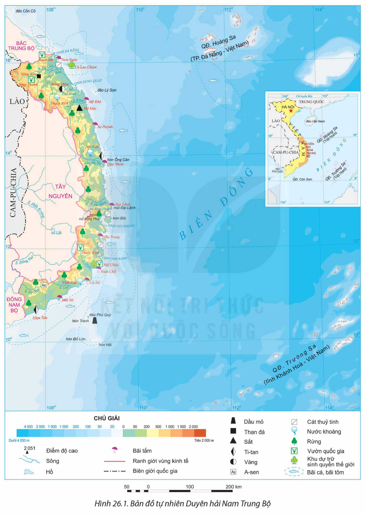
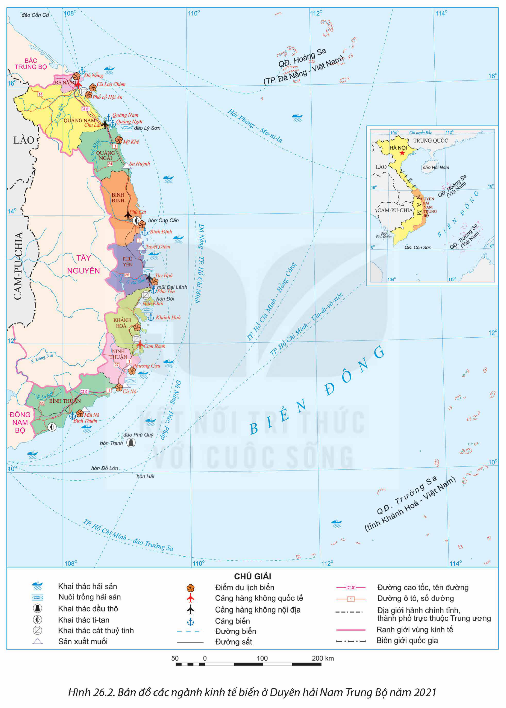

<!-- pdf:122 -->

# BÀI 26: PHÁT TRIỂN KINH TẾ BIỂN Ở DUYÊN HẢI NAM TRUNG BỘ

## 🔴 Mở đầu

Duyên hải Nam Trung Bộ là một bộ phận lãnh thổ của vùng Bắc Trung Bộ và Duyên hải miền Trung. Khai thác tài nguyên sinh vật biển, giao thông vận tải biển, du lịch biển, khai thác khoáng sản biển là những ngành kinh tế quan trọng ở vùng Duyên hải Nam Trung Bộ. Vậy, Duyên hải Nam Trung bộ có thế mạnh gì để phát triển các ngành kinh tế biển? Các ngành kinh tế biển của vùng có xu hướng phát triển gì?

## I. KHÁI QUÁT

### 1. Vị trí địa lí và phạm vi lãnh thổ

<!-- term: Duyên hải Nam Trung Bộ -->
Duyên hải Nam Trung Bộ bao gồm 8 tỉnh, thành phố là: Đà Nẵng, Quảng Nam, Quảng Ngãi, Bình Định, Phú Yên, Khánh Hoà, Ninh Thuận, Bình Thuận với diện tích hơn 44 nghìn km². Duyên hải Nam Trung Bộ giáp Bắc Trung Bộ (bộ phận lãnh thổ của vùng Bắc Trung Bộ và Duyên hải Nam Trung Bộ), vùng Tây Nguyên, vùng Đông Nam Bộ và nước láng giềng Lào.

> 💡 EM CÓ BIẾT?
>
> Theo Nghị quyết số 81/2023/QH15 ngày 09 – 01 – 2023 của Quốc hội về Quy hoạch tổng thể quốc gia thời kì 2021 – 2030, tầm nhìn đến 2050, nước ta có 6 vùng kinh tế: Đồng bằng sông Hồng, Trung du miền núi phía Bắc, Bắc Trung Bộ và Duyên hải miền Trung, Tây Nguyên, Đông Nam Bộ, Đồng bằng sông Cửu Long. Như vậy, Duyên hải Nam Trung Bộ là một bộ phận lãnh thổ của vùng kinh tế Bắc Trung Bộ và Duyên hải miền Trung.
<!-- ocr-ok: hộp EM CÓ BIẾT? đặt song song cột văn bản nên OCR trộn dòng, đã đối chiếu ảnh gốc -->

<!-- term: Duyên hải Nam Trung Bộ -->
Phía đông của Duyên hải Nam Trung Bộ có vùng biển rộng lớn với nhiều đảo và quần đảo có ý nghĩa quan trọng về kinh tế và quốc phòng an ninh như quần đảo Hoàng Sa (huyện đảo thuộc thành phố Đà Nẵng) và quần đảo Trường Sa (huyện đảo thuộc tỉnh Khánh Hoà), đảo Lý Sơn (Quảng Ngãi), đảo Phú Quý (Bình Thuận),...

Duyên hải Nam Trung Bộ là cửa ngõ ra biển của Tây Nguyên và một số quốc gia Đông Nam Á. Với đặc điểm vị trí địa lí như vậy, Duyên hải Nam Trung Bộ thuận lợi phát triển kinh tế theo hướng mở và đẩy mạnh hoạt động giao thương kinh tế với các quốc gia, các vùng kinh tế khác ở nước ta.

### 2. Dân số

Duyên hải Nam Trung Bộ có số dân gần 9,4 triệu người, chiếm 9,6% số dân cả nước. Tỉ lệ tăng dân số tự nhiên ở mức 0,96%.

Mật độ dân số là 211 người/km² (năm 2021). Phân bố dân cư có sự khác biệt giữa vùng đồi núi phía tây và vùng đồng bằng ven biển phía đông, phía đông dân cư tập trung đông hơn ở phía tây. Đây là địa bàn cư trú của nhiều dân tộc như Kinh, Chăm, Cơ Tu, Hrê,... Tỉ lệ dân thành thị chiếm hơn 40% tổng số dân (năm 2021).

<!-- pdf:123 -->

*Hình 26.1. Bản đồ tự nhiên Duyên hải Nam Trung Bộ*

<!-- pdf:124 -->

> ❓ Dựa vào thông tin mục I và hình 26.1, hãy:
> – Trình bày vị trí địa lí, phạm vi lãnh thổ của Duyên hải Nam Trung Bộ.
> – Nêu khái quát đặc điểm dân số của Duyên hải Nam Trung Bộ.

## II. THẾ MẠNH VÀ HẠN CHẾ ĐỐI VỚI PHÁT TRIỂN CÁC NGÀNH KINH TẾ BIỂN

### 1. Thế mạnh

**a) Điều kiện tự nhiên**

<!-- term: Kinh tế biển ở Duyên hải Nam Trung Bộ -->
Tài nguyên biển là một nguồn lực vô cùng quan trọng cho Duyên hải Nam Trung Bộ, tạo động lực cho các ngành kinh tế biển phát triển mạnh theo hướng phát triển tổng hợp.

– Tài nguyên biển là một lợi thế lớn của Duyên hải Nam Trung Bộ. Đường bờ biển dài, điều kiện khí hậu thuận lợi đã tạo cho vùng có nguồn hải sản phong phú. Vùng có tổng trữ lượng hải sản lớn, với nhiều hải sản có giá trị như tôm he, tôm hùm, cá mú, cá ngừ, ngọc trai,... Các ngư trường lớn của vùng là Ninh Thuận – Bình Thuận – Bà Rịa – Vũng Tàu, quần đảo Hoàng Sa và quần đảo Trường Sa.

– Duyên hải Nam Trung Bộ có nhiều diện tích mặt nước mặn, lợ và đầm phá (đầm Thị Nại, Bình Định), nguồn thức ăn phong phú, đa dạng tạo điều kiện thuận lợi để nuôi trồng thuỷ, hải sản nước lợ.

– Đường bờ biển dài, nhiều vịnh nước sâu, kín gió như vịnh Dung Quất, Quy Nhơn, Vân Phong, Cam Ranh,... thích hợp xây dựng cảng biển nước sâu, phát triển giao thông vận tải biển.

– Vùng biển và thềm lục địa Duyên hải Nam Trung Bộ có tiềm năng về dầu khí (phía đông quần đảo Phú Quý), dọc ven biển có tiềm năng để sản xuất muối và khai thác ti-tan, cát thuỷ tinh,... đáng chú ý là đồng muối Sa Huỳnh (Quảng Ngãi).

– Dọc bờ biển có nhiều bãi tắm đẹp như Mỹ Khê, Đại Lãnh, Nha Trang, Mũi Né,... và các bán đảo có cảnh quan phong phú như bán đảo Sơn Trà, bán đảo Hòn Gốm,... thuận lợi để phát triển du lịch biển.

**b) Điều kiện kinh tế – xã hội**

– Người dân Duyên hải Nam Trung Bộ có nhiều kinh nghiệm trong các hoạt động kinh tế biển, đặc biệt là trong khai thác, nuôi trồng thuỷ sản và nghề làm muối.

– Cơ sở hạ tầng và cơ sở vật chất – kĩ thuật ngày càng đồng bộ và hoàn thiện.

– Duyên hải Nam Trung Bộ có nhiều chính sách thúc đẩy phát triển kinh tế biển như: cho vay vốn ưu đãi, hỗ trợ phương tiện sản xuất cho ngư dân,...

### 2. Hạn chế

– Các thiên tai như bão, lũ, hạn hán,... làm ảnh hưởng đến phát triển các ngành kinh tế biển.

<!-- pdf:125 -->

– Vấn đề ô nhiễm môi trường biển, suy giảm tài nguyên biển là thách thức cho phát triển kinh tế biển.

– Hệ thống cơ sở hạ tầng ở một số khu vực còn hạn chế.

> ❓ Dựa vào nội dung mục II và hình 26.1, hãy phân tích thế mạnh và hạn chế trong phát triển các ngành kinh tế biển ở Duyên hải Nam Trung Bộ.

## III. CÁC NGÀNH KINH TẾ BIỂN

### 1. Khai thác tài nguyên sinh vật biển

Giá trị sản xuất ngành thuỷ sản năm 2021 đóng góp 6,5% vào GRDP của Duyên hải Nam Trung Bộ (năm 2021).

– Khai thác hải sản:

Sản lượng hải sản khai thác tăng nhanh, chiếm gần 90% tổng sản lượng hải sản của Duyên hải Nam Trung Bộ, chủ yếu là khai thác cá biển (năm 2021, sản lượng khai thác cá biển của Duyên hải Nam Trung Bộ là 996 nghìn tấn), đặc biệt khai thác cá ngừ đại dương đã tạo nên sản phẩm xuất khẩu chủ lực cho một số địa phương. Các tỉnh có hoạt động khai thác hải sản phát triển nhất là Bình Thuận, Bình Định, Quảng Ngãi, Ninh Thuận,...

Duyên hải Nam Trung Bộ đẩy mạnh khai thác xa bờ, đầu tư tàu khai thác công suất lớn, trang thiết bị hiện đại để tàu đi được dài ngày và đảm bảo chất lượng hải sản đánh bắt. Năm 2021, số tàu khai thác hải sản có công suất từ 90 CV trở lên đạt 14 750 tàu.

– Nuôi trồng hải sản:

Diện tích và sản lượng hải sản nuôi trồng chiếm tỉ trọng không nhiều, nhưng tập trung vào những loại hải sản có giá trị kinh tế cao như: tôm hùm, đồi mồi, trai lấy ngọc, rong biển,... Các địa phương nuôi trồng hải sản nhiều nhất là Khánh Hoà, Phú Yên.

Hoạt động nuôi trồng hải sản đang được đẩy mạnh theo hướng áp dụng công nghệ cao, nuôi trồng bền vững góp phần nâng cao chất lượng sản phẩm và bảo vệ môi trường.

### 2. Giao thông vận tải biển

Duyên hải Nam Trung Bộ có nhiều điều kiện thuận lợi để phát triển giao thông vận tải biển, nơi đây đã hình thành nhiều cảng biển loại I, II, III và bến cảng nước sâu. Các cảng biển loại I là Đà Nẵng, Bình Định, Khánh Hoà; các bến cảng nước sâu gồm Dung Quất (Quảng Ngãi), Kỳ Hà (Quảng Nam), Nhơn Hội (Bình Định), Vân Phong (Khánh Hoà),...

Cảng Đà Nẵng trong tương lai sẽ trở thành cảng cửa ngõ quốc tế, đầu mối giao thông quan trọng của Hành lang kinh tế Đông – Tây. Cảng Vân Phong được quy hoạch thành cảng trung chuyển quốc tế lớn trong khu vực.

<!-- pdf:126 -->

*Hình 26.2. Bản đồ các ngành kinh tế biển ở Duyên hải Nam Trung Bộ năm 2021*

<!-- pdf:127 -->

### 3. Du lịch biển

Đây là thế mạnh nổi trội của vùng. Các loại hình du lịch biển được chú trọng phát triển là du lịch nghỉ dưỡng biển, khám phá tự nhiên (rạn san hô, cảnh quan biển đảo,...), lễ hội biển,... Các cơ sở lưu trú, cơ sở vui chơi giải trí ngày càng hiện đại. Du lịch biển của Duyên hải Nam Trung Bộ đang phát triển theo hướng xây dựng các khu du lịch, khu nghỉ dưỡng đạt tiêu chuẩn quốc tế, hướng tới phát triển du lịch bền vững.

Đà Nẵng, Nha Trang (Khánh Hoà), Quy Nhơn (Bình Định),... là những trung tâm du lịch biển lớn của cả nước, hằng năm thu hút hàng chục triệu lượt khách du lịch trong nước và quốc tế.

### 4. Khai thác khoáng sản biển

<!-- term: Khu kinh tế Dung Quất -->
– Việc khai thác dầu mỏ và khí tự nhiên được tiến hành ở khu vực quần đảo Phú Quý. Duyên hải Nam Trung Bộ đã xây dựng nhà máy lọc dầu đầu tiên ở nước ta là nhà máy lọc dầu Dung Quất ở Quảng Ngãi với công suất 6,5 triệu tấn/năm, đã đáp ứng 30% nhu cầu xăng, dầu của cả nước.

– Khai thác khoáng sản ti-tan, cát thuỷ tinh được phát triển ở một số khu vực ven biển các tỉnh Bình Định, Khánh Hoà,... cung cấp nguyên liệu cho ngành công nghiệp sản xuất vật liệu xây dựng, sản xuất hàng tiêu dùng và xuất khẩu.

– Phát triển nghề làm muối: Đây là khu vực có những cánh đồng muối lớn nhất nước ta như: Sa Huỳnh (Quảng Ngãi), Cà Ná (Ninh Thuận).

– Ngoài ra, Duyên hải Nam Trung Bộ còn phát triển năng lượng tái tạo, đặc biệt là điện gió và điện gió ngoài khơi. Hiện nay có nhà máy điện mặt trời Trung Nam Thuận Nam (Ninh Thuận), nhà máy điện gió Phong Điện 1 (Bình Thuận),...

> ❓ Dựa vào thông tin mục III và hình 26.2, hãy trình bày sự phát triển của các ngành kinh tế biển ở Duyên hải Nam Trung Bộ.

## IV. HƯỚNG PHÁT TRIỂN KINH TẾ BIỂN

Phát triển kinh tế biển của Duyên hải Nam Trung Bộ tập trung vào các hướng sau đây:

<!-- term: Kinh tế biển ở Duyên hải Nam Trung Bộ -->
– Tập trung phát triển mạnh kinh tế biển kết hợp với bảo đảm quốc phòng an ninh trên biển, nhất là các ngành như du lịch và dịch vụ biển; kinh tế hàng hải; khai thác dầu khí và các tài nguyên khoáng sản biển khác; nuôi trồng và khai thác hải sản; công nghiệp ven biển; năng lượng tái tạo, nhất là năng lượng gió ven bờ và năng lượng gió ngoài khơi; các ngành kinh tế biển mới,...

<!-- pdf:128 -->

<!-- term: Khu kinh tế Dung Quất -->
– Mở rộng và xây dựng trung tâm lọc, hoá dầu và năng lượng quốc gia tại khu kinh tế Dung Quất; hình thành một số trung tâm năng lượng tái tạo lớn, đặc biệt là điện gió và điện gió ngoài khơi.

– Phân bố không gian công nghiệp theo các hành lang kinh tế ven biển gắn với các cảng biển, các tuyến hành lang kinh tế Đông – Tây, các đường quốc lộ kết nối với Tây Nguyên.

– Nghiên cứu cơ chế, chính sách phù hợp nhằm thúc đẩy và nâng cao hiệu quả các khu kinh tế ven biển.

– Phát triển các trung tâm dịch vụ hậu cần nghề cá kết hợp với quốc phòng an ninh. Phát triển Duyên hải Nam Trung Bộ trở thành khu vực trọng điểm du lịch của cả nước với các trung tâm du lịch biển, du lịch sinh thái mang tầm khu vực và quốc tế. Đẩy mạnh phát triển các trung tâm logistics gắn với các cảng biển,...

> ❓ Dựa vào thông tin mục IV, hãy trình bày hướng phát triển kinh tế biển ở Duyên hải Nam Trung Bộ.

## ✏️ Luyện tập và vận dụng

**Luyện tập**

Hệ thống hoá và trình bày thế mạnh phát triển một trong các ngành kinh tế biển ở Duyên hải Nam Trung Bộ.

**Vận dụng**

Sưu tầm thông tin về một ngành kinh tế biển của một tỉnh ở Duyên hải Nam Trung Bộ.

## 📷 Danh sách hình trong bài

| Mã hình | Trang PDF | Vị trí trong bài | Chú thích gốc |
| --- | --- | --- | --- |
| H12-dia-b26-01 | 123 | Mục I.2 | Hình 26.1. Bản đồ tự nhiên Duyên hải Nam Trung Bộ |
| H12-dia-b26-02 | 126 | Mục III.2 | Hình 26.2. Bản đồ các ngành kinh tế biển ở Duyên hải Nam Trung Bộ năm 2021 |
