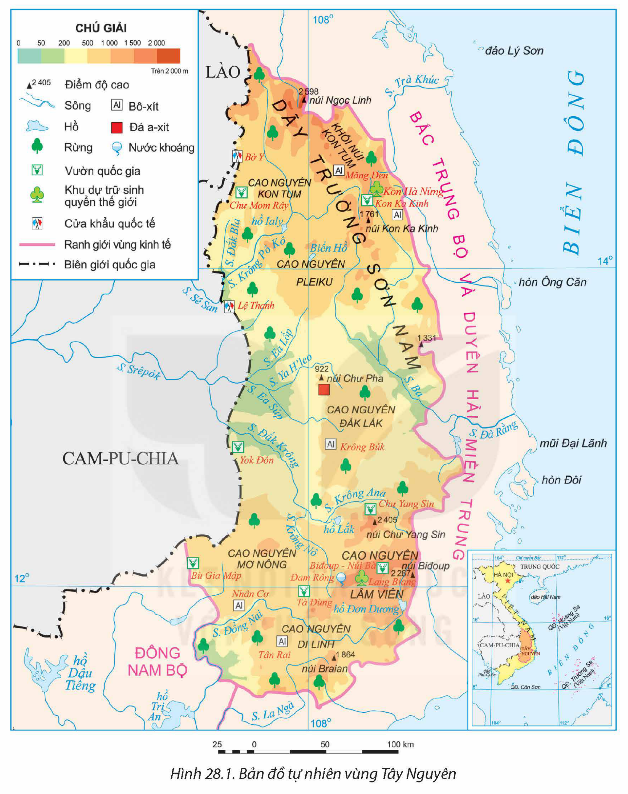
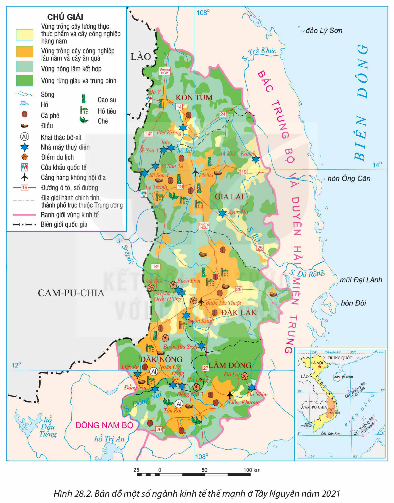
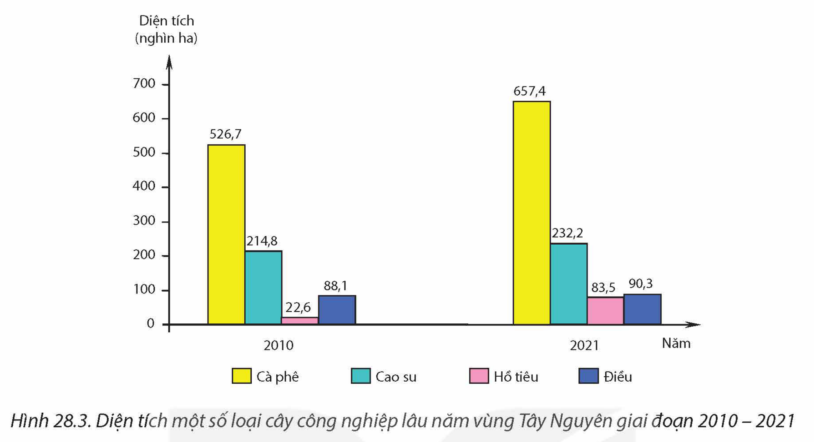
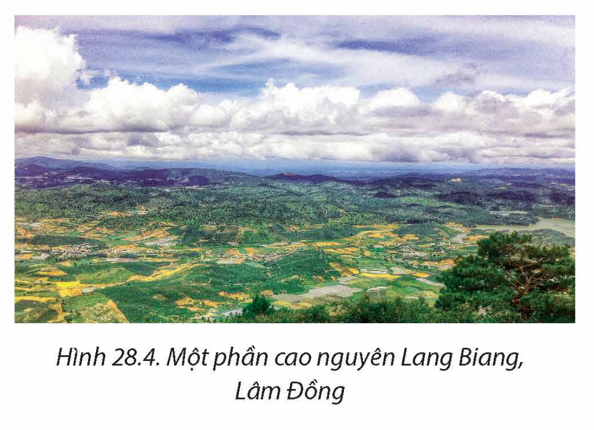

<!-- pdf:130 -->

# BÀI 28: KHAI THÁC THẾ MẠNH ĐỂ PHÁT TRIỂN KINH TẾ Ở TÂY NGUYÊN

## 🔴 Mở đầu

Tây Nguyên có vị trí đặc biệt quan trọng về quốc phòng an ninh. Vùng có nhiều thế mạnh về trồng cây công nghiệp lâu năm, phát triển lâm nghiệp, thuỷ điện, khai thác bô-xít và du lịch. Các ngành kinh tế đó phát triển và phân bố như thế nào? Việc phát triển kinh tế có ý nghĩa gì đối với quốc phòng an ninh?

## I. KHÁI QUÁT

### 1. Vị trí địa lí và phạm vi lãnh thổ

<!-- term: Tây Nguyên -->
Tây Nguyên gồm 5 tỉnh là Kon Tum, Gia Lai, Đắk Lắk, Đắk Nông và Lâm Đồng. Diện tích của vùng năm 2021 là 54,5 nghìn km².

<!-- term: Tây Nguyên -->
Vùng giáp với hai nước láng giềng là Lào và Cam-pu-chia, giáp với các vùng Đông Nam Bộ, Bắc Trung Bộ và Duyên hải miền Trung. Tây Nguyên có vị trí đặc biệt quan trọng về quốc phòng an ninh, phát triển kinh tế, giao thương trong nước và thế giới.

### 2. Dân số

Năm 2021, Tây Nguyên có số dân khoảng 6 triệu người, tỉ lệ gia tăng dân số tự nhiên là 1,25%. Mật độ dân số của vùng thấp nhất cả nước, năm 2021 là 111 người/km², tỉ lệ dân thành thị là 28,9%.

Tây Nguyên có nhiều dân tộc cùng chung sống như: Xơ-đăng, Ba Na, Gia-rai, Ê Đê, Cơ-ho, Kinh, Mường, HMông,...

> ❓ Dựa vào thông tin mục I và hình 28.1, hãy:
> – Trình bày vị trí địa lí, phạm vi lãnh thổ của vùng Tây Nguyên.
> – Nêu khái quát về đặc điểm dân số của vùng.

## II. KHAI THÁC CÁC THẾ MẠNH KINH TẾ Ở VÙNG TÂY NGUYÊN

### 1. Phát triển cây công nghiệp lâu năm

**a) Thế mạnh và hạn chế**

– Về tự nhiên

<!-- term: Cao nguyên xếp tầng -->
+ Địa hình và đất: Tây Nguyên có địa hình chủ yếu là các cao nguyên xếp tầng với độ cao khác nhau như các cao nguyên: Kon Tum, Pleiku, Đắk Lắk, Lâm Viên, Mơ Nông, Di Linh,... Bề mặt địa hình tương đối bằng phẳng. Tây Nguyên có diện tích đất badan lớn, thuận lợi cho quy hoạch vùng chuyên canh cây công nghiệp quy mô lớn có mức độ tập trung cao.

<!-- pdf:131 -->

*Hình 28.1. Bản đồ tự nhiên vùng Tây Nguyên*

+ Khí hậu mang tính chất cận xích đạo, có sự phân hoá theo độ cao và theo mùa rõ rệt, thuận lợi cho canh tác và phát triển cây công nghiệp với cơ cấu đa dạng (cây công nghiệp nhiệt đới, cận nhiệt đới).

+ Nguồn nước: Tây Nguyên có nhiều sông như Sê San, Srêpôk, Đồng Nai,... nhiều hồ tự nhiên và nhân tạo như hồ Lắk (Đắk Lắk), hồ Ialy (Kon Tum, Gia Lai),... là nguồn cung cấp nước tưới cho cây công nghiệp. Nguồn nước ngầm có trữ lượng khá phong phú có vai trò quan trọng trong việc cung cấp nước tưới vào mùa khô.

<!-- pdf:132 -->

Tuy nhiên, mùa khô ở Tây Nguyên kéo dài 4 đến 5 tháng, gây khô hạn và thiếu nước tưới cho cây trồng. Đất ở khu vực đồi núi dễ bị rửa trôi, xói mòn,... Tác động của biến đổi khí hậu cũng ảnh hưởng nhất định đến diện tích và sản lượng cây công nghiệp.

– Về kinh tế – xã hội

+ Nguồn lao động ở Tây Nguyên có truyền thống và kinh nghiệm trong sản xuất cây công nghiệp. Trình độ người lao động ngày càng nâng cao, tạo điều kiện để áp dụng khoa học – công nghệ vào sản xuất và chế biến sản phẩm cây công nghiệp.

+ Cơ sở hạ tầng và cơ sở vật chất – kĩ thuật được cải thiện, khoa học – công nghệ được ứng dụng rộng rãi trong sản xuất và chế biến sản phẩm, thị trường được mở rộng cả trong nước và quốc tế,... thúc đẩy sản xuất cây công nghiệp của vùng.

Tuy nhiên, thị trường tiêu thụ các sản phẩm cây công nghiệp có nhiều biến động; công nghiệp chế biến sản phẩm còn nhiều hạn chế.

> ❓ Dựa vào thông tin mục a và hình 28.1, hãy phân tích thế mạnh, hạn chế (về tự nhiên, kinh tế – xã hội) đối với phát triển cây công nghiệp lâu năm ở vùng Tây Nguyên.

**b) Hiện trạng phát triển**

<!-- term: Chuyên canh cây công nghiệp lâu năm ở Tây Nguyên -->
– Tây Nguyên là vùng chuyên canh cây công nghiệp lâu năm lớn của nước ta. Diện tích cây công nghiệp lâu năm luôn chiếm tỉ lệ cao so với cả nước. Năm 2021, diện tích cây công nghiệp của vùng là 981,2 nghìn ha, chiếm 44,5% diện tích cây công nghiệp lâu năm của cả nước. Vùng đã ứng dụng công nghệ cao (công nghệ sinh học, tự động hoá,...) trong sản xuất và chế biến nên năng suất và chất lượng sản phẩm tăng; công nghiệp chế biến các sản phẩm đã được hiện đại hoá, xây dựng được một số thương hiệu cà phê, hồ tiêu,...trên thị trường thế giới.

<!-- term: Chuyên canh cây công nghiệp lâu năm ở Tây Nguyên -->
– Cơ cấu cây công nghiệp khá đa dạng. Một số cây công nghiệp chính là cà phê, chè, cao su, hồ tiêu, điều, mắc ca, ca cao,...

<!-- term: Chuyên canh cây công nghiệp lâu năm ở Tây Nguyên -->
+ Cà phê là cây công nghiệp quan trọng số một ở Tây Nguyên. Năm 2021, vùng chiếm khoảng 90% diện tích và 94% sản lượng cà phê của cả nước. Nhiều công nghệ mới được ứng dụng trong sản xuất, thâm canh cà phê tạo ra sản phẩm sạch mang lại hiệu quả kinh tế cao. Cà phê được trồng nhiều nhất ở tỉnh Đắk Lắk.

+ Chè: Diện tích năm 2021 chiếm gần 9% diện tích chè của cả nước, tập trung chủ yếu ở Lâm Đồng. Hiện nay, vùng đã ứng dụng công nghệ mới trong trồng, chăm sóc và chế biến chè. Các nhà máy chế biến chè trong vùng tập trung ở Lâm Đồng và Gia Lai.

+ Cao su: Năm 2021, vùng chiếm khoảng 25% diện tích cao su của cả nước. Cao su được trồng chủ yếu ở các tỉnh Gia Lai, Đắk Lắk.

+ Hồ tiêu đang được phát triển mạnh ở Tây Nguyên, diện tích có xu hướng tăng nhanh. Các tỉnh trồng nhiều hồ tiêu là Đắk Nông, Đắk Lắk và Gia Lai.

<!-- pdf:133 -->

+ Điều là cây công nghiệp đang được chú trọng phát triển, là mặt hàng xuất khẩu có giá trị của vùng, tập trung chủ yếu ở Đắk Lắk, Gia Lai và Lâm Đồng. Ngoài ra, các tỉnh Đăk Nông, Đắk Lắk phát triển một số cây công nghiệp như ca cao, mắc ca,... bước đầu đã mang lại hiệu quả kinh tế cao.

*Hình 28.2. Bản đồ một số ngành kinh tế thế mạnh ở Tây Nguyên năm 2021*

<!-- pdf:134 -->

*Hình 28.3. Diện tích một số loại cây công nghiệp lâu năm vùng Tây Nguyên giai đoạn 2010 – 2021*

*(Nguồn: Tổng cục Thống kê)*

> ❓ Dựa vào thông tin mục b và hình 28.2, hãy trình bày sự phát triển và phân bố cây công nghiệp lâu năm của vùng.

### 2. Phát triển lâm nghiệp

**a) Thế mạnh và hạn chế**

– Tây Nguyên có diện tích rừng khá lớn. Năm 2021, tổng diện tích rừng hơn 2,5 triệu ha, chiếm 17,5% diện tích rừng cả nước. Rừng Tây Nguyên có đa dạng sinh học cao, giàu trữ lượng, có nhiều loại dược liệu quý,... Trong vùng có nhiều vườn quốc gia, khu dự trữ sinh quyển thế giới như Yok Đôn, Kon Hà Nừng, Tà Đùng,...

– Khí hậu có tính chất cận xích đạo, nền nhiệt độ cao, lượng mưa lớn, thuận lợi cho việc trồng rừng và khoanh nuôi rừng tự nhiên.

– Chính sách giao đất giao rừng, phát triển kinh tế,... góp phần giữ vững diện tích rừng tự nhiên, thúc đẩy công tác trồng rừng,...

– Tuy nhiên, rừng ở Tây Nguyên đang có nguy cơ bị suy giảm về diện tích và chất lượng rừng.

**b) Hiện trạng phát triển**

Ngành lâm nghiệp của vùng gồm các hoạt động khai thác, chế biến lâm sản và trồng rừng, khoanh nuôi, bảo vệ rừng.

– Năm 2021, sản lượng gỗ khai thác của vùng là 753 nghìn m³, riêng tỉnh Đắk Lắk chiếm 50,3% sản lượng gỗ khai thác toàn vùng. Ngoài ra, một số loại lâm sản ngoài gỗ như: măng, dược liệu,... cũng được khai thác tạo thêm sinh kế cho người dân.

<!-- pdf:135 -->

– Trồng rừng cũng đang được chú trọng. Gia Lai có diện tích rừng trồng mới hằng năm lớn nhất trong vùng.

Bảng 28. DIỆN TÍCH VÀ TỈ LỆ CHE PHỦ RỪNG CỦA TÂY NGUYÊN NĂM 2010 VÀ NĂM 2021

| Năm | Tổng diện tích rừng *(nghìn ha)* | Trong đó — Diện tích rừng tự nhiên *(nghìn ha)* | Trong đó — Diện tích rừng trồng *(nghìn ha)* | Tỉ lệ che phủ rừng *(%)* |
| --- | --- | --- | --- | --- |
| 2010 | 2 874,4 | 2 653,9 | 220,5 | 52,6 |
| 2021 | 2 572,7 | 2 104,1 | 468,6 | 46,3 |
<!-- ocr-ok: bảng có tiêu đề gộp cột/hàng đã đối chiếu ảnh gốc -->

*(Nguồn: Niên giám thống kê các năm 2011, 2022)*

Công tác quản lí, bảo vệ rừng ở Tây Nguyên đã được tăng cường; đặc biệt là bảo vệ nghiêm ngặt diện tích rừng tự nhiên, rừng phòng hộ, rừng đặc dụng. Các khu dự trữ sinh quyển của thế giới Kon Hà Nừng (Gia Lai), Lang Biang (Lâm Đồng) và các vườn quốc gia như: Chư Mom Ray (Kon Tum), Yok Đôn (Đắk Lắk, Đắk Nông), Chư Yang Sin (Đắk Lắk),... được bảo vệ để bảo tồn nguồn gen và các hệ sinh thái rừng của vùng.

> ❓ Dựa vào thông tin mục 2 và hình 28.1, 28.2, hãy:
> – Nêu thế mạnh để phát triển lâm nghiệp ở vùng Tây Nguyên.
> – Trình bày hiện trạng phát triển lâm nghiệp ở vùng.

### 3. Phát triển thuỷ điện

**a) Thế mạnh và hạn chế**

– Tây Nguyên có trữ năng thuỷ điện lớn thứ hai sau vùng Trung du và miền núi Bắc Bộ. Trữ năng thuỷ điện của vùng tập trung ở một số hệ thống sông như Sê San, Srêpôk, Đồng Nai,...

– Nhu cầu sử dụng điện để phát triển kinh tế – xã hội ngày càng cao, những thành tựu khoa học công nghệ tiên tiến đã được ứng dụng trong xây dựng và vận hành các nhà máy thuỷ điện, tạo điều kiện thuận lợi để phát triển thuỷ điện trong vùng.

– Tuy nhiên, mùa khô ở Tây Nguyên kéo dài, nguồn nước trong các hồ thuỷ điện hạ thấp ảnh hưởng đến công suất phát điện của các nhà máy.

<!-- pdf:136 -->

**b) Hiện trạng phát triển**

> 💡 EM CÓ BIẾT?
>
> Lưu vực sông Sê San có hai chi lưu là Krông Pô Kô và Đắk Bla. Hiện nay trên lưu vực sông Sê San có 8 nhà máy thuỷ điện lớn là Thượng Kon Tum, Plei Krông, Ialy, Sê San 3, Sê San 3A, Sê San 4, Sê San 4A, Ia Krel. Lưu vực sông Srêpôk có các nhánh chính là Krông Knô, Krông Ana, Ya H'leo, Ea Đrăng, Ea Lốp. Hiện nay trên lưu vực sông Srêpôk có 5 nhà máy thuỷ điện lớn là Buôn Kuốp, Đrây H'ling, Srêpôk 3, Srêpôk 4.
>
> *(Nguồn: Uỷ ban sông Mê Công Việt Nam)*

Tây Nguyên phát triển thuỷ điện lớn thứ hai cả nước. Sản lượng thuỷ điện sản xuất năm 2021 chiếm khoảng 20% tổng sản lượng thuỷ điện của cả nước. Trong vùng đã xây dựng nhiều nhà máy thuỷ điện. Trên lưu vực sông Sê San đã có các nhà máy lớn như: Ialy (720 MW), Sê San 3 (260 MW), Sê San 3A (108 MW), Sê San 4 (360 MW),... Trên lưu vực sông Srêpôk có các nhà máy thuỷ là Buôn Kuốp (280 MW), Srêpôk 3 (220 MW), Srêpôk 4 (80 MW), Buôn Tua Srah (86 MW),... Trên sông Đồng Nai có các nhà máy thuỷ điện là Đồng Nai 3 (180 MW), Đồng Nai 4 (340 MW),...

Việc xây dựng các nhà máy thuỷ điện trong vùng đã cung cấp nguồn điện thúc đẩy kinh tế phát triển; điều tiết nước, giữ mực nước ngầm, ngăn lũ lụt; phát triển giao thông, nuôi trồng thuỷ sản và du lịch.

> ❓ Dựa vào thông tin mục 3 và hình 28.1, 28.2, hãy:
> – Phân tích thế mạnh và hạn chế đối với phát triển thuỷ điện ở vùng Tây Nguyên.
> – Trình bày hiện trạng phát triển thuỷ điện của vùng.

### 4. Khai thác bô-xít

<!-- term: Khai thác bô-xít ở Tây Nguyên -->
– Tây Nguyên có trữ lượng bô-xít lớn nhất cả nước (khoảng 8,2 tỉ tấn), chiếm gần 90% trữ lượng cả nước, phân bố chủ yếu ở Lâm Đồng, Đắk Nông.

– Khai thác bô-xít thu hút vốn đầu tư trong và ngoài nước, thúc đẩy sự phát triển kinh tế xã hội của vùng Tây Nguyên.

– Nhu cầu của thị trường về sản phẩm a-lu-min và nhôm lớn, nhiều chính sách ưu tiên phát triển ngành theo hướng phát triển bền vững là động lực, thúc đẩy các ngành khai thác và chế biến bô-xít ở vùng.

<!-- term: Khai thác bô-xít ở Tây Nguyên -->
– Các mỏ khai thác bô-xít chủ yếu tập trung ở hai tỉnh Lâm Đồng và Đắk Nông. Quặng bô-xít được khai thác để chế biến thành a-lu-min, nguyên liệu chính để sản xuất bột nhôm. Năm 2021, các nhà máy trong vùng sản xuất được khoảng 680 nghìn tấn a-lu-min. Hai cơ sở chế biến a-lu-min và bột nhôm là Tân Rai (Lâm Đồng) và Nhân Cơ (Đắk Nông).

> ❓ Dựa vào thông tin mục 4 và hình 28.1, 28.2, hãy phân tích thế mạnh và trình bày hiện trạng khai thác bô-xít ở vùng Tây Nguyên.

<!-- pdf:137 -->

### 5. Phát triển du lịch

**a) Thế mạnh và hạn chế**

> 💡 EM CÓ BIẾT?
>
> Năm 2005, Không gian văn hoá Cồng chiêng Tây Nguyên được UNESCO ghi danh là Kiệt tác truyền khẩu và Di sản Văn hoá phi vật thể của nhân loại; năm 2008, chuyển sang danh sách Di sản Văn hoá phi vật thể đại diện của nhân loại.
>
> Năm 2020, Công viên địa chất Đắk Nông đã được UNESCO công nhận và gia nhập vào mạng lưới Công viên địa chất toàn cầu.
>
> *(Nguồn: Sở Văn hoá, Thể thao và Du lịch Đắk Nông)*

Tây Nguyên có nhiều thế mạnh để phát triển du lịch:

– Nguồn tài nguyên du lịch: Các tài nguyên du lịch tự nhiên có giá trị trong vùng như: Khu bảo tồn thiên nhiên Ngọc Linh, Măng Đen,...khu dự trữ sinh quyển Kon Hà Nừng, Lang Biang; nhiều thác nước, hồ đẹp như hồ Lắk, Biển Hồ,.... Tài nguyên du lịch văn hoá nổi bật là Không gian văn hoá Cồng chiêng Tây Nguyên, các di tích lịch sử – văn hoá, các làng nghề truyền thống, các lễ hội đặc sắc như: Lễ hội cà phê, lễ hội trà Bảo Lộc, Festival hoa Đà Lạt...

– Cơ sở vật chất – kĩ thuật, cơ sở hạ tầng phục vụ cho ngành du lịch đã được chú trọng đầu tư, việc ứng dụng công nghệ số trong quản lí, vận hành du lịch ngày càng tốt hơn, tạo thuận lợi cho du lịch của vùng phát triển.

– Tuy nhiên, các thiên tai, điều kiện về cơ sở hạ tầng, giao thông còn hạn chế gây khó khăn nhất định cho phát triển du lịch của vùng.

**b) Hiện trạng phát triển**

– Số lượng khách du lịch ngày càng tăng trong giai đoạn 2010 – 2019, năm 2019 đạt khoảng 6,6 triệu khách. Do ảnh hưởng của đại dịch COVID-19, số lượng khách du lịch năm 2021 giảm còn dưới 3 triệu lượt. Từ năm 2022, số lượt khách du lịch đến vùng lại có xu hướng phục hồi.

– Các loại hình du lịch chủ yếu trong vùng là du lịch sinh thái, du lịch văn hoá, du lịch cộng đồng, du lịch nghỉ dưỡng. Một số điểm du lịch nổi bật ở Tây Nguyên là Buôn Đôn, Măng Đen, Bảo tàng cà phê Buôn Ma Thuột, hồ Lắk, Lang Biang,... Các trung tâm du lịch trong vùng là Đà Lạt, Buôn Ma Thuột.

*Hình 28.4. Một phần cao nguyên Lang Biang, Lâm Đồng*

<!-- pdf:138 -->

> ❓ Dựa vào thông tin mục 5 và hình 28.1, 28.2, hãy :
> – Phân tích thế mạnh và hạn chế trong phát triển du lịch ở Tây Nguyên.
> – Trình bày việc phát triển du lịch của vùng.

## III. Ý NGHĨA CỦA VIỆC PHÁT TRIỂN KINH TẾ – XÃ HỘI ĐỐI VỚI QUỐC PHÒNG AN NINH

Tây Nguyên có diện tích rộng, có nhiều thế mạnh để phát triển kinh tế. Phát triển kinh tế, góp phần khai thác thế mạnh, nâng cao vị thế kinh tế của vùng và củng cố quốc phòng an ninh.

Vùng tiếp giáp với Lào và Cam-pu-chia, có nhiều cửa khẩu thông thương. Phát triển kinh tế – xã hội, xây dựng các khu kinh tế cửa khẩu, tăng cường sự thông thương, hợp tác kinh tế với các nước giúp củng cố quốc phòng an ninh.

Tây Nguyên là nơi cư trú của nhiều dân tộc thiểu số, giàu bản sắc văn hoá và truyền thống đấu tranh anh dũng chống giặc ngoại xâm. Phát triển kinh tế – xã hội của vùng là góp phần gìn giữ bản sắc văn hoá dân tộc, nâng cao chất lượng cuộc sống của đồng bào các dân tộc từ đó củng cố sức mạnh quốc phòng an ninh.

> ❓ Dựa vào thông tin mục III, hãy nêu ý nghĩa của phát triển kinh tế – xã hội đối với quốc phòng an ninh ở Tây Nguyên.

## ✏️ Luyện tập và vận dụng

**Luyện tập**

Lựa chọn phân tích một thế mạnh để phát triển kinh tế ở vùng Tây Nguyên.

**Vận dụng**

Tìm hiểu thông tin về ảnh hưởng của việc khai thác bô-xít đến môi trường ở vùng Tây Nguyên.

## 📷 Danh sách hình trong bài

| Mã hình | Trang PDF | Vị trí trong bài | Chú thích gốc |
| --- | --- | --- | --- |
| H12-dia-b28-01 | 131 | Mục II.1.a | Hình 28.1. Bản đồ tự nhiên vùng Tây Nguyên |
| H12-dia-b28-02 | 133 | Mục II.1.b | Hình 28.2. Bản đồ một số ngành kinh tế thế mạnh ở Tây Nguyên năm 2021 |
| H12-dia-b28-03 | 134 | Mục II.1.b | Hình 28.3. Diện tích một số loại cây công nghiệp lâu năm vùng Tây Nguyên giai đoạn 2010 – 2021 |
| H12-dia-b28-04 | 137 | Mục II.5.b | Hình 28.4. Một phần cao nguyên Lang Biang, Lâm Đồng |
