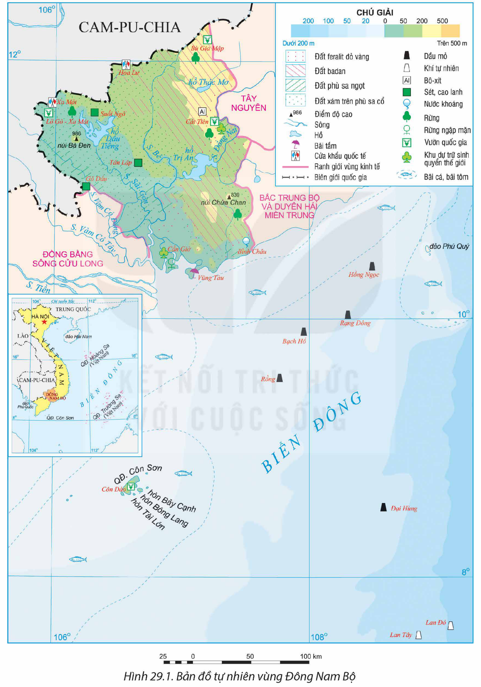
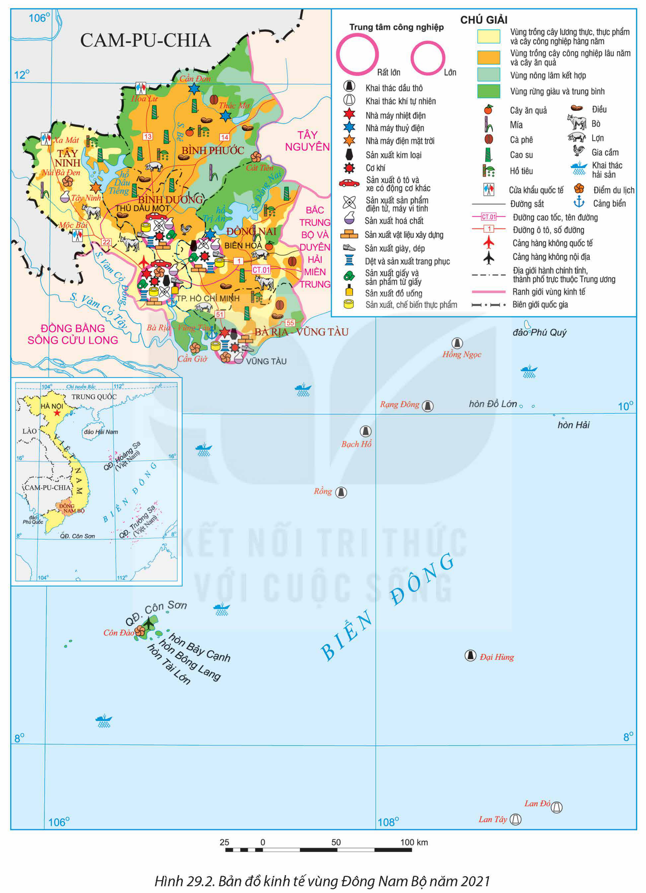
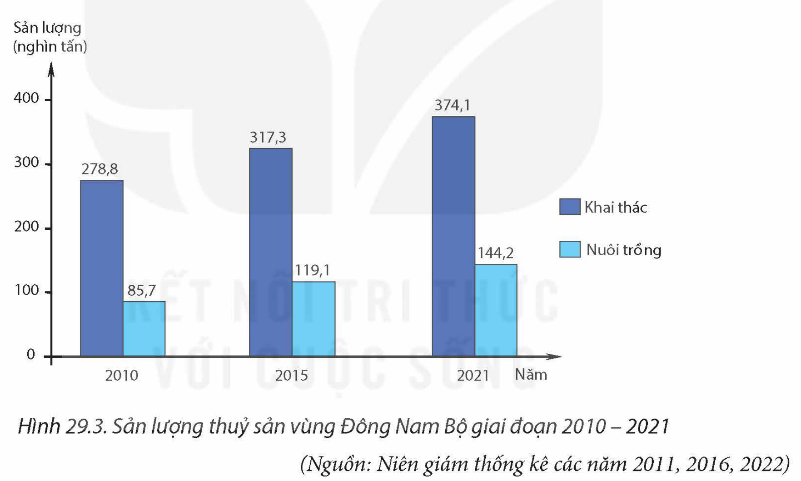

<!-- pdf:139 -->

# BÀI 29: PHÁT TRIỂN KINH TẾ – XÃ HỘI Ở ĐÔNG NAM BỘ

## 🔴 Mở đầu

Với nhiều thế mạnh nổi trội, Đông Nam Bộ trở thành một trong những vùng phát triển kinh tế hàng đầu và có vị trí, vai trò quan trọng đối với cả nước. Vậy những thế mạnh đó là gì? Các ngành kinh tế trong vùng phát triển ra sao? Việc phát triển kinh tế – xã hội ở Đông Nam Bộ cần lưu ý đến vấn đề bảo vệ môi trường như thế nào?

## I. KHÁI QUÁT

### 1. Vị trí địa lí và phạm vi lãnh thổ

<!-- term: Đông Nam Bộ -->
Đông Nam Bộ bao gồm Thành phố Hồ Chí Minh và 5 tỉnh: Bình Dương, Bình Phước, Tây Ninh, Đồng Nai và Bà Rịa – Vũng Tàu. Diện tích vùng năm 2021 là 23,6 nghìn km².

<!-- term: Đông Nam Bộ -->
Đông Nam Bộ tiếp giáp với nước láng giềng Cam-pu-chia, giáp vùng Đồng bằng sông Cửu Long, vùng Tây Nguyên, vùng Bắc Trung Bộ và Duyên hải miền Trung; phía đông nam có vùng biển rộng với một số đảo, quần đảo, lớn nhất là quần đảo Côn Sơn. Đông Nam Bộ nằm trong Vùng kinh tế trọng điểm phía Nam, có Thành phố Hồ Chí Minh là cực tăng trưởng, trung tâm kinh tế và là đầu mối giao thông lớn bậc nhất cả nước.

Vị trí địa lí thuận lợi cho vùng phát triển kinh tế, đẩy mạnh liên kết kinh tế với các vùng kinh tế khác, mở rộng giao thương quốc tế.

> ❓ Dựa vào thông tin trong mục 1 và hình 29.1, hãy:
> – Xác định vị trí địa lí và phạm vi lãnh thổ vùng Đông Nam Bộ.
> – Trình bày những lợi thế về vị trí địa lí của vùng Đông Nam Bộ.

### 2. Dân số

Năm 2021, số dân của vùng là 18,3 triệu người, chiếm 18,6% số dân cả nước. Tỉ lệ tăng dân số tự nhiên thấp (0,98%, năm 2021) nhưng do gia tăng cơ học nên vùng có tỉ lệ gia tăng dân số cao nhất cả nước.

Mật độ dân số của vùng cao, 778 người/km², chỉ thấp hơn vùng Đồng bằng sông Hồng. Tỉ lệ dân thành thị năm 2021 là 66,4%, cao nhất cả nước.

Các dân tộc sinh sống trong vùng là Kinh, Hoa, Khơ-me, Chăm,...

> ❓ Dựa vào thông tin trong mục 2, hãy nêu một số đặc điểm nổi bật về dân số vùng Đông Nam Bộ.

<!-- pdf:140 -->

## II. CÁC THẾ MẠNH VÀ HẠN CHẾ ĐỂ PHÁT TRIỂN KINH TẾ

### 1. Điều kiện tự nhiên và tài nguyên thiên nhiên

**a) Thế mạnh**

*Hình 29.1. Bản đồ tự nhiên vùng Đông Nam Bộ*

<!-- pdf:141 -->

– Địa hình và đất: Đông Nam Bộ có địa hình tương đối bằng phẳng thuận lợi cho các hoạt động kinh tế, xây dựng cơ sở hạ tầng, đô thị,... Đất badan và đất xám phù sa cổ chiếm khoảng 80% tổng diện tích tự nhiên của vùng. Ngoài ra, trong vùng còn có đất phù sa ở hạ lưu các sông Đồng Nai, Vàm Cỏ,... Các loại đất trong vùng thích hợp trồng cây công nghiệp, hình thành vùng chuyên canh quy mô lớn.

– Khí hậu: mang tính chất cận xích đạo, nền nhiệt cao, ít thay đổi trong năm, phân hai mùa mưa – khô rõ rệt, thuận lợi cho phát triển nền nông nghiệp nhiệt đới và các hoạt động kinh tế khác.

– Nguồn nước: hệ thống sông Sài Gòn, sông Bé,... có giá trị về thuỷ lợi, phát triển giao thông vận tải; sông Đồng Nai có giá trị lớn nhất về thuỷ điện. Các hồ thuỷ điện, hồ thuỷ lợi lớn như hồ Dầu Tiếng, Phước Hoà,... cung cấp nước cho sản xuất và sinh hoạt.

– Rừng: Tuy diện tích và trữ lượng rừng của vùng không lớn, song có giá trị cung cấp gỗ dân dụng, nguyên liệu giấy. Hệ thống rừng của vùng có giá trị bảo tồn như: Khu dự trữ sinh quyển rừng ngập mặn Cần Giờ và các vườn quốc gia Nam Cát Tiên, Bù Gia Mập, Lò Gò – Xa Mát, Côn Đảo.

<!-- term: Khai thác và chế biến dầu, khí ở Đông Nam Bộ -->
– Tài nguyên khoáng sản nổi bật và có giá trị nhất của vùng là dầu mỏ và khí tự nhiên ở thềm lục địa thuộc các bể trầm tích Cửu Long, Nam Côn Sơn. Ngoài ra, trong vùng còn có bô-xít, các khoáng sản vật liệu xây dựng như sét, cao lanh, đá xây dựng và ốp lát, cát trắng,...

– Biển: Đông Nam Bộ có vùng biển giàu tiềm năng dầu khí, hải sản; có một số bãi tắm đẹp, cảnh quan đảo đặc sắc,... thuận lợi để phát triển tổng hợp kinh tế biển.

**b) Hạn chế**

– Mùa khô kéo dài 4 đến 5 tháng, gây nên tình trạng thiếu nước cho các hoạt động sản xuất và sinh hoạt.

– Tác động của biến đổi khí hậu, hiện tượng ngập úng do triều cường, xâm nhập mặn ở vùng ven biển ảnh hưởng đến sản xuất và sinh hoạt trong vùng.

> ❓ Dựa vào nội dung mục 1 và hình 29.1, hãy phân tích những thế mạnh và hạn chế về điều kiện tự nhiên và tài nguyên thiên nhiên cho phát triển kinh tế của Đông Nam Bộ.

### 2. Điều kiện kinh tế – xã hội

**a) Thế mạnh**

– Dân cư và lao động: số dân đông, tỉ suất nhập cư thường cao, người nhập cư đa phần trong độ tuổi lao động, tạo cho vùng có nguồn lao động dồi dào, có kinh nghiệm sản xuất. Lao động năng động trong nền kinh tế thị trường, tỉ lệ đã qua đào tạo cao hơn mức trung bình cả nước, tạo khả năng nâng cao năng suất lao động, thúc đẩy phát triển kinh tế.

<!-- pdf:142 -->

– Cơ sở hạ tầng và cơ sở vật chất – kĩ thuật: phát triển đồng bộ, hiện đại, đặc biệt là giao thông vận tải và bưu chính viễn thông.

– Chính sách, đầu tư và khoa học – công nghệ: Vùng có nhiều chính sách linh hoạt trong thu hút đầu tư. Đông Nam Bộ có số dự án và số vốn đầu tư nước ngoài luôn đứng đầu cả nước. Việc ứng dụng, chuyển giao khoa học – công nghệ được đẩy mạnh.

– Đông Nam Bộ có Thành phố Hồ Chí Minh là đô thị đặc biệt, là trung tâm kinh tế, tài chính, thương mại, khoa học – công nghệ, đổi mới sáng tạo, văn hoá, giáo dục – đào tạo,... lớn hàng đầu cả nước, có sức lan toả, thúc đẩy phát triển kinh tế của vùng.

**b) Hạn chế**

Việc nhập cư tập trung vào các đô thị lớn của vùng làm nảy sinh một số khó khăn về việc làm, nhà ở, các vấn đề xã hội khác và môi trường,...

> ❓ Dựa vào nội dung mục 2 và hiểu biết của bản thân, hãy phân tích những thế mạnh và hạn chế về điều kiện kinh tế – xã hội cho phát triển kinh tế của Đông Nam Bộ.

## III. PHÁT TRIỂN CÁC NGÀNH KINH TẾ

Quy mô GRDP của vùng Đông Nam Bộ tăng liên tục, năm 2021 chiếm hơn 30% GDP cả nước. Cơ cấu kinh tế chuyển dịch theo hướng công nghiệp hoá, hiện đại hoá.

Bảng 29.1. CƠ CẤU GRDP VÙNG ĐÔNG NAM BỘ NĂM 2010 VÀ NĂM 2021

*(Đơn vị: %)*

| Cơ cấu GRDP \ Năm | 2010 | 2021 |
| :--- | :---: | :---: |
| Nông nghiệp, lâm nghiệp và thuỷ sản | 4,8 | 4,7 |
| Công nghiệp và xây dựng | 46,0 | 42,6 |
| – Trong đó: Công nghiệp | 42,0 | 37,9 |
| Dịch vụ | 38,5 | 42,2 |
| Thuế sản phẩm trừ trợ cấp sản phẩm | 10,7 | 10,5 |

*(Nguồn: Tổng cục Thống kê)*

### 1. Công nghiệp

Năm 2021, khu vực công nghiệp và xây dựng chiếm tỉ trọng cao trong cơ cấu GRDP của vùng, riêng công nghiệp chiếm 37,9%. Tỉ trọng giá trị sản xuất công nghiệp của vùng chiếm 31,7% tổng giá trị sản xuất công nghiệp của cả nước.

<!-- pdf:143 -->

Cơ cấu công nghiệp theo nhóm ngành có sự chuyển dịch theo hướng hiện đại hơn. Tỉ trọng nhóm ngành công nghiệp khai khoáng giảm xuống còn hơn 4%; nhóm ngành công nghiệp chế biến, chế tạo tăng lên, đạt hơn 90% năm 2021. Hai nhóm ngành còn lại chiếm tỉ trọng không đáng kể.

Các ngành công nghiệp của Đông Nam Bộ rất đa dạng. Một số ngành nổi trội là:

<!-- term: Khai thác và chế biến dầu, khí ở Đông Nam Bộ -->
– Công nghiệp khai thác và chế biến dầu, khí: Đây là ngành công nghiệp mũi nhọn của vùng và giữ vai trò quan trọng đối với cả nước. Sản lượng khai thác dầu khí của vùng chiếm ưu thế sản lượng của cả nước, cung cấp nhiên liệu cho các nhà máy lọc dầu trong nước và xuất khẩu.

<!-- term: Khai thác và chế biến dầu, khí ở Đông Nam Bộ -->
Khí tự nhiên ở Đông Nam Bộ được khai thác từ hai nguồn: khí đồng hành từ khai thác các mỏ dầu và khí tự nhiên từ các mỏ Lan Tây, Lan Đỏ,... Đây là nguồn nhiên liệu ổn định, cung cấp cho các nhà máy nhiệt điện lớn trong vùng và cho các ngành khác như: sản xuất phân đạm, chế biến các chế phẩm từ khí,...

– Công nghiệp sản xuất điện của vùng bao gồm nhiệt điện, thuỷ điện và điện từ năng lượng tái tạo khác. Các nhà máy nhiệt điện lớn ở Đông Nam Bộ chủ yếu được chạy bằng nhiên liệu khí, lớn nhất là tổ hợp nhiệt điện Phú Mỹ với tổng công suất thiết kế khoảng gần 4 000 MW, các nhà máy nhiệt điện Bà Rịa, Thủ Đức, Hiệp Phước, Nhơn Trạch,... được mở rộng công suất. Các nhà máy thuỷ điện được xây dựng trong vùng gồm: Trị An (công suất thiết kế 400 MW, trên sông Đồng Nai), Thác Mơ và Cần Đơn (công suất thiết kế là 150 MW và 77,6 MW, trên sông Bé), cung cấp nguồn điện năng đáng kể cho vùng. Các nguồn năng lượng tái tạo khác đang được chú ý phát triển, nhất là năng lượng mặt trời.

– Công nghiệp sản xuất sản phẩm điện tử, máy vi tính phát triển mạnh nhờ thu hút vốn đầu tư nước ngoài, tập trung ở các trung tâm có vị trí thuận lợi cho xuất khẩu.

– Công nghiệp sản xuất, chế biến thực phẩm và công nghiệp sản xuất đồ uống được phát triển ở hầu hết các tỉnh, thành phố trong vùng, do những lợi thế về nguồn nguyên liệu (cả nội vùng và từ các vùng lân cận), lao động và thị trường.

– Công nghiệp dệt, sản xuất trang phục; công nghiệp sản xuất giày dép là những ngành được phát triển từ lâu dựa trên cơ sở nguồn lao động dồi dào. Các mặt hàng vải dệt, quần áo, giày dép ngày càng đa dạng về mẫu mã, chất lượng, phục vụ xuất khẩu. Việc ứng dụng khoa học – công nghệ hiện đại như tự động hoá, in 3D vào quá trình sản xuất nhằm nâng cao năng suất và chất lượng sản phẩm ngày càng được đẩy mạnh.

– Các ngành công nghiệp khác như sản xuất hoá chất, sản xuất giấy và sản phẩm từ giấy, sản xuất kim loại, sản xuất ô tô và xe có động cơ khác,... cũng được chú trọng phát triển.

Đông Nam Bộ có nhiều trung tâm công nghiệp quy mô lớn của cả nước như: Thành phố Hồ Chí Minh, Biên Hoà, Thủ Dầu Một, Vũng Tàu,... Các trung tâm công nghiệp này có cơ cấu ngành đa dạng, nhiều ngành có vai trò lớn với cả nước.

<!-- pdf:144 -->

*Hình 29.2. Bản đồ kinh tế vùng Đông Nam Bộ năm 2021*

<!-- pdf:145 -->

> ❓ Dựa vào nội dung mục 1 và hình 29.2, hãy:
> – Trình bày sự phát triển công nghiệp của Đông Nam Bộ.
> – Xác định tên các ngành công nghiệp ở một số trung tâm công nghiệp của vùng.

### 2. Dịch vụ

Ngành dịch vụ của Đông Nam Bộ phát triển nhanh, ngày càng tăng về quy mô và chiếm tỉ trọng cao nhất trong cơ cấu GRDP của vùng (năm 2021). Các lĩnh vực dịch vụ trong vùng đa dạng, được phát triển hàng đầu trên cả nước.

– Giao thông vận tải trong vùng được phát triển với đầy đủ các loại hình: đường ô tô (với các tuyến quốc lộ 1, 13, 51, 22, 14,...), các tuyến cao tốc được tăng cường và mở rộng như Thành phố Hồ Chí Minh – Long Thành – Dầu Giây, Thành phố Hồ Chí Minh – Trung Lương – Mỹ Thuận, các tuyến cao tốc đang được xây dựng như Thành phố Hồ Chí Minh – Mộc Bài, Biên Hoà – Vũng Tàu,...; đường sắt (có tuyến đường sắt Thống Nhất); đường sông; đường biển (bến cảng Cát Lái, Cái Mép, Thị Vải,...) và đường hàng không (cảng hàng không quốc tế Tân Sơn Nhất có năng lực vận chuyển đứng đầu cả nước, cảng hàng không quốc tế Long Thành đang được xây dựng). Nhìn chung, giao thông vận tải của vùng có chất lượng tốt, đảm bảo sự kết nối nội, ngoại vùng và với thế giới. Thành phố Hồ Chí Minh là đầu mối giao thông lớn nhất vùng và cả nước.

– Thương mại của vùng phát triển mạnh. Năm 2021, tổng mức bán lẻ hàng hoá và doanh thu dịch vụ tiêu dùng của vùng đứng đầu cả nước (chiếm trên 27% cả nước). Đông Nam Bộ cũng là vùng phát triển sớm và nhanh các trung tâm thương mại lớn, siêu thị, thương mại điện tử,...

Ngoại thương: Trị giá xuất khẩu của vùng chiếm khoảng 34% tổng trị giá xuất khẩu của cả nước (năm 2021). Thành phố Hồ Chí Minh, Bình Dương, Đồng Nai là những địa phương có trị giá xuất khẩu lớn và luôn đứng ở vị trí hàng đầu trong vùng và cả nước.

– Du lịch ở Đông Nam Bộ ngày càng đóng vai trò quan trọng. Năm 2020, lượng khách du lịch đến vùng đạt 34,6 triệu lượt khách; năm 2021, do ảnh hưởng của đại dịch COVID-19, lượng khách du lịch đến vùng giảm mạnh, còn khoảng 15,7 triệu lượt khách. Tuy nhiên, năm 2022 lượng khách du lịch tăng trưởng mạnh, đạt trên 23,2 triệu lượt khách, chiếm gần 23% lượng khách của cả nước.

Các loại hình du lịch nổi bật trong vùng là du lịch đô thị, du lịch sinh thái,... Thành phố Hồ Chí Minh là trung tâm du lịch lớn nhất của cả nước. Ngoài ra, một số điểm thu hút khách du lịch khác như: Vũng Tàu, núi Bà Đen, cửa khẩu Mộc Bài, hồ Dầu Tiếng,...

– Bưu chính viễn thông được phát triển sớm và mạnh nhất so với các vùng khác, đi đầu trong chuyển đổi số, đầu tư vào công nghệ cao. Tài chính ngân hàng được phát triển mạnh với đa dạng các loại hình kinh doanh như hệ thống các ngân hàng, sàn giao dịch chứng khoán, bảo hiểm,... thúc đẩy phát triển kinh tế của vùng.

> ❓ Dựa vào thông tin mục 2 và hình 29.2, hãy trình bày tình hình phát triển các ngành dịch vụ vùng Đông Nam Bộ.

<!-- pdf:146 -->

### 3. Nông nghiệp, lâm nghiệp và thuỷ sản

– Nông nghiệp

<!-- term: Chuyên canh cây công nghiệp ở Đông Nam Bộ -->
+ Đông Nam Bộ là vùng chuyên canh cây công nghiệp hàng đầu của cả nước, có mức độ tập trung hoá sản xuất và trình độ thâm canh cao. Tổng diện tích cây công nghiệp lâu năm của vùng năm 2021 là hơn 800 nghìn ha (chiếm khoảng 36% diện tích trồng cây công nghiệp lâu năm của cả nước). Các cây công nghiệp lâu năm chủ yếu của vùng là cao su, điều, hồ tiêu,...

Bảng 29.2. DIỆN TÍCH MỘT SỐ CÂY CÔNG NGHIỆP LÂU NĂM CỦA VÙNG ĐÔNG NAM BỘ NĂM 2010 VÀ NĂM 2021

| Loại cây | Năm 2010: Đông Nam Bộ *(nghìn ha)* | Năm 2010: Tỉ trọng so với cả nước *(%)* | Năm 2021: Đông Nam Bộ *(nghìn ha)* | Năm 2021: Tỉ trọng so với cả nước *(%)* |
| :--- | :---: | :---: | :---: | :---: |
| Cao su | 441,4 | 58,7 | 547,6 | 58,8 |
| Điều | 225,7 | 60,4 | 192,6 | 61,3 |
| Hồ tiêu | 25,3 | 49,1 | 38,3 | 30,5 |

*(Nguồn: Niên giám thống kê các năm 2011, 2022)*

<!-- term: Chuyên canh cây công nghiệp ở Đông Nam Bộ -->
Cao su luôn đứng đầu về diện tích cây công nghiệp lâu năm của vùng cũng như về diện tích cao su của cả nước. Điều có diện tích lớn thứ hai sau cao su và đứng đầu về diện tích điều của cả nước. Hồ tiêu tuy diện tích không lớn, nhưng đứng thứ hai cả nước, sau vùng Tây Nguyên. Hầu hết các cây công nghiệp lâu năm được trồng tập trung ở Bình Phước, Tây Ninh, Bình Dương, Đồng Nai,... Ngoài ra, vùng phát triển một số cây công nghiệp hàng năm như mía, lạc, tập trung ở tỉnh Tây Ninh.

+ Cây ăn quả ngày càng được mở rộng về diện tích, đạt khoảng 129 nghìn ha năm 2021. Các loại cây ăn quả được trồng với diện tích lớn trong vùng là sầu riêng, xoài, bưởi, mít, chôm chôm,... Đồng Nai là tỉnh trồng tập trung nhiều loại cây ăn quả, chiếm hơn 50% tổng diện tích cây ăn quả của vùng.

+ Chăn nuôi ở Đông Nam Bộ đang phát triển theo hướng công nghiệp, quy trình khép kín và ứng dụng công nghệ cao với quy mô lớn. Số lượng đàn gia súc, gia cầm tăng qua các năm.

Bảng 29.3. SỐ LƯỢNG MỘT SỐ VẬT NUÔI VÙNG ĐÔNG NAM BỘ GIAI ĐOẠN 2010 – 2021

| Vật nuôi \ Năm | 2010 | 2015 | 2021 |
| :--- | :---: | :---: | :---: |
| Bò *(nghìn con)* | 439,6 | 375,6 | 421,5 |
| Lợn *(nghìn con)* | 2 484,9 | 3 364,5 | 4 259,1 |
| Gia cầm *(triệu con)* | 20,5 | 38,4 | 58,8 |

*(Nguồn: Niên giám thống kê các năm 2011, 2016, 2022)*

<!-- pdf:147 -->

Bò là vật nuôi quan trọng của vùng (bao gồm cả bò thịt và bò sữa). Tây Ninh và Thành phố Hồ Chí Minh là hai địa phương có đàn bò lớn nhất, chiếm khoảng 50% số lượng bò toàn vùng. Chăn nuôi lợn và gia cầm phát triển mạnh những năm gần đây. Đồng Nai là tỉnh có đàn lợn và gia cầm lớn nhất trong vùng.

– Lâm nghiệp có ý nghĩa kinh tế và môi trường đối với vùng Đông Nam Bộ. Rừng sản xuất cung cấp nguyên liệu cho ngành sản xuất giấy và gỗ gia dụng, sản lượng khai thác gỗ hằng năm khoảng 250 nghìn m³. Công tác quản lí hệ thống rừng phòng hộ được tăng cường. Các loại rừng đặc dụng được chú trọng bảo tồn dưới hình thức là các vườn quốc gia và các khu dự trữ sinh quyển, vừa bảo vệ đa dạng sinh học, vừa kết hợp khai thác phát triển du lịch sinh thái.

– Thuỷ sản: Năm 2021, tổng sản lượng thuỷ sản của vùng chiếm gần 6% cả nước, chủ yếu là lĩnh vực khai thác (chiếm 72,2% tổng sản lượng). Tỉnh Bà Rịa – Vũng Tàu chiếm tới 93,8% sản lượng thuỷ sản khai thác toàn vùng. Nuôi trồng thuỷ sản tập trung chủ yếu ở Đồng Nai và Thành phố Hồ Chí Minh.

*Hình 29.3. Sản lượng thuỷ sản vùng Đông Nam Bộ giai đoạn 2010 – 2021*

*(Nguồn: Niên giám thống kê các năm 2011, 2016, 2022)*

> ❓ Dựa vào thông tin mục 3 và hình 29.2, hãy trình bày tình hình phát triển và phân bố ngành nông nghiệp, lâm nghiệp và thuỷ sản ở vùng Đông Nam Bộ.

## IV. VẤN ĐỀ BẢO VỆ MÔI TRƯỜNG

### 1. Phát triển kinh tế – xã hội với bảo vệ môi trường

Phát triển kinh tế trong vùng đặt ra nhiều thách thức đến vấn đề bảo vệ môi trường nhằm đảm bảo sự phát triển bền vững như: sự phát triển công nghiệp tập trung dẫn đến gia tăng tình trạng ô nhiễm môi trường không khí, đất, nước, biển; phát triển vùng chuyên canh cây công nghiệp lâu năm cũng tác động xấu tới môi trường đất, nước,...

<!-- pdf:148 -->

Phát triển kinh tế theo hướng bền vững sẽ tác động tích cực và góp phần bảo vệ môi trường bền vững. Kinh tế phát triển tạo nguồn đầu tư, tăng cường cơ sở vật chất, thực hiện các dự án bảo vệ, cải tạo môi trường.

### 2. Bảo vệ môi trường với phát triển kinh tế – xã hội

Bảo vệ môi trường góp phần phát triển kinh tế bền vững, tạo thuận lợi cho các hoạt động sinh hoạt của dân cư theo hướng văn minh.

– Việc bảo vệ môi trường giúp các hoạt động kinh tế, đặc biệt các ngành công nghiệp, dịch vụ (nhất là với ngành du lịch) duy trì hoạt động và mang lại hiệu quả cao. Đồng thời, tạo môi trường trong lành cho các hoạt động xã hội, nhất là trong các đô thị lớn của vùng như Thành phố Hồ Chí Minh, Vũng Tàu, Biên Hoà,...

– Việc giải quyết các vấn đề về quá tải hạ tầng, tắc nghẽn giao thông, ô nhiễm ở các đô thị lớn sẽ giúp các hoạt động kinh tế – xã hội được đẩy mạnh, chất lượng cuộc sống dân cư được nâng cao,...

– Bảo vệ môi trường biển, triển khai các giải pháp thích ứng với biến đổi khí hậu và nước biển dâng, tạo thuận lợi cho việc phát triển tổng hợp kinh tế biển của vùng.

> ❓ Dựa vào thông tin mục IV, hãy trình bày mối quan hệ giữa phát triển kinh tế – xã hội với bảo vệ môi trường ở vùng Đông Nam Bộ.

## ✏️ Luyện tập và vận dụng

**Luyện tập**

- Chứng minh một số hoạt động kinh tế của vùng Đông Nam Bộ dẫn đầu cả nước.

**Vận dụng**

- Tìm kiếm thông tin, viết bài giới thiệu về tiềm năng phát triển của một ngành kinh tế ở Đông Nam Bộ (du lịch biển, khai thác dầu khí, cây công nghiệp, cây ăn quả).

## 📷 Danh sách hình trong bài

| Mã hình | Trang PDF | Vị trí trong bài | Chú thích gốc |
| --- | --- | --- | --- |
| H12-dia-b29-01 | 140 | Mục II.1.a | Hình 29.1. Bản đồ tự nhiên vùng Đông Nam Bộ |
| H12-dia-b29-02 | 144 | Mục III.1 | Hình 29.2. Bản đồ kinh tế vùng Đông Nam Bộ năm 2021 |
| H12-dia-b29-03 | 147 | Mục III.3 | Hình 29.3. Sản lượng thuỷ sản vùng Đông Nam Bộ giai đoạn 2010 – 2021 |
