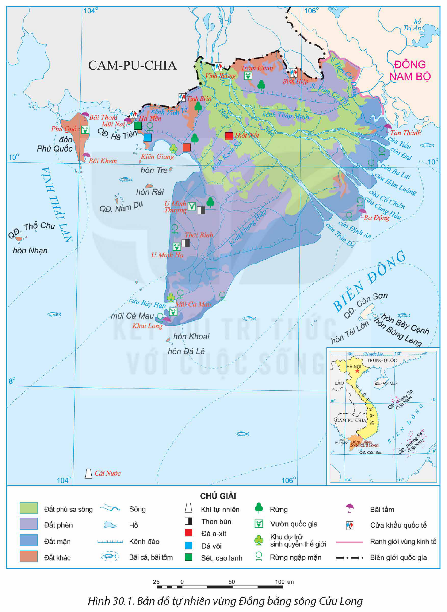
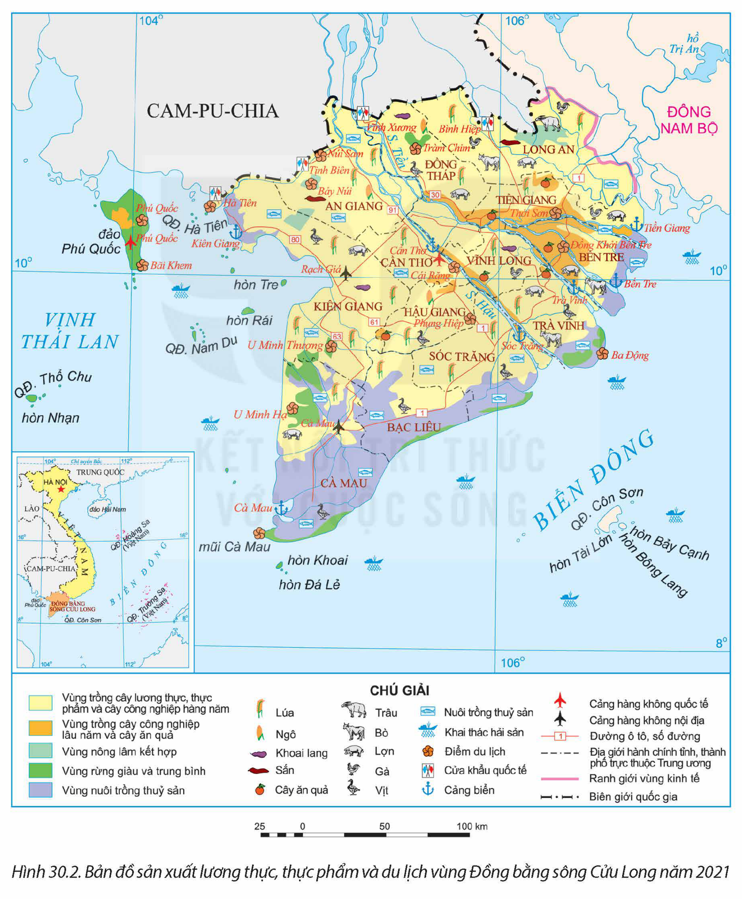
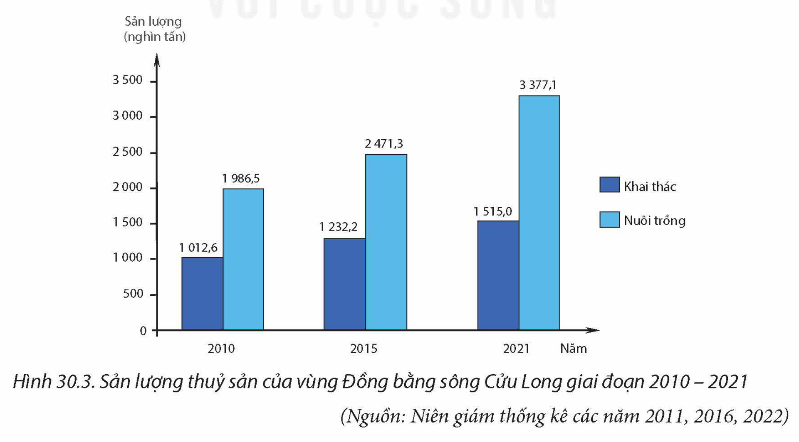

<!-- pdf:149 -->

# BÀI 30: SỬ DỤNG HỢP LÍ TỰ NHIÊN ĐỂ PHÁT TRIỂN KINH TẾ Ở ĐỒNG BẰNG SÔNG CỬU LONG

## 🔴 Mở đầu

Vùng Đồng bằng sông Cửu Long có nhiều thế mạnh để phát triển kinh tế, đặc biệt cho phát triển nông nghiệp, thuỷ sản và du lịch. Những thế mạnh, hạn chế và vấn đề sử dụng hợp lí tự nhiên của vùng là gì? Thực trạng phát triển sản xuất lương thực, thực phẩm và du lịch của vùng như thế nào?

## I. KHÁI QUÁT

### 1. Vị trí địa lí và phạm vi lãnh thổ

<!-- term: Đồng bằng sông Cửu Long -->
Vùng Đồng bằng sông Cửu Long có diện tích 40,9 nghìn km², bao gồm thành phố Cần Thơ và 12 tỉnh: Long An, Vĩnh Long, Tiền Giang, Bến Tre, Hậu Giang, Sóc Trăng, Trà Vinh, Bạc Liêu, Đồng Tháp, An Giang, Kiên Giang, Cà Mau.

<!-- term: Đồng bằng sông Cửu Long -->
Đồng bằng sông Cửu Long là vùng đất cuối cùng về phía nam của Việt Nam, có vùng biển rộng lớn bao quanh ba phía, giàu tài nguyên, gần ngã tư đường hàng hải quốc tế. Vùng giáp vùng Đông Nam Bộ và nước láng giềng Cam-pu-chia. Vị trí địa lí tạo thuận lợi cho Đồng bằng sông Cửu Long phát triển kinh tế, giao lưu, hợp tác với các vùng khác và các quốc gia trong khu vực; đồng thời có vị trí quan trọng đối với quốc phòng an ninh trên cả đất liền và vùng biển đảo.

### 2. Dân số

Số dân của Đồng bằng sông Cửu Long năm 2021 là 17,4 triệu người, chiếm 17,7% số dân cả nước. Tỉ lệ tăng dân số tự nhiên của vùng thấp nhất cả nước (0,55% năm 2021).

Năm 2021, mật độ dân số trung bình của vùng là 426 người/km². Tỉ lệ dân thành thị là 26,4%, thấp hơn mức trung bình của cả nước.

Trong vùng có các dân tộc là Kinh, Khơ-me, Hoa, Chăm,...

> ❓ Dựa vào thông tin mục I và hình 30.1, hãy:
> – Trình bày vị trí địa lí và phạm vi lãnh thổ vùng Đồng bằng sông Cửu Long.
> – Nêu khái quát về đặc điểm dân số của vùng.

## II. SỬ DỤNG HỢP LÍ TỰ NHIÊN

### 1. Các thế mạnh và hạn chế về tự nhiên

**a) Thế mạnh**

<!-- term: Đồng bằng sông Cửu Long -->
<!-- term: Ba loại đất chính ở Đồng bằng sông Cửu Long -->
– Địa hình và đất: Đồng bằng sông Cửu Long là đồng bằng châu thổ lớn nhất nước ta, địa hình thấp, bằng phẳng, thuận lợi cho canh tác nông nghiệp và các hoạt động kinh tế khác. Vùng có ba loại đất chính: Đất phù sa sông có diện tích khoảng hơn 1 triệu ha, phân bố dọc sông Tiền, sông Hậu, là loại đất tốt, màu mỡ, thích hợp

<!-- pdf:150 -->

<!-- term: Ba loại đất chính ở Đồng bằng sông Cửu Long -->
trồng lúa và các loại cây trồng khác. Đất phèn có hơn 1,6 triệu ha, tập trung ở Đồng Tháp Mười, Tứ giác Long Xuyên, bán đảo Cà Mau, có thể cải tạo để trồng lúa, cây ăn quả,... Đất mặn gần 1 triệu ha ở khu vực ven biển, phù hợp cho phát triển rừng ngập mặn, nuôi trồng thuỷ sản. Ngoài ra, các loại đất khác ở khu vực biên giới Cam-pu-chia và trên các đảo, có thể trồng cây ăn quả và cây công nghiệp nhiệt đới.

*Hình 30.1. Bản đồ tự nhiên vùng Đồng bằng sông Cửu Long*

<!-- pdf:151 -->

– Khí hậu của vùng mang tính chất cận xích đạo. Nhiệt độ trung bình trên 25°C, biên độ nhiệt độ trung bình năm nhỏ, số giờ nắng cao; lượng mưa trung bình năm khoảng 1 500 – 2 000 mm. Khí hậu thuận lợi cho sản xuất nông nghiệp nhiệt đới, có tiềm năng phát triển điện gió, điện mặt trời.

– Nguồn nước: Đồng bằng sông Cửu Long có mạng lưới sông ngòi, kênh rạch dày đặc, hệ thống sông Cửu Long với 2 nhánh lớn là sông Tiền và sông Hậu. Sông ngòi có vai trò quan trọng về thuỷ lợi, giao thông đường sông và phát triển du lịch. Vùng có nhiều bãi triều rộng, diện tích mặt nước lớn trong nội địa, tạo điều kiện nuôi thuỷ sản nước mặn, nước lợ, nước ngọt.

– Rừng: Rừng tràm ở An Giang, Cà Mau, Kiên Giang, rừng ngập mặn ven biển các tỉnh Cà Mau, Bạc Liêu, Kiên Giang có ý nghĩa lớn đối với môi trường, bảo tồn nguồn gen, đồng thời là cơ sở để phát triển du lịch sinh thái.

> 💡 EM CÓ BIẾT?
>
> Vùng Đồng bằng sông Cửu Long có 5 vườn quốc gia là Tràm Chim, Phú Quốc, Mũi Cà Mau, U Minh Hạ và U Minh Thượng; 2 khu dự trữ sinh quyển thế giới là Kiên Giang và Mũi Cà Mau.
<!-- ocr-ok: đã đối chiếu ảnh p151.png, hộp EM CÓ BIẾT? xếp 2 cột ngang với đoạn Rừng -->

– Khoáng sản trong vùng có dầu mỏ và khí tự nhiên ở vùng thềm lục địa; vật liệu xây dựng có đá vôi ở khu vực Hà Tiên (Kiên Giang), đá xây dựng ở vùng Bảy Núi (An Giang); sét, cao lanh,... Ngoài ra, còn có than bùn ở các khu vực đầm lầy, dưới rừng ngập nước (Kiên Giang, Cà Mau,...).

– Biển: Với vùng biển rộng, nhiều đảo, Đồng bằng sông Cửu Long có nhiều thế mạnh để phát triển tổng hợp kinh tế biển. Sinh vật vùng biển phong phú, nguồn lợi hải sản giàu có, ngư trường Cà Mau – Kiên Giang là ngư trường trọng điểm, trữ lượng hải sản đứng đầu cả nước. Các đảo có tiềm năng cho phát triển du lịch biển, nổi bật là đảo Phú Quốc.

**b) Hạn chế**

– Khí hậu có một mùa khô sâu sắc, gây nên tình trạng thiếu nước ngọt cho các hoạt động kinh tế (đặc biệt cho sản xuất nông nghiệp), cho sinh hoạt, tăng nguy cơ cháy rừng, làm tăng diện tích đất phèn, đất mặn,...

– Đồng bằng sông Cửu Long là vùng chịu ảnh hưởng nặng nề nhất của biến đổi khí hậu, làm gia tăng những hiện tượng thời tiết cực đoan và nước biển dâng làm mở rộng diện tích đất bị ngập nước ven biển.

– Đồng bằng sông Cửu Long nằm ở hạ lưu của hệ thống sông Mê Công, nguồn nước sông phụ thuộc vào việc sử dụng nước của các quốc gia đầu nguồn, gây khó khăn trong quản lí, sử dụng tổng hợp nguồn nước sông.

> ❓ Dựa vào nội dung mục 1, hãy chứng minh các thế mạnh và hạn chế về tự nhiên cho phát triển kinh tế của vùng Đồng bằng sông Cửu Long.

<!-- pdf:152 -->

### 2. Hướng sử dụng hợp lí tự nhiên

**a) Lí do phải sử dụng hợp lí tự nhiên ở Đồng bằng sông Cửu Long**

<!-- term: Sản xuất lương thực và thực phẩm ở Đồng bằng sông Cửu Long -->
Đồng bằng sông Cửu Long là vùng trọng điểm sản xuất lương thực, thực phẩm lớn nhất cả nước, có vai trò đặc biệt quan trọng trong chiến lược phát triển kinh tế – xã hội của đất nước.

Vùng có nhiều lợi thế về tự nhiên để phát triển kinh tế, đặc biệt là đối với phát triển nông nghiệp, thuỷ sản, du lịch. Sử dụng hợp lí các nguồn lực tự nhiên sẽ phát triển đa dạng các hoạt động nông nghiệp, lâm nghiệp và thuỷ sản của vùng, phát huy hiệu quả thế mạnh của vùng.

Tuy nhiên, tự nhiên của vùng cũng tồn tại những khó khăn, đặc biệt là vấn đề đất nhiễm phèn, nhiễm mặn, khô hạn, mất cân bằng nguồn nước, biến đổi khí hậu,... Để phát triển kinh tế – xã hội bền vững cần có hướng sử dụng hợp lí, cải tạo và thích ứng với tự nhiên trong sản xuất và đời sống.

**b) Hướng sử dụng hợp lí tự nhiên**

– Tăng cường quản lí và sử dụng hiệu quả các nguồn tài nguyên, nhất là tài nguyên đất và tài nguyên nước; bảo vệ môi trường, chủ động ứng phó với thiên tai và biến đổi khí hậu.

– Đầu tư xây dựng mới và hiện đại hoá hệ thống thuỷ lợi, phát triển nông nghiệp bền vững, phù hợp với đặc điểm sinh thái của các vùng sản xuất. Chủ động kiểm soát lũ, phòng, chống sạt lở; đầu tư các công trình thuỷ lợi tích hợp, kiểm soát nguồn nước; tăng khả năng chủ động lấy nước, trữ nước, tiêu thoát và điều tiết lũ.

– Bảo vệ và phát triển các khu bảo tồn thiên nhiên và các vùng ngập nước quan trọng, bảo vệ bờ biển, hạn chế gió, sóng biển.

– Áp dụng công nghệ sinh học, công nghệ môi trường để phát triển các mô hình kinh tế phù hợp với từng địa bàn, tham gia vào các chuỗi giá trị toàn cầu.

– Khai thác tổng hợp thế mạnh vùng biển đảo, phát triển du lịch sinh thái theo hướng bền vững.

– Nâng cao nhận thức của người dân về bảo vệ môi trường, có các chính sách hỗ trợ chủ động khai thác mùa lũ, thích ứng với thiên tai và biến đổi khí hậu. Xây dựng các tuyến dân cư và nhà ở vùng ngập lũ.

> ❓ Dựa vào thông tin mục 2, hãy:
> – Giải thích tại sao phải sử dụng hợp lí tự nhiên vùng Đồng bằng sông Cửu Long.
> – Trình bày hướng sử dụng hợp lí tự nhiên của vùng.

<!-- pdf:153 -->

## III. PHÁT TRIỂN SẢN XUẤT LƯƠNG THỰC VÀ THỰC PHẨM

### 1. Vai trò sản xuất lương thực và thực phẩm

– Sản xuất lương thực, thực phẩm ở Đồng bằng sông Cửu Long có vai trò quan trọng đối với việc đảm bảo an ninh lương thực của vùng và cả nước.

– Vùng là nơi cung cấp các mặt hàng lương thực, thực phẩm xuất khẩu chủ lực cho đất nước, đặc biệt là gạo và thuỷ sản.

– Góp phần khai thác thế mạnh cả về điều kiện tự nhiên, tài nguyên thiên nhiên và kinh tế – xã hội của vùng.

– Cung cấp nguồn nguyên liệu cho công nghiệp sản xuất, chế biến thực phẩm, góp phần thúc đẩy tăng trưởng kinh tế của vùng,...

– Giúp giải quyết việc làm cho một lượng lao động đáng kể trong vùng, cải thiện đời sống của nhân dân.

> ❓ Dựa vào thông tin mục 1, hãy nêu vai trò của sản xuất lương thực và thực phẩm ở Đồng bằng sông Cửu Long.

### 2. Tình hình phát triển

Nông nghiệp vùng Đồng bằng sông Cửu Long được phát triển theo hướng sinh thái bền vững với các sản phẩm trọng tâm là thuỷ sản, lúa gạo và trái cây; phát triển nông nghiệp ứng dụng công nghệ cao, nông nghiệp xanh và hữu cơ.

**a) Sản xuất lương thực**

<!-- term: Sản xuất lương thực và thực phẩm ở Đồng bằng sông Cửu Long -->
Sản xuất lương thực là ngành giữ vai trò quan trọng nhất trong nông nghiệp của vùng. Năm 2021, vùng chiếm khoảng 50% cả về diện tích gieo trồng và sản lượng lương thực có hạt của cả nước. Bình quân lương thực đầu người của vùng đạt 1 405,1 kg, gấp hơn 2,8 lần mức bình quân của cả nước.

<!-- term: Sản xuất lương thực và thực phẩm ở Đồng bằng sông Cửu Long -->
Lúa là cây lương thực chủ đạo, chiếm hơn 99% về diện tích và sản lượng lương thực có hạt của vùng. Đồng bằng sông Cửu Long cũng là vùng sản xuất lúa hàng hoá lớn nhất và chiếm hơn 90% sản lượng gạo xuất khẩu của cả nước.

Bảng 30.1. DIỆN TÍCH VÀ SẢN LƯỢNG LÚA Ở ĐỒNG BẰNG SÔNG CỬU LONG GIAI ĐOẠN 2010 – 2021

| Năm \ Chỉ tiêu | Diện tích gieo trồng: *Triệu ha* | Diện tích gieo trồng: So với cả nước *(%)* | Sản lượng: *Triệu tấn* | Sản lượng: So với cả nước *(%)* |
| :---: | :---: | :---: | :---: | :---: |
| 2010 | 3,9 | 52,7 | 21,6 | 54,0 |
| 2015 | 4,3 | 54,9 | 25,6 | 56,7 |
| 2021 | 3,9 | 53,9 | 24,3 | 55,5 |

*(Nguồn: Niên giám thống kê các năm 2011, 2016, 2022)*

<!-- pdf:154 -->

Việc ứng dụng khoa học – công nghệ trong sản xuất lúa được tăng cường. Năng suất lúa cả năm của vùng tăng lên, năm 2021 đạt 62,4 tạ/ha, cao nhất cả nước. Các giống lúa mới có năng suất và chất lượng cao được đưa vào sản xuất, mang lại hiệu quả kinh tế cao, đáp ứng nhu cầu thị trường. Lúa được trồng ở hầu khắp các tỉnh trong vùng, các tỉnh trồng nhiều lúa là Kiên Giang, An Giang, Hậu Giang, Sóc Trăng và Đồng Tháp.

Ngoài lúa, một số cây lương thực khác như ngô, khoai, sắn,... cũng được trồng trong vùng, song diện tích không đáng kể.

*Hình 30.2. Bản đồ sản xuất lương thực, thực phẩm và du lịch vùng Đồng bằng sông Cửu Long năm 2021*

<!-- pdf:155 -->

**b) Sản xuất thực phẩm**

– Chăn nuôi

Các vật nuôi chính của vùng là lợn, bò thịt, gia cầm,... Chăn nuôi của vùng phát triển theo hướng sạch, quy mô lớn, ứng dụng khoa học – công nghệ, gắn với công nghiệp chế biến và thị trường tiêu thụ. Các tỉnh phát triển chăn nuôi mạnh trong vùng là Bến Tre, Tiền Giang, Trà Vinh,...

Bảng 30.2. SỐ LƯỢNG BÒ, LỢN VÀ GIA CẦM VÙNG ĐỒNG BẰNG SÔNG CỬU LONG NĂM 2010 VÀ NĂM 2021

| Vật nuôi \ Năm | 2010: Số lượng *(nghìn con)* | 2010: So với cả nước *(%)* | 2021: Số lượng *(nghìn con)* | 2021: So với cả nước *(%)* |
| :--- | :---: | :---: | :---: | :---: |
| Bò | 691,1 | 11,9 | 909,4 | 15,1 |
| Lợn | 3 798,9 | 13,9 | 2 079,5 | 9,0 |
| Gia cầm | 60 703,0 | 20,2 | 87 537,0 | 16,7 |

*(Nguồn: Niên giám thống kê các năm 2011, 2022)*

– Thuỷ sản

<!-- term: Sản xuất lương thực và thực phẩm ở Đồng bằng sông Cửu Long -->
Đồng bằng sông Cửu Long là vùng trọng điểm số một về thuỷ sản, phát triển cả khai thác và nuôi trồng. Sản lượng thuỷ sản toàn vùng lớn và ngày càng tăng, luôn chiếm trên 50% sản lượng thuỷ sản của cả nước và đứng đầu về giá trị xuất khẩu thuỷ sản.

Năm 2021, sản lượng thuỷ sản khai thác chiếm khoảng 30% tổng sản lượng thuỷ sản cả vùng và chiếm hơn 38% sản lượng khai thác của cả nước. Các tỉnh có sản lượng khai thác lớn nhất là Kiên Giang, Cà Mau, Bến Tre,...

*Hình 30.3. Sản lượng thuỷ sản của vùng Đồng bằng sông Cửu Long giai đoạn 2010 – 2021*

*(Nguồn: Niên giám thống kê các năm 2011, 2016, 2022)*

<!-- pdf:156 -->

<!-- term: Sản xuất lương thực và thực phẩm ở Đồng bằng sông Cửu Long -->
Nuôi trồng thuỷ sản của Đồng bằng sông Cửu Long là ưu thế và luôn ở vị trí đứng đầu cả nước. Năm 2021, diện tích thu hoạch thuỷ sản trong vùng đạt hơn 772 nghìn ha, chiếm gần 71% tổng diện tích thu hoạch thuỷ sản của cả nước. Sản lượng thuỷ sản nuôi trồng tăng liên tục, chiếm gần 70% tổng sản lượng thuỷ sản nuôi trồng của cả nước. Đối tượng thuỷ sản nuôi trồng đa dạng như tôm, cá da trơn, cua,... Nuôi trồng thuỷ sản ở vùng phát triển theo hướng sản xuất công nghiệp, công nghệ cao; các cơ sở chế biến, sản xuất thức ăn thuỷ sản phát triển mạnh, tạo nên chuỗi giá trị từ nuôi trồng, chế biến và tiêu thụ. Các tỉnh nuôi trồng thuỷ sản lớn là Cà Mau, Kiên Giang, Bạc Liêu, Đồng Tháp, An Giang,...

<!-- term: Sản xuất lương thực và thực phẩm ở Đồng bằng sông Cửu Long -->
– Trồng cây ăn quả: Đồng bằng sông Cửu Long là vùng sản xuất cây ăn quả lớn nhất cả nước. Diện tích cây ăn quả tăng nhanh, năm 2021 đạt hơn 377 nghìn ha (chiếm hơn 33% cả nước). Các cây trồng chủ lực là sầu riêng, thanh long, xoài, chôm chôm, nhãn, bưởi, cam,... Một số vùng trồng cây ăn quả tập trung được đẩy mạnh đầu tư với quy mô lớn.

Trồng cây ăn quả ở vùng phát triển theo hướng áp dụng công nghệ cao (công nghệ gen, tự động hoá, nông nghiệp thông minh, công nghệ sinh học) hướng tới trồng trọt hữu cơ, bền vững,... tăng cường đầu tư công nghiệp chế biến. Sản phẩm cây ăn quả không chỉ cung cấp cho thị trường trong nước mà còn xuất khẩu đến nhiều nước trên thế giới như Trung Quốc, Hoa Kỳ,...

> ❓ Dựa vào nội dung mục 2 và hình 30.2, hãy trình bày:
> – Tình hình phát triển sản xuất lương thực vùng Đồng bằng sông Cửu Long.
> – Tình hình phát triển sản xuất thực phẩm (thuỷ sản, chăn nuôi, cây ăn quả) của vùng.

## IV. PHÁT TRIỂN DU LỊCH

### 1. Tài nguyên du lịch

– Tài nguyên du lịch tự nhiên

Đồng bằng sông Cửu Long có nhiều lợi thế về tự nhiên để phát triển du lịch. Hệ thống sông, kênh rạch chằng chịt, các cù lao sông; các hệ sinh thái rừng như rừng ngập mặn (U Minh Thượng, U Minh Hạ – Cà Mau), rừng tràm (Vườn quốc gia Tràm Chim – Đồng Tháp),... tạo nên cảnh quan thiên nhiên độc đáo, hấp dẫn khách du lịch.

Vùng biển có hệ thống các đảo như Phú Quốc, Nam Du, Hòn Tre,... với nhiều bãi tắm, cảnh quan đặc sắc là những điểm đến thu hút khách du lịch.

– Tài nguyên du lịch văn hoá

Các di tích lịch sử – văn hoá, di tích cách mạng, khảo cổ, kiến trúc, nghệ thuật,... trong vùng rất phong phú. Những địa điểm nổi tiếng là nhà tù Phú Quốc (Kiên Giang), di chỉ khảo cổ Óc Eo – Gò Thành (Tiền Giang), di tích Đồng Khởi (Bến Tre), chùa Dơi (Sóc Trăng), các di tích ở Núi Sam (An Giang),...

Đồng bằng sông Cửu Long có nền văn hoá vùng châu thổ với các miệt vườn cây trái trù phú, người dân thích ứng với cuộc sống miền sông nước, hình thành nên các chợ nổi

<!-- pdf:157 -->

(Cái Răng – Cần Thơ, Phụng Hiệp – Hậu Giang,...) hấp dẫn khách du lịch. Nghệ thuật dân gian có đờn ca tài tử, hò,... cùng các nghề thủ công truyền thống, ẩm thực, lễ hội đặc sắc (Vía Bà Chúa Xứ Núi Sam, Ok Om Bok) làm phong phú hơn các sản phẩm du lịch của vùng.

> ❓ Dựa vào thông tin mục 1, hãy trình bày tài nguyên du lịch ở Đồng bằng sông Cửu Long.

### 2. Tình hình phát triển

Khách du lịch và doanh thu du lịch lữ hành của vùng Đồng bằng sông Cửu Long có xu hướng tăng đều trong giai đoạn 2015 – 2019, năm 2020, 2021 giảm do ảnh hưởng của đại dịch COVID-19. Sau khi dịch được kiểm soát, lượng khách đang dần phục hồi trở lại.

Bảng 30.3. SỐ LƯỢNG KHÁCH DU LỊCH VÀ DOANH THU DU LỊCH LỮ HÀNH CỦA VÙNG ĐỒNG BẰNG SÔNG CỬU LONG GIAI ĐOẠN 2015 – 2022

| Chỉ số \ Năm | 2015 | 2019 | 2022 |
| :--- | :---: | :---: | :---: |
| Số lượt khách *(triệu lượt người)* | 23,2 | 46,0 | 37,5 |
| Doanh thu du lịch lữ hành *(tỉ đồng)* | 512 | 1 000,8 | 957,2 |

*(Nguồn: Niên giám thống kê các năm 2016, 2022)*

Loại hình du lịch đặc trưng của vùng là du lịch sinh thái, du lịch sông nước, du lịch nghỉ dưỡng biển đảo và du lịch văn hoá lễ hội.

Các địa bàn trọng điểm du lịch của vùng gồm Cần Thơ, Kiên Giang, Đồng Tháp, An Giang, Tiền Giang, Bến Tre. Phú Quốc là đô thị du lịch và là điểm đến hấp dẫn nhất trong vùng.

> ❓ Dựa vào thông tin mục 2, hãy trình bày tình hình phát triển du lịch ở Đồng bằng sông Cửu Long.

## ✏️ Luyện tập và vận dụng

**Luyện tập**

- Dựa vào bảng 30.1, hãy nhận xét tình hình và vai trò của ngành sản xuất lúa ở vùng Đồng bằng sông Cửu Long.

**Vận dụng**

- Sưu tầm thông tin, tìm hiểu về tiềm năng phát triển một loại hình du lịch ở vùng Đồng bằng sông Cửu Long.

## 📷 Danh sách hình trong bài

| Mã hình | Trang PDF | Vị trí trong bài | Chú thích gốc |
| --- | --- | --- | --- |
| H12-dia-b30-01 | 150 | Mục II.1.a | Hình 30.1. Bản đồ tự nhiên vùng Đồng bằng sông Cửu Long |
| H12-dia-b30-02 | 154 | Mục III.2.a | Hình 30.2. Bản đồ sản xuất lương thực, thực phẩm và du lịch vùng Đồng bằng sông Cửu Long năm 2021 |
| H12-dia-b30-03 | 155 | Mục III.2.b | Hình 30.3. Sản lượng thuỷ sản của vùng Đồng bằng sông Cửu Long giai đoạn 2010 – 2021 |
