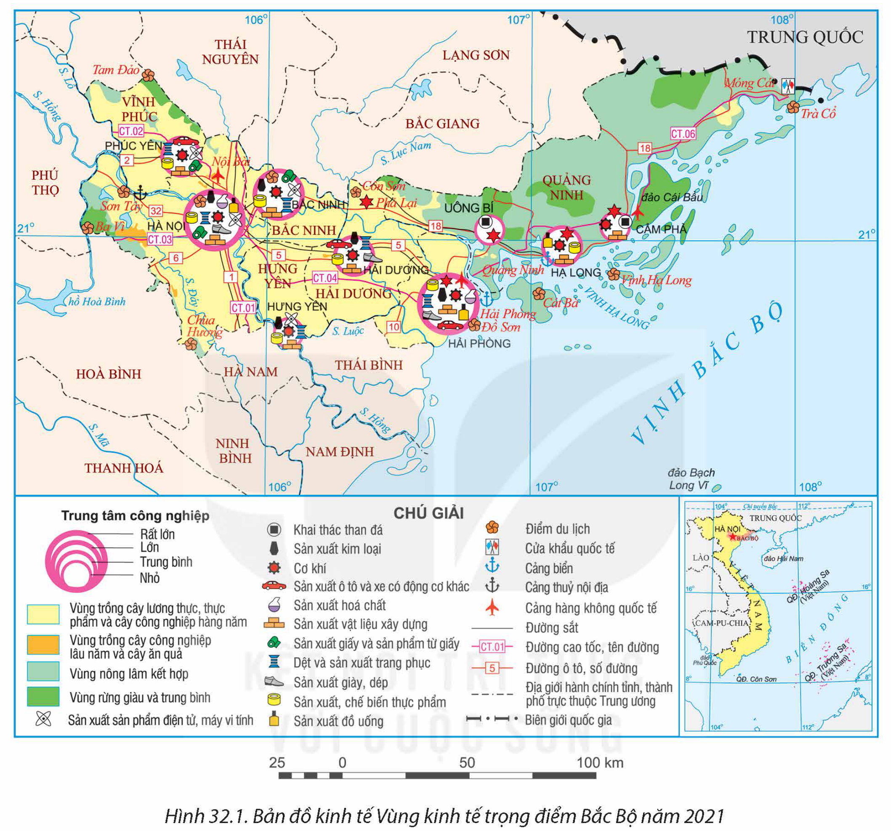
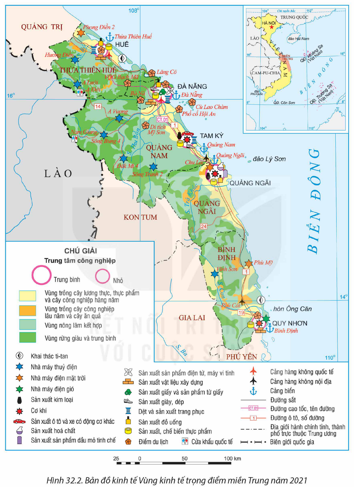
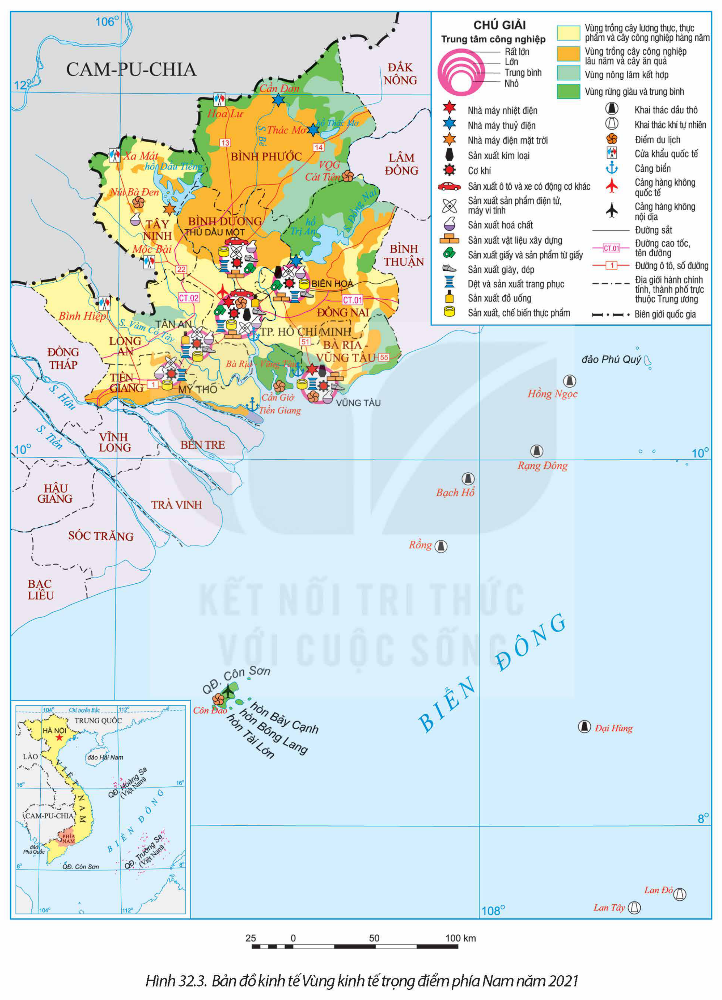
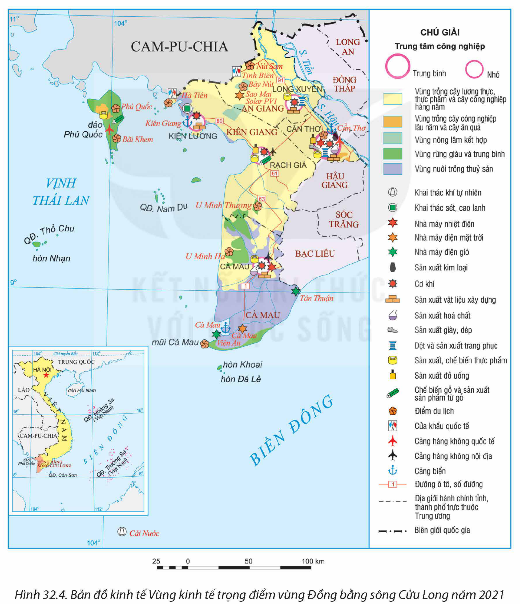

<!-- pdf:159 -->

# BÀI 32: PHÁT TRIỂN CÁC VÙNG KINH TẾ TRỌNG ĐIỂM

## 🔴 Mở đầu

Nghị quyết số 81/2023/QH13 của Quốc hội về Quy hoạch tổng thể quốc gia thời kì 2021 – 2030, tầm nhìn đến năm 2050 đã nêu rõ định hướng phát triển không gian kinh tế – xã hội, trong đó có phát triển 4 vùng động lực quốc gia trên cơ sở các vùng kinh tế trọng điểm hiện nay. Vậy thế nào là vùng kinh tế trọng điểm? Các vùng kinh tế trọng điểm của nước ta có đặc điểm gì?

## I. ĐẶC ĐIỂM VÙNG KINH TẾ TRỌNG ĐIỂM

<!-- term: Vùng kinh tế trọng điểm -->
Vùng kinh tế trọng điểm là một bộ phận của lãnh thổ quốc gia, hội tụ các điều kiện và yếu tố phát triển thuận lợi, có tiềm lực kinh tế lớn, giữ vai trò động lực, đầu tàu thúc đẩy sự phát triển chung của cả nước.

Vùng kinh tế trọng điểm có đặc điểm:

<!-- term: Vùng kinh tế trọng điểm -->
– Hội tụ các yếu tố thuận lợi về vị trí địa lí, nguồn lực tự nhiên và nguồn lực kinh tế – xã hội, tạo nên tiềm lực lớn cho phát triển kinh tế – xã hội.

<!-- term: Vùng kinh tế trọng điểm -->
– Được ưu tiên đầu tư (về vốn, khoa học – công nghệ, cơ sở hạ tầng,...), từ đó tạo khả năng phát triển các ngành mới về công nghiệp, dịch vụ, tăng tốc độ phát triển và có thể lan toả đến các lãnh thổ khác.

<!-- term: Vùng kinh tế trọng điểm -->
– Có đóng góp lớn cho quốc gia, giữ vai trò động lực trong sự phát triển chung của cả nước. Vai trò của các vùng kinh tế trọng điểm thể hiện ở tỉ trọng đóng góp trong cả nước về GDP, tăng trưởng kinh tế, cơ cấu và chuyển dịch cơ cấu kinh tế, trị giá xuất khẩu,...

<!-- term: Vùng kinh tế trọng điểm -->
– Số lượng và phạm vi lãnh thổ của các vùng kinh tế trọng điểm thay đổi phù hợp với sự phát triển kinh tế – xã hội của đất nước.

> ❓ Dựa vào thông tin mục I, hãy phân tích đặc điểm chung của các vùng kinh tế trọng điểm.

## II. CÁC VÙNG KINH TẾ TRỌNG ĐIỂM

### 1. Vùng kinh tế trọng điểm Bắc Bộ

**a) Quá trình hình thành**

<!-- term: Vùng kinh tế trọng điểm Bắc Bộ -->
Vùng kinh tế trọng điểm Bắc Bộ được thành lập năm 1997, bao gồm Hà Nội, Hải Phòng, Quảng Ninh, Hưng Yên, Hải Dương. Năm 2004, vùng được mở rộng thêm tỉnh Vĩnh Phúc và Bắc Ninh. Đến năm 2021, bảy tỉnh, thành phố của vùng có diện tích hơn 15 nghìn km², số dân là 17,6 triệu người.

<!-- pdf:160 -->

**b) Nguồn lực phát triển**

<!-- term: Vùng kinh tế trọng điểm Bắc Bộ -->
Vùng kinh tế trọng điểm Bắc Bộ là cửa ngõ ra biển của các tỉnh phía Bắc. Vùng có hai hành lang và một vành đai kinh tế trong quan hệ kinh tế Việt Nam – Trung Quốc đi qua; có Thủ đô Hà Nội là trung tâm chính trị, kinh tế, văn hoá, khoa học – công nghệ của cả nước.

Vùng có một số loại khoáng sản quan trọng, trữ lượng lớn như than đá, than nâu, đá vôi,...; có không gian biển để xây dựng các cảng biển và phát triển dịch vụ hàng hải; có lợi thế về tài nguyên du lịch tự nhiên với Di sản thiên nhiên thế giới Vịnh Hạ Long – quần đảo Cát Bà, các bãi biển, danh thắng,...

Vùng có số dân đông, nguồn lao động dồi dào, tỉ lệ lao động đã qua đào tạo cao nhất nước. Đây là vùng có lịch sử khai thác lãnh thổ lâu đời, có tài nguyên du lịch văn hoá đa dạng với nhiều di sản văn hoá vật thể và phi vật thể của thế giới (Hoàng thành Thăng Long, dân ca Quan họ Bắc Ninh,...). Cơ sở hạ tầng được đầu tư và phát triển đồng bộ, hiện đại bậc nhất cả nước với nhiều tuyến cao tốc, cảng hàng không quốc tế (Nội Bài, Cát Bi, Vân Đồn), cảng biển (Hải Phòng, Quảng Ninh),...

**c) Thực trạng phát triển**

<!-- term: Vùng kinh tế trọng điểm Bắc Bộ -->
Quy mô GRDP, tỉ lệ đóng góp vào GDP cả nước chỉ đứng sau Vùng kinh tế trọng điểm phía Nam. Cơ cấu kinh tế của vùng tương đối hài hoà và chuyển dịch theo hướng hiện đại. Năm 2021, vùng thu hút 31,8% tổng số dự án đầu tư trực tiếp nước ngoài với 26,9% tổng số vốn đăng kí, đóng góp 32,5% trị giá xuất khẩu của cả nước.

Bảng 32.1. QUY MÔ VÀ CƠ CẤU GRDP CỦA VÙNG KINH TẾ TRỌNG ĐIỂM BẮC BỘ NĂM 2010 VÀ NĂM 2021

| Chỉ số \ Năm | 2010 | 2021 |
| :--- | :---: | :---: |
| GRDP *(nghìn tỉ đồng)* | 629,6 | 2 243,6 |
| – Tỉ trọng trong GDP cả nước *(%)* | 23,7 | 26,6 |
| Cơ cấu GRDP *(%)* | 100,0 | 100,0 |
| – Nông nghiệp, lâm nghiệp và thuỷ sản | 6,5 | 3,9 |
| – Công nghiệp và xây dựng | 29,4 | 42,3 |
| – Dịch vụ | 50,1 | 43,8 |
| – Thuế sản phẩm trừ trợ cấp sản phẩm | 14,0 | 10,0 |

*(Nguồn: Tổng cục Thống kê)*

Các ngành kinh tế nổi bật của vùng là công nghiệp (sản xuất ô tô và xe có động cơ khác; sản xuất sản phẩm điện tử, máy vi tính; sản xuất kim loại,...); dịch vụ

<!-- pdf:161 -->

(tài chính ngân hàng, giao thông vận tải, bưu chính viễn thông, giáo dục – đào tạo,...); nông nghiệp thâm canh, áp dụng công nghệ cao,...

*Hình 32.1. Bản đồ kinh tế Vùng kinh tế trọng điểm Bắc Bộ năm 2021*

**d) Định hướng phát triển**

Chú trọng phát triển khoa học – công nghệ, đổi mới sáng tạo, kinh tế số, xã hội số; phát triển một số ngành dịch vụ hiện đại, chất lượng cao; các ngành công nghiệp chế biến, chế tạo giá trị gia tăng cao, tham gia vào chuỗi giá trị toàn cầu; phát triển kinh tế biển với các ngành vận tải biển, du lịch biển đảo,...

> ❓ Dựa vào thông tin mục 1 và hình 32.1, hãy trình bày:
> – Quá trình hình thành, các nguồn lực của Vùng kinh tế trọng điểm Bắc Bộ.
> – Thực trạng và định hướng phát triển của vùng.

<!-- pdf:162 -->

### 2. Vùng kinh tế trọng điểm miền Trung

**a) Quá trình hình thành**

<!-- term: Vùng kinh tế trọng điểm miền Trung -->
Vùng kinh tế trọng điểm miền Trung được thành lập năm 1997, bao gồm Đà Nẵng, Thừa Thiên Huế, Quảng Nam, Quảng Ngãi. Năm 2004, vùng được bổ sung thêm tỉnh Bình Định. Đến năm 2021, năm tỉnh, thành phố của vùng có diện tích khoảng 28 nghìn km², số dân là 6,6 triệu người.

**b) Nguồn lực phát triển**

<!-- term: Vùng kinh tế trọng điểm miền Trung -->
Vùng kinh tế trọng điểm miền Trung nằm ở vị trí chiến lược về giao lưu kinh tế Bắc – Nam và Đông – Tây. Vùng là cửa ngõ thông ra biển của vùng Tây Nguyên và các nước láng giềng (Lào, Cam-pu-chia, Thái Lan).

Vùng có không gian biển rộng, tài nguyên biển phong phú tạo thuận lợi cho phát triển kinh tế biển; khoáng sản có cao lanh, cát thuỷ tinh,... chất lượng tốt; có tiềm năng để phát triển điện gió, điện mặt trời,...

Người dân trong vùng có truyền thống cần cù, tinh thần cách mạng. Trong vùng có nhiều di sản văn hoá vật thể và phi vật thể thế giới (Phố cổ Hội An, Cố đô Huế, Thánh địa Mỹ Sơn), là những thế mạnh để phát triển du lịch. Hệ thống giao thông của vùng khá hiện đại, bao gồm các quốc lộ, cao tốc (quốc lộ 1, cao tốc Bắc – Nam,...), các cảng hàng không (Phú Bài, Đà Nẵng, Chu Lai, Phù Cát), cảng biển (Thừa Thiên Huế, Đà Nẵng, Quảng Ngãi,...),...

**c) Thực trạng phát triển**

Quy mô GRDP của vùng ngày càng tăng nhưng tỉ trọng trong GDP cả nước còn nhỏ. Cơ cấu kinh tế của vùng thiên về phát triển dịch vụ song chuyển dịch còn chậm. Năm 2021, vùng thu hút 4,0% tổng số dự án đầu tư trực tiếp nước ngoài với 4,6% tổng số vốn đăng kí, đóng góp 2,6% trị giá xuất khẩu của cả nước.

Bảng 32.2. QUY MÔ VÀ CƠ CẤU GRDP CỦA VÙNG KINH TẾ TRỌNG ĐIỂM MIỀN TRUNG NĂM 2010 VÀ NĂM 2021

| Chỉ số \ Năm | 2010 | 2021 |
| :--- | :---: | :---: |
| GRDP *(nghìn tỉ đồng)* | 141,6 | 458,6 |
| – Tỉ trọng trong GDP cả nước *(%)* | 5,3 | 5,4 |
| Cơ cấu GRDP *(%)* | 100,0 | 100,0 |
| – Nông nghiệp, lâm nghiệp và thuỷ sản | 16,6 | 15,1 |
| – Công nghiệp và xây dựng | 25,7 | 31,3 |
| – Dịch vụ | 44,3 | 41,3 |
| – Thuế sản phẩm trừ trợ cấp sản phẩm | 13,4 | 12,3 |

*(Nguồn: Tổng cục Thống kê)*

<!-- pdf:163 -->

*Hình 32.2. Bản đồ kinh tế Vùng kinh tế trọng điểm miền Trung năm 2021*

<!-- term: Vùng kinh tế trọng điểm miền Trung -->
Các ngành kinh tế nổi bật của vùng là kinh tế biển (giao thông vận tải biển, dịch vụ hàng hải, du lịch biển đảo, khai thác thuỷ sản xa bờ và nuôi trồng thuỷ sản); công nghiệp (sản xuất ô tô và xe có động cơ khác, sản xuất kim loại, sản xuất sản phẩm dầu mỏ tinh chế, năng lượng tái tạo,...).

<!-- pdf:164 -->

**d) Định hướng phát triển**

Tiếp tục phát triển các trung tâm du lịch biển, du lịch sinh thái mang tầm khu vực và thế giới; phát triển công nghiệp sản xuất sản phẩm dầu mỏ tinh chế, công nghiệp sản xuất ô tô; phát triển các cảng biển và dịch vụ cảng biển, hạ tầng và các trung tâm dịch vụ hậu cần nghề cá.

> ❓ Dựa vào thông tin mục 2 và hình 32.2, hãy trình bày:
> – Quá trình hình thành, các nguồn lực của Vùng kinh tế trọng điểm miền Trung.
> – Thực trạng phát triển của vùng.

### 3. Vùng kinh tế trọng điểm phía Nam

**a) Quá trình hình thành**

<!-- term: Vùng kinh tế trọng điểm phía Nam -->
Vùng kinh tế trọng điểm phía Nam được thành lập năm 1998, bao gồm Thành phố Hồ Chí Minh và các tỉnh Đồng Nai, Bình Dương, Bà Rịa – Vũng Tàu. Vùng mở rộng thêm các tỉnh Tây Ninh, Bình Phước, Long An vào năm 2003 và tỉnh Tiền Giang vào năm 2009. Đến năm 2021, tám tỉnh, thành phố của vùng có diện tích hơn 30 nghìn km², số dân là 21,8 triệu người.

**b) Nguồn lực phát triển**

Vùng kinh tế trọng điểm phía Nam nằm trên các tuyến giao thông quan trọng, thuận lợi cho giao lưu kinh tế – xã hội cả trong nước và quốc tế. Vùng có Thành phố Hồ Chí Minh là trung tâm lớn về kinh tế, khoa học – kĩ thuật, là đầu mối giao thông và giao lưu quốc tế lớn nhất cả nước.

Nguồn tài nguyên dầu khí với trữ lượng lớn trong vùng là thế mạnh nổi bật. Vùng có không gian biển thuận lợi cho xây dựng cảng nước sâu, nuôi trồng và khai thác thuỷ sản, du lịch biển,... Các điều kiện về đất, khí hậu thích hợp trồng cây công nghiệp lâu năm và cây ăn quả nhiệt đới.

Vùng có lực lượng lao động dồi dào, tay nghề cao, năng động, sáng tạo, thích ứng với nền kinh tế thị trường. Cơ sở hạ tầng phát triển hiện đại và ngày càng hoàn thiện cả về số lượng và chất lượng với hệ thống quốc lộ, cao tốc, cảng hàng không (Tân Sơn Nhất, Long Thành – đang xây dựng, Côn Đảo), cảng biển (Thành phố Hồ Chí Minh, Bà Rịa – Vũng Tàu,...). Vùng có nhiều chính sách linh hoạt trong thu hút đầu tư, chuyển giao công nghệ,...

**c) Thực trạng phát triển**

<!-- term: Vùng kinh tế trọng điểm phía Nam -->
Vùng kinh tế trọng điểm phía Nam là vùng phát triển kinh tế hàng đầu của cả nước, GRDP của vùng đứng đầu 4 vùng kinh tế trọng điểm. Cơ cấu kinh tế của vùng có sự chuyển dịch theo hướng hiện đại. Năm 2021, vùng thu hút 54,6% tổng số dự án đầu tư trực tiếp nước ngoài với 44,1% tổng số vốn đăng kí và đóng góp 37,1% trị giá xuất khẩu của cả nước.

<!-- pdf:165 -->

*Hình 32.3. Bản đồ kinh tế Vùng kinh tế trọng điểm phía Nam năm 2021*

<!-- pdf:166 -->

Bảng 32.3. QUY MÔ VÀ CƠ CẤU GRDP CỦA VÙNG KINH TẾ TRỌNG ĐIỂM PHÍA NAM NĂM 2010 VÀ NĂM 2021

| Chỉ số \ Năm | 2010 | 2021 |
| :--- | :---: | :---: |
| GDRP *(nghìn tỉ đồng)* | 1 053,4 | 2 835,6 |
| – Tỉ trọng trong GDP cả nước *(%)* | 39,7 | 33,5 |
| Cơ cấu GRDP *(%)* | 100,0 | 100,0 |
| – Nông nghiệp, lâm nghiệp và thuỷ sản | 6,9 | 6,4 |
| – Công nghiệp và xây dựng | 44,7 | 42,6 |
| – Dịch vụ | 38,2 | 40,8 |
| – Thuế sản phẩm trừ trợ cấp sản phẩm | 10,2 | 10,2 |

*(Nguồn: Tổng cục Thống kê)*

Các ngành kinh tế nổi bật trong vùng là công nghiệp (khai thác, chế biến dầu khí; sản xuất điện; sản xuất sản phẩm điện tử, máy vi tính; sản xuất, chế biến thực phẩm, đồ uống,...); dịch vụ (cảng biển, du lịch, tài chính ngân hàng, bưu chính viễn thông,...); phát triển cây công nghiệp với mức độ tập trung và trình độ thâm canh cao.

**d) Định hướng phát triển**

Xây dựng, phát triển Vùng kinh tế trọng điểm phía Nam trở thành trung tâm kinh tế, tài chính, thương mại; đi đầu trong khoa học – công nghệ, đổi mới sáng tạo, chuyển đổi mô hình tăng trưởng, xây dựng kinh tế số, xã hội số; phát triển mạnh các dịch vụ tài chính ngân hàng, khoa học – công nghệ, logistics,...; thu hút đầu tư các ngành công nghiệp công nghệ cao, các công viên phần mềm, trí tuệ nhân tạo; phát triển kinh tế biển.

> ❓ Dựa vào thông tin mục 3 và hình 32.3, hãy:
> – Trình bày quá trình hình thành Vùng kinh tế trọng điểm phía Nam.
> – Chứng minh Vùng kinh tế trọng điểm phía Nam có nền kinh tế phát triển nhất.

### 4. Vùng kinh tế trọng điểm vùng Đồng bằng sông Cửu Long

**a) Quá trình hình thành**

<!-- term: Vùng kinh tế trọng điểm vùng Đồng bằng sông Cửu Long -->
Vùng kinh tế trọng điểm vùng Đồng bằng sông Cửu Long được thành lập muộn nhất (năm 2009), bao gồm thành phố Cần Thơ và 3 tỉnh An Giang, Kiên Giang và Cà Mau. Đến năm 2021, vùng có diện tích hơn 16 nghìn km², số dân là 6,1 triệu người.

**b) Nguồn lực phát triển**

Vùng kinh tế trọng điểm vùng Đồng bằng sông Cửu Long có vị trí địa lí thuận lợi và quan trọng đối với quốc phòng an ninh đất nước.

<!-- pdf:167 -->

Vùng thuộc hạ lưu của hệ thống sông Mê Công, thuận lợi cho việc phát triển lương thực, thực phẩm. Tài nguyên khoáng sản có dầu mỏ, khí tự nhiên ở vùng thềm lục địa; đá vôi ở khu vực Hà Tiên, Kiên Lương,.... Tài nguyên sinh vật biển phong phú, nhiều bãi tắm đẹp, nhiều đảo, thuận lợi cho phát triển nuôi trồng và khai thác thuỷ sản, du lịch.

Người dân có kinh nghiệm trồng lúa, nuôi trồng và khai thác thuỷ sản. Vùng có nhiều di tích lịch sử, văn hoá tạo thế mạnh để phát triển du lịch. Cơ sở hạ tầng của vùng ngày càng được phát triển và hoàn thiện, với các cảng hàng không (Cần Thơ, Cà Mau, Rạch Giá, Phú Quốc), cảng biển (Kiên Giang, Cà Mau,...) tạo thuận lợi cho các hoạt động sản xuất, thúc đẩy thương mại và du lịch.

*Hình 32.4. Bản đồ kinh tế Vùng kinh tế trọng điểm vùng Đồng bằng sông Cửu Long năm 2021*

<!-- pdf:168 -->

**c) Thực trạng phát triển**

Mặc dù có tiềm năng lớn nhưng kinh tế của vùng chưa thực sự phát triển. Tỉ lệ đóng góp vào GDP cả nước còn khiêm tốn. Trong cơ cấu kinh tế của vùng, tỉ trọng của khu vực nông nghiệp, lâm nghiệp và thuỷ sản tuy giảm song còn khá cao. Năm 2021, vùng thu hút 0,5% tổng số dự án đầu tư trực tiếp nước ngoài với 1,7% tổng số vốn đăng kí và đóng góp 1,2% trị giá xuất khẩu của cả nước.

Bảng 32.4. QUY MÔ VÀ CƠ CẤU GRDP CỦA VÙNG KINH TẾ TRỌNG ĐIỂM VÙNG ĐỒNG BẰNG SÔNG CỬU LONG NĂM 2010 VÀ NĂM 2021

| Chỉ số \ Năm | 2010 | 2021 |
| :--- | :---: | :---: |
| GRDP *(nghìn tỉ đồng)* | 124,7 | 346,6 |
| – Tỉ trọng trong GDP cả nước *(%)* | 4,7 | 4,1 |
| Cơ cấu GRDP *(%)* | 100,0 | 100,0 |
| – Nông nghiệp, lâm nghiệp và thuỷ sản | 36,9 | 30,8 |
| – Công nghiệp và xây dựng | 24,6 | 23,0 |
| – Dịch vụ | 34,3 | 40,9 |
| – Thuế sản phẩm trừ trợ cấp sản phẩm | 4,2 | 5,3 |

*(Nguồn: Tổng cục Thống kê)*

Sản xuất lúa gạo, nuôi trồng, khai thác và chế biến thuỷ sản; công nghiệp sản xuất, chế biến thực phẩm; công nghiệp sản xuất điện; du lịch,... là các ngành kinh tế nổi bật trong vùng.

**d) Định hướng phát triển**

<!-- term: Vùng kinh tế trọng điểm vùng Đồng bằng sông Cửu Long -->
Phát triển Vùng kinh tế trọng điểm vùng Đồng bằng sông Cửu Long tập trung vào lĩnh vực nông nghiệp công nghệ cao; trở thành vùng nghiên cứu, ứng dụng khoa học – công nghệ về nông nghiệp quốc gia và các dịch vụ nông nghiệp; phát triển công nghiệp chế biến lương thực, thực phẩm, cơ khí, hoá chất phục vụ nông nghiệp; phát triển kinh tế biển.

> ❓ Dựa vào thông tin mục 4 và hình 32.4, hãy trình bày quá trình hình thành, các nguồn lực, thực trạng và định hướng phát triển của Vùng kinh tế trọng điểm vùng Đồng bằng sông Cửu Long.

## ✏️ Luyện tập và vận dụng

**Luyện tập**

- Lựa chọn từ các bảng 32.1, 32.2, 32.3, 32.4, vẽ biểu đồ thể hiện cơ cấu GRDP năm 2010 và năm 2021 của một trong bốn vùng kinh tế trọng điểm. Nhận xét và giải thích cơ cấu GRDP của vùng kinh tế trọng điểm đó.

**Vận dụng**

- Sưu tầm thông tin, tìm hiểu về vai trò của các vùng kinh tế trọng điểm đối với nước ta.

## 📷 Danh sách hình trong bài

| Mã hình | Trang PDF | Vị trí trong bài | Chú thích gốc |
| --- | --- | --- | --- |
| H12-dia-b32-01 | 161 | Mục II.1.c | Hình 32.1. Bản đồ kinh tế Vùng kinh tế trọng điểm Bắc Bộ năm 2021 |
| H12-dia-b32-02 | 163 | Mục II.2.c | Hình 32.2. Bản đồ kinh tế Vùng kinh tế trọng điểm miền Trung năm 2021 |
| H12-dia-b32-03 | 165 | Mục II.3.c | Hình 32.3. Bản đồ kinh tế Vùng kinh tế trọng điểm phía Nam năm 2021 |
| H12-dia-b32-04 | 167 | Mục II.4.b | Hình 32.4. Bản đồ kinh tế Vùng kinh tế trọng điểm vùng Đồng bằng sông Cửu Long năm 2021 |
