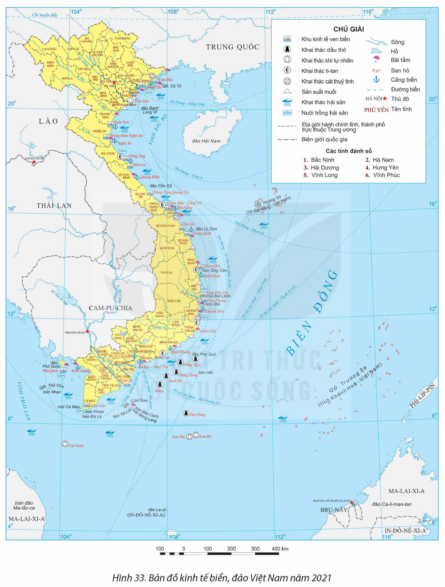

<!-- pdf:169 -->

# BÀI 33: PHÁT TRIỂN KINH TẾ VÀ ĐẢM BẢO QUỐC PHÒNG AN NINH Ở BIỂN ĐÔNG VÀ CÁC ĐẢO, QUẦN ĐẢO

## 🔴 Mở đầu

Việt Nam có vùng biển và các đảo, quần đảo giàu tài nguyên thiên nhiên, có nhiều tiềm năng để phát triển tổng hợp kinh tế biển. Việc khai thác tổng hợp tài nguyên biển – đảo ở Việt Nam như thế nào? Ý nghĩa chiến lược của Biển Đông trong phát triển kinh tế và đảm bảo quốc phòng an ninh cho đất nước ra sao?

## I. KHÁI QUÁT VỀ BIỂN ĐÔNG VÀ CÁC ĐẢO, QUẦN ĐẢO

### 1. Biển Đông

<!-- term: Biển Đông -->
Biển Đông nằm ở phía tây Thái Bình Dương, trải dài từ khoảng vĩ độ 3°N đến 26°B và từ khoảng kinh độ 100°Đ đến 121°Đ. Diện tích Biển Đông là 3,44 triệu km², lớn thứ hai ở Thái Bình Dương và thứ ba trên thế giới; có hai vịnh biển lớn là vịnh Bắc Bộ và vịnh Thái Lan. Các nước có chung Biển Đông với Việt Nam là Trung Quốc, Phi-líp-pin, In-đô-nê-xi-a, Bru-nây, Ma-lai-xi-a, Xin-ga-po, Thái Lan và Cam-pu-chia.

<!-- term: Biển Đông -->
Khí hậu trên Biển Đông mang tính chất nhiệt đới gió mùa. Độ muối trung bình khoảng 32 – 33‰, có sự biến động theo mùa và theo khu vực. Trên Biển Đông có các dòng biển gió mùa, thay đổi hướng chảy, tính chất theo mùa.

<!-- term: Biển Đông -->
Biển Đông giàu tài nguyên khoáng sản, sinh vật, du lịch,... là điều kiện thuận lợi để các nước trong khu vực khai thác tổng hợp kinh tế biển.

### 2. Vùng biển, các đảo, quần đảo của Việt Nam

<!-- term: Hệ thống đảo và quần đảo của Việt Nam -->
Biển Việt Nam có diện tích rộng trên 1 triệu km² (lớn gấp ba lần diện tích đất liền). Vùng biển nước ta bao gồm: nội thuỷ, lãnh hải, vùng tiếp giáp lãnh hải, vùng đặc quyền kinh tế và thềm lục địa. Vùng biển nước ta có hàng nghìn đảo và quần đảo, trong đó có hai quần đảo: quần đảo Hoàng Sa (thành phố Đà Nẵng) và quần đảo Trường Sa (tỉnh Khánh Hoà). Tính đến năm 2022, Việt Nam có 1 thành phố đảo trực thuộc tỉnh là Phú Quốc (Kiên Giang) và 11 huyện đảo là Cô Tô, Vân Đồn (Quảng Ninh), Bạch Long Vĩ, Cát Hải (Hải Phòng), Cồn Cỏ (Quảng Trị), Hoàng Sa (Đà Nẵng), Lý Sơn (Quảng Ngãi), Trường Sa (Khánh Hoà), Phú Quý (Bình Thuận), Côn Đảo (Bà Rịa – Vũng Tàu) và Kiên Hải (Kiên Giang).

Đường bờ biển nước ta dài khoảng 3 260 km từ Quảng Ninh đến Kiên Giang, có 28 tỉnh và thành phố trực thuộc Trung ương giáp biển. Đây là điều kiện thuận lợi để khai thác các nguồn lợi trên Biển Đông của Việt Nam.

> ❓ Dựa vào thông tin mục I và kiến thức đã học, hãy trình bày khái quát về Biển Đông và vùng biển Việt Nam.

<!-- pdf:170 -->

## II. TÀI NGUYÊN THIÊN NHIÊN VÙNG BIỂN, ĐẢO VIỆT NAM

### 1. Tài nguyên sinh vật

Biển Việt Nam có nguồn tài nguyên sinh vật phong phú, đa dạng. Vùng biển có khoảng 2 000 loài cá, trong đó có trên 110 loài giá trị kinh tế cao; có nhiều loài động vật giáp xác, thân mềm, nhiều loại có giá trị dinh dưỡng cao như: tôm, cua, mực,... Trữ lượng hải sản của vùng biển nước ta khoảng 4 triệu tấn, thuận lợi để phát triển ngành đánh bắt hải sản. Vùng ven bờ có nhiều loại rong biển được khai thác, sử dụng trong công nghiệp sản xuất và chế biến thực phẩm.

Trên các đảo và khu vực ven biển có nhiều vườn quốc gia như: Bái Tử Long, Cát Bà, Xuân Thuỷ, Mũi Cà Mau, Phú Quốc, Côn Đảo,... nhiều khu dự trữ sinh quyển như Châu thổ sông Hồng, Cù Lao Chàm, Kiên Giang,... Đây là những khu vực có tài nguyên sinh vật phong phú có ý nghĩa về bảo tồn nguồn gen và là cơ sở để phát triển du lịch sinh thái. Nhiều khu vực đầm lầy, cửa sông, bãi triều ven biển tạo thuận lợi cho ngành nuôi trồng thuỷ sản nước mặn, lợ.

### 2. Tài nguyên khoáng sản

Thềm lục địa nước ta có trữ lượng dầu mỏ và khí tự nhiên tương đối lớn, tổng trữ lượng khoảng 10 tỉ tấn dầu quy đổi, tập trung ở các bể trầm tích: Sông Hồng, Phú Khánh, Cửu Long, Nam Côn Sơn, Malay – Thổ Chu, Tư Chính – Vũng Mây và nhóm bể Trường Sa – Hoàng Sa.

Dọc ven biển, vùng sườn bờ và đáy biển điều tra được hơn 30 loại khoáng sản. Ti-tan, cát thuỷ tinh, muối biển là những loại khoáng sản có trữ lượng tương đối lớn đang được khai thác. Ngoài ra, vùng biển Việt Nam có tiềm năng về băng cháy phân bố ở khu vực quần đảo Hoàng Sa, Trường Sa và khu vực bể trầm tích Phú Khánh,...

Năng lượng gió ở vùng biển Việt Nam được đánh giá đứng đầu khu vực Đông Nam Á. Vùng biển có khả năng khai thác năng lượng gió tốt nhất là từ Bình Định đến Cà Mau.

### 3. Tài nguyên du lịch

Việt Nam có đường bờ biển kéo dài, cảnh quan bờ biển đa dạng, nhiều bãi tắm đẹp dọc khu vực biển, đảo từ Bắc vào Nam như Mỹ Khê, Nha Trang, Mũi Né, Phú Quốc,...

Vùng biển có hàng nghìn đảo, nhiều đảo có phong cảnh đẹp như Cát Bà, Lý Sơn, Phú Quý, Côn Đảo, Phú Quốc. Đặc biệt có vịnh Hạ Long và quần đảo Cát Bà đã được UNESCO vinh danh là di sản thiên nhiên của thế giới.

Hệ sinh thái biển phong phú, đặc sắc như các hệ sinh thái rừng ngập mặn, hệ sinh thái rạn san hô, đầm phá,... tạo thuận lợi để đa dạng hoá các sản phẩm du lịch biển.

Ngoài ra, địa hình bờ biển có nhiều vũng, vịnh, thuận lợi cho xây dựng các cảng biển nước sâu, phát triển giao thông vận tải biển và xuất, nhập khẩu hàng hoá,...

> ❓ Dựa vào thông tin mục II, hãy chứng minh vùng biển và các đảo, quần đảo nước ta có tài nguyên thiên nhiên phong phú, đa dạng.

<!-- pdf:171 -->

## III. VẤN ĐỀ KHAI THÁC TỔNG HỢP TÀI NGUYÊN BIỂN, ĐẢO

<!-- term: Phát triển tổng hợp các ngành kinh tế biển -->
Phát triển tổng hợp các ngành kinh tế biển là khai thác các nguồn tài nguyên biển, phát triển đồng thời nhiều ngành kinh tế có liên quan với nhau, mang lại hiệu quả kinh tế cao hơn, thúc đẩy nhau cùng phát triển, không cản trở hoặc gây thiệt hại kinh tế cho các ngành kinh tế còn lại. Khai thác tổng hợp tài nguyên biển, đảo vừa đem lại hiệu quả kinh tế, vừa góp phần bảo vệ tài nguyên, môi trường và khẳng định chủ quyền quốc gia.

### 1. Phát triển du lịch biển, đảo

Trong những năm qua, hoạt động du lịch biển của nước ta phát triển nhanh. Số lượng khách và doanh thu của hoạt động du lịch biển tăng. Nhiều loại hình du lịch biển mang lại hiệu quả cao như nghỉ dưỡng biển, thể thao biển,... Việt Nam đã hình thành các trung tâm du lịch biển như: Hạ Long (Quảng Ninh), Đà Nẵng, Nha Trang (Khánh Hoà), Phú Quốc (Kiên Giang),... Ngoài ra, còn nhiều điểm du lịch biển nổi tiếng khác như: Cát Bà (Hải Phòng), Sầm Sơn (Thanh Hoá), Quy Nhơn (Bình Định), Mũi Né (Bình Thuận), Côn Đảo (Bà Rịa – Vũng Tàu),...

Phát triển du lịch biển, đảo thúc đẩy các ngành giao thông vận tải biển, nuôi trồng thuỷ sản, hình thành các mô hình nuôi trồng thuỷ sản gắn với du lịch, nâng cao đời sống của người dân, góp phần bảo tồn các giá trị văn hoá vùng biển. Trong phát triển du lịch biển, đảo cần chú ý đến bảo vệ môi trường và các hệ sinh thái biển, đảo.

### 2. Giao thông vận tải biển

Hệ thống cảng biển ngày càng phát triển và hiện đại. Đến năm 2022, nước ta có 34 cảng biển, trong đó có 2 cảng đặc biệt; 11 cảng loại I; 7 cảng loại II và 14 cảng loại III.

Các tuyến giao thông vận tải biển ở nước ta được mở rộng cả nội địa và quốc tế, dịch vụ hàng hải ngày càng phát triển, đội tàu buôn quốc gia được tăng cường góp phần quan trọng trong việc vận chuyển, lưu thông hàng hoá trong nước và xuất, nhập khẩu.

Khối lượng vận chuyển, luân chuyển hàng hoá bằng đường biển có xu hướng tăng.

Bảng 33.1. KHỐI LƯỢNG VẬN CHUYỂN VÀ LUÂN CHUYỂN HÀNG HOÁ BẰNG ĐƯỜNG BIỂN CỦA NƯỚC TA GIAI ĐOẠN 2010 – 2021

| Năm | 2010 | 2015 | 2021 |
| :--- | :---: | :---: | :---: |
| Vận chuyển *(triệu tấn)* | 61,6 | 60,8 | 69,9 |
| Luân chuyển *(triệu tấn.km)* | 145 521,4 | 131 835,7 | 70 130,3 |

*(Nguồn: Niên giám thống kê các năm 2011, 2016, 2022)*

<!-- pdf:172 -->

*Hình 33. Bản đồ kinh tế biển, đảo Việt Nam năm 2021*

<!-- pdf:173 -->

Phát triển giao thông vận tải biển thúc đẩy sự phát triển các hoạt động xuất nhập khẩu, du lịch biển, khẳng định vai trò, vị thế của Việt Nam trên thế giới và góp phần bảo vệ quốc phòng an ninh trên biển. Trong quá trình vận chuyển hàng hoá cần chú ý vấn đề bảo vệ môi trường, hạn chế các sự cố tràn dầu xảy ra.

### 3. Khai thác khoáng sản

Khai thác khoáng sản vùng biển nước ta quan trọng nhất là dầu mỏ và khí tự nhiên. Mỏ dầu khai thác đầu tiên trên vùng biển Việt Nam vào năm 1986, ở thềm lục địa phía nam. Tính đến năm 2022, Việt Nam đã khai thác 25 mỏ dầu, khí. Tuy nhiên, sản lượng khai thác không ổn định.

Bảng 33.2. SẢN LƯỢNG DẦU THÔ VÀ KHÍ TỰ NHIÊN KHAI THÁC TRONG NƯỚC TRÊN VÙNG BIỂN CỦA NƯỚC TA GIAI ĐOẠN 2010 – 2021

| Năm | 2010 | 2015 | 2021 |
| :--- | :---: | :---: | :---: |
| Dầu thô *(triệu tấn)* | 14,7 | 16,9 | 9,1 |
| Khí tự nhiên *(tỉ m³)* | 9,4 | 10,7 | 7,4 |

*(Nguồn: Niên giám thống kê các năm 2011, 2016, 2022)*

Dọc ven biển, cát thuỷ tinh và ti-tan cũng đang được khai thác, nhiều nhất ở các tỉnh Bình Thuận, Bà Rịa – Vũng Tàu,... Làm muối là nghề truyền thống của người dân một số vùng ven biển. Tổng sản lượng muối biển mỗi năm khoảng 1 triệu tấn. Những nơi sản xuất muối lớn nhất nước ta là Cà Ná, Phương Cựu (Ninh Thuận), Diêm Điền (Thái Bình), Sa Huỳnh (Quảng Ngãi),...

Khai thác tài nguyên khoáng sản biển mang lại nguồn lợi kinh tế lớn cho đất nước, thúc đẩy ngành công nghiệp hoá dầu,... tạo nguồn hàng xuất khẩu. Tuy nhiên, việc khai thác nguồn tài nguyên cần bảo vệ môi trường biển, tránh gây ô nhiễm, ảnh hưởng đến các ngành kinh tế khác.

### 4. Khai thác tài nguyên sinh vật biển, đảo

Ngành khai thác hản sản đã được đầu tư tốt hơn về phương tiện, công nghệ để tăng cường khai thác xa bờ, truy xuất được nguồn gốc. Sản lượng khai thác hải sản tăng nhanh. Bắc Trung Bộ và Duyên hải miền Trung có sản lượng khai thác hải sản lớn nhất, chiếm hơn 45% sản lượng cả nước (năm 2021).

Bảng 33.3. SẢN LƯỢNG HẢI SẢN KHAI THÁC CỦA NƯỚC TA GIAI ĐOẠN 2010 – 2021

| Năm | 2010 | 2015 | 2021 |
| :--- | :---: | :---: | :---: |
| Sản lượng hải sản khai thác *(triệu tấn)* | 2,27 | 2,98 | 3,74 |
| – Trong đó: Cá biển | 1,66 | 2,23 | 2,92 |

*(Nguồn: Niên giám thống kê các năm 2011, 2016, 2022)*

Ngành nuôi trồng hải sản đã được đầu tư phát triển mở rộng diện tích và đối tượng nuôi trồng. Các mô hình nuôi trồng công nghiệp, công nghệ cao ngày càng phổ biến

<!-- pdf:174 -->

rộng rãi. Nuôi trồng theo hướng bền vững được chú trọng, vừa đem lại hiệu quả kinh tế vừa bảo vệ tài nguyên môi trường.

Khai thác và nuôi trồng hải sản cung cấp nguyên liệu cho công nghiệp sản xuất và chế biến thực phẩm, tạo mặt hàng xuất khẩu quan trọng, góp phần thúc đẩy du lịch biển. Tuy nhiên, việc khai thác và nuôi trồng hải sản cần chú ý bảo vệ nguồn tài nguyên sinh vật, bảo vệ môi trường.

> ❓ Dựa vào thông tin mục 3 và hình 33, hãy trình bày tình hình khai thác tổng hợp tài nguyên biển, đảo ở nước ta.

## IV. SỰ CẦN THIẾT PHẢI BẢO VỆ MÔI TRƯỜNG BIỂN, ĐẢO

– Môi trường biển, đảo là một bộ phận trong môi trường sống của người dân Việt Nam. Các hoạt động kinh tế biển mang lại hiệu quả kinh tế cao, góp phần đáng kể vào quy mô GDP của cả nước. Vì thế, bảo vệ môi trường biển là bảo vệ không gian, các nguồn lợi để phát triển kinh tế – xã hội đất nước.

– Môi trường biển, đảo có những đặc điểm khác biệt với môi trường trên đất liền:

+ Môi trường biển là một thể thống nhất. Vì vậy, nếu một vùng biển bị ô nhiễm sẽ ảnh hưởng đến vùng bờ biển, vùng nước và các đảo xung quanh, ảnh hưởng đến các hệ sinh thái trên biển, cuộc sống của cư dân ven biển và trên các đảo.

+ Các đảo trên biển của nước ta thường có diện tích nhỏ, nằm biệt lập với đất liền. Mỗi đảo đều có đặc điểm tự nhiên riêng và dễ bị tác động bởi các hoạt động của con người. Bảo vệ rừng, bảo vệ môi trường trên đảo là giữ được mực nước ngầm và hệ sinh thái trên đảo, đảm bảo cuộc sống cho cư dân sinh sống trên đảo, đồng thời, bảo vệ quốc phòng an ninh cho đất nước.

– Việc khai thác các nguồn lợi trên Biển Đông và khu vực ven biển đã và đang có những tác động xấu đến môi trường biển. Môi trường biển đảo ở một số nơi bị ô nhiễm và suy thoái. Do đó, cần bảo vệ để kịp thời ngăn chặn những tác động xấu đến môi trường biển và cuộc sống của cư dân ven biển.

> ❓ Dựa vào thông tin mục IV và hiểu biết của bản thân, hãy giải thích tại sao cần phải bảo vệ môi trường biển, đảo ở nước ta.

## V. Ý NGHĨA CHIẾN LƯỢC CỦA BIỂN ĐÔNG TRONG PHÁT TRIỂN KINH TẾ VÀ ĐẢM BẢO QUỐC PHÒNG AN NINH

### 1. Ý nghĩa của Biển Đông đối với sự phát triển kinh tế và đảm bảo quốc phòng an ninh

Biển Đông có ý nghĩa chiến lược đối với phát triển kinh tế và đảm bảo an ninh cho đất nước.

– Biển Đông và các đảo, quần đảo của Việt Nam có vị trí, vai trò quan trọng đối với sự phát triển kinh tế và quốc phòng an ninh. Mục tiêu của nước ta là xây dựng Việt Nam trở thành quốc gia mạnh về biển, giàu từ biển, phát triển bền vững, thịnh vượng, an ninh và an toàn trên cơ sở phát huy tối đa tiềm năng, lợi thế của biển, đảo. Bởi thế, cần phát triển tổng hợp các ngành kinh tế biển.

<!-- pdf:175 -->

– Tài nguyên, môi trường biển và hải đảo là nền tảng và nguồn lực quan trọng để phát triển kinh tế đất nước nên phải được khai thác, sử dụng hiệu quả, bền vững nhằm phát triển kinh tế, văn hoá, xã hội và bảo vệ môi trường, bảo tồn đa dạng sinh học, ứng phó với biến đổi khí hậu và nước biển dâng,...

– Khai thác, sử dụng bền vững tài nguyên, bảo vệ môi trường biển và hải đảo vừa là quyền lợi, trách nhiệm của mọi cá nhân, tổ chức tham gia các hoạt động trên biển và phải gắn liền với đảm bảo quốc phòng an ninh, giữ vững độc lập, chủ quyền và toàn vẹn lãnh thổ, tăng cường đối ngoại và hợp tác quốc tế về biển, góp phần duy trì môi trường hoà bình, ổn định cho sự phát triển.

### 2. Hướng chung trong giải quyết các tranh chấp vùng biển, đảo

Biển Đông là biển chung giữa Việt Nam và nhiều nước. Vì vậy, việc khai thác các nguồn lợi từ biển cần tôn trọng chủ quyền và toàn vẹn lãnh thổ của mỗi quốc gia. Hướng chung trong giải quyết các tranh chấp vùng biển, đảo là:

– Tuân thủ Công ước của Liên hợp quốc về Luật Biển năm 1982.

– Chủ động, tích cực tham gia diễn đàn quốc tế và khu vực, phối hợp với các nước thực hiện đầy đủ và hiệu quả Tuyên bố về ứng xử của các bên ở Biển Đông (DOC), thúc đẩy kí Bộ Quy tắc ứng xử ở Biển Đông (COC).

– Đẩy mạnh phát triển tổng hợp các ngành kinh tế biển, khai thác hiệu quả nguồn tài nguyên thiên nhiên trên biển, bảo vệ môi trường biển, qua đó đảm bảo an ninh quốc phòng.

– Giải quyết các tranh chấp trên cơ sở hoà bình, hữu nghị, tôn trọng chủ quyền biển, đảo của các quốc gia, xây dựng một khu vực Đông Nam Á ổn định, hoà bình.

> ❓ Dựa vào thông tin mục V, hãy:
> – Phân tích ý nghĩa chiến lược của Biển Đông trong việc phát triển kinh tế và bảo đảm quốc phòng an ninh.
> – Nêu hướng chung trong việc giải quyết tranh chấp vùng biển, đảo ở Biển Đông.

## ✏️ Luyện tập và vận dụng

**Luyện tập**

- Lập bảng về tiềm năng khai thác biển, đảo ở nước ta theo mẫu sau vào vở ghi bài:

| Hoạt động | Tiềm năng |
| :---: | :---: |
| Khai thác sinh vật | ? |
| ? | ? |

**Vận dụng**

- Sưu tầm thông tin, tìm hiểu về Chiến lược phát triển bền vững kinh tế biển Việt Nam đến năm 2030, tầm nhìn đến năm 2045.

## 📷 Danh sách hình trong bài

| Mã hình | Trang PDF | Vị trí trong bài | Chú thích gốc |
| --- | --- | --- | --- |
| H12-dia-b33-01 | 172 | Mục III.2 | Hình 33. Bản đồ kinh tế biển, đảo Việt Nam năm 2021 |
