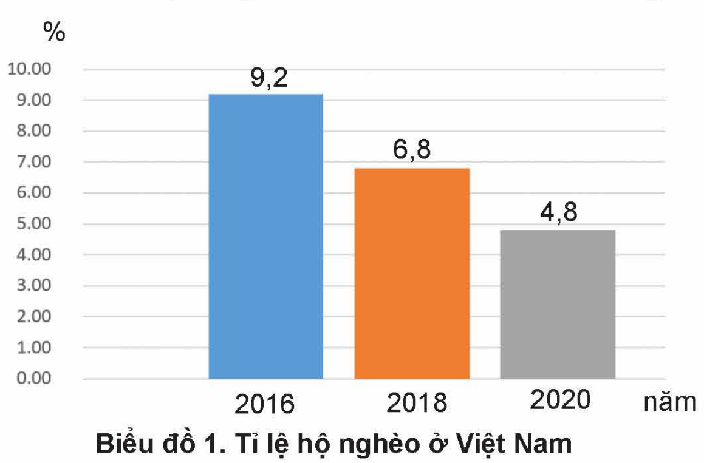
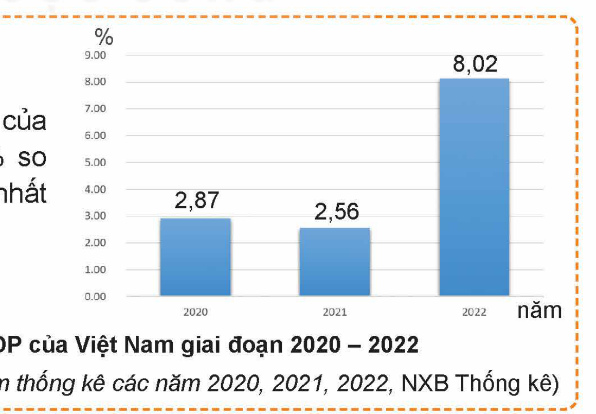
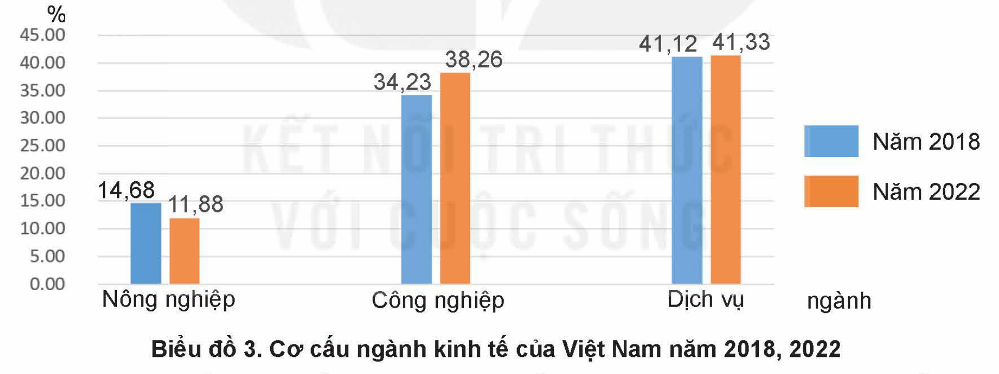

<!-- pdf:8 -->

# BÀI 1: TĂNG TRƯỞNG VÀ PHÁT TRIỂN KINH TẾ

## 🎯 Yêu cầu cần đạt

– Phân biệt được tăng trưởng và phát triển kinh tế.
– Nêu được các chỉ tiêu của tăng trưởng và phát triển kinh tế.
– Giải thích được vai trò của tăng trưởng và phát triển kinh tế.
– Nhận biết được mối quan hệ giữa tăng trưởng kinh tế với sự phát triển bền vững.
– Tham gia các hoạt động góp phần thúc đẩy sự tăng trưởng và phát triển kinh tế.
– Ủng hộ những hành vi, việc làm góp phần thúc đẩy tăng trưởng, phát triển kinh tế; phê phán, đấu tranh với những hành vi, việc làm cản trở sự tăng trưởng, phát triển kinh tế.

## 🔴 Mở đầu

Tăng trưởng kinh tế và phát triển kinh tế là hai thuật ngữ được dùng trong hoạt động kinh tế. Các chỉ tiêu về tăng trưởng và phát triển kinh tế được sử dụng để đánh giá thành tựu kinh tế vĩ mô của mỗi quốc gia. Để thực hiện thành công mục tiêu phát triển bền vững, mỗi quốc gia không chỉ quan tâm thực hiện các chỉ tiêu tăng trưởng kinh tế mà còn phải chú trọng đến các tiêu chí đảm bảo tiến bộ và công bằng xã hội, bảo vệ môi trường.

*Biểu đồ 1. Tỉ lệ hộ nghèo ở Việt Nam giai đoạn 2016 – 2020*
*(Theo Tổng cục Thống kê, Niên giám thống kê các năm 2016, 2018, 2020, NXB Thống kê)*

> ❓ Em hãy quan sát biểu đồ thể hiện tỉ lệ hộ nghèo ở nước ta giai đoạn 2016 – 2020 và cho biết tỉ lệ này thay đổi thế nào. Nêu ý nghĩa của sự thay đổi đó.

<!-- pdf:9 -->

## 1. TĂNG TRƯỞNG KINH TẾ

### a) Tăng trưởng kinh tế và các chỉ tiêu tăng trưởng kinh tế

**Tăng trưởng kinh tế** là sự tăng lên về thu nhập hay tổng giá trị hàng hoá và dịch vụ mà nền kinh tế tạo ra trong một thời kì nhất định.

Các chỉ tiêu tăng trưởng kinh tế bao gồm:

**Tổng sản phẩm quốc nội** (GDP):

GDP là giá trị bằng tiền (theo giá cả thị trường) của tất cả hàng hoá và dịch vụ cuối cùng được sản xuất ra trên lãnh thổ một nước trong một thời gian nhất định (thường là một năm).

GDP là thước đo sản lượng quốc gia, đánh giá mức độ hoạt động của nền kinh tế, phản ánh năng lực của nền kinh tế trong việc thoả mãn nhu cầu và nguyện vọng của nhân dân. Mức tăng GDP của thời điểm hiện tại so với GDP của thời điểm gốc cần so sánh thể hiện sự tăng trưởng về quy mô của nền kinh tế.

<!-- term: Tốc độ tăng trưởng kinh tế -->
Tốc độ tăng trưởng kinh tế được tính bằng tỉ lệ phần trăm thay đổi của GDP từ thời kì này sang thời kì khác. Lưu ý: Do có sự biến động của giá cả (lạm phát) nên khi so sánh cần tính GDP của năm hiện tại theo giá của năm gốc cần so sánh.

> 💡 EM CÓ BIẾT?
>
> **GDP thường được tính như sau:**
>
> *GDP là tổng chi tiêu cho tiêu dùng cuối cùng, tính bằng công thức:*
>
> $\text{GDP} = \text{C} + \text{I} + \text{G} + (\text{X} - \text{M})$
>
> Trong đó: C: Chi tiêu của hộ gia đình
>
> I: Chi tiêu của doanh nghiệp
>
> G: Chi tiêu của chính phủ
>
> X: Kim ngạch xuất khẩu
>
> M: Kim ngạch nhập khẩu
>
> **GNI được tính theo công thức sau:**
>
> $\text{GNI} = \text{GDP} + \text{Chênh lệch thu nhập với nhân tố nước ngoài}$
>
> Chênh lệch thu nhập nhân tố nước ngoài = Thu lợi tức nhân tố nước ngoài – Chi trả lợi tức nhân tố nước ngoài

Theo Tổng cục Thống kê, GDP của Việt Nam năm 2022 tăng 8,02% so với năm trước, đạt mức cao nhất trong giai đoạn 2011 – 2022.

*Biểu đồ 2. Tăng trưởng GDP của Việt Nam giai đoạn 2020 – 2022*
*(Theo Tổng cục Thống kê, Niên giám thống kê các năm 2020, 2021, 2022, NXB Thống kê)*

> ❓ Em có nhận xét gì về chỉ tiêu tăng trưởng GDP của nước ta qua thông tin trên?

<!-- pdf:10 -->

<!-- term: Tổng sản phẩm quốc nội bình quân đầu người -->
**Tổng sản phẩm quốc nội bình quân đầu người** (GDP/người):

GDP bình quân đầu người liên quan đến tổng giá trị sản phẩm hằng năm trên tổng số dân cư, được tính bằng cách chia tổng sản phẩm quốc nội GDP trong năm cho dân số trung bình của năm tương ứng.

GDP/người được sử dụng phổ biến như một thước đo mức sống người dân của một quốc gia vì nó chỉ ra khối lượng sản phẩm hằng năm mà bình quân một người dân có thể có. Tuy nhiên, chỉ tiêu này chỉ phản ánh thước đo mức sống tương đối vì chất lượng cuộc sống còn tuỳ thuộc vào phương thức phân phối thu nhập, điều kiện tiếp cận hàng hoá và dịch vụ của người dân ở các vùng miền, các quốc gia là khác nhau.

**Bảng 1. Chỉ tiêu GDP, GDP/người năm 2022 của Trung Quốc và Singapore**

*Đơn vị: USD (theo giá hiện hành)*

| Tên quốc gia | GDP | GDP/người |
| --- | --- | --- |
| Trung Quốc | 17,96 nghìn tỉ | 12.720 |
| Singapore | 466,8 tỉ | 82.808 |

*(Theo Ngân hàng Thế giới)*

> ❓ Từ bảng số liệu trên, em hãy nhận xét sự khác nhau trong việc phản ánh kết quả tăng trưởng giữa chỉ tiêu GDP và chỉ tiêu GDP/người.

**Tổng thu nhập quốc dân** (GNI):

**Tổng thu nhập quốc dân** (GNI) là thước đo về thu nhập của nền kinh tế trong một thời kì nhất định, được tính bằng tổng thu nhập từ hàng hoá, dịch vụ cuối cùng do công dân của quốc gia đó tạo ra (bao gồm cả ở trong và ngoài lãnh thổ quốc gia) trong một thời gian nhất định (thường là một năm).

Mức tăng GNI của nền kinh tế so với thời điểm gốc cần so sánh thể hiện đầy đủ hơn sự tăng trưởng về quy mô của nền kinh tế so với chỉ tiêu GDP (vì có tính thêm yếu tố ngoài lãnh thổ quốc gia).

**Bảng 2. Chỉ tiêu GDP và GNI của Việt Nam 2021 – 2022**

*Đơn vị: USD (theo giá hiện hành)*

| Chỉ tiêu | Năm 2021 | Năm 2022 |
| --- | --- | --- |
| GDP | 366,14 tỉ | 408,8 tỉ |
| GNI | 347,4 tỉ | 388,9 tỉ |

*(Theo Ngân hàng Thế giới)*

<!-- pdf:11 -->

> ❓
>
> 1/ Em hãy so sánh GDP và GNI của Việt Nam trong từng năm 2021, 2022 và nêu ý nghĩa của từng chỉ tiêu tăng trưởng này.
>
> 2/ Em có nhận xét gì về sự tăng trưởng kinh tế Việt Nam năm 2022 so với năm 2021?

<!-- term: Tổng thu nhập quốc dân bình quân đầu người -->
**Tổng thu nhập quốc dân bình quân đầu người** (GNI/người):

GNI/người là thước đo trung bình mức thu nhập một người dân trong quốc gia thu được trong năm, được tính bằng cách chia tổng thu nhập quốc dân trong năm cho dân số trung bình của năm tương ứng.

Mức gia tăng GNI/người so với thời điểm gốc cần so sánh thể hiện cụ thể hơn sự tăng trưởng của mỗi quốc gia, được dùng để so sánh kết quả tăng trưởng kinh tế giữa các quốc gia, đồng thời cũng được dùng làm thước đo về sự gia tăng mức thu nhập, mức sống của người dân giữa các quốc gia.

**Bảng 3. Chỉ tiêu GNI, GNI/người năm 2022 của Việt Nam – Trung Quốc – Singapore**

*Đơn vị: USD (theo giá hiện hành)*

| Tên nước | GNI | GNI/người |
| --- | --- | --- |
| Việt Nam | 388,9 tỉ | 4.010 |
| Trung Quốc | 17,77 nghìn tỉ | 12.850 |
| Singapore | 391,65 tỉ | 67.200 |

*(Theo Ngân hàng Thế giới)*

> ❓ Từ bảng số liệu trên, em hãy nhận xét sự khác nhau trong việc phản ánh kết quả tăng trưởng giữa chỉ tiêu GNI và chỉ tiêu GNI/người.

Tăng trưởng kinh tế là sự tăng lên về quy mô sản lượng của nền kinh tế trong một thời kì nhất định (so với thời kì gốc cần so sánh).

Tăng trưởng kinh tế được đo bằng mức tăng tổng sản phẩm quốc nội (GDP) hay tổng thu nhập quốc dân (GNI) trong một thời gian nhất định (thường là một năm) cả về quy mô và tốc độ gia tăng.

Một số chỉ tiêu tăng trưởng kinh tế:

– Tổng sản phẩm quốc nội (GDP)

– Tổng sản phẩm quốc nội bình quân đầu người (GDP/người)

– Tổng thu nhập quốc dân (GNI)

– Tổng thu nhập quốc dân bình quân đầu người (GNI/người).

<!-- pdf:12 -->

### b) Vai trò của tăng trưởng kinh tế

Tăng trưởng kinh tế nhìn bề ngoài là sự gia tăng về lượng của GDP, GNI nhưng bên trong là sự lớn lên của các nguồn lực, là cơ sở vật chất cho sức mạnh, sự thịnh vượng của quốc gia. Kinh tế tăng trưởng làm cho GDP/người tăng, tạo điều kiện để có thêm nhiều việc làm, giúp tăng thu nhập, không ngừng nâng cao đời sống vật chất và tinh thần cho nhân dân. Với quy mô GDP, GNI ngày càng lớn, quốc gia có điều kiện để phát triển kết cấu hạ tầng kinh tế – xã hội, văn hoá nghệ thuật, dịch vụ y tế, cung cấp các phúc lợi xã hội, đảm bảo cho người dân có điều kiện thụ hưởng các quyền cơ bản của con người. Tăng trưởng kinh tế không chỉ tăng tích luỹ để mở rộng sản xuất, phát triển khoa học công nghệ mà còn tạo điều kiện để tăng cường tiềm lực quốc phòng, an ninh, mở rộng sự tham gia vào các tổ chức quốc tế,...

> **Thông tin**
>
> Tính chung thời kì thực hiện Chiến lược phát triển kinh tế xã hội 10 năm (2011 – 2020), tăng trưởng GDP của Việt Nam đạt khoảng 5,9%/năm, thuộc nhóm các nước tăng trưởng cao trong khu vực. Quy mô GDP tăng gấp 2,4 lần, từ 116 tỉ USD năm 2010 lên 268,4 tỉ USD vào năm 2020. GDP bình quân đầu người tăng từ 1.331 USD năm 2010 lên khoảng 2.750 USD năm 2020. Tỉ lệ hộ nghèo cả nước giảm nhanh, từ 14,2% năm 2010 xuống còn 7% năm 2015 (theo chuẩn nghèo giai đoạn 2011 – 2015) và giảm từ 9,2% năm 2016 xuống dưới 3% vào năm 2020 (theo chuẩn nghèo đa chiều). Cơ sở hạ tầng thiết yếu ở các huyện nghèo, xã nghèo, vùng đồng bào dân tộc thiểu số được tăng cường. Thực hiện nhiều giải pháp tạo việc làm, nâng cao thu nhập cho người lao động.
>
> *(Theo Báo cáo Tổng kết thực hiện chiến lược phát triển kinh tế xã hội 10 năm 2011 – 2020 của Việt Nam tại Đại hội đại biểu toàn quốc Đảng Cộng sản Việt Nam lần thứ XIII)*

> ❓
>
> 1/ Em hãy chỉ ra vai trò của tăng trưởng kinh tế được đề cập trong thông tin trên.
>
> 2/ Hãy lấy ví dụ cụ thể ở địa phương em để minh chứng cho vai trò của tăng trưởng kinh tế.

Tăng trưởng kinh tế có vai trò quan trọng đối với sự phát triển của quốc gia. Tăng trưởng kinh tế là điều kiện cần thiết để khắc phục tình trạng đói nghèo lạc hậu, tạo điều kiện để giải quyết việc làm, tăng thu nhập, nâng cao phúc lợi xã hội, phát triển văn hoá, giáo dục, thể thao,... góp phần cải thiện chất lượng cuộc sống của người dân; Là tiền đề vật chất để củng cố an ninh, quốc phòng, nâng cao vai trò quản lí của Nhà nước, vị thế của quốc gia.

Tăng trưởng kinh tế là điều kiện tiên quyết để khắc phục tình trạng tụt hậu đối với quốc gia đang phát triển như Việt Nam.

<!-- pdf:13 -->

## 2. PHÁT TRIỂN KINH TẾ

### a) Phát triển kinh tế và các chỉ tiêu phát triển kinh tế

**Phát triển kinh tế** là sự lớn lên về quy mô cùng với những thay đổi về cấu trúc nền kinh tế, mang lại những chuyển biến tích cực về xã hội.

Chỉ tiêu phát triển kinh tế bao gồm:

– Chỉ tiêu tăng trưởng kinh tế.

– Chỉ tiêu chuyển dịch cơ cấu kinh tế:

<!-- term: Cơ cấu kinh tế -->
Cơ cấu kinh tế là tổng thể các mối quan hệ giữa các ngành, các lĩnh vực, các bộ phận hợp thành của nền kinh tế quốc gia. Cơ cấu kinh tế bao gồm: cơ cấu ngành kinh tế, cơ cấu vùng kinh tế và cơ cấu thành phần kinh tế, trong đó, cơ cấu ngành kinh tế (công nghiệp – nông nghiệp – dịch vụ) giữ vai trò quan trọng nhất.

Sự chuyển dịch cơ cấu ngành kinh tế theo hướng tích cực thể hiện ở chỉ tiêu: tỉ trọng của ngành công nghiệp, dịch vụ trong GDP tăng lên, tỉ trọng của ngành nông nghiệp giảm xuống nhưng giá trị tuyệt đối của các ngành đều tăng.

Theo Tổng cục Thống kê, trong giai đoạn 2018 – 2022, cùng với việc thực hiện các mục tiêu kinh tế – xã hội, cơ cấu kinh tế của nước ta đã có sự chuyển dịch theo hướng tích cực. Biểu đồ dưới đây cho thấy sự chuyển dịch cơ cấu ngành kinh tế năm 2022 so với năm 2018:

*Biểu đồ 3. Cơ cấu ngành kinh tế của Việt Nam năm 2018, 2022*
*(Theo Tổng cục Thống kê, Niên giám thống kê các năm 2018, 2022, NXB Thống kê)*

Chỉ tiêu về tiến bộ xã hội: thể hiện ở sự công bằng xã hội, mức sống của người dân tăng lên, chênh lệch giàu nghèo ngày càng ít đi, các loại phúc lợi xã hội, dân trí,... tăng lên. Tiến bộ xã hội được thể hiện qua một số chỉ tiêu:

<!-- term: Chỉ số phát triển con người -->
Chỉ số phát triển con người (HDI) là thước đo tổng hợp phản ánh sự phát triển của con người trên các tiêu chí:

Tuổi thọ trung bình (số năm sống bình quân của người dân ở mỗi quốc gia từ khi sinh ra đến lúc chết);

<!-- pdf:14 -->

Chỉ số giáo dục (tính bằng số năm đi học bình quân và số năm đi học kì vọng);

Chỉ số thu nhập (tính bằng GDP/người, GNI/người).

<!-- term: Tỉ lệ hộ nghèo đa chiều -->
Tỉ lệ hộ nghèo đa chiều: tính bằng tỉ lệ hộ nghèo trong tình trạng con người không được đáp ứng ở mức tối thiểu các nhu cầu cơ bản trong cuộc sống.

<!-- term: Hệ số Gini -->
Hệ số bất bình đẳng trong phân phối thu nhập (hệ số Gini) là chỉ tiêu phản ánh tình trạng bất bình đẳng trong phân phối thu nhập của các tầng lớp dân cư. Hệ số này nhận giá trị từ 0 đến 1 trong đó 0 là bình đẳng tuyệt đối, 1 là bất bình đẳng tuyệt đối. Hệ số Gini càng cao thì mức bất bình đẳng trong phân phối thu nhập càng lớn.

Trong công cuộc đổi mới, Đảng và Nhà nước ta luôn đặt con người vào vị trí trung tâm của chiến lược phát triển. Thực hiện đồng thời sự phát triển kinh tế kết hợp với các chính sách xã hội, đem lại cuộc sống hoà bình, ấm no, hạnh phúc cho nhân dân luôn là mục đích của sự phát triển. Vì vậy, cùng với những thành tựu tăng trưởng kinh tế, việc thực hiện tiến bộ xã hội ở nước ta cũng đạt được những thành tựu to lớn.

**Bảng 4. Một số thành tựu thực hiện tiến bộ xã hội của Việt Nam giai đoạn 2018 – 2022**

| Chỉ số | Năm 2018 | Năm 2019 | Năm 2020 | Năm 2021 | Năm 2022 |
| --- | --- | --- | --- | --- | --- |
| Chỉ số phát triển con người (HDI) | 0,693 | 0,703 | 0,706 | 0,726 | 0,737 |
| Hệ số bất bình đẳng trong phân phối thu nhập (hệ số Gini) | 0,425 | 0,423 | 0,373 | 0,374 | 0,375 |
<!-- ocr-ok: đối chiếu ảnh trang PDF 14 bảng 4 số liệu tiến bộ xã hội -->

*(Theo Tổng cục Thống kê, Niên giám thống kê các năm 2018, 2019, 2020, 2021, 2022, NXB Thống kê)*

> ❓
>
> 1/ Em hiểu thế nào là phát triển kinh tế? Phát triển kinh tế được xác định qua các chỉ tiêu cơ bản nào?
>
> 2/ Các thông tin, biểu đồ trên phản ánh các chỉ tiêu nào của phát triển kinh tế? Em có nhận xét gì về kết quả thực hiện các chỉ tiêu đó ở nước ta?
>
> 3/ Hãy phân biệt tăng trưởng kinh tế và phát triển kinh tế.

<!-- pdf:15 -->

Phát triển kinh tế là sự tăng trưởng kinh tế gắn liền với sự chuyển dịch cơ cấu kinh tế và đảm bảo tiến bộ xã hội.

Các chỉ tiêu đánh giá phát triển kinh tế bao gồm:

– Sự gia tăng GDP, GNI, GDP/người, GNI/người.

– Chuyển dịch cơ cấu ngành kinh tế theo hướng tích cực: tỉ trọng của ngành công nghiệp, dịch vụ trong GDP tăng lên, tỉ trọng của ngành nông nghiệp giảm đi.

– Chỉ tiêu về tiến bộ xã hội: chỉ số phát triển con người HDI tăng, chỉ số đói nghèo, chỉ số bất bình đẳng trong phân phối thu nhập (hệ số Gini) giảm.

Tăng trưởng kinh tế và phát triển kinh tế có quan hệ mật thiết với nhau. Tăng trưởng kinh tế chỉ là sự thay đổi về lượng của nền kinh tế, là điều kiện tiền đề cho phát triển kinh tế nhưng không phải chỉ cần tăng trưởng kinh tế là đã đạt được phát triển kinh tế. Phát triển kinh tế có phạm vi rộng lớn, toàn diện hơn bao hàm cả tăng trưởng kinh tế lẫn chuyển dịch cơ cấu và tiến bộ xã hội. Trên cơ sở những kết quả đạt được về phát triển kinh tế, quốc gia luôn hướng tới mục tiêu tiến bộ xã hội, đem lại cuộc sống ấm no, hạnh phúc cho nhân dân.

### b) Vai trò của phát triển kinh tế

Phát triển kinh tế có vai trò quan trọng trong việc nâng cao trình độ, hiệu quả sản xuất của nền kinh tế cũng như đảm bảo các điều kiện để người dân được thụ hưởng kết quả của tăng trưởng kinh tế, thực hiện mục tiêu phát triển con người, tiến bộ xã hội.

Với chỉ tiêu chuyển dịch cơ cấu kinh tế hợp lí, phát triển kinh tế làm cho trình độ phát triển sản xuất của quốc gia được nâng cao cả về lực lượng sản xuất lẫn phân công lao động xã hội, cho phép khai thác hiệu quả thế mạnh của từng địa phương và quốc gia, tạo đà phát triển nhanh và vững chắc cho nền kinh tế.

Với chỉ tiêu thực hiện tiến bộ xã hội, phát triển kinh tế hướng tới việc xây dựng một thể chế kinh tế tiến bộ, thực hiện phân phối công bằng, tạo ra sản phẩm có chất lượng ngày càng cao, môi trường sinh thái được bảo vệ, đảm bảo cho người dân được thụ hưởng những thành quả của tăng trưởng kinh tế, nâng cao chất lượng cuộc sống, giảm khoảng cách giàu nghèo, giảm bớt chênh lệch trình độ phát triển giữa các vùng,...

Phát triển kinh tế tạo động lực đẩy nhanh tốc độ tăng trưởng kinh tế.

> **Thông tin**
>
> Giai đoạn thực hiện Chiến lược phát triển kinh tế – xã hội 10 năm (2011 – 2020), cùng với những thành tựu về tăng trưởng kinh tế, kinh tế Việt Nam cũng có nhiều bước tiến trong việc nâng cao chất lượng phát triển.

<!-- pdf:16 -->

> Cơ cấu kinh tế ngành và nội ngành chuyển biến tích cực; tỉ trọng công nghiệp chế biến, chế tạo và ứng dụng công nghệ cao tăng lên. Cơ cấu lao động chuyển dịch từ khu vực năng suất lao động thấp sang khu vực năng suất lao động cao hơn. Tỉ trọng lao động nông, lâm nghiệp và thuỷ sản trong tổng số lao động cả nước giảm từ 48,6% năm 2010 xuống còn 34% năm 2020. Tỉ trọng lao động ngành công nghiệp và xây dựng tăng từ 21,7% lên 30,3%; ngành dịch vụ từ 29,7% lên khoảng 35,7% trong cùng giai đoạn...
>
> Kết quả này làm cho chất lượng tăng trưởng được cải thiện, năng suất lao động được nâng lên rõ rệt. Tốc độ tăng năng suất lao động bình quân giai đoạn 2011 – 2015 là 4,3%/năm, giai đoạn 2016 – 2020 là 5,8%/năm. Tỉ trọng giá trị xuất khẩu sản phẩm công nghệ cao trong tổng giá trị xuất khẩu hàng hoá tăng từ 19% năm 2010 lên khoảng 50% năm 2020. Đồng thời, tạo tiền đề vật chất cho việc thực hiện tiến bộ xã hội, nâng cao chất lượng cuộc sống cho người dân, thể hiện qua một số kết quả sau:
>
> Đời sống người dân không ngừng được cải thiện; tạo sinh kế và nâng cao khả năng tiếp cận các dịch vụ xã hội cơ bản. Thu nhập bình quân đầu người tăng 3,1 lần, từ 16,6 triệu đồng năm 2010 lên 51,5 triệu đồng năm 2019. Thực hiện nhiều giải pháp tạo việc làm, nâng cao thu nhập cho người lao động. Mạng lưới cơ sở y tế phát triển rộng khắp, năng lực, chất lượng khám, chữa bệnh và y đức được nâng lên; y tế cơ sở được chú trọng. Tuổi thọ trung bình tăng từ 72,9 tuổi năm 2010 lên 73,7 tuổi vào năm 2020.
>
> *(Theo Báo cáo Tổng kết thực hiện chiến lược phát triển kinh tế xã hội 10 năm 2011 – 2020 của Việt Nam tại Đại hội đại biểu toàn quốc Đảng Cộng sản Việt Nam lần thứ XIII)*

> ❓
>
> 1/ Em hãy chỉ ra vai trò của phát triển kinh tế được đề cập trong những thông tin trên.
>
> 2/ Hãy lấy ví dụ cụ thể ở địa phương em để minh chứng cho vai trò của tăng trưởng, phát triển kinh tế.

Phát triển kinh tế có vai trò vô cùng quan trọng đối với mỗi quốc gia:

Với những tác động từ kết quả tăng trưởng kinh tế ổn định, bền vững, phát triển kinh tế đảm bảo những tiền đề vật chất cần thiết cho việc phát triển kết cấu hạ tầng kinh tế – xã hội, văn hoá, giáo dục, tăng cường tiềm lực quốc phòng, an ninh, đẩy mạnh hội nhập quốc tế, góp phần nâng cao sức mạnh và sự thịnh vượng của quốc gia.

Phát triển kinh tế với việc chuyển dịch cơ cấu kinh tế theo hướng tích cực góp phần nâng cao trình độ phát triển, tạo đà phát triển nhanh, vững chắc cho nền kinh tế. Với việc thực hiện tiến bộ xã hội, phát triển kinh tế không chỉ tạo điều kiện vật chất mà còn tạo điều kiện đảm bảo thực hiện tiến bộ xã hội như xây dựng thể chế kinh tế tiến bộ, nâng cao năng lực tổ chức quản lí của Nhà nước, thực hiện phân phối công bằng, hợp lí,...

<!-- pdf:17 -->

Phát triển kinh tế là điều kiện tiên quyết để khắc phục tình trạng tụt hậu đối với nước đang phát triển như Việt Nam.

## 3. MỐI QUAN HỆ GIỮA TĂNG TRƯỞNG KINH TẾ VÀ PHÁT TRIỂN BỀN VỮNG

> **Thông tin**
>
> 1. Phát triển bền vững là mối quan tâm lớn của các quốc gia trên thế giới. Liên hợp quốc đã tổ chức Hội nghị Thượng đỉnh về môi trường và phát triển (năm 1992) với Chương trình nghị sự 21, Hội nghị Thượng đỉnh về phát triển bền vững (năm 2002), Hội nghị Thượng đỉnh về phát triển bền vững (năm 2015) với Chương trình nghị sự 2030, có sự tham gia của nhiều quốc gia trên thế giới. Các Chương trình này đều hướng đến mục tiêu phát triển bền vững, đạt được sự đầy đủ về vật chất, sự giàu có về văn hoá, tinh thần, sự đồng thuận của xã hội, sự hài hoà giữa con người với tự nhiên ở mỗi quốc gia và toàn thế giới. Để thực hiện được mục tiêu phát triển bền vững, các quốc gia đều cam kết sẽ có chương trình cụ thể trong đó kết hợp hài hoà giữa tăng trưởng kinh tế, tiến bộ xã hội và bảo vệ môi trường.
>
> 2. Tăng trưởng kinh tế và phát triển bền vững có mối quan hệ mật thiết với nhau. Tăng trưởng kinh tế ổn định là tiêu chí hàng đầu của phát triển bền vững bởi đó là sự đảm bảo điều kiện vật chất cho sự phát triển và giải quyết các vấn đề xã hội. Tuy nhiên, nếu tăng trưởng không gắn với mục tiêu phát triển xã hội và bảo vệ môi trường, chỉ đem lại lợi ích cho một bộ phận nhỏ người giàu, điều kiện sống của phần đông người nghèo không được cải thiện; đạo đức xã hội bị suy thoái; môi trường sống của con người bị huỷ hoại,... sẽ làm nảy sinh mâu thuẫn, tạo ra sự bất ổn trong xã hội, ảnh hưởng không tốt đến môi trường kinh doanh, làm cản trở đến phát triển kinh tế, không thực hiện được phát triển bền vững. Vì vậy, Đảng và Nhà nước ta luôn chủ trương duy trì tăng trưởng bền vững, không đánh đổi tăng trưởng kinh tế bằng mọi giá.
>
> Phát triển bền vững với việc nền kinh tế đạt tốc độ tăng trưởng cao, duy trì trong thời gian dài, gắn với đó là quá trình nâng cao chất lượng nguồn nhân lực, bảo vệ môi trường và bảo đảm tiến bộ xã hội, tự do cho mỗi người góp phần xây dựng một xã hội ổn định, đồng thuận và phát triển thể hiện tính bền vững của xã hội phát triển và có tác động tích cực đến sự tăng trưởng kinh tế bền vững. Nếu xã hội chứa đựng nhiều mâu thuẫn, tiến bộ và công bằng xã hội không được giải quyết tốt sẽ ảnh hưởng đến tăng trưởng kinh tế.

> ❓
>
> 1/ Từ thông tin 1, em hiểu thế nào là phát triển bền vững?
>
> 2/ Từ thông tin 2, em hãy chỉ ra những tác động tích cực, tiêu cực của tăng trưởng kinh tế tới phát triển bền vững và ngược lại.

<!-- pdf:18 -->

**Phát triển bền vững** là quá trình phát triển có sự kết hợp hợp lí, hài hoà giữa ba mặt: phát triển kinh tế, phát triển xã hội và bảo vệ môi trường.

Tăng trưởng kinh tế và phát triển bền vững có quan hệ chặt chẽ với nhau. Tăng trưởng kinh tế là một nội dung của phát triển bền vững, điều kiện tiên quyết để thực hiện phát triển bền vững, điều kiện vật chất để nâng cao mức sống của nhân dân, thực hiện nhiều mục tiêu kinh tế – xã hội. Tăng trưởng kinh tế không hợp lí có thể tạo ra những tác động tiêu cực, cản trở tiến trình phát triển bền vững của quốc gia.

Phát triển bền vững với những yêu cầu nâng cao chất lượng tăng trưởng cùng với thực hiện các chính sách phát triển xã hội tạo điều kiện giữ vững ổn định chính trị, nâng cao chất lượng nguồn nhân lực, góp phần thúc đẩy tăng trưởng kinh tế.

## ✏️ Luyện tập

1. Em hãy cho biết chỉ tiêu nào dưới đây được chọn để đánh giá tăng trưởng kinh tế. Vì sao?

a. Mức tăng tổng sản phẩm quốc nội trong một thời kì nhất định.

b. Tỉ lệ lạm phát của nền kinh tế quốc gia trong một thời kì nhất định.

c. Mức tăng tổng thu nhập quốc dân bình quân đầu người trong một thời kì nhất định.

d. Mức tăng dân số của một quốc gia trong một thời kì nhất định.

e. Mức tăng chỉ số bất bình đẳng trong phân phối thu nhập.

2. Phát biểu nào dưới đây phản ánh đúng cách hiểu về phát triển kinh tế? Giải thích vì sao.

a. Phát triển kinh tế là quá trình tăng trưởng kinh tế gắn liền với tiến bộ xã hội.

b. Mục tiêu cuối cùng của phát triển kinh tế là xây dựng được cơ cấu kinh tế hiện đại.

c. Muốn phát triển kinh tế cần thúc đẩy tăng trưởng kinh tế với tốc độ cao.

3. Em hãy thuyết trình về vai trò của tăng trưởng, phát triển kinh tế đối với các vấn đề dưới đây:

a. Tăng trưởng, phát triển kinh tế tạo điều kiện để phát triển văn hoá, giáo dục.

b. Phát triển kinh tế góp phần thúc đẩy công nghiệp hoá, hiện đại hoá nền kinh tế.

c. Phát triển kinh tế góp phần giảm bớt chênh lệch trình độ phát triển giữa các vùng.

<!-- pdf:19 -->

4. Ý kiến nào dưới đây phản ánh đúng cách hiểu về mối quan hệ giữa tăng trưởng kinh tế và phát triển bền vững? Giải thích vì sao.

a. Muốn phát triển bền vững phải đẩy mạnh tốc độ tăng trưởng kinh tế.
<!-- ocr-ok: đối chiếu ảnh trang PDF 19 câu 4.a OCR sai dấu -->

b. Phát triển bền vững là sự bảo đảm để thúc đẩy tăng trưởng kinh tế.

c. Đảm bảo tăng trưởng kinh tế và tiến bộ xã hội là điều kiện đủ để phát triển bền vững.

5. Em hãy đọc thông tin dưới đây và thực hiện các yêu cầu:

> Văn kiện Đại hội đại biểu toàn quốc Đoàn Thanh niên Cộng sản Hồ Chí Minh lần thứ XII xác định mục tiêu hành động: "Xây dựng thế hệ thanh niên Việt Nam phát triển toàn diện, giàu lòng yêu nước, có ý chí tự cường, tự hào dân tộc, có lí tưởng cách mạng, hoài bão, khát vọng vươn lên xây dựng đất nước phồn vinh, hạnh phúc; có đạo đức, ý thức công dân, chấp hành pháp luật; có sức khoẻ, văn hoá, kiến thức khoa học, công nghệ, kĩ năng sống; có nghề nghiệp, ý chí lập thân, lập nghiệp, năng động, sáng tạo. Phát huy tinh thần xung kích, tình nguyện, sáng tạo, trách nhiệm của thanh niên trong sự nghiệp xây dựng và bảo vệ Tổ quốc, đặc biệt là trong hội nhập quốc tế, chuyển đổi số quốc gia, góp phần hiện thực hoá mục tiêu phát triển đất nước đến năm 2030, tầm nhìn đến năm 2045".
>
> – Từ thông tin trên, em hãy cho biết nhiệm vụ của thế hệ trẻ Việt Nam đối với phát triển kinh tế đất nước.
>
> – Hãy nêu một tấm gương thanh niên tích cực tham gia phát triển kinh tế và rút ra bài học đối với bản thân.

## 🚀 Vận dụng

Em hãy viết bài luận về những việc mình có thể thực hiện để góp phần thúc đẩy tăng trưởng, phát triển kinh tế.

## 📷 Danh sách hình trong bài

| Mã hình | Trang PDF | Vị trí trong bài | Chú thích gốc |
| --- | --- | --- | --- |
| H12-gd_kt_va_pl-b01-01 | 8 | Mở đầu | Biểu đồ 1. Tỉ lệ hộ nghèo ở Việt Nam giai đoạn 2016 – 2020 |
| H12-gd_kt_va_pl-b01-02 | 9 | Mục 1.a | Biểu đồ 2. Tăng trưởng GDP của Việt Nam giai đoạn 2020 – 2022 |
| H12-gd_kt_va_pl-b01-03 | 13 | Mục 2.a | Biểu đồ 3. Cơ cấu ngành kinh tế của Việt Nam năm 2018, 2022 |
