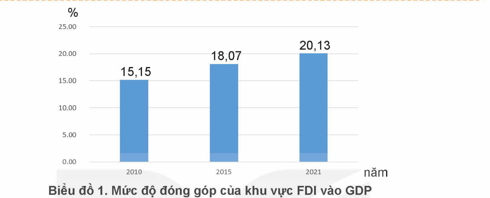

<!-- pdf:20 -->

# BÀI 2: HỘI NHẬP KINH TẾ QUỐC TẾ

## 🎯 Yêu cầu cần đạt

– Nêu được khái niệm hội nhập kinh tế quốc tế.
– Giải thích được hội nhập kinh tế quốc tế là cần thiết đối với mọi quốc gia.
– Liệt kê được các hình thức hội nhập kinh tế quốc tế.
– Xác định được trách nhiệm của bản thân trong hội nhập kinh tế quốc tế.
– Ủng hộ những hành vi chấp hành và phê phán những hành vi không chấp hành chủ trương, chính sách hội nhập kinh tế quốc tế của Nhà nước Cộng hoà xã hội chủ nghĩa Việt Nam.

## 🔴 Mở đầu

Trong bối cảnh toàn cầu hoá hiện nay, hội nhập kinh tế quốc tế trở thành xu hướng tất yếu, phổ biến đối với các quốc gia trên thế giới nhằm tăng cường sự hợp tác, liên kết, cùng phát triển. Đối với Việt Nam, hội nhập kinh tế quốc tế là cơ hội để rút ngắn khoảng cách với các nước có nền kinh tế phát triển, khắc phục nguy cơ tụt hậu.

> ❓ Em hãy nêu tên một tổ chức kinh tế quốc tế mà Việt Nam tham gia và cho biết lợi ích của việc tham gia đó đối với sự phát triển kinh tế – xã hội ở nước ta hiện nay.

## 1. KHÁI NIỆM VÀ SỰ CẦN THIẾT HỘI NHẬP KINH TẾ QUỐC TẾ

Kinh tế thị trường phát triển đòi hỏi phải mở rộng thị trường, hình thành thị trường khu vực và quốc tế. Bên cạnh đó, sự phát triển mạnh mẽ của khoa học – kĩ thuật đã thúc đẩy phân công lao động mang tính quốc tế dẫn đến xu hướng toàn cầu hoá kinh tế với sự gia tăng các hoạt động kinh tế vượt qua mọi biên giới quốc gia, khu vực, tạo ra sự phụ thuộc lẫn nhau giữa các nền kinh tế, hướng tới một nền kinh tế thế giới thống nhất.

<!-- pdf:21 -->

Trong xu thế đó, mỗi quốc gia đều hội nhập với nền kinh tế thế giới thông qua việc gắn kết nền kinh tế của mình với các quốc gia khác dựa trên sự chia sẻ lợi ích giữa các bên tham gia, đồng thời tuân thủ các chuẩn mực quốc tế chung. Hội nhập kinh tế quốc tế trở thành phương thức phát triển phổ biến, khách quan và cần thiết đối với mọi quốc gia, nhất là với các nước đang phát triển.

> **Thông tin 1**
>
> Hiệp định Đối tác Kinh tế toàn diện khu vực (RCEP) là Hiệp định thương mại tự do giữa 10 nước ASEAN và các đối tác Australia, Trung Quốc, Nhật Bản, Hàn Quốc và New Zealand được kí kết ngày 15 – 11 – 2020. Mục tiêu của Hiệp định là thiết lập nền tảng quan hệ đối tác kinh tế hiện đại, toàn diện, chất lượng cao, cùng có lợi, tạo điều kiện thuận lợi cho việc mở rộng thương mại và đầu tư trong khu vực, đồng thời đóng góp vào tăng trưởng và phát triển kinh tế toàn cầu. Các nước thành viên RCEP có trình độ phát triển kinh tế không đồng đều nên các cam kết trong Hiệp định được thiết kế theo cách thức phù hợp đảm bảo mang lại lợi ích cho các bên đồng thời tuân thủ những chuẩn mực quốc tế chung.
>
> Trong quá trình đàm phán thành lập và đàm phán gia nhập RCEP, tất cả các quốc gia liên quan đều phải cam kết tuân thủ toàn bộ các quy định toàn diện của RCEP về tự do thương mại hàng hoá, dịch vụ, tuân thủ cơ chế thực thi chặt chẽ...

> **Thông tin 2**
>
> Trong tiến trình hội nhập kinh tế quốc tế, với việc quan hệ hợp tác cùng nhiều quốc gia, tham gia nhiều tổ chức kinh tế quốc tế trong khu vực và toàn cầu, kí kết và thực hiện nhiều Hiệp định thương mại tự do FTA, nền kinh tế Việt Nam đã có nhiều điều kiện thuận lợi để thúc đẩy hoạt động thương mại quốc tế, thu hút đầu tư nước ngoài, phát triển các dịch vụ quốc tế,... tạo động lực để tăng trưởng kinh tế, tạo việc làm, tăng thu nhập, chuyển dịch cơ cấu kinh tế theo hướng tiến bộ, hiện đại đồng thời không ngừng nâng cao vị thế Việt Nam trên trường quốc tế.
>
> Trong quá trình hội nhập kinh tế quốc tế, hoạt động xuất khẩu ở nước ta ngày càng được thúc đẩy, đóng góp tích cực cho sự tăng trưởng kinh tế, nâng cao thu nhập, chuyển dịch cơ cấu kinh tế. Cùng với tăng trưởng thương mại quốc tế, việc thu hút và sử dụng nguồn vốn đầu tư trực tiếp nước ngoài (FDI) cũng là một động lực thúc đẩy tăng trưởng kinh tế, chuyển dịch cơ cấu kinh tế theo hướng hiện đại hoá. Doanh nghiệp FDI đã đưa vào Việt Nam những máy móc thiết bị, công nghệ hiện đại hơn, giúp hình thành nên một số ngành công nghiệp và dịch vụ mới, chất lượng cao; đào tạo được đội ngũ công nhân có kĩ năng nghề nghiệp,

<!-- pdf:22 -->

> có khả năng sử dụng được các công nghệ hiện đại. FDI cũng đóng góp lớn cho xuất khẩu, cân bằng cán cân thương mại, thúc đẩy tăng trưởng kinh tế. Giá trị xuất khẩu hàng hoá của khu vực doanh nghiệp FDI chiếm 27% vào năm 1995 và tăng gấp gần 3 lần lên tới 73,6% tổng kim ngạch xuất khẩu cả nước trong năm 2021.

*Biểu đồ 1. Mức độ đóng góp của khu vực FDI vào GDP*
*(Theo Tổng cục Thống kê, Niên giám thống kê các năm 2010, 2015, 2021, NXB Thống kê)*

> ❓
>
> 1/ Em hãy cho biết để tham gia Hiệp định RCEP, các quốc gia phải cam kết thực hiện những điều gì. Lợi ích của họ được đảm bảo như thế nào?
>
> 2/ Từ thông tin và biểu đồ trên, em hãy chỉ ra đóng góp của các hoạt động hội nhập kinh tế quốc tế đối với sự phát triển của Việt Nam.
>
> 3/ Hãy lí giải vì sao các quốc gia, nhất là các nước đang phát triển như Việt Nam phải tích cực hội nhập kinh tế quốc tế.

**Hội nhập kinh tế quốc tế** là quá trình một quốc gia thực hiện gắn kết nền kinh tế của mình với nền kinh tế các quốc gia khác trong khu vực và trên thế giới dựa trên sự chia sẻ lợi ích, đồng thời tuân thủ các chuẩn mực quốc tế chung.

Trong điều kiện toàn cầu hoá, hội nhập kinh tế quốc tế là tất yếu khách quan với mọi quốc gia. Hội nhập kinh tế quốc tế tạo ra cơ hội để mỗi quốc gia mở rộng thị trường, thu hút vốn đầu tư, chuyển dịch cơ cấu theo hướng hiện đại, thúc đẩy tăng trưởng và phát triển kinh tế; tạo nhiều việc làm và nâng cao thu nhập cho các tầng lớp dân cư.

Đối với các nước đang phát triển như Việt Nam, hội nhập kinh tế quốc tế tạo cơ hội tiếp cận và sử dụng các nguồn lực bên ngoài như tài chính, khoa học – công nghệ, kinh nghiệm quản lí,... tận dụng thời cơ phát triển rút ngắn, thu hẹp khoảng cách với các nước tiên tiến, khắc phục nguy cơ tụt hậu.

## 2. CÁC HÌNH THỨC HỘI NHẬP KINH TẾ QUỐC TẾ

Hội nhập kinh tế quốc tế được thực hiện theo nhiều cấp độ khác nhau: hội nhập song phương, hội nhập khu vực, hội nhập toàn cầu. Việc tham gia của một quốc gia vào các quan hệ kinh tế quốc tế cũng có nhiều mức độ từ thấp đến cao:

<!-- pdf:23 -->

thoả thuận thương mại ưu đãi, khu vực mậu dịch tự do, liên minh thuế quan, thị trường chung, liên minh kinh tế – tiền tệ.

Về hình thức, hội nhập kinh tế quốc tế là toàn bộ các hoạt động kinh tế đối ngoại của quốc gia với nhiều hình thức đa dạng như: thương mại quốc tế, đầu tư quốc tế, dịch vụ thu ngoại tệ,...

> **Thông tin 1**
>
> CÁC CẤP ĐỘ HỘI NHẬP KINH TẾ QUỐC TẾ
>
> <!-- term: Hội nhập kinh tế song phương -->
> **Hội nhập kinh tế song phương**
>
> Là sự liên kết, hợp tác giữa hai quốc gia dựa trên nguyên tắc bình đẳng, cùng có lợi, tôn trọng độc lập và chủ quyền của nhau nhằm thiết lập và phát triển quan hệ giữa hai bên, góp phần thúc đẩy thương mại, liên kết đầu tư, đem lại lợi ích cho người dân, doanh nghiệp hai nước.
>
> Hình thức này được thực hiện thông qua các hiệp định thương mại tự do, đầu tư trực tiếp nước ngoài,...
>
> Do chỉ là quan hệ giữa hai nước nên dễ đạt được những thoả thuận và nghĩa vụ, ưu đãi phù hợp, chỉ áp dụng cho hai quốc gia kí kết.
>
> Với định hướng: "Đẩy mạnh và làm sâu sắc hơn quan hệ hợp tác song phương với các đối tác, đặc biệt là các đối tác chiến lược, đối tác toàn diện và đối tác quan trọng khác", Việt Nam đã mở rộng quan hệ hợp tác song phương với hơn 170 quốc gia trên thế giới, kí kết trên 90 Hiệp định thương mại song phương, xây dựng và nâng cấp quan hệ đối tác chiến lược, đối tác chiến lược toàn diện với 17 nước, giúp bảo đảm, củng cố môi trường hoà bình, ổn định, tranh thủ lợi thế của các đối tác để bảo vệ, phát triển đất nước nhanh và bền vững.
>
> <!-- term: Hội nhập kinh tế khu vực -->
> **Hội nhập kinh tế khu vực**
>
> Là quá trình liên kết, hợp tác giữa các quốc gia trong một khu vực trên cơ sở tương đồng về địa lí, văn hoá, xã hội hoặc có chung mục tiêu, lợi ích phát triển thông qua các tổ chức kinh tế khu vực, các Diễn đàn hợp tác kinh tế khu vực, Hiệp định đối tác kinh tế...
>
> Hình thức này giúp quốc gia hợp tác kinh tế sâu rộng và toàn diện với các nước trong khu vực và thế giới, mở rộng thị trường, thu hút vốn đầu tư nước ngoài nhiều hơn, phát triển xuất khẩu, du lịch,... tạo môi trường hoà bình, ổn định, hữu nghị, hợp tác toàn diện trong khu vực và thế giới.
>
> Việt Nam đã chủ động tham gia các hình thức hội nhập kinh tế khu vực như: Cộng đồng kinh tế ASEAN (AEC), Diễn đàn hợp tác kinh tế châu Á – Thái Bình Dương (APEC), Hiệp định đối tác toàn diện và tiến bộ xuyên Thái Bình Dương (CPTPP), Hiệp định thương mại tự do Việt Nam – Liên minh châu Âu,.... giúp Việt Nam đẩy mạnh xuất khẩu, được tham gia chuỗi cung ứng khu vực và toàn cầu nên có điều kiện nâng cao trình độ phát triển của nền kinh tế, tăng năng suất lao động, có cơ hội hoàn thiện thể chế theo hướng tiếp cận các chuẩn mực của các nước tiên tiến, hoàn thiện môi trường kinh doanh, từ đó thúc đẩy đầu tư trong nước và nước ngoài phát triển, tạo thêm nhiều cơ hội việc làm và nâng cao thu nhập cho người lao động.

<!-- pdf:24 -->

> <!-- term: Hội nhập kinh tế toàn cầu -->
> **Hội nhập kinh tế toàn cầu**
>
> Là quá trình liên kết, gắn kết giữa các quốc gia, vùng lãnh thổ với nhau thông qua việc tham gia các tổ chức kinh tế toàn cầu.
>
> Đây là hình thức hội nhập sâu rộng nhất của nền kinh tế quốc gia với nền kinh tế thế giới tạo thêm nhiều cơ hội để hợp tác với nhiều quốc gia, tổ chức, khu vực trên toàn thế giới, mở rộng quan hệ thương mại ra thị trường toàn cầu,....
>
> Việt Nam đã tích cực, chủ động tham gia các tổ chức kinh tế toàn cầu như Liên hợp quốc, Tổ chức Thương mại Thế giới (WTO), Quỹ tiền tệ Quốc tế...
>
> Tổ chức Thương mại Thế giới (WTO) là tổ chức thương mại toàn cầu, ngày càng có nhiều thành viên tham gia. Tính đến năm 2020, WTO có 164 quốc gia thành viên trên tổng số 195 quốc gia và vùng lãnh thổ trên thế giới (Việt Nam trở thành thành viên chính thức thứ 150 của WTO năm 2007).
>
> Sau 15 năm gia nhập WTO, Việt Nam đã đạt được những bước tiến dài trên con đường hội nhập, quy mô kinh tế của Việt Nam không ngừng tăng lên. Năm 2006, quy mô kinh tế Việt Nam đạt 66,3 tỉ USD, đến năm 2021 đạt 366,1 tỉ USD, đứng thứ 41 trên thế giới, thứ 5 trong khu vực Đông Nam Á. Tổng kim ngạch xuất nhập khẩu của Việt Nam tăng từ 84,7 tỉ USD năm 2006 lên gần 669 tỉ USD năm 2021. Vốn đầu tư nước ngoài đăng kí tăng gần 4 lần, số vốn giải ngân tăng gần 5 lần. Việt Nam lọt vào nhóm 20 nền kinh tế hàng đầu thế giới về thương mại quốc tế, nằm trong nhóm 20 quốc gia thu hút đầu tư nước ngoài nhiều nhất thế giới.
>
> Nhờ hội nhập kinh tế toàn cầu mà môi trường pháp lí của Việt Nam được hoàn thiện theo hướng tiếp cận các chuẩn mực quốc tế, từng bước nâng cao trình độ quản trị nhà nước, nâng cao hiệu lực, hiệu quả quản lí của Nhà nước; nâng cao năng lực cạnh tranh quốc gia, của doanh nghiệp và sản phẩm; thúc đẩy các mối quan hệ đa dạng hoá, hạn chế rủi ro trước các cú sốc bên ngoài; mở rộng cơ hội thị trường cho hàng hoá Việt Nam thâm nhập vào các thị trường lớn trên thế giới...
<!-- ocr-ok: đối chiếu ảnh trang PDF 24 viền khung làm OCR nhận dính kí tự rác -->

> 💡 EM CÓ BIẾT?
>
> Trong các quan hệ kinh tế quốc tế, việc tham gia của mỗi quốc gia cũng có nhiều mức độ từ thấp đến cao:
>
> *Thoả thuận thương mại ưu đãi:* là phương thức thấp nhất của hội nhập kinh tế quốc tế, nhưng có lịch sử hình thành lâu đời nhất. Theo phương thức này, các quốc gia/vùng lãnh thổ tham gia các thoả thuận/hiệp định, cam kết dành cho nhau các ưu đãi về thuế quan và phi thuế quan đối với hàng hoá của nhau, tạo thành các ưu đãi thương mại.
>
> *Hiệp định thương mại tự do:* là thoả thuận giữa các bên tham gia nhằm xoá bỏ hầu hết hàng rào thuế quan và phi thuế quan nhưng vẫn duy trì chính sách thuế quan riêng của mỗi bên đối với các nước ngoài hiệp định.
>
> *Liên minh thuế quan:* là hình thức xoá bỏ thuế quan và những hàng rào phi thuế quan đối với những hàng hoá, dịch vụ trong quan hệ buôn bán của các nước thành viên, đồng thời thiết lập và áp dụng một biểu thuế quan chung của các nước thành viên với các nước khác.
>
> *Thị trường chung:* được thành lập bởi các quốc gia trong cùng khu vực địa lí để thúc đẩy tự do thương mại, tự do di chuyển lao động và vốn giữa các thành viên.
>
> *Liên minh kinh tế:* là hình thức các bên tham gia hình thành thị trường chung đồng thời xây dựng chính sách kinh tế chung, thực hiện những mục tiêu chung cho toàn liên minh.

<!-- pdf:25 -->

> **Thông tin 2**
>
> CÁC HOẠT ĐỘNG KINH TẾ ĐỐI NGOẠI
>
> <!-- term: Thương mại quốc tế -->
> **Thương mại quốc tế**
>
> Là những hoạt động trao đổi hàng hoá, dịch vụ giữa các quốc gia thông qua xuất, nhập khẩu, thương mại quốc tế kích thích tiêu dùng, mở rộng sản xuất, chuyển giao công nghệ và đầu tư giữa các quốc gia, nhờ đó, tạo tiền đề cho tăng trưởng và phát triển kinh tế. Sự tăng trưởng kim ngạch xuất khẩu thể hiện kết quả hội nhập của mỗi quốc gia.
>
> Theo Tổng cục Thống kê, năm 2022 kim ngạch xuất khẩu hàng hoá của Việt Nam đạt 371,3 tỉ USD, tăng 10,5% so với năm trước. Kim ngạch nhập khẩu hàng hoá năm 2022 sơ bộ đạt 358,9 tỉ USD, tăng 7,8% so với năm trước. Đặc biệt, đây là năm thứ 7 liên tiếp nước ta có cán cân thương mại đạt mức xuất siêu trên 10 tỉ USD.
>
> <!-- term: Đầu tư quốc tế -->
> **Đầu tư quốc tế**
>
> Là quá trình di chuyển vốn từ quốc gia này đến quốc gia khác nhằm đem lại lợi ích cho các bên tham gia, đầu tư quốc tế giúp tăng cường nguồn vốn, góp phần chuyển dịch cơ cấu kinh tế theo hướng hiện đại, tạo thêm việc làm, phát triển chất lượng nguồn nhân lực, tiếp thu khoa học công nghệ hiện đại, kinh nghiệm quản lí tiên tiến, thúc đẩy tăng trưởng kinh tế,... cho nước tiếp nhận đầu tư như Việt Nam.
>
> Theo Tổng cục Thống kê, vốn đầu tư trực tiếp nước ngoài (FDI) vào nước ta thực hiện năm 2022 đạt gần 22,4 tỉ USD, tăng 13,5% so với năm trước. Tổng vốn đầu tư ra nước ngoài (vốn cấp mới và tăng thêm của các dự án được cấp giấy phép từ các năm trước) đạt 599,3 triệu USD.
>
> Vốn vay ưu đãi và vốn viện trợ không hoàn lại (vốn ODA) cho Việt Nam từ các quốc gia và tổ chức quốc tế,... là nguồn lực tài chính quan trọng góp phần thúc đẩy phát triển kinh tế – xã hội nước ta. Đặc biệt, nguồn vốn ODA đã hỗ trợ Việt Nam đạt được nhiều kết quả trong công cuộc xoá đói giảm nghèo.
>
> <!-- term: Dịch vụ thu ngoại tệ -->
> **Dịch vụ thu ngoại tệ**
>
> Dịch vụ thu ngoại tệ bao gồm các dịch vụ quốc tế như du lịch, giao thông vận tải, thông tin liên lạc, bảo hiểm, xuất nhập khẩu lao động, thanh toán và tín dụng,... có vai trò tạo nguồn thu ngoại tệ giúp cải thiện cán cân thanh toán quốc tế. Một số hoạt động còn góp phần tạo việc làm, tăng thu nhập, thúc đẩy tăng trưởng kinh tế như du lịch, thông tin liên lạc...
>
> Theo Bộ Văn hoá, Thể thao và Du lịch, năm 2022, khách quốc tế đến Việt Nam đạt 3,66 triệu lượt người, gấp 23,3 lần so với năm 2021. Tổng thu từ khách du lịch ước đạt 495.000 tỉ đồng.
>
> Theo Bộ Lao động – Thương binh và Xã hội, tính đến cuối năm 2022, có hơn 600.000 người Việt Nam đi làm việc có thời hạn ở nước ngoài. Người lao động Việt Nam ở nước ngoài đang làm việc tại 40 quốc gia và vùng lãnh thổ, với thu nhập ổn định, gửi về nước lượng kiều hối lớn hơn 3 tỉ USD/năm.
>
> *(Theo Cổng thông tin Bộ Văn hoá, Thể thao và Du lịch ngày 11-8-2023 và Tạp chí Kinh tế Việt Nam ngày 20 – 8 – 2022)*

<!-- pdf:26 -->

> ❓
>
> 1/ Từ thông tin 1, em hãy nêu đặc điểm của các cấp độ hội nhập kinh tế quốc tế và cho biết Việt Nam đã thực hiện hội nhập kinh tế quốc tế theo các cấp độ đó như thế nào. Nêu ý nghĩa của việc thực hiện các cấp độ hội nhập đó đối với sự phát triển kinh tế Việt Nam.
>
> 2/ Từ thông tin 2, em hãy nêu các hoạt động kinh tế đối ngoại cơ bản trong quá trình hội nhập kinh tế quốc tế và ý nghĩa của các hoạt động đó đối với Việt Nam.

Hội nhập kinh tế quốc tế thể hiện ở nhiều cấp độ khác nhau: Quốc gia có thể hội nhập kinh tế song phương thông qua hợp tác kinh tế với một quốc gia khác, hội nhập kinh tế khu vực khi tham gia các hoạt động kinh tế với nhiều quốc gia trong khu vực hoặc hội nhập với nền kinh tế thế giới với việc tham gia các tổ chức kinh tế quốc tế có phạm vi toàn cầu.

Hội nhập kinh tế quốc tế thể hiện thông qua các hình thức đa dạng của các hoạt động kinh tế quốc tế như: thương mại quốc tế, đầu tư quốc tế, các dịch vụ thu ngoại tệ...

## 3. ĐƯỜNG LỐI, CHÍNH SÁCH HỘI NHẬP KINH TẾ QUỐC TẾ CỦA VIỆT NAM

Nhận thức được sự cần thiết, tất yếu của hội nhập kinh tế quốc tế, Đảng và Nhà nước ta đã đề ra đường lối, chủ trương, chính sách hội nhập kinh tế nhất quán, không ngừng được hoàn thiện, kế thừa qua các kì Đại hội Đảng và được triển khai tích cực.

> **Thông tin 1**
>
> Kế thừa các kì đại hội trước, Đại hội đại biểu toàn quốc Đảng Cộng sản Việt Nam lần thứ XIII chỉ rõ phương hướng hội nhập kinh tế quốc tế trong giai đoạn 2021 – 2030: Đa phương hoá, đa dạng hoá quan hệ kinh tế quốc tế. Nâng cao khả năng chống chịu của nền kinh tế trước tác động tiêu cực từ những biến động của bên ngoài. Thực hiện nhiều hình thức hội nhập kinh tế quốc tế với các lộ trình linh hoạt, phù hợp.
>
> Trong Chiến lược tổng thể hội nhập quốc tế đến năm 2020, tầm nhìn đến năm 2030, Nhà nước ta đã xác định một số chính sách để hội nhập kinh tế quốc tế hiệu quả như sau: (1) Đẩy mạnh hoàn thiện thể chế, cải cách hành chính; (2) Không ngừng cải thiện môi trường thu hút đầu tư nước ngoài; (3) Gia tăng mức độ liên kết giữa các tỉnh, vùng, phát huy thế mạnh của từng địa phương, khuyến khích tạo điều kiện các địa phương chủ động tích cực hội nhập kinh tế quốc tế; (4) Thực hiện hiệu quả các cam kết quốc tế.

<!-- pdf:27 -->

> **Thông tin 2**
>
> Chính phủ Việt Nam đã phê duyệt Chiến lược hợp tác đầu tư nước ngoài giai đoạn 2021 – 2030 nhằm thu hút các dự án đầu tư nước ngoài sử dụng công nghệ tiên tiến, công nghệ mới, công nghệ cao của cuộc cách mạng công nghiệp lần thứ tư, quản trị hiện đại, có giá trị gia tăng cao, có tác động lan toả tích cực, kết nối chuỗi sản xuất và cung ứng toàn cầu. Phấn đấu đến năm 2030, Việt Nam nằm trong nhóm 3 quốc gia dẫn đầu ASEAN và nhóm 60 quốc gia đứng đầu thế giới theo xếp hạng môi trường kinh doanh của Ngân hàng Thế giới; Phát triển các doanh nghiệp trong nước lớn mạnh, đủ thực lực hội nhập quốc tế;...

> **Trường hợp**
>
> Ông T là chủ một tàu cá đã tháo gỡ thiết bị giám sát hành trình trên tàu, gửi sang tàu khác để đi khai thác bất hợp pháp ở vùng biển nước ngoài, tránh sự giám sát của các cơ quan chức năng.

> ❓
>
> 1/ Từ thông tin 2, em hãy cho biết chính sách hợp tác đầu tư nước ngoài của Nhà nước ta giai đoạn 2021 – 2030 có ý nghĩa gì trong thực hiện đường lối hội nhập kinh tế của Đảng ta.
>
> 2/ Em hãy nhận xét việc thực hiện chủ trương, chính sách hội nhập kinh tế quốc tế của Đảng và Nhà nước ta của ông T trong trường hợp trên. Theo em, việc làm đó ảnh hưởng thế nào đến hoạt động hội nhập kinh tế quốc tế của nước ta?
>
> 3/ Em hãy xác định trách nhiệm của bản thân trong hội nhập kinh tế quốc tế của đất nước.

Hội nhập kinh tế quốc tế là một chủ trương, chính sách lớn của Đảng và Nhà nước ta trong suốt quá trình đổi mới, phát triển đất nước. Quan điểm định hướng là chủ động, tích cực hội nhập kinh tế quốc tế toàn diện, sâu rộng, sử dụng linh hoạt, hiệu quả nhiều hình thức hội nhập kinh tế quốc tế, đa phương hoá, đa dạng hoá quan hệ kinh tế quốc tế.

Một số chính sách nhằm thúc đẩy hội nhập kinh tế quốc tế: Đẩy mạnh hoàn thiện thể chế, cải cách hành chính; Cải thiện môi trường thu hút đầu tư nước ngoài; Gia tăng mức độ liên kết giữa các tỉnh, vùng, phát huy thế mạnh của từng địa phương, khuyến khích tạo điều kiện các địa phương chủ động tích cực hội nhập kinh tế quốc tế; Thực hiện hiệu quả các cam kết quốc tế:...

<!-- pdf:28 -->

## ✏️ Luyện tập

1. Em hãy cho biết phát biểu nào sau đây thể hiện đúng quan niệm về hội nhập kinh tế quốc tế. Vì sao?

a. Hội nhập kinh tế quốc tế là quá trình gắn kết nền kinh tế của quốc gia này với nền kinh tế của quốc gia khác trên thế giới.

b. Trong hội nhập kinh tế quốc tế, mối quan hệ giữa các quốc gia được xây dựng trên nguyên tắc cùng có lợi.

c. Khi tham gia một tổ chức kinh tế quốc tế, mỗi quốc gia thành viên không chỉ có nghĩa vụ tuân thủ mà phải chủ động đề xuất, tham gia xây dựng những điều khoản quy định của tổ chức.

d. Trong tiến trình hội nhập kinh tế quốc tế, các quốc gia thường chú trọng đến liên kết với các quốc gia có trình độ phát triển tương đồng.

2. Em hãy cho biết ý kiến nào dưới đây thể hiện đúng sự cần thiết của hội nhập kinh tế quốc tế:

a. Hội nhập kinh tế quốc tế chỉ cần thiết với những quốc gia đang thiếu các nguồn lực về vốn, lao động, tài nguyên.

b. Hội nhập kinh tế quốc tế làm cho nền kinh tế quốc gia ngày càng phụ thuộc vào bên ngoài.

c. Hội nhập kinh tế quốc tế giúp nền kinh tế quốc gia phát triển bền vững.

d. Hội nhập kinh tế quốc tế chỉ cần thiết với các quốc gia đang phát triển cần theo kịp các nước tiên tiến.

3. Em hãy kể tên những hiệp định Việt Nam đã tham gia trong tiến trình hội nhập kinh tế quốc tế ứng với mỗi cấp độ hội nhập song phương, hội nhập khu vực và hội nhập toàn cầu và nêu ý nghĩa của việc tham gia này đối với sự phát triển của đất nước.

4. Em hãy tìm hiểu và giới thiệu một số kết quả thực hiện chủ trương dưới đây ở địa phương em:

> Chiến lược tổng thể hội nhập quốc tế đến năm 2020, tầm nhìn đến năm 2030 chủ trương gia tăng mức độ liên kết giữa các tỉnh, vùng, phát huy thế mạnh của từng địa phương, khuyến khích tạo điều kiện các địa phương chủ động tích cực hội nhập kinh tế quốc tế.

5. Từ quan điểm chỉ đạo trong Nghị quyết số 06-NQ/TW của Đảng "Hội nhập kinh tế quốc tế là sự nghiệp của toàn dân; doanh nhân, doanh nghiệp và đội ngũ trí thức là lực lượng đi đầu", em hãy cho biết mỗi công dân nên làm gì để đóng góp vào công cuộc hội nhập kinh tế quốc tế của đất nước.

## 🚀 Vận dụng

Em hãy viết bài chia sẻ suy nghĩ của mình về cơ hội đối với lao động trẻ trong bối cảnh hội nhập kinh tế quốc tế sâu rộng hiện nay và những việc học sinh cần làm để tận dụng cơ hội đó.

## 📷 Danh sách hình trong bài

| Mã hình | Trang PDF | Vị trí trong bài | Chú thích gốc |
| --- | --- | --- | --- |
| H12-gd_kt_va_pl-b02-01 | 22 | Mục 1 | Biểu đồ 1. Mức độ đóng góp của khu vực FDI vào GDP |
