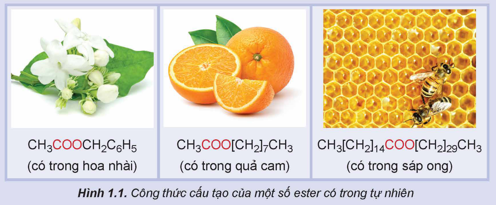
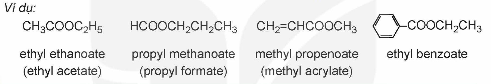
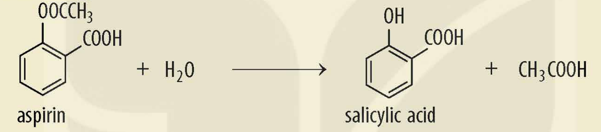
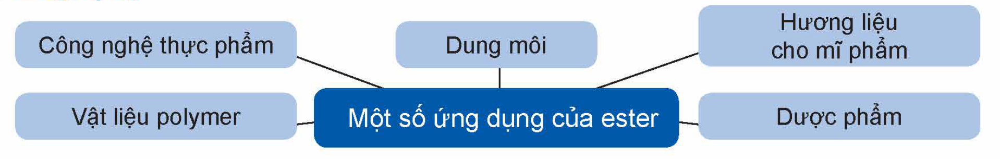
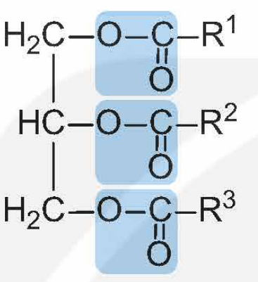
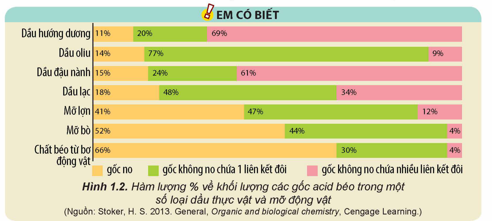
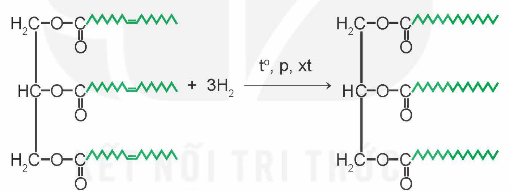
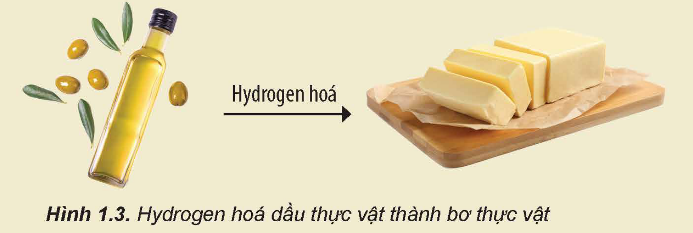
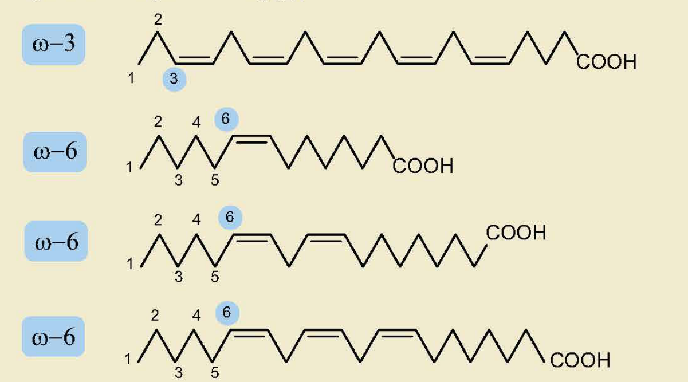

<!-- pdf:8 -->

# BÀI 1: ESTER – LIPID

## 🎯 Mục tiêu

- Nêu được khái niệm về lipid, chất béo, acid béo, đặc điểm cấu tạo phân tử ester.
- Viết được công thức cấu tạo và gọi được tên một số ester đơn giản (số nguyên tử C trong phân tử ≤ 5) và thường gặp.
- Trình bày được đặc điểm về tính chất vật lí và tính chất hoá học cơ bản của ester (phản ứng thuỷ phân) và của chất béo (phản ứng hydrogen hoá chất béo lỏng, phản ứng oxi hoá chất béo bởi oxygen không khí).
- Trình bày được phương pháp điều chế ester và ứng dụng của một số ester.
- Trình bày được ứng dụng của chất béo và acid béo (omega-3 và omega-6).

## 🔴 Mở đầu

Một số ester như ethyl butyrate, benzyl acetate, linalyl acetate, geranyl acetate,... có mùi thơm nên được dùng làm hương liệu. Chất béo (thành phần chính của mỡ động vật và dầu thực vật) là thức ăn quan trọng của con người. Vậy, ester và chất béo là gì? Chúng có tính chất vật lí và tính chất hoá học cơ bản nào?

## I. ESTER

### 1. Khái niệm

> ✋ Tìm hiểu về đặc điểm chung của ester
>
> Nhiều ester có trong tự nhiên là nguyên liệu để sản xuất hương liệu, mĩ phẩm. Hãy nhận xét đặc điểm chung về cấu tạo của các ester dưới đây:
>
> $\ce{CH3COOCH2C6H5}$ (có trong hoa nhài); $\ce{CH3COO[CH2]7CH3}$ (có trong quả cam); $\ce{CH3[CH2]14COO[CH2]29CH3}$ (có trong sáp ong)
>
> 
>
> Hình 1.1. Công thức cấu tạo của một số ester có trong tự nhiên

<!-- pdf:9 -->

Khi thay thế nhóm –OH ở nhóm carboxyl (–COOH) của carboxylic acid bằng nhóm –OR’ thì được **ester**. Trong đó R’ là gốc hydrocarbon.

$\underset{\text{carboxylic acid}}{\ce{R-C(=O)-O-H}} \Longrightarrow \underset{\text{ester}}{\ce{R-C(=O)-O-R'}}$

**Ester đơn chức** có công thức chung là RCOOR', trong đó R là gốc hydrocarbon hoặc H, R' là gốc hydrocarbon.

*Ví dụ:* $\ce{CH3COOC2H5}$, $\ce{CH2=CHCOOCH3}$, $\ce{C6H5COOCH3}$.

### 2. Danh pháp

Tên gọi của ester đơn chức:

Tên gốc R' Tên gốc carboxylic acid
<!-- ocr-ok: nhãn hai ô màu của sơ đồ; OCR bỏ sót ô "Tên gốc R'", đã đối chiếu ảnh -->

ethanoate hay acetate, methyl ⟹ methyl ethanoate hay methyl acetate

*Ví dụ:*

- $\ce{CH3COOC2H5}$ ethyl ethanoate (ethyl acetate)
- $\ce{HCOOCH2CH2CH3}$ propyl methanoate (propyl formate)
- $\ce{CH2=CHCOOCH3}$ methyl propenoate (methyl acrylate)
- ethyl benzoate
<!-- ocr-ok: sách in công thức và tên thành bốn cột, OCR đọc theo hàng ngang và đọc sai chỉ số; đã đối chiếu ảnh -->

> ❓ 1. Viết công thức cấu tạo và gọi tên các đồng phân ester có công thức phân tử $\ce{C4H8O2}$.
>
> 2. Viết công thức cấu tạo của các ester có tên gọi sau đây:
>
> a) methyl formate; b) isopropyl acetate;
>
> c) ethyl propionate; d) methyl butyrate.

### 3. Tính chất vật lí

> ✋ Tại sao trong số các hợp chất hữu cơ có phân tử khối tương đương dưới đây, ester lại có nhiệt độ sôi thấp nhất?
>
> | | $\ce{CH3CH2CH2OH}$ | $\ce{CH3COOH}$ | $\ce{HCOOCH3}$ |
> |---|---|---|---|
> | Loại hợp chất | Alcohol | Carboxylic acid | Ester |
> | Phân tử khối | 60 | 60 | 60 |
> | Nhiệt độ sôi (°C)$^{(1)}$ | 97 | 118 | 32 |

Các phân tử ester không tạo được liên kết hydrogen với nhau nên nhiệt độ sôi của các ester thấp hơn nhiều so với alcohol và carboxylic acid có phân tử khối tương đương.

Các ester có phân tử khối thấp và trung bình thường là chất lỏng ở nhiệt độ phòng. Những ester có phân tử khối lớn thường ở dạng rắn. Ester thường nhẹ hơn nước và ít tan trong nước. Một số ester có mùi thơm của hoa, quả chín.

> (1) Nguồn: Haynes, W. M., Lide, D. R. & Bruno, T. J. 2017. *CRC Handbook of Chemistry and Physics, 97th Edition*, CRC Press LLC.

<!-- pdf:10 -->

> ❓ 3. Cho ba hợp chất butan-1-ol, propanoic acid, methyl acetate và các giá trị nhiệt độ sôi (không theo thứ tự) là: 57 °C; 118 °C; 141 °C$^{(1)}$. Em hãy gán cho mỗi chất một giá trị nhiệt độ sôi thích hợp.

### 4. Tính chất hoá học

<!-- term: Phản ứng thuỷ phân ester -->
Ester bị thuỷ phân trong môi trường acid hoặc môi trường base. Sản phẩm thu được khác nhau tuỳ thuộc vào điều kiện phản ứng.

> ✋ Nghiên cứu phản ứng thuỷ phân ester
>
> Phản ứng thuỷ phân ester đã được tiến hành như sau:
>
> - Cho vào hai ống nghiệm (1) và (2) mỗi ống khoảng 1,0 mL ethyl acetate.
> - Thêm khoảng 2 mL dung dịch $\ce{H2SO4}$ 20% vào ống nghiệm (1) và khoảng 2 mL dung dịch NaOH 30% vào ống nghiệm (2). Quan sát thấy chất lỏng trong cả hai ống nghiệm tách thành hai lớp.
> - Đun cách thuỷ ống nghiệm (1) và (2) trong cốc thuỷ tinh ở nhiệt độ 60 – 70 °C. Sau một thời gian, quan sát thấy:
>
>   Ống nghiệm (1): thể tích lớp chất lỏng phía trên giảm.
>
>   Ống nghiệm (2): tạo thành hỗn hợp đồng nhất.
>
> *Thực hiện các yêu cầu sau:*
>
> 1. Tại sao ban đầu chất lỏng trong cả hai ống nghiệm lại tách thành hai lớp? Ester thuộc lớp nào?
> 2. Phản ứng thuỷ phân ester trong môi trường acid hay môi trường kiềm xảy ra tốt hơn?

**a) Phản ứng thuỷ phân ester trong môi trường acid**

Ester bị thuỷ phân trong môi trường acid thường tạo thành carboxylic acid và alcohol (hoặc phenol) tương ứng.

*Ví dụ:* $\underset{\text{methyl acetate}}{\ce{CH3COOCH3}} + \ce{H2O <=>[H+, t^o]} \underset{\text{acetic acid}}{\ce{CH3COOH}} + \underset{\text{methanol}}{\ce{CH3OH}}$

Phản ứng thuỷ phân ester trong môi trường acid thường là phản ứng thuận nghịch.

**b) Phản ứng thuỷ phân ester trong môi trường base**

Ester bị thuỷ phân trong môi trường base (như NaOH, KOH) thường thu được muối carboxylate và alcohol:

$\underset{\text{ester}}{\ce{R-C(=O)-O-R'}} + \ce{NaOH ->[t^o]} \underset{\text{muối carboxylate}}{\ce{R-C(=O)-ONa}} + \underset{\text{alcohol}}{\ce{R'-O-H}}$

*Ví dụ:* $\ce{CH3COOCH3 + NaOH ->[t^o] CH3COONa + CH3OH}$

Phản ứng thuỷ phân ester trong môi trường base là phản ứng một chiều. Phản ứng này được ứng dụng làm xà phòng nên được gọi là ***phản ứng xà phòng hoá***.

> (1) Nguồn: Haynes, W. M., Lide, D. R. & Bruno, T. J. 2017. *CRC Handbook of Chemistry and Physics, 97th Edition*, CRC Press LLC.

<!-- pdf:11 -->

> ❓ 4. Em hãy so sánh điểm giống nhau và khác nhau của phản ứng thuỷ phân ester $\ce{CH3COOCH3}$ trong môi trường acid và môi trường base.
>
> 5. Hoàn thành phương trình hoá học của các phản ứng sau:
>
> a) $\ce{CH3COOC2H5 + H2O}$ (trong dung dịch $\ce{H2SO4}$, đun nóng).
>
> b) $\ce{HCOOCH3 + NaOH}$ (dung dịch, đun nóng).
>
> 6. Propyl ethanoate là ester có mùi đặc trưng của quả lê, còn methyl butanoate là ester có mùi đặc trưng của quả táo.
>
> a) Viết công thức cấu tạo của propyl ethanoate và methyl butanoate.
>
> b) Viết phương trình hoá học của phản ứng thuỷ phân propyl ethanoate và methyl butanoate trong môi trường acid và môi trường base.

> 💡 EM CÓ BIẾT
>
> Aspirin được sử dụng làm thuốc giảm đau, hạ sốt. Sau khi uống, aspirin bị thuỷ phân trong cơ thể tạo thành salicylic acid. Salicylic acid ức chế quá trình sinh tổng hợp prostaglandin (chất gây đau, sốt và viêm khi nồng độ trong máu cao hơn mức bình thường).
>
> 

### 5. Điều chế

<!-- term: Phản ứng ester hoá -->
Ester thường được điều chế bằng phản ứng ester hoá giữa carboxylic acid và alcohol với xúc tác là acid (thường dùng $\ce{H2SO4}$ đặc).

$\ce{R-C(=O)-O-H + R'-O-H <=>[H2SO4 \text{đặc}, t^o] R-C(=O)-O-R' + H2O}$

*Ví dụ:* Ethyl acetate là một ester được sử dụng làm dung môi để tách, chiết chất hữu cơ. Hợp chất này được điều chế từ acetic acid và ethanol theo phản ứng sau:

$\ce{CH3COOH + C2H5OH <=>[H2SO4 \text{đặc}, t^o] CH3COOC2H5 + H2O}$

> ❓ 7. Isoamyl acetate có mùi thơm đặc trưng của chuối chín nên còn được gọi là dầu chuối. Khi đun nóng hỗn hợp gồm 16,2 g acetic acid và 15,2 g isoamyl alcohol ($\ce{(CH3)2CHCH2CH2OH}$) với xúc tác là $\ce{H2SO4}$ đặc, thu được 14,16 g dầu chuối. Tính hiệu suất của phản ứng điều chế dầu chuối trên.

### 6. Ứng dụng

Một số ứng dụng của ester: Công nghệ thực phẩm; Dung môi; Hương liệu cho mĩ phẩm; Vật liệu polymer; Dược phẩm.

Các ester có mùi thơm, không độc, được dùng làm chất tạo hương trong công nghiệp thực phẩm (ethyl butyrate, benzyl acetate,...), mĩ phẩm (linalyl acetate, geranyl acetate,...).

<!-- pdf:12 -->

Một số polymer có nhóm chức ester được dùng để sản xuất chất dẻo (poly(methyl methacrylate)), sơn tường (polyacrylate).

Một số hợp chất chứa nhóm chức ester được dùng làm dược phẩm (aspirin, methyl salicylate,...). Các ester có phân tử khối thấp được dùng làm dung môi để tách, chiết chất hữu cơ (ethyl acetate), pha sơn (butyl acetate),...

> ✋ Em hãy tìm hiểu và trình bày về ứng dụng của một ester mà em biết.

## II. LIPID

### 1. Khái niệm về lipid, chất béo, acid béo

***Lipid*** là các hợp chất hữu cơ có trong tế bào sống, không tan trong nước nhưng tan trong dung môi hữu cơ không phân cực. Dựa trên cấu tạo, lipid được phân loại thành: chất béo, sáp, steroid, phospholipid,...

***Chất béo*** là triester (ester ba chức) của glycerol với acid béo, gọi chung là triglyceride.

Công thức cấu tạo chung của chất béo:

($R^1$, $R^2$, $R^3$ là các gốc hydrocarbon giống hoặc khác nhau)

***Acid béo*** là carboxylic acid đơn chức. Hầu hết chúng có mạch carbon dài (thường từ 12 đến 24 nguyên tử carbon), không phân nhánh và có số nguyên tử carbon chẵn.

Gốc hydrocarbon trong phân tử acid béo có thể là gốc no (**acid béo bão hoà**) hoặc không no chứa một hay nhiều liên kết đôi $>\!\ce{C=C}\!<$ (**acid béo không bão hoà**).

Các chất béo hay gặp thường là ester của một số acid béo sau:

- Acid béo no
  - palmitic acid: $\ce{CH3[CH2]14COOH}$
  - stearic acid: $\ce{CH3[CH2]16COOH}$
- Acid béo không no
  - oleic acid: $\ce{CH3[CH2]7CH}\overset{cis}{=}\ce{CH[CH2]7COOH}$
  - linoleic acid: $\ce{CH3[CH2]4CH}\overset{cis}{=}\ce{CHCH2CH}\overset{cis}{=}\ce{CH[CH2]7COOH}$
<!-- ocr-ok: sách in hai nhóm acid béo bằng dấu ngoặc nhọn, OCR tách "Acid béo / không no" và đọc sai công thức; đã đối chiếu ảnh -->

> 💡 EM CÓ BIẾT
>
> 
>
> Hình 1.2. Hàm lượng % về khối lượng các gốc acid béo trong một số loại dầu thực vật và mỡ động vật
>
> (Nguồn: Stoker, H. S. 2013. General, *Organic and biological chemistry*, Cengage Learning.)

<!-- pdf:13 -->

> ❓ 8. Viết công thức cấu tạo của chất béo được tạo thành từ glycerol và palmitic acid.

### 2. Tính chất vật lí của chất béo

Ở nhiệt độ thường, chất béo ở trạng thái lỏng hoặc rắn. Khi trong phân tử chất béo chứa nhiều gốc acid béo no thì chất béo thường ở trạng thái rắn như mỡ lợn, mỡ bò, mỡ cừu,... Khi trong phân tử chất béo chứa nhiều gốc acid béo không no thì chúng thường ở trạng thái lỏng như dầu lạc, dầu vừng, dầu cá,...

Chất béo nhẹ hơn nước và không tan trong nước, dễ tan trong các dung môi hữu cơ ít phân cực hoặc không phân cực.

### 3. Tính chất hoá học của chất béo

Chất béo là ester nên có phản ứng thuỷ phân. Ngoài ra, chất béo còn có các phản ứng sau:

**a) Phản ứng hydrogen hoá**

Các chất béo có gốc acid không no có thể phản ứng với hydrogen (khi có mặt xúc tác, ở điều kiện thích hợp), tạo thành chất béo chứa gốc acid no.

*Ví dụ:*

> 💡 EM CÓ BIẾT
>
> Nhiều loại bơ thực vật (chất béo no ở dạng rắn) được tạo ra bởi quá trình hydrogen hoá một phần dầu thực vật (chất béo không no ở dạng lỏng).
>
> 
>
> Hình 1.3. Hydrogen hoá dầu thực vật thành bơ thực vật

**b) Phản ứng oxi hoá chất béo bởi oxygen không khí**

Khi để lâu trong không khí, các gốc acid béo không no trong chất béo có thể bị oxi hoá chậm bởi oxygen, tạo thành các hợp chất có mùi khó chịu. Đây là nguyên nhân của hiện tượng dầu mỡ bị ôi.

<!-- pdf:14 -->

> 💡 EM CÓ BIẾT
>
> Để bảo quản các thực phẩm chế biến có chứa chất béo, người ta thường thêm các chất chống oxi hoá như vitamin C, vitamin E,…

> ❓ 9. Viết phương trình hoá học của phản ứng hydrogen hoá chất béo được tạo thành từ glycerol và linoleic acid.

### 4. Ứng dụng của chất béo và acid béo

- Chất béo là nguồn cung cấp và dự trữ năng lượng ở người và động vật. Chất béo khi được chuyển hoá sẽ cung cấp năng lượng nhiều hơn carbohydrate ở dạng tinh bột hoặc đường.

  Chất béo cũng là nguồn cung cấp acid béo thiết yếu cho cơ thể. Nhiều vitamin như A, D, E và K hoà tan tốt trong chất béo nên chúng được vận chuyển, hấp thụ cùng với chất béo.

  Chất béo là nguyên liệu cho ngành công nghiệp thực phẩm, sản xuất xà phòng và glycerol,...

- ***Acid béo omega-3 và omega-6*** là các acid béo không no với liên kết đôi đầu tiên ở vị trí số 3 và 6 khi đánh số từ nhóm methyl.

  Dầu cá biển chứa nhiều acid béo omega-3. Các loại dầu thực vật (dầu mè, dầu đậu nành, dầu hướng dương,...) chứa nhiều acid béo omega-6.

  Acid béo omega-3 và omega-6 đều có vai trò quan trọng đối với cơ thể, giúp phòng ngừa nhiều loại bệnh. Vì nguồn cung cấp acid béo omega-6 phổ biến hơn so với acid béo omega-3 nên để có chế độ dinh dưỡng cân bằng, cần chú ý tăng cường sử dụng các thực phẩm giàu acid béo omega-3.

> 💡 EM CÓ BIẾT
>
> - Một số acid béo omega-3 và omega-6 thường gặp:
>
> 

> ✋ Em hãy tìm hiểu và chỉ ra một số thực phẩm giàu acid béo omega-3 và omega-6.

<!-- pdf:15 -->

## 📌 Em đã học

- Khi thay thế nhóm –OH ở nhóm carboxyl (–COOH) của carboxylic acid bằng nhóm –OR’ thì được ester. Trong đó R’ là gốc hydrocarbon.
- Ester đơn chức có công thức chung là RCOOR', trong đó R là gốc hydrocarbon hoặc H, R' là gốc hydrocarbon.
- Tên gọi của ester đơn chức: Tên gốc R' Tên gốc carboxylic acid
- Các phân tử ester không tạo được liên kết hydrogen với nhau nên có nhiệt độ sôi thấp hơn so với alcohol và carboxylic acid có phân tử khối tương đương.
- Phản ứng thuỷ phân: ester bị thuỷ phân trong môi trường acid (thường là phản ứng thuận nghịch) hoặc môi trường base (phản ứng một chiều).
- Ester thường được điều chế từ phản ứng ester hoá:

  $\underset{\text{carboxylic acid}}{\ce{R-C(=O)-O-H}} + \underset{\text{alcohol}}{\ce{R'-O-H}} \ce{<=>[H2SO4 \text{đặc}, t^o]} \underset{\text{ester}}{\ce{R-C(=O)-O-R'}} + \ce{H2O}$

- Một số ester được dùng làm dung môi, hương liệu, phụ gia thực phẩm, nguyên liệu sản xuất polymer, dược phẩm,…
- Lipid là những hợp chất hữu cơ có trong tế bào sống, gồm chất béo (còn gọi là triglyceride), sáp, steroid, phospholipid,...
- Chất béo là triester của glycerol với acid béo.
- Acid béo là carboxylic acid đơn chức, hầu hết chúng có mạch carbon dài, thường từ 12 – 24 nguyên tử carbon và không phân nhánh.
- Phản ứng hydrogen hoá chất béo có gốc hydrocarbon không no (dạng lỏng) tạo thành chất béo có gốc hydrocarbon no (dạng rắn).
- Chất béo bị oxi hoá bởi oxygen trong không khí tạo thành các hợp chất có mùi khó chịu.
- Chất béo là nguồn cung cấp và dự trữ năng lượng ở người và động vật. Chất béo là nguyên liệu cho ngành công nghiệp thực phẩm, sản xuất xà phòng và glycerol,...
- Acid béo omega-3 và omega-6 có vai trò quan trọng đối với cơ thể, giúp phòng ngừa nhiều loại bệnh.

## ✏️ Em có thể

- Giải thích được mùi hương đặc trưng của một số loài hoa, trái cây.
- Biết một số cách lựa chọn và sử dụng chất béo phù hợp trong chế độ ăn uống để đảm bảo sức khoẻ.

## 📷 Danh sách hình trong bài

| Mã hình | Trang PDF | Vị trí | Chú thích gốc |
|---|---|---|---|
| H12-hoa-b01-01 | 8 | Mục I.1, hộp "Tìm hiểu về đặc điểm chung của ester" | Hình 1.1. Công thức cấu tạo của một số ester có trong tự nhiên |
| H12-hoa-b01-02 | 9 | Mục I.2 (sơ đồ gọi tên ester đơn chức, gồm cả tên mục và câu dẫn) | (sách không đánh số, không có chú thích) |
| H12-hoa-b01-03 | 9 | Mục I.2, ví dụ tên gọi ester | (sách không đánh số, không có chú thích) |
| H12-hoa-b01-04 | 11 | Mục I.4, hộp "Em có biết" (thuỷ phân aspirin) | (sách không đánh số, không có chú thích) |
| H12-hoa-b01-05 | 11 | Mục I.6 (sơ đồ "Một số ứng dụng của ester") | (sách không đánh số, không có chú thích) |
| H12-hoa-b01-06 | 12 | Mục II.1 (công thức cấu tạo chung của chất béo) | (sách không đánh số, không có chú thích) |
| H12-hoa-b01-07 | 12 | Mục II.1, hộp "Em có biết" | Hình 1.2. Hàm lượng % về khối lượng các gốc acid béo trong một số loại dầu thực vật và mỡ động vật — (Nguồn: Stoker, H. S. 2013. General, Organic and biological chemistry, Cengage Learning.) |
| H12-hoa-b01-08 | 13 | Mục II.3.a (ví dụ phản ứng hydrogen hoá chất béo) | (sách không đánh số, không có chú thích) |
| H12-hoa-b01-09 | 13 | Mục II.3.a, hộp "Em có biết" | Hình 1.3. Hydrogen hoá dầu thực vật thành bơ thực vật |
| H12-hoa-b01-10 | 14 | Mục II.4, hộp "Em có biết" (một số acid béo omega-3 và omega-6) | (sách không đánh số, không có chú thích) |
