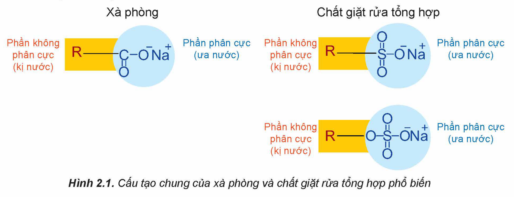
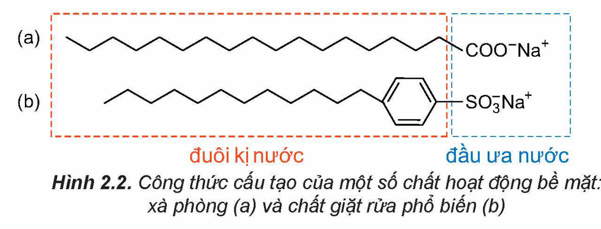
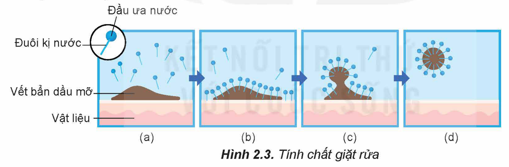
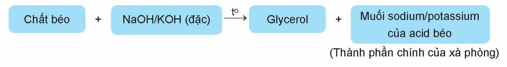
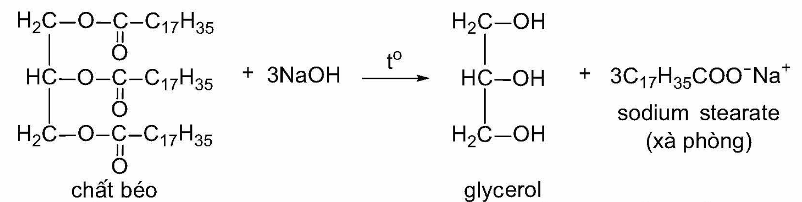
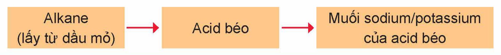

<!-- pdf:16 -->

# BÀI 2: XÀ PHÒNG VÀ CHẤT GIẶT RỬA

## 🎯 Mục tiêu

- Nêu được khái niệm, đặc điểm về cấu tạo và tính chất chất giặt rửa của xà phòng và chất giặt rửa tự nhiên, tổng hợp.
- Trình bày được một số phương pháp sản xuất xà phòng, phương pháp chủ yếu sản xuất chất giặt rửa tổng hợp.
- Thực hiện được (hoặc quan sát video) thí nghiệm về phản ứng xà phòng hoá chất béo.
- Trình bày được cách sử dụng hợp lí, an toàn xà phòng và chất giặt rửa tổng hợp trong đời sống.

## 🔴 Mở đầu

Tại sao xà phòng và chất giặt rửa có thể loại bỏ các vết bẩn trên quần áo, dầu mỡ ở chén bát.

## I. KHÁI NIỆM, ĐẶC ĐIỂM CẤU TẠO CỦA XÀ PHÒNG VÀ CHẤT GIẶT RỬA

***Xà phòng*** là hỗn hợp muối sodium hoặc potassium của các acid béo và các chất phụ gia. Thành phần chủ yếu của xà phòng thường là muối sodium của palmitic acid hoặc stearic acid.

***Chất giặt rửa tổng hợp*** là các chất được tổng hợp hoá học, có tác dụng giặt rửa như xà phòng nhưng không phải là muối sodium, potassium của các acid béo. Những chất này thường là muối sodium alkylsulfate hoặc alkylbenzene sulfonate.

<!-- term: Chất giặt rửa tự nhiên -->
Ngoài ra, một số sản phẩm từ thiên nhiên cũng có tác dụng giặt rửa như nước quả bồ kết, quả bồ hòn,…(chất giặt rửa tự nhiên).

Cấu tạo của xà phòng và chất giặt rửa phổ biến thường gồm hai phần:

***Phần phân cực*** (“đầu” ưa nước): là nhóm carboxylate (xà phòng) hoặc nhóm sulfate, sulfonate (chất giặt rửa tổng hợp). Phần này có thể hoà tan được trong nước.

***Phần không phân cực*** (“đuôi” kị nước): là gốc hydrocarbon có mạch dài (R). Phần này không tan trong nước.

Hình 2.1. Cấu tạo chung của xà phòng và chất giặt rửa tổng hợp phổ biến

<!-- pdf:17 -->

Dưới đây là ví dụ về cấu tạo của xà phòng và chất giặt rửa:

Hình 2.2. Công thức cấu tạo của một số chất hoạt động bề mặt: xà phòng (a) và chất giặt rửa phổ biến (b)

> ❓ 1. Em hãy nêu sự giống và khác nhau về cấu tạo giữa xà phòng và chất giặt rửa tổng hợp.
>
> 2. Trong các chất sau, chất nào là xà phòng, chất nào là chất giặt rửa tổng hợp? Xác định đầu ưa nước và đuôi kị nước của các chất này.
>
> a) $\ce{CH3[CH2]14COONa}$; b) $\ce{CH3[CH2]10CH2OSO3Na}$.

## II. TÍNH CHẤT GIẶT RỬA

<!-- term: Tính chất giặt rửa -->
Khi xà phòng, chất giặt rửa tan vào nước sẽ tạo dung dịch có sức căng bề mặt nhỏ làm cho vật cần giặt rửa dễ thấm ướt. Đuôi kị nước trong xà phòng và chất giặt rửa thâm nhập vào vết bẩn (Hình 2.3b), phân chia vết bẩn thành những hạt rất nhỏ có đầu ưa nước quay ra ngoài (Hình 2.3c), các hạt này phân tán vào nước và bị rửa trôi (Hình 2.3d).

Hình 2.3. Tính chất giặt rửa

## III. PHƯƠNG PHÁP SẢN XUẤT XÀ PHÒNG VÀ CHẤT GIẶT RỬA

### 1. Phương pháp sản xuất xà phòng

Xà phòng được sản xuất bằng cách đun chất béo với dung dịch NaOH đặc hoặc KOH đặc (phản ứng xà phòng hoá):

Chất béo + NaOH/KOH (đặc) $\xrightarrow{t^o}$ Glycerol + Muối sodium/potassium của acid béo (Thành phần chính của xà phòng)

<!-- pdf:18 -->

*Ví dụ:*

chất béo + 3NaOH $\xrightarrow{t^o}$ glycerol + $\ce{3C17H35COO^-Na^+}$ sodium stearate (xà phòng)
<!-- ocr-ok: nhãn và phần công thức dạng dòng của phương trình in trong hình; OCR đọc lẫn thứ tự nhãn, đã đối chiếu ảnh -->

Các muối của acid béo tách ra được đem trộn với chất diệt khuẩn, chất tạo hương,… rồi ép thành bánh với nhiều hình dạng khác nhau.

Xà phòng còn được sản xuất từ dầu mỏ theo sơ đồ sau:

Alkane (lấy từ dầu mỏ) → Acid béo → Muối sodium/potassium của acid béo

> 🧪 Thí nghiệm: Phản ứng xà phòng hoá chất béo
>
> *Chuẩn bị:*
>
> Hoá chất: chất béo (dầu thực vật hoặc mỡ động vật), dung dịch NaOH 40%, dung dịch NaCl bão hoà.
>
> Dụng cụ: bát sứ, cốc thuỷ tinh, đũa thuỷ tinh, kiềng sắt, đèn cồn.
>
> *Tiến hành:*
>
> - Cho khoảng 2 g chất béo và khoảng 4 mL dung dịch NaOH 40% vào bát sứ. Đun hỗn hợp trong khoảng 10 phút và liên tục khuấy bằng đũa thuỷ tinh. Nếu thể tích nước giảm cần bổ sung thêm nước.
> - Kết thúc phản ứng, đổ hỗn hợp vào cốc thuỷ tinh chứa khoảng 30 mL dung dịch NaCl bão hoà, khuấy nhẹ. Để nguội hỗn hợp, tách lấy khối xà phòng nổi lên ở trên.
>
> *Quan sát hiện tượng xảy ra và thực hiện các yêu cầu sau:*
>
> 1. Tại sao phải khuấy liên tục hỗn hợp phản ứng?
> 2. Giải thích hiện tượng xảy ra trong thí nghiệm.

> ❓ 3. Viết phương trình phản ứng xà phòng hoá chất béo tripalmitin (tạo thành từ glycerol và palmitic acid).

### 2. Phương pháp sản xuất chất giặt rửa tổng hợp

Chất giặt rửa tổng hợp được sản xuất từ dầu mỏ theo sơ đồ sau:

Dầu mỏ $\xrightarrow{(*)}$ $\ce{R-SO3H}$, $\ce{R-OSO3H}$ $\longrightarrow$ $\ce{R-SO3Na}$, $\ce{R-OSO3Na}$

Muối sulfonate hoặc muối sulfate được trộn với một số chất phụ gia khác nhau để tạo thành chất giặt rửa tổng hợp.

> (\*) Quá trình có thể diễn ra qua nhiều giai đoạn.

<!-- pdf:19 -->

> 💡 EM CÓ BIẾT
>
> Bột giặt tổng hợp có thành phần chính gồm: chất tạo hạt bột giặt, chất giặt rửa tổng hợp, chất tẩy trắng, enzyme. Ngoài ra, chúng còn có thêm chất chống lắng đọng, chất điều chỉnh bọt, chất tạo huỳnh quang, chất tạo hương, chất độn,...

## IV. ỨNG DỤNG CỦA XÀ PHÒNG VÀ CHẤT GIẶT RỬA

Xà phòng được sử dụng để tắm, rửa tay,... Chất giặt rửa tổng hợp được sử dụng để giặt quần áo, rửa chén bát, rửa tay, lau sàn,…

Hiện nay, chất giặt rửa tổng hợp được sử dụng phổ biến là do: chất giặt rửa dễ hoà tan trong nước hơn xà phòng; chất giặt rửa có thể sử dụng với nước cứng và môi trường acid, ngược lại xà phòng kém tác dụng trong môi trường này.

Nhược điểm của chất giặt rửa tổng hợp so với xà phòng là một số chất giặt rửa tổng hợp khó phân huỷ sinh học nên kém thân thiện với môi trường.

## 📌 Em đã học

- Xà phòng là hỗn hợp muối sodium hoặc potassium của các acid béo và các chất phụ gia.
- Chất giặt rửa tổng hợp là các chất được tổng hợp hoá học, có tác dụng giặt rửa như xà phòng nhưng không phải là muối sodium, potassium của các acid béo. Những chất này thường là muối sodium alkylsulfate hoặc alkylbenzene sulfonate.
- Một số sản phẩm từ thiên nhiên có tác dụng giặt rửa như nước quả bồ kết, quả bồ hòn,…
- Cấu tạo của xà phòng và chất giặt rửa phổ biến thường gồm hai phần: đầu ưa nước và đuôi kị nước.
- Xà phòng được sản xuất bằng phản ứng thuỷ phân chất béo trong môi trường kiềm hoặc sản xuất từ dầu mỏ.
- Chất giặt rửa tổng hợp được sản xuất từ dầu mỏ.
- Xà phòng được dùng để tắm, rửa tay,... Chất giặt rửa được sử dụng để giặt quần áo, rửa tay, rửa chén bát, nước lau kính, lau sàn,…

## ✏️ Em có thể

- Biết được đặc điểm cấu tạo, tính chất, các ưu, nhược điểm của xà phòng và chất giặt rửa để lựa chọn và sử dụng chúng hợp lí, an toàn trong đời sống.

## 📷 Danh sách hình trong bài

| Mã hình | Trang PDF | Vị trí | Chú thích gốc |
|---|---|---|---|
| H12-hoa-b02-01 | 16 | Cuối mục I | Hình 2.1. Cấu tạo chung của xà phòng và chất giặt rửa tổng hợp phổ biến |
| H12-hoa-b02-02 | 17 | Mục I | Hình 2.2. Công thức cấu tạo của một số chất hoạt động bề mặt: xà phòng (a) và chất giặt rửa phổ biến (b) |
| H12-hoa-b02-03 | 17 | Mục II | Hình 2.3. Tính chất giặt rửa |
| H12-hoa-b02-04 | 17 | Mục III.1 (sơ đồ sản xuất xà phòng từ chất béo) | (sách không đánh số, không có chú thích) |
| H12-hoa-b02-05 | 18 | Mục III.1 (ví dụ phản ứng xà phòng hoá chất béo) | (sách không đánh số, không có chú thích) |
| H12-hoa-b02-06 | 18 | Mục III.1 (sơ đồ sản xuất xà phòng từ dầu mỏ) | (sách không đánh số, không có chú thích) |
| H12-hoa-b02-07 | 18 | Mục III.2 (sơ đồ sản xuất chất giặt rửa tổng hợp) | (sách không đánh số, không có chú thích) |
