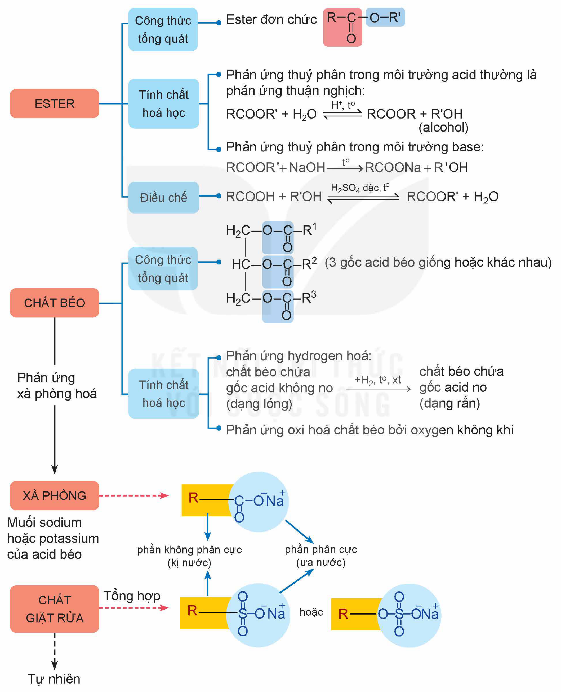

<!-- pdf:20 -->

# BÀI 3: ÔN TẬP CHƯƠNG 1

## I. HỆ THỐNG HOÁ KIẾN THỨC
<!-- ocr-ok: OCR đọc "HOÁ" thành "H0Á" -->

- ESTER
  - Công thức tổng quát
    - Ester đơn chức $\ce{R-C(=O)-O-R'}$
  - Tính chất hoá học
    - Phản ứng thuỷ phân trong môi trường acid thường là phản ứng thuận nghịch:

      $\ce{RCOOR' + H2O <=>[H+, t^o] RCOOR + R'OH}$ (alcohol)
      <!-- lỗi in của sách: sản phẩm in là "RCOOR", đúng ra là RCOOH (carboxylic acid); giữ nguyên như in (spec 4.3), đã đối chiếu ảnh 300 dpi -->
    - Phản ứng thuỷ phân trong môi trường base:

      $\ce{RCOOR' + NaOH ->[t^o] RCOONa + R'OH}$
  - Điều chế
    - $\ce{RCOOH + R'OH <=>[H2SO4 \text{đặc}, t^o] RCOOR' + H2O}$
- CHẤT BÉO
  - Công thức tổng quát
    - (3 gốc acid béo giống hoặc khác nhau)
  - Tính chất hoá học
    - Phản ứng hydrogen hoá: chất béo chứa gốc acid không no (dạng lỏng) $\xrightarrow{+\ce{H2}, t^o, xt}$ chất béo chứa gốc acid no (dạng rắn)
    - Phản ứng oxi hoá chất béo bởi oxygen không khí
  - Phản ứng xà phòng hoá → XÀ PHÒNG
- XÀ PHÒNG: Muối sodium hoặc potassium của acid béo
- CHẤT GIẶT RỬA: Tổng hợp; Tự nhiên
- phần không phân cực (kị nước); phần phân cực (ưa nước); hoặc
<!-- ocr-ok: sơ đồ tư duy nhiều nhánh, OCR đọc lẫn thứ tự các nhánh; các nhánh chép theo ảnh -->

<!-- pdf:21 -->

## II. LUYỆN TẬP

Câu 1. Tên gọi của $\ce{HCOOC2H5}$ là

A. methyl formate. B. ethyl formate.

C. methyl acetate. D. ethyl acetate.

Câu 2. Ester X có mùi đặc trưng giống mùi táo và có công thức phân tử $\ce{C5H10O2}$. Thuỷ phân X trong dung dịch NaOH, thu được sodium butanoate và một alcohol. Công thức của X là

A. $\ce{CH3COOCH2CH2CH3}$. B. $\ce{CH3CH2COOCH2CH3}$.

C. $\ce{CH3CH2CH2COOCH3}$. D. $\ce{(CH3)2CHCOOCH2CH3}$.

Câu 3. Phản ứng hoá học nào sau đây xảy ra thuận nghịch?

A. Đun nóng ethyl acetate với dung dịch $\ce{H2SO4}$ loãng.

B. Đun nóng ethyl acetate với dung dịch NaOH.

C. Hydrogen hoá chất béo có gốc acid không no.

D. Đun nóng chất béo với dung dịch NaOH.

Câu 4. Cho các phát biểu sau:

(1) Một số ester có mùi thơm nên được dùng làm chất tạo hương trong công nghiệp thực phẩm và mĩ phẩm.

(2) Chất béo là triester của glycerol với acid béo.

(3) Chất béo tan tốt trong nước.

(4) Mỡ động vật, dầu thực vật có thể được dùng làm nguyên liệu để sản xuất xà phòng.

(5) Phản ứng thuỷ phân ester trong môi trường acid luôn là phản ứng một chiều.

Số phát biểu đúng là

A. 2. B. 3. C. 4. D. 5.

Câu 5. Hãy phân loại các chất sau thành hai nhóm là xà phòng và chất giặt rửa tổng hợp: $\ce{C15H31COONa}$; $\ce{CH3[CH2]11OSO3Na}$; $\ce{CH3[CH2]11C6H4SO3Na}$; $\ce{C17H33COOK}$.

## 📷 Danh sách hình trong bài

| Mã hình | Trang PDF | Vị trí | Chú thích gốc |
|---|---|---|---|
| H12-hoa-b03-01 | 20 | Mục I (sơ đồ hệ thống hoá kiến thức, cả trang) | (sách không đánh số, không có chú thích) |
