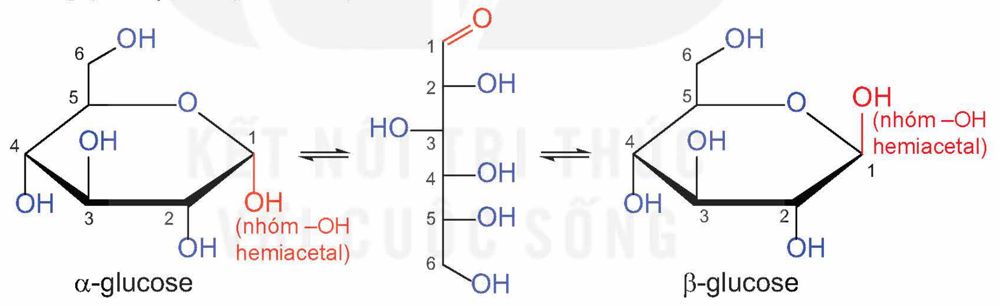
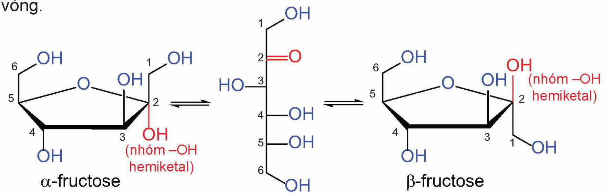
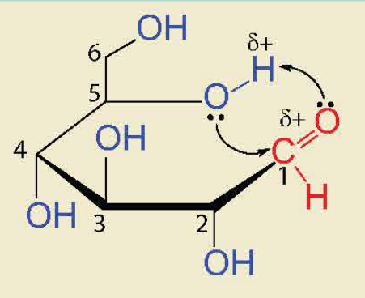
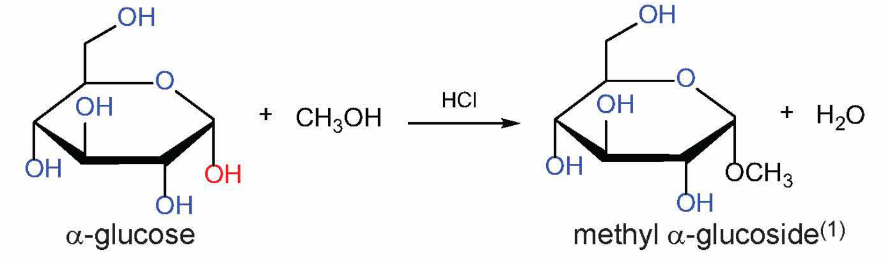
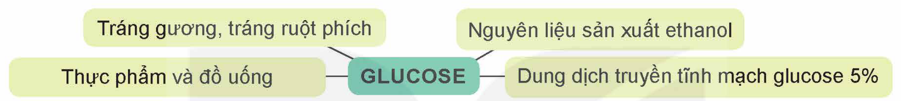

<!-- pdf:22 -->

# BÀI 4: GIỚI THIỆU VỀ CARBOHYDRATE. GLUCOSE VÀ FRUCTOSE

## 🎯 Mục tiêu

- Nêu được khái niệm, cách phân loại carbohydrate, trạng thái tự nhiên của glucose, fructose.
- Viết được công thức cấu tạo dạng mạch hở, dạng mạch vòng và gọi được tên của glucose, fructose.
- Trình bày được tính chất hoá học cơ bản của glucose và fructose (phản ứng với copper(II) hydroxide, nước bromine, thuốc thử Tollens, phản ứng lên men của glucose, phản ứng riêng của nhóm –OH hemiacetal khi glucose ở dạng mạch vòng).
- Thực hiện được (hoặc quan sát video) thí nghiệm về phản ứng của glucose (với copper(II) hydroxide, nước bromine, thuốc thử Tollens). Mô tả các hiện tượng thí nghiệm và giải thích được tính chất hoá học của glucose và fructose.
- Trình bày được ứng dụng của glucose, fructose.

## 🔴 Mở đầu

Carbohydrate gồm nhiều hợp chất thiên nhiên có vai trò quan trọng đối với sinh vật như: tinh bột và glucose là nguồn dự trữ và cung cấp năng lượng quan trọng cho các quá trình sinh hoá tế bào; cellulose giúp xây dựng cấu trúc cho màng tế bào thực vật và thân cây. Vậy, carbohydrate là gì? Các carbohydrate đơn giản như glucose và fructose có các tính chất hoá học cơ bản nào?

## I. KHÁI NIỆM VÀ PHÂN LOẠI CARBOHYDRATE

### 1. Khái niệm

> ✋ 1. Xét công thức cấu tạo mạch hở của hai carbohydrate sau:
>
> $\ce{CH2OH-CHOH-CHOH-CHOH-CHOH-CH=O}$;
>
> $\ce{CH2OH-CHOH-CHOH-CHOH-CO-CH2OH}$.
>
> Hai carbohydrate trên chứa những loại nhóm chức nào?
>
> 2. Công thức phân tử của một số carbohydrate là $\ce{C6H12O6}$, $\ce{C12H22O11}$ và $\ce{(C6H10O5)_n}$. Viết lại các công thức này dưới dạng $\ce{C_n(H2O)_m}$.

**Carbohydrate** là những hợp chất hữu cơ tạp chức, thường có công thức chung là $\ce{C_n(H2O)_m}$.

> 💡 EM CÓ BIẾT
>
> Tên gọi carbohydrate có nguồn gốc lịch sử từ nhận xét rằng phần nhiều hợp chất loại này có thành phần phân tử tương ứng với công thức chung $\ce{C_n(H2O)_m}$ và được hiểu như sự kết hợp của carbon và nước (hydrate). Hiện nay, dù tên gọi carbohydrate vẫn được sử dụng, nhưng quan điểm trên đã được thay thế với hiểu biết đúng về cấu tạo của các hợp chất loại này.
>
> Carbohydrate còn có tên gọi khác là saccharide hoặc glucide. Thuật ngữ saccharide có nguồn gốc từ tiếng Hy Lạp, nghĩa là đường. Thuật ngữ glucide được dùng với nghĩa loại chất khi thuỷ phân sinh ra glucose.

<!-- pdf:23 -->

### 2. Phân loại

Carbohydrate có thể được chia thành ba loại chính: monosaccharide, disaccharide và polysaccharide.

**Monosaccharide** là những carbohydrate không bị thuỷ phân.

*Ví dụ:* glucose và fructose.

**Disaccharide** là những carbohydrate khi thuỷ phân hoàn toàn mỗi phân tử tạo thành hai phân tử monosaccharide.

*Ví dụ:* saccharose và maltose.

**Polysaccharide** là những carbohydrate khi thuỷ phân hoàn toàn mỗi phân tử tạo thành nhiều phân tử monosaccharide.

*Ví dụ:* tinh bột và cellulose.
<!-- ocr-ok: OCR đọc "tinh bột" thành "tỉnh bột", đã đối chiếu ảnh -->

## II. GLUCOSE – FRUCTOSE

### 1. Cấu tạo phân tử

Glucose có công thức phân tử $\ce{C6H12O6}$. Phân tử glucose ở dạng mạch hở có năm nhóm hydroxy và một nhóm aldehyde, với công thức cấu tạo là $\ce{CH2OH[CHOH]4CH=O}$. Các nghiên cứu sâu hơn về cấu tạo cho biết glucose có một dạng mạch hở và hai dạng mạch vòng (α và β) chuyển hoá qua lại lẫn nhau.

α-glucose; β-glucose; (nhóm –OH hemiacetal)
<!-- ocr-ok: nhãn của hình công thức cấu tạo glucose, đã đối chiếu ảnh -->

Fructose có công thức phân tử $\ce{C6H12O6}$, ở dạng mạch hở chứa năm nhóm hydroxy và một nhóm ketone. Tương tự glucose, fructose tồn tại đồng thời ở dạng mạch hở và mạch vòng.

α-fructose; β-fructose; (nhóm –OH hemiketal)
<!-- ocr-ok: nhãn của hình công thức cấu tạo fructose, đã đối chiếu ảnh -->

Trong môi trường kiềm, glucose và fructose có thể chuyển hoá qua lại:

Glucose $\ce{<=>[OH-]}$ Fructose

<!-- pdf:24 -->

> 💡 EM CÓ BIẾT
>
> Sự hình thành cấu tạo vòng
>
> Cấu tạo vòng của các monosaccharide hình thành do phản ứng thuận nghịch giữa nhóm –OH với nhóm –CH=O (hoặc >C=O) hình thành cấu tạo hemiacetal (hoặc hemiketal). Ví dụ: sự hình thành cấu tạo vòng của glucose là do phản ứng của nhóm –OH trên carbon số 5 với nhóm –CH=O (hình bên).
>
> 

### 2. Tính chất hoá học

> ✋ Từ cấu tạo phân tử của glucose và fructose (dạng mạch hở và mạch vòng), cho biết mỗi chất chứa các nhóm chức nào và đề xuất một số phản ứng chứng minh sự tồn tại của các nhóm chức đó.

Glucose có tính chất của polyalcohol và của aldehyde. Fructose có tính chất của polyalcohol và của ketone.

**a) Tính chất polyalcohol**

> 🧪 Thí nghiệm: Phản ứng của glucose với $\ce{Cu(OH)2}$
>
> *Chuẩn bị:*
>
> Hoá chất: dung dịch $\ce{CuSO4}$ 5%, dung dịch NaOH 10%, dung dịch glucose 2%.
>
> Dụng cụ: ống nghiệm.
>
> *Tiến hành:*
>
> - Cho khoảng 2 mL dung dịch NaOH 10% vào ống nghiệm. Sau đó, thêm khoảng 0,5 mL dung dịch $\ce{CuSO4}$ 5% vào, lắc nhẹ.
> - Cho tiếp khoảng 3 mL dung dịch glucose 2% vào ống nghiệm và lắc đều.
>
> *Quan sát hiện tượng xảy ra, giải thích và viết phương trình hoá học.*

Phân tử glucose và fructose có nhiều nhóm hydroxy liền kề nên dung dịch glucose và dung dịch fructose có thể hoà tan copper(II) hydroxide trong môi trường kiềm, tạo thành dung dịch có màu xanh lam.

$\ce{2C6H12O6 + Cu(OH)2 -> (C6H11O6)2Cu + 2H2O}$

**b) Tính chất aldehyde**

> 🧪 Thí nghiệm: Tính chất aldehyde của glucose
>
> *Chuẩn bị:*
>
> Hoá chất: dung dịch $\ce{CuSO4}$ 5%, dung dịch NaOH 10%, dung dịch $\ce{AgNO3}$ 1%, dung dịch ammonia 5%, nước bromine loãng, dung dịch glucose 2%, nước nóng.
>
> Dụng cụ: ống nghiệm, cốc thuỷ tinh, đèn cồn.
>
> *Tiến hành:*
>
> 1. Oxi hoá glucose bằng $\ce{Cu(OH)2}$:
>
> - Cho khoảng 2 mL dung dịch NaOH 10% vào ống nghiệm. Sau đó, thêm khoảng 0,5 mL dung dịch $\ce{CuSO4}$ 5% vào, lắc nhẹ.
> - Cho tiếp khoảng 3 mL dung dịch glucose 2% vào ống nghiệm và lắc đều.
> - Đun nóng ống nghiệm bằng ngọn lửa đèn cồn trong vài phút.

<!-- pdf:25 -->

> 2. Phản ứng của glucose với thuốc thử Tollens:
>
> - Cho khoảng 2 mL dung dịch $\ce{AgNO3}$ 1% vào ống nghiệm, thêm từ từ dung dịch ammonia 5%, lắc đều đến khi kết tủa tan hết. Dung dịch thu được là thuốc thử Tollens.
> - Thêm vào ống nghiệm khoảng 2 mL dung dịch glucose 2%, lắc đều. Sau đó, ngâm ống nghiệm vào cốc thuỷ tinh chứa nước nóng trong vài phút.
>
> 3. Phản ứng của glucose với nước bromine
>
> - Cho khoảng 1 mL nước bromine loãng vào ống nghiệm.
> - Thêm tiếp từ từ 2 mL dung dịch glucose 2%, lắc đều.
>
> *Quan sát và mô tả hiện tượng xảy ra trong mỗi ống nghiệm, giải thích và viết phương trình hoá học.*

Nhóm aldehyde của glucose có thể bị oxi hoá bởi $\ce{Cu(OH)2}$ trong môi trường kiềm khi đun nóng, bởi thuốc thử Tollens và bởi nước bromine.

$\ce{CH2OH[CHOH]4CH=O + 2Cu(OH)2 + NaOH ->[t^o]} \underset{\text{sodium gluconate}}{\ce{CH2OH[CHOH]4COONa}} \ce{+ Cu2O + 3H2O}$

$\ce{CH2OH[CHOH]4CH=O + 2[Ag(NH3)2]OH ->[t^o]} \underset{\text{ammonium gluconate}}{\ce{CH2OH[CHOH]4COONH4}} \ce{+ 2Ag + 3NH3 + H2O}$

$\ce{CH2OH[CHOH]4CH=O + Br2 + H2O ->} \underset{\text{gluconic acid}}{\ce{CH2OH[CHOH]4COOH}} \ce{+ 2HBr}$

Tương tự glucose, fructose cũng bị oxi hoá bởi thuốc thử Tollens và bởi $\ce{Cu(OH)2}$ trong môi trường kiềm.

> ❓ 1. Viết phương trình hoá học minh hoạ phản ứng của fructose với thuốc thử Tollens và $\ce{Cu(OH)2}$ (trong môi trường kiềm, đun nóng).

**c) Tính chất của nhóm –OH hemiacetal**

Ở dạng cấu tạo mạch vòng, nhóm –OH hemiacetal của glucose tác dụng với methanol khi có mặt của HCl khan, tạo thành methyl glucoside.

α-glucose + $\ce{CH3OH ->[HCl]}$ methyl α-glucoside$^{(1)}$ + $\ce{H2O}$
<!-- ocr-ok: nhãn trong hình phản ứng, OCR đọc sai α thành "ơœ"; đã đối chiếu ảnh -->

**d) Phản ứng lên men của glucose**

Dưới tác dụng của các enzyme từ các vi sinh vật khác nhau, glucose được lên men tạo thành các hợp chất có nhiều ứng dụng trong đời sống như ethanol, lactic acid,...

> (1) Ngoài dạng methyl α-glucoside còn sinh ra dạng methyl β-glucoside.

<!-- pdf:26 -->

*Ví dụ:* $\ce{C6H12O6 ->[enzyme] 2C2H5OH + 2CO2}$

$\ce{C6H12O6 ->[enzyme]} \underset{\text{lactic acid}}{\ce{2CH3CH(OH)COOH}}$

### 3. Trạng thái tự nhiên và ứng dụng

**a) Glucose**

Glucose là chất rắn, dễ tan trong nước, có vị ngọt.

Glucose hình thành trong thực vật nhờ quá trình quang hợp. Glucose có trong hầu hết các bộ phận của cây như hoa, lá,... và nhất là trong quả chín. Glucose cũng có trong cơ thể người và động vật. Trong máu người trưởng thành, khoẻ mạnh vào lúc đói có một lượng nhỏ glucose với nồng độ khoảng 4,4 – 7,2 mmol/L (hay 80 – 130 mg/dL)$^{(1)}$.

Glucose đóng vai trò cung cấp năng lượng cho tế bào. Trong cuộc sống, glucose có các ứng dụng phổ biến sau:

GLUCOSE: Tráng gương, tráng ruột phích; Nguyên liệu sản xuất ethanol; Thực phẩm và đồ uống; Dung dịch truyền tĩnh mạch glucose 5%

> ❓ 2. Cho biết các ứng dụng của glucose trong sơ đồ trên dựa trên tính chất nào của chất này.

**b) Fructose**

Fructose là chất rắn, dễ tan trong nước, có vị ngọt.

Fructose có trong nhiều loại trái cây (táo, lựu, nho, lê,...), trong một số loại rau củ (cà rốt, củ cải đường,...) và fructose có nhiều trong mật ong.

Tương tự glucose, fructose chủ yếu đóng vai trò cung cấp năng lượng cho tế bào.

## 📌 Em đã học

- Carbohydrate là những hợp chất hữu cơ tạp chức, thường có công thức chung là $\ce{C_n(H2O)_m}$.
- Glucose và fructose tồn tại đồng thời cấu tạo dạng mạch hở và mạch vòng. Fructose chuyển hoá thuận nghịch thành glucose trong môi trường kiềm.
- Glucose và fructose thể hiện tính chất của các hợp chất alcohol có nhiều nhóm –OH liền kề. Glucose còn thể hiện tính chất của nhóm –OH hemiacetal và của nhóm chức aldehyde.
- Glucose và fructose là nguồn dinh dưỡng có giá trị cho con người, chúng có nhiều ứng dụng trong các ngành công nghiệp thực phẩm, y tế,...

## ✏️ Em có thể

- Lựa chọn và sử dụng các nguồn cung cấp glucose và fructose phù hợp.

> (1) Nguồn: Quyết định số 5481/QĐ-BYT, ngày 30 tháng 12 năm 2020 của Bộ trưởng Bộ Y tế về việc ban hành tài liệu chuyên môn “Hướng dẫn chẩn đoán và điều trị đái tháo đường típ 2”.

## 📷 Danh sách hình trong bài

| Mã hình | Trang PDF | Vị trí | Chú thích gốc |
|---|---|---|---|
| H12-hoa-b04-01 | 23 | Mục II.1 (các dạng cấu tạo của glucose) | (sách không đánh số, không có chú thích) |
| H12-hoa-b04-02 | 23 | Mục II.1 (các dạng cấu tạo của fructose; khung có lẫn chữ "vòng." cuối đoạn văn phía trên vì nhãn OH của hình nằm ngang hàng với dòng chữ) | (sách không đánh số, không có chú thích) |
| H12-hoa-b04-03 | 24 | Mục II.1, hộp "Em có biết" (sự hình thành cấu tạo vòng của glucose) | (sách không đánh số, không có chú thích) |
| H12-hoa-b04-04 | 25 | Mục II.2.c (phản ứng của glucose với methanol) | (sách không đánh số, không có chú thích) |
| H12-hoa-b04-05 | 26 | Mục II.3.a (sơ đồ ứng dụng của glucose) | (sách không đánh số, không có chú thích) |
