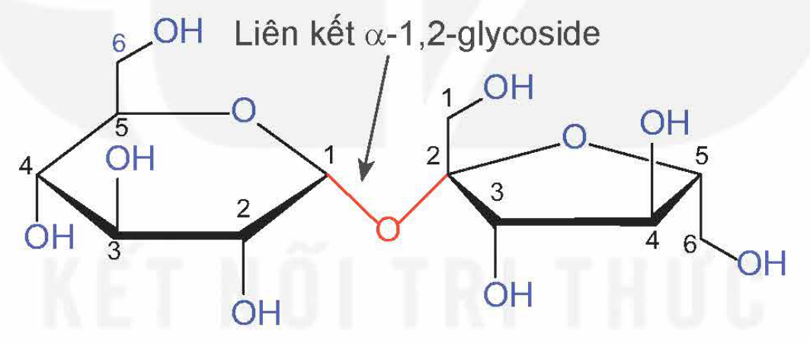
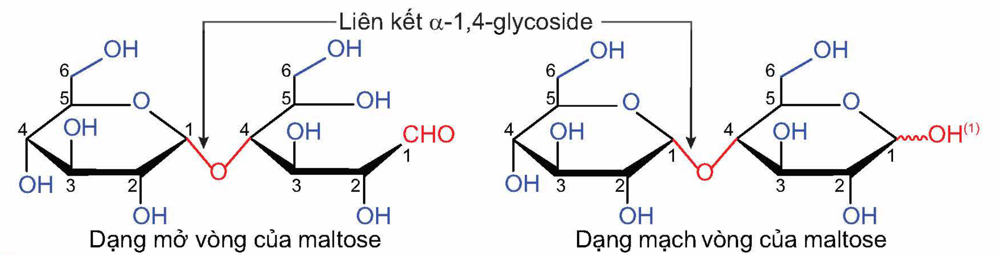
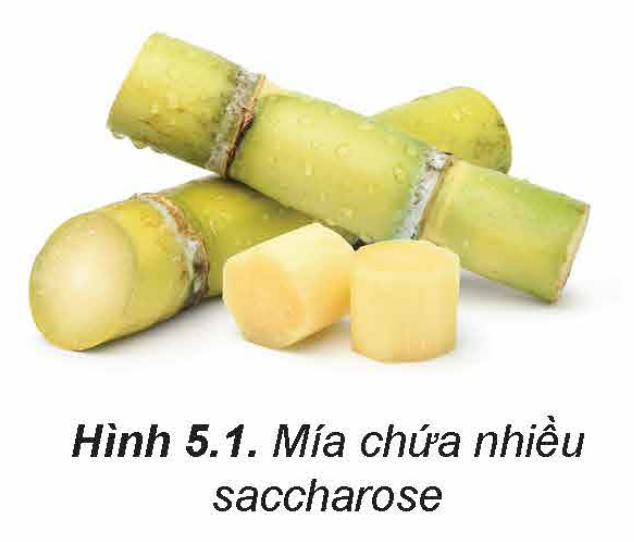
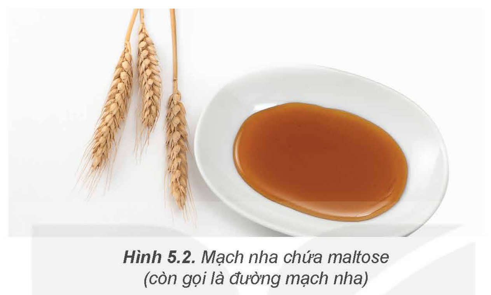

<!-- pdf:27 -->

# BÀI 5: SACCHAROSE VÀ MALTOSE

## 🎯 Mục tiêu

- Viết được công thức cấu tạo dạng mạch hở, dạng mạch vòng và gọi được tên của saccharose, maltose.
- Trình bày được tính chất hoá học cơ bản của saccharose (phản ứng với copper(II) hydroxide, phản ứng thuỷ phân).
- Thực hiện được (hoặc quan sát video) thí nghiệm về phản ứng của saccharose với copper(II) hydroxide. Mô tả hiện tượng thí nghiệm và giải thích được tính chất hoá học của saccharose.
- Nêu được trạng thái tự nhiên và trình bày được ứng dụng của saccharose, maltose.

## 🔴 Mở đầu

Đường ăn (saccharose) là chất làm ngọt phổ biến trong sản xuất thực phẩm, còn đường mạch nha (maltose) chủ yếu sử dụng để sản xuất bia. Saccharose và maltose có cấu tạo như thế nào? Chúng có những tính chất hoá học cơ bản nào?

## I. CẤU TẠO PHÂN TỬ

<!-- term: Saccharose -->
Saccharose có công thức phân tử $\ce{C12H22O11}$, cấu tạo từ một đơn vị α-glucose và một đơn vị β-fructose qua liên kết α-1,2-glycoside.

Liên kết α-1,2-glycoside
<!-- ocr-ok: nhãn trong hình; OCR đọc α thành "ø", đã đối chiếu ảnh -->

<!-- term: Maltose -->
Maltose có công thức phân tử $\ce{C12H22O11}$, cấu tạo từ hai đơn vị glucose qua liên kết α-1,4-glycoside.

Liên kết α-1,4-glycoside; Dạng mở vòng của maltose; Dạng mạch vòng của maltose

> ❓ 1. Tại sao saccharose chỉ tồn tại ở dạng mạch vòng, trong khi maltose tồn tại đồng thời ở dạng mở vòng và mạch vòng?

> (1) Nhóm –OH có thể ở dạng α hoặc β.
<!-- ocr-ok: OCR đọc α, β thành "ø", "8"; đã đối chiếu ảnh -->

<!-- pdf:28 -->

## II. TÍNH CHẤT HOÁ HỌC CỦA SACCHAROSE

> ✋ Từ đặc điểm cấu tạo phân tử của sacharose, dự đoán các tính chất hoá học có thể có của saccharose.

### 1. Tính chất của polyalcohol

> 🧪 Thí nghiệm: Phản ứng của saccharose với $\ce{Cu(OH)2}$
>
> *Chuẩn bị:*
>
> Hoá chất: dung dịch $\ce{CuSO4}$ 5%, dung dịch NaOH 10%, dung dịch saccharose 5%.
>
> Dụng cụ: ống nghiệm.
>
> *Tiến hành:*
>
> - Cho khoảng 2 mL dung dịch NaOH 10% vào ống nghiệm. Sau đó, thêm khoảng 0,5 mL dung dịch $\ce{CuSO4}$ 5% vào, lắc nhẹ.
> - Cho khoảng 3 mL dung dịch saccharose 5% vào ống nghiệm, lắc đều.
>
> *Quan sát hiện tượng xảy ra, giải thích và viết phương trình hoá học.*

Phân tử saccharose có nhiều nhóm hydroxy kề nhau nên dung dịch chất này có thể hoà tan $\ce{Cu(OH)2}$ trong môi trường kiềm, tạo thành dung dịch có màu xanh lam.

$\ce{2C12H22O11 + Cu(OH)2 -> (C12H21O11)2Cu + 2H2O}$

### 2. Phản ứng thuỷ phân

Saccharose bị thuỷ phân trong môi trường acid hoặc dưới tác dụng của enzyme, tạo thành glucose và fructose.

$\ce{C12H22O11 + H2O ->[\text{enzyme hoặc } H+] C6H12O6}$ (glucose) + $\ce{C6H12O6}$ (fructose)

> ❓ 2. Dung dịch saccharose không phản ứng với thuốc thử Tollens nhưng khi đun nóng với dung dịch acid loãng thì tạo thành dung dịch phản ứng với thuốc thử Tollens. Giải thích.

## III. TRẠNG THÁI TỰ NHIÊN VÀ ỨNG DỤNG

### 1. Saccharose

Saccharose là chất rắn có vị ngọt, dễ tan trong nước.

Saccharose được tổng hợp trong thực vật từ glucose và fructose. Saccharose có trong nhiều loài thực vật, có nhiều nhất trong cây mía, củ cải đường và hoa thốt nốt.

Saccharose được sử dụng như một chất làm ngọt phổ biến trong sản xuất thực phẩm như bánh, kẹo, nước giải khát và đồ uống có gas,…

Hình 5.1. Mía chứa nhiều saccharose

<!-- pdf:29 -->

### 2. Maltose

Maltose là chất rắn, có vị ngọt, dễ tan trong nước.

Maltose có trong một số hạt nảy mầm. Maltose chủ yếu được tạo ra trong quá trình thuỷ phân tinh bột.

Maltose được sử dụng làm nguyên liệu sản xuất bia và chất tạo ngọt cho một số loại bánh kẹo.

Hình 5.2. Mạch nha chứa maltose (còn gọi là đường mạch nha)

## 📌 Em đã học

- Phân tử saccharose cấu tạo từ một đơn vị α-glucose và một đơn vị β-fructose qua liên kết α-1,2-glycoside. Phân tử maltose cấu tạo từ hai đơn vị glucose qua liên kết α-1,4-glycoside.
- Saccharose có tính chất của polyalcohol tương tự glucose (hoà tan được $\ce{Cu(OH)2}$ trong môi trường kiềm tạo dung dịch màu xanh lam).
- Saccharose có thể bị thuỷ phân (dưới tác dụng của enzyme hoặc acid) tạo thành glucose và fructose.
- Saccharose thường được sử dụng làm chất tạo ngọt cho thực phẩm, được sản xuất từ mía, thốt nốt, củ cải đường. Maltose thường sử dụng để sản xuất bia, được hình thành trong quá trình thuỷ phân tinh bột.

## ✏️ Em có thể

- Lựa chọn và sử dụng các nguồn cung cấp saccharose và maltose phù hợp trong chế độ ăn uống để đảm bảo sức khoẻ.

## 📷 Danh sách hình trong bài

| Mã hình | Trang PDF | Vị trí | Chú thích gốc |
|---|---|---|---|
| H12-hoa-b05-01 | 27 | Mục I (cấu tạo phân tử saccharose) | (sách không đánh số, không có chú thích) |
| H12-hoa-b05-02 | 27 | Mục I (cấu tạo phân tử maltose, dạng mở vòng và dạng mạch vòng) | (sách không đánh số, không có chú thích) |
| H12-hoa-b05-03 | 28 | Mục III.1 | Hình 5.1. Mía chứa nhiều saccharose |
| H12-hoa-b05-04 | 29 | Mục III.2 | Hình 5.2. Mạch nha chứa maltose (còn gọi là đường mạch nha) |
