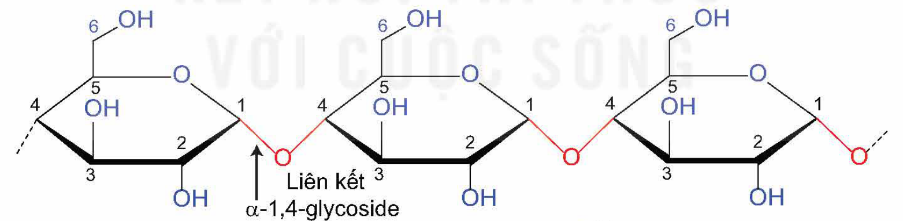
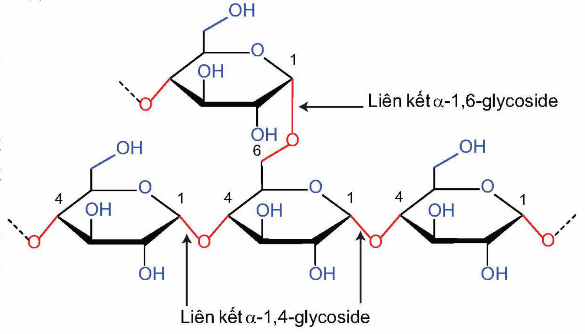
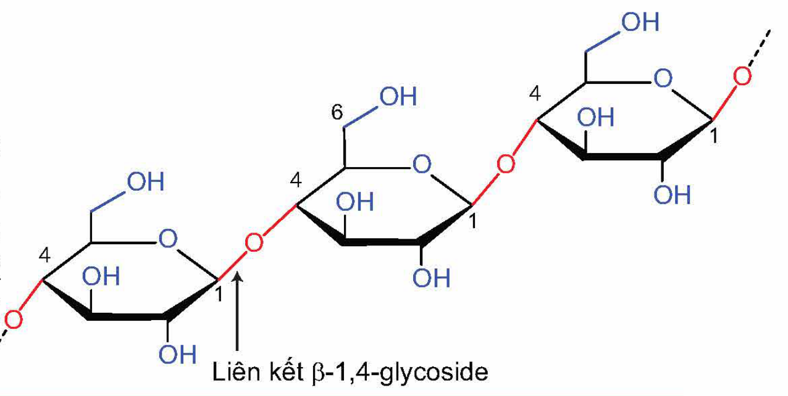
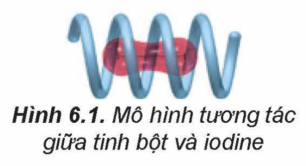
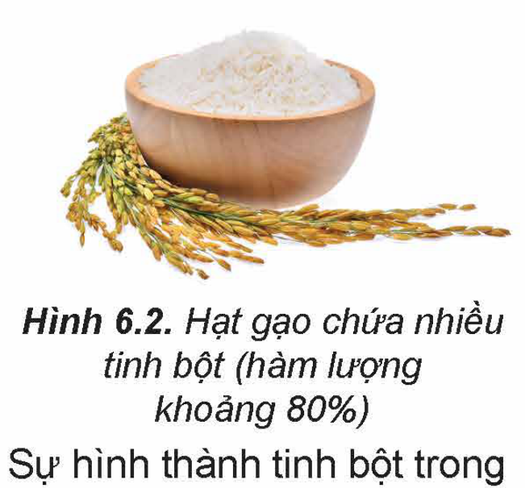
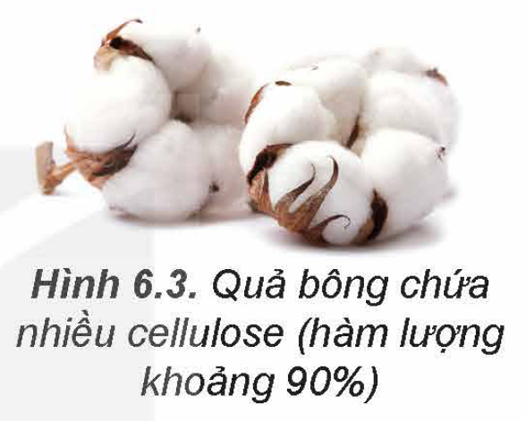

<!-- pdf:30 -->

# BÀI 6: TINH BỘT VÀ CELLULOSE

## 🎯 Mục tiêu

- Viết được công thức cấu tạo và gọi được tên của tinh bột, cellulose.
- Trình bày được tính chất hoá học cơ bản của tinh bột (phản ứng thuỷ phân, phản ứng với iodine); của cellulose (phản ứng thuỷ phân, phản ứng với nitric acid và với nước Schweizer (Svayde)).
- Thực hiện được (hoặc quan sát video) thí nghiệm về phản ứng của tinh bột (phản ứng thuỷ phân, phản ứng của hồ tinh bột với iodine); của cellulose (phản ứng thuỷ phân, phản ứng với nitric acid và tan trong nước Schweizer). Mô tả các hiện tượng thí nghiệm và giải thích được tính chất hoá học của tinh bột và cellulose.
- Nêu được trạng thái tự nhiên và trình bày được ứng dụng của tinh bột, cellulose.
- Trình bày được sự chuyển hoá tinh bột trong cơ thể, sự tạo thành tinh bột trong cây xanh.

## 🔴 Mở đầu

Tinh bột và cellulose đều là polysaccharide, nhưng chúng đóng những vai trò quan trọng khác nhau trong thực vật và có một số ứng dụng khác nhau trong cuộc sống. Vậy, về cấu tạo và tính chất của tinh bột và cellulose khác nhau như thế nào?

## I. CẤU TẠO PHÂN TỬ

### 1. Tinh bột

**Tinh bột** là polymer thiên nhiên, gồm amylose và amylopectin. Tinh bột có công thức phân tử là $\ce{(C6H10O5)_n}$.

<!-- term: Amylose -->
Phân tử amylose cấu tạo từ nhiều đơn vị α-glucose liên kết với nhau qua các liên kết α-1,4-glycoside và hình thành chuỗi xoắn.

Liên kết α-1,4-glycoside
<!-- ocr-ok: nhãn trong hình; OCR đọc sai chữ α, đã đối chiếu ảnh -->

<!-- term: Amylopectin -->
Phân tử amylopectin có cấu tạo phân nhánh, gồm các chuỗi chứa nhiều đơn vị α-glucose liên kết với nhau qua các liên kết α-1,4-glycoside. Các chuỗi này liên kết với nhau tạo cấu tạo mạch nhánh qua liên kết α-1,6-glycoside.

Liên kết α-1,6-glycoside; Liên kết α-1,4-glycoside
<!-- ocr-ok: nhãn trong hình; OCR đọc sai chữ α, đã đối chiếu ảnh -->

<!-- pdf:31 -->

### 2. Cellulose

**Cellulose** là polymer thiên nhiên, có công thức phân tử là $\ce{(C6H10O5)_n}$. Phân tử cellulose cấu tạo từ nhiều đơn vị β-glucose qua liên kết β-1,4-glycoside và hình thành chuỗi không nhánh.

Liên kết β-1,4-glycoside
<!-- ocr-ok: nhãn trong hình; OCR đọc sai chữ β, đã đối chiếu ảnh -->

> ❓ 1. Cấu tạo của tinh bột và cellulose có những đặc điểm nào khác nhau?

## II. TÍNH CHẤT HOÁ HỌC
<!-- ocr-ok: OCR đọc tiêu đề thành "TÍNH CHẤT H0A HC"; đã đối chiếu ảnh -->

### 1. Tính chất của tinh bột

**a) Phản ứng thuỷ phân**

> 🧪 Thí nghiệm: Phản ứng thuỷ phân tinh bột
>
> *Chuẩn bị:*
>
> Hoá chất: dung dịch hồ tinh bột 1%, dung dịch $\ce{CuSO4}$ 5%, dung dịch NaOH 10%, dung dịch HCl 1 M, $\ce{NaHCO3}$ rắn, nước nóng.
>
> Dụng cụ: ống nghiệm, cốc thuỷ tinh, bếp điện.
>
> *Tiến hành:*
>
> - Cho khoảng 5 mL dung dịch hồ tinh bột 1% vào ống nghiệm. Sau đó thêm khoảng 1 mL dung dịch HCl 1 M vào, lắc đều.
> - Đặt ống nghiệm trong một cốc thuỷ tinh chứa nước nóng, đun cách thuỷ trong 10 phút. Sau đó để nguội.
> - Thêm từ từ $\ce{NaHCO3}$ vào đến khi ngừng sủi bọt khí.
> - Cho khoảng 2 mL dung dịch thu được vào ống nghiệm chứa $\ce{Cu(OH)2}$ (được điều chế bằng cách cho 0,5 mL dung dịch $\ce{CuSO4}$ 5% vào 2 mL dung dịch NaOH 10%, lắc nhẹ). Sau đó đặt ống nghiệm trong cốc thuỷ tinh chứa nước nóng khoảng 5 phút.
>
> *Quan sát hiện tượng xảy ra và rút ra nhận xét.*

Tinh bột bị thuỷ phân dưới tác dụng của enzyme hoặc acid. Khi tinh bột bị thuỷ phân không hoàn toàn tạo thành dextrin$^{(1)}$, maltose và glucose. Tinh bột bị thuỷ phân hoàn toàn tạo thành glucose.

$\ce{(C6H10O5)_n + n H2O ->[\text{enzyme hoặc } H+] n C6H12O6}$ (glucose)

**b) Phản ứng màu với dung dịch iodine**

> 🧪 Thí nghiệm: Phản ứng màu của hồ tinh bột với iodine
>
> *Chuẩn bị:*
>
> Hoá chất: dung dịch iodine trong KI, dung dịch hồ tinh bột 1%.
>
> Dụng cụ: ống nghiệm, ống hút nhỏ giọt.
>
> *Tiến hành:* Lấy 2 mL dung dịch hồ tinh bột 1% vào ống nghiệm. Nhỏ tiếp vài giọt dung dịch iodine vào ống nghiệm, lắc đều.
>
> *Quan sát hiện tượng xảy ra và rút ra nhận xét.*

> (1) **Dextrin** là các hợp chất carbohydrate có phân tử khối thấp hơn tinh bột.

<!-- pdf:32 -->

Trong tinh bột, các phân tử amylose có dạng xoắn, khi tương tác với iodine tạo ra màu xanh tím. Phản ứng này được dùng để nhận biết tinh bột.

Hình 6.1. Mô hình tương tác giữa tinh bột và iodine

### 2. Tính chất của cellulose
<!-- ocr-ok: OCR ghép tiêu đề với chú thích Hình 6.1 nằm cùng hàng; đã đối chiếu ảnh -->

**a) Phản ứng thuỷ phân**

> 🧪 Thí nghiệm: Phản ứng thuỷ phân cellulose trong môi trường acid
>
> *Chuẩn bị:*
>
> Hoá chất: cellulose (bông), dung dịch $\ce{H2SO4}$ 70%, dung dịch NaOH 10%, dung dịch $\ce{CuSO4}$ 5%, $\ce{NaHCO3}$ rắn, nước nóng.
>
> Dụng cụ: ống nghiệm, cốc thuỷ tinh 250 mL, đũa thuỷ tinh, đèn cồn, giá đựng ống nghiệm.
>
> *Tiến hành:*
>
> - Cho 10 mL dung dịch $\ce{H2SO4}$ 70% vào cốc thuỷ tinh, thêm một lượng nhỏ cellulose (bông) vào cốc và dùng đũa thuỷ tinh khuấy đều. Sau đó, đặt cốc thuỷ tinh vào cốc nước nóng và khuấy trong khoảng 3 phút để cellulose tan hết tạo dung dịch đồng nhất.
> - Trung hoà dung dịch bằng cách thêm từ từ $\ce{NaHCO3}$ đến khi dừng sủi bọt khí, sau đó thêm tiếp 5 mL dung dịch NaOH 10%.
> - Cho 5 mL dung dịch thu được ở trên vào ống nghiệm chứa $\ce{Cu(OH)2}$ (được điều chế bằng cách cho 0,5 mL dung dịch $\ce{CuSO4}$ 5% vào 2 mL dung dịch NaOH 10%, lắc nhẹ). Đun nóng đều ống nghiệm khoảng 2 phút, sau đó để ống nghiệm trên giá khoảng 3 phút.
>
> *Chú ý:* Cẩn thận trọng khi làm việc với dung dịch $\ce{H2SO4}$ đặc.
>
> *Quan sát hiện tượng xảy ra, giải thích và viết phương trình hoá học.*

Tương tự tinh bột, cellulose bị thuỷ phân bởi enzyme hoặc acid (HCl hoặc $\ce{H2SO4}$). Phản ứng thuỷ phân hoàn toàn tạo thành glucose.

$\ce{(C6H10O5)_n + n H2O ->[\text{enzyme hoặc } H+] n C6H12O6}$ (glucose)

> ❓ 2. Tại sao tinh bột và cellulose đều có thể dùng để sản xuất ethanol?

**b) Phản ứng với nitric acid**

> 🧪 Thí nghiệm: Phản ứng của cellulose với nitric acid
>
> *Chuẩn bị:*
>
> Hoá chất: cellulose (bông), dung dịch $\ce{HNO3}$ đặc, dung dịch $\ce{H2SO4}$ đặc, dung dịch $\ce{NaHCO3}$ loãng, quỳ tím.
>
> Dụng cụ: cốc thuỷ tinh 100 mL, chậu nước nóng, chậu nước đá, đũa thuỷ tinh, giấy lọc, đĩa sứ, đèn cồn.
>
> *Tiến hành:*
>
> - Cho khoảng 5 mL dung dịch $\ce{HNO3}$ đặc vào cốc thuỷ tinh (loại 100 mL) ngâm trong chậu nước đá. Thêm từ từ khoảng 10 mL dung dịch $\ce{H2SO4}$ đặc vào cốc và khuấy đều. Sau đó, lấy cốc thuỷ tinh ra khỏi chậu nước đá, thêm tiếp một nhúm bông vào cốc và dùng đũa thuỷ tinh ấn bông ngập trong dung dịch.

<!-- pdf:33 -->

> - Ngâm cốc trong chậu nước nóng khoảng 10 phút. Để nguội, lấy sản phẩm thu được ra khỏi cốc, rửa nhiều lần với nước lạnh (đến khi nước rửa không làm đổi màu quỳ tím), sau đó rửa lại bằng dung dịch $\ce{NaHCO3}$ loãng.
> - Ép sản phẩm giữa hai miếng giấy lọc để hút nước và làm khô tự nhiên. Sau đó, để sản phẩm lên đĩa sứ rồi đốt cháy sản phẩm.
>
> *Chú ý:* Cẩn thận trọng khi làm việc với dung dịch $\ce{HNO3}$ đặc và dung dịch $\ce{H2SO4}$ đặc.
>
> *Quan sát hiện tượng xảy ra, giải thích và viết phương trình hoá học.*

Trong mỗi đơn vị glucose cấu thành phân tử cellulose có ba nhóm hydroxy. Khi đun nóng cellulose với hỗn hợp $\ce{HNO3}$ đặc và $\ce{H2SO4}$ đặc, tuỳ theo điều kiện phản ứng mà một, hai hay cả ba nhóm hydroxy này có thể phản ứng với nitric acid tạo thành cellulose nitrate.

*Ví dụ:* $\ce{[C6H7O2(OH)3]_n + 3n HONO2 ->[H2SO4 \text{đặc}, t^o]} \underset{\text{cellulose trinitrate}}{\ce{[C6H7O2(ONO2)3]_n}} \ce{+ 3n H2O}$

**c) Cellulose phản ứng với nước Schweizer**

> 🧪 Thí nghiệm: Tính tan của cellulose trong nước Schweizer
>
> *Chuẩn bị:*
>
> Hoá chất: cellulose (bông), dung dịch $\ce{CuSO4}$ 1 M, dung dịch NaOH 20%, dung dịch $\ce{NH3}$ đặc.
>
> Dụng cụ: giấy lọc, cốc thuỷ tinh 250 mL, đũa thuỷ tinh, ống hút.
>
> *Tiến hành:*
>
> - Cho khoảng 50 mL dung dịch $\ce{CuSO4}$ 1 M vào cốc 250 mL. Thêm 20 mL dung dịch NaOH 20% vào, khuấy đều.
> - Lọc tách kết tủa, cho vào cốc thuỷ tinh 250 mL. Thêm khoảng 50 mL dung dịch $\ce{NH3}$ đặc, khuấy đều đến khi kết tủa tan hết thu được nước Schweizer.
> - Thêm một lượng nhỏ bông vào khoảng 30 mL nước Schweizer và khuấy đều trong khoảng 3 phút.
>
> *Quan sát hiện tượng xảy ra, giải thích và viết phương trình hoá học.*

<!-- term: Nước Schweizer -->
Cellulose tan được trong nước Schweizer (dung dịch thu được khi hoà tan $\ce{Cu(OH)2}$ trong ammonia).

## III. TRẠNG THÁI TỰ NHIÊN VÀ ỨNG DỤNG

### 1. Tinh bột

Tinh bột là chất rắn màu trắng, hầu như không tan trong nước lạnh. Trong nước nóng, tinh bột tan tạo dung dịch keo nhớt, gọi là **hồ tinh bột**.

Hình 6.2. Hạt gạo chứa nhiều tinh bột (hàm lượng khoảng 80%)

*Sự tạo thành tinh bột trong cây xanh:*

Trong thực vật, tinh bột có chủ yếu trong củ, quả hay hạt. Sự hình thành tinh bột trong thực vật diễn ra qua nhiều giai đoạn, gồm hai quá trình chính là quá trình quang hợp hình thành glucose và quá trình kết hợp của các đơn vị glucose tạo thành tinh bột.

$\ce{6n CO2 + 5n H2O ->[\text{ánh sáng}][\text{chất diệp lục}] (C6H10O5)_n + 6n O2}$

<!-- pdf:34 -->

*Sự chuyển hoá tinh bột trong cơ thể:*

Khi con người sử dụng thức ăn chứa tinh bột, enzyme α-amylase có trong nước bọt thúc đẩy quá trình thuỷ phân tinh bột thành các phân tử nhỏ hơn gồm maltose và dextrin. Quá trình này tiếp tục ở ruột non, nơi phần lớn tinh bột bị thuỷ phân thành glucose. Glucose được hấp thụ vào máu và di chuyển đến các tế bào trong khắp cơ thể. Glucose có thể được sử dụng cho nhu cầu năng lượng hoặc có thể được chuyển đổi thành glycogen lưu trữ trong gan và cơ.

Tinh bột là nguồn lương thực chính của con người và một số động vật, đồng thời cũng được dùng nhiều trong công nghiệp thực phẩm (chất làm đặc, chất kết dính, sản xuất ethanol,…). Ngoài ra, tinh bột cũng được sử dụng làm chất kết dính trong công nghiệp giấy và công nghiệp dệt may.

### 2. Cellulose

Cellulose là chất rắn, dạng sợi, màu trắng, không tan trong nước ngay cả khi đun nóng, không tan trong các dung môi hữu cơ thông thường như ether, benzene,…

Cellulose được tổng hợp bởi thực vật, chiếm khoảng 50% khối lượng của gỗ khô và khoảng 90% khối lượng sợi bông.
<!-- ocr-ok: OCR ghép dòng chữ với chú thích Hình 6.3 nằm cùng hàng; đã đối chiếu ảnh -->

Hình 6.3. Quả bông chứa nhiều cellulose (hàm lượng khoảng 90%)
<!-- ocr-ok: chú thích hình nằm cạnh đoạn văn, OCR ghép lẫn hai cột; đã đối chiếu ảnh -->

Cellulose được sử dụng để làm vật liệu xây dựng (các loại đồ gỗ), sản xuất giấy, sợi tự nhiên và sợi nhân tạo. Cellulose cũng được sử dụng làm nguyên liệu để điều chế ethanol và cellulose trinitrate (dùng chế tạo thuốc súng không khói).

## 📌 Em đã học

- Tinh bột và cellulose là những polymer thiên nhiên, có công thức phân tử là $\ce{(C6H10O5)_n}$. Tinh bột gồm amylose và amylopectin.
- Tinh bột có phản ứng thuỷ phân, phản ứng màu với dung dịch iodine.
- Cellulose có phản ứng thuỷ phân, phản ứng với $\ce{HNO3}$, tan trong nước Schweizer.
- Tinh bột là nguồn cung cấp năng lượng và chất dinh dưỡng quan trọng cho con người và một số động vật, nguyên liệu sản xuất glucose, ethanol,… Cellulose được dùng làm vật liệu xây dựng, tơ sợi, giấy,…

## ✏️ Em có thể

- Lựa chọn và sử dụng một số nguồn cung cấp tinh bột hợp lí.
- Lựa chọn và sử dụng một số sản phẩm từ cellulose an toàn, hợp lí.

## 📷 Danh sách hình trong bài

| Mã hình | Trang PDF | Vị trí | Chú thích gốc |
|---|---|---|---|
| H12-hoa-b06-01 | 30 | Mục I.1 (cấu tạo phân tử amylose) | (sách không đánh số, không có chú thích) |
| H12-hoa-b06-02 | 30 | Mục I.1 (cấu tạo phân tử amylopectin) | (sách không đánh số, không có chú thích) |
| H12-hoa-b06-03 | 31 | Mục I.2 (cấu tạo phân tử cellulose; cạnh trái khung cắt qua 1 điểm của nét đứt mở đầu mạch vì chữ đoạn văn bên cạnh chạy sát hình) | (sách không đánh số, không có chú thích) |
| H12-hoa-b06-04 | 32 | Mục II.1.b | Hình 6.1. Mô hình tương tác giữa tinh bột và iodine |
| H12-hoa-b06-05 | 33 | Mục III.1 | Hình 6.2. Hạt gạo chứa nhiều tinh bột (hàm lượng khoảng 80%) |
| H12-hoa-b06-06 | 34 | Mục III.2 | Hình 6.3. Quả bông chứa nhiều cellulose (hàm lượng khoảng 90%) |
