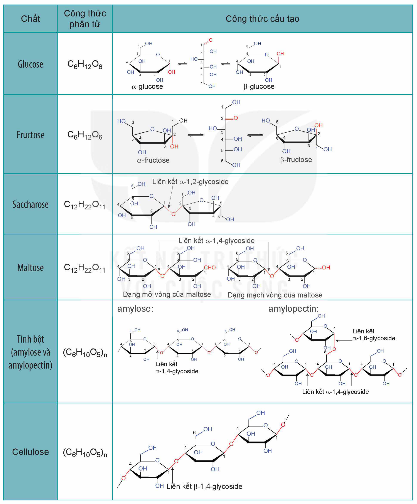

<!-- pdf:35 -->

# BÀI 7: ÔN TẬP CHƯƠNG 2

## I. HỆ THỐNG HOÁ KIẾN THỨC
<!-- ocr-ok: OCR đọc sai chữ tiêu đề trang trí, đã đối chiếu ảnh -->

### 1. Cấu tạo của các carbohydrate

| Chất | Công thức phân tử | Công thức cấu tạo |
|---|---|---|
| Glucose | $\ce{C6H12O6}$ | α-glucose; β-glucose |
| Fructose | $\ce{C6H12O6}$ | α-fructose; β-fructose |
| Saccharose | $\ce{C12H22O11}$ | Liên kết α-1,2-glycoside |
| Maltose | $\ce{C12H22O11}$ | Liên kết α-1,4-glycoside; Dạng mở vòng của maltose; Dạng mạch vòng của maltose |
| Tinh bột (amylose và amylopectin) | $\ce{(C6H10O5)_n}$ | amylose: Liên kết α-1,4-glycoside; amylopectin: Liên kết α-1,6-glycoside, Liên kết α-1,4-glycoside |
| Cellulose | $\ce{(C6H10O5)_n}$ | Liên kết β-1,4-glycoside |
<!-- ocr-ok: bảng có cột công thức cấu tạo là hình vẽ (đã cắt thành hình); chữ trong ô chép theo ảnh -->

<!-- pdf:36 -->

### 2. Tính chất hoá học cơ bản của các carbohydrate

| | $\ce{Cu(OH)2}$ /NaOH | $\ce{Br2/H2O}$ | $\ce{AgNO3/NH3}$ | Thuỷ phân |
|---|---|---|---|---|
| Glucose | Tạo dung dịch xanh lam | Mất màu nước bromine | Tạo kết tủa bạc | Không |
| Fructose | Tạo dung dịch xanh lam | Không | Tạo kết tủa bạc | Không |
| Saccharose | Tạo dung dịch xanh lam | Không | Không | Tạo glucose và fructose |
| Tinh bột | Không | Không | Không | Tạo glucose |
| Cellulose | Không | Không | Không | Tạo glucose |

Glucose còn có phản ứng của nhóm –OH hemiacetal (khi glucose ở dạng mạch vòng), phản ứng lên men; tinh bột có phản ứng màu với dung dịch iodine; cellulose có phản ứng với nitric acid và tan trong nước Schweizer.

## II. LUYỆN TẬP

Câu 1. Cho các chất sau: glucose, fructose, saccharose, maltose, tinh bột và cellulose. Mỗi phát biểu sau đây đúng hay sai?

a) Trong các chất trên, có hai monosaccharide, hai disaccharide và hai polysaccharide.

b) Cấu tạo phân tử các chất trên đều có nhiều nhóm hydroxy.

c) Glucose và fructose có thể chuyển hoá qua lại với nhau trong môi trường kiềm.

Câu 2. Giải thích các hiện tượng sau:

a) Khi ăn cơm, nếu nhai kĩ sẽ thấy vị ngọt.

b) Nước ép chuối chín cho phản ứng tráng bạc.

c) Nhỏ dung dịch iodine lên miếng chuối xanh xuất hiện màu xanh tím.

Câu 3. Cồn sinh học được dùng làm nhiên liệu sạch, được sản xuất thông qua quá trình lên men các chất hữu cơ như tinh bột, cellulose. Tính khối lượng ethanol thu được từ một tấn mùn cưa chứa 45% cellulose về khối lượng, biết hiệu suất cả quá trình đạt 70%.

## 📷 Danh sách hình trong bài

| Mã hình | Trang PDF | Vị trí | Chú thích gốc |
|---|---|---|---|
| H12-hoa-b07-01 | 35 | Mục I.1 (bảng cấu tạo của các carbohydrate, gồm cột công thức cấu tạo vẽ hình) | (sách không đánh số, không có chú thích) |
