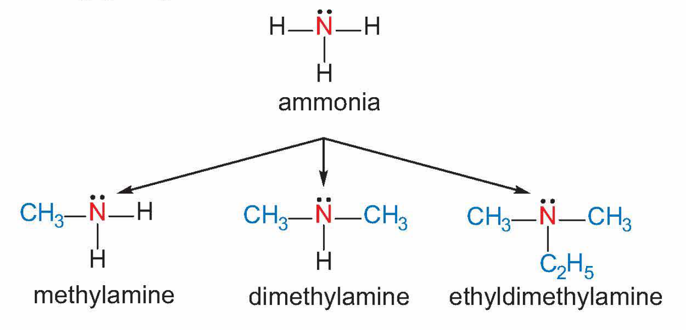
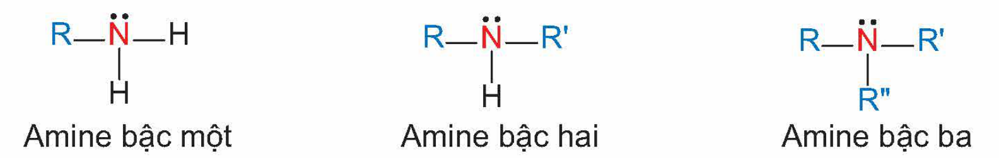
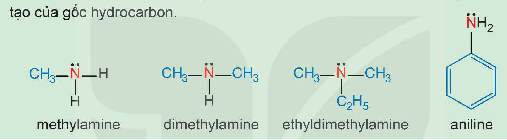
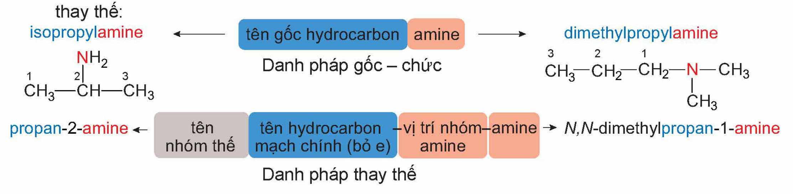
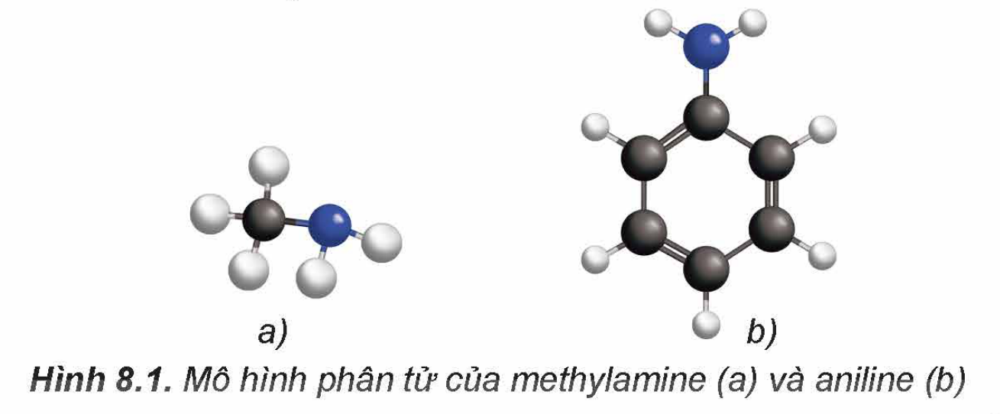
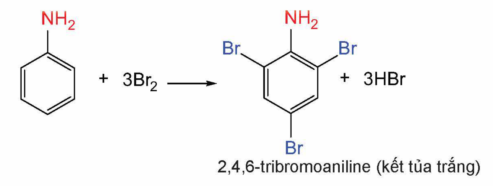
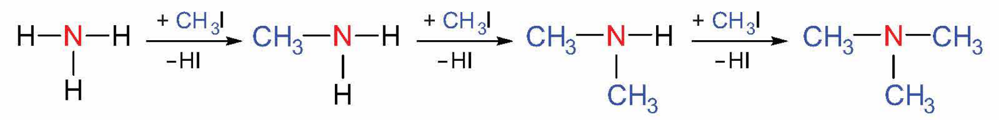

<!-- pdf:37 -->

# BÀI 8: AMINE

## 🎯 Mục tiêu

- Nêu được khái niệm amine và phân loại amine (theo bậc của amine và bản chất gốc hydrocarbon).
- Viết được công thức cấu tạo và gọi được tên một số amine theo danh pháp thay thế, danh pháp gốc – chức (số nguyên tử C trong phân tử ≤ 5), tên thông thường của một số amine hay gặp.
- Nêu được đặc điểm về tính chất vật lí của amine (trạng thái, nhiệt độ sôi, nhiệt độ nóng chảy, khả năng hoà tan).
- Trình bày được đặc điểm cấu tạo phân tử và hình dạng phân tử methylamine và aniline.
- Trình bày được tính chất hoá học đặc trưng của amine: tính chất của nhóm –NH$_2$ (tính base (với quỳ tím, với HCl, với FeCl$_3$), phản ứng với nitrous acid (axit nitrơ)), phản ứng thế ở nhân thơm (với nước bromine) của aniline (anilin), phản ứng tạo phức của methylamine (hoặc ethylamine) với Cu(OH)$_2$.
- Thực hiện được (hoặc quan sát video) thí nghiệm về phản ứng của dung dịch methylamine (hoặc ethylamine) với quỳ tím (chất chỉ thị), với HCl, với iron(III) chloride (FeCl$_3$), với copper(II) hydroxide (Cu(OH)$_2$); phản ứng của aniline với nước bromine; mô tả được các hiện tượng thí nghiệm và giải thích được tính chất hoá học của amine.
- Trình bày được ứng dụng của amine (ứng dụng của diamine và aniline); các phương pháp điều chế amine (khử hợp chất nitro và thế nguyên tử H trong phân tử ammonia).

## 🔴 Mở đầu

Amine có nhiều ứng dụng trong các lĩnh vực dược phẩm, hoá mĩ phẩm và phẩm nhuộm. Vậy, amine là gì? Đặc điểm cấu tạo và tính chất của amine là gì?

## I. KHÁI NIỆM, PHÂN LOẠI, ĐỒNG PHÂN VÀ DANH PHÁP
<!-- ocr-ok: OCR đọc sai chữ tiêu đề trang trí, đã đối chiếu ảnh -->

### 1. Khái niệm

***Amine*** là dẫn xuất của ammonia, trong đó nguyên tử hydrogen trong phân tử ammonia được thay thế bằng gốc hydrocarbon.

*Ví dụ:*

ammonia; methylamine; dimethylamine; ethyldimethylamine

<!-- pdf:38 -->

### 2. Phân loại

Amine thường được phân loại theo bậc của amine và bản chất gốc hydrocarbon.

- **Bậc của amine** được tính bằng số gốc hydrocarbon liên kết trực tiếp với nguyên tử nitrogen. Theo đó, amine được phân loại thành amine bậc một, amine bậc hai và amine bậc ba.

Amine bậc một; Amine bậc hai; Amine bậc ba

- Dựa trên đặc điểm cấu tạo của gốc hydrocarbon, amine được phân thành nhiều loại, trong đó hai loại điển hình là **alkylamine** (nhóm amine liên kết với gốc alkyl) và **arylamine** (nhóm amine liên kết trực tiếp với nguyên tử carbon của vòng benzene).

> ❓ 1. Phân loại các amine dưới đây dựa trên bậc của amine và dựa trên đặc điểm cấu tạo của gốc hydrocarbon.
>
> 
>
> methylamine; dimethylamine; ethyldimethylamine; aniline

### 3. Đồng phân

Các amine có từ hai nguyên tử carbon trong phân tử bắt đầu xuất hiện hiện tượng đồng phân. Amine có thể có các đồng phân: bậc amine, mạch carbon và vị trí nhóm amine.

> ❓ 2. Viết công thức cấu tạo của các amine có công thức phân tử $\ce{C3H9N}$ và xác định bậc của các amine đó.

### 4. Danh pháp

Tên của các amine đơn chức được gọi theo danh pháp gốc – chức và danh pháp thay thế:

isopropylamine; tên gốc hydrocarbon; amine; dimethylpropylamine; Danh pháp gốc – chức

propan-2-amine; tên nhóm thế; tên hydrocarbon mạch chính (bỏ e); vị trí nhóm amine; amine; *N*,*N*-dimethylpropan-1-amine; Danh pháp thay thế
<!-- ocr-ok: nhãn các ô màu của sơ đồ danh pháp, chép theo ảnh -->

*Chú ý:* sử dụng N làm chỉ số vị trí cho các nhóm thế liên kết với nguyên tử nitrogen ở amine bậc hai và amine bậc ba.

Ngoài ra, một số amine được gọi theo tên thông thường.

*Ví dụ:* $\ce{C6H5NH2}$ có tên gọi là aniline.

<!-- pdf:39 -->

> ❓ 3. Gọi tên theo danh pháp gốc chức và danh pháp thay thế các amine sau: $\ce{CH3CH2CH2NH2}$; $\ce{CH3CH2NHCH3}$; $\ce{(CH3)3N}$.

## II. ĐẶC ĐIỂM CẤU TẠO
<!-- ocr-ok: OCR đọc sai chữ tiêu đề trang trí, đã đối chiếu ảnh -->

Hình dạng phân tử của methylamine và aniline được mô tả ở Hình 8.1 dưới đây.

Hình 8.1. Mô hình phân tử của methylamine (a) và aniline (b)

Trong phân tử amine, nguyên tử nitrogen còn cặp electron chưa liên kết. Cấu tạo của amine tương tự ammonia nên amine có một số tính chất hoá học tương tự ammonia.

Aniline còn dễ tham gia phản ứng thế nguyên tử hydrogen trong nhân thơm do ảnh hưởng của nhóm –NH$_2$.

## III. TÍNH CHẤT VẬT LÍ

> ✋ Xác định trạng thái của các amine trong Bảng 8.1 ở nhiệt độ phòng (25 °C).
>
> Bảng 8.1. Nhiệt độ nóng chảy và nhiệt độ sôi của một số amine$^{(1)}$
>
> | Amine | Tên gọi | Nhiệt độ nóng chảy (°C) | Nhiệt độ sôi (°C) |
> |---|---|---|---|
> | $\ce{CH3NH2}$ | Methylamine | –93,4 | –6,4 |
> | $\ce{CH3CH2NH2}$ | Ethylamine | –81,0 | 16,6 |
> | $\ce{CH3NHCH3}$ | Dimethylamine | –93,0 | 7,3 |
> | $\ce{CH3CH2CH2NH2}$ | Propylamine | –84,8 | 47,2 |
> | $\ce{CH3CH(NH2)CH3}$ | Isopropylamine | –95,1 | 31,8 |
> | $\ce{(CH3)3N}$ | Trimethylamine | –117,1 | 2,8 |
> | $\ce{C6H5NH2}$ | Aniline | –6,0 | 184,1 |

Amine có nhiệt độ sôi cao hơn hydrocarbon có cùng số nguyên tử carbon hoặc có phân tử khối tương đương.

Methylamine, ethylamine, dimethylamine và trimethylamine là những chất khí, có mùi tanh của cá hoặc mùi khai tương tự ammonia (tuỳ nồng độ). Các amine có số nguyên tử carbon nhỏ thường tan tốt trong nước nhờ tạo được liên kết hydrogen với nước. Khi số nguyên tử carbon trong gốc hydrocarbon tăng thì độ tan của các amine giảm. Ở điều kiện thường, aniline là chất lỏng, ít tan trong nước.

> (1) Nguồn: Haynes, W. M., Lide, D. R. & Bruno, T. J. 2017. *CRC Handbook of Chemistry and Physics, 97th Edition*, CRC Press LLC.

<!-- pdf:40 -->

## IV. TÍNH CHẤT HOÁ HỌC

### 1. Tính base và phản ứng tạo phức

> 🧪 Thí nghiệm: Phản ứng của nhóm amine
>
> *Chuẩn bị:*
>
> Hoá chất: dung dịch methylamine 0,1 M, dung dịch HCl 0,1 M, dung dịch $\ce{FeCl3}$ 0,1 M, dung dịch $\ce{CuSO4}$ 0,1 M, giấy pH/giấy quỳ tím, phenolphthalein.
>
> Dụng cụ: ống nghiệm, mặt kính đồng hồ.
>
> *Tiến hành:*
>
> 1. Phản ứng với chất chỉ thị:
>
> Nhỏ một giọt dung dịch methylamine 0,1 M lên mẩu giấy pH hoặc giấy quỳ tím đặt trên mặt kính đồng hồ.
>
> *Quan sát và mô tả sự thay đổi màu sắc của giấy pH.*
>
> 2. Phản ứng với dung dịch acid:
>
> - Cho 2 mL dung dịch methylamine 0,1 M vào ống nghiệm, thêm tiếp 1 giọt phenolphthalein.
> - Nhỏ từ từ 2 mL dung dịch HCl 0,1 M vào ống nghiệm.
>
> *Quan sát hiện tượng xảy ra trong ống nghiệm, giải thích và viết phương trình hoá học.*
>
> 3. Phản ứng với dung dịch muối:
>
> - Cho khoảng 1 mL dung dịch $\ce{FeCl3}$ 0,1 M vào ống nghiệm.
> - Thêm tiếp khoảng 3 mL dung dịch methylamine 0,1 M vào ống nghiệm.
>
> *Quan sát hiện tượng xảy ra trong ống nghiệm, giải thích và viết phương trình hoá học.*
>
> 4. Phản ứng với copper(II) hydroxide:
>
> - Cho khoảng 2 mL dung dịch $\ce{CuSO4}$ 0,1 M vào ống nghiệm.
> - Thêm từ từ dung dịch methylamine 0,1 M vào ống nghiệm, lắc đều tới khi kết tủa tan hết.
>
> *Quan sát hiện tượng xảy ra trong ống nghiệm, giải thích và viết phương trình hoá học.*

<!-- term: Tính base của amine -->
Tương tự như ammonia, amine thể hiện tính base yếu. Dung dịch các alkylamine có thể làm quỳ tím đổi màu xanh, còn dung dịch aniline không làm đổi màu quỳ tím.

*Ví dụ:* $\ce{CH3NH2 + H2O <=> CH3NH3+ + OH-}$

$\ce{CH3NH2 + HCl ->} \underset{\text{methylammonium chloride}}{\ce{CH3NH3Cl}}$

$\ce{FeCl3 + 3CH3NH2 + 3H2O -> Fe(OH)3 + 3CH3NH3Cl}$

Các amine như methylamine hay ethylamine tác dụng với $\ce{Cu(OH)2}$ tạo dung dịch phức chất có màu xanh lam.

*Ví dụ:* $\ce{CuCl2 + 2CH3NH2 + 2H2O -> Cu(OH)2 + 2CH3NH3Cl}$

$\ce{Cu(OH)2 + 4CH3NH2 -> [Cu(CH3NH2)4](OH)2}$

<!-- pdf:41 -->

> ❓ 4. Giấm có thể dùng để khử mùi tanh của cá. Giải thích và viết phương trình hoá học. (Biết mùi tanh của cá thường do trimethylamine gây ra.)

### 2. Phản ứng với nitrous acid

Alkylamine bậc một tác dụng với nitrous acid ở nhiệt độ thường tạo thành alcohol và giải phóng khí nitrogen (phản ứng này thường được dùng để nhận biết alkylamine bậc một). *Ví dụ:*

$\ce{CH3NH2 + HONO -> CH3OH + N2 + H2O}$

<!-- term: Muối diazonium -->
Aniline tác dụng với nitrous acid ở nhiệt độ thấp (0 – 5 °C) tạo thành muối diazonium (thường được dùng tổng hợp phẩm nhuộm azo và dược phẩm).

$\ce{C6H5NH2 + HONO + HCl ->[0-5 ^oC] [C6H5N2]+Cl- + 2H2O}$

### 3. Phản ứng của aniline với nước bromine

> 🧪 Thí nghiệm: Phản ứng của aniline với nước bromine
>
> *Chuẩn bị:*
>
> Hoá chất: dung dịch aniline loãng, nước bromine.
>
> Dụng cụ: ống nghiệm.
>
> *Tiến hành:*
>
> - Cho khoảng 1 mL nước bromine vào ống nghiệm.
> - Thêm từ từ vài giọt dung dịch aniline loãng vào ống nghiệm.
>
> *Quan sát hiện tượng xảy ra trong ống nghiệm, giải thích và viết phương trình hoá học.*

Do ảnh hưởng của nhóm –NH$_2$, aniline dễ tham gia phản ứng thế nguyên tử H của vòng benzene hơn so với benzene, ưu tiên thế vào các vị trí *ortho* và *para* so với nhóm NH$_2$.

*Ví dụ:*

2,4,6-tribromoaniline (kết tủa trắng)

## V. ỨNG DỤNG

Aniline là nguyên liệu tổng hợp một số hợp chất quan trọng trong các lĩnh vực khác nhau như công nghiệp phẩm nhuộm, dược phẩm (như paracetamol, sulfonamide) hay công nghiệp polymer.

Một số diamine được sử dụng làm nguyên liệu tổng hợp tơ sợi.

*Ví dụ:* hexamethylenediamine là nguyên liệu tổng hợp nylon-6,6.

<!-- pdf:42 -->

## VI. ĐIỀU CHẾ

### 1. Alkyl hoá ammonia

Alkylamine được điều chế từ ammonia và dẫn xuất halogen.

*Ví dụ:*

### 2. Khử hợp chất nitro

Aniline và các arylamine thường được điều chế bằng cách khử hợp chất nitrobenzene (hoặc dẫn xuất nitro tương ứng) bởi một số kim loại (Zn, Fe,...) trong dung dịch HCl.

*Ví dụ:* $\ce{C6H5NO2 + 6[H] ->[Fe + HCl][t^o] C6H5NH2 + 2H2O}$

## 📌 Em đã học

- Amine là dẫn xuất của ammonia, trong đó nguyên tử hydrogen trong phân tử ammonia được thay thế bằng gốc hydrocarbon. Có thể phân loại amine theo bậc amine (amine bậc một, bậc hai và bậc ba) hoặc theo đặc điểm cấu tạo gốc hydrocarbon (alkylamine và arylamine).
- Amine có tính base yếu; một số amine như methylamine, ethylamine tạo được hợp chất phức với Cu$^{2+}$; các alkylamine bậc một phản ứng với $\ce{HNO2}$ tạo thành alcohol và giải phóng $\ce{N2}$; Aniline phản ứng với $\ce{HNO2}$ ở nhiệt độ thấp tạo muối diazonium; aniline dễ tham gia phản ứng thế nguyên tử H của vòng benzene hơn so với benzene.
- Các amine được điều chế bằng cách alkyl hoá ammonia hoặc khử hợp chất nitro.
- Các amine là nguyên liệu cho công nghiệp tổng hợp phẩm nhuộm, dược phẩm, polymer và tơ sợi.

## ✏️ Em có thể

- Biết sử dụng, cũng như xử lí một số vấn đề thực tế có liên quan đến amine.

## 📷 Danh sách hình trong bài

| Mã hình | Trang PDF | Vị trí | Chú thích gốc |
|---|---|---|---|
| H12-hoa-b08-01 | 37 | Mục I.1 (ví dụ amine tạo từ ammonia) | (sách không đánh số, không có chú thích) |
| H12-hoa-b08-02 | 38 | Mục I.2 (amine bậc một, bậc hai, bậc ba) | (sách không đánh số, không có chú thích) |
| H12-hoa-b08-03 | 38 | Mục I.2, câu hỏi 1 (khung có lẫn dòng thứ hai của câu hỏi "tạo của gốc hydrocarbon." vì nhóm NH$_2$ của aniline in ngang hàng dòng chữ) | (sách không đánh số, không có chú thích) |
| H12-hoa-b08-04 | 38 | Mục I.4 (sơ đồ danh pháp gốc – chức và danh pháp thay thế; khung có lẫn chữ "thay thế:" cuối câu dẫn) | (sách không đánh số, không có chú thích) |
| H12-hoa-b08-05 | 39 | Mục II | Hình 8.1. Mô hình phân tử của methylamine (a) và aniline (b) |
| H12-hoa-b08-06 | 41 | Mục IV.3 (phản ứng của aniline với nước bromine) | (sách không đánh số, không có chú thích) |
| H12-hoa-b08-07 | 42 | Mục VI.1 (alkyl hoá ammonia) | (sách không đánh số, không có chú thích) |
