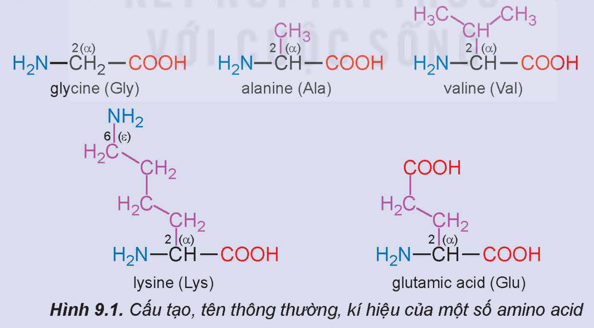
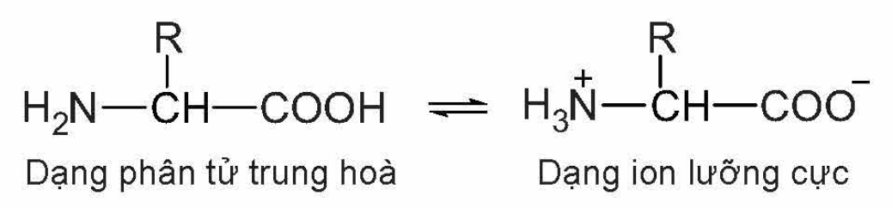
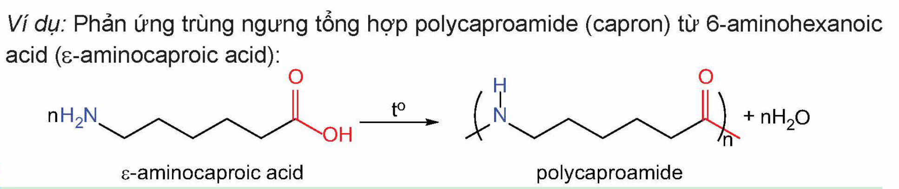
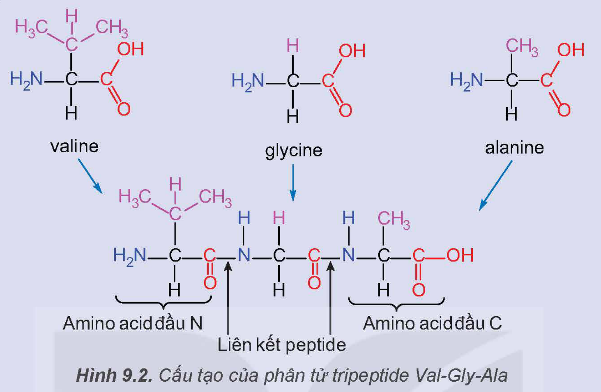
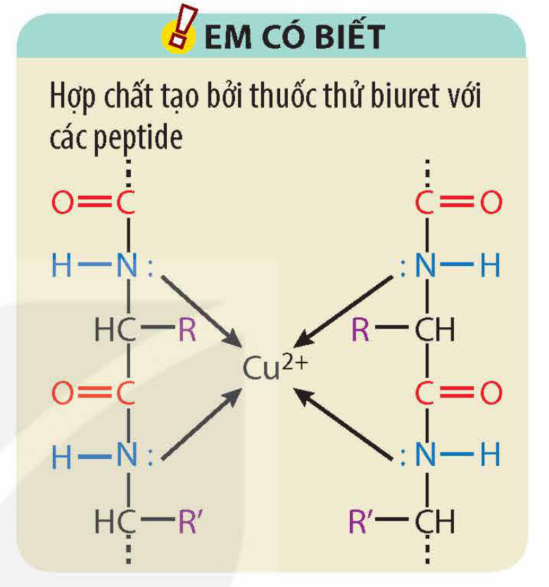

<!-- pdf:43 -->

# BÀI 9: AMINO ACID VÀ PEPTIDE

## 🎯 Mục tiêu

- Nêu được khái niệm về amino acid, amino acid thiên nhiên, amino acid trong cơ thể; gọi được tên một số amino acid thông dụng, đặc điểm cấu tạo phân tử của amino acid.
- Nêu được đặc điểm về tính chất vật lí của amino acid (trạng thái, nhiệt độ nóng chảy, khả năng hoà tan).
- Trình bày được tính chất hoá học đặc trưng của amino acid (tính lưỡng tính, phản ứng ester hoá; phản ứng trùng ngưng của ε- và ω-amino acid).
- Nêu được khả năng di chuyển của amino acid trong điện trường ở các giá trị pH khác nhau (tính chất điện di).
- Nêu được khái niệm peptide và viết được cấu tạo của peptide.
- Trình bày được tính chất hoá học đặc trưng của peptide (phản ứng thuỷ phân, phản ứng màu biuret).
- Thực hiện được thí nghiệm phản ứng màu biuret của peptide.

## 🔴 Mở đầu

Khoảng 20 amino acid thiên nhiên là cơ sở để kiến tạo nên các protein của cơ thể sống. Amino acid cũng được ứng dụng trong nhiều lĩnh vực khác nhau của cuộc sống như thực phẩm, dược phẩm, tơ sợi,… Vậy, amino acid là gì? Amino acid có đặc điểm cấu tạo và tính chất như thế nào?

## I. AMINO ACID

### 1. Khái niệm và danh pháp

**a) Khái niệm**

> ✋ Hãy nhận xét đặc điểm chung về cấu tạo của các amino acid dưới đây:
>
> 
>
> glycine (Gly); alanine (Ala); valine (Val); lysine (Lys); glutamic acid (Glu)
>
> Hình 9.1. Cấu tạo, tên thông thường, kí hiệu của một số amino acid

***Amino acid*** là hợp chất hữu cơ tạp chức, trong phân tử chứa đồng thời nhóm amino (–NH$_2$) và nhóm carboxyl (–COOH).

<!-- pdf:44 -->

<!-- term: α-amino acid -->
Các amino acid thiên nhiên hầu hết là α-amino acid (công thức chung có dạng $\ce{H2N-CH(R)-COOH}$). Trong đó, chỉ có khoảng 20 amino acid cấu thành nên phần lớn protein trong cơ thể người, gọi là những **amino acid tiêu chuẩn**. Một số amino acid tiêu chuẩn mà cơ thể người không thể tự tổng hợp được, gọi là **amino acid thiết yếu**. Con người tiếp nhận amino acid thiết yếu qua thức ăn như thịt, cá, trứng, sữa,...

**b) Danh pháp**

Tên gọi amino acid xuất phát từ tên carboxylic acid tương ứng.

Tên thay thế: chọn mạch chính chứa nhóm carboxyl, nhóm amino là nhóm thế trên mạch chính này.

Tên bán hệ thống: vị trí của nhóm amino được kí hiệu bằng chữ cái Hy Lạp (α, β,...) và tên gọi acid được gọi theo tên thông thường.

Ngoài ra, các α-amino acid có trong thiên nhiên thường được gọi bằng tên thông thường (Bảng 9.1).

Bảng 9.1. Tên gọi của một số amino acid

| Công thức cấu tạo | Tên thay thế | Tên bán hệ thống | Tên thông thường | Kí hiệu |
|---|---|---|---|---|
| $\ce{H2N-CH2-COOH}$ | Aminoethanoic acid | Aminoacetic acid | Glycine | Gly |
| $\ce{H2N-CH(CH3)-COOH}$ | 2-aminopropanoic acid | α-aminopropionic acid | Alanine | Ala |
| $\ce{H2N-[CH2]4-CH(NH2)COOH}$ | 2,6-diaminohexanoic acid | α,ε-diaminocaproic acid | Lysine | Lys |
| $\ce{HOOC-[CH2]2-CH(NH2)COOH}$ | 2-aminopentane-1,5-dioic acid | α-aminoglutaric acid | Glutamic acid | Glu |
| $\ce{(CH3)2CH-CH(NH2)-COOH}$ | 2-amino-3-methylbutanoic acid | α-aminoisovaleric acid | Valine | Val |
<!-- ocr-ok: bảng năm cột, OCR đọc lẫn các ô; đã đối chiếu từng ô với ảnh 170 dpi -->

### 2. Đặc điểm cấu tạo
<!-- ocr-ok: OCR đọc "cấu" thành "cầu", đã đối chiếu ảnh -->

<!-- term: Ion lưỡng cực -->
Các amino acid tồn tại chủ yếu ở dạng ion lưỡng cực$^{(1)}$ do tương tác giữa nhóm –COOH và nhóm –NH$_2$:

Dạng phân tử trung hoà; Dạng ion lưỡng cực

### 3. Tính chất vật lí

Ở điều kiện thường, các amino acid là chất rắn, khi ở dạng tinh thể chúng không có màu, có nhiệt độ nóng chảy cao và thường tan tốt trong nước vì chúng tồn tại ở dạng ion lưỡng cực.

> (1) Trong một số trường hợp, để đơn giản amino acid thường được biểu diễn ở dạng phân tử.

<!-- pdf:45 -->

### 4. Tính chất hoá học

Tương tự các hợp chất hữu cơ tạp chức khác, amino acid có tính chất của các nhóm chức cấu thành (tính chất của nhóm amino và nhóm carboxyl) và có thêm tính chất gây ra bởi đồng thời cả hai nhóm chức này.

**a) Phản ứng ester hoá**

Tương tự carboxylic acid, amino acid phản ứng được với alcohol tạo ester.

*Ví dụ:* Đun nóng hỗn hợp glycine và ethanol có mặt $\ce{H2SO4}$ đặc xúc tác, ở nhiệt độ 80 – 90 °C, trong khoảng 2 – 3 giờ, thu được ester$^{(1)}$.

$\ce{H2N-CH2-COOH + CH3CH2OH <=>[H2SO4, t^o] H2N-CH2-COOCH2CH3 + H2O}$

**b) Tính chất lưỡng tính**

Nhóm amino có tính base và nhóm carboxyl có tính acid nên các amino acid có tính lưỡng tính, có thể tác dụng với acid mạnh cũng như base mạnh.

$\ce{HCl + H2N-CH2-COOH -> ClH3N-CH2-COOH}$

$\ce{H2N-CH2-COOH + NaOH -> H2N-CH2-COONa + H2O}$

Tính lưỡng tính của amino acid rất quan trọng trong nhiều quá trình sinh học như ổn định pH của dung dịch máu, dung dịch nội bào,...

**c) Tính chất điện di**

Các amino acid có khả năng di chuyển khác nhau trong điện trường tuỳ thuộc vào pH của môi trường (tính chất điện di).

*Ví dụ:* Ở pH ~ 6, Gly tồn tại chủ yếu ở dạng ion lưỡng cực có tổng điện tích bằng không. Khi đặt trong điện trường, Gly hầu như không di chuyển; ở pH < 6, Gly nhận proton, trở thành cation và di chuyển về cực âm (–); còn ở pH > 6, Gly nhường proton, trở thành anion và di chuyển về cực dương (+).

**d) Phản ứng trùng ngưng**

Khi đun nóng, các ε-amino acid hoặc ω-amino acid có thể phản ứng với nhau để tạo thành polymer, đồng thời tách ra các phân tử nước (phản ứng trùng ngưng). Trong phản ứng trùng ngưng của amino acid, nhóm –COOH của phân tử này phản ứng với nhóm –NH$_2$ của phân tử khác để tạo thành polyamide.

*Ví dụ:* Phản ứng trùng ngưng tổng hợp polycaproamide (capron) từ 6-aminohexanoic acid (ε-aminocaproic acid):

ε-aminocaproic acid; polycaproamide

> ❓ 1. Viết phương trình hoá học của phản ứng trùng ngưng tổng hợp polyenanthamide từ 7-aminoheptanoic acid (ω-aminoenanthic acid).

> (1) Trong điều kiện phản ứng, sản phẩm tồn tại ở dạng muối.

<!-- pdf:46 -->

## II. PEPTIDE

> ✋ Một tripeptide có cấu tạo như sau:
>
> 
>
> valine; glycine; alanine; Amino acid đầu N; Liên kết peptide; Amino acid đầu C
>
> Hình 9.2. Cấu tạo của phân tử tripeptide Val-Gly-Ala
>
> Tripeptide trên cấu thành bằng cách nào? Tại sao lại gọi là tripeptide?

### 1. Khái niệm

***Peptide*** là những hợp chất hữu cơ được cấu tạo từ các đơn vị α-amino acid liên kết với nhau qua **liên kết peptide** (–CO–NH–).

Các peptide chứa từ 2, 3, 4,... đơn vị α-amino acid lần lượt được gọi là **dipeptide**, **tripeptide**, **tetrapeptide**,...; peptide chứa nhiều đơn vị α-amino acid được gọi là **polypeptide**.

### 2. Cấu tạo

Cấu tạo của một peptide được xác định bằng thứ tự liên kết của các α-amino acid trong phân tử. Mỗi peptide mạch hở bắt đầu bằng amino acid đầu N và kết thúc bằng amino acid đầu C (Hình 9.2).

Tên viết tắt của peptide gồm tên viết tắt của các amino acid theo thứ tự từ amino acid đầu N đến amino acid đầu C.

*Ví dụ:* Tripeptide trong Hình 9.2 được biểu diễn là Val-Gly-Ala.

> ❓ 2. Viết cấu tạo của tripeptide Gly-Ala-Val.

### 3. Tính chất hoá học

**a) Phản ứng thuỷ phân**

Peptide bị thuỷ phân bởi acid, base hoặc enzyme. Quá trình thuỷ phân không hoàn toàn có thể tạo thành các peptide nhỏ hơn.

*Ví dụ:* Tetrapeptide Gly-Tyr-Val-Ala khi bị thuỷ phân không hoàn toàn có thể tạo thành các tripeptide Gly-Tyr-Val, Tyr-Val-Ala và các dipeptide là Gly-Tyr, Tyr-Val, Val-Ala.

<!-- pdf:47 -->

Quá trình thuỷ phân hoàn toàn peptide tạo ra các amino acid cấu thành nên peptide đó. Tuy nhiên, trong môi trường acid hoặc môi trường base, các amino acid sẽ tác dụng với acid hoặc base để tạo thành muối tương ứng.

*Ví dụ:* $\ce{H2N-CH2-CO-NH-CH2-COOH + H2O ->[enzyme] 2H2N-CH2-COOH}$

$\ce{H2N-CH2-CO-NH-CH2-COOH + H2O + 2HCl -> 2Cl^-H3N^+-CH2-COOH}$

$\ce{H2N-CH2-CO-NH-CH2-COOH + 2NaOH -> 2H2N-CH2-COONa + H2O}$

**b) Phản ứng màu biuret**

> 🧪 Thí nghiệm: Phản ứng màu biuret của peptide
>
> *Chuẩn bị:*
>
> Hoá chất: dung dịch lòng trắng trứng (polypeptide), dung dịch $\ce{CuSO4}$ 2%, dung dịch NaOH 30%.
>
> Dụng cụ: ống nghiệm.
>
> *Tiến hành:*
>
> - Cho khoảng 1 mL dung dịch NaOH 30% vào ống nghiệm. Nhỏ thêm 2 – 3 giọt dung dịch $\ce{CuSO4}$ 2%, lắc đều.
> - Cho khoảng 4 mL dung dịch lòng trắng trứng vào ống nghiệm, lắc đều.
>
> *Quan sát và giải thích hiện tượng xảy ra.*

> 💡 EM CÓ BIẾT
>
> 
>
> Hợp chất tạo bởi thuốc thử biuret với các peptide

Các peptide có từ hai liên kết peptide trở lên phản ứng với thuốc thử biuret ($\ce{Cu(OH)2}$ trong môi trường kiềm), tạo thành dung dịch có màu tím đặc trưng. Phản ứng này được sử dụng để nhận biết các peptide (trừ dipeptide).

> ❓ 3. Thuỷ phân không hoàn toàn tripeptide Val-Gly-Ala thu được các dipeptide nào? Viết phương trình hoá học minh hoạ phản ứng thuỷ phân hoàn toàn tripeptide này trong môi trường kiềm.

## 📌 Em đã học

- Amino acid là hợp chất hữu cơ tạp chức, trong phân tử chứa đồng thời nhóm amino và nhóm carboxyl, tồn tại chủ yếu ở dạng ion lưỡng cực. Hầu hết amino acid thiên nhiên là α-amino acid.
- Amino acid là chất rắn, thường tan tốt trong nước, có nhiệt độ nóng chảy cao. Các amino acid có tính lưỡng tính và tham gia được phản ứng ester hoá; các ε- và ω-amino acid có thể tham gia phản ứng trùng ngưng tạo polyamide.
- Peptide là những hợp chất hữu cơ được cấu tạo từ nhiều đơn vị α-amino acid liên kết với nhau qua liên kết peptide (–CO–NH–). Peptide tham gia phản ứng thuỷ phân và phản ứng màu biuret.

## ✏️ Em có thể

- Biết được tại sao amino acid quan trọng cho sức khoẻ, từ đó có thể lựa chọn được một số thực phẩm giàu dinh dưỡng.

## 📷 Danh sách hình trong bài

| Mã hình | Trang PDF | Vị trí | Chú thích gốc |
|---|---|---|---|
| H12-hoa-b09-01 | 43 | Mục I.1.a, hộp hoạt động | Hình 9.1. Cấu tạo, tên thông thường, kí hiệu của một số amino acid |
| H12-hoa-b09-02 | 44 | Mục I.2 (dạng phân tử trung hoà và dạng ion lưỡng cực) | (sách không đánh số, không có chú thích) |
| H12-hoa-b09-03 | 45 | Mục I.4.d (phản ứng trùng ngưng tổng hợp polycaproamide; khung gồm cả câu "Ví dụ: …" phía trên vì nguyên tử O của công thức in sát dòng chữ) | (sách không đánh số, không có chú thích) |
| H12-hoa-b09-04 | 46 | Mục II, hộp hoạt động | Hình 9.2. Cấu tạo của phân tử tripeptide Val-Gly-Ala |
| H12-hoa-b09-05 | 47 | Mục II.3.b, hộp "Em có biết" | (sách không đánh số; tiêu đề trong hộp: Hợp chất tạo bởi thuốc thử biuret với các peptide) |
