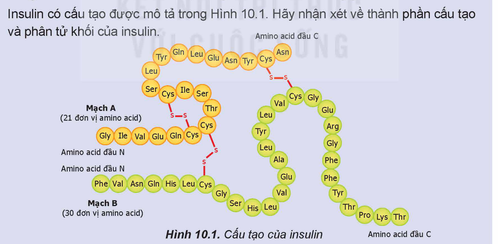
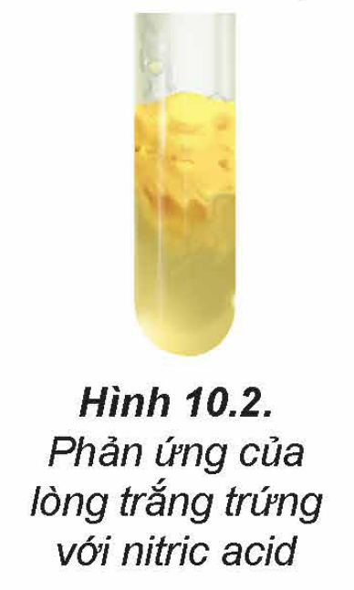

<!-- pdf:48 -->

# BÀI 10: PROTEIN VÀ ENZYME

## 🎯 Mục tiêu

- Nêu được khái niệm, đặc điểm cấu tạo phân tử, tính chất vật lí của protein.
- Trình bày được tính chất hoá học đặc trưng của protein (phản ứng thuỷ phân, phản ứng màu của protein với nitric acid và copper(II) hydroxide; sự đông tụ bởi nhiệt, bởi acid, kiềm và muối kim loại nặng).
- Thực hiện được thí nghiệm về phản ứng đông tụ của protein: đun nóng lòng trắng trứng hoặc tác dụng của acid, kiềm với lòng trắng trứng; phản ứng của lòng trắng trứng với nitric acid; mô tả các hiện tượng thí nghiệm, giải thích được tính chất hoá học của protein.
- Nêu được vai trò của protein đối với sự sống; vai trò của enzyme trong phản ứng sinh hoá và ứng dụng của enzyme trong công nghệ sinh học.

## 🔴 Mở đầu

Các protein khác nhau đảm nhận nhiều vai trò thiết yếu khác nhau với sự sống như xây dựng tế bào, xúc tác cho các quá trình sinh hoá, điều hoà quá trình trao đổi chất, vận chuyển chất, kháng thể,… Vậy, protein có đặc điểm cấu tạo và tính chất đặc trưng là gì?

## I. PROTEIN

### 1. Khái niệm và đặc điểm cấu tạo

> ✋ Insulin, một loại hormone thuộc loại protein, được sản sinh bởi tuyến tuỵ, có chức năng điều hoà quá trình chuyển hoá glucose trong cơ thể. Insulin thúc đẩy sự hấp thu glucose của các tế bào và dự trữ glucose dư thừa trong gan và cơ.
>
> 
>
> Insulin có cấu tạo được mô tả trong Hình 10.1. Hãy nhận xét về thành phần cấu tạo và phân tử khối của insulin.
>
> Mạch A (21 đơn vị amino acid); Mạch B (30 đơn vị amino acid); Amino acid đầu N; Amino acid đầu C
>
> Hình 10.1. Cấu tạo của insulin

***Protein*** là hợp chất cao phân tử được cấu tạo từ một hay nhiều chuỗi polypeptide.

Mỗi chuỗi polypeptide gồm các đơn vị α-amino acid liên kết với nhau qua liên kết peptide theo một trật tự nhất định.

<!-- pdf:49 -->

Protein khi thuỷ phân chỉ cho hỗn hợp các α-amino acid gọi là **protein đơn giản**.

**Protein phức tạp** là loại protein được tạo thành từ protein đơn giản và các thành phần "phi protein" như nucleic acid, lipid,...

### 2. Tính chất vật lí

Các protein dạng hình sợi như keratin (có ở tóc, móng), collagen (có ở da, sụn), myosin (có ở cơ bắp),… không tan trong nước cũng như trong các dung môi thông thường. Các protein dạng hình cầu như hemoglobin (có ở máu), albumin (có ở lòng trắng trứng) có thể tan được trong nước tạo dung dịch keo.

### 3. Tính chất hoá học

**a) Phản ứng thuỷ phân**

Tương tự như peptide, protein bị thuỷ phân bởi acid, base hoặc enzyme. Quá trình thuỷ phân hoàn toàn protein tạo thành các α-amino acid.

**b) Phản ứng màu**

- Protein có khả năng tạo thành sản phẩm màu tím đặc trưng với thuốc thử biuret, tương tự như peptide.
- Protein hình thành sản phẩm rắn màu vàng với dung dịch nitric acid đặc, một phần do phản ứng nitro hoá các đơn vị amino acid chứa vòng benzene và một phần khác do sự đông tụ protein trong môi trường acid (Hình 10.2).

Hình 10.2. Phản ứng của lòng trắng trứng với nitric acid

**c) Phản ứng đông tụ**

> 🧪 Thí nghiệm: Phản ứng đông tụ và phản ứng màu của protein
>
> *Chuẩn bị:*
>
> Hoá chất: dung dịch $\ce{HNO3}$ đặc, dung dịch lòng trắng trứng.
>
> Dụng cụ: ống nghiệm, đèn cồn.
>
> *Tiến hành:*
>
> - Cho vào hai ống nghiệm (1) và (2), mỗi ống 2 mL dung dịch lòng trắng trứng.
> - Đun nóng ống nghiệm (1) trên ngọn lửa đèn cồn trong 2 – 3 phút.
> - Thêm vài giọt dung dịch $\ce{HNO3}$ đặc vào ống nghiệm (2).
>
> *Quan sát hiện tượng xảy ra trong các ống nghiệm, giải thích.*

Protein có thể bị đông tụ dưới tác dụng của nhiệt, acid, base hoặc ion kim loại nặng. Sự đông tụ này xảy ra do cấu tạo ban đầu của protein bị biến đổi.

### 4. Vai trò của protein đối với sự sống

Các protein khác nhau đảm nhận vai trò khác nhau, rất cần thiết cho sự sống như tham gia xây dựng tế bào, vận chuyển các chất trong cơ thể, điều hoà quá trình trao đổi chất, xúc tác cho các phản ứng hoá sinh, giúp cơ thể chống lại tác nhân có hại,…

Protein có vai trò rất quan trọng cho hoạt động sống của cơ thể người. Protein là một trong những nguồn thức ăn chính bổ sung các amino acid thiết yếu và năng lượng cho cơ thể.

<!-- pdf:50 -->

## II. ENZYME

### 1. Vai trò của enzyme trong phản ứng sinh hoá

<!-- term: Enzyme -->
Phần lớn enzyme là những protein xúc tác cho các phản ứng hoá học và sinh hoá.

<!-- term: Enzyme -->
Enzyme có tính chọn lọc cao, mỗi enzyme chỉ xúc tác cho một hoặc một số phản ứng nhất định.

Tốc độ phản ứng có xúc tác enzyme thường nhanh hơn rất nhiều lần so với xúc tác hoá học của cùng quá trình hoá học.$^{(1)}$

### 2. Ứng dụng của enzyme trong công nghệ sinh học

Bên cạnh vai trò quan trọng trong cơ thể sinh vật, enzyme còn có nhiều ứng dụng trong công nghệ sinh học, như trong công nghiệp thực phẩm (sản xuất, bảo quản, chế biến thực phẩm,…); công nghiệp dược phẩm (sản xuất enzyme thay thế, enzyme vận chuyển thuốc, enzyme xúc tác một số quá trình sản xuất dược phẩm,...); kĩ thuật di truyền (enzyme tham gia vào quá trình tạo ra thông tin di truyền mới hoặc sửa đổi thông tin di truyền hiện có)$^{(2)}$;...

> ❓ Viết ba phương trình hoá học minh hoạ cho phản ứng có enzyme làm xúc tác mà em đã học.

## 📌 Em đã học

- Protein là hợp chất cao phân tử được cấu tạo từ một hay nhiều chuỗi polypeptide.
- Protein dạng hình sợi không tan trong nước và các dung môi thông thường, protein dạng hình cầu tan trong nước tạo dung dịch keo.
- Protein bị đông tụ dưới tác dụng của nhiệt, acid, base và ion kim loại nặng; Protein tác dụng với thuốc thử biuret tạo sản phẩm có màu tím và với nitric acid tạo sản phẩm rắn màu vàng. Protein bị thuỷ phân bởi acid, base hoặc dưới tác dụng enzyme. Khi thuỷ phân hoàn toàn protein tạo thành các α-amino acid.
- Protein có vai trò quan trọng đối với sự sống như tham gia xây dựng tế bào, điều hoà quá trình trao đổi chất,...
- Phần lớn enzyme là những protein xúc tác các phản ứng hoá học và phản ứng sinh hoá. Enzyme có tính chọn lọc cao, có nhiều ứng dụng quan trọng trong công nghệ sinh học,…

## ✏️ Em có thể

- Giải thích được hiện tượng đông tụ protein trong quá trình chế biến một số thực phẩm giàu protein.
- Lựa chọn và sử dụng một số nguồn cung cấp protein phù hợp trong chế độ ăn uống để đảm bảo sức khoẻ.

> (1) Nguồn: Nelson, D. L., Cox, M. & Aaron, A. H. 2021. *Lehninger Principles of Biochemistry, 8th Edition*, Macmillan Learning.
>
> (2) Nguồn: Palmer, T. & Bonner, P. L. 2007. *Enzymes: Biochemistry, Biotechnology, Clinical Chemistry*, Elsevier Science.

## 📷 Danh sách hình trong bài

| Mã hình | Trang PDF | Vị trí | Chú thích gốc |
|---|---|---|---|
| H12-hoa-b10-01 | 48 | Mục I.1, hộp hoạt động (khung gồm cả hai dòng câu hỏi phía trên vì nhãn "Amino acid đầu C" in ngang hàng dòng chữ) | Hình 10.1. Cấu tạo của insulin |
| H12-hoa-b10-02 | 49 | Mục I.3.b | Hình 10.2. Phản ứng của lòng trắng trứng với nitric acid |
