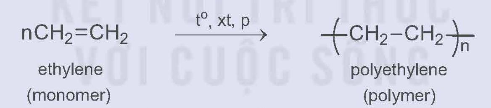
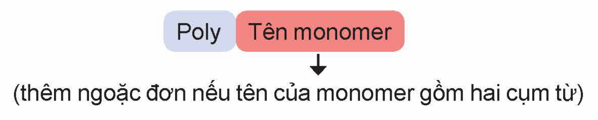
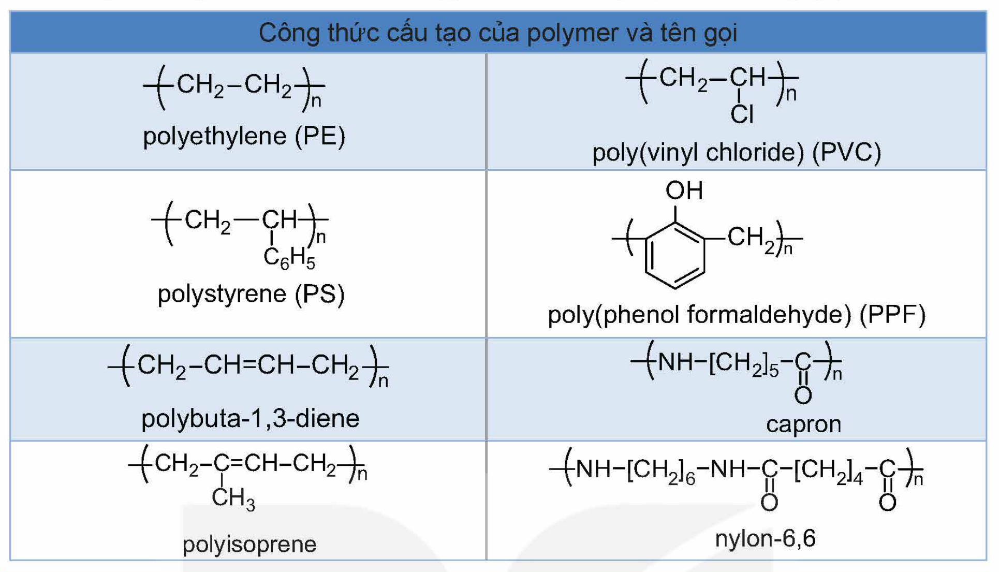
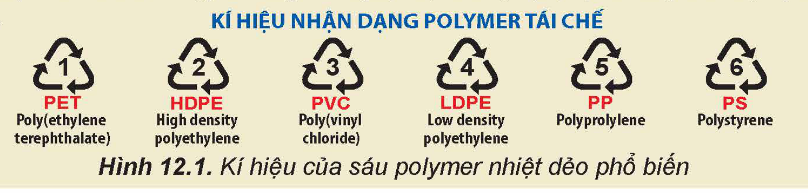
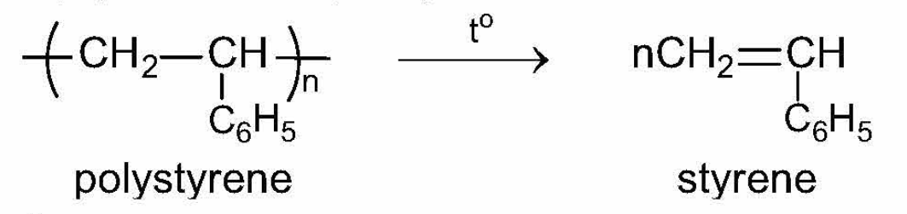
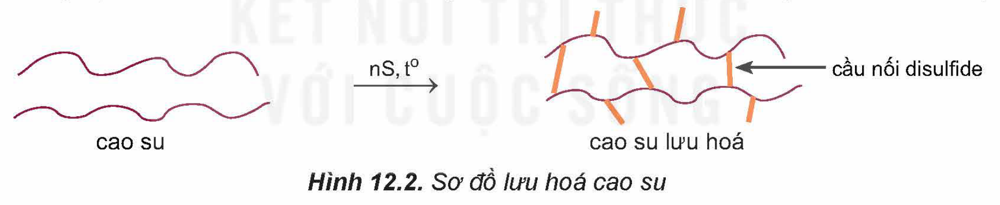
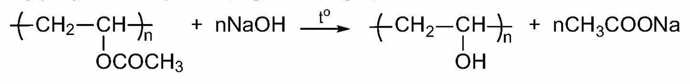
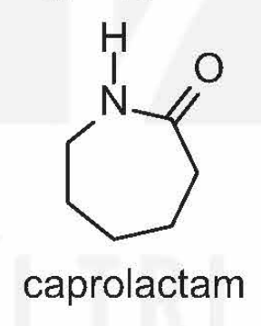
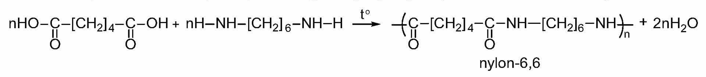

<!-- pdf:53 -->

# BÀI 12: ĐẠI CƯƠNG VỀ POLYMER

## 🎯 Mục tiêu

- Viết được công thức cấu tạo và gọi được tên của một số polymer thường gặp (polyethylene (PE), polypropylene (PP), polystyrene (PS), poly(vinyl chloride) (PVC), polybuta-1,3-diene, polyisoprene, poly(methyl methacrylate), poly(phenol formaldehyde) (PPF), capron, nylon-6,6).
- Nêu được đặc điểm về tính chất vật lí (trạng thái, nhiệt độ nóng chảy, tính chất cơ học) và tính chất hoá học (phản ứng cắt mạch (tinh bột, cellulose, polyamide, polystyrene), tăng mạch (lưu hoá cao su), giữ nguyên mạch của một số polymer).
- Trình bày được phương pháp trùng hợp, trùng ngưng để tổng hợp một số polymer thường gặp.

## 🔴 Mở đầu

Các polymer tự nhiên (tinh bột, cellulose, tơ tằm,...) hay polymer tổng hợp (PE, PVC, nylon-6,6,...) được sử dụng rộng rãi trong đời sống và sản xuất. Vậy, polymer là gì và chúng có các tính chất cơ bản nào?

## I. KHÁI NIỆM, DANH PHÁP

### 1. Khái niệm

> ✋ Trùng hợp ethylene tạo thành polyethylene (PE):
>
> 
>
> $\ce{nCH2=CH2 ->[t^o, xt, p] -(CH2-CH2)_n-}$ ethylene (monomer); polyethylene (polymer)
>
> Em hãy so sánh về thành phần nguyên tố, phân tử khối của polyethylene so với ethylene.

***Polymer*** là những hợp chất có phân tử khối lớn do nhiều đơn vị nhỏ (gọi là mắt xích) liên kết với nhau tạo nên.

***Monomer*** là những phân tử nhỏ, phản ứng với nhau để tạo nên polymer.

### 2. Danh pháp

Các polymer đơn giản có tên gọi chung như sau:

Poly; Tên monomer; (thêm ngoặc đơn nếu tên của monomer gồm hai cụm từ)

<!-- pdf:54 -->

Dưới đây là công thức cấu tạo và tên gọi của một số polymer thường gặp.

Công thức cấu tạo của polymer và tên gọi: polyethylene (PE); poly(vinyl chloride) (PVC); polystyrene (PS); poly(phenol formaldehyde) (PPF); polybuta-1,3-diene; capron; polyisoprene; nylon-6,6

> ❓ 1. Hãy xác định các monomer tương ứng dùng để tổng hợp các polymer sau: PE, PS và PVC.
>
> 2. Viết công thức cấu tạo và gọi tên polymer được tổng hợp từ monomer sau:
>
> a) propylene; b) methyl methacrylate ($\ce{CH2=C(CH3)-COOCH3}$).

## II. TÍNH CHẤT VẬT LÍ

Hầu hết polymer là những chất rắn, không bay hơi, không bị nóng chảy hoặc nóng chảy ở một khoảng nhiệt độ khá rộng. Các polymer bị nóng chảy khi đun nóng được gọi là ***polymer nhiệt dẻo***. Các polymer không bị nóng chảy mà bị phân huỷ bởi nhiệt được gọi là ***polymer nhiệt rắn***.

Hầu hết polymer không tan trong nước, một số tan được trong dung môi hữu cơ.

Tính chất vật lí của polymer thường phụ thuộc vào cấu tạo: nhiều polymer có tính dẻo (PE, PP (polypropylene),...); một số polymer có tính đàn hồi (polyisoprene, polybuta-1,3-diene,...); một số polymer khác có tính dai, bền và có thể kéo sợi (capron, nylon-6,6,...). Nhiều polymer có tính cách điện (PE, PVC,...); một số polymer có tính bán dẫn.

> 💡 EM CÓ BIẾT
>
> Một số polymer nhiệt dẻo thường gặp
>
> Sáu polymer nhiệt dẻo phổ biến, có kí hiệu được mô tả như Hình 12.1. Các polymer này có thể tái chế được. Các kí hiệu này thường được in trên bao bì, vỏ hộp, đồ dùng,… để giúp nhận biết vật liệu polymer cũng như thuận lợi cho việc thu gom, tái chế.
>
> 
>
> Hình 12.1. Kí hiệu của sáu polymer nhiệt dẻo phổ biến

<!-- pdf:55 -->

## III. TÍNH CHẤT HOÁ HỌC

### 1. Phản ứng cắt mạch polymer

<!-- term: Phản ứng cắt mạch polymer -->
Polymer có thể bị phân cắt thành monomer bởi nhiệt, tác nhân hoá học, sinh học,...

*Ví dụ:*

- Polystyrene bị nhiệt phân thu được styrene:

polystyrene; styrene

- Polyamide có thể bị thuỷ phân hoàn toàn trong môi trường acid hoặc môi trường base thu được amino acid:

$\ce{-(NH-[CH2]5-CO)_n- + nH2O ->[t^o, xt] nH2N-[CH2]5-COOH}$ capron; 6-aminohexanoic acid

- Tinh bột và cellulose có thể bị thuỷ phân hoàn toàn trong môi trường acid hoặc bởi enzyme thu được glucose:

$\ce{(C6H10O5)_n + nH2O ->[H+, t^o \text{hoặc enzyme}] nC6H12O6}$ tinh bột, cellulose; glucose

### 2. Phản ứng tăng mạch polymer

<!-- term: Phản ứng tăng mạch polymer -->
Khi có điều kiện thích hợp như nhiệt độ, chất xúc tác,... các mạch polymer có thể nối với nhau thành mạch dài hơn hoặc thành mạng lưới.

*Ví dụ:* Khi đun cao su với lưu huỳnh thì thu được cao su lưu hoá. Ở cao su lưu hoá, các mạch polymer được nối với nhau chủ yếu bởi các cầu nối –S–S– (cầu nối disulfide).

Hình 12.2. Sơ đồ lưu hoá cao su

### 3. Phản ứng giữ nguyên mạch polymer

<!-- term: Phản ứng giữ nguyên mạch polymer -->
Polymer có thể tham gia các phản ứng hoá học mà không làm thay đổi chiều dài mạch polymer. Phản ứng có thể xảy ra ở nhóm thế đính vào mạch polymer, cộng vào liên kết đôi trong mạch polymer,...

*Ví dụ:* Poly(vinyl acetate) tác dụng với dung dịch NaOH:

<!-- pdf:56 -->

> ❓ 3. Viết phương trình hoá học của các phản ứng sau:
>
> a) Thuỷ phân hoàn toàn poly(methyl methacrylate) trong môi trường base.
>
> b) Thuỷ phân hoàn toàn nylon-6,6 trong môi trường acid.
>
> 4. Hộp xốp đựng thực phẩm chế biến sẵn thường làm bằng polystyrene. Hãy tìm hiểu và cho biết có nên sử dụng các hộp này để đựng thức ăn nóng hoặc cho hộp vào lò vi sóng để hâm nóng thức ăn hay không. Tại sao?

## IV. PHƯƠNG PHÁP TỔNG HỢP

Polymer thường được tổng hợp theo hai phương pháp phổ biến là phương pháp trùng hợp và phương pháp trùng ngưng.

### 1. Phương pháp trùng hợp

***Trùng hợp*** là quá trình kết hợp nhiều phân tử nhỏ giống nhau hay tương tự nhau tạo thành phân tử có phân tử khối lớn (polymer).

$\ce{nCH2=CH2 ->[xt, t^o, p] -(CH2-CH2)_n-}$ ethylene; polyethylene (PE)

Các monomer tham gia phản ứng trùng hợp thường có liên kết đôi ($\ce{CH2=CHR}$) hoặc vòng như:

caprolactam

### 2. Phương pháp trùng ngưng

***Trùng ngưng*** là quá trình kết hợp nhiều phân tử nhỏ (monomer) thành phân tử lớn (polymer) đồng thời giải phóng những phân tử nhỏ khác (thường là nước).

Các monomer tham gia phản ứng trùng ngưng phải có ít nhất hai nhóm chức có khả năng phản ứng.

*Ví dụ:* Nylon-6,6 thu được từ phản ứng trùng ngưng adipic acid với hexamethylenediamine:

nylon-6,6

> ❓ 5. Cho các polymer sau: PS; nylon-6,6; PVC.
>
> Polymer nào được điều chế bằng phản ứng trùng hợp? Polymer nào được điều chế bằng phản ứng trùng ngưng?

<!-- pdf:57 -->

## 📌 Em đã học

- Polymer là những hợp chất có phân tử khối rất lớn do nhiều đơn vị nhỏ (gọi là mắt xích) liên kết với nhau.

  Monomer: là những phân tử nhỏ, phản ứng với nhau tạo thành polymer.

- Các polymer thường là chất rắn, không nóng chảy hoặc nóng chảy ở một khoảng nhiệt độ khá rộng. Hầu hết polymer không tan trong nước, một số tan được trong dung môi hữu cơ. Nhiều polymer có tính dẻo (nhựa); một số polymer có tính đàn hồi (cao su); một số polymer khác thường dai, bền và dễ kéo sợi. Nhiều polymer không dẫn điện nhưng có một số polymer có tính bán dẫn.
- Polymer có thể tham gia phản ứng cắt mạch, giữ nguyên mạch và tăng mạch.
- Nhiều polymer thường gặp có thể được tổng hợp bằng phương pháp trùng hợp hoặc trùng ngưng.

## ✏️ Em có thể

- Vận dụng các tính chất của polymer như tính đàn hồi, tính dai bền và có thể kéo sợi,... để giải thích ứng dụng của một số vật liệu polymer được tổng hợp từ các polymer đó.
- Biết cách sử dụng hợp lí một số polymer theo tính chất của chúng.

## 📷 Danh sách hình trong bài

| Mã hình | Trang PDF | Vị trí | Chú thích gốc |
|---|---|---|---|
| H12-hoa-b12-01 | 53 | Mục I.1, hộp hoạt động (trùng hợp ethylene) | (sách không đánh số, không có chú thích) |
| H12-hoa-b12-02 | 53 | Mục I.2 (sơ đồ tên gọi chung của polymer) | (sách không đánh số, không có chú thích) |
| H12-hoa-b12-03 | 54 | Mục I.2 (bảng công thức cấu tạo của polymer và tên gọi) | (sách không đánh số; tiêu đề bảng: Công thức cấu tạo của polymer và tên gọi) |
| H12-hoa-b12-04 | 54 | Mục II, hộp "Em có biết" | Hình 12.1. Kí hiệu của sáu polymer nhiệt dẻo phổ biến |
| H12-hoa-b12-05 | 55 | Mục III.1 (nhiệt phân polystyrene) | (sách không đánh số, không có chú thích) |
| H12-hoa-b12-06 | 55 | Mục III.2 | Hình 12.2. Sơ đồ lưu hoá cao su |
| H12-hoa-b12-07 | 55 | Mục III.3 (poly(vinyl acetate) tác dụng với NaOH) | (sách không đánh số, không có chú thích) |
| H12-hoa-b12-08 | 56 | Mục IV.1 (caprolactam) | (sách không đánh số, không có chú thích) |
| H12-hoa-b12-09 | 56 | Mục IV.2 (trùng ngưng tổng hợp nylon-6,6) | (sách không đánh số, không có chú thích) |
