<!-- pdf:58 -->

# BÀI 13: VẬT LIỆU POLYMER

## 🎯 Mục tiêu

- Nêu được khái niệm về chất dẻo.
- Trình bày được thành phần phân tử và phản ứng điều chế polyethylene (PE), polypropylene (PP), polystyrene (PS), poly(vinyl chloride) (PVC), poly(methyl methacrylate), poly(phenol formaldehyde) (PPF).
- Trình bày được ứng dụng của chất dẻo và tác hại của việc lạm dụng chất dẻo trong đời sống và sản xuất. Nêu được một số biện pháp hạn chế sử dụng chất dẻo để giảm thiểu ô nhiễm môi trường, bảo vệ sức khoẻ con người.
- Nêu được khái niệm về composite.
- Trình bày được ứng dụng của một số loại composite.
- Nêu được khái niệm và phân loại về tơ.
- Trình bày được cấu tạo, tính chất và ứng dụng một số tơ tự nhiên (bông, sợi, len lông cừu, tơ tằm,...), tơ tổng hợp (như nylon-6,6; capron; nitron hay olon,...) và tơ bán tổng hợp (như visco, cellulose acetate,...).
- Nêu được khái niệm cao su, cao su tự nhiên, cao su nhân tạo.
- Trình bày được đặc điểm cấu tạo, tính chất, ứng dụng của cao su tự nhiên và cao su tổng hợp (cao su buna, cao su buna-S, cao su buna-N, cao su isoprene, cao su chloroprene).
- Trình bày được phản ứng điều chế cao su tổng hợp (cao su buna, cao su buna-S, cao su buna-N, cao su isoprene, cao su chloroprene).
- Nêu được bản chất và ý nghĩa của quá trình lưu hoá cao su.
- Nêu được khái niệm về keo dán.
- Trình bày được thành phần, tính chất, ứng dụng của một số keo dán (nhựa vá săm, keo dán epoxy, keo dán poly(urea-formaldehyde)).

## 🔴 Mở đầu

Vật liệu polymer như chất dẻo, tơ, cao su, keo dán, vật liệu composite,… được ứng dụng rộng rãi trong đời sống và sản xuất. Các vật liệu polymer này là gì? Chúng có thành phần cấu tạo như thế nào?

## I. CHẤT DẺO

### 1. Khái niệm

***Chất dẻo*** là các vật liệu polymer có tính dẻo.

**Tính dẻo** của vật liệu là tính bị biến dạng khi chịu tác dụng của nhiệt, áp lực bên ngoài và vẫn giữ được sự biến dạng đó khi thôi tác dụng.

Thành phần chính của chất dẻo là polymer. Ngoài ra chất dẻo còn có chất độn, chất hoá dẻo, chất tạo màu,…

### 2. Tổng hợp một số polymer dùng làm chất dẻo

- Một số polymer dùng làm chất dẻo thông dụng như PE, PP, PVC, PS, poly(methyl methacrylate),... được tổng hợp bằng phương pháp trùng hợp từ các monomer tương ứng.

<!-- pdf:59 -->

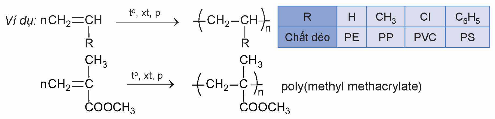

*Ví dụ:* $\ce{nCH2=CH(R) ->[t^o, xt, p] -(CH2-CH(R))_n-}$

| R | H | $\ce{CH3}$ | Cl | $\ce{C6H5}$ |
|---|---|---|---|---|
| Chất dẻo | PE | PP | PVC | PS |
<!-- ocr-ok: bảng nhỏ nằm cạnh phương trình (trong hình), OCR đọc lẫn với công thức; đã đối chiếu ảnh -->

$\ce{nCH2=C(CH3)COOCH3 ->[t^o, xt, p] -(CH2-C(CH3)(COOCH3))_n-}$ poly(methyl methacrylate)

- Poly(phenol formaldehyde) (PPF) được điều chế từ phản ứng của formaldehyde với phenol, có mặt acid làm xúc tác:

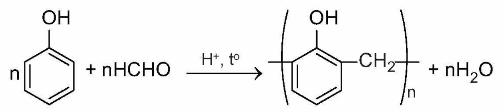

### 3. Ứng dụng của chất dẻo

Chất dẻo được sử dụng rất phổ biến trên thế giới để tạo ra nhiều sản phẩm ứng dụng trong đời sống, công nghiệp, xây dựng,... Ước tính có khoảng hai phần ba lượng polymer tiêu thụ trên thế giới là từ các chất dẻo thông dụng như PE, PP, PVC, PS.

| Chất dẻo | Ứng dụng |
|---|---|
| PE | Sản xuất túi nylon, bao gói, màng bọc thực phẩm, chai lọ, đồ chơi trẻ em,... |
| PP | Sản xuất bao gói, hộp đựng, ống nước, chi tiết nhựa trong công nghiệp ô tô,... |
| PVC | Sản xuất giày ủng, rèm nhựa, khung cửa, sàn nhựa, ống nước, vỏ cáp điện, vải giả da,... |
| PS | Sản xuất bao gói thực phẩm, hộp xốp, vật liệu cách nhiệt,... |
| Poly(methyl methacrylate) | Sản xuất thuỷ tinh hữu cơ dùng làm kính máy bay, kính xây dựng, kính bảo hiểm, bể cá,... |

> ✋ Em hãy tìm hiểu các vật dụng trong gia đình được làm từ chất dẻo. Cho biết chúng được làm từ loại chất dẻo nào.

### 4. Ô nhiễm môi trường do chất dẻo và rác thải nhựa

Các loại nhựa được tạo ra từ chất dẻo khi thải ra môi trường thì phải mất rất nhiều thời gian để phân huỷ (lên đến hàng trăm năm), do đó việc xử lí rác thải nhựa không đúng cách sẽ gây ô nhiễm môi trường, ảnh hưởng đến môi trường sống của con người và động vật. Đốt nhựa tạo ra các khí độc hại và làm tăng lượng khí gây hiệu ứng nhà kính. Khi chôn lấp, rác thải nhựa sẽ làm cho đất không giữ được nước, dinh dưỡng, làm chết vi sinh vật có lợi trong đất, gây tác động xấu đến sự sinh trưởng của cây trồng. Nhựa thải ra sông, hồ, đại dương,... gây ô nhiễm nguồn nước, làm mất cân bằng hệ sinh thái.

> 💡 EM CÓ BIẾT
>
> Hiện nay, sản lượng nhựa sản xuất trên thế giới đạt khoảng 400 triệu tấn/năm. Như vậy, bình quân đầu người sử dụng khoảng 50 kg nhựa mỗi năm, trong đó chỉ dưới 10% được tái chế, phần còn lại bị đốt cháy, chôn lấp hoặc thải ra môi trường. Nếu tốc độ tiêu thụ nhựa tiếp tục tăng như hiện nay, ước tính vào năm 2050, lượng nhựa bình quân đầu người sẽ đạt khoảng 100 kg/người/năm.
>
> (Nguồn: Chương trình môi trường LHQ, 2022.)

<!-- pdf:60 -->

Để hạn chế tình trạng ô nhiễm môi trường khi sử dụng đồ nhựa, cần thực hiện một số biện pháp như mô tả trong Hình 13.1.

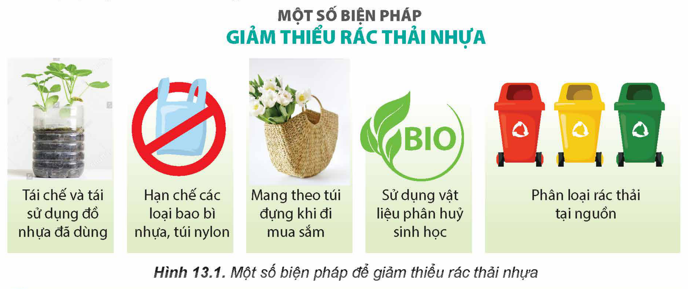

MỘT SỐ BIỆN PHÁP GIẢM THIỂU RÁC THẢI NHỰA: Tái chế và tái sử dụng đồ nhựa đã dùng; Hạn chế các loại bao bì nhựa, túi nylon; Mang theo túi đựng khi đi mua sắm; Sử dụng vật liệu phân huỷ sinh học; Phân loại rác thải tại nguồn

Hình 13.1. Một số biện pháp để giảm thiểu rác thải nhựa

> ✋ Nêu một số biện pháp có thể thực hiện được trong gia đình để giảm thiểu rác thải nhựa giúp hạn chế ô nhiễm môi trường.

> ❓ 1. Cho các polymer sau: PE, PP, poly(methyl methacrylate) và PPF. Hãy xác định polymer nào được tạo thành từ phản ứng trùng hợp, polymer nào được tạo thành từ phản ứng trùng ngưng.
>
> 2. PVC được dùng làm vỏ bọc dây điện. Ứng dụng này dựa trên tính chất đặc trưng nào của PVC?

## II. VẬT LIỆU COMPOSITE

### 1. Khái niệm

***Vật liệu composite*** là loại vật liệu được tổ hợp từ hai hay nhiều vật liệu khác nhau tạo nên vật liệu mới có các tính chất vượt trội so với các vật liệu ban đầu.

Vật liệu composite thường bao gồm hai thành phần chính:

- ***Vật liệu cốt*** có vai trò đảm bảo cho composite có được các đặc tính cơ học cần thiết. Hai dạng vật liệu cốt thường gặp là dạng cốt sợi (sợi thuỷ tinh, sợi hữu cơ, sợi carbon, vải,...) và dạng cốt hạt.
- ***Vật liệu nền*** có vai trò đảm bảo cho các thành phần cốt của composite liên kết với nhau nhằm tạo tính thống nhất cho vật liệu composite. Các dạng vật liệu nền điển hình như nền hữu cơ (nhựa polymer), nền kim loại, nền gốm,…

> ❓ 3. Một loại vật liệu composite dùng để làm vỏ tàu thuyền được chế tạo từ sợi thuỷ tinh và nhựa polyester. Hãy xác định vật liệu cốt và vật liệu nền trong vật liệu composite trên.

<!-- pdf:61 -->

### 2. Ứng dụng

Vật liệu composite có nhiều tính chất vượt trội nên hiện nay được dùng phổ biến để thay thế các vật liệu truyền thống trong nhiều ngành công nghiệp và đời sống.

Vật liệu composite cốt sợi được dùng phổ biến để sản xuất thân, vỏ máy bay, tàu thuyền, thân xe đua, khung xe đạp, bồn chứa, ống dẫn,...

Vật liệu composite cốt hạt được dùng để sản xuất gỗ nhựa, bê tông nhựa, gốm chất lượng cao,...

> ✋ Sưu tầm hình ảnh từ sách, báo, Internet và trình bày ứng dụng của một số loại vật liệu composite.

## III. TƠ

### 1. Khái niệm

***Tơ*** là những vật liệu polymer có dạng sợi mảnh và có độ bền nhất định.

Các phân tử polymer dùng làm tơ thường có mạch không phân nhánh, sắp xếp song song với nhau. Các polymer này tương đối bền với các dung môi thông thường, mềm, dai, không độc và có khả năng nhuộm màu.

### 2. Phân loại

Dựa vào nguồn gốc và quy trình chế tạo, tơ thường được phân loại theo sơ đồ sau:

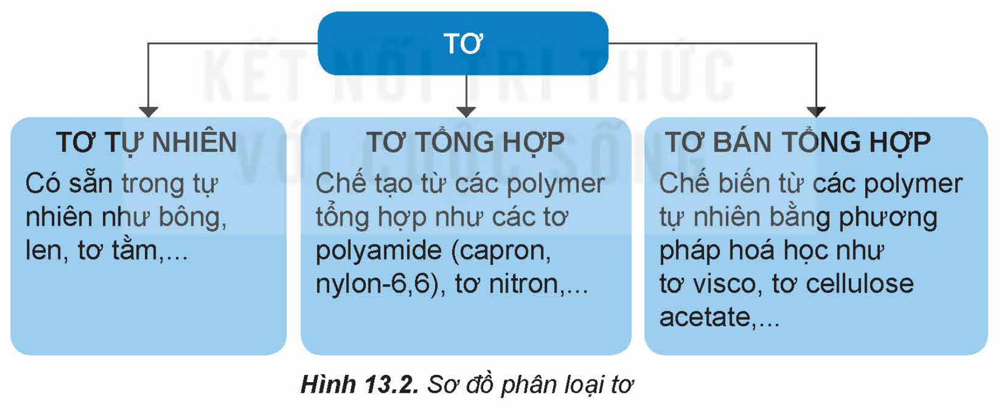

- TƠ
  - **TƠ TỰ NHIÊN**: Có sẵn trong tự nhiên như bông, len, tơ tằm,...
  - **TƠ TỔNG HỢP**: Chế tạo từ các polymer tổng hợp như các tơ polyamide (capron, nylon-6,6), tơ nitron,...
  - **TƠ BÁN TỔNG HỢP**: Chế biến từ các polymer tự nhiên bằng phương pháp hoá học như tơ visco, tơ cellulose acetate,...

Hình 13.2. Sơ đồ phân loại tơ

### 3. Một số loại tơ thường gặp

**a) Tơ tự nhiên**

- ***Sợi bông***: là một loại tơ sợi được lấy từ quả bông. Thành phần chủ yếu của sợi bông là cellulose. Sợi bông có nhiều ưu điểm như mềm mịn, thấm hút mồ hôi tốt, thông thoáng nên vải dệt từ sợi bông (vải cotton) được sử dụng phổ biến trong ngành may mặc.
- ***Len***: là một loại tơ được làm từ lông một số loài động vật như cừu, dê, lạc đà,... có thành phần chính là protein. Sợi len giữ nhiệt tốt nên được dùng để dệt áo len, áo choàng, khăn len,...

<!-- pdf:62 -->

- ***Tơ tằm***: là loại tơ được lấy từ kén của con sâu tằm. Tơ tằm có cấu trúc là các chuỗi protein do sâu tằm tiết ra. Vải dệt từ sợi tơ tằm có độ bóng cao, mềm mại, thoáng khí, hút ẩm tốt nên được dùng phổ biến để dệt vải may trang phục vào mùa hè.

**b) Tơ tổng hợp**

- *Tơ nylon-6,6:*

<!-- term: Tơ nylon-6,6 -->
Tơ nylon-6,6 thuộc loại tơ polyamide được tổng hợp từ hai loại hợp chất đều chứa 6 nguyên tử carbon trong phân tử:

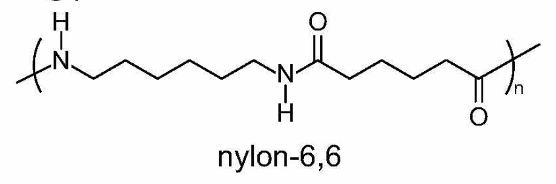

nylon-6,6

<!-- term: Tơ nylon-6,6 -->
Tơ nylon-6,6 có tính dai, mềm, ít thấm nước nên được dùng để dệt vải may mặc, vải lót lốp xe, bện dây cáp, dây dù, đan lưới,...

- *Tơ capron:*

<!-- term: Tơ capron -->
Tơ capron thường được tổng hợp từ phản ứng trùng hợp mở vòng ε-caprolactam:

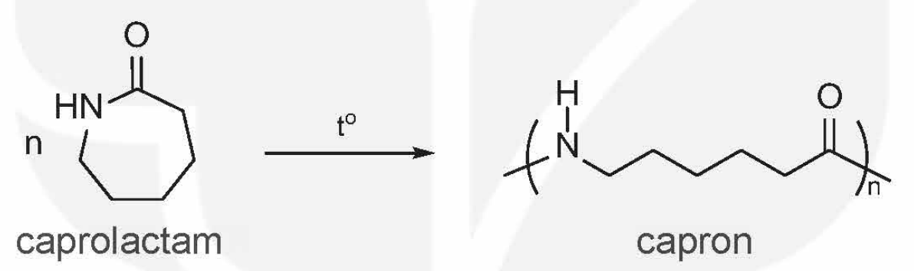

caprolactam; capron

<!-- term: Tơ capron -->
Tơ capron dai, bền, độ đàn hồi và độ bóng cao, ít bị nhăn, có khả năng chống mài mòn.

- *Tơ nitron (hay olon):*

<!-- term: Tơ nitron -->
Tơ nitron được tổng hợp từ phản ứng trùng hợp vinyl cyanide (hay acrylonitrile), tạo thành polyacrylonitrile:

$\ce{nCH2=CH(CN) ->[t^o, xt, p] -(CH2-CH(CN))_n-}$ acrylonitrile; polyacrylonitrile (nitron)

<!-- term: Tơ nitron -->
Tơ nitron dai, bền với nhiệt và giữ nhiệt tốt nên thường được dùng để dệt vải may quần áo ấm, vải bạt, mái hiên ngoài trời, vải làm cánh buồm, sợi gia cường,...

**c) Tơ bán tổng hợp**

- *Tơ visco:*

<!-- term: Tơ visco -->
Tơ visco có cấu trúc phân tử giống như cellulose, được sản xuất từ các nguồn cellulose.

Vải visco dai, bền, thấm mồ hôi và thoáng khí, thường dùng để dệt vải may quần áo mùa hè.

<!-- pdf:63 -->

- *Tơ cellulose acetate:*

<!-- term: Tơ cellulose acetate -->
Tơ cellulose acetate là một trong những loại tơ sợi bán tổng hợp được tạo ra sớm nhất. Mỗi mắt xích trong cellulose thường chứa 2 nhóm acetate ($\ce{[C6H7O2(OH)(OOCCH3)2]_n}$) hoặc 3 nhóm acetate ($\ce{[C6H7O2(OOCCH3)3]_n}$).

Tơ cellulose acetate mềm, mịn, đàn hồi, thoáng khí, thấm hút mồ hôi, khô nhanh, bền màu nên được sử dụng để dệt các loại vải như sa tanh, dệt kim,…

## IV. CAO SU

### 1. Khái niệm

***Cao su*** là vật liệu polymer có tính đàn hồi.

**Tính đàn hồi** là tính biến dạng khi chịu lực tác dụng bên ngoài và trở lại dạng ban đầu khi lực đó thôi tác dụng.

Có hai loại cao su: cao su tự nhiên và cao su tổng hợp.

### 2. Cao su tự nhiên

<!-- term: Cao su tự nhiên -->
Cao su tự nhiên lấy từ mủ cây cao su. Cây cao su có tên khoa học là *Hevea brasiliensis*, có nguồn gốc từ Nam Mỹ, được trồng ở Việt Nam và ở nhiều nơi trên thế giới.

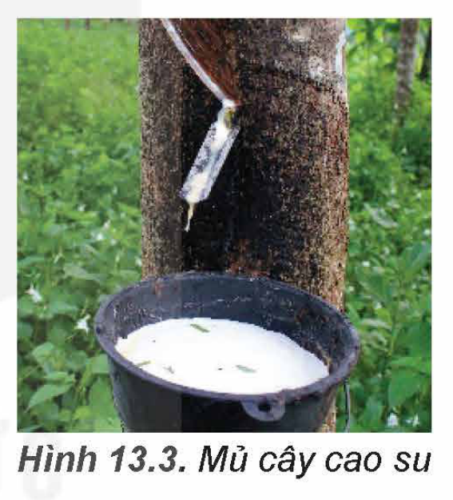

Hình 13.3. Mủ cây cao su

**a) Đặc điểm cấu tạo**

<!-- term: Cao su tự nhiên -->
Cao su tự nhiên là một loại polymer có chứa các mắt xích isoprene, các liên kết đôi trong mạch cao su đều ở dạng *cis*:

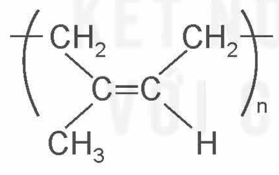

**b) Tính chất và ứng dụng**

Cao su tự nhiên có tính đàn hồi, không dẫn điện, chịu mài mòn, không thấm khí và nước, không tan trong nước và một số dung môi hữu cơ như ethanol,... nhưng tan trong xăng, benzene,... Cao su tự nhiên được dùng để sản xuất các loại lốp xe, băng tải, ống dẫn, gioăng, đệm, gối,…

Do có liên kết đôi trong phân tử polymer nên cao su tự nhiên có thể tham gia các phản ứng cộng với $\ce{H2}$, HCl, $\ce{Cl2}$,...

<!-- term: Lưu hoá cao su -->
Khi cho cao su tác dụng với lưu huỳnh thu được cao su lưu hoá. Cao su sau khi lưu hoá có các cầu nối disulfide tạo mạng lưới không gian nên có các tính chất lí hoá nổi trội hơn so với cao su ban đầu,...

<!-- pdf:64 -->

### 3. Cao su tổng hợp

**Cao su tổng hợp** là loại vật liệu polymer có tính chất đàn hồi tương tự cao su tự nhiên, được điều chế bằng phản ứng trùng hợp.

Có nhiều loại cao su tổng hợp, trong đó có một số loại thông dụng sau đây:

**a) Cao su buna**

Trùng hợp buta-1,3-diene có mặt sodium, thu được cao su buna:

$\ce{nCH2=CH-CH=CH2 ->[Na, t^o, p] -(CH2-CH=CH-CH2)_n-}$

**b) Cao su buna-S, buna-N**

<!-- term: Cao su buna-S -->
<!-- term: Cao su buna-N -->
Khi trùng hợp buta-1,3-diene với styrene ($\ce{C6H5CH=CH2}$) thu được cao su buna-S, trùng hợp buta-1,3-diene với acrylonitrile ($\ce{CH2=CH-CN}$) thu được cao su buna-N:

$\ce{nCH2=CH-CH=CH2 + nCH2=CH(R) ->[t^o, xt, p] -(CH2-CH=CH-CH2-CH2-CH(R))_n-}$

R = –$\ce{C6H5}$ : cao su buna-S

R = –CN : cao su buna-N

**c) Cao su isoprene**

Khi trùng hợp isoprene có mặt xúc tác, thu được cao su isoprene:

$\ce{nCH2=C(CH3)-CH=CH2 ->[t^o, xt, p] -(CH2-C(CH3)=CH-CH2)_n-}$ isoprene; cao su isoprene

**d) Cao su chloroprene**

Khi trùng hợp chloroprene có mặt xúc tác, thu được cao su chloroprene:

$\ce{nCH2=C(Cl)-CH=CH2 ->[t^o, xt, p] -(CH2-C(Cl)=CH-CH2)_n-}$ chloroprene; cao su chloroprene

Cao su tổng hợp có độ đàn hồi tốt, độ bền cao, khả năng chống lão hoá tốt, giá thành thấp nên được ứng dụng phổ biến trong nhiều lĩnh vực như xây dựng, giao thông (lốp xe, đệm chống va đập, gối cầu, khe co giãn), máy móc công nghiệp (băng tải, dây truyền động,...), y tế (găng tay nitrile),...

> ✋ Hãy kể tên các vật dụng trong gia đình được làm từ cao su. Em hãy tìm hiểu và cho biết chúng được làm từ cao su tự nhiên hay cao su tổng hợp.

> 💡 EM CÓ BIẾT
>
> Cao su tổng hợp phổ biến nhất hiện nay là cao su buna-S (SBR). SBR được tổng hợp bằng phản ứng trùng hợp styrene với buta-1,3-diene (tỉ lệ khoảng 1:3). Sản lượng hàng năm của SBR gấp hơn hai lần cao su tự nhiên, trong đó khoảng hai phần ba được sử dụng để sản xuất lốp xe.

<!-- pdf:65 -->

## V. KEO DÁN TỔNG HỢP

### 1. Khái niệm

***Keo dán*** là loại vật liệu có khả năng kết dính bề mặt của hai vật liệu rắn với nhau, mà không làm biến đổi bản chất các vật liệu được kết dính.

Bản chất kết dính của keo dán là tạo ra lớp màng mỏng bám chắc vào hai mảnh vật liệu để giúp chúng kết dính lại được với nhau.

### 2. Một số loại keo dán thông dụng

**a) Nhựa vá săm**

Nhựa vá săm là dung dịch dạng keo của cao su được hoà tan trong các dung môi hữu cơ như xăng, toluene, xylene,... Nhựa vá săm dùng để vá chỗ thủng của săm hoặc lốp.

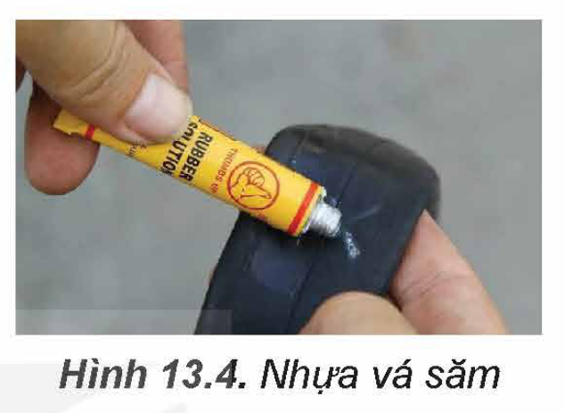

Hình 13.4. Nhựa vá săm

**b) Keo dán epoxy**

Keo dán epoxy gồm hai thành phần: thành phần chính có cấu tạo là hợp chất hữu cơ chứa hai nhóm epoxy ở hai đầu.

*Ví dụ:*

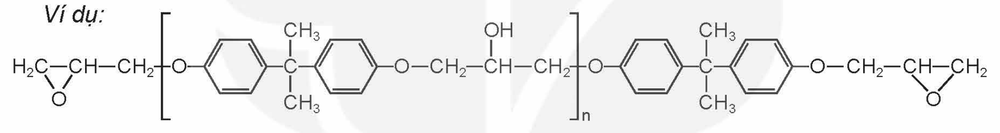

Thành phần thứ hai gọi là chất đóng rắn, thường là các amine, chẳng hạn như $\ce{H2NCH2CH2NHCH2CH2NH2}$.

Để tạo keo dán cần trộn hai thành phần trên với nhau. Các nhóm amine sẽ phản ứng với các nhóm epoxy tạo ra polymer mạng không gian gắn kết hai bề mặt vật cần dán lại.

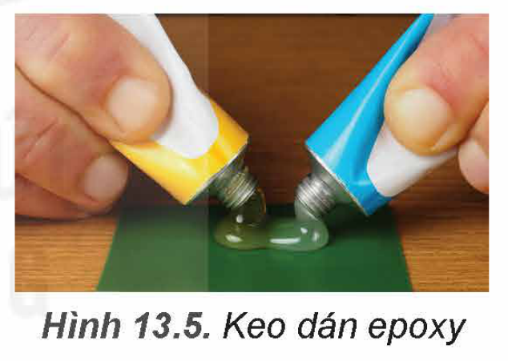

Hình 13.5. Keo dán epoxy

Keo dán epoxy dùng để dán các vật liệu kim loại, gỗ, thuỷ tinh, chất dẻo, bê tông,… trong các ngành công nghiệp sản xuất ô tô, máy bay, xây dựng và trong đời sống hàng ngày.

**c) Keo dán poly(urea-formaldehyde)**

Keo dán poly(urea-formaldehyde) được điều chế từ urea và formaldehyde:

$\ce{nH2N-CO-NH2 + nCH2=O ->[xt, t^o] -(NH-CO-NH-CH2)_n- + nH2O}$ urea; formaldehyde; poly(urea-formaldehyde)

Keo dán poly(urea-formaldehyde) được dùng làm chất kết dính trong gỗ ván ép, chất dẻo,... Khi sử dụng keo dán poly(urea-formaldehyde) cần bổ sung thêm chất đóng rắn như ammonium chloride, oxalic acid,... để tạo polymer mạng không gian.

<!-- pdf:66 -->

## 📌 Em đã học

- *Chất dẻo* là các vật liệu polymer có tính dẻo. Tính dẻo của vật liệu là tính bị biến dạng khi chịu tác dụng của nhiệt, áp lực bên ngoài và vẫn giữ được sự biến dạng đó khi thôi tác dụng.
- Chất dẻo được ứng dụng rộng rãi trong đời sống và sản xuất. Lạm dụng và xử lí chất dẻo không đúng cách là nguyên nhân gây ô nhiễm môi trường.
- *Vật liệu composite* là loại vật liệu được tổ hợp từ hai hay nhiều vật liệu khác nhau tạo nên vật liệu mới có các tính chất vượt trội so với các vật liệu ban đầu.
- *Tơ* là những vật liệu polymer có dạng sợi mảnh và có độ bền nhất định.
- *Cao su* là vật liệu polymer có tính đàn hồi.
- *Keo dán* là vật liệu có khả năng kết dính bề mặt của hai vật liệu rắn với nhau mà không làm biến đổi bản chất các vật liệu được kết dính.
- Vật liệu composite, tơ, cao su, keo dán được ứng dụng rộng rãi trong đời sống và sản xuất.

## ✏️ Em có thể

- Nhận biết được một số vật dụng trong gia đình được làm bằng vật liệu polymer như chất dẻo, vật liệu composite, tơ, cao su, keo dán,…
- Biết cách phân loại để tái chế rác thải nhựa theo tính chất của chúng.
- Biết được các tác hại của rác thải nhựa, từ đó có biện pháp để giảm thiểu rác thải nhựa.

## 📷 Danh sách hình trong bài

| Mã hình | Trang PDF | Vị trí | Chú thích gốc |
|---|---|---|---|
| H12-hoa-b13-01 | 59 | Mục I.2 (trùng hợp các monomer tạo PE, PP, PVC, PS, poly(methyl methacrylate)) | (sách không đánh số, không có chú thích) |
| H12-hoa-b13-02 | 59 | Mục I.2 (điều chế poly(phenol formaldehyde)) | (sách không đánh số, không có chú thích) |
| H12-hoa-b13-03 | 60 | Mục I.4 | Hình 13.1. Một số biện pháp để giảm thiểu rác thải nhựa |
| H12-hoa-b13-04 | 61 | Mục III.2 | Hình 13.2. Sơ đồ phân loại tơ |
| H12-hoa-b13-05 | 62 | Mục III.3.b (công thức nylon-6,6) | (sách không đánh số, không có chú thích) |
| H12-hoa-b13-06 | 62 | Mục III.3.b (trùng hợp mở vòng caprolactam) | (sách không đánh số, không có chú thích) |
| H12-hoa-b13-07 | 63 | Mục IV.2.a (mắt xích cao su tự nhiên dạng *cis*) | (sách không đánh số, không có chú thích) |
| H12-hoa-b13-08 | 63 | Mục IV.2 | Hình 13.3. Mủ cây cao su |
| H12-hoa-b13-09 | 65 | Mục V.2.a | Hình 13.4. Nhựa vá săm |
| H12-hoa-b13-10 | 65 | Mục V.2.b (thành phần chính của keo dán epoxy) | (sách không đánh số, không có chú thích) |
| H12-hoa-b13-11 | 65 | Mục V.2.b | Hình 13.5. Keo dán epoxy |
