<!-- pdf:69 -->

# BÀI 15: THẾ ĐIỆN CỰC VÀ NGUỒN ĐIỆN HOÁ HỌC

## 🎯 Mục tiêu

- Mô tả được cặp oxi hoá – khử của kim loại.
- Nêu được giá trị thế điện cực chuẩn là đại lượng đánh giá khả năng khử giữa các dạng khử, khả năng oxi hoá giữa các dạng oxi hoá trong điều kiện chuẩn.
- Sử dụng bảng giá trị thế điện cực chuẩn để: so sánh được tính khử, tính oxi hoá giữa các cặp oxi hoá – khử; Dự đoán được chiều hướng xảy ra phản ứng giữa hai cặp oxi hoá – khử; tính được sức điện động của pin điện hoá tạo bởi hai cặp oxi hoá – khử.
- Nêu được cấu tạo, nguyên tắc hoạt động của pin Galvani, ưu nhược điểm chính của một số loại pin khác như acquy; pin nhiên liệu; pin Mặt Trời;...
- Lắp ráp được pin đơn giản (pin đơn giản: 2 thanh kim loại khác nhau cắm vào quả chanh, lọ nước muối,...) và đo được sức điện động của pin.

## 🔴 Mở đầu

Pin điện hoá là nguồn năng lượng được sử dụng phổ biến trong nhiều thiết bị như đèn pin, điện thoại, laptop, máy tính cầm tay, đồng hồ, xe đạp điện, xe máy điện, ô tô, máy bay không người lái,... Pin điện hoá có cấu tạo như thế nào? Phản ứng oxi hoá – khử đóng vai trò gì trong hoạt động của pin điện hoá? Làm thế nào để lắp ráp được một số pin điện hoá đơn giản?

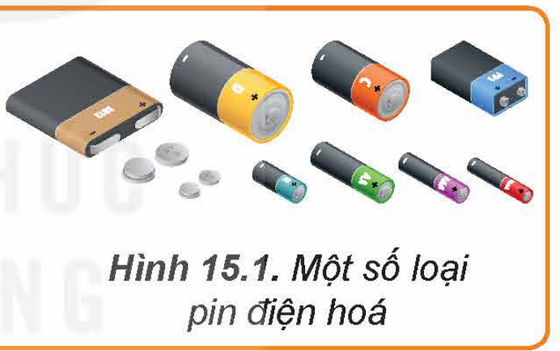

Hình 15.1. Một số loại pin điện hoá

## I. CẶP OXI HOÁ - KHỬ

> ✋ Nhúng một thanh kẽm vào cốc đựng dung dịch copper(II) sulfate (Hình 15.2a), sau một thời gian nhấc thanh kẽm ra thì thấy xuất hiện một lớp đồng màu đỏ bám vào thanh kẽm (Hình 15.2b).
>
> 1. Viết phương trình hoá học dạng ion rút gọn của phản ứng oxi hoá – khử xảy ra trong thí nghiệm.
> 2. Viết quá trình oxi hoá nguyên tử Zn và quá trình khử ion Cu$^{2+}$. Chỉ ra dạng oxi hoá và dạng khử trong mỗi quá trình.
> 3. Biểu diễn dạng oxi hoá và dạng khử của mỗi nguyên tố trên như sau: dạng oxi hoá/dạng khử.
>
> 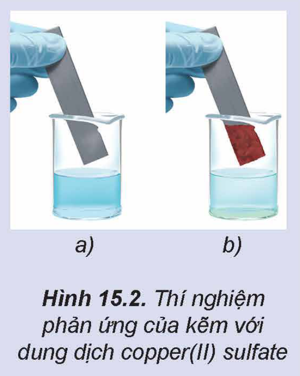
>
> Hình 15.2. Thí nghiệm phản ứng của kẽm với dung dịch copper(II) sulfate

<!-- pdf:70 -->

Nguyên tử kim loại có thể nhường electron để trở thành cation kim loại. Ngược lại, cation kim loại có thể nhận electron để trở thành nguyên tử kim loại.

*Ví dụ:*

$\ce{Al^3+ + 3e <=> Al}$; $\ce{Zn^2+ + 2e <=> Zn}$; $\ce{Cu^2+ + 2e <=> Cu}$.

Các nguyên tử kim loại (Al, Zn, Cu,...) đóng vai trò chất khử, các ion kim loại ($\ce{Al^3+}$, $\ce{Zn^2+}$, $\ce{Cu^2+}$,...) đóng vai trò chất oxi hoá.

<!-- term: Cặp oxi hoá – khử của kim loại -->
Dạng oxi hoá và dạng khử tương ứng của cùng một nguyên tố kim loại tạo nên cặp oxi hoá – khử của kim loại. *Ví dụ:* $\ce{Al^3+}$/Al; $\ce{Zn^2+}$/Zn; $\ce{Cu^2+}$/Cu.

<!-- term: Cặp oxi hoá – khử của kim loại -->
Tổng quát, dạng oxi hoá ($\ce{M^n+}$) và dạng khử (M) của cùng một kim loại tạo nên cặp oxi hoá – khử $\ce{M^n+}$/M, giữa chúng có mối quan hệ:

$\ce{M^n+ + ne <=> M}$ (dạng oxi hoá; dạng khử)

> 💡 EM CÓ BIẾT
>
> Trong cặp oxi hoá – khử của kim loại, dạng oxi hoá và dạng khử có thể tồn tại ở dạng ion đơn nguyên tử, ion đa nguyên tử hoặc dạng phân tử, *ví dụ:* $\ce{Fe^3+}$/$\ce{Fe^2+}$; $\ce{[Ag(NH3)2]+}$/Ag; AgCl/Ag;...
>
> Các nguyên tố phi kim cũng có các cặp oxi hoá – khử tương ứng, *ví dụ:* $\ce{2H+}$/$\ce{H2}$; $\ce{Cl2}$/$\ce{2Cl-}$;...

> ❓ 1. Viết bán phản ứng hoặc cặp oxi hoá – khử còn thiếu trong bảng dưới đây vào vở:
>
> | Bán phản ứng | Cặp oxi hoá – khử | Bán phản ứng | Cặp oxi hoá – khử |
> |---|---|---|---|
> | $\ce{Na+ + 1e <=> Na}$ | ? | ? | $\ce{2H+}$/$\ce{H2}$ |
> | ? | $\ce{Al^3+}$/Al | $\ce{Ag+ + 1e <=> Ag}$ | ? |
> | $\ce{Fe^2+ + 2e <=> Fe}$ | ? | ? | $\ce{Au^3+}$/Au |
>
> 2. Cho đinh sắt (iron) tác dụng với dung dịch hydrochloric acid, thu được muối iron(II) chloride và khí hydrogen.
>
> a) Viết phương trình hoá học của phản ứng ở dạng ion thu gọn.
>
> b) Xác định các cặp oxi hoá – khử trong phản ứng trên.

## II. THẾ ĐIỆN CỰC CHUẨN

### 1. Điện cực

<!-- term: Điện cực -->
Ứng với mỗi cặp oxi hoá – khử có thể thiết lập một điện cực, tại đó tồn tại cân bằng giữa dạng oxi hoá và dạng khử.

*Ví dụ:*

Đối với cặp $\ce{Zn^2+}$/Zn, thiết lập được điện cực kẽm bằng cách cho thanh Zn tiếp xúc trực tiếp với dung dịch muối chứa ion $\ce{Zn^2+}$ (Hình 15.3 a).

<!-- pdf:71 -->

Tương tự, đối với cặp $\ce{Cu^2+}$/Cu cũng thiết lập được điện cực đồng như Hình 15.3 b.

Tại ranh giới giữa kim loại và dung dịch chất điện li của mỗi điện cực tồn tại cân bằng:

$\ce{Zn^2+ + 2e <=> Zn}$; $\ce{Cu^2+ + 2e <=> Cu}$

Điện cực kim loại có nồng độ ion kim loại bằng 1 M và nhiệt độ thường được chọn là 25 °C (298 K) được gọi là **điện cực ở điều kiện chuẩn**.

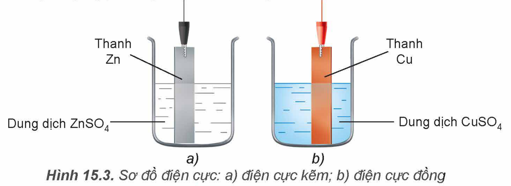

Thanh Zn; Dung dịch $\ce{ZnSO4}$; Thanh Cu; Dung dịch $\ce{CuSO4}$
<!-- ocr-ok: nhãn trong hình, OCR đọc lẫn vị trí; đã đối chiếu ảnh -->

Hình 15.3. Sơ đồ điện cực: a) điện cực kẽm; b) điện cực đồng

> 💡 EM CÓ BIẾT
>
> Điện cực hydrogen chuẩn
>
> <!-- term: Điện cực hydrogen chuẩn -->
> Điện cực hydrogen chuẩn gồm một lá Pt (hấp phụ bão hoà khí hydrogen với áp suất 1 bar), nhúng trong dung dịch acid có nồng độ ion H$^+$ bằng 1 M.
>
> Tại ranh giới giữa lá Pt (có hấp phụ $\ce{H2}$) và dung dịch chất điện li tồn tại cân bằng:
>
> $\ce{2H+ + 2e <=> H2}$.
>
> 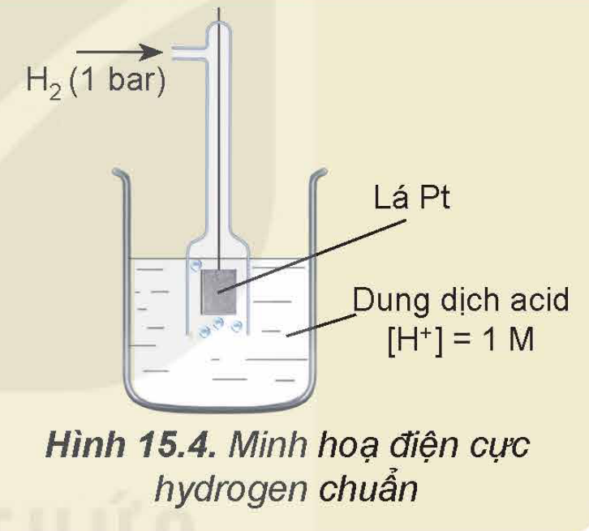
>
> Hình 15.4. Minh hoạ điện cực hydrogen chuẩn

### 2. Thế điện cực chuẩn

Mỗi điện cực ở điều kiện chuẩn có một đại lượng đặc trưng về điện thế, gọi là **thế điện cực chuẩn**.

Thế điện cực chuẩn gắn liền với cặp oxi hoá – khử tương ứng nên thường được kí hiệu là $E^o_{\text{oxi hoá/khử}}$ và thường có đơn vị là volt (vôn).

Thực nghiệm không đo được giá trị tuyệt đối của thế điện cực chuẩn nhưng đo được sự chênh lệch điện thế giữa hai điện cực ở điều kiện chuẩn.

Do vậy, bằng cách quy ước thế điện cực chuẩn của hydrogen bằng 0:

$\ce{2H+ + 2e <=> H2}$ $\quad E^o_{2H^+/H_2} = 0$ V

Từ đó, thế điện cực chuẩn của một điện cực khác được xác định bằng thực nghiệm trên cơ sở đo sự chênh lệch điện thế giữa điện cực đó với điện cực hydrogen chuẩn. *Ví dụ:*

$\ce{Zn^2+ + 2e <=> Zn}$ $\quad E^o_{Zn^{2+}/Zn} = -0{,}762$ V

$\ce{Cu^2+ + 2e <=> Cu}$ $\quad E^o_{Cu^{2+}/Cu} = +0{,}340$ V

<!-- pdf:72 -->

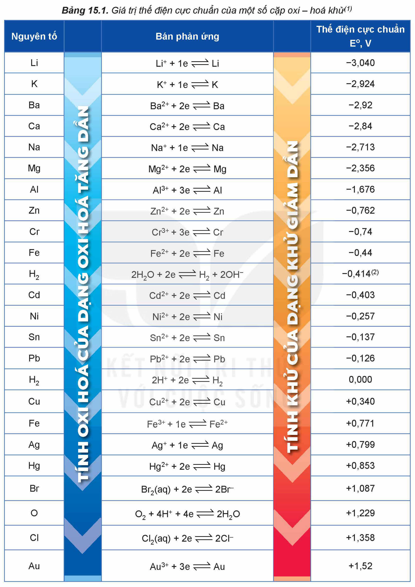

Bảng 15.1. Giá trị thế điện cực chuẩn của một số cặp oxi – hoá khử$^{(1)}$

| Nguyên tố | Bán phản ứng | Thế điện cực chuẩn E°, V |
|---|---|---|
| Li | $\ce{Li+ + 1e <=> Li}$ | –3,040 |
| K | $\ce{K+ + 1e <=> K}$ | –2,924 |
| Ba | $\ce{Ba^2+ + 2e <=> Ba}$ | –2,92 |
| Ca | $\ce{Ca^2+ + 2e <=> Ca}$ | –2,84 |
| Na | $\ce{Na+ + 1e <=> Na}$ | –2,713 |
| Mg | $\ce{Mg^2+ + 2e <=> Mg}$ | –2,356 |
| Al | $\ce{Al^3+ + 3e <=> Al}$ | –1,676 |
| Zn | $\ce{Zn^2+ + 2e <=> Zn}$ | –0,762 |
| Cr | $\ce{Cr^3+ + 3e <=> Cr}$ | –0,74 |
| Fe | $\ce{Fe^2+ + 2e <=> Fe}$ | –0,44 |
| H$_2$ | $\ce{2H2O + 2e <=> H2 + 2OH-}$ | –0,414$^{(2)}$ |
| Cd | $\ce{Cd^2+ + 2e <=> Cd}$ | –0,403 |
| Ni | $\ce{Ni^2+ + 2e <=> Ni}$ | –0,257 |
| Sn | $\ce{Sn^2+ + 2e <=> Sn}$ | –0,137 |
| Pb | $\ce{Pb^2+ + 2e <=> Pb}$ | –0,126 |
| H$_2$ | $\ce{2H+ + 2e <=> H2}$ | 0,000 |
| Cu | $\ce{Cu^2+ + 2e <=> Cu}$ | +0,340 |
| Fe | $\ce{Fe^3+ + 1e <=> Fe^2+}$ | +0,771 |
| Ag | $\ce{Ag+ + 1e <=> Ag}$ | +0,799 |
| Hg | $\ce{Hg^2+ + 2e <=> Hg}$ | +0,853 |
| Br | $\ce{Br2(aq) + 2e <=> 2Br-}$ | +1,087 |
| O | $\ce{O2 + 4H+ + 4e <=> 2H2O}$ | +1,229 |
| Cl | $\ce{Cl2(aq) + 2e <=> 2Cl-}$ | +1,358 |
| Au | $\ce{Au^3+ + 3e <=> Au}$ | +1,52 |

TÍNH OXI HOÁ CỦA DẠNG OXI HOÁ TĂNG DẦN; TÍNH KHỬ CỦA DẠNG KHỬ GIẢM DẦN
<!-- ocr-ok: hai nhãn in dọc trên hai cột mũi tên của bảng, OCR không đọc được chữ dọc; đã đối chiếu ảnh -->

> (1) Nguồn: Dean, J. A. 1999. *Lange's handbook of chemistry*, United States of America, McGraw-Hill, Inc.
>
> (2) tại pH = 7.

<!-- pdf:73 -->

Giá trị thế điện cực chuẩn là đại lượng đánh giá khả năng khử của dạng khử, khả năng oxi hoá của dạng oxi hoá trong điều kiện chuẩn:

- Giá trị thế điện cực chuẩn càng nhỏ thì dạng khử có tính khử càng mạnh, dạng oxi hoá có tính oxi hoá càng yếu.
- Giá trị thế điện cực chuẩn càng lớn thì dạng khử có tính khử càng yếu, dạng oxi hoá có tính oxi hoá càng mạnh.

> ❓ 3. Cho các cặp oxi hoá – khử sau: $\ce{Na+}$/Na, $\ce{Mg^2+}$/Mg, $\ce{Zn^2+}$/Zn, $\ce{Al^3+}$/Al, $\ce{Fe^2+}$/Fe, $\ce{Ag+}$/Ag, $\ce{2H+}$/$\ce{H2}$, $\ce{Cu^2+}$/Cu.
>
> Dựa vào Bảng 15.1, sắp xếp các cặp oxi hoá – khử trên theo chiều giảm dần tính khử của dạng khử.

> 💡 EM CÓ BIẾT
>
> Nguyên nhân xuất hiện thế điện cực
>
> <!-- term: Lớp điện kép -->
> Khi cân bằng $\ce{M^n+ + ne <=> M}$ được thiết lập thì tại ranh giới giữa kim loại và dung dịch điện li xuất hiện hai lớp tích điện trái dấu rất gần nhau (lớp điện kép).
>
> Sự xuất hiện lớp điện kép tạo ra sự chênh lệch điện thế và điện thế chênh lệch này được gọi là thế điện cực của điện cực tương ứng.
>
> 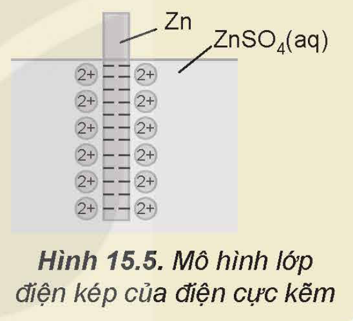
>
> Hình 15.5. Mô hình lớp điện kép của điện cực kẽm

### 3. Ý nghĩa của thế điện cực chuẩn

**a) So sánh tính khử, tính oxi hoá giữa các cặp oxi hoá – khử**

Giữa hai cặp oxi hoá – khử, cặp có giá trị thế điện cực chuẩn nhỏ hơn thì dạng khử có tính khử mạnh hơn, còn dạng oxi hoá có tính oxi hoá yếu hơn và ngược lại.

*Ví dụ:* $E^o_{Cu^{2+}/Cu} = +0{,}340$ V $< E^o_{Ag^+/Ag} = +0{,}799$ V nên tính khử của Cu mạnh hơn Ag, tính oxi hoá của ion $\ce{Cu^2+}$ yếu hơn $\ce{Ag+}$ ở điều kiện chuẩn.

<!-- term: Dãy điện hoá của kim loại -->
Trên cơ sở so sánh giá trị thế điện cực chuẩn, các cặp oxi hoá – khử $\ce{M^n+}$/M được sắp xếp thành dãy theo chiều tăng dần thế điện cực chuẩn, thường gọi là dãy điện hoá của kim loại:

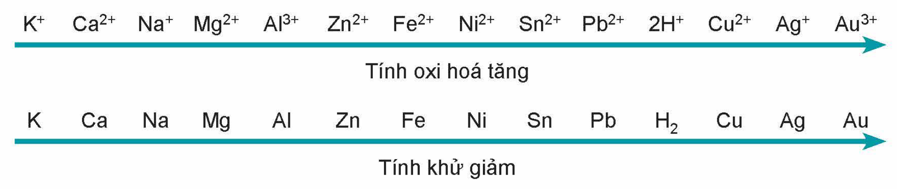

$\ce{K+}$ $\ce{Ca^2+}$ $\ce{Na+}$ $\ce{Mg^2+}$ $\ce{Al^3+}$ $\ce{Zn^2+}$ $\ce{Fe^2+}$ $\ce{Ni^2+}$ $\ce{Sn^2+}$ $\ce{Pb^2+}$ $\ce{2H+}$ $\ce{Cu^2+}$ $\ce{Ag+}$ $\ce{Au^3+}$ — Tính oxi hoá tăng

K Ca Na Mg Al Zn Fe Ni Sn Pb H$_2$ Cu Ag Au — Tính khử giảm
<!-- ocr-ok: hai dãy kí hiệu trong hình, OCR đọc lẫn chỉ số điện tích; đã đối chiếu ảnh -->

<!-- term: Dãy điện hoá của kim loại -->
Dãy điện hoá thường được sử dụng để so sánh tính khử, tính oxi hoá giữa các cặp oxi hoá – khử.

<!-- pdf:74 -->

**b) Dự đoán chiều phản ứng giữa hai cặp oxi hoá – khử**

> ✋ Nghiên cứu về chiều phản ứng giữa các cặp oxi hoá – khử
>
> Xét hai phản ứng oxi hoá – khử sau:
>
> $\ce{Zn + Cu^2+ -> Zn^2+ + Cu}$ (1)
>
> $\ce{Cu + 2Ag+ -> Cu^2+ + 2Ag}$ (2)
>
> 1. Dựa vào Bảng 15.1, so sánh thế điện cực chuẩn của các cặp oxi hoá – khử: $\ce{Zn^2+}$/Zn với $\ce{Cu^2+}$/Cu; $\ce{Cu^2+}$/Cu với $\ce{Ag+}$/Ag.
> 2. Chỉ ra chất khử mạnh hơn và chất oxi hoá mạnh hơn trong mỗi phản ứng.
> 3. Dựa vào giá trị thế điện cực chuẩn, rút ra nhận xét chung về chiều phản ứng giữa các cặp oxi hoá – khử ở trên.

Chiều của phản ứng giữa hai cặp oxi hoá – khử có thể dự đoán được từ việc so sánh giá trị thế điện cực chuẩn:

*Chất khử của cặp oxi hoá – khử có thế điện cực nhỏ hơn tác dụng với chất oxi hoá của cặp oxi hoá – khử có thế điện cực lớn hơn, tạo ra dạng oxi hoá và dạng khử tương ứng.*

Có thể dự đoán chiều phản ứng dựa vào vị trí hai cặp oxi hoá – khử trong dãy điện hoá:

*Chất khử của cặp oxi hoá – khử đứng trước tác dụng với chất oxi hoá của cặp oxi hoá – khử đứng sau, tạo ra dạng oxi hoá và dạng khử tương ứng.*

<!-- term: Quy tắc α -->
Hai cách dự đoán trên được minh hoạ thông qua quy tắc α (alpha).

*Ví dụ:* Sau khi sắp xếp hai cặp oxi hoá – khử $\ce{Cu^2+}$/Cu và $\ce{Ag+}$/Ag theo chiều tăng của thế điện cực chuẩn thì vận dụng quy tắc α như sau:

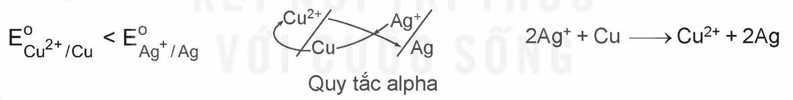

$E^o_{Cu^{2+}/Cu} < E^o_{Ag^+/Ag}$ $\quad \ce{2Ag+ + Cu -> Cu^2+ + 2Ag}$ Quy tắc alpha

> ❓ 4. Ở điều kiện chuẩn, kim loại M có thể tác dụng được với dung dịch acid (H$^+$), với nước khi giá trị thế điện cực chuẩn của cặp oxi hoá – khử kim loại $\ce{M^n+}$/M thoả mãn điều kiện nào?
>
> 5. Dựa vào giá trị thế điện cực chuẩn ở Bảng 15.1, hãy viết phương trình hoá học của phản ứng xảy ra giữa các cặp oxi hoá – khử sau:
>
> a) $\ce{Ni^2+}$/Ni và $\ce{2H+}$/$\ce{H2}$;
>
> b) $\ce{Fe^2+}$/Fe và $\ce{Cu^2+}$/Cu;
>
> c) $\ce{Zn^2+}$/Zn và $\ce{Au^3+}$/Au.

<!-- pdf:75 -->

## III. PIN ĐIỆN HOÁ

### 1. Phản ứng oxi hoá – khử và dòng điện

> ✋ Phản ứng oxi hoá – khử luôn kèm theo sự chuyển electron từ chất khử sang chất oxi hoá. Nếu các quá trình oxi hoá, quá trình khử xảy ra trên hai điện cực và electron được truyền từ chất khử sang chất oxi hoá qua dây dẫn thì năng lượng của phản ứng hoá học sẽ chuyển thành năng lượng điện.
>
> Xét phản ứng oxi hoá – khử:
>
> $\ce{Zn + Cu^2+ -> Zn^2+ + Cu}$ (2e)
>
> Phản ứng hoá học trên xảy ra trong hai thí nghiệm sau:
>
> Thí nghiệm 1: Cho Zn tiếp xúc trực tiếp với ion $\ce{Cu^2+}$ bằng cách nhúng thanh Zn vào dung dịch $\ce{CuSO4}$ (Hình 15.6), thấy xuất hiện kim loại đồng màu đỏ bám trên bề mặt thanh kẽm.
>
> Thí nghiệm 2: Lắp hệ điện hoá gồm hai điện cực $\ce{Zn^2+}$/Zn và $\ce{Cu^2+}$/Cu như Hình 15.7, thấy bóng đèn sáng.
>
> *Thực hiện các yêu cầu sau:*
>
> 1. Viết quá trình oxi hoá, quá trình khử trong mỗi thí nghiệm.
> 2. Trong thí nghiệm nào thì quá trình oxi hoá và quá trình khử cùng xảy ra trên bề mặt của một thanh kim loại?
> 3. Tại sao trong thí nghiệm 2 bóng đèn lại sáng?
>
> 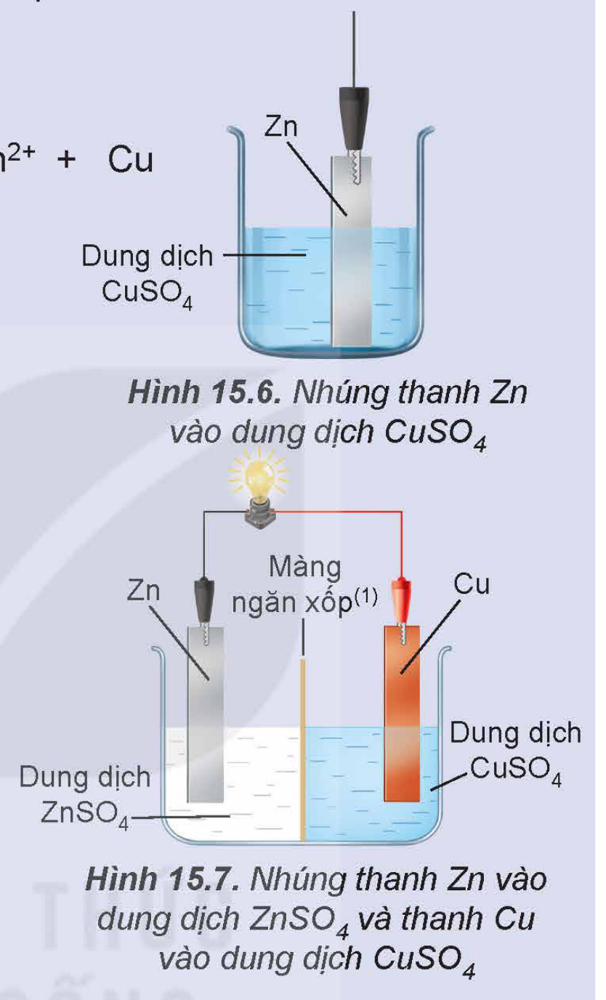
>
> Hình 15.6. Nhúng thanh Zn vào dung dịch $\ce{CuSO4}$
>
> Hình 15.7. Nhúng thanh Zn vào dung dịch $\ce{ZnSO4}$ và thanh Cu vào dung dịch $\ce{CuSO4}$

### 2. Pin Galvani

Ở 25 °C, nhúng một thanh Zn vào cốc đựng dung dịch $\ce{ZnSO4}$ 1 M, nhúng một thanh Cu vào cốc đựng dung dịch $\ce{CuSO4}$ 1 M. Nối thanh Zn và thanh Cu bằng dây dẫn, lắp một vôn kế để đo hiệu điện thế. Đóng kín mạch bằng một cầu muối (Hình 15.8).

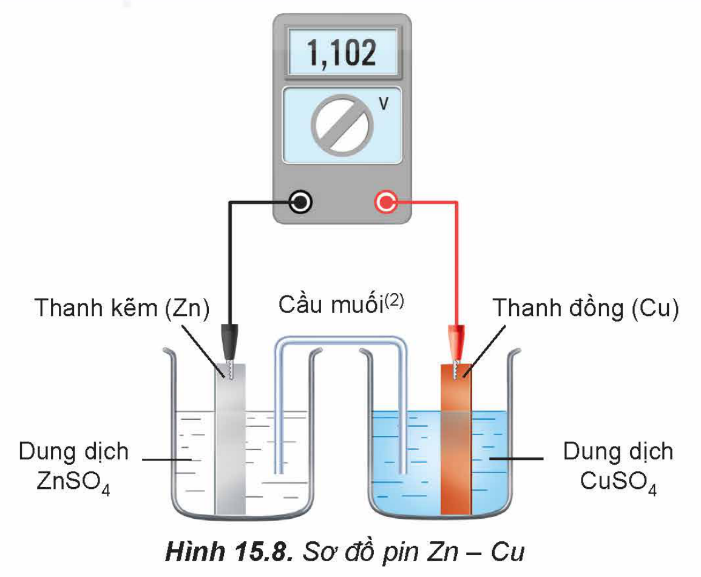

Thanh kẽm (Zn); Cầu muối$^{(2)}$; Thanh đồng (Cu); Dung dịch $\ce{ZnSO4}$; Dung dịch $\ce{CuSO4}$
<!-- ocr-ok: nhãn trong hình, OCR đọc lẫn vị trí; đã đối chiếu ảnh -->

Hình 15.8. Sơ đồ pin Zn – Cu

> (1) Màng ngăn xốp cho ion $\ce{Zn^2+}$ đi qua để đóng kín mạch điện và trung hoà điện tích.
>
> <!-- term: Cầu muối -->
> (2) Cầu muối thường là ống thuỷ tinh chứa thạch được tẩm dung dịch muối bão hoà của kim loại kiềm (ví dụ: $\ce{KNO3}$, KCl).

<!-- pdf:76 -->

<!-- term: Pin Galvani -->
Sơ đồ Hình 15.8 minh hoạ một pin Galvani ở điều kiện chuẩn. Pin Galvani được đặt theo tên nhà bác học người Italia là L. Galvani (1737 – 1798).

- Ở thanh Zn xảy ra quá trình: $\ce{Zn -> Zn^2+ + 2e}$

  Thanh Zn trở thành nguồn cung cấp electron nên đóng vai trò là **cực âm** (anode). Các electron theo dây dẫn di chuyển sang điện cực Cu.

- Ở thanh Cu xảy ra quá trình: $\ce{Cu^2+ + 2e -> Cu}$

  Điện cực Cu là nơi nhận electron nên đóng vai trò là **cực dương** (cathode).

- Trong pin Zn – Cu xảy ra quá trình oxi hoá và quá trình khử trên các điện cực, nghĩa là xảy ra phản ứng oxi hoá – khử: $\ce{Zn + Cu^2+ -> Zn^2+ + Cu}$

  Phản ứng này giống như phản ứng xảy ra khi cho Zn tác dụng trực tiếp với dung dịch $\ce{CuSO4}$. Việc bố trí tách biệt hai cặp oxi hoá – khử ở hai điện cực tạo ra sự truyền electron từ chất khử sang chất oxi hoá qua dây dẫn để tạo ra dòng điện.

- Trong quá trình pin hoạt động, cầu muối cho phép các ion di chuyển qua, do đó vừa đóng kín mạch điện, vừa duy trì tính trung hoà điện của mỗi dung dịch.

- Sức điện động của pin đo ở điều kiện chuẩn gọi là **sức điện động chuẩn**. Sức điện động chuẩn có thể xác định dựa vào thế điện cực chuẩn của các cặp oxi hoá – khử tương ứng: $E^o_{pin} = E^o_{cathode} - E^o_{anode}$.

  *Ví dụ:* đối với pin Zn – Cu:

  Tại anode:

  $\ce{Zn -> Zn^2+ + 2e}$ $\quad E^o_{Zn^{2+}/Zn} = -0{,}762$ V ($E^o_{anode}$)

  Tại cathode:

  $\ce{Cu^2+ + 2e -> Cu}$ $\quad E^o_{Cu^{2+}/Cu} = +0{,}340$ V ($E^o_{cathode}$)

  $E^o_{pin} = E^o_{cathode} - E^o_{anode} = 0{,}340$ V $- (-0{,}762$ V$) = 1{,}102$ V.

> 💡 EM CÓ BIẾT
>
> 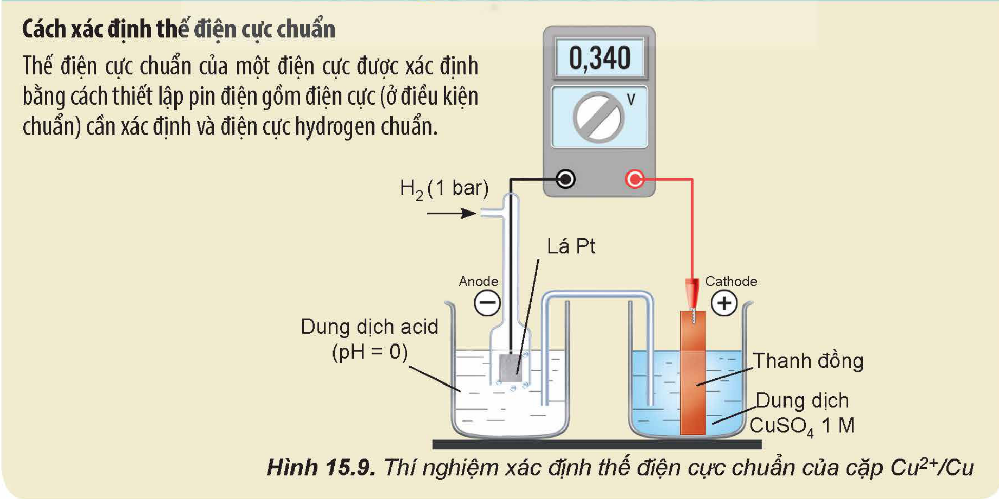
>
> Cách xác định thế điện cực chuẩn
>
> Thế điện cực chuẩn của một điện cực được xác định bằng cách thiết lập pin điện gồm điện cực (ở điều kiện chuẩn) cần xác định và điện cực hydrogen chuẩn.
>
> Hình 15.9. Thí nghiệm xác định thế điện cực chuẩn của cặp $\ce{Cu^2+}$/Cu

<!-- pdf:77 -->

> ❓ 6. Một pin Galvani được thiết lập ở điều kiện chuẩn theo sơ đồ Hình 15.10.
>
> Dựa vào giá trị thế điện cực chuẩn ở Bảng 15.1:
>
> a) Xác định anode, cathode và viết các quá trình xảy ra ở anode, cathode. Viết phương trình hoá học của phản ứng xảy ra trong pin.
>
> b) Tính sức điện động chuẩn của pin và so sánh với giá trị hiển thị trên vôn kế.
>
> c) Xác định chiều của dòng electron chạy qua dây dẫn.
>
> 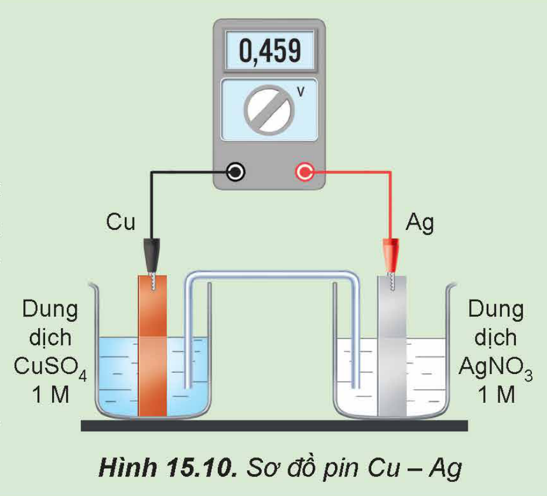
>
> Hình 15.10. Sơ đồ pin Cu – Ag

> 🧪 Lắp ráp một pin đơn giản
>
> *Chuẩn bị:*
>
> Hoá chất: các thanh kim loại: kẽm, đồng, nhôm, sắt; quả chanh (hoặc quả cam, quả chuối, củ khoai tây,...).
>
> Dụng cụ: dây điện có sẵn kẹp cá sấu hai đầu, vôn kế.
>
> *Tiến hành:*
>
> - Chọn hai điện cực là hai kim loại khác nhau, ví dụ như thanh kẽm và thanh đồng.
> - Cắm hai thanh kim loại vào quả chanh (Hình 15.11 a).
> - Nối cực âm của vôn kế với thanh kẽm và cực dương của vôn kế với thanh đồng.
>
> 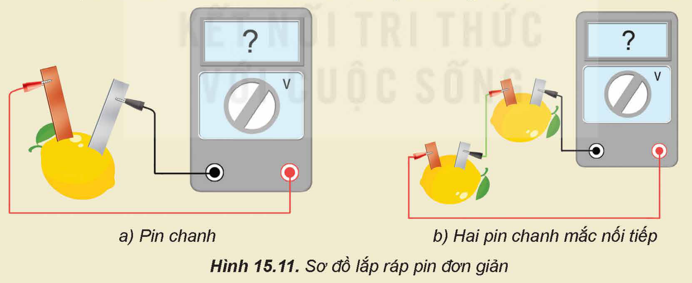
>
> a) Pin chanh; b) Hai pin chanh mắc nối tiếp
>
> Hình 15.11. Sơ đồ lắp ráp pin đơn giản
>
> *Chú ý:* Không để hai thanh kim loại tiếp xúc với nhau.
>
> *Thực hiện yêu cầu sau:*
>
> Đo sức điện động của pin đã lắp ráp theo Hình 15.11 a.
>
> (*Lưu ý:* Có thể mắc nối tiếp các pin như minh hoạ ở Hình 15.11 b.)

<!-- pdf:78 -->

## IV. MỘT SỐ LOẠI PIN KHÁC

Hiện nay, có nhiều loại pin đang được sử dụng phổ biến như acquy, pin nhiên liệu, pin Mặt Trời,...

<!-- term: Acquy -->
Acquy là nguồn điện được sử dụng phổ biến trong các phương tiện giao thông, thiết bị lưu điện, phát điện. Acquy thuộc loại pin thứ cấp (pin sạc), các chất phản ứng được tái tạo trong quá trình sạc bằng dòng điện một chiều.

<!-- term: Pin nhiên liệu -->
Pin nhiên liệu là loại pin điện hoá chuyển đổi hoá năng thành điện năng thông qua phản ứng oxi hoá – khử giữa nhiên liệu và chất oxi hoá. Trong đó, các nhiên liệu thường là methane, methanol, ethanol, hydrogen,... còn chất oxi hoá thường là oxygen. Pin nhiên liệu hydrogen – oxygen có nhiều ứng dụng và triển vọng trong tương lai.

<!-- term: Pin Mặt Trời -->
Pin Mặt Trời (solar cell) gồm nhiều tấm vật liệu bán dẫn được ghép nối với nhau, có khả năng chuyển đổi quang năng thành điện năng.

Ưu, nhược điểm các loại pin trên được trình bày ở Bảng 15.2.

Bảng 15.2. Ưu, nhược điểm của acquy, pin nhiên liệu và pin Mặt Trời

| Pin | Ưu điểm | Nhược điểm |
|---|---|---|
| Acquy chì | – Dễ sản xuất, giá thành thấp. – Hoạt động ổn định. – Dễ thu hồi sulfuric acid và chì để tái chế. | – Nặng, tuổi thọ thấp (trung bình khoảng 1 năm). – Gây ô nhiễm môi trường và ngộ độc chì ở các làng nghề tái chế acquy cũ. |
| Pin nhiên liệu | – Điều chỉnh được cường độ dòng điện nhờ thay đổi tốc độ dòng nhiên liệu. – Hiệu suất chuyển đổi năng lượng cao, lượng chất phát thải ít và dễ kiểm soát. | Giá thành cao. |
| Pin Mặt Trời | – Là nguồn năng lượng sạch, không phát thải khí gây ô nhiễm môi trường. – Tận dụng được năng lượng vô tận của Mặt Trời. | – Sản xuất khá phức tạp, giá thành cao. – Cần nhiều ánh nắng nên phụ thuộc vào khí hậu, thời tiết. – Các tấm pin Mặt Trời hết hạn sử dụng có nguy cơ gây ô nhiễm môi trường. |

<!-- pdf:79 -->

> 💡 EM CÓ BIẾT
>
> Pin lithium-ion
>
> Pin lithium-ion thuộc loại pin sạc, được sử dụng trong máy tính laptop, điện thoại, máy quay phim, phương tiện giao thông chạy điện,...
>
> Pin lithium-ion có nhiều ưu điểm như nhẹ, nhỏ gọn, bền, mật độ năng lượng cao, sạc nhanh và có thể sạc mọi thời điểm. Pin lithium-ion có nhược điểm là giá thành cao, dễ hư hỏng bởi nhiệt, tiềm ẩn nguy cơ cháy nổ.
>
> Pin khô
>
> Pin khô thuộc loại pin sơ cấp (không sạc được), được dùng trong thiết bị điều khiển, máy ảnh, đồ chơi,...
>
> Pin khô có nhiều ưu điểm như năng lượng ổn định, giá rẻ, phù hợp các thiết bị di động. Pin khô có nhược điểm là điện áp thấp, tiềm ẩn nguy cơ ô nhiễm môi trường.

> ❓ 7. Phân loại các loại pin sử dụng trong gia đình và đề xuất cách thu gom, xử lí khi hết hạn sử dụng để bảo vệ môi trường.

## 📌 Em đã học

- Cặp oxi hoá – khử của kim loại là dạng oxi hoá và dạng khử tương ứng của một nguyên tố kim loại.
- Giá trị thế điện cực chuẩn là đại lượng đánh giá khả năng oxi hoá của dạng oxi hoá và khả năng khử của dạng khử: thế điện cực chuẩn càng cao, dạng oxi hoá có tính oxi hoá càng mạnh, dạng khử có tính khử càng yếu và ngược lại.
- Chiều xảy ra phản ứng giữa hai cặp oxi hoá – khử: Chất khử của cặp oxi hoá – khử có thế điện cực thấp hơn tác dụng với chất oxi hoá của cặp oxi hoá – khử có thế điện cực cao hơn, tạo ra dạng oxi hoá và dạng khử tương ứng.
- Pin điện hoá là thiết bị chuyển hoá năng lượng của phản ứng oxi hoá – khử thành dòng điện.
- Pin Galvani là pin điện hoá có cấu tạo gồm hai điện cực, mỗi điện cực ứng với một cặp oxi hoá – khử và thường nối với nhau qua cầu muối.
- Khi pin điện hoá hoạt động: ở anode (cực âm) xảy ra quá trình oxi hoá; ở cathode (cực dương) xảy ra quá trình khử.
- Sức điện động chuẩn của pin điện bằng thế điện cực chuẩn của cực dương (cathode) trừ thế điện cực chuẩn của cực âm (anode):

  $E^o_{pin} = E^o_{cathode} - E^o_{anode}$

- Các loại pin khác như acquy, pin nhiên liệu, pin Mặt Trời,... hiện được sử dụng phổ biến trong đời sống và sản xuất.

## ✏️ Em có thể

- Lắp ráp được một số loại pin điện hoá đơn giản.
- Phân loại pin phục vụ cho nhu cầu sử dụng, tái chế và bảo vệ môi trường.

## 📷 Danh sách hình trong bài

| Mã hình | Trang PDF | Vị trí | Chú thích gốc |
|---|---|---|---|
| H12-hoa-b15-01 | 69 | Khung Mở đầu (cạnh trái chạm vài điểm của chữ cuối dòng, khai báo allow_edge_ink) | Hình 15.1. Một số loại pin điện hoá |
| H12-hoa-b15-02 | 69 | Mục I, hộp hoạt động | Hình 15.2. Thí nghiệm phản ứng của kẽm với dung dịch copper(II) sulfate |
| H12-hoa-b15-03 | 71 | Mục II.1 (cạnh trên cắt qua 2 điểm của dây dẫn điện cực, khai báo allow_edge_ink) | Hình 15.3. Sơ đồ điện cực: a) điện cực kẽm; b) điện cực đồng |
| H12-hoa-b15-04 | 71 | Mục II.1, hộp "Em có biết" | Hình 15.4. Minh hoạ điện cực hydrogen chuẩn |
| H12-hoa-b15-05 | 72 | Mục II.2 (cả trang bảng, gồm hai cột mũi tên chữ dọc) | Bảng 15.1. Giá trị thế điện cực chuẩn của một số cặp oxi – hoá khử(1) |
| H12-hoa-b15-06 | 73 | Mục II.2, hộp "Em có biết" | Hình 15.5. Mô hình lớp điện kép của điện cực kẽm |
| H12-hoa-b15-07 | 73 | Mục II.3.a (dãy điện hoá của kim loại) | (sách không đánh số, không có chú thích) |
| H12-hoa-b15-08 | 74 | Mục II.3.b (quy tắc alpha) | (sách không đánh số; nhãn trong hình: Quy tắc alpha) |
| H12-hoa-b15-09 | 75 | Mục III.1, hộp hoạt động (Hình 15.6 và 15.7 xếp sát nhau nên cắt chung một ảnh; khung có lẫn phần cuối phương trình "Zn²⁺ + Cu" của hộp; khai báo allow_edge_ink) | Hình 15.6. Nhúng thanh Zn vào dung dịch CuSO4 — Hình 15.7. Nhúng thanh Zn vào dung dịch ZnSO4 và thanh Cu vào dung dịch CuSO4 |
| H12-hoa-b15-10 | 75 | Mục III.2 | Hình 15.8. Sơ đồ pin Zn – Cu |
| H12-hoa-b15-11 | 76 | Mục III.2, hộp "Em có biết" (cắt cả hộp gồm tiêu đề và đoạn chữ, vì hình nằm sát đoạn chữ) | Hình 15.9. Thí nghiệm xác định thế điện cực chuẩn của cặp Cu²⁺/Cu |
| H12-hoa-b15-12 | 77 | Câu hỏi 6 | Hình 15.10. Sơ đồ pin Cu – Ag |
| H12-hoa-b15-13 | 77 | Mục III.2, hộp thí nghiệm "Lắp ráp một pin đơn giản" | Hình 15.11. Sơ đồ lắp ráp pin đơn giản |
