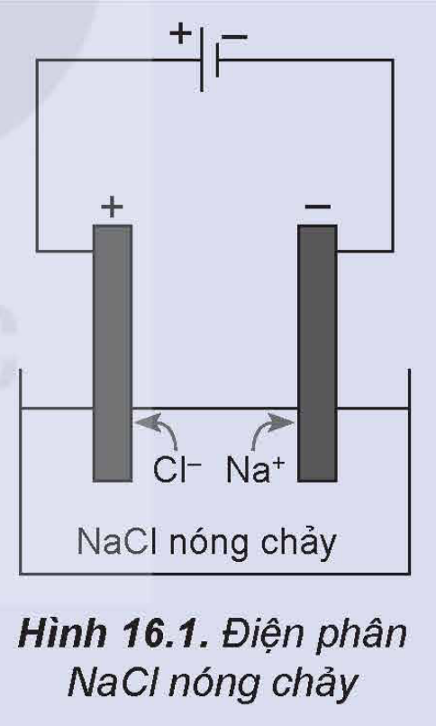
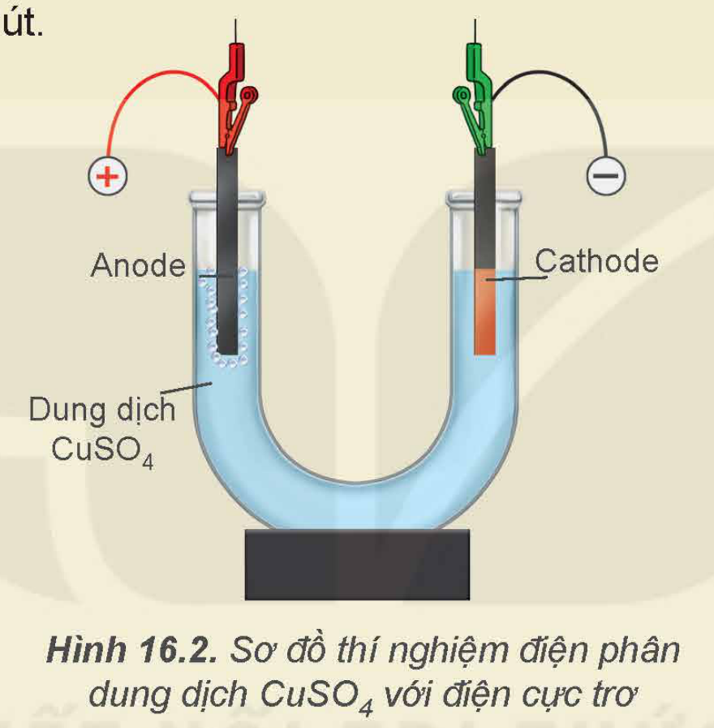
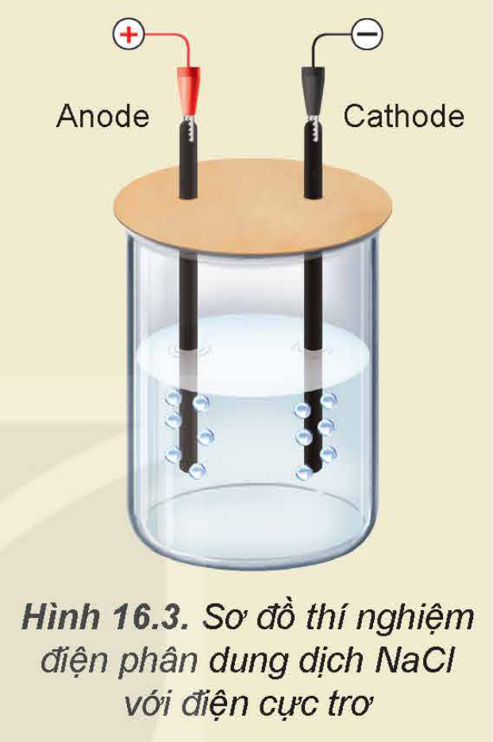
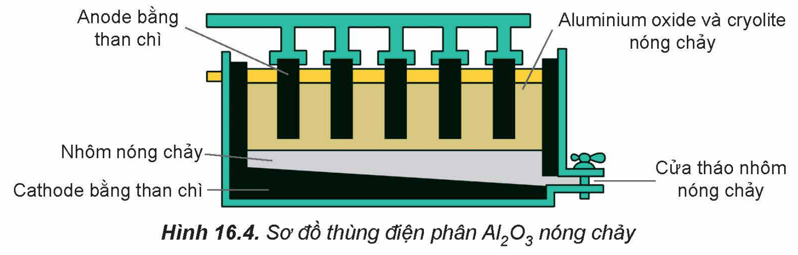
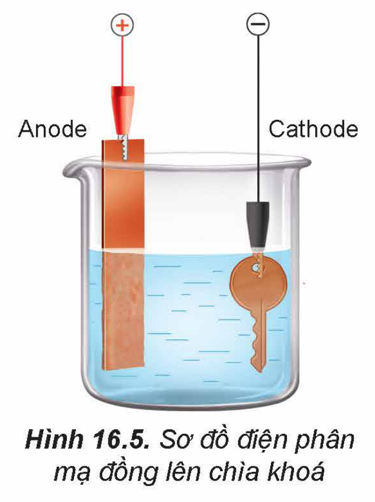

<!-- pdf:80 -->

# BÀI 16: ĐIỆN PHÂN

## 🎯 Mục tiêu

- Trình bày được nguyên tắc (thứ tự) điện phân dung dịch, điện phân nóng chảy.
- Thực hiện được (hoặc quan sát video) thí nghiệm điện phân dung dịch copper(II) sulfate, dung dịch sodium chloride (tự chế tạo nước Javel để tẩy rửa).
- Nêu được ứng dụng của một số hiện tượng điện phân trong thực tiễn (mạ điện, tinh chế kim loại).
- Trình bày được giai đoạn điện phân aluminium oxide trong sản xuất nhôm (aluminium), tinh luyện đồng (copper) bằng phương pháp điện phân, mạ điện.

## 🔴 Mở đầu

Trong pin điện hoá, hoá năng được chuyển thành điện năng của dòng điện một chiều thông qua phản ứng oxi hoá – khử tự xảy ra. Ngược lại, trong bình điện phân, điện năng của dòng điện một chiều được sử dụng để thực hiện phản ứng oxi hoá – khử không tự xảy ra. Vậy, quá trình điện phân tuân theo nguyên tắc nào và có ứng dụng gì trong sản xuất?

## I. HIỆN TƯỢNG ĐIỆN PHÂN

### 1. Khái niệm

> ✋ Quá trình điện phân NaCl nóng chảy được tiến hành theo hai bước như sau:
>
> Bước 1: Nung NaCl trong bình đến nóng chảy, thu được chất lỏng có khả năng dẫn điện.
>
> Bước 2: Nhúng hai điện cực than chì vào bình đựng NaCl nóng chảy rồi nối chúng với hai cực của nguồn điện một chiều (khoảng 7 V). Các ion di chuyển về các điện cực trái dấu, ở điện cực dương có khí $\ce{Cl2}$ thoát ra và ở điện cực âm, Na được tạo thành.
>
> *Thực hiện các yêu cầu sau:*
>
> 1. Viết phương trình phân li của NaCl ở bước 1.
> 2. Viết quá trình xảy ra ở mỗi điện cực.
> 3. Viết phương trình hoá học của phản ứng xảy ra trong quá trình điện phân.
>
> 
>
> Hình 16.1. Điện phân NaCl nóng chảy

***Điện phân*** là một quá trình oxi hoá – khử xảy ra tại các điện cực khi có dòng điện một chiều với hiệu điện thế đủ lớn đi qua chất điện li nóng chảy hoặc dung dịch chất điện li.

Phản ứng oxi hoá – khử xảy ra trong quá trình điện phân là phản ứng không tự xảy ra mà phải nhờ tác động của điện năng để gây ra phản ứng đó.

Các chất tham gia vào quá trình điện phân có thể ở trạng thái nóng chảy (**điện phân nóng chảy**) hoặc dung dịch (**điện phân dung dịch**). Trong quá trình điện phân,

<!-- pdf:81 -->

dưới tác dụng của điện trường, các ion âm sẽ di chuyển về điện cực dương, các ion dương sẽ di chuyển về điện cực âm.

Khi điện phân dung dịch, nước cũng có thể tham gia điện phân với vai trò chất khử ($\ce{2H2O -> O2 + 4H+ + 4e}$) hoặc chất oxi hoá ($\ce{2H2O + 2e -> H2 + 2OH-}$).

Theo quy ước chung, đối với cả pin điện và bình điện phân, tại cathode xảy ra quá trình khử và tại anode xảy ra quá trình oxi hoá. Do vậy, trong điện phân cathode là cực âm, anode là cực dương.

> ❓ 1. Xét thí nghiệm điện phân dung dịch (đpdd) $\ce{CuCl2}$ với điện cực trơ$^{(1)}$ (như than chì).
>
> Dung dịch $\ce{CuCl2}$: Anode (+) — $\ce{Cl-}$; Cathode (–) — $\ce{Cu^2+}$
>
> Viết quá trình xảy ra ở mỗi điện cực và viết phương trình hoá học của phản ứng điện phân.

### 2. Nguyên tắc (thứ tự) điện phân

**a) Điện phân dung dịch $\ce{CuSO4}$ với các điện cực trơ (graphite)**

Khi đặt một hiệu điện thế khoảng 3 – 6 V giữa hai điện cực (thí nghiệm ở Hình 16.2), thấy khí $\ce{O2}$ thoát ra ở anode và kim loại Cu bám trên cathode.

Trong thí nghiệm này, khi có dòng điện đi qua dung dịch, ion $\ce{SO4^2-}$ di chuyển về phía anode, ion $\ce{Cu^2+}$ di chuyển về cathode.

Ở anode có thể xảy ra sự oxi hoá ion $\ce{SO4^2-}$ hoặc phân tử $\ce{H2O}$. Tuy nhiên, vì $\ce{H2O}$ dễ bị oxi hoá hơn $\ce{SO4^2-}$ nên $\ce{H2O}$ bị oxi hoá trước, tạo thành sản phẩm là khí $\ce{O2}$.

$\ce{2H2O -> O2 + 4H+ + 4e}$

Ở cathode có thể xảy ra sự khử ion $\ce{Cu^2+}$ hoặc phân tử $\ce{H2O}$. Vì ion $\ce{Cu^2+}$ dễ bị khử hơn $\ce{H2O}$ nên ion $\ce{Cu^2+}$ bị khử trước, tạo thành kim loại Cu bám trên cathode.

$\ce{Cu^2+ + 2e -> Cu}$

Sơ đồ điện phân:

Dung dịch $\ce{CuSO4}$

Anode (+): $\ce{SO4^2-}$, $\ce{H2O}$; $\ce{H2O -> 1/2O2 + 2H+ + 2e}$

Cathode (–): $\ce{Cu^2+}$, $\ce{H2O}$; $\ce{Cu^2+ + 2e -> Cu}$

Phương trình hoá học của phản ứng điện phân:

$\ce{CuSO4 + H2O ->[\text{đpdd}] Cu + 1/2O2 + H2SO4}$

> (1) **Điện cực trơ** là điện cực có khả năng dẫn điện và không tham gia phản ứng trong quá trình điện phân.

<!-- pdf:82 -->

> 🧪 Thí nghiệm: Điện phân dung dịch $\ce{CuSO4}$
>
> *Chuẩn bị:*
>
> Hoá chất: dung dịch $\ce{CuSO4}$ 0,5 M.
>
> Dụng cụ: nguồn điện một chiều (3 – 6 vôn), ống thuỷ tinh hình chữ U, hai điện cực than chì, dây dẫn, kẹp kim loại.
>
> *Tiến hành:*
>
> - Lắp thiết bị thí nghiệm điện phân dung dịch $\ce{CuSO4}$ như Hình 16.2.
> - Rót dung dịch $\ce{CuSO4}$ 0,5 M vào ống thuỷ tinh hình chữ U rồi nhúng hai điện cực than chì vào dung dịch.
> - Nối hai điện cực than chì với hai cực của nguồn điện và tiến hành điện phân trong khoảng 5 phút.
>
> 
>
> Hình 16.2. Sơ đồ thí nghiệm điện phân dung dịch $\ce{CuSO4}$ với điện cực trơ
>
> *Quan sát hiện tượng xảy ra ở mỗi điện cực và giải thích.*

**b) Điện phân dung dịch NaCl với các điện cực trơ (graphite)**

> ✋ Điện phân dung dịch NaCl bão hoà với điện cực trơ (graphite)
>
> Dung dịch NaCl: Anode (+) — $\ce{Cl-}$, $\ce{H2O}$; Cathode (–) — $\ce{Na+}$, $\ce{H2O}$
>
> a) Viết quá trình oxi hoá, quá trình khử xảy ra ở mỗi điện cực, biết sản phẩm của quá trình điện phân có khí $\ce{Cl2}$ và $\ce{H2}$.
>
> b) Viết phương trình hoá học của phản ứng điện phân.
>
> c) Trong quá trình điện phân, sản phẩm tạo thành ở hai điện cực khuếch tán vào nhau sẽ xảy ra phản ứng hoá học nào?

<!-- pdf:83 -->

> 🧪 Thí nghiệm: Điện phân dung dịch NaCl (tự điều chế nước Javel để tẩy rửa)
>
> *Chuẩn bị:*
>
> Hoá chất: dung dịch NaCl bão hoà, cánh hoa màu hồng.
>
> Dụng cụ: nguồn điện một chiều (3 – 6 vôn), cốc thuỷ tinh 100 mL, hai điện cực than chì, dây dẫn, kẹp kim loại.
>
> *Tiến hành:*
>
> - Lắp thiết bị thí nghiệm điện phân dung dịch NaCl với điện cực trơ như Hình 16.3.
> - Rót khoảng 80 mL dung dịch NaCl bão hoà vào cốc rồi nhúng hai điện cực than chì vào dung dịch.
> - Nối hai điện cực than chì với hai cực của nguồn điện và tiến hành điện phân trong khoảng 5 phút.
> - Cho một mẩu cánh hoa màu hồng vào cốc chứa khoảng 5 mL dung dịch sau điện phân.
>
> *Quan sát hiện tượng xảy ra và thực hiện các yêu cầu sau:*
>
> 1. Giải thích hiện tượng quan sát được ở mỗi điện cực.
> 2. Giải thích khả năng tẩy màu của dung dịch sau điện phân.
> 3. Tại sao nên dùng nắp đậy trong quá trình điện phân?
>
> 
>
> Hình 16.3. Sơ đồ thí nghiệm điện phân dung dịch NaCl với điện cực trơ

<!-- term: Thứ tự điện phân -->
- Khi bình điện phân chứa nhiều chất oxi hoá và chất khử, các quá trình xảy ra tại anode và cathode tuân theo thứ tự sau:

  <!-- term: Thứ tự điện phân -->
  Tại anode, chất khử mạnh hơn sẽ bị oxi hoá trước.

  <!-- term: Thứ tự điện phân -->
  Tại cathode, chất oxi hoá mạnh hơn sẽ bị khử trước.

- Ở điều kiện chuẩn, độ mạnh yếu của các chất oxi hoá và chất khử được so sánh dựa vào giá trị thế điện cực chuẩn hoặc vị trí cặp oxi hoá – khử trong dãy điện hoá.

  *Ví dụ:* Thứ tự điện phân tại anode: $\ce{I-}$ > $\ce{Br-}$ > $\ce{Cl-}$

  (Các anion như $\ce{CO3^2-}$, $\ce{NO3-}$, $\ce{PO4^3-}$, $\ce{SO4^2-}$, $\ce{F-}$ và $\ce{ClO4-}$ coi như không bị điện phân).

  Thứ tự điện phân tại cathode: $\ce{Au^3+}$ > $\ce{Ag+}$ > $\ce{Hg^2+}$ > $\ce{Cu^2+}$ > $\ce{H+}$ > $\ce{H2O}$.

> 💡 EM CÓ BIẾT
>
> Thứ tự điện phân còn phụ thuộc vào bản chất của vật liệu làm điện cực và trạng thái bề mặt của điện cực, đặc biệt là các quá trình tạo ra sản phẩm ở thể khí.

<!-- pdf:84 -->

## II. ỨNG DỤNG CỦA PHƯƠNG PHÁP ĐIỆN PHÂN
<!-- ocr-ok: OCR đọc sai chữ tiêu đề trang trí, đã đối chiếu ảnh -->

### 1. Sản xuất kim loại

Trong công nghiệp, một số kim loại trung bình và yếu được sản xuất bằng phương pháp điện phân dung dịch.

Ví dụ: hơn 50% sản lượng kẽm trên thế giới được sản xuất bằng phương pháp điện phân:

$\ce{ZnSO4 + H2O ->[\text{đpdd}] Zn + 1/2O2 + H2SO4}$

Các kim loại mạnh như Na, K, Mg, Ca, Al,... được sản xuất bằng phương pháp điện phân nóng chảy (đpnc) hợp chất ion của chúng.

*Ví dụ:* Trong công nghiệp, nhôm được sản xuất từ quặng bauxite theo hai giai đoạn chính:

*Giai đoạn 1*: Tinh chế quặng bauxite

Quặng bauxite (thành phần chính $\ce{Al2O3.2H2O}$) thường lẫn tạp chất. Sau khi loại bỏ tạp chất bằng phương pháp hoá học thu được $\ce{Al2O3}$.

*Giai đoạn 2*: Điện phân $\ce{Al2O3}$ nóng chảy

Do $\ce{Al2O3}$ có nhiệt độ nóng chảy rất cao (2 050 °C) nên $\ce{Al2O3}$ được trộn cùng với cryolite ($\ce{Na3AlF6}$) để tạo thành hỗn hợp nóng chảy ở gần 1 000 °C. Giải pháp này giúp tiết kiệm nhiều năng lượng, đồng thời tạo ra chất lỏng vừa có tính dẫn điện tốt, vừa nổi lên trên Al lỏng để ngăn cách Al lỏng với không khí.

Thùng điện phân có cathode là tấm than chì ở dưới đáy thùng, anode là những tấm than chì có thể di chuyển theo phương thẳng đứng (Hình 16.4).

Ở anode xảy ra quá trình oxi hoá $\ce{O^2-}$ thành $\ce{O2}$:

$\ce{2O^2- -> O2 + 4e}$

Ở cathode xảy ra quá trình khử $\ce{Al^3+}$ thành Al:

$\ce{Al^3+ + 3e -> Al}$

Phương trình hoá học của phản ứng điện phân:

$\ce{2Al2O3 ->[\text{đpnc}] 4Al + 3O2}$

Khí $\ce{O2}$ tạo thành ở nhiệt độ cao, đốt cháy dần điện cực anode than chì thành CO và $\ce{CO2}$. Do vậy, trong quá trình điện phân phải hạ thấp dần các điện cực anode vào thùng điện phân.

Anode bằng than chì; Aluminium oxide và cryolite nóng chảy; Nhôm nóng chảy; Cathode bằng than chì; Cửa tháo nhôm nóng chảy

Hình 16.4. Sơ đồ thùng điện phân $\ce{Al2O3}$ nóng chảy

<!-- pdf:85 -->

### 2. Tinh chế kim loại

Từ nguồn kim loại thô (kim loại phế liệu hoặc sau quá trình nhiệt luyện, thuỷ luyện), các kim loại như Zn, Ni, Co, Cu, Ag, Au,... được tinh chế bằng phương pháp điện phân.

<!-- term: Tinh chế kim loại -->
Quá trình tinh chế được thực hiện bằng cách điện phân dung dịch chất tan (muối hoặc phức chất) của kim loại đó với anode làm bằng kim loại thô tương ứng.

*Ví dụ:* Trong công nghiệp, đồng phế liệu hoặc đồng thô được tinh chế bằng phương pháp điện phân.

Bình điện phân tinh chế đồng chứa dung dịch muối $\ce{CuSO4}$ trong dung dịch $\ce{H2SO4}$, anode bằng đồng thô và cathode là đồng tinh khiết.

Tại anode: Cu bị oxi hoá thành ion $\ce{Cu^2+}$ đi vào dung dịch:

$\ce{Cu -> Cu^2+ + 2e}$

Do vậy, anode dần bị hoà tan.

Tại cathode: $\ce{Cu^2+}$ bị khử thành Cu bám trên cathode:

$\ce{Cu^2+ + 2e -> Cu}$

Quá trình điện phân này được coi như là sự chuyển dời kim loại Cu từ anode (ở dạng đồng thô) về cathode (ở dạng đồng tinh khiết).

Kết thúc quá trình điện phân thu được đồng tinh khiết ở cathode.

### 3. Mạ điện

<!-- term: Mạ điện -->
Phương pháp điện phân được sử dụng trong mạ điện, trong đó ion kim loại bị khử, tạo thành lớp kim loại rắn bao phủ trên bề mặt kim loại cần mạ nhằm trang trí bề mặt hoặc chống sự ăn mòn.

Trong kĩ thuật mạ điện, các kim loại mạ thường là chromium, nickel, đồng, vàng, bạc, platinum,...

<!-- term: Mạ điện -->
Bình mạ điện chứa dung dịch muối của kim loại mạ, vật cần mạ và thanh kim loại mạ.

*Ví dụ:* Quá trình điện phân để mạ đồng lên một chiếc chìa khoá được mô tả ở Hình 16.5. Trong quá trình điện phân, thanh kim loại đóng vai trò là anode, chiếc chìa khoá đóng vai trò là cathode và dung dịch điện phân là dung dịch $\ce{CuSO4}$. Các quá trình xảy ra ở các điện cực tương tự như quá trình điện phân tinh chế đồng với anode tan.

Độ dày của lớp mạ tỉ lệ thuận với cường độ dòng điện chạy qua dung dịch điện phân và thời gian mạ.

Hình 16.5. Sơ đồ điện phân mạ đồng lên chìa khoá

<!-- pdf:86 -->

> ❓ 2. a) Liệt kê một số đồ vật được mạ kim loại và nêu tác dụng của việc mạ đó.
>
> b) Kể tên một số kim loại được sản xuất bằng phương pháp điện phân.

## 📌 Em đã học

- Thứ tự điện phân:

  Tại anode, chất khử mạnh hơn bị oxi hoá trước.

  Tại cathode, chất oxi hoá mạnh hơn bị khử trước.

- Trong thực tiễn, phương pháp điện phân được sử dụng để sản xuất kim loại, tinh chế kim loại, mạ điện.
- Trong công nghiệp, nhôm được sản xuất bằng cách điện phân aluminium oxide nóng chảy.
- Quá trình tinh chế đồng được thực hiện bằng phương pháp điện phân với anode bằng đồng thô.

## ✏️ Em có thể

- Vận dụng được kiến thức về điện phân để giải thích một số quá trình sản xuất kim loại, tinh chế kim loại, mạ điện.
- Hiểu được nguyên tắc của các quá trình sản xuất nước Javel bằng phương pháp điện phân.

## 📷 Danh sách hình trong bài

| Mã hình | Trang PDF | Vị trí | Chú thích gốc |
|---|---|---|---|
| H12-hoa-b16-01 | 80 | Mục I.1, hộp hoạt động | Hình 16.1. Điện phân NaCl nóng chảy |
| H12-hoa-b16-02 | 82 | Mục I.2.a, hộp thí nghiệm (khung có lẫn chữ "út." cuối dòng phía trên vì dây điện cực in sát dòng chữ) | Hình 16.2. Sơ đồ thí nghiệm điện phân dung dịch CuSO4 với điện cực trơ |
| H12-hoa-b16-03 | 83 | Mục I.2.b, hộp thí nghiệm | Hình 16.3. Sơ đồ thí nghiệm điện phân dung dịch NaCl với điện cực trơ |
| H12-hoa-b16-04 | 84 | Mục II.1 | Hình 16.4. Sơ đồ thùng điện phân Al2O3 nóng chảy |
| H12-hoa-b16-05 | 85 | Mục II.3 | Hình 16.5. Sơ đồ điện phân mạ đồng lên chìa khoá |
