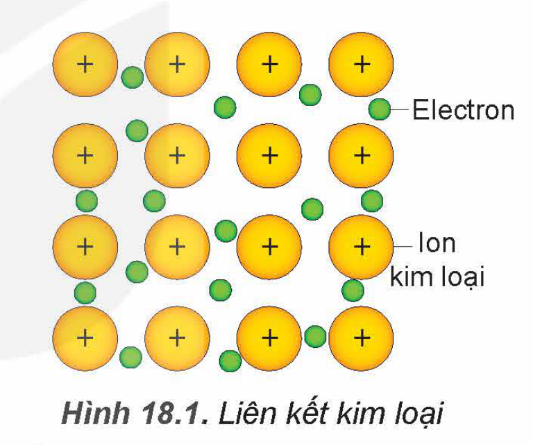

<!-- pdf:89 -->

# BÀI 18: CẤU TẠO VÀ LIÊN KẾT TRONG TINH THỂ KIM LOẠI

## 🎯 Mục tiêu

- Trình bày được đặc điểm cấu tạo của nguyên tử kim loại và tinh thể kim loại.
- Nêu được đặc điểm của liên kết kim loại.

## 🔴 Mở đầu

Kim loại được sử dụng nhiều trong cuộc sống như các kết cấu bằng thép, dây dẫn điện bằng đồng, đồ trang sức bằng vàng,... Kim loại có đặc điểm gì về cấu tạo nguyên tử và liên kết mà hữu dụng như vậy?

## I. ĐẶC ĐIỂM CẤU TẠO CỦA NGUYÊN TỬ KIM LOẠI

> ✋ Dựa vào bảng tuần hoàn các nguyên tố hoá học, hãy cho biết:
>
> 1. Các nguyên tố khối s, d, f thường là kim loại hay phi kim?
> 2. Kể tên các kim loại thuộc nhóm IA và IIA.
> 3. Các nguyên tố kim loại thường có bao nhiêu electron ở lớp ngoài cùng?

Trong cùng một chu kì, so với các nguyên tử nguyên tố phi kim, nguyên tử kim loại có điện tích hạt nhân nhỏ hơn và bán kính lớn hơn nên dễ nhường electron hoá trị hơn và có độ âm điện nhỏ hơn.

> ❓ 1. Viết cấu hình electron nguyên tử của Sc (Z = 21) và Ti (Z = 22). Cho biết số electron ở lớp ngoài cùng và trên phân lớp d sát lớp ngoài cùng.

## II. TINH THỂ KIM LOẠI

### 1. Tinh thể kim loại

<!-- term: Tinh thể kim loại -->
Ở nhiệt độ phòng, các đơn chất kim loại ở thể rắn và có cấu tạo tinh thể (trừ thuỷ ngân ở thể lỏng).

<!-- term: Tinh thể kim loại -->
Trong tinh thể kim loại, các ion dương kim loại nằm ở các nút mạng tinh thể và các electron hoá trị chuyển động tự do xung quanh.

<!-- pdf:90 -->

> 💡 EM CÓ BIẾT
>
> Các kiểu mạng tinh thể phổ biến của kim loại:
>
> | Kiểu mạng tinh thể | Mạng lập phương tâm khối | Mạng lập phương tâm mặt | Mạng lục phương chặt khít |
> |---|---|---|---|
> | Cấu trúc | *(hình vẽ cấu trúc)* | *(hình vẽ cấu trúc)* | *(hình vẽ cấu trúc)* |
> | Độ đặc khít (%) | 68 | 74 | 74 |
> | Số phối trí | 8 | 12 | 12 |
> | Ví dụ | Li, Na, K, Ba,... | Ca, Sr, Cu,... | Be, Mg,... |
<!-- ocr-ok: bảng cấu trúc mạng tinh thể trong hộp Em có biết, OCR đọc sai dòng cấu trúc; đã đối chiếu ảnh -->

### 2. Liên kết kim loại

Trong tinh thể kim loại, **liên kết kim loại** được hình thành do lực hút tĩnh điện giữa các electron hoá trị tự do với các ion dương kim loại ở các nút mạng.

Hình 18.1. Liên kết kim loại

> ❓ 2. Hãy cho biết liên kết kim loại có đặc điểm gì giống và khác với liên kết ion.

## 📌 Em đã học

- Nguyên tử của hầu hết các kim loại có từ 1 đến 3 electron ở lớp ngoài cùng. Nguyên tử kim loại dễ nhường electron và có độ âm điện nhỏ hơn so với các nguyên tử phi kim.
- Ở nhiệt độ phòng, các đơn chất kim loại ở thể rắn và có cấu tạo tinh thể (trừ thuỷ ngân).
- Liên kết kim loại được hình thành do lực hút tĩnh điện giữa các electron hoá trị tự do với các ion dương kim loại trong mạng tinh thể kim loại.

## ✏️ Em có thể

- So sánh được đặc điểm liên kết kim loại với liên kết ion.

## 📷 Danh sách hình trong bài

| Mã hình | Trang PDF | Vị trí | Chú thích gốc |
|---|---|---|---|
| H12-hoa-b18-01 | 90 | Mục II.2 | Hình 18.1. Liên kết kim loại |
