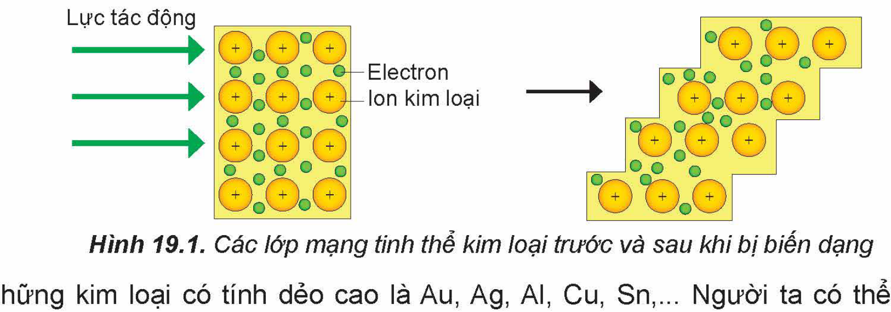
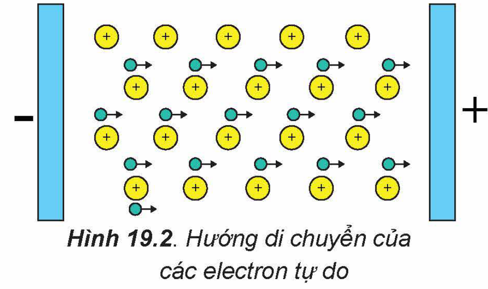

<!-- pdf:91 -->

# BÀI 19: TÍNH CHẤT VẬT LÍ VÀ TÍNH CHẤT HOÁ HỌC CỦA KIM LOẠI

## 🎯 Mục tiêu

- Giải thích được một số tính chất vật lí chung của kim loại (tính dẻo, tính dẫn điện, tính dẫn nhiệt, tính ánh kim).
- Trình bày được ứng dụng từ tính chất vật lí chung và riêng của kim loại.
- Sử dụng bảng giá trị thế điện cực chuẩn của một số cặp oxi hoá – khử phổ biến của ion kim loại/kim loại (có bổ sung thế điện cực chuẩn của các cặp $\ce{H2O/OH- + 1/2 H2}$; $\ce{2H+/H2}$) để giải thích được các trường hợp kim loại phản ứng với dung dịch HCl, $\ce{H2SO4}$ loãng và đặc; nước; dung dịch muối.
- Trình bày được phản ứng của kim loại với phi kim (chlorine, oxygen, lưu huỳnh) và viết được các phương trình hoá học.
- Thực hiện được một số thí nghiệm của kim loại tác dụng với phi kim, acid (HCl, $\ce{H2SO4}$), muối.

## 🔴 Mở đầu

Tại sao kim loại có thể được sử dụng làm dây dẫn điện, chế tạo dụng cụ đun nấu, dùng trong công trình xây dựng? Kim loại có những tính chất hoá học đặc trưng nào?

## I. TÍNH CHẤT VẬT LÍ

Ở điều kiện thường, các kim loại đều có tính dẻo, dẫn điện, dẫn nhiệt và có ánh kim.

### 1. Tính dẻo

<!-- term: Tính dẻo -->
Kim loại có tính dẻo: dễ rèn, dễ dát mỏng và dễ kéo sợi. Tính chất này khác với phi kim và các hợp chất ion.

Khi thanh kim loại chịu lực tác động (rèn, cán, kéo,...), các ion dương kim loại trong mạng tinh thể kim loại có thể trượt lên nhau mà không tách rời nhau. Đó là do các electron tự do trong mạng tinh thể kim loại chuyển động, liên kết các ion dương kim loại lại với nhau (Hình 19.1).

Hình 19.1. Các lớp mạng tinh thể kim loại trước và sau khi bị biến dạng

Những kim loại có tính dẻo cao là Au, Ag, Al, Cu, Sn,... Người ta có thể dát được những lá vàng mỏng tới khoảng 8 nm.

Nhờ có tính dẻo mà kim loại có thể được uốn cong, ép khuôn thành nhiều hình dạng hay kích thước khác nhau.

<!-- pdf:92 -->

> ❓ 1. Vì sao kim loại có tính dẻo?

### 2. Tính dẫn điện

<!-- term: Tính dẫn điện -->
Tất cả các kim loại đều có tính dẫn điện. Khi một hiệu điện thế được áp vào thanh kim loại, các electron tự do trong mạng tinh thể sẽ di chuyển từ phía cực âm về phía cực dương (Hình 19.2). Hệ quả là thanh kim loại trở thành vật dẫn điện.

Hình 19.2. Hướng di chuyển của các electron tự do

Bạc (Ag) là kim loại dẫn điện tốt nhất, tiếp sau bạc là đồng (Cu), vàng (Au) và nhôm (Al),... Tuy nhiên, nhôm và đồng thường được sử dụng làm dây dẫn điện hơn.

> ❓ 2.
>
> a) Hãy nêu sự khác biệt giữa liên kết kim loại và liên kết cộng hoá trị.
>
> b) Vì sao kim loại có tính dẫn điện, trong khi hầu hết các phi kim không dẫn điện?

### 3. Tính dẫn nhiệt

<!-- term: Tính dẫn nhiệt -->
Tính dẫn nhiệt của các kim loại cũng được giải thích bằng sự có mặt của các electron tự do trong mạng tinh thể. Khi đốt nóng một đầu của thanh kim loại thì động năng của các electron trong vùng đó tăng lên. Các electron này truyền động năng của chúng cho các ion dương ở các nút mạng và các electron khác trong toàn thanh kim loại thông qua va chạm, làm cho nhiệt được lan truyền trong toàn bộ thanh kim loại.

Các kim loại dẫn điện tốt thường dẫn nhiệt tốt. Do có tính dẫn nhiệt tốt, các kim loại hoặc hợp kim được sử dụng làm các dụng cụ đun nấu như xoong, nồi, chảo,...

> ❓ 3. Vì sao kim loại có tính dẫn nhiệt tốt? Hãy nêu một số ứng dụng của kim loại dựa trên tính dẫn nhiệt của chúng.

### 4. Tính ánh kim

<!-- term: Ánh kim -->
Các electron tự do trong tinh thể kim loại phản xạ hầu hết những tia sáng nhìn thấy được. Do đó, kim loại có vẻ sáng lấp lánh, gọi là “ánh kim”.

Trên thực tế, khi nhìn vào nhiều kim loại không thấy ánh kim vì chúng thường bị bao phủ bởi một lớp oxide, ví dụ như sắt thường có gỉ sắt, nhôm bị phủ lớp aluminium oxide,...

> ❓ 4. Vì sao kim loại có ánh kim? Hãy nêu một số ứng dụng của kim loại dựa trên tính ánh kim của chúng.

<!-- pdf:93 -->

### 5. Một số tính chất vật lí khác của kim loại

**a) Khối lượng riêng**

Khối lượng riêng của các kim loại rất khác nhau. Kim loại nhẹ nhất là lithium ($D = 0{,}534\text{ g/cm}^3$), kim loại nặng nhất là osmium ($D = 22{,}6\text{ g/cm}^3$). Kim loại có $D < 5\text{ g/cm}^3$, được gọi là **kim loại nhẹ**, những kim loại có $D \ge 5\text{ g/cm}^3$, được gọi là **kim loại nặng**.

**b) Nhiệt độ nóng chảy**

Nhiệt độ nóng chảy của các kim loại biến đổi trong khoảng rộng: Có kim loại nóng chảy ở nhiệt độ rất cao, như tungsten (vonfram, W) nóng chảy ở 3 410 °C; kim loại duy nhất ở trạng thái lỏng trong điều kiện thường là thuỷ ngân (nhiệt độ nóng chảy là –39 °C).

**c) Tính cứng**

Các kim loại có độ cứng rất khác nhau. Kim loại cứng nhất là chromium, có thể cắt được kính, các kim loại mềm nhất là kim loại kiềm như potassium, rubidium, sodium và caesium, chúng có thể được cắt dễ dàng bằng dao.

> ✋ Hãy tìm hiểu và trình bày một số ứng dụng của kim loại có nhiệt độ nóng chảy cao và kim loại có độ cứng lớn.

## II. TÍNH CHẤT HOÁ HỌC

Các nguyên tử kim loại dễ nhường electron hoá trị:

$\ce{M -> M^n+ + ne}$

Trong đó: M là kí hiệu của kim loại.

Như vậy, tính chất hoá học chung của kim loại là tính khử.

### 1. Tác dụng với phi kim

Hầu hết các kim loại đều phản ứng với các phi kim điển hình.

> 🧪 Thí nghiệm: Kim loại tác dụng với phi kim
>
> Chuẩn bị:
>
> Hoá chất: dây magnesium (Mg), nhôm bột, lưu huỳnh bột.
>
> Dụng cụ: kẹp sắt, ống nghiệm chịu nhiệt, đũa thuỷ tinh, đèn cồn.
>
> Tiến hành:
>
> 1. Magnesium tác dụng với oxygen: Dùng kẹp sắt kẹp một mẩu dây magnesium (Mg) và đốt trên ngọn lửa đèn cồn.
>
> 2. Nhôm tác dụng với lưu huỳnh: Trộn đều bột nhôm và bột lưu huỳnh theo tỉ lệ khối lượng tương ứng khoảng 1 : 2. Lấy một thìa thuỷ tinh (khoảng 0,3 g) hỗn hợp vào ống nghiệm khô chịu nhiệt. Hơ nóng đều ống nghiệm trên ngọn lửa đèn cồn, sau đó đun tập trung vào phần ống nghiệm chứa hỗn hợp.
>
> Thực hiện yêu cầu sau:
>
> Hãy mô tả hiện tượng quan sát được và viết phương trình hoá học của các phản ứng xảy ra.

<!-- pdf:94 -->

**a) Tác dụng với oxygen**

Hầu hết các kim loại (trừ vàng, bạc, platinum,...) đều tác dụng với oxygen tạo thành oxide.

*Ví dụ:* Khi đốt nóng, bột nhôm cháy mạnh trong không khí tạo thành aluminium oxide:

$\ce{4Al(s) + 3O2(g) -> 2Al2O3(s)}$

**b) Tác dụng với chlorine**

Hầu hết các kim loại đều tác dụng với khí chlorine khi đun nóng, thu được muối chloride tương ứng.

*Ví dụ:* Dây sắt nóng đỏ cháy mạnh trong khí chlorine tạo ra khói màu nâu có chứa iron(III) chloride:

$\ce{2Fe(s) + 3Cl2(g) -> 2FeCl3(s)}$

**c) Tác dụng với lưu huỳnh (sulfur)**

Nhiều kim loại có thể khử lưu huỳnh khi đun nóng (trừ thuỷ ngân phản ứng ngay ở nhiệt độ thường).

*Ví dụ:*

$\ce{Fe(s) + S(s) ->[t^o] FeS(s)}$

$\ce{Hg(l) + S(s) -> HgS(s)}$

> ❓ 5. Khi tác dụng với phi kim, kim loại thể hiện tính chất hoá học gì? Minh hoạ bằng các phương trình hoá học.

### 2. Tác dụng với nước

Hầu hết các kim loại nhóm IA, IIA có tính khử mạnh, tác dụng với nước ở nhiệt độ thường giải phóng $\ce{H2}$.

*Ví dụ:* $\ce{2Na(s) + 2H2O(l) -> 2NaOH(aq) + H2(g)}$

Những kim loại có thế điện cực chuẩn $E^o_{\ce{M^n+/M}}$ nhỏ hơn –0,414 V có thể đẩy được hydrogen ra khỏi nước.

> ❓ 6. Hãy cho biết kim loại nào trong Bảng 15.1 có thể phản ứng được với nước ở nhiệt độ thường giải phóng khí hydrogen.

### 3. Tác dụng với dung dịch acid

**a) Với dung dịch HCl, $\ce{H2SO4}$ loãng**
<!-- ocr-ok: OCR đọc sai công thức HCl thành HCI và H2SO4 thành H,SO,; đã đối chiếu ảnh -->

> 🧪 Thí nghiệm: Kim loại tác dụng với dung dịch acid loãng
>
> Chuẩn bị:
>
> Hoá chất: dung dịch $\ce{H2SO4}$ 10%, kẽm hạt.
>
> Dụng cụ: ống nghiệm, kẹp gỗ.
>
> Tiến hành:
>
> Cho vài hạt kẽm vào ống nghiệm. Thêm tiếp khoảng 2 mL dung dịch $\ce{H2SO4}$ 10%.
>
> Thực hiện yêu cầu sau:
>
> Hãy mô tả hiện tượng quan sát được và viết phương trình hoá học.

<!-- pdf:95 -->

Ở điều kiện chuẩn, những kim loại có $E^o_{\ce{M^n+/M}} < 0$ có thể tác dụng với các dung dịch acid (như HCl, $\ce{H2SO4}$) tạo thành $\ce{H2}$.

*Ví dụ:* Sắt phản ứng với dung dịch $\ce{H2SO4}$ loãng theo phương trình hoá học sau:

$\ce{\overset{0}{Fe}(s) + \overset{+1}{H2}SO4(aq) -> \overset{+2}{Fe}SO4(aq) + \overset{0}{H2}(g)}$

> ❓ 7. Các kim loại từ Cu đến Au trong dãy điện hoá không đẩy được $\ce{H2}$ ra khỏi dung dịch của các acid như HCl, $\ce{H2SO4}$ loãng. Hãy dựa vào thế điện cực chuẩn của các cặp oxi hoá – khử tương ứng để giải thích.

**b) Với dung dịch $\ce{H2SO4}$ đặc**

Hầu hết kim loại (trừ Pt, Au) khử được $\ce{\overset{+6}{S}}$ (trong $\ce{H2SO4}$ đặc) xuống số oxi hoá thấp hơn.

*Ví dụ:* $\ce{\overset{0}{Cu}(s) + 2H2\overset{+6}{S}O4(\text{đặc}) ->[t^o] \overset{+2}{Cu}SO4(aq) + \overset{+4}{S}O2(g) + 2H2O(l)}$

*Chú ý:* $\ce{HNO3}$ đặc, nguội và $\ce{H2SO4}$ đặc, nguội làm thụ động hoá Al, Fe, Cr,...

### 4. Tác dụng với dung dịch muối

Kim loại hoạt động mạnh hơn có thể đẩy kim loại hoạt động yếu hơn ra khỏi dung dịch muối của nó.

*Ví dụ:* $\ce{Cu(s) + 2AgNO3(aq) -> Cu(NO3)2(aq) + 2Ag(s)}$

> 🧪 Kim loại tác dụng với dung dịch muối
>
> Chuẩn bị:
>
> Hoá chất: đinh sắt mới (đã rửa sạch lớp dầu mỡ), dung dịch $\ce{CuSO4}$ 1 M.
>
> Dụng cụ: cốc thuỷ tinh, kẹp sắt.
>
> Tiến hành: Cho đinh sắt vào cốc. Thêm tiếp 2 – 3 mL dung dịch $\ce{CuSO4}$ 1 M. Sau 5 phút dùng kẹp lấy đinh sắt ra khỏi dung dịch.
>
> Thực hiện yêu cầu sau:
>
> Mô tả hiện tượng xảy ra, giải thích và viết phương trình hoá học.

## 📌 Em đã học

- Ở điều kiện thường, các kim loại đều ở trạng thái rắn (trừ Hg), có tính dẻo, dẫn điện, dẫn nhiệt và có ánh kim.
- Một số ứng dụng dựa trên tính chất vật lí chung và các tính chất vật lí riêng của kim loại (như khối lượng riêng, nhiệt độ nóng chảy, tính cứng).
- Tính chất hoá học của kim loại: kim loại phản ứng với phi kim; với dung dịch HCl, $\ce{H2SO4}$ loãng và $\ce{H2SO4}$ đặc; với nước và với dung dịch muối.

## ✏️ Em có thể

- Giải thích được các ứng dụng của kim loại dựa trên tính chất vật lí của chúng.
- Giải thích được vì sao các vật bằng sắt thép bị phá huỷ nhanh hơn trong môi trường acid loãng, còn vật bằng đồng thì khó bị phá huỷ hơn.

## 📷 Danh sách hình trong bài

| Mã hình | Trang PDF | Vị trí | Chú thích gốc |
|---|---|---|---|
| H12-hoa-b19-01 | 91 | Mục I.1 | Hình 19.1. Các lớp mạng tinh thể kim loại trước và sau khi bị biến dạng |
| H12-hoa-b19-02 | 92 | Mục I.2 | Hình 19.2. Hướng di chuyển của các electron tự do |
