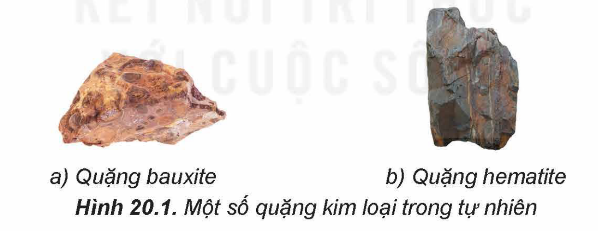
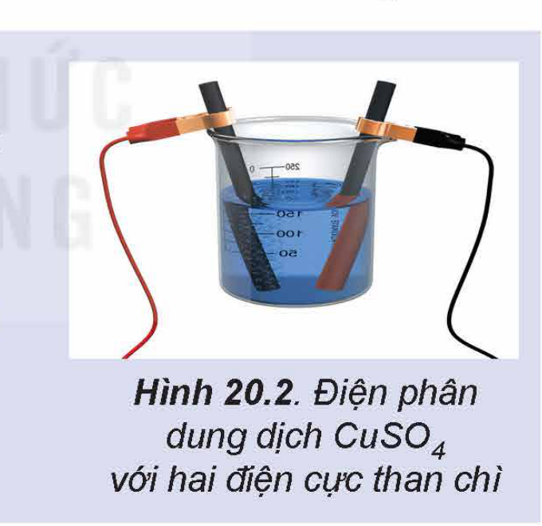

<!-- pdf:96 -->

# BÀI 20: KIM LOẠI TRONG TỰ NHIÊN VÀ PHƯƠNG PHÁP TÁCH KIM LOẠI

## 🎯 Mục tiêu

- Nêu được khái quát trạng thái tự nhiên của kim loại và một số quặng, mỏ kim loại phổ biến.
- Trình bày và giải thích được phương pháp tách kim loại hoạt động mạnh như sodium, magnesium, nhôm (aluminium).
- Trình bày và giải thích được phương pháp tách kim loại hoạt động trung bình như kẽm (zinc), sắt (iron); phương pháp tách kim loại kém hoạt động như đồng (copper).
- Trình bày được nhu cầu và thực tiễn tái chế kim loại phổ biến như sắt, nhôm, đồng,...

## 🔴 Mở đầu

Trong tự nhiên, các kim loại (trừ vàng, bạc và platinum) thường tồn tại dưới dạng hợp chất trong quặng. Làm thế nào để tách kim loại ra khỏi quặng?

## I. KIM LOẠI TRONG TỰ NHIÊN

Trong tự nhiên, hầu hết các kim loại tồn tại ở dạng hợp chất (oxide, muối,...) trong quặng, chỉ một số kim loại kém hoạt động như vàng, bạc, platinum,... được tìm thấy dưới dạng đơn chất.

<!-- term: Quặng -->
***Quặng*** là những loại đất, đá tồn tại trong tự nhiên có chứa khoáng vật của kim loại hoặc hợp chất kim loại với trữ lượng đủ lớn để có thể khai thác (Hình 20.1). Quặng thường chứa tạp chất. Phương pháp được sử dụng để tách một kim loại nhất định từ quặng của nó phụ thuộc vào tính chất của kim loại và của quặng.

Hình 20.1. Một số quặng kim loại trong tự nhiên: a) Quặng bauxite; b) Quặng hematite

Một số loại quặng kim loại thông dụng được trình bày trong Bảng 20.1.

**Bảng 20.1. Một số quặng kim loại thông dụng**

| Kim loại | Quặng | Thành phần chính |
| :--- | :--- | :--- |
| Al | Bauxite | $\ce{Al2O3.2H2O}$ |
| Zn | Zinc blende | $\ce{ZnS}$ |
| Fe | Hematite | $\ce{Fe2O3}$ |
| | Pyrite | $\ce{FeS2}$ |
| Cu | Chalcopyrite | $\ce{CuFeS2}$ |
<!-- ocr-ok: Bảng 20.1 công thức hoá học và kí hiệu Al, Fe, Cu bị OCR nhận dạng nhầm -->

<!-- pdf:97 -->

> ✋
> 1.
> a) Hãy cho biết những kim loại nào tồn tại ở dạng đơn chất trong tự nhiên.
> b) Hãy tìm hiểu và cho biết một số mỏ quặng kim loại quan trọng ở Việt Nam.

## II. CÁC PHƯƠNG PHÁP TÁCH KIM LOẠI

### 1. Nguyên tắc

Nguyên tắc điều chế kim loại là khử ion kim loại thành nguyên tử:

$\ce{M^{n+} + n e -> M}$

### 2. Tách kim loại hoạt động hoá học mạnh - Điện phân nóng chảy

<!-- term: Điện phân nóng chảy -->
Những kim loại hoạt động hoá học mạnh như K, Na, Ca, Mg, Al,... được điều chế bằng phương pháp điện phân nóng chảy các hợp chất của chúng (oxide, muối chloride).

**a) Điện phân oxide nóng chảy**

> ✋ Hãy tìm hiểu quá trình điện phân $\ce{Al2O3}$ nóng chảy và thực hiện các yêu cầu sau:
> 1. Nêu vai trò của cryolite trong quá trình điện phân.
> 2. Tại sao sau một thời gian, cần phải thay cực dương của bình điện phân. Viết các phương trình hoá học để giải thích.

**b) Điện phân muối chloride nóng chảy**

Để điều chế các kim loại như K, Na, Ca, Mg,... người ta điện phân muối chloride của chúng ở trạng thái nóng chảy.

*Ví dụ:* Điện phân $\ce{MgCl2}$ nóng chảy.

$\ce{MgCl2}$ nóng chảy phân li thành các ion $\ce{Mg^2+}$ và ion $\ce{Cl-}$. Cation $\ce{Mg^2+}$ di chuyển về cực âm (cathode) và anion $\ce{Cl-}$ di chuyển về cực dương (anode) của bình điện phân.

Ở cathode: $\ce{Mg^2+ + 2e -> Mg}$

Ở anode: $\ce{2Cl- -> Cl2 + 2e}$

Phương trình hoá học của phản ứng điện phân: $\ce{MgCl2(l) ->[đpnc] Mg(l) + Cl2(g)}$.

> ✋
> 2.
> a) Hãy cho biết những kim loại nào thường được điều chế bằng phương pháp điện phân nóng chảy. Giải thích.
> b) Hãy viết các quá trình xảy ra trên các điện cực và phương trình hoá học của phản ứng khi điện phân nóng chảy muối ăn.

<!-- pdf:98 -->

### 3. Tách kim loại hoạt động trung bình, yếu

**a) Phương pháp nhiệt luyện**

<!-- term: Phương pháp nhiệt luyện -->
*Nguyên tắc:* Khử các oxide kim loại ở nhiệt độ cao bằng chất khử như C, CO,...

Những kim loại có độ hoạt động trung bình, yếu như Zn, Fe, Sn, Pb, Cu,... thường được điều chế bằng phương pháp nhiệt luyện.

*Ví dụ 1:* Tách kẽm từ quặng zinc blende.

Đốt quặng zinc blende: $\ce{2ZnS(s) + 3O2(g) -> 2ZnO(s) + 2SO2(g)}$.

Khử zinc oxide ở nhiệt độ cao bằng than cốc: $\ce{ZnO(s) + C(s) -> Zn(g) + CO(g)}$.

*Ví dụ 2:* Tách sắt từ quặng hematite.

Ở nhiệt độ cao, sắt được tách ra khỏi iron(III) oxide bởi carbon monoxide:
$\ce{Fe2O3(s) + 3CO(g) -> 2Fe(l) + 3CO2(g)}$

> ✋ 3. Hãy kể tên một số kim loại được điều chế bằng phương pháp nhiệt luyện.

**b) Phương pháp điện phân dung dịch**

<!-- term: Phương pháp điện phân dung dịch -->
Kim loại hoạt động trung bình hoặc yếu có thể được điều chế bằng cách điện phân dung dịch muối của chúng.

*Ví dụ:* Điện phân dung dịch $\ce{CuCl2}$ để điều chế Cu.

Phương trình hoá học của phản ứng điện phân: $\ce{CuCl2(aq) ->[đpdd] Cu(s) + Cl2(g)}$

> ✋ Quan sát Hình 20.2 và thực hiện các yêu cầu sau:
> 1. Cho biết điện cực nào là điện cực dương, điện cực nào là điện cực âm.
> 2. Hãy viết các quá trình xảy ra trên các điện cực và phương trình hoá học của phản ứng điện phân dung dịch $\ce{CuSO4}$.

Hình 20.2. Điện phân dung dịch $\ce{CuSO4}$ với hai điện cực than chì

**c) Phương pháp thuỷ luyện**

<!-- term: Phương pháp thuỷ luyện -->
Cơ sở của phương pháp này là dùng những dung dịch thích hợp như dung dịch $\ce{H2SO4}$, NaOH, NaCN,... để hoà tan kim loại hoặc hợp chất của kim loại, tách phần không tan ra khỏi dung dịch. Sau đó khử những ion kim loại này trong dung dịch bằng kim loại có tính khử mạnh hơn như Fe, Zn,...

*Ví dụ:* Dùng Fe để khử ion $\ce{Cu^2+}$ trong dung dịch muối đồng.
$\ce{Fe(s) + CuSO4(aq) -> FeSO4(aq) + Cu(s)}$

<!-- pdf:99 -->

> 💡 EM CÓ BIẾT
> Trong công nghiệp, phương pháp thuỷ luyện thường được dùng để điều chế các kim loại quý như Au, Ag.
> *Ví dụ:* Au tồn tại trong tự nhiên dưới dạng đơn chất nhưng quặng vàng thường có hàm lượng vàng thấp. Người ta nghiền quặng, hoà tan chúng vào dung dịch KCN và liên tục sục không khí vào. Vàng bị hoà tan tạo thành phức chất:
> $\ce{4Au(s) + 8KCN(aq) + O2(g) + 2H2O(l) -> 4K[Au(CN)2](aq) + 4KOH(aq)}$
> Dùng bột kẽm đẩy vàng ra khỏi hợp chất:
> $\ce{2K[Au(CN)2](aq) + Zn(s) -> K2[Zn(CN)4](aq) + 2Au(s)}$

## III. TÁI CHẾ KIM LOẠI

<!-- term: Tái chế kim loại -->
Hiện nay, trữ lượng các mỏ quặng kim loại ngày càng cạn kiệt, trong khi nhu cầu sử dụng kim loại ngày càng tăng và lượng phế thải kim loại tạo ra ngày càng nhiều. Do đó, tái chế kim loại là công việc cần thiết, vừa đảm bảo nguồn cung, vừa gia tăng giá trị kinh tế, bảo vệ môi trường và thực hiện mục tiêu phát triển bền vững.

Quy trình tái chế kim loại thường gồm các giai đoạn: thu gom, phân loại; xử lí sơ bộ; phối trộn phế liệu; nấu chảy; tinh chế; đúc, chế tạo, gia công.

**Tái chế nhôm**

Nhôm là một trong những kim loại có thể được tái chế hiệu quả nhất, tiết kiệm năng lượng so với sản xuất từ quặng. Giống như hầu hết các kim loại, nhôm có thể được tái chế nhiều lần mà không mất đi các tính chất vốn có của nó. Nhôm tái chế được sử dụng trong các lĩnh vực như xây dựng, sản xuất ô tô, xe máy, xe đạp, thiết bị điện tử,... Hiện nay, khoảng 75% tổng lượng nhôm từng được sản xuất vẫn đang được sử dụng.(1)

**Tái chế đồng**

Đồng cũng có thể được tái chế nhiều lần mà ít bị tiêu hao. Đồng tái chế được sử dụng trong nhiều lĩnh vực như làm vật liệu xây dựng, phương tiện giao thông, dụng cụ nấu ăn, nhạc cụ, dây dẫn điện,... Tái chế đồng giúp tiết kiệm một lượng lớn năng lượng so với sản xuất kim loại từ quặng. Ước tính khoảng 80% lượng đồng từng được khai thác từ Trái Đất vẫn đang được sử dụng cho đến ngày nay.(2)

**Tái chế sắt**

Sắt là kim loại được tái chế nhiều nhất trên thế giới và có thể tái chế nhiều lần. Tái chế sắt giúp tiết kiệm năng lượng so với sản xuất sắt thép từ quặng sắt, giảm thiểu một số tác động tiêu cực tới môi trường của quá trình khai thác quặng. Phần lớn sắt tái chế được sử dụng để sản xuất thép. Sắt thép tái chế được sử dụng trong các lĩnh vực xây dựng, sản xuất ô tô,...

*(1) Nguồn: Dierk Raabe, et al. 2022. Making sustainable aluminum by recycling scrap: The science of "dirty" alloys. Progress in Materials Science, 128, page 100947.*

*(2) Nguồn: Lusty, P. A. J. & Hannis, S. D. 2009. Commodity Profile: Copper. Keyworth, Nottingham: British Geological Survey.*

<!-- pdf:100 -->

> 💡 EM CÓ BIẾT
> - Khoảng 70% trọng lượng xe hơi là thép. Quá trình tái chế xe hơi phế liệu cung cấp một lượng rất lớn thép mỗi năm.
> - Việc tái chế thép giúp giảm 80% lượng khí thải $\ce{CO2}$ so với sản xuất thép mới từ nguyên liệu thô. Các quy trình tái chế thép cũng giảm 40% mức tiêu thụ nước và ô nhiễm nước xuống 76%.
>
> *(Nguồn: Yue, K. 2012. Comparative analysis of scrap car recycling management policies. The 7th International Conference on Waste Management and Technology Conference, pages 44 – 50.)*

> ✋ Em hãy tìm hiểu, trình bày nhu cầu sử dụng và thực tiễn tái chế sắt, nhôm, đồng ở Việt Nam.

## 📌 Em đã học

- Trong tự nhiên, hầu hết các kim loại tồn tại ở dạng hợp chất trong quặng, chỉ một vài kim loại kém hoạt động như vàng, bạc, platinum,... được tìm thấy dưới dạng đơn chất.
- Nguyên tắc điều chế kim loại là khử ion kim loại thành nguyên tử:
  $\ce{M^{n+} + n e -> M}$
  - Những kim loại hoạt động hoá học mạnh được điều chế bằng phương pháp điện phân nóng chảy các hợp chất của chúng.
  - Những kim loại hoạt động trung bình, yếu thường được điều chế bằng phương pháp nhiệt luyện hoặc điện phân dung dịch muối của chúng hoặc thuỷ luyện.
- Sắt, nhôm, đồng là những vật liệu kim loại được sử dụng phổ biến nhất, nhu cầu tái chế nhiều nhất và việc tái chế kim loại góp phần giảm thiểu ô nhiễm môi trường.

## ✏️ Em có thể

- Trình bày được nguyên tắc tinh chế kẽm, đồng bằng phương pháp điện phân dung dịch.
- Trình bày được thực tiễn tái chế sắt, nhôm, đồng ở Việt Nam.

## 📷 Danh sách hình trong bài

| Mã hình | Trang PDF | Vị trí | Chú thích gốc |
|---|---|---|---|
| H12-hoa-b20-01 | 96 | Mục I | Hình 20.1. Một số quặng kim loại trong tự nhiên: a) Quặng bauxite; b) Quặng hematite |
| H12-hoa-b20-02 | 98 | Mục II.3 | Hình 20.2. Điện phân dung dịch $\ce{CuSO4}$ với hai điện cực than chì |
