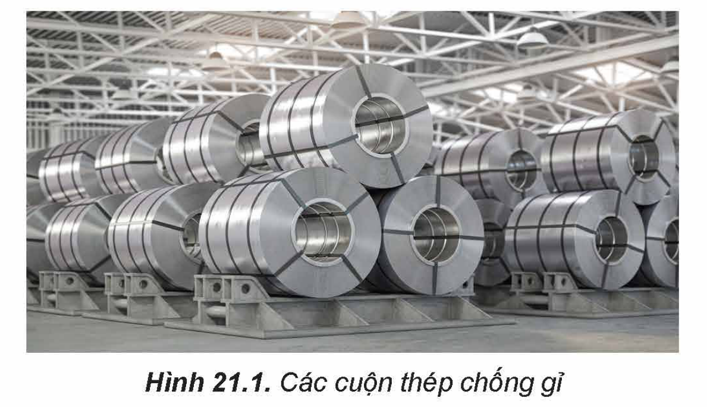

<!-- pdf:101 -->

# BÀI 21: HỢP KIM

## 🎯 Mục tiêu

- Trình bày được khái niệm hợp kim và việc sử dụng phổ biến hợp kim.
- Trình bày được một số tính chất của hợp kim so với kim loại thành phần.
- Nêu được thành phần, tính chất và ứng dụng của một số hợp kim quan trọng của sắt và nhôm (gang, thép, duralumin,...).

## 🔴 Mở đầu

Khung xe đạp, xe máy, ô tô hay thân vỏ máy bay thường được làm bằng hợp kim. Vậy, hợp kim là gì? Hợp kim có những tính chất khác biệt nào so với kim loại thành phần mà được sử dụng rộng rãi như vậy?

## I. KHÁI NIỆM VÀ ỨNG DỤNG CỦA HỢP KIM

### 1. Khái niệm hợp kim

<!-- term: Hợp kim -->
***Hợp kim*** là vật liệu kim loại chứa một kim loại cơ bản và một số kim loại khác hoặc phi kim.

*Ví dụ:* Thép, gang là hợp kim của Fe với C và một số nguyên tố khác (Mn, Si,...); Duralumin là hợp kim của Al với Cu, Mn, Mg, Si.

Hợp kim thường được điều chế bằng cách nung chảy các thành phần rồi để nguội.

### 2. Ứng dụng của hợp kim

> ✋ Trong đời sống và sản xuất, hợp kim được sử dụng rộng rãi hơn nhiều so với kim loại nguyên chất. Hãy tìm hiểu và nêu tên gọi, thành phần chính của các hợp kim có đặc điểm sau:
> a) Hợp kim nhẹ, bền, dùng để chế tạo các chi tiết của máy bay, ô tô,...
> b) Hợp kim cứng và bền dùng để xây dựng nhà cửa, cầu cống.

Từ thời cổ đại, con người đã biết sử dụng hợp kim để làm công cụ lao động và chế tạo vũ khí. Ngày nay, hợp kim được sử dụng rộng rãi trong đời sống và sản xuất. Trong lĩnh vực chế tạo máy bay, ô tô,... sử dụng những hợp kim nhẹ, bền, chịu nhiệt,... Ngành công nghiệp hoá chất sử dụng những hợp kim có tính bền hoá học và cơ học cao,... Các đồ gia dụng được làm từ những hợp kim không gỉ, không độc hại,...

> ❓ 1. Hãy nêu tên và ứng dụng của một số hợp kim thông dụng của nhôm và sắt.

## II. TÍNH CHẤT CỦA HỢP KIM

Tính chất của hợp kim phụ thuộc vào thành phần các đơn chất tham gia cấu tạo mạng tinh thể của hợp kim. Nhìn chung, hợp kim có nhiều tính chất hoá học tương tự các kim loại thành phần, nhưng tính chất vật lí thường khác nhau nhiều.

<!-- pdf:102 -->

- Hợp kim có những tính chất vật lí chung như có ánh kim, dẫn điện, dẫn nhiệt,... Tuy nhiên, tính dẫn điện và dẫn nhiệt kém hơn kim loại cơ bản trong hợp kim.

*Ví dụ:* đồng dẫn điện tốt hơn hợp kim đồng.

- Độ cứng của hợp kim thường lớn hơn độ cứng của kim loại thành phần trong hợp kim và độ dẻo thường kém hơn.

*Ví dụ:* hợp kim Au – Cu (khoảng 8% – 12% Cu) cứng hơn vàng, dùng đúc tiền, làm đồ trang sức, ngòi bút máy.

- Nhiệt độ nóng chảy của hợp kim tuỳ thuộc vào thành phần và cấu tạo tinh thể của hợp kim, nhưng khác so với kim loại thành phần trong hợp kim.

*Ví dụ:* gang là hợp kim Fe – C có nhiệt độ nóng chảy thấp hơn nhiệt độ nóng chảy của sắt nguyên chất.

## III. MỘT SỐ HỢP KIM QUAN TRỌNG CỦA SẮT VÀ NHÔM

### 1. Hợp kim của sắt

**a) Gang**

<!-- term: Gang -->
***Gang*** là hợp kim chứa khoảng 95% sắt, 2% đến 4% carbon và một số nguyên tố khác như manganese, silicon, phosphorus, sulfur,... Gang cứng hơn nhưng cũng giòn hơn sắt. Gang được sử dụng để làm nguyên liệu sản xuất thép, chế tạo dụng cụ đun nấu, các chi tiết máy,...

**b) Thép**

<!-- term: Thép -->
***Thép*** là hợp kim của sắt chứa ít hơn 2,0% carbon và một số nguyên tố như chromium, manganese, silicon,... tạo cho thép có tính cứng, tính chịu nhiệt và các tính chất quý khác. Thép là vật liệu chủ yếu trong ngành chế tạo máy, xây dựng và nhiều lĩnh vực khác của đời sống và sản xuất.

Các tính chất của thép có thể được điều chỉnh để phù hợp với mục đích sử dụng, thường bằng cách thêm các kim loại như titanium, vanadium, manganese,... vào hợp kim. Ví dụ: thép không gỉ là hợp kim của sắt có chứa ít nhất 10% chromium theo khối lượng, ngoài ra còn có một lượng nhỏ carbon. Thép không gỉ có khả năng chống ăn mòn cao hơn nhiều so với sắt nguyên chất, thường được sử dụng làm dụng cụ y tế,...
<!-- ocr-ok: OCR thiếu cụm từ cuối câu 'mòn cao hơn nhiều so với sắt nguyên chất, thường được sử dụng làm dụng cụ y tế,...' do bị vướng hình 21.1 -->

Hình 21.1. Các cuộn thép chống gỉ

<!-- pdf:103 -->

### 2. Hợp kim của nhôm

<!-- term: Duralumin -->
***Duralumin*** là hợp kim chứa trên 90% nhôm, khoảng 4% đồng và một số nguyên tố khác như manganese, magnesium, silicon,...

Duralumin nhẹ, cứng và bền, được sử dụng rộng rãi trong ngành công nghiệp chế tạo máy bay.

> ❓ 2. Cho biết một số đặc tính vượt trội của các hợp kim: gang, thép và duralumin so với kim loại cơ bản trong hợp kim.

## 📌 Em đã học

- Hợp kim là vật liệu kim loại chứa một kim loại cơ bản và một số kim loại khác hoặc phi kim.
- Nhìn chung, hợp kim có nhiều tính chất hoá học tương tự kim loại thành phần nhưng tính chất vật lí thường khác nhau nhiều.
- Một số hợp kim của sắt như gang được sử dụng để làm nguyên liệu sản xuất thép, chế tạo dụng cụ đun nấu, các chi tiết máy,... Thép là vật liệu chủ yếu trong ngành chế tạo máy, xây dựng và nhiều lĩnh vực khác của đời sống và sản xuất.
- Hợp kim của nhôm (như duralumin), cứng, nhẹ và bền, được sử dụng rộng rãi trong ngành công nghiệp chế tạo máy bay.

## ✏️ Em có thể

Giải thích được tại sao hợp kim được sử dụng phổ biến trong đời sống và sản xuất.

## 📷 Danh sách hình trong bài

| Mã hình | Trang PDF | Vị trí | Chú thích gốc |
|---|---|---|---|
| H12-hoa-b21-01 | 102 | Mục III.1 | Hình 21.1. Các cuộn thép chống gỉ |
