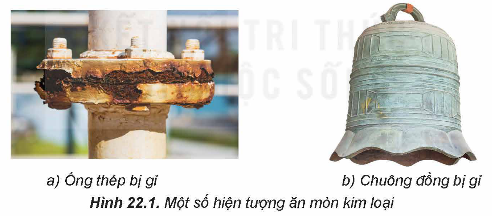
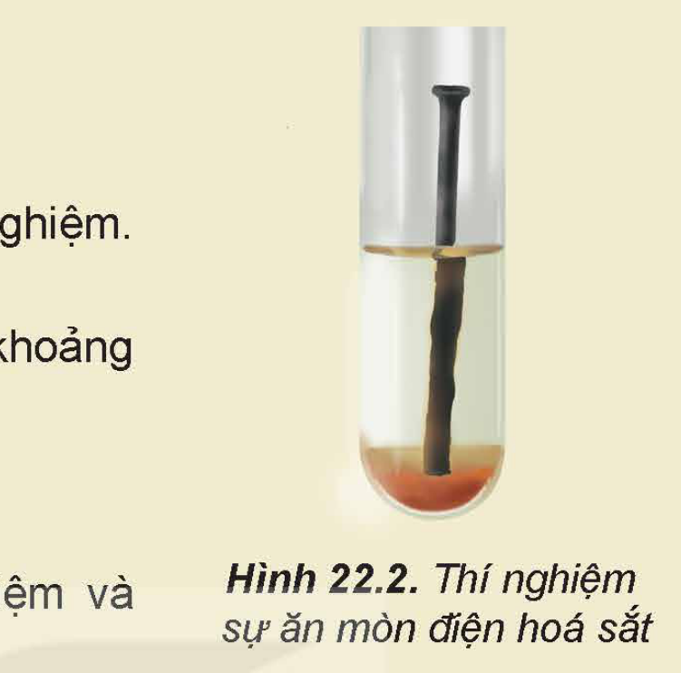
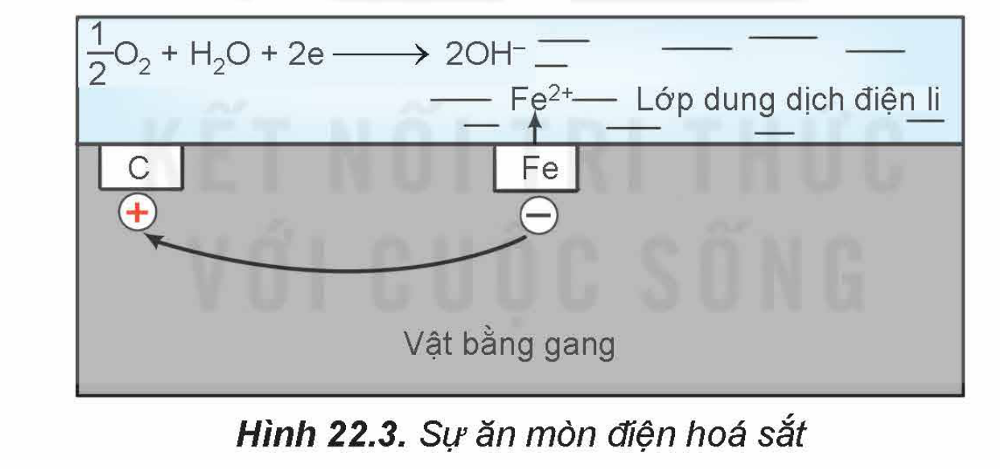
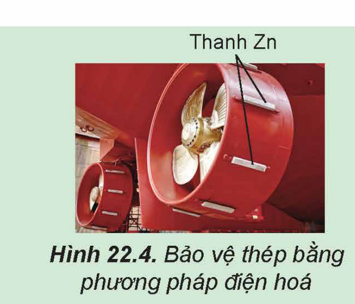
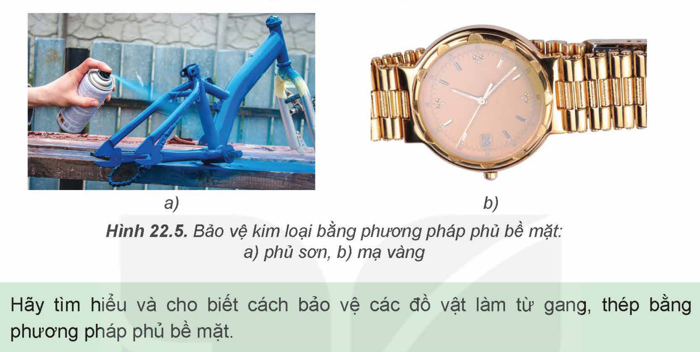

<!-- pdf:104 -->

# BÀI 22: SỰ ĂN MÒN KIM LOẠI

## 🎯 Mục tiêu

- Nêu được khái niệm ăn mòn kim loại từ sự biến đổi của một số kim loại, hợp kim trong tự nhiên.
- Trình bày được các dạng ăn mòn kim loại và các phương pháp chống ăn mòn kim loại.
- Thực hiện được (hoặc quan sát qua video) thí nghiệm ăn mòn điện hoá đối với sắt và thí nghiệm bảo vệ sắt bằng phương pháp điện hoá, mô tả hiện tượng thí nghiệm, giải thích và nhận xét.

## 🔴 Mở đầu

Vỏ tàu biển bằng thép để lâu trong tự nhiên thường bị ăn mòn. Để bảo vệ vỏ tàu khỏi bị ăn mòn, người ta thường phủ sơn lên vỏ tàu; phần vỏ tàu chìm trong nước biển thường được gắn thêm các tấm kẽm. Vậy, ăn mòn kim loại là gì? Để bảo vệ kim loại khỏi sự ăn mòn có thể dùng những cách nào?

## I. ĂN MÒN KIM LOẠI

### 1. Khái niệm

Thép để lâu ngoài không khí ẩm thường tạo thành gỉ sắt có màu nâu đỏ (Hình 22.1a); Vật bằng đồng để lâu trong tự nhiên có thể tạo thành gỉ đồng màu xanh (Hình 22.1b). Nhiều kim loại và hợp kim để lâu trong tự nhiên cũng có hiện tượng tương tự như vậy. Hiện tượng này được gọi là sự ăn mòn kim loại.

<!-- term: Ăn mòn kim loại -->
***Ăn mòn kim loại*** là sự phá huỷ kim loại hoặc hợp kim dưới tác dụng của các chất trong môi trường, trong đó kim loại bị oxi hoá.

Hình 22.1. Một số hiện tượng ăn mòn kim loại: a) Ống thép bị gỉ; b) Chuông đồng bị gỉ

### 2. Các dạng ăn mòn kim loại trong tự nhiên

Tuỳ theo cơ chế của sự ăn mòn, người ta chia ăn mòn kim loại thành hai loại: ăn mòn hoá học và ăn mòn điện hoá.

**a) Ăn mòn hoá học**

<!-- term: Ăn mòn hoá học -->
Khi để kim loại trong không khí, có thể xảy ra hiện tượng ***ăn mòn hoá học***. Nguyên nhân của hiện tượng trên là do xảy ra phản ứng oxi hoá – khử trực tiếp giữa kim loại với các chất oxi hoá có trong môi trường.

<!-- pdf:105 -->

*Ví dụ:* Bộ phận của thiết bị lò đốt bằng sắt bị ăn mòn bởi khí oxygen:
$\ce{3Fe(s) + 2O2(g) ->[t^o] Fe3O4(s)}$

**b) Ăn mòn điện hoá**

<!-- term: Ăn mòn điện hoá -->
> 🧪 Thí nghiệm: Sự ăn mòn điện hoá sắt
>
> Chuẩn bị:
>
> Hoá chất: đinh sắt mới(1), nước.
>
> Dụng cụ: ống nghiệm (hoặc cốc thuỷ tinh), giá ống nghiệm.
>
> Tiến hành:
>
> - Cho đinh sắt vào ống nghiệm. Thêm tiếp khoảng 3 mL nước.
>
> - Để ống nghiệm trong không khí khoảng 3 ngày.
>
> Thực hiện yêu cầu sau:
>
> Hãy nêu hiện tượng quan sát được ở ống nghiệm và giải thích.

Hình 22.2. Thí nghiệm sự ăn mòn điện hoá sắt

Sự ***ăn mòn điện hoá*** kim loại xảy ra khi có sự tạo thành pin điện.

*Ví dụ:* Sự ăn mòn điện hoá kim loại trong không khí ẩm.

Trong không khí ẩm, trên bề mặt của gang thép luôn có một lớp nước mỏng đã hoà tan khí oxygen và carbon dioxide tạo thành dung dịch chất điện li. Sắt và các thành phần khác (chủ yếu là carbon) cùng tiếp xúc với dung dịch đó, tạo nên vô số pin điện hoá rất nhỏ mà anode là sắt và cathode là carbon.

Hình 22.3. Sự ăn mòn điện hoá sắt

Ở anode, xảy ra quá trình oxi hoá:
$\ce{Fe(s) -> Fe^2+(aq) + 2e}$

Ở cathode, xảy ra quá trình khử:
$\ce{1/2 O2(g) + H2O(l) + 2e -> 2OH-(aq)}$
<!-- ocr-ok: OCR đọc sai phương trình khử ở cathode thành 202(9) + H,O(J) +2e -->

$\ce{Fe^2+}$ tiếp tục bị oxi hoá bởi oxygen không khí, tạo thành gỉ sắt có thành phần chính là $\ce{Fe2O3.nH2O}$.

Điều kiện của quá trình ăn mòn điện hoá: Hai kim loại khác nhau hoặc một kim loại và một phi kim; Chúng tiếp xúc với nhau trực tiếp hoặc gián tiếp thông qua dây dẫn điện và cùng tiếp xúc với một dung dịch chất điện li.

(1) Đinh sắt được làm từ hợp kim của sắt với carbon và một số nguyên tố khác.

<!-- pdf:106 -->

> ❓ 1. Một số hiện tượng ăn mòn thép trong đời sống:
> a) Thép bị gỉ trong không khí khô.
> b) Thép bị gỉ trong không khí ẩm.
> c) Thép bị gỉ khi tiếp xúc với nước biển.
> Hãy cho biết các hiện tượng ăn mòn thép trên thuộc loại ăn mòn hoá học hay ăn mòn điện hoá. Giải thích.

## II. CHỐNG ĂN MÒN KIM LOẠI
<!-- ocr-ok: OCR đọc sai tiêu đề II. CHỐNG ĂN MÒN KIM LOẠI thành {3 0CHÔNG ĂN MÙN KIM LOẠI -->

Có hai phương pháp phổ biến bảo vệ kim loại khỏi bị ăn mòn là phương pháp điện hoá và phương pháp phủ bề mặt.

### 1. Phương pháp điện hoá

<!-- term: Phương pháp điện hoá -->
> 🧪 Bảo vệ sắt bằng phương pháp điện hoá
>
> Chuẩn bị:
>
> Hoá chất: hai đinh sắt mới, dây kẽm, nước máy hoặc nước tự nhiên.
>
> Dụng cụ: hai ống nghiệm đánh số (1) và (2).
>
> Tiến hành:
>
> - Cho đinh sắt thứ nhất vào ống nghiệm (1).
>
> - Quấn dây kẽm quanh đinh sắt thứ hai, sau đó cho vào ống nghiệm (2).
>
> - Thêm nước máy vào mỗi ống nghiệm đến ngập đinh sắt.
>
> - Để các ống nghiệm trong không khí khoảng 3 ngày.
>
> Quan sát hiện tượng xảy ra và thực hiện yêu cầu sau:
>
> Đinh sắt có gắn kẽm bị ăn mòn nhanh hơn hay chậm hơn đinh sắt không gắn kẽm? Giải thích.

> 💡 EM CÓ BIẾT
> Ăn mòn kim loại xảy ra phổ biến và gây thiệt hại kinh tế, nhất là ăn mòn thép tạo gỉ sắt. Gỉ sắt làm thay đổi tính chất cơ học vốn có của thép, gây mất an toàn. Khoảng 25% thép được sản xuất tại Mỹ chỉ để thay thế thép bị ăn mòn khi sử dụng.

Nguyên tắc bảo vệ kim loại khỏi bị ăn mòn bằng ***phương pháp điện hoá*** là gắn lên kim loại cần bảo vệ một kim loại khác hoạt động hoá học mạnh hơn. Khi đó, kim loại hoạt động hoá học mạnh hơn bị ăn mòn.

*Ví dụ:* để bảo vệ tàu biển làm bằng thép, người ta gắn các tấm kẽm lên vỏ tàu (phần chìm dưới nước).

> ❓ 2. Các thiết bị bằng thép (đường ống, bể chứa, giàn khoan dầu, tàu thuỷ,...) trong môi trường biển hoặc dưới lòng đất ẩm ướt thường được bảo vệ bằng phương pháp điện hoá. Kim loại được sử dụng để bảo vệ thép thường là kẽm (Hình 22.4). Hãy cho biết kim loại nào bị ăn mòn. Giải thích.

Hình 22.4. Bảo vệ thép bằng phương pháp điện hoá

<!-- pdf:107 -->

### 2. Phương pháp phủ bề mặt

<!-- term: Phương pháp phủ bề mặt -->
***Phương pháp phủ bề mặt*** ngăn kim loại tiếp xúc trực tiếp với môi trường bằng cách:
- Phủ kim loại cần bảo vệ bằng các kim loại khác không bị gỉ như Au, Sn, Zn. Ví dụ: vỏ đồng hồ mạ vàng; tráng thiếc lên lá thép (sắt tây); tráng kẽm lên lá thép (tôn).
- Phủ kim loại cần bảo vệ bằng các hợp chất vô cơ hoặc hữu cơ như sơn, dầu, mỡ,... Ví dụ: Các đồ vật bằng sắt thường được sơn hoặc tra dầu, mỡ.

Hình 22.5. Bảo vệ kim loại bằng phương pháp phủ bề mặt: a) phủ sơn; b) mạ vàng

> ❓ 3. Hãy tìm hiểu và cho biết cách bảo vệ các đồ vật làm từ gang, thép bằng phương pháp phủ bề mặt.

## 📌 Em đã học

- Ăn mòn kim loại là sự phá huỷ kim loại hoặc hợp kim dưới tác dụng của các chất trong môi trường.
- Hai loại ăn mòn kim loại:
  - Ăn mòn hoá học: xảy ra phản ứng oxi hoá – khử trực tiếp giữa kim loại với các chất oxi hoá có trong môi trường.
  - Ăn mòn điện hoá: xảy ra khi có sự tạo thành pin điện.
- Hai phương pháp bảo vệ kim loại:
  - Phương pháp điện hoá: gắn kim loại cần bảo vệ với kim loại hoạt động hoá học mạnh hơn.
  - Phương pháp phủ bề mặt: phủ lên bề mặt kim loại cần bảo vệ một kim loại khác không bị gỉ hoặc các chất như sơn, dầu, mỡ,...

## ✏️ Em có thể

- Giải thích được một số hiện tượng ăn mòn kim loại trong tự nhiên.
- Bảo vệ các đồ dùng làm bằng kim loại trong gia đình khỏi bị ăn mòn kim loại.

## 📷 Danh sách hình trong bài

| Mã hình | Trang PDF | Vị trí | Chú thích gốc |
|---|---|---|---|
| H12-hoa-b22-01 | 104 | Mục I.1 | Hình 22.1. Một số hiện tượng ăn mòn kim loại: a) Ống thép bị gỉ; b) Chuông đồng bị gỉ |
| H12-hoa-b22-02 | 105 | Mục I.2 | Hình 22.2. Thí nghiệm sự ăn mòn điện hoá sắt |
| H12-hoa-b22-03 | 105 | Mục I.2 | Hình 22.3. Sự ăn mòn điện hoá sắt |
| H12-hoa-b22-04 | 106 | Mục II.1 | Hình 22.4. Bảo vệ thép bằng phương pháp điện hoá |
| H12-hoa-b22-05 | 107 | Mục II.2 | Hình 22.5. Bảo vệ kim loại bằng phương pháp phủ bề mặt: a) phủ sơn; b) mạ vàng |
