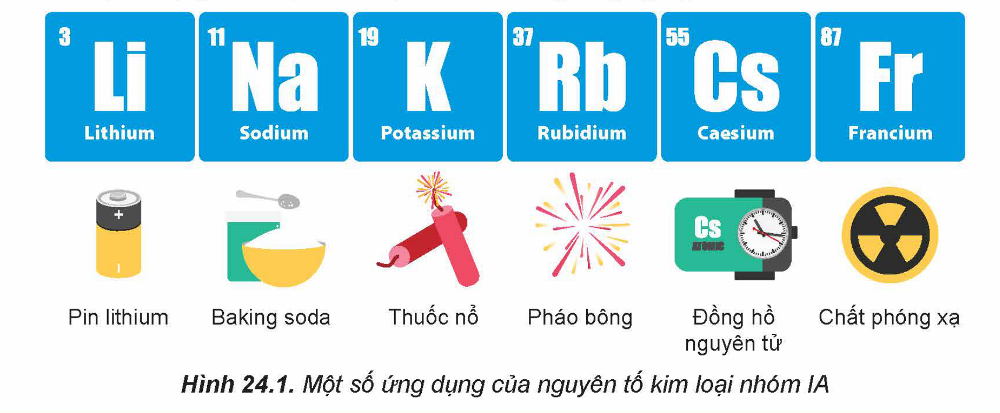
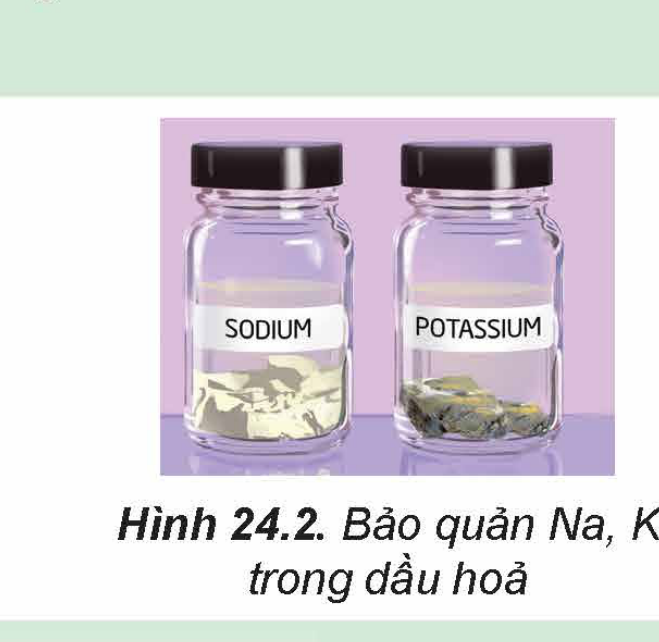
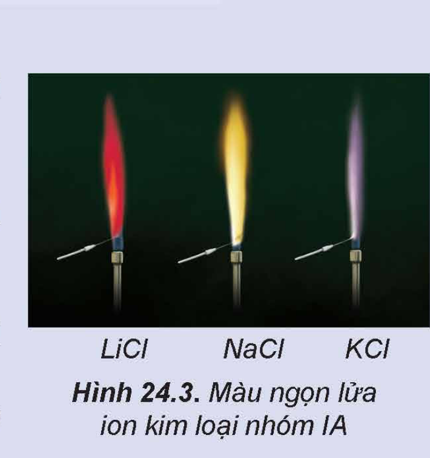
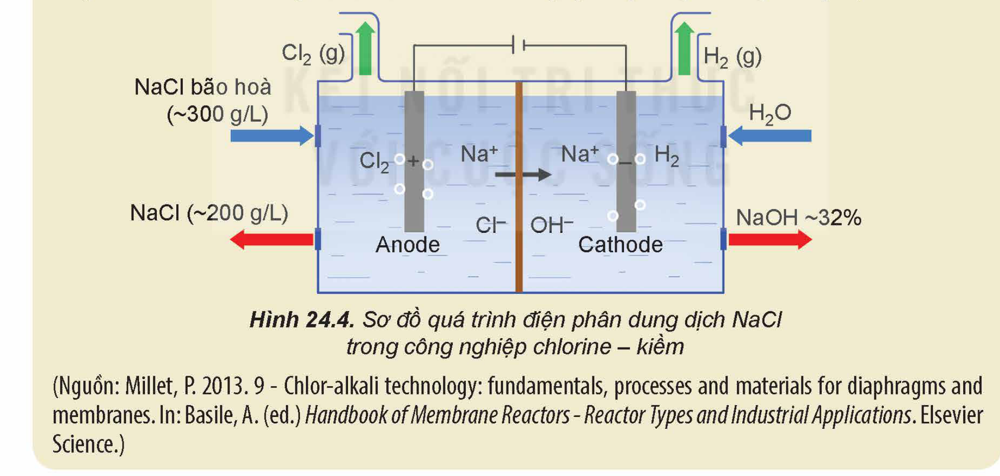

<!-- pdf:110 -->

# BÀI 24: NGUYÊN TỐ NHÓM IA

## 🎯 Mục tiêu

- Nêu được vị trí của nhóm IA trong bảng tuần hoàn.
- Nêu được trạng thái tự nhiên của các nguyên tố kim loại nhóm IA.
- Nêu được cấu hình electron lớp ngoài cùng của nguyên tử kim loại nhóm IA; giải thích được tính chất hoá học đặc trưng của kim loại nhóm IA là tính khử mạnh; viết được các phương trình hoá học minh hoạ.
- Nêu được xu hướng biến đổi nhiệt độ nóng chảy, nhiệt độ sôi của kim loại nhóm IA.
- Giải thích được nguyên nhân khối lượng riêng nhỏ và độ cứng thấp của kim loại nhóm IA.
- Giải thích được nguyên nhân kim loại nhóm IA có tính khử mạnh hơn so với các nhóm kim loại khác.
- Thông qua mô tả thí nghiệm (hoặc quan sát qua video), nêu được mức độ phản ứng tăng dần từ lithium, sodium, potassium khi chúng phản ứng với nước, chlorine và oxygen.
- Trình bày được cách bảo quản kim loại nhóm IA.
- Giải thích được trạng thái tồn tại của nguyên tố nhóm IA trong tự nhiên.
- Nêu được khả năng tan trong nước của các hợp chất nhóm IA.
- Thực hiện được thí nghiệm (hoặc qua quan sát video thí nghiệm) phân biệt các ion $\ce{Li+}$, $\ce{Na+}$, $\ce{K+}$ bằng màu ngọn lửa.
- Tìm hiểu và trình bày được ứng dụng của sodium chloride.
- Trình bày được quá trình điện phân dung dịch sodium chloride và các sản phẩm cơ bản của công nghiệp chlorine – kiềm.
- Giải thích được các ứng dụng phổ biến của sodium hydrogencarbonate (natri hiđrocacbonat), sodium carbonate (natri cacbonat) và phương pháp Solvay sản xuất soda.

## 🔴 Mở đầu

<!-- term: Kim loại kiềm -->
Các kim loại nhóm IA (nhóm ***kim loại kiềm***) và hợp chất của chúng có nhiều ứng dụng như: sản xuất pin lithium, nước Javel, phân kali, tế bào quang điện, đồng hồ nguyên tử,...

Vậy, đơn chất nhóm IA có đặc điểm gì nổi bật về tính chất vật lí và tính chất hoá học? Các hợp chất nhóm IA quan trọng như xút, soda được sản xuất trong công nghiệp như thế nào?

Hình 24.1. Một số ứng dụng của nguyên tố kim loại nhóm IA

<!-- pdf:111 -->

## I. ĐƠN CHẤT NHÓM IA

### 1. Đặc điểm chung

Một số đại lượng đặc trưng của các nguyên tố nhóm IA được trình bày trong Bảng 24.1.

Bảng 24.1. Một số đại lượng đặc trưng của các nguyên tố nhóm IA

| Nguyên tố | Số hiệu nguyên tử | Cấu hình electron nguyên tử | Bán kính nguyên tử (pm) | Thế điện cực chuẩn $E^\circ_{$\ce{M+/M}$}$ (V) |
|---|---|---|---|---|
| Lithium (Li) | 3 | $\ce{[He] 2s^1}$ | 152 | -3,040 |
| Sodium (Na) | 11 | $\ce{[Ne] 3s^1}$ | 186 | -2,713 |
| Potassium (K) | 19 | $\ce{[Ar] 4s^1}$ | 227 | -2,924 |
| Rubidium (Rb) | 37 | $\ce{[Kr] 5s^1}$ | 248 | -2,924 |
| Caesium (Cs) | 55 | $\ce{[Xe] 6s^1}$ | 265 | -2,923 |
<!-- ocr-ok: bảng số liệu Bảng 24.1 đối chiếu đúng với SGK -->

> ❓ Thực hiện các yêu cầu sau:
>
> 1. Nhận xét về xu hướng biến đổi bán kính nguyên tử của nguyên tố nhóm IA.
> 2. Cho biết: xu hướng biến đổi tính khử từ Li đến Cs; số oxi hoá đặc trưng của nguyên tử kim loại nhóm IA.

Nguyên tố nhóm IA là những nguyên tố s, chỉ có 1 electron hoá trị ở phân lớp $\ce{ns^1}$ và đứng đầu mỗi chu kì tương ứng. Kim loại nhóm IA có thế điện cực chuẩn $E^\circ_{$\ce{M+/M}$}$ rất nhỏ nên dễ tách electron hoá trị ra khỏi nguyên tử. Vì vậy, trong các phản ứng hoá học, chúng dễ nhường 1 electron, thể hiện tính khử rất mạnh:

$\ce{M -> M+ + 1e}$

Trong hợp chất, nguyên tử kim loại nhóm IA chỉ thể hiện số oxi hoá +1.

### 2. Trạng thái tự nhiên

Trong tự nhiên, các nguyên tố nhóm IA chỉ tồn tại ở dạng hợp chất (chủ yếu là dạng muối). Sodium và potassium là hai nguyên tố phổ biến trong vỏ Trái Đất, có nhiều trong nước biển, mỏ muối, quặng halite ($\ce{NaCl}$), quặng sylvinite ($\ce{NaCl.KCl}$).

> ❓ 1. Tại sao các nguyên tố kim loại nhóm IA không tồn tại ở dạng đơn chất trong tự nhiên?

<!-- pdf:112 -->

### 3. Tính chất vật lí

Một số thông số vật lí của kim loại nhóm IA được trình bày ở Bảng 24.2.

Bảng 24.2. Một số thông số vật lí của kim loại nhóm IA

| Kim loại | Nhiệt độ nóng chảy (°C) | Nhiệt độ sôi (°C) | Khối lượng riêng ($\ce{g/cm^3}$) | Độ cứng (thang Mohs) |
|---|---|---|---|---|
| Li | 180,5 | 1341 | 0,534 | 0,6 |
| Na | 97,8 | 861 | 0,968 | 0,5 |
| K | 63,4 | 759 | 0,89 | 0,4 |
| Rb | 39,3 | 691 | 1,532 | 0,3 |
| Cs | 28,4 | 668 | 1,878 | 0,2 |

> ❓ Thực hiện các yêu cầu sau:
>
> 1. Nhận xét về xu hướng biến đổi nhiệt độ nóng chảy, nhiệt độ sôi của các kim loại nhóm IA.
> 2. Dựa vào Bảng 24.2, hãy nhận xét về khối lượng riêng và độ cứng của các kim loại nhóm IA.

**a) Nhiệt độ nóng chảy và nhiệt độ sôi**

Trong nhóm IA, nhiệt độ nóng chảy và nhiệt độ sôi của các kim loại có xu hướng giảm dần từ Li đến Cs.

Các kim loại nhóm IA đều dễ nóng chảy và có nhiệt độ nóng chảy thấp hơn so với các kim loại nhóm khác.

**b) Khối lượng riêng**

Các kim loại nhóm IA có khối lượng riêng nhỏ (đều là kim loại nhẹ) do có bán kính nguyên tử lớn và cấu trúc mạng tinh thể kém đặc khít.

**c) Độ cứng**

Do có liên kết kim loại yếu nên các kim loại nhóm IA có độ cứng thấp (đều mềm, có thể cắt bằng dao, kéo).

### 4. Tính chất hoá học

Kim loại kiềm là những kim loại hoạt động hoá học mạnh, có tính khử mạnh và tính khử tăng dần từ Li đến Cs.

Các kim loại kiềm có thế điện cực chuẩn rất âm, do đó chúng đều phản ứng với nước ở điều kiện thường với mức độ tăng dần từ Li đến Cs.

<!-- pdf:113 -->

> 🧪 Lithium, sodium, potassium tác dụng với nước, chlorine, oxygen
>
> Ba thí nghiệm về phản ứng của lithium, sodium, potassium với nước, chlorine, oxygen đã được thực hiện và quan sát thấy các hiện tượng như được mô tả dưới đây:
>
> Hoá chất: kim loại lithium, sodium, potassium, nước.
>
> Dụng cụ: 3 bình tam giác đựng khí oxygen, 3 bình tam giác đựng khí chlorine, 3 chậu thuỷ tinh, muôi sắt, dao, kẹp sắt.
>
> **Thí nghiệm 1: Tác dụng với nước**
>
> Tiến hành: Cho mỗi mẫu kim loại vào một chậu thuỷ tinh chứa nước, hiện tượng xảy ra được ghi lại ở Bảng 24.3.
>
> Bảng 24.3. Hiện tượng phản ứng của Li, Na, K với nước
>
> | Kim loại | Hiện tượng |
> |---|---|
> | Li | Mẫu kim loại chuyển động chậm trên mặt nước. |
> | Na | Mẫu kim loại trở thành khối cầu, chạy nhanh trên mặt nước. |
> | K | Mẫu kim loại cháy, kèm tiếng nổ nhẹ. |
>
> Thực hiện các yêu cầu sau:
> 1. So sánh mức độ phản ứng của Li, Na, K với nước.
> 2. Viết phương trình hoá học của các phản ứng xảy ra. Nêu cách nhận biết môi trường của các dung dịch sau phản ứng.
>
> **Thí nghiệm 2: Tác dụng với chlorine**
>
> Tiến hành: Cho mỗi mẫu kim loại Li, Na, K vào một muôi sắt, hơ nóng trên ngọn lửa đèn cồn đến khi nóng chảy, rồi đưa nhanh vào bình đựng khí chlorine.
>
> Hiện tượng xảy ra như sau: Các kim loại bốc cháy với mức độ tăng dần từ Li đến K.
>
> Thực hiện yêu cầu sau: Viết phương trình hoá học của các phản ứng xảy ra.
>
> **Thí nghiệm 3: Tác dụng với oxygen**
>
> Tiến hành: Cho mỗi mẫu kim loại Li, Na, K vào một muôi sắt, hơ nóng trên ngọn lửa đèn cồn đến khi nóng chảy rồi đưa nhanh vào lọ đựng khí oxygen.
>
> Hiện tượng xảy ra như sau: Các kim loại bốc cháy với mức độ tăng dần từ Li đến K.
>
> Thực hiện yêu cầu sau: Viết phương trình hoá học của các phản ứng xảy ra.

<!-- pdf:114 -->

> ❓ 2. Trong phòng thí nghiệm:
>
> a) Khi cho kim loại nhóm IA (Li, Na, K) tác dụng với nước thì cần lấy mẫu kim loại nhỏ. Giải thích.
>
> b) Sodium được dùng để loại nước khỏi một số dung môi hữu cơ như ether. Giải thích.

### 5. Bảo quản

Các kim loại nhóm IA được bảo quản trong dầu hoả, trong chân không hoặc trong khí hiếm.

Ví dụ: Na, K thường được bảo quản bằng cách ngâm trong dầu hoả khan; Rb, Cs thường được bảo quản trong các ống thuỷ tinh hàn kín.

Hình 24.2. Bảo quản Na, K trong dầu hoả

> ❓ a) Tại sao có thể bảo quản Na, K bằng cách ngâm trong dầu hoả?
>
> b) Có thể sử dụng các alcohol (ví dụ ethanol) để bảo quản kim loại nhóm IA không? Giải thích.

## II. HỢP CHẤT CỦA KIM LOẠI NHÓM IA

### 1. Đặc điểm chung

Các hợp chất của kim loại kiềm thường dễ tan trong nước và tạo thành dung dịch chất điện li mạnh.

Ở nhiệt độ thường, các ion kim loại nhóm IA đều không có màu. Tuy nhiên, đốt nóng kim loại kiềm hoặc các hợp chất của chúng trên ngọn lửa không màu làm ngọn lửa có màu đặc trưng. Do vậy, có thể nhận biết hợp chất của kim loại nhóm IA bằng màu ngọn lửa.

> 🧪 Phân biệt các ion $\ce{Li+}$, $\ce{Na+}$, $\ce{K+}$ bằng màu ngọn lửa (học sinh quan sát video thí nghiệm)
>
> Hoá chất: các dung dịch bão hoà: $\ce{LiCl}$, $\ce{NaCl}$, $\ce{KCl}$.
>
> Dụng cụ: ống nghiệm, giá ống nghiệm; dây platinum (hoặc nickel); đèn khí Bunsen (khí gas).
>
> Tiến hành:
>
> - Nhúng dây platinum vào ống nghiệm chứa dung dịch $\ce{LiCl}$ bão hoà.
> - Hơ nóng đầu dây trên ngọn lửa đèn khí.
> - Tiến hành thí nghiệm tương tự với dung dịch $\ce{NaCl}$ bão hoà và dung dịch $\ce{KCl}$ bão hoà.
>
> Quan sát hiện tượng xảy ra qua video thí nghiệm và thực hiện yêu cầu sau:
>
> Nhận xét về màu ngọn lửa các ion kim loại trong thí nghiệm.

Hình 24.3. Màu ngọn lửa của một số ion kim loại nhóm IA

<!-- pdf:115 -->

### 2. Hợp chất quan trọng

**a) Sodium chloride**

- **Ứng dụng:**
  - Trong đời sống: gia vị, bảo quản và chế biến thực phẩm...
  - Trong y học: nước muối sinh lí, chất điện giải...
  - Trong công nghiệp hoá chất: sản xuất chlorine – kiềm, nước Javel, soda,...

<!-- term: Xút -->
<!-- term: Nước Javel -->
- **Quá trình điện phân dung dịch $\ce{NaCl}$:**
  Trong công nghiệp chlorine – kiềm, quá trình điện phân dung dịch $\ce{NaCl}$ bão hoà có màng ngăn điện cực được ứng dụng để sản xuất xút công nghiệp ($\ce{NaOH}$), khí chlorine ($\ce{Cl2}$). Điện phân dung dịch $\ce{NaCl}$ bão hoà không có màng ngăn điện cực được ứng dụng để sản xuất nước Javel (chứa $\ce{NaClO}$).

> ❓ Viết các quá trình oxi hoá, quá trình khử xảy ra ở mỗi điện cực và viết phương trình hoá học của quá trình điện phân dung dịch $\ce{NaCl}$ có màng ngăn.

> 💡 EM CÓ BIẾT
>
> Trong công nghiệp, quá trình điện phân dung dịch $\ce{NaCl}$ thường được tiến hành trong thùng điện phân có anode bằng than chì và cathode bằng sắt. Giữa hai điện cực có màng ngăn xốp để ngăn không cho $\ce{Cl2}$ tiếp xúc với $\ce{OH-}$...

Hình 24.4. Sơ đồ quá trình điện phân dung dịch NaCl trong công nghiệp chlorine – kiềm

<!-- pdf:116 -->

**b) Sodium hydrogencarbonate, sodium carbonate**

- **Ứng dụng:**

  - **Sodium hydrogencarbonate:**

> ❓ 1. $\ce{NaHCO3}$ là hợp chất kém bền nhiệt, bắt đầu bị phân huỷ ở khoảng 120 °C:
>
> $\ce{2NaHCO3(s) ->[t^o] Na2CO3(s) + CO2(g) + H2O(g)}$
>
> Trong thực tiễn, $\ce{NaHCO3}$ được sử dụng làm bột nở trong chế biến thực phẩm và làm chất chữa cháy dạng bột. Giải thích cơ sở của các ứng dụng đó.
>
> 2. Viết các phương trình hoá học để giải thích cơ sở các ứng dụng sau:
> a) Viên sủi chứa $\ce{NaHCO3}$ và acid hữu cơ (viết gọn là HX) có khả năng tạo bọt khí khi hoà tan vào nước.
> b) Trong kĩ thuật xử lí nước, $\ce{NaHCO3}$ được sử dụng để điều chỉnh pH khi nước dư acid ($\ce{H+}$).

  - **Sodium carbonate:**
    - Nguyên liệu sản xuất thuỷ tinh, xà phòng, bột giặt, giấy, sợi, chất tẩy rửa...
    - Xử lí, làm mềm nước; điều chế các muối khác;...
    - Tác nhân tẩy sạch vết dầu mỡ trên chi tiết máy trước khi sơn, hàn, mạ điện...

> ❓ Trong thực tiễn, sodium carbonate có một số ứng dụng:
>
> 1. Tách loại ion $\ce{Mg^{2+}$}$ và $\ce{Ca^{2+}$}$ ra khỏi nước (để làm mềm nước).
> 2. Tách loại ion $\ce{Fe^{3+}$}$ ra khỏi nước ở dạng kết tủa $\ce{Fe(OH)3}$ (để xử lí nước nhiễm phèn).
>
> Viết phương trình hoá học để giải thích các ứng dụng trên.

- **Sản xuất:**

<!-- term: Phương pháp Solvay -->
<!-- term: Soda -->
<!-- term: Bột nở -->
<!-- term: Baking soda -->
Trong công nghiệp, sodium hydrogencarbonate (baking soda) và sodium carbonate (soda) được sản xuất bằng phương pháp Solvay từ nguyên liệu chính là đá vôi, muối ăn, ammonia và nước.

Quá trình Solvay sản xuất soda gồm hai giai đoạn chính:

- Giai đoạn tạo $\ce{NaHCO3}$:
  $\ce{NaCl + NH3 + CO2 + H2O -> NaHCO3 v + NH4Cl}$
  Khi làm lạnh, $\ce{NaHCO3}$ kết tinh và được lọc, tách khỏi hệ phản ứng.

- Giai đoạn tạo $\ce{Na2CO3}$:
  $\ce{2NaHCO3 ->[t^o] Na2CO3 + CO2 + H2O}$

<!-- pdf:117 -->

*Sơ đồ quá trình Solvay:*

Nước muối bão hoà $\rightarrow$ Tháp carbonate hoá $\rightarrow$ Tháp làm lạnh $\rightarrow$ Sản phẩm $\ce{NaHCO3(s)}$ $\rightarrow$ Sản phẩm $\ce{Na2CO3(s)}$
<!-- ocr-ok: sơ đồ khối quá trình Solvay đối chiếu đúng với SGK -->

> ❓ a) Trong quá trình Solvay, viết các phương trình hoá học của phản ứng:
> - Nung vôi để cung cấp vôi sống và carbon dioxide.
> - Tái chế ammonia từ vôi sống và dung dịch ammonium chloride.
>
> b) Quy trình Solvay đã giảm thiểu được tác động đến môi trường bằng cách quay vòng các sản phẩm trung gian (như $\ce{CO2}$ và $\ce{NH3}$) để tái sử dụng trong quy trình sản xuất.
>
> Từ sơ đồ quá trình Solvay, hãy làm sáng tỏ nhận định trên.

## 📌 Em đã học

- Kim loại nhóm IA chỉ tồn tại trong tự nhiên ở dạng hợp chất.
- Kim loại nhóm IA mềm, khối lượng riêng nhỏ, nhiệt độ nóng chảy và nhiệt độ sôi thấp.
- Kim loại nhóm IA có tính khử mạnh. Mức độ phản ứng với nước, chlorine và oxygen tăng dần trong dãy lithium, sodium, potassium.
- Các ion kim loại nhóm IA cho màu ngọn lửa đặc trưng: ion $\ce{Li+}$ màu đỏ tía, ion $\ce{Na+}$ màu vàng, ion $\ce{K+}$ màu tím nhạt.
- Các kim loại kiềm thường được bảo quản bằng cách ngâm trong dầu hoả, trong chân không hoặc trong khí hiếm.
- Sodium chloride là nguyên liệu sản xuất chlorine, kiềm bằng phương pháp điện phân dung dịch.
- Sodium hydrogencarbonate và sodium carbonate được sản xuất bằng phương pháp Solvay. Chúng được sử dụng trong công nghệ thực phẩm, dược phẩm, hoá chất, xử lí nước,...

## ✏️ Em có thể

- Bảo quản các kim loại kiềm đúng cách.
- Giải thích được cơ sở của quá trình sản xuất chlorine – kiềm, quá trình Solvay.

## 📷 Danh sách hình trong bài

| Mã hình | Trang PDF | Vị trí | Chú thích gốc |
|---|---|---|---|
| H12-hoa-b24-01 | 110 | Mục 🔴 Mở đầu | Hình 24.1. Một số ứng dụng của nguyên tố kim loại nhóm IA |
| H12-hoa-b24-02 | 114 | Mục I.5 | Hình 24.2. Bảo quản Na, K trong dầu hoả |
| H12-hoa-b24-03 | 114 | Mục II.1 | Hình 24.3. Màu ngọn lửa của một số ion kim loại nhóm IA |
| H12-hoa-b24-04 | 115 | Mục II.2.a | Hình 24.4. Sơ đồ quá trình điện phân dung dịch NaCl trong công nghiệp chlorine – kiềm |
