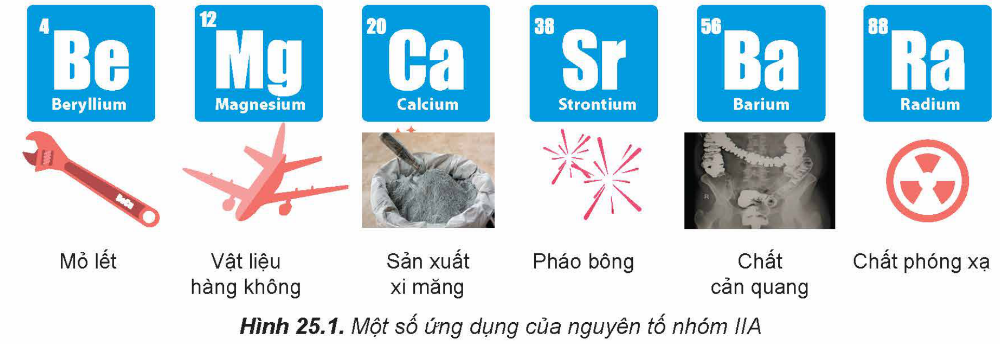
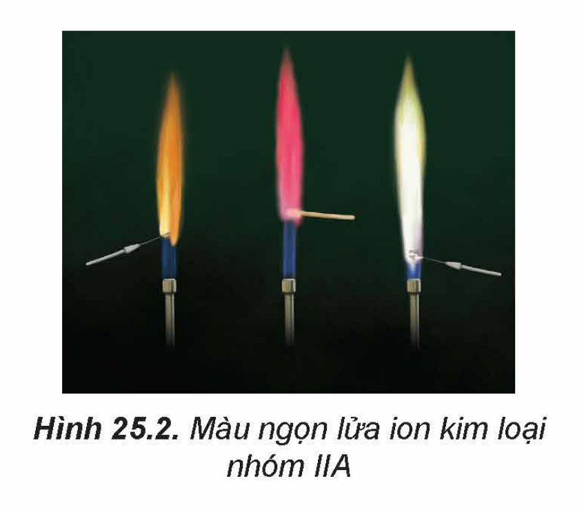
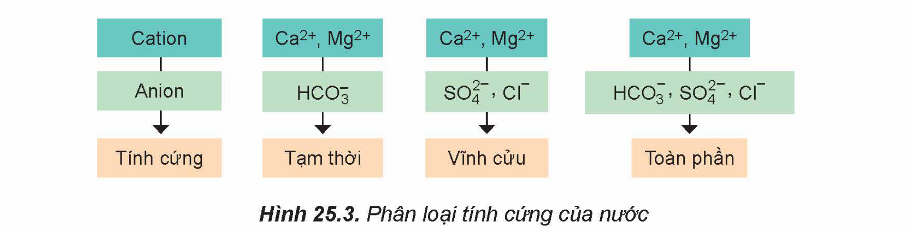

<!-- pdf:118 -->

# BÀI 25: NGUYÊN TỐ NHÓM IIA

## 🎯 Mục tiêu

- Nêu được vị trí của nhóm IIA trong bảng tuần hoàn.
- Nêu được trạng thái tự nhiên của các nguyên tố kim loại nhóm IIA.
- Nêu được cấu hình electron lớp ngoài cùng của nguyên tử kim loại nhóm IIA; giải thích được tính chất hoá học đặc trưng của kim loại nhóm IIA là tính khử mạnh; viết được các phương trình hoá học minh hoạ.
- Nêu được xu hướng biến đổi nhiệt độ nóng chảy, nhiệt độ sôi của kim loại nhóm IIA.
- Giải thích được nguyên nhân kim loại nhóm IIA có khối lượng riêng tương đối nhỏ và nhiệt độ nóng chảy tương đối thấp.
- Trình bày được mức độ phản ứng của kim loại nhóm IIA với nước tăng dần từ Mg đến Ba.
- Giải thích được xu hướng biến đổi độ tan của hydroxide kim loại nhóm IIA trong nước.
- Nêu được khả năng tan trong nước của các muối carbonate, sulfate, nitrate của kim loại nhóm IIA; giải thích được độ bền nhiệt của muối carbonate và muối nitrate của kim loại nhóm IIA tăng dần từ Mg đến Ba.
- Trình bày được ứng dụng của các kim loại nhóm IIA và hợp chất của chúng.
- Nêu được vai trò sinh học của ion $\ce{Ca^{2+}}$ đối với cơ thể người.
- Thực hiện được thí nghiệm nhận biết sự có mặt của các ion: $\ce{Ca^{2+}}$, $\ce{Ba^{2+}}$, $\ce{SO4^{2-}}$, $\ce{CO3^{2-}}$ trong dung dịch.
- Nêu được khái niệm nước cứng, nước mềm, tính cứng tạm thời, tính cứng vĩnh cửu, tính cứng toàn phần; giải thích được tác hại của nước cứng; trình bày được nguyên tắc và các phương pháp làm mềm nước cứng.

## 🔴 Mở đầu

<!-- term: Kim loại kiềm thổ -->
Các kim loại nhóm IIA (nhóm ***kim loại kiềm thổ***) và hợp chất của chúng có vai trò quan trọng trong tự nhiên: magnesium là thành phần của diệp lục tố trong cây xanh; hợp chất của calcium có trong vỏ và mai các loài giáp xác, trong xương và răng của người và động vật...

Ngoài ra, đơn chất và hợp chất nhóm IIA có nhiều ứng dụng phổ biến trong đời sống, sản xuất.

Vậy, đơn chất nhóm IIA có đặc điểm gì nổi bật về tính chất vật lí và tính chất hoá học? Các hợp chất phổ biến của calcium có vai trò như thế nào với đời sống, sản xuất và cơ thể con người?

Hình 25.1. Một số ứng dụng của nguyên tố nhóm IIA

<!-- pdf:119 -->

## I. ĐƠN CHẤT NHÓM IIA
<!-- ocr-ok: tiêu đề phần I, OCR đọc nhầm là (Q3 D0N -->

### 1. Đặc điểm chung

Một số đại lượng đặc trưng của các nguyên tố nhóm IIA được trình bày trong Bảng 25.1.

Bảng 25.1. Một số đại lượng đặc trưng các nguyên tố nhóm IIA

| Nguyên tố | Số hiệu nguyên tử | Cấu hình electron nguyên tử | Bán kính nguyên tử (pm) | Thế điện cực chuẩn $E^\circ_{\ce{M^{2+}/M}}$ (V) |
|---|---|---|---|---|
| Beryllium (Be) | 4 | $\ce{[He] 2s^2}$ | 112 | -1,99 |
| Magnesium (Mg) | 12 | $\ce{[Ne] 3s^2}$ | 160 | -2,356 |
| Calcium (Ca) | 20 | $\ce{[Ar] 4s^2}$ | 197 | -2,84 |
| Strontium (Sr) | 38 | $\ce{[Kr] 5s^2}$ | 215 | -2,89 |
| Barium (Ba) | 56 | $\ce{[Xe] 6s^2}$ | 222 | -2,92 |
<!-- ocr-ok: bảng đại lượng đặc trưng Bảng 25.1 đối chiếu đúng với SGK -->

> ❓ Thực hiện các yêu cầu sau:
>
> 1. Nhận xét xu hướng biến đổi bán kính nguyên tử của nguyên tố nhóm IIA.
> 2. Dựa vào bán kính nguyên tử, điện tích hạt nhân, dự đoán xu hướng biến đổi tính khử từ Be đến Ba.
> 3. Dự đoán số oxi hoá đặc trưng của nguyên tử của nguyên tố nhóm IIA. Giải thích.

Kim loại nhóm IIA là những nguyên tố s, đứng ngay sau nguyên tố kim loại kiềm ở mỗi chu kì.

Kim loại nhóm IIA có thế điện cực chuẩn $E^\circ_{\ce{M^{2+}/M}}$ nhỏ nên dễ tách electron hoá trị ra khỏi nguyên tử, thể hiện tính khử mạnh:

$\ce{M -> M^{2+} + 2e}$

Trong hợp chất, nguyên tử nhóm IIA thể hiện số oxi hoá đặc trưng là +2.

### 2. Trạng thái tự nhiên

Trong tự nhiên, các nguyên tố nhóm IIA chỉ tồn tại ở dạng hợp chất. Magnesium và calcium là hai nguyên tố phổ biến trên vỏ Trái Đất, có trong nhiều khoáng vật như $\ce{MgCO3.CaCO3}$ (dolomite), $\ce{CaCO3}$ (calcite), $\ce{Ca3(PO4)2}$ (phosphorite)...

> ❓ 1. Tại sao trong tự nhiên, các nguyên tố nhóm IIA chỉ tồn tại ở dạng hợp chất?

<!-- pdf:120 -->

### 3. Tính chất vật lí

Một số thông số vật lí của kim loại nhóm IIA được trình bày trong Bảng 25.2.

Bảng 25.2. Một số thông số vật lí của kim loại nhóm IIA

| Kim loại | Nhiệt độ nóng chảy (°C) | Nhiệt độ sôi (°C) | Khối lượng riêng ($\ce{g/cm^3}$) |
|---|---|---|---|
| Be | 1287 | 2467 | 1,85 |
| Mg | 651 | 1100 | 1,74 |
| Ca | 842 | 1484 | 1,55 |
| Sr | 757 | 1366 | 2,64 |
| Ba | 727 | 1845 | 3,62 |
<!-- ocr-ok: bảng thông số vật lí Bảng 25.2 đối chiếu đúng với SGK -->

> ❓ Thực hiện các yêu cầu sau:
>
> 1. So sánh nhiệt độ nóng chảy của kim loại nhóm IIA với kim loại nhóm IA trong cùng chu kì.
> 2. Trong nhóm IIA, kim loại nào là kim loại nhẹ?

> 💡 EM CÓ BIẾT
>
> **Cấu trúc tinh thể kim loại nhóm IIA**
>
> Beryllium và magnesium có cấu trúc lục phương chặt khít; calcium và strontium có cấu trúc lập phương tâm mặt; barium có cấu trúc lập phương tâm khối.

Kim loại nhóm IIA có nhiệt độ nóng chảy cao hơn nhiệt độ nóng chảy của kim loại nhóm IA, nhưng tương đối thấp so với nhiệt độ nóng chảy của các kim loại khác.

Kim loại nhóm IIA đều là kim loại nhẹ, có khối lượng riêng tương đối nhỏ.

### 4. Tính chất hoá học

Kim loại nhóm IIA là các kim loại có tính khử mạnh, chỉ kém kim loại nhóm IA.

**Tác dụng với oxygen**

Ở điều kiện thường, trong không khí beryllium bền do có lớp màng oxide bảo vệ, magnesium bị oxi hoá chậm, các kim loại khác bị oxi hoá nhanh tạo thành oxide, bề mặt kim loại chuyển dần sang màu xám.

Khi đốt nóng trong không khí, beryllium phản ứng chậm với oxygen, các kim loại khác phản ứng mạnh với oxygen cho màu ngọn lửa đặc trưng (calcium cho màu đỏ cam, strontium cho màu đỏ son, barium cho màu lục).

<!-- pdf:121 -->

**Tác dụng với nước**

Bảng 25.3. Khả năng và mức độ tác dụng với nước của kim loại nhóm IIA

| Kim loại | Hiện tượng |
|---|---|
| Be | Không tác dụng với nước. |
| Mg | Phản ứng chậm với nước ở nhiệt độ thường, nhanh hơn khi đun nóng: $\ce{Mg + 2H2O -> Mg(OH)2 + H2}$ |
| Ca, Sr, Ba | Tác dụng mạnh với nước ngay ở nhiệt độ thường. Ví dụ: $\ce{Ca + 2H2O -> Ca(OH)2 + H2}$ |

Độ tan trong nước của các hydroxide nhóm IIA ở 20 °C cho trong bảng sau:

| Hydroxide | $\ce{Mg(OH)2}$ | $\ce{Ca(OH)2}$ | $\ce{Sr(OH)2}$ | $\ce{Ba(OH)2}$ |
|---|---|---|---|---|
| Độ tan (g/100 g nước) | $1,26 \cdot 10^{-3}$ | 0,173 | 1,77 | 5,89 |
<!-- ocr-ok: bảng độ tan hydroxide đối chiếu đúng với SGK -->

> ❓ Thực hiện các yêu cầu sau:
>
> 1. Nêu xu hướng biến đổi độ tan của các hydroxide nhóm IIA.
> 2. Dự đoán xu hướng phản ứng với nước của kim loại nhóm IIA (từ Mg đến Ba) dựa vào độ tan của các hydroxide.

Trong phản ứng của kim loại nhóm IIA với nước, sản phẩm tạo thành càng dễ tan thì càng dễ giải phóng khỏi bề mặt kim loại, tạo điều kiện để kim loại tiếp tục phản ứng với nước.

### 5. Ứng dụng

Các kim loại nhóm IIA và hợp kim của chúng có nhiều ứng dụng trong thực tế: Be dùng để chế tạo hợp kim có độ bền cơ học, không bị ăn mòn, khó nóng chảy,...; Mg dùng để chế tạo hợp kim làm vật liệu sản xuất ô tô, máy bay, chi tiết máy...

## II. HỢP CHẤT CỦA KIM LOẠI NHÓM IIA

### 1. Đặc điểm chung

Độ tan (g/100 g nước) của các muối sulfate, carbonate và nitrate của kim loại nhóm IIA ở 20 °C cho trong bảng sau:

| Anion \ Cation | $\ce{Mg^{2+}}$ | $\ce{Ca^{2+}}$ | $\ce{Sr^{2+}}$ | $\ce{Ba^{2+}}$ |
|---|---|---|---|---|
| $\ce{CO3^{2-}}$ | 0,01 | 0,0014 | 0,0011 | 0,002 |
| $\ce{SO4^{2-}}$ | 33,7 | 0,20 | 0,0132 | 0,00028 |
| $\ce{NO3^-}$ | 69,5 | 152 | 69,5 | 9,02 |
<!-- ocr-ok: bảng độ tan các muối nhóm IIA đối chiếu đúng với SGK -->

<!-- pdf:122 -->

> ❓ Thực hiện yêu cầu sau:
>
> Nhận xét về khả năng hoà tan (dễ tan/ít tan/không tan) của các muối của kim loại nhóm IIA.

> 💡 EM CÓ BIẾT
>
> Sự phân loại tính tan các chất dựa vào độ tan (g/100 gam nước) của chúng như sau:
>
> - Độ tan < 0,001 g/100 g nước: Chất không tan
> - Độ tan từ 0,001 đến 1 g/100 g nước: Chất ít tan
> - Độ tan > 1 g/100 g nước: Chất dễ tan
<!-- ocr-ok: hộp Em có biết trang 122 đối chiếu đúng với SGK -->

Tính tan trong nước của một số hợp chất nhóm IIA được trình bày trong Bảng 25.4.

Bảng 25.4. Tính tan trong nước của một số hợp chất nhóm IIA

| Cation \ Anion | $\ce{CO3^{2-}}$ | $\ce{SO4^{2-}}$ | $\ce{NO3^-}$ | $\ce{OH-}$ |
|---|---|---|---|---|
| $\ce{Mg^{2+}}$ | K | T | T | K |
| $\ce{Ca^{2+}}$ | K | I | T | I |
| $\ce{Sr^{2+}}$ | K | K | T | T |
| $\ce{Ba^{2+}}$ | K | K | T | T |
<!-- ocr-ok: bảng tính tan Bảng 25.4 đối chiếu đúng với SGK -->

*T: chất dễ tan; I: chất ít tan; K: chất không tan.*
<!-- ocr-ok: bảng tính tan Bảng 25.4 đối chiếu đúng với SGK -->

> 🧪 Thí nghiệm: So sánh độ tan giữa calcium sulfate và barium sulfate
>
> Chuẩn bị:
> - Hoá chất: các dung dịch $\ce{CaCl2}$ 1 M, $\ce{BaCl2}$ 1 M, $\ce{CuSO4}$ 1 M.
> - Dụng cụ: ống nghiệm, giá ống nghiệm.
>
> Tiến hành:
> - Đặt 2 ống nghiệm vào giá. Thêm khoảng 2 mL dung dịch $\ce{CaCl2}$ vào ống nghiệm (1), 2 mL dung dịch $\ce{BaCl2}$ vào ống nghiệm (2).
> - Nhỏ từ từ từng giọt dung dịch $\ce{CuSO4}$ vào mỗi ống nghiệm cho đến khi xuất hiện kết tủa.
>
> Quan sát hiện tượng xảy ra và thực hiện yêu cầu sau:
>
> So sánh thời điểm xuất hiện kết tủa ở hai ống nghiệm và giải thích.

<!-- pdf:123 -->

> ❓ Tương tự kim loại nhóm IA, đốt nóng các kim loại nhóm IIA hoặc hợp chất của chúng trong ngọn lửa không màu làm ngọn lửa có màu đặc trưng: $\ce{Ca^{2+}}$ màu đỏ cam, $\ce{Sr^{2+}}$ màu đỏ son, $\ce{Ba^{2+}}$ màu lục.
>
> 2. Đề xuất cách phân biệt ba dung dịch bão hoà: $\ce{CaCl2}$, $\ce{SrCl2}$, $\ce{BaCl2}$.

Hình 25.2. Màu ngọn lửa ion kim loại

### 2. Một số hợp chất quan trọng

**a) Muối carbonate và nitrate**

*Tác dụng với acid*

Muối carbonate của kim loại nhóm IIA là muối của acid yếu, tác dụng được với nhiều acid vô cơ và hữu cơ, giải phóng khí carbon dioxide.

> ❓ 1. Viết phương trình hoá học của phản ứng giữa $\ce{CaCO3}$ với dung dịch $\ce{HCl}$, với dung dịch $\ce{CH3COOH}$.
>
> 2. Đề xuất cách làm sạch cặn đá vôi trong phích nước.

Muối carbonate của kim loại nhóm IIA tan dần trong nước có hoà tan khí carbon dioxide. Ví dụ:

$\ce{CaCO3 + CO2 + H2O <=> Ca(HCO3)2}$

*Phản ứng nhiệt phân*

Các muối carbonate của kim loại nhóm IIA đều bị phân huỷ bởi nhiệt:

$\ce{MCO3(s) ->[t^o] MO(s) + CO2(g)}$ $\Delta_r H^\circ_{298}$

Biến thiên enthalpy chuẩn của quá trình trên được cho trong bảng sau:

| Muối | $\ce{MgCO3(s)}$ | $\ce{CaCO3(s)}$ | $\ce{SrCO3(s)}$ | $\ce{BaCO3(s)}$ |
|---|---|---|---|---|
| $\Delta_r H^\circ_{298}$ (kJ) | 100,7 | 179,2 | 234,6 | 271,5 |
<!-- ocr-ok: bảng biến thiên enthalpy nhiệt phân muối carbonate đối chiếu đúng với SGK -->

> ❓ Thực hiện các yêu cầu sau:
>
> Dựa vào biến thiên enthalpy chuẩn của phản ứng, dự đoán xu hướng biến đổi độ bền nhiệt của các muối carbonate của kim loại nhóm IIA.

Tương tự muối carbonate, các muối nitrate của kim loại nhóm IIA cũng đều bị phân huỷ nhiệt tạo thành oxide.

<!-- pdf:124 -->

Biến thiên enthalpy chuẩn của phản ứng nhiệt phân các muối nitrate của kim loại nhóm IIA:

$\ce{M(NO3)2(s) ->[t^o] MO(s) + 2NO2(g) + 1/2 O2(g)}$ $\Delta_r H^\circ_{298}$

cho trong bảng sau:

| Muối | $\ce{Mg(NO3)2(s)}$ | $\ce{Ca(NO3)2(s)}$ | $\ce{Sr(NO3)2(s)}$ | $\ce{Ba(NO3)2(s)}$ |
|---|---|---|---|---|
| $\Delta_r H^\circ_{298}$ (kJ) | 255,2 | 369,5 | 452,4 | 506,2 |
<!-- ocr-ok: bảng biến thiên enthalpy nhiệt phân muối nitrate đối chiếu đúng với SGK -->

> ❓ Thực hiện yêu cầu sau:
>
> Dựa vào biến thiên enthalpy chuẩn của phản ứng, dự đoán xu hướng biến đổi độ bền nhiệt của muối nitrate của kim loại nhóm IIA.

**b) Nhận biết từng ion riêng rẽ $\ce{Ca^{2+}}$, $\ce{Ba^{2+}}$, $\ce{SO4^{2-}}$, $\ce{CO3^{2-}}$ trong dung dịch**

> 🧪 Thí nghiệm: Phân biệt từng ion riêng rẽ $\ce{Ca^{2+}}$, $\ce{Ba^{2+}}$, $\ce{SO4^{2-}}$, $\ce{CO3^{2-}}$ trong dung dịch
>
> Chuẩn bị:
> - Hoá chất: các dung dịch $\ce{CaCl2}$ 1 M, $\ce{BaCl2}$ 1 M, $\ce{Na2SO4}$ 1 M, $\ce{Na2CO3}$ 1 M, $\ce{HCl}$ 2 M.
> - Dụng cụ: ống nghiệm, giá ống nghiệm.
>
> Tiến hành:
>
> 1. Nhận biết từng ion riêng rẽ $\ce{Ca^{2+}}$, $\ce{Ba^{2+}}$, $\ce{SO4^{2-}}$:
> - Cho vào ống nghiệm (1) khoảng 1 mL dung dịch $\ce{CaCl2}$ 1 M, ống nghiệm (2) khoảng 1 mL dung dịch $\ce{BaCl2}$ 1 M, ống nghiệm (3) khoảng 1 mL $\ce{Na2SO4}$ 1 M.
> - Nhỏ từ từ từng giọt dung dịch $\ce{Na2SO4}$ 1 M vào mỗi ống nghiệm (1) và ống nghiệm (2); nhỏ vài giọt dung dịch $\ce{BaCl2}$ 1 M vào ống nghiệm (3).
> *Chú ý: $\ce{BaCl2}$ độc, cần tuân thủ quy tắc an toàn trong phòng thí nghiệm.*
>
> Quan sát hiện tượng xảy ra và thực hiện các yêu cầu sau:
> 1. Viết phương trình hoá học của các phản ứng xảy ra trong mỗi ống nghiệm.
> 2. Ở ống nghiệm (1) và (2), ống nào tạo kết tủa nhanh hơn? Nhiều hơn?
>
> 2. Nhận biết ion $\ce{CO3^{2-}}$:
> - Cho khoảng 1 mL dung dịch $\ce{Na2CO3}$ 1 M vào ống nghiệm, thêm tiếp khoảng 1 mL dung dịch $\ce{CaCl2}$ 1 M, lắc đều.
> - Thêm tiếp 2 mL dung dịch $\ce{HCl}$ 2 M vào ống nghiệm, lắc đều.
>
> Quan sát hiện tượng xảy ra và thực hiện các yêu cầu sau:
> 1. Viết phương trình hoá học của các phản ứng xảy ra trong thí nghiệm.
> 2. Nêu các hiện tượng xảy ra và giải thích.

<!-- pdf:125 -->

### 3. Ứng dụng

<!-- term: Đá vôi -->
<!-- term: Vôi sống -->
<!-- term: Vôi -->
<!-- term: Nước vôi -->
<!-- term: Thạch cao -->
Các nguyên, vật liệu chứa calcium như đá vôi, vôi, nước vôi, thạch cao, quặng apatite, quặng fluorite,... có nhiều ứng dụng trong đời sống và sản xuất (Bảng 25.5).

Bảng 25.5. Một số ứng dụng của các nguyên, vật liệu chứa calcium

| Tên nguyên, vật liệu | Ứng dụng |
|---|---|
| Đá vôi | Sản xuất vôi sống, xi măng, vật liệu xây dựng... |
| Vôi sống | Khử chua; sát trùng, tẩy uế; hút ẩm trong công nghiệp... |
| Vôi, nước vôi | Khử chua, làm mềm nước cứng,... |
| Thạch cao | Vật liệu xây dựng, phấn viết bảng,... |
| Apatite | Sản xuất phân lân (superphosphate, nung chảy,...)... |
<!-- ocr-ok: bảng ứng dụng Bảng 25.5 đối chiếu đúng với SGK -->

Một số hợp chất của calcium còn có vai trò quan trọng đối với cơ thể con người như: calcium phosphate, hydroxylapatite tham gia cấu tạo xương và răng.

> ❓ 3. Tìm hiểu và trình bày vai trò của calcium trong cơ thể con người mà em biết.

## III. NƯỚC CỨNG

### 1. Khái niệm, phân loại

**a) Khái niệm**

Nước trong tự nhiên như nước mặt (nước sông, suối, ao, hồ...) và nước ngầm thường hoà tan muối của nhiều ion kim loại như $\ce{Ca^{2+}}$, $\ce{Mg^{2+}}$...

<!-- term: Nước cứng -->
Nước chứa nhiều ion $\ce{Ca^{2+}}$ và $\ce{Mg^{2+}}$ được gọi là ***nước cứng***.

<!-- term: Nước mềm -->
Nước chứa ít hoặc không chứa các ion $\ce{Ca^{2+}}$ và $\ce{Mg^{2+}}$ được gọi là ***nước mềm***.

**b) Phân loại**

Căn cứ vào thành phần của anion gốc acid tạo muối với ion $\ce{Ca^{2+}}$ và $\ce{Mg^{2+}}$, nước cứng được phân làm ba loại: nước có ***tính cứng tạm thời***, nước có ***tính cứng vĩnh cửu*** và nước có ***tính cứng toàn phần***.

<!-- term: Tính cứng tạm thời -->
<!-- term: Tính cứng vĩnh cửu -->
<!-- term: Tính cứng toàn phần -->

Hình 25.3. Phân loại tính cứng của nước

Nước tự nhiên thường có tính cứng toàn phần, tức là có cả tính cứng tạm thời và tính cứng vĩnh cửu.

<!-- pdf:126 -->

> ❓ 4. a) Khi đun nóng nước có tính cứng tạm thời, phần lớn các ion $\ce{Ca^{2+}}$ và $\ce{Mg^{2+}}$ được tách ra khỏi nước ở dạng kết tủa muối carbonate.
> Viết phương trình hoá học của các phản ứng xảy ra.
>
> b) Giải thích sự tạo thành cặn đá vôi trong phích nước, ấm đun nước.

### 2. Tác hại của nước cứng

Nước cứng ảnh hưởng nhiều đến các hoạt động trong sản xuất và đời sống.

Một số ví dụ về tác hại của nước cứng:
- Nồi hơi dễ bị đóng cặn gây tốn nhiên liệu và không an toàn.
- Đường ống dẫn nước dễ bị đóng cặn làm giảm lưu lượng nước hoặc tắc đường ống.
- Giặt bằng xà phòng sẽ tạo ra muối ít tan bám vào quần áo, xà phòng tạo ít bọt, tốn xà phòng, quần áo mau hỏng.
- Nấu ăn bằng nước cứng làm cho thực phẩm lâu chín, giảm mùi vị.

> ❓ 5. Trình bày về tác hại của nước cứng với sản xuất và đời sống.

### 3. Làm mềm nước cứng

<!-- term: Làm mềm nước cứng -->
Nguyên tắc làm mềm nước cứng là làm giảm nồng độ các cation $\ce{Ca^{2+}}$ và $\ce{Mg^{2+}}$ trong nước cứng. Có hai phương pháp làm mềm nước cứng phổ biến: chuyển các cation $\ce{Ca^{2+}}$ và $\ce{Mg^{2+}}$ vào hợp chất không tan (phương pháp kết tủa) và thay thế những cation này bằng các cation khác (phương pháp trao đổi ion).

**a) Phương pháp kết tủa**

> ❓ 1. Đề xuất hai cách (không dùng hoá chất và có dùng hoá chất) để làm mềm mẫu nước có tính cứng tạm thời chứa $\ce{Ca(HCO3)2}$ và $\ce{Mg(HCO3)2}$. Viết phương trình hoá học để minh hoạ.
>
> 2. Đề xuất hai hoá chất có thể dùng để làm mềm mẫu nước có tính cứng vĩnh cửu chứa $\ce{CaCl2}$ và $\ce{MgSO4}$. Giải thích.

**b) Phương pháp trao đổi ion**

Vật liệu có khả năng trao đổi một số ion trong thành phần cấu tạo của chúng với các ion có trong dung dịch gọi là vật liệu trao đổi ion.

<!-- term: Nhựa trao đổi ion -->
Các vật liệu trao đổi ion thường dùng trong xử lí nước cứng là các vật liệu polymer có khả năng trao đổi cation, thường gọi là nhựa cationite. Khi nước cứng chảy qua cột chứa nhựa trao đổi ion, các ion $\ce{Ca^{2+}}$, $\ce{Mg^{2+}}$ trong nước sẽ bị hấp thụ và ở lại trên cột, đồng thời các cation như $\ce{Na+}$, $\ce{H+}$ được giải phóng từ cột vào nước.

<!-- pdf:127 -->

## 📌 Em đã học

- Các kim loại nhóm IIA có tính khử mạnh nên chúng chỉ tồn tại trong tự nhiên dưới dạng hợp chất.
- Kim loại nhóm IIA (từ Mg đến Ba) tác dụng với nước theo mức độ phản ứng tăng dần.
- Khi đốt nóng, các kim loại nhóm IIA và hợp chất của chúng có màu ngọn lửa đặc trưng: $\ce{Ca^{2+}}$ màu đỏ cam, $\ce{Sr^{2+}}$ màu đỏ son, $\ce{Ba^{2+}}$ màu lục.
- Độ bền nhiệt của muối carbonate và nitrate của kim loại nhóm IIA có xu hướng tăng dần từ Be đến Ba.
- Các hợp chất của kim loại nhóm IIA có nhiều ứng dụng trong đời sống, sản xuất và có vai trò quan trọng đối với cơ thể người.
- Kiểm tra sự có mặt của ion $\ce{Ca^{2+}}$, $\ce{Ba^{2+}}$, $\ce{SO4^{2-}}$, $\ce{CO3^{2-}}$ trong dung dịch thông qua phản ứng trao đổi để tạo thành kết tủa $\ce{CaSO4}$, $\ce{BaSO4}$ và $\ce{CaCO3}$.
- Nước cứng là nước chứa nhiều ion $\ce{Ca^{2+}}$ và $\ce{Mg^{2+}}$. Nguyên tắc làm mềm nước cứng là làm giảm nồng độ các cation $\ce{Ca^{2+}}$ và $\ce{Mg^{2+}}$ trong nước cứng.

## ✏️ Em có thể

- Hiểu được tác hại của nước cứng với sản xuất, có thể đề xuất được hoá chất phù hợp để làm mềm nước cứng.

## 📷 Danh sách hình trong bài

| Mã hình | Trang PDF | Vị trí | Chú thích gốc |
|---|---|---|---|
| H12-hoa-b25-01 | 118 | Mục 🔴 Mở đầu | Hình 25.1. Một số ứng dụng của nguyên tố nhóm IIA |
| H12-hoa-b25-02 | 123 | Mục II.1 | Hình 25.2. Màu ngọn lửa ion kim loại |
| H12-hoa-b25-03 | 125 | Mục III.1.b | Hình 25.3. Phân loại tính cứng của nước |
