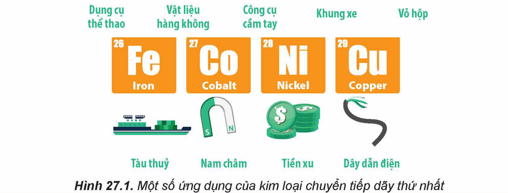
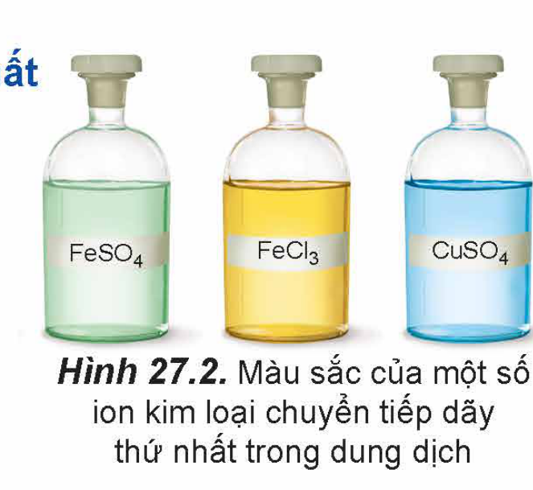

<!-- pdf:130 -->

# BÀI 27: ĐẠI CƯƠNG VỀ KIM LOẠI CHUYỂN TIẾP DÃY THỨ NHẤT

## 🎯 Mục tiêu

- Nêu được đặc điểm cấu hình electron của nguyên tử kim loại chuyển tiếp dãy thứ nhất (từ Sc đến Cu).
- Trình bày được một số tính chất vật lí của kim loại chuyển tiếp (nhiệt độ nóng chảy, khối lượng riêng, độ dẫn điện và dẫn nhiệt, độ cứng) và ứng dụng của kim loại chuyển tiếp từ các tính chất đó.
- Nêu được sự khác biệt các số liệu về nhiệt độ nóng chảy, khối lượng riêng, độ dẫn điện, độ cứng,... giữa một số kim loại chuyển tiếp so với kim loại họ s.
- Nêu được xu hướng có nhiều số oxi hoá của nguyên tố chuyển tiếp.
- Nêu được các trạng thái oxi hoá phổ biến, cấu hình electron, đặc tính có màu của một số ion kim loại chuyển tiếp dãy thứ nhất.
- Thực hiện được (hoặc quan sát video) thí nghiệm xác định hàm lượng muối $\ce{Fe(II)}$ bằng dung dịch thuốc tím.
- Thực hiện được thí nghiệm kiểm tra sự có mặt từng ion riêng biệt: $\ce{Cu^{2+}}$, $\ce{Fe^{3+}}$.

## 🔴 Mở đầu

Các kim loại chuyển tiếp dãy thứ nhất và hợp kim của chúng được sử dụng phổ biến làm vật liệu chế tạo dụng cụ, thiết bị, máy móc, phương tiện giao thông,...

Các ứng dụng này dựa trên tính chất nào của kim loại chuyển tiếp dãy thứ nhất?

Hình 27.1. Một số ứng dụng của kim loại chuyển tiếp dãy thứ nhất

<!-- pdf:131 -->

## I. ĐƠN CHẤT KIM LOẠI CHUYỂN TIẾP DÃY THỨ NHẤT

### 1. Đặc điểm cấu tạo nguyên tử

Cấu hình electron của nguyên tử các nguyên tố kim loại chuyển tiếp dãy thứ nhất được cho trong bảng sau:

Bảng 27.1. Cấu hình electron của nguyên tử các nguyên tố kim loại chuyển tiếp dãy thứ nhất

| Số hiệu nguyên tử | Nguyên tử | Cấu hình electron | Số hiệu nguyên tử | Nguyên tử | Cấu hình electron |
|---|---|---|---|---|---|
| 21 | Sc | $\ce{[Ar] 3d^1 4s^2}$ | 26 | Fe | $\ce{[Ar] 3d^6 4s^2}$ |
| 22 | Ti | $\ce{[Ar] 3d^2 4s^2}$ | 27 | Co | $\ce{[Ar] 3d^7 4s^2}$ |
| 23 | V | $\ce{[Ar] 3d^3 4s^2}$ | 28 | Ni | $\ce{[Ar] 3d^8 4s^2}$ |
| 24 | Cr | $\ce{[Ar] 3d^5 4s^1}$ | 29 | Cu | $\ce{[Ar] 3d^{10} 4s^1}$ |
| 25 | Mn | $\ce{[Ar] 3d^5 4s^2}$ | | | |
<!-- ocr-ok: bảng cấu hình electron Bảng 27.1 đối chiếu đúng với SGK -->

> ❓ Thực hiện các yêu cầu sau:
>
> 1. Trong bảng tuần hoàn, các nguyên tố kim loại chuyển tiếp dãy thứ nhất thuộc khối s, p, d hay f?
> 2. Nhận xét chung về cấu hình electron của nguyên tử kim loại chuyển tiếp dãy thứ nhất về:
> a) Đặc điểm giống nhau và khác nhau trong cấu hình electron nguyên tử.
> b) Sự biến đổi số electron trên phân lớp 3d và 4s.

<!-- term: Kim loại chuyển tiếp dãy thứ nhất -->
Các nguyên tố từ Sc (Z = 21) đến Cu (Z = 29) được gọi là ***nguyên tố chuyển tiếp dãy thứ nhất*** (hay ***kim loại chuyển tiếp dãy thứ nhất***).

Đặc điểm cấu hình electron trong nguyên tử của các kim loại chuyển tiếp dãy thứ nhất đều có lớp vỏ bên trong của khí hiếm Ar. Số electron trên phân lớp 3d tăng dần từ 1 (ở Sc) đến 10 (ở Cu). Trong khi đó trên phân lớp 4s, số electron thường bằng 2 (trừ Cr và Cu).

Nguyên tử của các kim loại chuyển tiếp dãy thứ nhất có nhiều electron hoá trị thuộc phân lớp 3d và 4s nên kim loại chuyển tiếp dãy thứ nhất thường tạo thành các hợp chất với nhiều số oxi hoá khác nhau.

> ❓ 1. Đặc điểm cấu hình electron nguyên tử kim loại chuyển tiếp dãy thứ nhất có gì khác biệt với nhóm IA và IIA trong cùng chu kì?

<!-- pdf:132 -->

<!-- term: Kim loại chuyển tiếp -->
> 💡 EM CÓ BIẾT
>
> ***Kim loại chuyển tiếp*** gồm toàn bộ các nguyên tố họ d và họ f, đều thuộc nhóm B trong bảng tuần hoàn. Nguyên tố họ d gồm 4 dãy: dãy 3d (chu kì 4), dãy 4d (chu kì 5), dãy 5d (chu kì 6) và dãy 6d (chu kì 7). Nguyên tố họ f gồm 2 dãy: dãy 4f (họ lanthanides, chu kì 6) và dãy 5f (họ actinides, chu kì 7).

### 2. Tính chất vật lí và ứng dụng của kim loại chuyển tiếp

Một số thông số vật lí của kim loại chuyển tiếp dãy thứ nhất được trình bày ở Bảng 27.2.

Bảng 27.2. Một số thông số vật lí của kim loại chuyển tiếp dãy thứ nhất

| Kim loại | Sc | Ti | V | Cr | Mn | Fe | Co | Ni | Cu |
|---|---|---|---|---|---|---|---|---|---|
| Nhiệt độ nóng chảy (°C) | 1541 | 1668 | 1917 | 1907 | 1244 | 1535 | 1494 | 1453 | 1084 |
| Khối lượng riêng ($\ce{g/cm^3}$) | 2,98 | 4,50 | 6,11 | 7,15 | 7,21 | 7,86 | 8,90 | 8,91 | 8,96 |
| Độ dẫn điện ($10^6\text{ S/m}$) | 1,7 | 2,3 | 4,9 | 7,7 | 0,7 | 10,0 | 15,4 | 13,8 | 57,1 |
| Độ dẫn nhiệt ($\text{W/(m}\cdot\text{K)}$) | 16 | 21,9 | 30,7 | 93,9 | 7,8 | 80,4 | 100 | 90,9 | 401 |
| Độ cứng (thang Mohs) | - | 6 | 7 | 8,5 | 6 | 4 | 5 | 4 | 3 |
<!-- ocr-ok: bảng thông số vật lí Bảng 27.2 đối chiếu đúng với SGK -->

> ❓ Thực hiện các yêu cầu sau:
>
> 1. Trong số các kim loại chuyển tiếp dãy thứ nhất, hãy chỉ ra:
> a) Các kim loại khó nóng chảy hơn Be. Biết nhiệt độ nóng chảy của Be là 1 287 °C.
> b) Các kim loại nặng ($D > 5\text{ g/cm}^3$).
>
> 2. a) Tra cứu Bảng 24.2, Bảng 25.2 và Bảng 27.2 để hoàn thành các thông số vật lí của K, Ca, Fe, Cu vào vở theo mẫu bảng sau:
> b) So sánh sự khác biệt về các thông số vật lí trên giữa Fe, Cu (kim loại chuyển tiếp dãy thứ nhất) với K, Ca (kim loại họ s).

<!-- pdf:133 -->

Một số tính chất vật lí và ứng dụng của các kim loại chuyển tiếp dãy thứ nhất được trình bày ở Bảng 27.3.

Bảng 27.3. Tính chất vật lí và ứng dụng của các kim loại chuyển tiếp dãy thứ nhất

| Tính chất | Đặc điểm | Ứng dụng |
|---|---|---|
| Nhiệt độ nóng chảy | Khó nóng chảy, đặc biệt là vanadium, chromium và cobalt. | Chế tạo dụng cụ, máy móc, thiết bị làm việc ở nhiệt độ cao. |
| Độ cứng | Khá cao, chromium là kim loại cứng nhất trong tất cả các kim loại. | Chế tạo hợp kim không gỉ hoặc siêu cứng để sản xuất dụng cụ y tế, nhà bếp, vòng bi, mũi khoan,... |
| Khối lượng riêng | Scandium và titanium tương đối nhẹ. Các kim loại khác đều là kim loại nặng. | Chế tạo vật liệu hàng không, gọng kính. Sản xuất phương tiện giao thông, máy móc, bệ máy... |
| Độ dẫn điện | Tương đối tốt, đồng là kim loại dẫn điện tốt (chỉ sau bạc). | Chế tạo dây dẫn, thiết bị điện... |
| Độ dẫn nhiệt | Tương đối tốt, điển hình là đồng. | Chế tạo thiết bị nồi hơi, thiết bị trao đổi nhiệt, đồ gia dụng... |
<!-- ocr-ok: bảng tính chất vật lí Bảng 27.3 đối chiếu đúng với SGK -->

## II. HỢP CHẤT CỦA KIM LOẠI CHUYỂN TIẾP DÃY THỨ NHẤT

### 1. Số oxi hoá của nguyên tử kim loại chuyển tiếp dãy thứ nhất trong hợp chất

> ❓ Xác định số oxi hoá của nguyên tử các nguyên tố chromium và manganese trong các dãy chất sau:
> - $\ce{Cr2O3}$, $\ce{CrO3}$, $\ce{K2CrO4}$, $\ce{K2Cr2O7}$.
> - $\ce{MnO}$, $\ce{MnO2}$, $\ce{K2MnO4}$, $\ce{KMnO4}$.

Do có nhiều electron hoá trị (ở phân lớp 4s và 3d) nên các nguyên tố chuyển tiếp dãy thứ nhất có khả năng tạo ra các hợp chất với nhiều trạng thái oxi hoá khác nhau.

Bảng 27.4. Các trạng thái oxi hoá thường gặp của một số nguyên tố kim loại chuyển tiếp dãy thứ nhất

| Nguyên tử | Cr | Mn | Fe | Cu |
|---|---|---|---|---|
| Số oxi hoá | +3 +6 | +2 +4 +7 | +2 +3 | +2 |
<!-- ocr-ok: bảng số oxi hoá Bảng 27.4 đối chiếu đúng với SGK -->

Khi tham gia phản ứng hoá học, nguyên tử kim loại chuyển tiếp dãy thứ nhất ưu tiên nhường electron ở phân lớp 4s trước rồi đến electron ở phân lớp 3d, tạo thành các cation tương ứng.

Ví dụ:
- $\ce{Fe -> Fe^{2+} + 2e}$
  $\ce{[Ar] 3d^6 4s^2 -> [Ar] 3d^6}$
- $\ce{Fe -> Fe^{3+} + 3e}$
  $\ce{[Ar] 3d^6 4s^2 -> [Ar] 3d^5}$

<!-- pdf:134 -->

> ❓ 2. Từ cấu hình electron ở Bảng 27.1, xác định cấu hình electron của các ion kim loại sau: $\ce{Cr^{3+}}$, $\ce{Mn^{2+}}$, $\ce{Cu^{2+}}$.

### 2. Màu sắc của các ion kim loại chuyển tiếp dãy thứ nhất

Các ion kim loại chuyển tiếp dãy thứ nhất có màu sắc phong phú (Hình 27.2).

Hình 27.2. Màu sắc của một số ion kim loại chuyển tiếp dãy thứ nhất trong dung dịch

### 3. Chuẩn độ iron(II) sulfate bằng thuốc tím
<!-- ocr-ok: tiêu đề mục 3, OCR đọc nhầm dấu; đã đối chiếu ảnh SGK -->

Trong phòng thí nghiệm, nồng độ iron(II) sulfate có thể được xác định bằng phương pháp chuẩn độ với dung dịch thuốc tím trong môi trường sulfuric acid theo phương trình hoá học:

$\ce{10FeSO4 + 2KMnO4 + 8H2SO4 -> 5Fe2(SO4)3 + 2MnSO4 + K2SO4 + 8H2O}$

> 🧪 Thí nghiệm: Xác định hàm lượng muối $\ce{Fe(II)}$ bằng dung dịch thuốc tím
>
> Chuẩn bị:
> - Hoá chất: các dung dịch: $\ce{KMnO4}$ 0,02 M, $\ce{H2SO4}$ 10%, $\ce{FeSO4}$ có nồng độ khoảng 0,10 M.
> - Dụng cụ: pipette 5 mL, burette 25 mL, bình tam giác 100 mL, ống đong 10 mL, bình tia nước cất, giá đỡ, kẹp càng cua.
>
> Tiến hành:
> - Dùng pipette lấy 5,0 mL dung dịch $\ce{FeSO4}$ cho vào bình tam giác; thêm tiếp khoảng 5 mL dung dịch $\ce{H2SO4}$ 10% (lấy bằng ống đong).
> - Cho dung dịch $\ce{KMnO4}$ vào burette, điều chỉnh thể tích dung dịch trong burette về mức 0.
> - Mở khoá burette, nhỏ từng giọt dung dịch $\ce{KMnO4}$ xuống bình tam giác, lắc đều. Ban đầu dung dịch trong bình tam giác xuất hiện màu hồng rồi mất màu. Tiếp tục chuẩn độ đến khi màu hồng tồn tại bền trong khoảng 20 giây thì dừng chuẩn độ.
> - Ghi lại thể tích dung dịch $\ce{KMnO4}$ đã dùng.
>
> Tiến hành chuẩn độ 3 lần, ghi số liệu vào vở và xử lí số liệu theo mẫu bảng sau:
>
> | Thí nghiệm | $V_{\ce{FeSO4}}$ (mL) | $V_{\ce{KMnO4}}$ (mL) | $V_{\text{tb, }\ce{KMnO4}}$ (mL) | $C_{\ce{FeSO4}}$ (mol/L) |
> |---|---|---|---|---|
> | 1 | ? | ? | ? | ? |
> | 2 | ? | ? | ? | ? |
> | 3 | ? | ? | ? | ? |
>
> *Lưu ý: Trong quá trình chuẩn độ, ban đầu thuốc tím mất màu chậm, sau đó mất màu nhanh.*

<!-- pdf:135 -->

### 4. Nhận biết một số ion kim loại chuyển tiếp

Trong hoá học, các ion kim loại chuyển tiếp thường được nhận biết dựa vào màu sắc đặc trưng của ion, của hợp chất ít tan hoặc của phức chất tương ứng.

> 🧪 Thí nghiệm: Kiểm tra sự có mặt từng ion riêng biệt: $\ce{Cu^{2+}}$, $\ce{Fe^{3+}}$.
>
> Chuẩn bị:
> - Hoá chất: các dung dịch: $\ce{FeCl3}$ 1 M, $\ce{CuSO4}$ 1 M, $\ce{NaOH}$ 1 M.
> - Dụng cụ: ống nghiệm, kẹp ống nghiệm.
>
> Tiến hành:
> - Cho khoảng 2 mL dung dịch $\ce{FeCl3}$ 1 M vào ống nghiệm (1) và khoảng 2 mL dung dịch $\ce{CuSO4}$ 1 M vào ống nghiệm (2).
> - Thêm tiếp vào mỗi ống nghiệm khoảng 2 - 3 giọt dung dịch $\ce{NaOH}$ 1 M, lắc nhẹ.
>
> Quan sát hiện tượng xảy ra và thực hiện các yêu cầu sau:
> 1. Cho biết màu sắc của các kết tủa tạo thành trong mỗi ống nghiệm.
> 2. Viết phương trình hoá học của các phản ứng xảy ra trong mỗi ống nghiệm.

## 📌 Em đã học

- Kim loại chuyển tiếp dãy thứ nhất gồm các nguyên tố từ Sc (Z = 21) đến Cu (Z = 29).
- Nguyên tử các kim loại chuyển tiếp dãy thứ nhất có cấu hình electron $\ce{[Ar] 3d^{1-10} 4s^{1-2}}$.
- Kim loại chuyển tiếp dãy thứ nhất khó nóng chảy, thường có độ cứng cao, dẫn điện tốt, dẫn nhiệt tốt, khối lượng riêng lớn và được ứng dụng rộng rãi trong thực tiễn.
- Kim loại chuyển tiếp dãy thứ nhất có xu hướng thể hiện nhiều trạng thái oxi hoá và tạo ra các hợp chất có màu sắc phong phú.

## ✏️ Em có thể

- Phân biệt được một số ion kim loại chuyển tiếp dựa vào màu sắc của chúng.
- Xác định được nồng độ iron(II) sulfate bằng phương pháp chuẩn độ với dung dịch thuốc tím.

## 📷 Danh sách hình trong bài

| Mã hình | Trang PDF | Vị trí | Chú thích gốc |
|---|---|---|---|
| H12-hoa-b27-01 | 130 | Mục 🔴 Mở đầu | Hình 27.1. Một số ứng dụng của kim loại chuyển tiếp dãy thứ nhất |
| H12-hoa-b27-02 | 134 | Mục II.2 | Hình 27.2. Màu sắc của một số ion kim loại chuyển tiếp dãy thứ nhất trong dung dịch |
