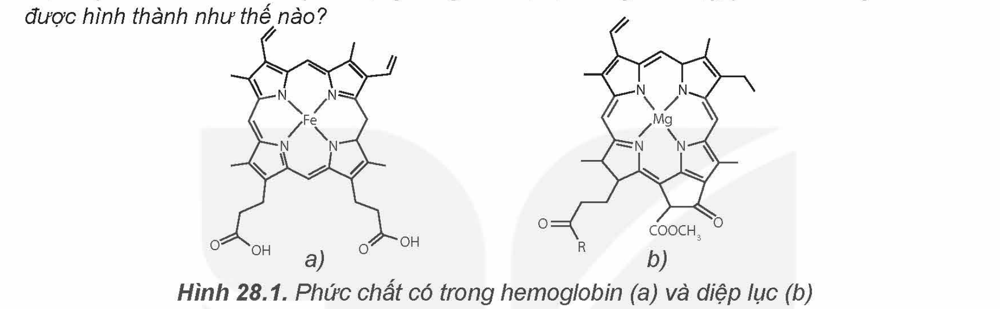
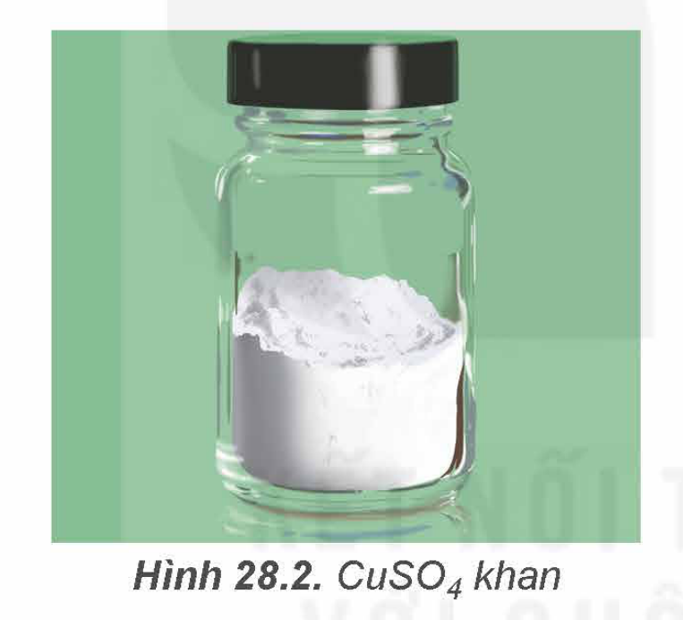
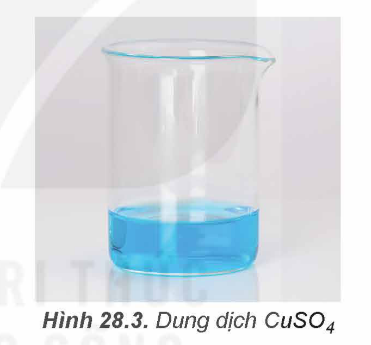

<!-- pdf:136 -->

# BÀI 28: SƠ LƯỢC VỀ PHỨC CHẤT

## 🎯 Mục tiêu

- Nêu được nguyên tử trung tâm; phối tử; liên kết cho – nhận giữa nguyên tử trung tâm và phối tử trong phức chất.
- Nêu được một số dạng hình học của phức chất (tứ diện, vuông phẳng, bát diện).
- Trình bày được sự hình thành phức chất aqua của ion kim loại chuyển tiếp và $\ce{H2O}$ trong dung dịch nước.

## 🔴 Mở đầu

Phức chất có trong một số thành phần quan trọng của sinh vật như hemoglobin, chất diệp lục,... Một số phức chất có vai trò quan trọng trong điều trị bệnh ung thư. Vậy, phức chất là gì? Phức chất được hình thành như thế nào?

Hình 28.1. Phức chất có trong hemoglobin (a) và diệp lục (b)

## I. MỘT SỐ KHÁI NIỆM CƠ BẢN VỀ PHỨC CHẤT

<!-- term: Phức chất -->
<!-- term: Nguyên tử trung tâm -->
<!-- term: Phối tử -->
***Phức chất*** là hợp chất có chứa ***nguyên tử trung tâm*** (thường được kí hiệu là M) và các ***phối tử*** (thường được kí hiệu là L). Trong đó, nguyên tử trung tâm là cation kim loại hoặc nguyên tử kim loại liên kết với các phối tử. Phối tử là anion hoặc phân tử. Phức chất có thể mang điện tích hoặc không mang điện tích.

Trong công thức phức chất, nguyên tử trung tâm M và các phối tử L thường được đặt trong móc vuông.

Ví dụ 1: Phức chất $\ce{[Co(NH3)6]^{3+}}$ có điện tích là +3, nguyên tử trung tâm là $\ce{Co^{3+}}$ và phối tử là $\ce{NH3}$.

Ví dụ 2: Phức chất $\ce{[Zn(OH)4]^{2-}}$ có điện tích là -2, nguyên tử trung tâm là $\ce{Zn^{2+}}$ và phối tử là $\ce{OH-}$.

Ví dụ 3: Phức chất $\ce{[Fe(CO)5]}$ không mang điện tích, nguyên tử trung tâm là Fe và phối tử là CO.

> ❓ 1. Cho các phức chất sau: $\ce{[Cu(H2O)4]^{2+}}$, $\ce{[CoF6]^{3-}}$, $\ce{[Ni(CO)4]}$, $\ce{[PtCl2(NH3)2]}$.
> a) Hãy chỉ ra phối tử và nguyên tử trung tâm trong mỗi phức chất trên.
> b) Hãy cho biết số lượng phối tử có trong mỗi phức chất trên.
> c) Hãy cho biết điện tích của mỗi phức chất trên.

<!-- pdf:137 -->

<!-- term: Cầu nội -->
<!-- term: Cầu ngoại -->
> 💡 EM CÓ BIẾT
>
> **Công thức phức chất**
>
> Trong công thức của phức chất, cầu nội được đặt trong móc vuông. Cầu nội của phức chất gồm nguyên tử trung tâm M và các phối tử L. Khi cầu nội mang điện tích, phức chất thường chứa ion cầu ngoại, các ion này trung hoà điện tích với ion cầu nội.
>
> Trong nhiều trường hợp, người ta chỉ quan tâm đến cầu nội do nó quyết định tính chất của phức chất.
>
> Ví dụ: Trong dung dịch thuốc thử Tollens, phức $\ce{[Ag(NH3)2]OH}$ phân li như sau:
> $\ce{[Ag(NH3)2]OH -> [Ag(NH3)2]+ + OH-}$
> Cation cầu nội $\ce{[Ag(NH3)2]+}$ quyết định tính chất của thuốc thử Tollens.

## II. MỘT SỐ DẠNG HÌNH HỌC CỦA PHỨC CHẤT

<!-- term: Dạng tứ diện -->
<!-- term: Dạng vuông phẳng -->
<!-- term: Dạng bát diện -->
Trong phức chất $\ce{[ML_n]}$ (điện tích đã được lược bỏ), các phối tử L sắp xếp một cách xác định xung quanh nguyên tử trung tâm M tạo ra các dạng hình học khác nhau, phổ biến là dạng tứ diện, vuông phẳng và bát diện (Bảng 28.1).

Bảng 28.1. Một số dạng hình học phổ biến của phức chất $\ce{[ML_n]}$

| Dạng hình học | Dạng tứ diện | Dạng vuông phẳng | Dạng bát diện |
|---|---|---|---|
| Số lượng phối tử | 4 | 4 | 6 |
<!-- ocr-ok: bảng dạng hình học Bảng 28.1 đối chiếu đúng với SGK -->

*Chú ý: Nét màu xanh nối các phối tử L trong phức chất để chỉ rõ dạng hình học của phức chất, nét màu trắng chỉ liên kết giữa M và L.*

> ❓ 1. Hãy xác định số lượng phối tử L trong phân tử hoặc ion phức chất ứng với mỗi dạng hình học ở Bảng 28.1.
> 2. Hãy dự đoán dạng hình học của phức chất $\ce{[Cu(H2O)4]^{2+}}$.

<!-- pdf:138 -->

## III. LIÊN KẾT TRONG PHỨC CHẤT

### 1. Liên kết giữa nguyên tử trung tâm và phối tử

Liên kết hoá học giữa nguyên tử trung tâm M và phối tử L trong phức chất là liên kết cho – nhận, được hình thành nhờ sự cho cặp electron chưa liên kết của phối tử vào orbital trống của nguyên tử trung tâm.

Ví dụ 1: Liên kết trong phức chất $\ce{[Co(NH3)6]^{3+}}$ được hình thành do phối tử $\ce{NH3}$ cho cặp electron chưa liên kết vào AO trống của nguyên tử trung tâm $\ce{Co^{3+}}$.

Ví dụ 2: Liên kết trong phức chất $\ce{[Zn(OH)4]^{2-}}$ được hình thành do phối tử $\ce{OH-}$ cho cặp electron chưa liên kết vào AO trống của nguyên tử trung tâm $\ce{Zn^{2+}}$.

> ❓ 2. Cho các phức chất sau: $\ce{[Ag(NH3)2]+}$ và $\ce{[CoF6]^{3-}}$.
> Hãy chỉ ra nguyên tử trung tâm, phối tử và giải thích sự hình thành liên kết trong mỗi phức chất trên.

### 2. Sự hình thành phức chất aqua của một số ion kim loại chuyển tiếp

Hình 28.2. $\ce{CuSO4}$ khan

Hình 28.3. Dung dịch $\ce{CuSO4}$

Muối $\ce{CuSO4}$ khan màu trắng (Hình 28.2) khi tan vào nước tạo thành dung dịch có màu xanh (Hình 28.3) vì tạo thành phức chất $\ce{[Cu(H2O)6]^{2+}}$.

<!-- term: Phức chất aqua -->
Trong dung dịch, các ion kim loại chuyển tiếp $\ce{M^{n+}}$ thường nhận cặp electron chưa liên kết của $\ce{H2O}$ tạo thành liên kết cộng hoá trị kiểu cho – nhận, hình thành phức chất aqua. Hầu hết các phức chất aqua có dạng hình học bát diện ($\ce{[M(H2O)6]^{n+}}$). Chẳng hạn trong dung dịch nước, ion $\ce{Fe^{2+}}$ tạo phức chất $\ce{[Fe(H2O)6]^{2+}}$, ion $\ce{Co^{3+}}$ tạo phức chất $\ce{[Co(H2O)6]^{3+}}$.

> ❓ 3. Phức chất aqua của $\ce{Ni^{2+}}$ và $\ce{Zn^{2+}}$ đều có dạng hình học bát diện.
> a) Viết công thức hoá học của mỗi phức chất aqua trên.
> b) Mô tả sự hình thành liên kết giữa phối tử và nguyên tử trung tâm trong mỗi phức chất trên.

<!-- pdf:139 -->

## 📌 Em đã học

- Phức chất là hợp chất có chứa nguyên tử trung tâm và các phối tử, nó có thể mang điện tích hoặc không mang điện tích.
- Các phối tử sắp xếp một cách xác định xung quanh nguyên tử trung tâm, tạo ra các dạng hình học khác nhau. Các dạng hình học phổ biến là tứ diện, vuông phẳng và bát diện.
- Phối tử liên kết với nguyên tử trung tâm bằng liên kết cho – nhận.
- Trong dung dịch, các ion kim loại chuyển tiếp $\ce{M^{n+}}$ thường tạo phức chất aqua, hầu hết có dạng hình học bát diện.

## ✏️ Em có thể

- Chỉ ra được nguyên tử trung tâm, phối tử, dạng hình học của một số phức chất.
- Giải thích được sự hình thành phức chất aqua của ion kim loại chuyển tiếp và $\ce{H2O}$ trong dung dịch nước.

## 📷 Danh sách hình trong bài

| Mã hình | Trang PDF | Vị trí | Chú thích gốc |
|---|---|---|---|
| H12-hoa-b28-01 | 136 | Mục 🔴 Mở đầu | Hình 28.1. Phức chất có trong hemoglobin (a) và diệp lục (b) |
| H12-hoa-b28-02 | 138 | Mục III.2 | Hình 28.2. $\ce{CuSO4}$ khan |
| H12-hoa-b28-03 | 138 | Mục III.2 | Hình 28.3. Dung dịch $\ce{CuSO4}$ |
