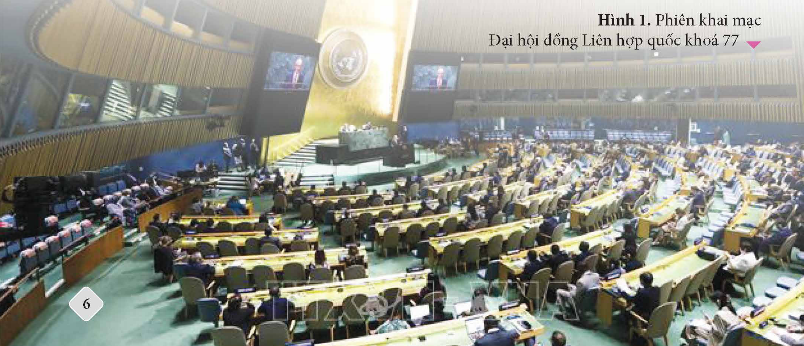
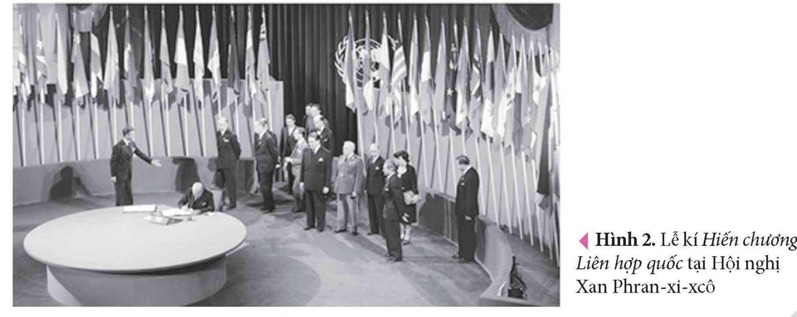
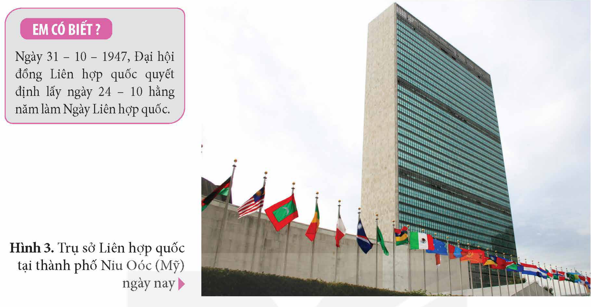
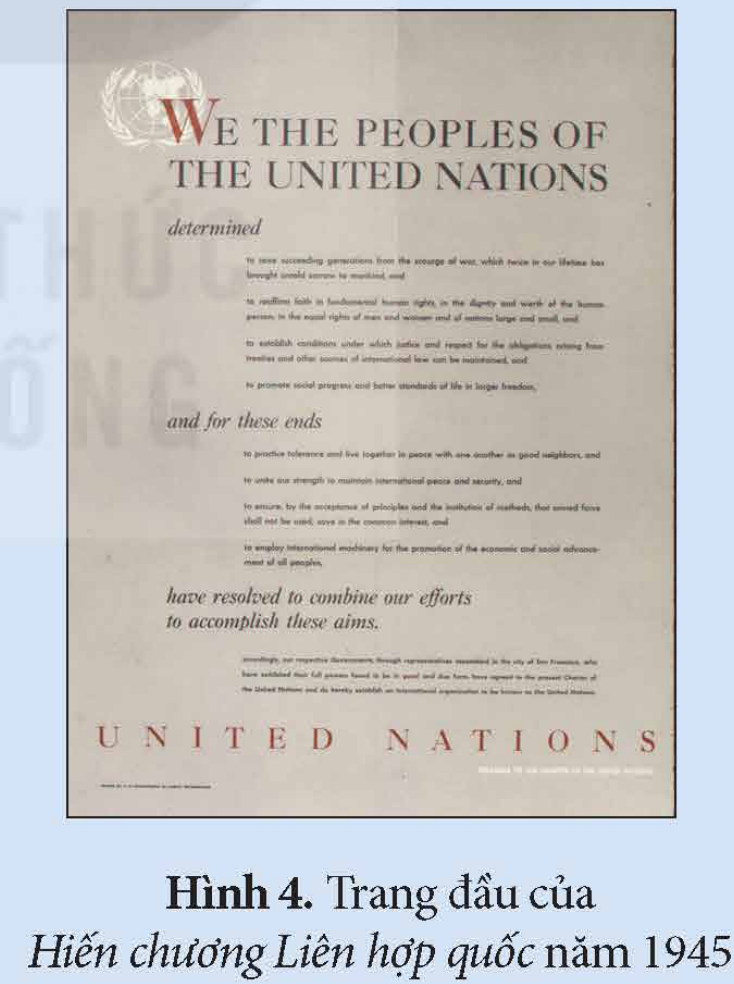
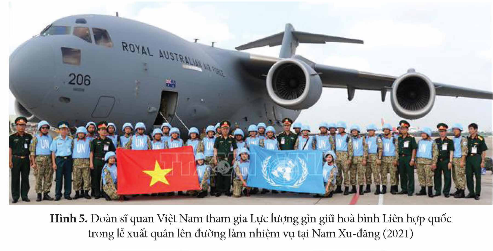
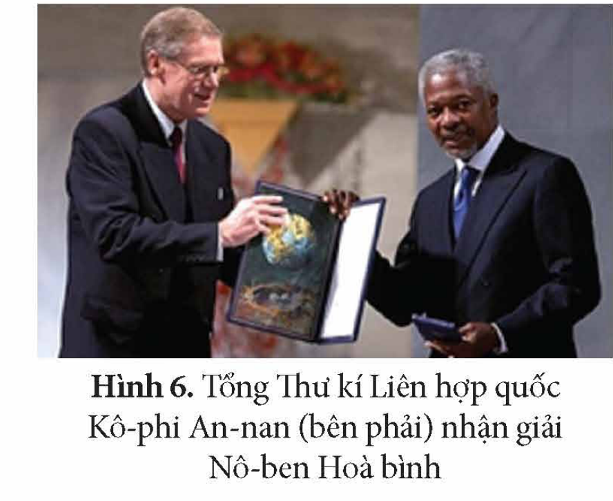
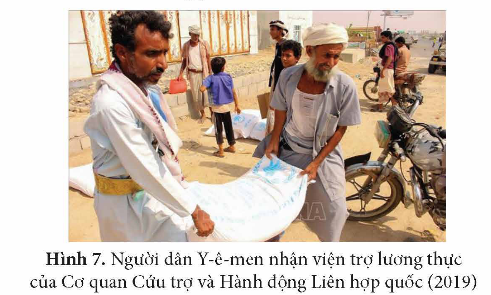
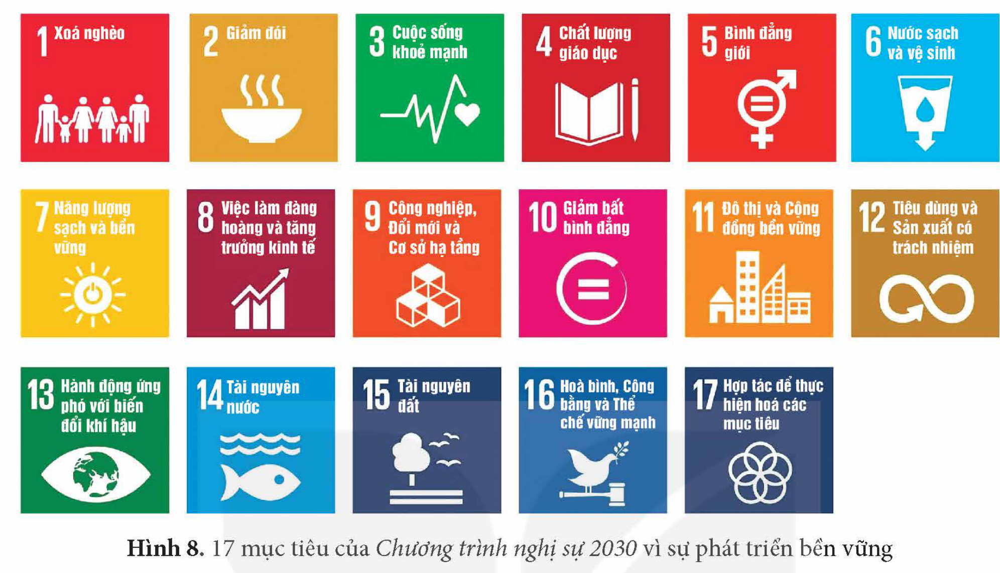
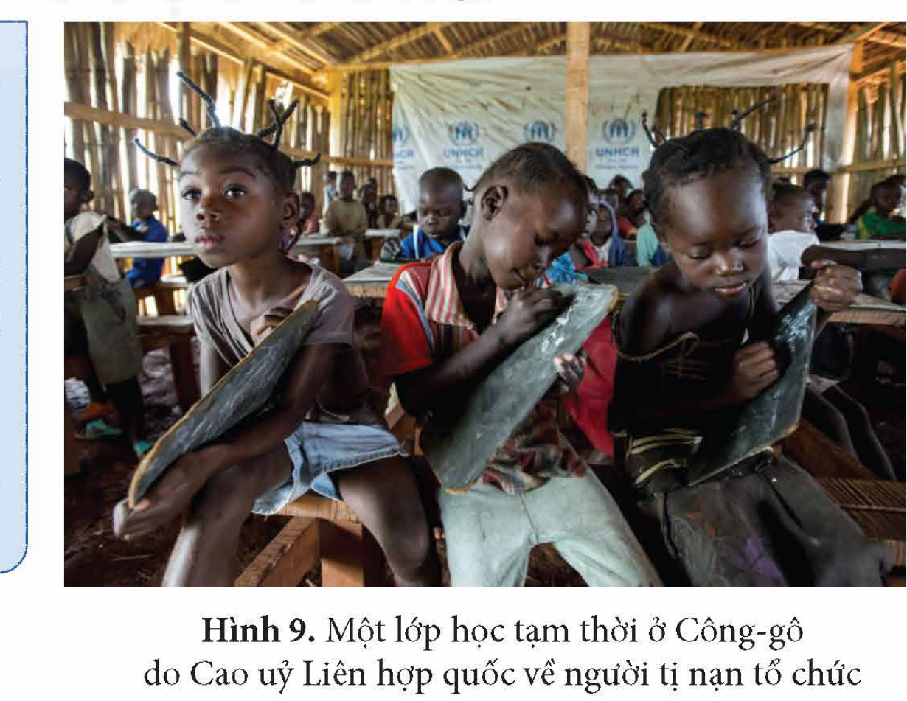

<!-- pdf:8 -->

# BÀI 1: LIÊN HỢP QUỐC

## 🎯 Học xong bài này, em sẽ:

- Biết cách sưu tầm và sử dụng tài liệu để tìm hiểu quá trình thành lập Liên hợp quốc.
- Nêu được bối cảnh lịch sử và quá trình hình thành Liên hợp quốc.
- Trình bày được mục tiêu, nguyên tắc hoạt động cơ bản của Liên hợp quốc.
- Nêu được vai trò của Liên hợp quốc trong việc duy trì hoà bình, an ninh quốc tế.
- Trình bày được vai trò của Liên hợp quốc trong việc thúc đẩy phát triển, tạo môi trường thuận lợi để phát triển kinh tế, tài chính, thương mại quốc tế, nâng cao đời sống người dân.
- Trình bày được vai trò của Liên hợp quốc trong việc đảm bảo quyền con người, phát triển văn hoá, xã hội.

## 🔴 Mở đầu

Hình dưới đây là phiên khai mạc Đại hội đồng Liên hợp quốc khoá 77 vào ngày 13 – 9 – 2022 tại Niu Oóc (Mỹ) với sự tham dự của đại diện 193 quốc gia thành viên. Tổ chức này được thành lập trong bối cảnh nào? Liên hợp quốc có mục tiêu, nguyên tắc hoạt động và đóng vai trò như thế nào trong việc thúc đẩy sự phát triển kinh tế, văn hoá, xã hội,... của thế giới? Vì sao Liên hợp quốc trở thành tổ chức toàn cầu lớn nhất thế giới? Hãy chia sẻ những điều em biết về một số vấn đề nêu trên.

*Hình 1. Phiên khai mạc Đại hội đồng Liên hợp quốc khoá 77*

<!-- pdf:9 -->

## 1. Một số vấn đề cơ bản về Liên hợp quốc

### a) Bối cảnh lịch sử và quá trình hình thành

• *Bối cảnh lịch sử*

Vào giai đoạn cuối của Chiến tranh thế giới thứ hai, tình hình thế giới có những chuyển biến quan trọng. Sức mạnh và ưu thế trên chiến trường thuộc về phe Đồng minh chống phát xít. Việc tổ chức lại thế giới sau chiến tranh càng trở nên cấp bách. Chiến tranh diễn ra càng khốc liệt thì ý tưởng về một tổ chức quốc tế thực sự có vai trò trong việc duy trì hoà bình thế giới càng rõ nét.

> 💡 EM CÓ BIẾT ?

<!-- term: Hội Quốc liên -->
> Hội Quốc liên là tổ chức quốc tế được thành lập năm 1920 nhằm duy trì trật tự thế giới mới sau Chiến tranh thế giới thứ nhất. Tuy nhiên, tổ chức này không đủ sức mạnh để bảo vệ hoà bình, an ninh thế giới và chính thức giải thể năm 1946.

Khi Chiến tranh thế giới thứ hai đang diễn ra, các nước Đồng minh chống phát xít đã mong muốn thiết lập một tổ chức quốc tế để bảo vệ hoà bình, an ninh thế giới thay thế cho Hội Quốc liên.

Trong bối cảnh đó, các nước Liên Xô, Mỹ, Anh triển khai các hoạt động để thành lập Liên hợp quốc.

• *Quá trình hình thành*

<!-- term: Tuyên bố về Liên hợp quốc -->
Ngày 1 – 1 – 1942, đại diện 26 nước chống phát xít đã kí bản *Tuyên bố về Liên hợp quốc*, cam kết thành lập một tổ chức quốc tế vì hoà bình và an ninh sau chiến tranh.

Từ năm 1943, các nước đã thoả thuận được một số điểm cơ bản về cơ cấu Liên hợp quốc, Đại hội đồng, thành viên thường trực Hội đồng Bảo an,...

Tại Hội nghị Tê-hê-ran (I-ran, từ ngày 28 – 11 đến ngày 1 – 12 – 1943), ba nước Liên Xô, Mỹ, Anh khẳng định quyết tâm thành lập Liên hợp quốc.

Tại Hội nghị I-an-ta (Liên Xô, tháng 2 – 1945), ba nước Liên Xô, Mỹ, Anh đã ra quyết định về việc thành lập Liên hợp quốc và đồng ý triệu tập hội nghị để thông qua Hiến chương Liên hợp quốc.

<!-- term: Hiến chương Liên hợp quốc -->
Từ ngày 25 – 4 – 1945 đến ngày 26 – 6 – 1945, một hội nghị quốc tế được tổ chức tại Xan Phran-xi-xcô (Mỹ) với sự tham gia của đại biểu 50 nước đã thông qua bản *Hiến chương Liên hợp quốc*.

*Hình 2. Lễ kí Hiến chương Liên hợp quốc tại Hội nghị Xan Phran-xi-xcô*

<!-- pdf:10 -->

<!-- term: Liên hợp quốc -->
Ngày 24 – 10 – 1945, Liên hợp quốc chính thức được thành lập với 51 nước thành viên.

> 💡 EM CÓ BIẾT ?

<!-- term: Ngày Liên hợp quốc -->
> Ngày 31 – 10 – 1947, Đại hội đồng Liên hợp quốc quyết định lấy ngày 24 – 10 hằng năm làm Ngày Liên hợp quốc.

*Hình 3. Trụ sở Liên hợp quốc tại thành phố Niu Oóc (Mỹ) ngày nay*

> ❓ Hãy nêu bối cảnh lịch sử và quá trình thành lập Liên hợp quốc.

### b) Mục tiêu, nguyên tắc hoạt động

Mục tiêu của Liên hợp quốc được quy định trong *Hiến chương Liên hợp quốc*.

<!-- term: Mục tiêu của Liên hợp quốc -->
> TƯ LIỆU 1. Theo *Hiến chương*, Liên hợp quốc được thành lập nhằm bốn mục tiêu: 1. Duy trì hoà bình và an ninh quốc tế; 2. Thúc đẩy quan hệ hữu nghị giữa các dân tộc trên cơ sở tôn trọng quyền bình đẳng, quyền tự quyết dân tộc và củng cố hoà bình thế giới; 3. Thúc đẩy hợp tác quốc tế để giải quyết các vấn đề kinh tế, xã hội, văn hoá, nhân đạo, đảm bảo quyền con người và quyền tự do cơ bản cho mọi người không phân biệt chủng tộc, giới tính, tôn giáo, ngôn ngữ; 4. Liên hợp quốc đóng vai trò là trung tâm điều hoà các nỗ lực quốc tế vì những mục tiêu trên.
>
> *(Theo Điều 1, Hiến chương Liên hợp quốc năm 1945)*

*Hình 4. Trang đầu của Hiến chương Liên hợp quốc năm 1945*

Trong số các mục tiêu của Liên hợp quốc, mục tiêu duy trì hoà bình và an ninh quốc tế được chú trọng và là cơ sở để thực hiện các mục tiêu khác.

Để đảm bảo Liên hợp quốc là một tổ chức quốc tế thực sự phục vụ mục tiêu chung của cộng đồng quốc tế, Hiến chương Liên hợp quốc quy định rõ các nguyên tắc hoạt động của tổ chức này.

<!-- pdf:11 -->

*Hình 5. Đoàn sĩ quan Việt Nam tham gia Lực lượng gìn giữ hoà bình Liên hợp quốc trong lễ xuất quân lên đường làm nhiệm vụ tại Nam Xu-đăng (2021)*

<!-- term: Nguyên tắc hoạt động của Liên hợp quốc -->
> TƯ LIỆU 2. Các nguyên tắc hoạt động của Liên hợp quốc bao gồm: Bình đẳng về chủ quyền quốc gia; Tôn trọng toàn vẹn lãnh thổ và độc lập chính trị quốc gia; Từ bỏ đe doạ bằng vũ lực hoặc sử dụng vũ lực trong quan hệ quốc tế; Không can thiệp vào công việc nội bộ các nước; Tôn trọng các nghĩa vụ quốc tế và luật pháp quốc tế; Giải quyết các tranh chấp quốc tế bằng biện pháp hoà bình.
>
> *(Theo Điều 2, Hiến chương Liên hợp quốc năm 1945)*

Toàn bộ các hoạt động của Liên hợp quốc kể từ khi thành lập đến nay được thực hiện dựa trên cơ sở những mục tiêu và nguyên tắc hoạt động do Hiến chương quy định.

> ❓ Khai thác thông tin và các tư liệu 1, 2 trong mục, hãy trình bày mục tiêu và nguyên tắc hoạt động cơ bản của Liên hợp quốc.

## 2. Vai trò của Liên hợp quốc

### a) Duy trì hoà bình, an ninh quốc tế

*Trước hết*, Liên hợp quốc góp phần ngăn ngừa không để xảy ra một cuộc chiến tranh thế giới mới kể từ năm 1945 đến nay.

*Thứ hai*, Liên hợp quốc triển khai hoạt động gìn giữ hoà bình ở nhiều khu vực trên thế giới, góp phần chấm dứt nhiều cuộc xung đột, như ở En Xan-va-đo, Goa-tê-ma-la, Mô-dăm-bích,... và hỗ trợ cho tiến trình tái thiết ở nhiều quốc gia thành viên.

*Thứ ba*, Liên hợp quốc đã soạn thảo và xây dựng được hệ thống các công ước quốc tế về giải trừ quân bị, chống chạy đua vũ trang.

*Hình 6. Tổng Thư kí Liên hợp quốc Kô-phi An-nan (bên phải) nhận giải Nô-ben Hoà bình*

<!-- pdf:12 -->

Trong đó, tiêu biểu là: *Hiệp ước cấm phổ biến vũ khí hạt nhân (1968)*, *Công ước cấm vũ khí hoá học (1992)*, *Công ước cấm vũ khí hạt nhân (2017)*,... tạo khuôn khổ cho việc ngăn chặn, tiến tới xoá bỏ hoàn toàn các loại vũ khí này.

*Thứ tư*, Liên hợp quốc đã thành công trong việc thúc đẩy quá trình giành độc lập dân tộc của các nước thuộc địa và phụ thuộc, góp phần làm gia tăng số lượng thành viên của Liên hợp quốc hiện nay là 193 nước.

> ❓ Nêu vai trò của Liên hợp quốc trong việc duy trì hoà bình, an ninh quốc tế.

### b) Thúc đẩy phát triển kinh tế, tài chính, thương mại quốc tế và nâng cao đời sống người dân

Liên hợp quốc với hệ thống các cơ quan, tổ chức chuyên môn đóng vai trò quan trọng trong việc thúc đẩy, tạo môi trường thuận lợi để phát triển kinh tế, tài chính và thương mại quốc tế đạt được nhiều thành tựu nổi bật.

> TƯ LIỆU 3. Từ năm 1960, Đại hội đồng Liên hợp quốc đề ra các chiến lược phát triển cho từng thập kỉ nhằm huy động hợp tác quốc tế cho các mục tiêu phát triển chung. Một trong những ưu tiên của Liên hợp quốc là tạo môi trường kinh tế, thương mại, tài chính quốc tế bình đẳng và quan tâm thích đáng đến lợi ích của các nước thành viên.
>
> *(Theo Bộ Ngoại giao, Tài liệu cơ bản về Liên hợp quốc)*

> 💡 EM CÓ BIẾT ?

<!-- term: Hội nghị Liên hợp quốc về Thương mại và Phát triển -->
> Hội nghị Liên hợp quốc về Thương mại và Phát triển (UNCTAD) là tổ chức kinh tế, thương mại lớn nhất trực thuộc Liên hợp quốc. Mục đích của UNCTAD là thúc đẩy sự phát triển kinh tế nói chung và thương mại nói riêng của tất cả các nước thành viên, nhất là các nước đang phát triển.

Việc phát triển và hợp tác kinh tế, thương mại quốc tế là mục tiêu quan trọng được Liên hợp quốc chú trọng và xem đó là công cụ chủ yếu để phát triển kinh tế của các nước thành viên.

Thông qua các tổ chức chuyên môn và các quỹ trực thuộc, Liên hợp quốc đã thực hiện nhiều dự án, đóng vai trò quan trọng trong việc cải thiện, nâng cao đời sống của người dân và hỗ trợ cho công tác xoá đói, giảm nghèo, đặc biệt là ở các nước đang phát triển.

> 💡 EM CÓ BIẾT ?

<!-- term: Mục tiêu phát triển Thiên niên kỉ -->
> Từ năm 2000, Liên hợp quốc thúc đẩy việc thực hiện các Mục tiêu phát triển Thiên niên kỉ, đã được Hội nghị Thượng đỉnh Thiên niên kỉ (9 – 2000) thông qua, nhằm xoá bỏ đói nghèo, thực hiện bình đẳng giới, đảm bảo bền vững về môi trường,...

*Hình 7. Người dân Y-ê-men nhận viện trợ lương thực của Cơ quan Cứu trợ và Hành động Liên hợp quốc (2019)*

Liên hợp quốc cũng góp phần vào các hoạt động chống biến đổi khí hậu, dịch bệnh,... ở nhiều khu vực trên thế giới.

<!-- pdf:13 -->

<!-- term: Chương trình nghị sự 2030 vì sự phát triển bền vững -->
Năm 2015, Liên hợp quốc thông qua *Chương trình nghị sự 2030 vì sự phát triển bền vững*, đặt ra 17 mục tiêu, hành động mang tính toàn cầu đến năm 2030.

*Hình 8. 17 mục tiêu của Chương trình nghị sự 2030 vì sự phát triển bền vững*

> ❓ Khai thác thông tin và Tư liệu 3 trong mục, hãy trình bày vai trò của Liên hợp quốc trong thúc đẩy phát triển kinh tế, tài chính, thương mại quốc tế, cũng như trong việc nâng cao đời sống người dân.

### c) Đảm bảo quyền con người, phát triển văn hoá, xã hội

Ngay từ khi thành lập, Liên hợp quốc đã nỗ lực thúc đẩy việc xây dựng và kí kết những văn bản, điều ước quốc tế quan trọng nhằm đảm bảo các quyền cơ bản của con người, tạo cơ hội phát triển văn hoá, xã hội cho tất cả mọi người.

<!-- term: Tuyên ngôn Nhân quyền -->
> TƯ LIỆU 4. Năm 1948, Đại hội đồng Liên hợp quốc thông qua *Tuyên ngôn Nhân quyền*, đưa ra những quyền và tự do cơ bản của con người... Liên hợp quốc chú trọng việc đảm bảo thực hiện những quyền cơ bản này của người dân trên toàn thế giới.
>
> *(Theo Bộ Ngoại giao, Tài liệu cơ bản về Liên hợp quốc)*

*Hình 9. Một lớp học tạm thời ở Công-gô do Cao uỷ Liên hợp quốc về người tị nạn tổ chức*

<!-- pdf:14 -->

> 💡 EM CÓ BIẾT ?

<!-- term: Tổ chức Giáo dục, Văn hoá, Khoa học của Liên hợp quốc -->
> Tổ chức Giáo dục, Văn hoá, Khoa học của Liên hợp quốc (UNESCO) có vai trò quan trọng trong việc thúc đẩy đối thoại, hợp tác giữa các dân tộc nhằm mục tiêu toàn cầu về phát triển văn hoá, xã hội, khoa học, phát triển bền vững,... Uỷ ban Di sản thế giới của UNESCO đã công nhận và hỗ trợ tài chính, góp phần quan trọng trong việc bảo tồn di sản văn hoá của nhân loại.

Các cơ quan và tổ chức chuyên môn của Liên hợp quốc tiến hành các hoạt động thúc đẩy sự hợp tác quốc tế giữa các quốc gia nhằm phát triển văn hoá, xã hội.

<!-- term: Quỹ Giáo dục không thể chờ đợi -->
Liên hợp quốc đóng vai trò quan trọng trong việc xây dựng các quỹ tài trợ quốc tế để phát triển văn hoá, xã hội, trong số đó có các quỹ tài trợ cho giáo dục, tiêu biểu là *Quỹ Giáo dục không thể chờ đợi* (Education Cannot Wait). Chỉ tính riêng trong năm 2021, khoảng 222 triệu trẻ em ở các khu vực chiến sự và khó khăn trên thế giới đã được tiếp cận với giáo dục nhờ sự hỗ trợ của quỹ này.

> ❓ Khai thác thông tin và Tư liệu 4 trong mục, nêu những nét chính về vai trò của Liên hợp quốc trong việc đảm bảo quyền con người và phát triển văn hoá, xã hội.

## ✏️ Luyện tập và vận dụng

1. Lập bảng tóm tắt bối cảnh thành lập, mục tiêu, nguyên tắc hoạt động của Liên hợp quốc.

2. Lập sơ đồ tư duy thể hiện những nét chính về vai trò của Liên hợp quốc trong các lĩnh vực.

1. Có ý kiến cho rằng: Vai trò quan trọng nhất của Liên hợp quốc là góp phần ngăn ngừa không để xảy ra một cuộc chiến tranh thế giới mới kể từ năm 1945 đến nay. Em có đồng ý với ý kiến này không? Vì sao?

2. Tìm hiểu thông tin từ sách, báo, internet và chia sẻ với bạn về những đóng góp, hỗ trợ của Liên hợp quốc đối với Việt Nam.

## 📷 Danh sách hình trong bài

| Mã hình | Trang PDF | Vị trí trong bài | Chú thích gốc |
| --- | --- | --- | --- |
| H12-lich_su-b01-01 | 8 | Mở đầu (ảnh nền tràn lề cuối trang dưới khung Mở đầu) | Hình 1. Phiên khai mạc Đại hội đồng Liên hợp quốc khoá 77 |
| H12-lich_su-b01-02 | 9 | Mục 1.a | Hình 2. Lễ kí Hiến chương Liên hợp quốc tại Hội nghị Xan Phran-xi-xcô |
| H12-lich_su-b01-03 | 10 | Mục 1.a | Hình 3. Trụ sở Liên hợp quốc tại thành phố Niu Oóc (Mỹ) ngày nay |
| H12-lich_su-b01-04 | 10 | Mục 1.b | Hình 4. Trang đầu của Hiến chương Liên hợp quốc năm 1945 |
| H12-lich_su-b01-05 | 11 | Mục 1.b | Hình 5. Đoàn sĩ quan Việt Nam tham gia Lực lượng gìn giữ hoà bình Liên hợp quốc trong lễ xuất quân lên đường làm nhiệm vụ tại Nam Xu-đăng (2021) |
| H12-lich_su-b01-06 | 11 | Mục 2.a | Hình 6. Tổng Thư kí Liên hợp quốc Kô-phi An-nan (bên phải) nhận giải Nô-ben Hoà bình |
| H12-lich_su-b01-07 | 12 | Mục 2.b | Hình 7. Người dân Y-ê-men nhận viện trợ lương thực của Cơ quan Cứu trợ và Hành động Liên hợp quốc (2019) |
| H12-lich_su-b01-08 | 13 | Mục 2.b | Hình 8. 17 mục tiêu của Chương trình nghị sự 2030 vì sự phát triển bền vững |
| H12-lich_su-b01-09 | 13 | Mục 2.c (chú thích trải sang trái sát viền phải khung Tư liệu 4) | Hình 9. Một lớp học tạm thời ở Công-gô do Cao uỷ Liên hợp quốc về người tị nạn tổ chức |
