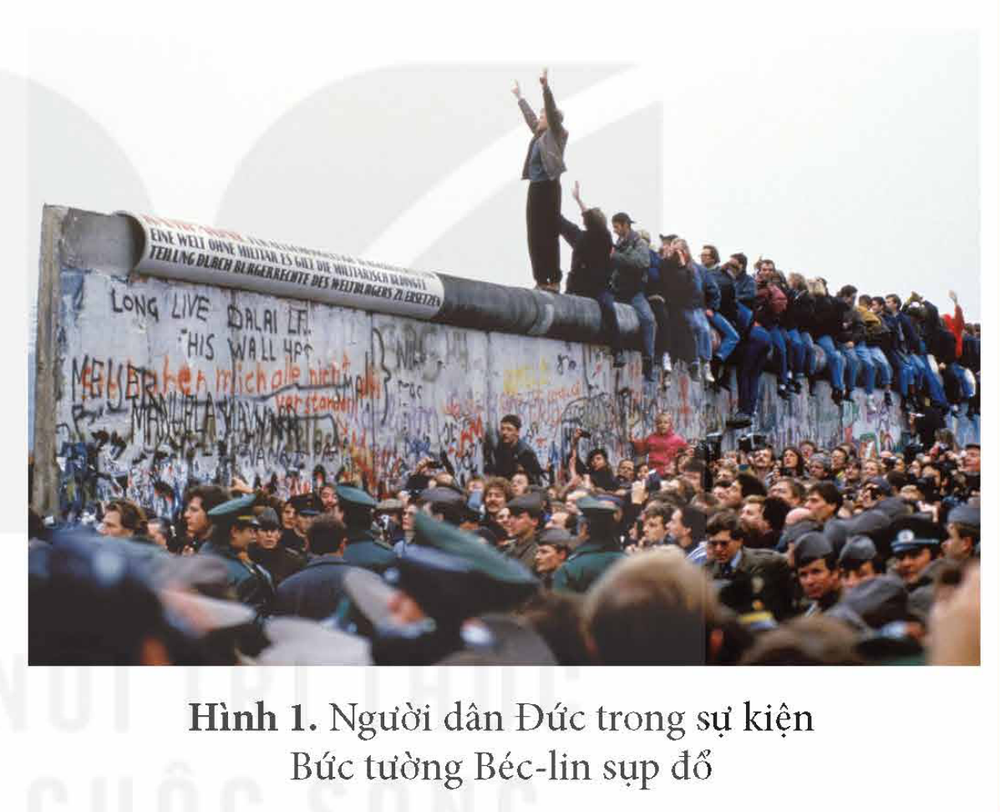
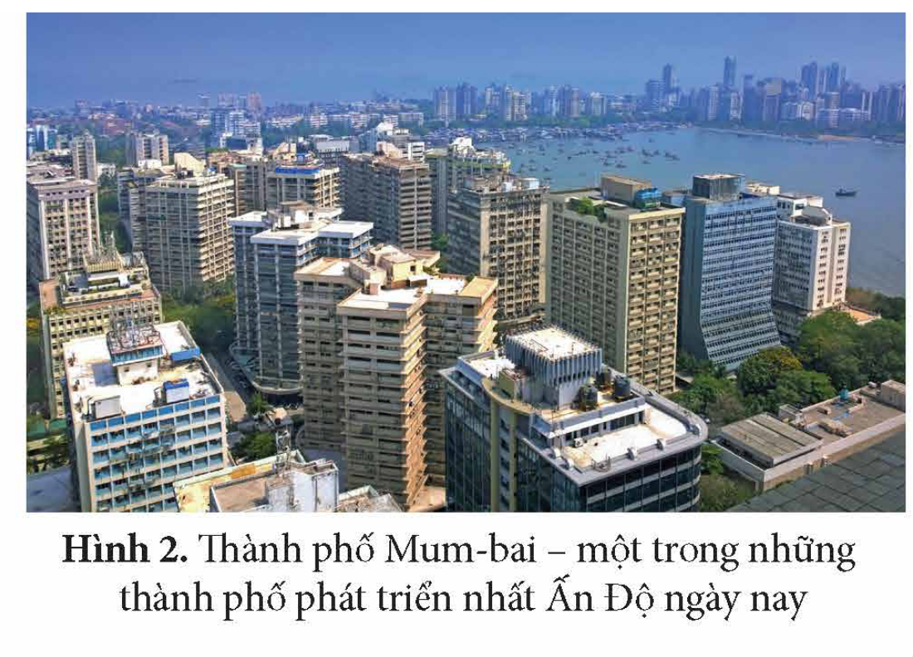

<!-- pdf:20 -->

# BÀI 3: TRẬT TỰ THẾ GIỚI SAU CHIẾN TRANH LẠNH

## 🎯 Học xong bài này, em sẽ:

- Nêu được xu thế phát triển chính của thế giới sau Chiến tranh lạnh.
- Trình bày được khái niệm đa cực.
- Nêu được xu thế đa cực trong quan hệ quốc tế sau Chiến tranh lạnh.
- Vận dụng được những hiểu biết về thế giới sau Chiến tranh lạnh để giải thích những vấn đề thời sự trong quan hệ quốc tế.

## 🔴 Mở đầu

Sự kiện Bức tường Béc-lin sụp đổ (11 – 1989) là một trong những biểu tượng cho sự kết thúc của Chiến tranh lạnh. Chiến tranh lạnh kết thúc đã mở ra những xu thế phát triển mới của thế giới. Đó là những xu thế nào? Vì sao xu thế đa cực trở thành xu hướng chính trong quan hệ quốc tế sau Chiến tranh lạnh? Hãy chia sẻ những điều em biết về trật tự thế giới sau Chiến tranh lạnh.

*Hình 1. Người dân Đức trong sự kiện Bức tường Béc-lin sụp đổ*

## 1. Các xu thế phát triển chính của thế giới sau chiến tranh lạnh

Chiến tranh lạnh kết thúc đã mở ra một thời kì mới của thế giới với những xu thế phát triển chính: kinh tế là trọng tâm; toàn cầu hoá; đối thoại, hợp tác; đa cực trong quan hệ quốc tế,...

• *Xu thế phát triển lấy kinh tế là trọng tâm*

> 💡 EM CÓ BIẾT ?

> Từ năm 1986, Việt Nam bắt đầu công cuộc Đổi mới, xây dựng nền kinh tế thị trường định hướng xã hội chủ nghĩa, được xếp trong nhóm những nền kinh tế có tốc độ tăng trưởng cao nhất thế giới, đồng thời gắn kết phát triển kinh tế với tiến bộ và công bằng xã hội.

<!-- term: Xu thế phát triển lấy kinh tế là trọng tâm -->
Sau Chiến tranh lạnh, hầu hết các quốc gia trên thế giới đều điều chỉnh chiến lược phát triển tập trung vào kinh tế, nhằm tăng cường sức mạnh, tiềm lực quốc gia, đồng thời nâng cao đời sống người dân.

<!-- pdf:21 -->

• *Xu thế toàn cầu hoá*

<!-- term: Toàn cầu hoá -->
Sự kết thúc của Trật tự thế giới hai cực I-an-ta và Chiến tranh lạnh, cùng với sự phát triển của cách mạng khoa học – công nghệ đã thúc đẩy mạnh mẽ quá trình toàn cầu hoá. Toàn cầu hoá là quá trình gia tăng mạnh mẽ của những mối liên hệ, sự phụ thuộc, tác động lẫn nhau giữa các quốc gia, dân tộc và khu vực trên phạm vi toàn cầu.

• *Xu thế đối thoại, hợp tác trong quan hệ quốc tế*

<!-- term: Xu thế đối thoại, hợp tác trong quan hệ quốc tế -->
Nhu cầu ổn định để phát triển kinh tế, đặc biệt là xu thế toàn cầu hoá đã thúc đẩy xu thế đối thoại, cùng hợp tác, thay cho xu thế đối đầu giữa các nước có chế độ chính trị khác nhau trong quan hệ quốc tế. Xu thế đối thoại, hợp tác dựa trên cơ sở hai bên cùng có lợi, tôn trọng lẫn nhau, cùng tồn tại hoà bình đang ngày càng trở thành xu thế chủ yếu trong các mối quan hệ quốc tế.

> ❓ Hãy nêu những xu thế phát triển chính của thế giới sau Chiến tranh lạnh.

## 2. Xu thế đa cực trong quan hệ quốc tế

### a) Khái niệm đa cực

<!-- term: Đa cực -->
Đa cực là một thuật ngữ trong quan hệ quốc tế dùng để chỉ một trật tự thế giới có sự tham gia của các quốc gia, các trung tâm khác nhau, trong đó không một quốc gia nào có quyền lực áp đảo đối với các quốc gia khác, cũng như chi phối sự phát triển của thế giới.

Sự hình thành của trật tự thế giới đa cực là một tiến trình lịch sử khách quan với sự nổi lên của các cường quốc, sự gia tăng vai trò của các trung tâm, tổ chức quốc tế, phản ánh tương quan so sánh lực lượng mới trong quan hệ quốc tế sau Chiến tranh lạnh.

> ❓ Trình bày khái niệm đa cực trong quan hệ quốc tế sau Chiến tranh lạnh.

### b) Xu thế đa cực

Sau Chiến tranh lạnh, xu thế đa cực trở thành một trong những xu thế phát triển chính của thế giới.

> TƯ LIỆU. Nhận định về tình hình thế giới, Đại hội XII của Đảng Cộng sản Việt Nam nêu rõ: "Quá trình toàn cầu hoá và hội nhập quốc tế tiếp tục được đẩy mạnh... Cục diện thế giới theo xu hướng đa cực, đa trung tâm diễn ra nhanh hơn".
>
> *(Đảng Cộng sản Việt Nam, Văn kiện Đại hội đại biểu toàn quốc lần thứ XII, NXB Chính trị quốc gia Sự thật, 2016, tr. 16)*

<!-- term: Xu thế đa cực -->
Biểu hiện của xu thế đa cực *trước hết* là sự gia tăng sức mạnh, tầm ảnh hưởng và vị thế về kinh tế, chính trị, quân sự, đối ngoại,... của các nước lớn như: Trung Quốc, Nga, Ấn Độ, Nhật Bản, các nước thuộc Liên minh châu Âu (EU),...

<!-- pdf:22 -->

*Hình 2. Thành phố Mum-bai – một trong những thành phố phát triển nhất Ấn Độ ngày nay*

Cùng với sự phát triển của Trung Quốc, Nga, thế giới còn chứng kiến sự nổi lên của Ấn Độ với mức tăng trưởng kinh tế cao liên tục trong nhiều năm. Nhật Bản và các nước thuộc Liên minh châu Âu tiếp tục khẳng định tiềm lực kinh tế và vị thế của mình.

> 💡 EM CÓ BIẾT ?

> Mặc dù Mỹ vẫn giữ vị trí số một thế giới về kinh tế và các lĩnh vực như: vốn, khoa học – công nghệ,... nhưng vị thế của nước này đang ngày càng bị giảm dần trước sự nổi lên của các trung tâm khác. Năm 2000, GDP của Mỹ gấp khoảng 12 lần Trung Quốc, nhưng đến năm 2021 chỉ còn gấp khoảng 1,3 lần.

<!-- term: Xu thế đa cực -->
*Thứ hai* là sự suy giảm sức mạnh tương đối của Mỹ trong tương quan so sánh với các cường quốc khác.

<!-- term: Xu thế đa cực -->
*Thứ ba* là vai trò ngày càng gia tăng của các trung tâm, tổ chức kinh tế, tài chính quốc tế, khu vực.

> 💡 EM CÓ BIẾT ?

<!-- term: Nhóm 20 nền kinh tế lớn nhất thế giới -->
> G20 (gồm các nước nhóm G7, EU, Ác-hen-ti-na, Ô-xtrây-li-a, Bra-xin, Trung Quốc, Mê-hi-cô, Nga, In-đô-nê-xi-a, Ấn Độ, A-rập Xê-út, Nam Phi, Hàn Quốc và Thổ Nhĩ Kỳ), chiếm 2/3 dân số thế giới, 90% GDP toàn cầu và 80% thương mại quốc tế. Được thành lập năm 1999, G20 trở thành trung tâm điều phối các nỗ lực quốc tế nhằm thúc đẩy sự phát triển kinh tế thế giới.

<!-- term: Diễn đàn Hợp tác Á – Âu -->
Sau Chiến tranh lạnh, các tổ chức kinh tế, tài chính khu vực, liên khu vực có vai trò ngày càng lớn đối với sự phát triển của thế giới, tiêu biểu là: Nhóm 20 nền kinh tế lớn nhất thế giới (G20); Diễn đàn Hợp tác Á – Âu (ASEM) gồm các nước thuộc Liên minh châu Âu (EU), các nước ASEAN, Trung Quốc, Nhật Bản, Hàn Quốc.

Trong xu thế đa cực, Mỹ và Trung Quốc là hai cực có tầm ảnh hưởng lớn, nhưng các nước lớn, các trung tâm kinh tế, chính trị khác cũng đang vươn lên mạnh mẽ để khẳng định vai trò của mình trong quan hệ quốc tế.

> ❓ Nêu những nét chính về xu thế đa cực trong quan hệ quốc tế sau Chiến tranh lạnh.

## ✏️ Luyện tập và vận dụng

Lập bảng tóm tắt các xu thế phát triển chính của thế giới sau Chiến tranh lạnh.

Bằng những kiến thức đã học và sưu tầm thêm tư liệu từ sách, báo, internet, em hãy chứng minh nhận định sau: "Hiện nay, cục diện thế giới theo xu hướng đa cực, đa trung tâm diễn ra nhanh hơn". Theo em, xu thế đó mang lại những cơ hội nào cho Việt Nam trong công cuộc phát triển đất nước?

## 📷 Danh sách hình trong bài

| Mã hình | Trang PDF | Vị trí trong bài | Chú thích gốc |
| --- | --- | --- | --- |
| H12-lich_su-b03-01 | 20 | Mở đầu | Hình 1. Người dân Đức trong sự kiện Bức tường Béc-lin sụp đổ |
| H12-lich_su-b03-02 | 22 | Mục 2.b | Hình 2. Thành phố Mum-bai – một trong những thành phố phát triển nhất Ấn Độ ngày nay |
