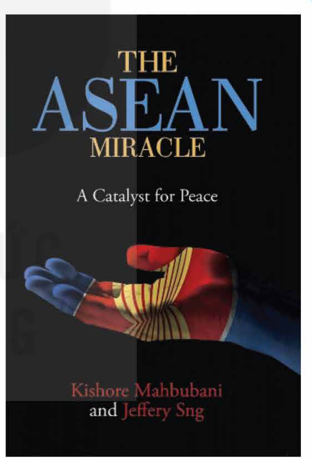
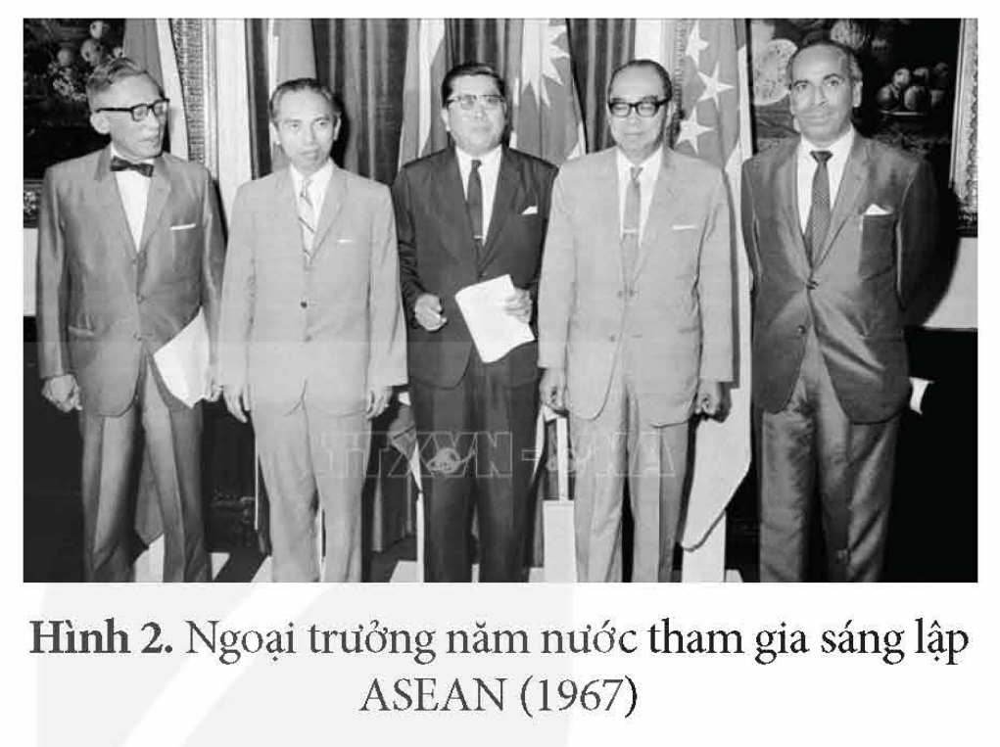
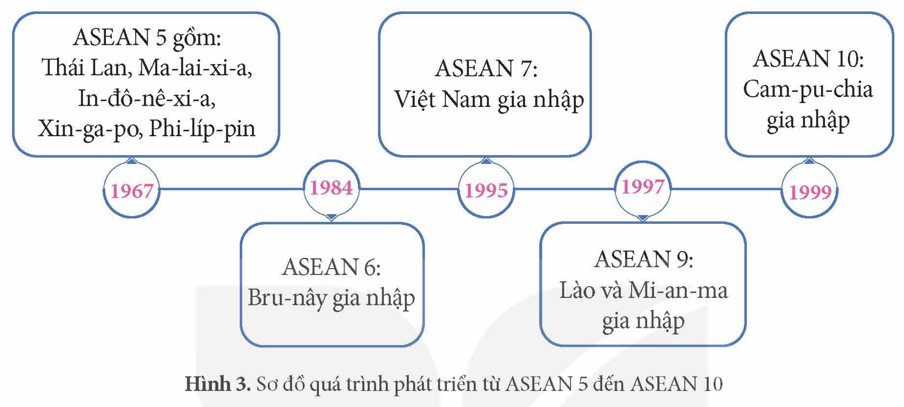
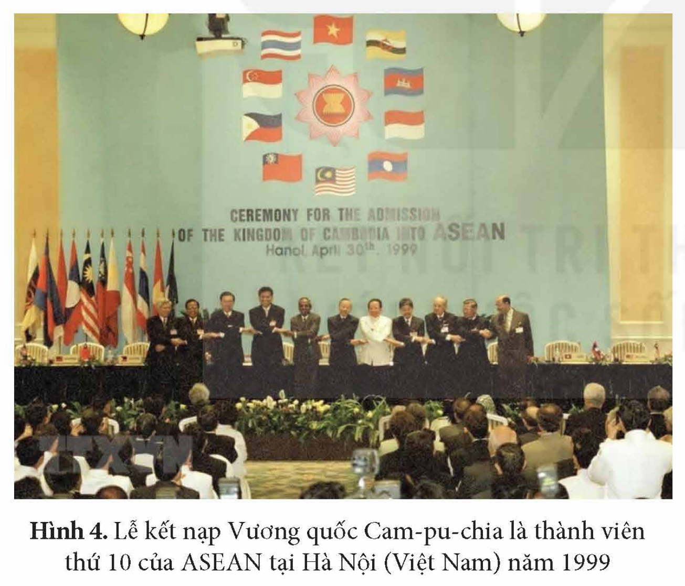

<!-- pdf:23 -->

# BÀI 4: SỰ RA ĐỜI VÀ PHÁT TRIỂN CỦA HIỆP HỘI CÁC QUỐC GIA ĐÔNG NAM Á (ASEAN)

## 🎯 Học xong bài này, em sẽ:

- Biết cách sưu tầm và sử dụng tài liệu để tìm hiểu quá trình thành lập ASEAN.
- Trình bày được quá trình hình thành và mục đích thành lập của ASEAN.
- Trình bày được quá trình phát triển từ ASEAN 5 đến ASEAN 10.
- Nêu được các giai đoạn phát triển chính của ASEAN (từ năm 1967 đến nay).

## 🔴 Mở đầu

Trong cuốn sách *Kì diệu ASEAN – Chất xúc tác cho hoà bình* (The ASEAN miracle, A Catalyst for Peace), xuất bản vào dịp kỉ niệm 50 năm thành lập tổ chức ASEAN (1967 – 2017), các tác giả cho rằng thành công của ASEAN là một điều kì diệu và thế giới sẽ trở nên tốt đẹp hơn khi các khu vực đang phát triển khác noi gương sự thành công của ASEAN để tạo ra hoà bình, thịnh vượng. Vì sao ASEAN được đánh giá như một “điều kì diệu”? Hãy chia sẻ những điều em biết về sự hình thành và phát triển của ASEAN.

*Hình 1. Trang bìa cuốn sách “Kì diệu ASEAN – Chất xúc tác cho hoà bình”*

## 1. Quá trình hình thành và mục đích thành lập tổ chức ASEAN

### a) Quá trình hình thành tổ chức ASEAN

ASEAN ra đời trong bối cảnh thế giới và khu vực Đông Nam Á có những chuyển biến quan trọng.

Sau Chiến tranh thế giới thứ hai, xu hướng khu vực hoá trên thế giới bắt đầu xuất hiện và ngày càng trở nên phổ biến. Ở Đông Nam Á, các nước có nhu cầu hợp tác với nhau để cùng phát triển kinh tế, xã hội, đồng thời tạo ra sức mạnh tập thể trong việc ứng phó với sự tranh giành ảnh hưởng giữa các nước lớn đối với khu vực trong bối cảnh Chiến tranh lạnh.

<!-- pdf:24 -->

<!-- term: Hiệp hội Đông Nam Á -->
<!-- term: Tổ chức MAPHILINDO -->
Đầu những năm 60 của thế kỉ XX, một số tổ chức khu vực được thành lập như: Hiệp hội Đông Nam Á (1961) gồm Ma-lai-xi-a, Phi-líp-pin và Thái Lan; Tổ chức MAPHILINDO (1963) gồm Ma-lai-xi-a, Phi-líp-pin, In-đô-nê-xi-a. Tuy nhiên, các tổ chức này chỉ tồn tại trong một thời gian ngắn, do những bất đồng trong quan hệ song phương giữa một số nước thành viên.

Vào nửa sau những năm 60, các nước Đông Nam Á ngày càng nhận thức rõ về sự cần thiết của việc hợp tác khu vực, đồng thời quan hệ giữa các nước có những diễn biến thuận lợi cho việc thành lập một tổ chức khu vực.

<!-- term: Hiệp hội các quốc gia Đông Nam Á -->
<!-- term: Tuyên bố Băng Cốc -->
Sau các cuộc thảo luận về việc thành lập tổ chức khu vực, ngày 8 – 8 – 1967, tại Băng Cốc (Thái Lan), Ngoại trưởng năm nước: In-đô-nê-xi-a, Ma-lai-xi-a, Phi-líp-pin, Xin-ga-po và Thái Lan đã thông qua *Tuyên bố ASEAN* (còn gọi là Tuyên bố Băng Cốc), chính thức thành lập Hiệp hội các quốc gia Đông Nam Á (viết tắt tiếng Anh là ASEAN).

*Hình 2. Ngoại trưởng năm nước tham gia sáng lập ASEAN (1967)*

> ❓ Hãy trình bày quá trình hình thành tổ chức ASEAN.

### b) Mục đích thành lập ASEAN

<!-- term: Tuyên bố Băng Cốc -->
> TƯ LIỆU. *Tuyên bố ASEAN* nêu rõ mục đích thành lập của ASEAN:
> 1. Thúc đẩy sự tăng trưởng kinh tế, tiến bộ xã hội và phát triển văn hoá trong khu vực thông qua các nỗ lực chung trên tinh thần bình đẳng và hợp tác nhằm tăng cường cơ sở cho một Cộng đồng các quốc gia Đông Nam Á hoà bình và thịnh vượng.
> 2. Thúc đẩy hoà bình và ổn định khu vực bằng việc tôn trọng công lí và nguyên tắc luật pháp trong quan hệ giữa các quốc gia trong vùng và tuân thủ các nguyên tắc của Hiến chương Liên hợp quốc.
> 3. Thúc đẩy sự cộng tác tích cực và giúp đỡ lẫn nhau trong các vấn đề cùng quan tâm trong các lĩnh vực kinh tế, xã hội, văn hoá, khoa học – kĩ thuật và hành chính,...
>
> *(Theo Tuyên bố ASEAN, Hiệp hội các nước Đông Nam Á (ASEAN), NXB Chính trị quốc gia, 1998, tr. 15-16)*

<!-- term: Mục đích thành lập của ASEAN -->
ASEAN được thành lập nhằm mục đích chính là tăng cường hợp tác kinh tế, văn hoá, xã hội, tạo điều kiện cho các nước thành viên phát triển và hội nhập với khu vực, thế giới; phấn đấu để Đông Nam Á trở thành khu vực hoà bình, tự do, thịnh vượng và ASEAN trở thành tổ chức bao gồm tất cả các quốc gia Đông Nam Á.

> ❓ Khai thác thông tin và tư liệu trong mục, hãy trình bày mục đích thành lập ASEAN.

<!-- pdf:25 -->

## 2. Hành trình phát triển của ASEAN

### a) Từ ASEAN 5 (1967) đến ASEAN 10 (1999)

Để thực hiện mục tiêu mở rộng thành viên bao gồm tất cả các nước trong khu vực, ASEAN phải trải qua hành trình hơn 30 năm để đưa ASEAN 5 trở thành ASEAN 10.

*Hình 3. Sơ đồ quá trình phát triển từ ASEAN 5 đến ASEAN 10*

*Hình 4. Lễ kết nạp Vương quốc Cam-pu-chia là thành viên thứ 10 của ASEAN tại Hà Nội (Việt Nam) năm 1999*

> 💡 EM CÓ BIẾT ?

<!-- term: Việt Nam gia nhập ASEAN -->
> Sự kiện Việt Nam trở thành thành viên thứ bảy của ASEAN là dấu mốc quan trọng trong sự phát triển của ASEAN. Đây không chỉ là sự tăng thêm về số lượng thành viên mà còn đẩy nhanh quá trình thực hiện mục tiêu xây dựng ASEAN trở thành “ngôi nhà chung” của các quốc gia Đông Nam Á.

Quá trình mở rộng ASEAN phù hợp với mong muốn, lợi ích của mỗi thành viên, đảm bảo hoà bình, ổn định của cả khu vực, đồng thời nâng cao vị thế của Hiệp hội trên trường quốc tế.

> ❓ Trình bày quá trình phát triển từ ASEAN 5 đến ASEAN 10.

<!-- pdf:26 -->

### b) Các giai đoạn phát triển chính của ASEAN (từ năm 1967 đến nay)

**Bảng tóm tắt các giai đoạn phát triển chính của ASEAN**

<!-- term: Tuyên bố về Khu vực Hoà bình, Tự do và Trung lập -->
<!-- term: Tuyên bố về sự Hoà hợp ASEAN -->
<!-- term: Hiệp ước Ba-li -->
<!-- term: Khu vực Mậu dịch tự do ASEAN -->
<!-- term: Diễn đàn khu vực ASEAN -->
<!-- term: Hiến chương ASEAN -->
<!-- term: Tầm nhìn Cộng đồng ASEAN 2025 -->
| Các giai đoạn phát triển | Các tuyên bố, hiệp định quan trọng |
| --- | --- |
| 1967 – 1976: Giai đoạn khởi đầu, xây dựng nền móng ban đầu, tạo tiền đề cho sự hợp tác ASEAN, tập trung vào hợp tác chính trị – an ninh “xây dựng lòng tin và học cách hoà giải”. | Ra *Tuyên bố về Khu vực Hoà bình, Tự do và Trung lập* (ZOPFAN, 1971). |
| 1976 – 1999: Giai đoạn xây dựng quan hệ chính trị ổn định, tạo điều kiện phát triển và hợp tác kinh tế giữa các thành viên; mở rộng ASEAN 5 thành ASEAN 10; từng bước nâng cao uy tín ASEAN trên trường quốc tế, bước đầu mở rộng quan hệ hợp tác, đối thoại với bên ngoài. | Ra *Tuyên bố về sự Hoà hợp ASEAN* (Tuyên bố Ba-li I), kí *Hiệp ước Thân thiện và Hợp tác ở Đông Nam Á* (TAC, 1976),... |
| 1999 – 2015: Giai đoạn hoàn thiện cơ cấu tổ chức, tăng cường hợp tác nội khối và ngoại khối về chính trị – an ninh, kinh tế – thương mại và các lĩnh vực khác; khẳng định uy tín, vai trò của ASEAN. | Kí *Hiệp định Khung về tăng cường hợp tác kinh tế ASEAN* và thoả thuận về *Khu vực Mậu dịch tự do ASEAN* (AFTA, 1992), thành lập *Diễn đàn khu vực ASEAN* (ARF, 1994), ra *Tuyên bố Ba-li II* (2003), công bố *Hiến chương ASEAN* (2007),... |
| 2015 đến nay: Thành lập và xây dựng Cộng đồng ASEAN với ba trụ cột: chính trị – an ninh, kinh tế, văn hoá – xã hội; đẩy mạnh hợp tác bên trong giữa ASEAN và bên ngoài ASEAN với các đối tác đối thoại, nâng cao uy tín, vai trò của ASEAN ở khu vực và trên thế giới. | Ra *Tuyên bố thành lập Cộng đồng ASEAN* (2015), thông qua *Tầm nhìn Cộng đồng ASEAN 2025* (2016), *Tầm nhìn Cộng đồng ASEAN sau năm 2025* (2020),... |

> ❓ Nêu những nét chính về các giai đoạn phát triển của ASEAN từ năm 1967 đến nay.

## ✏️ Luyện tập và vận dụng

Lập bảng niên biểu về quá trình mở rộng từ ASEAN 5 đến ASEAN 10.

1. Có ý kiến cho rằng: Đóng góp quan trọng nhất của ASEAN trong quá trình thành lập và phát triển hơn 50 năm qua là xây dựng được môi trường hoà bình, ổn định ở Đông Nam Á. Em có đồng ý với ý kiến này không? Vì sao?

2. Tìm hiểu tư liệu từ sách, báo và internet, viết một bài giới thiệu ngắn gọn về các giai đoạn phát triển của ASEAN từ năm 1967 đến nay.

## 📷 Danh sách hình trong bài

| Mã hình | Trang PDF | Vị trí trong bài | Chú thích gốc |
| --- | --- | --- | --- |
| H12-lich_su-b04-01 | 23 | Mở đầu | Hình 1. Trang bìa cuốn sách “Kì diệu ASEAN – Chất xúc tác cho hoà bình” |
| H12-lich_su-b04-02 | 24 | Mục 1.a | Hình 2. Ngoại trưởng năm nước tham gia sáng lập ASEAN (1967) |
| H12-lich_su-b04-03 | 25 | Mục 2.a | Hình 3. Sơ đồ quá trình phát triển từ ASEAN 5 đến ASEAN 10 |
| H12-lich_su-b04-04 | 25 | Mục 2.a | Hình 4. Lễ kết nạp Vương quốc Cam-pu-chia là thành viên thứ 10 của ASEAN tại Hà Nội (Việt Nam) năm 1999 |
