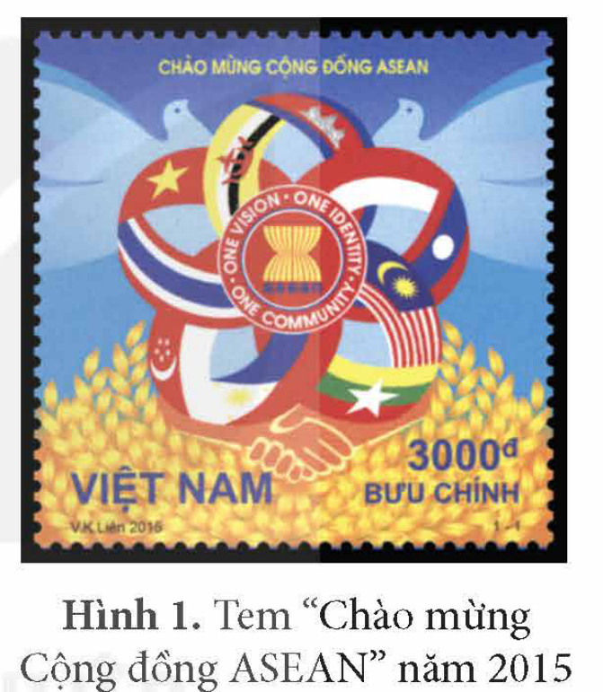
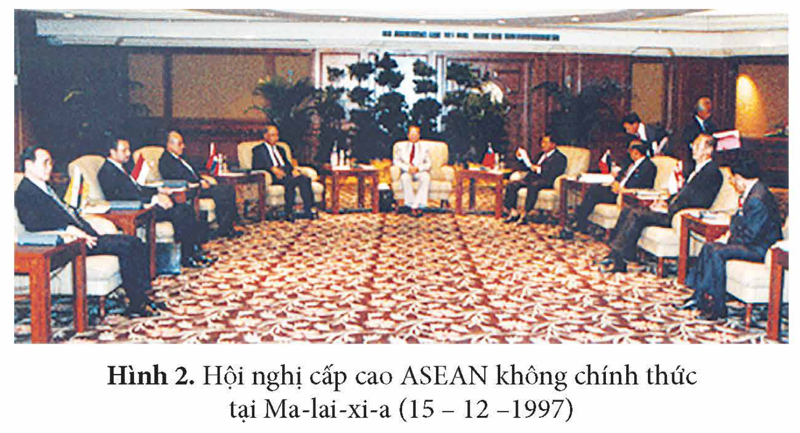
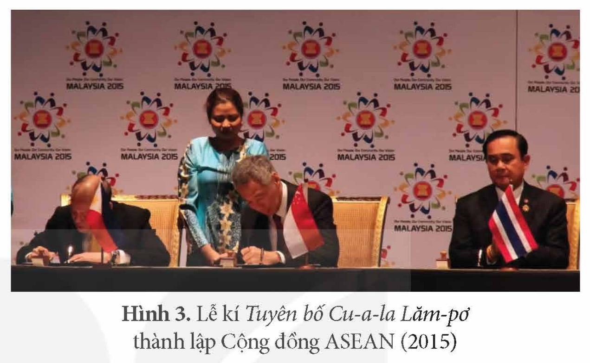
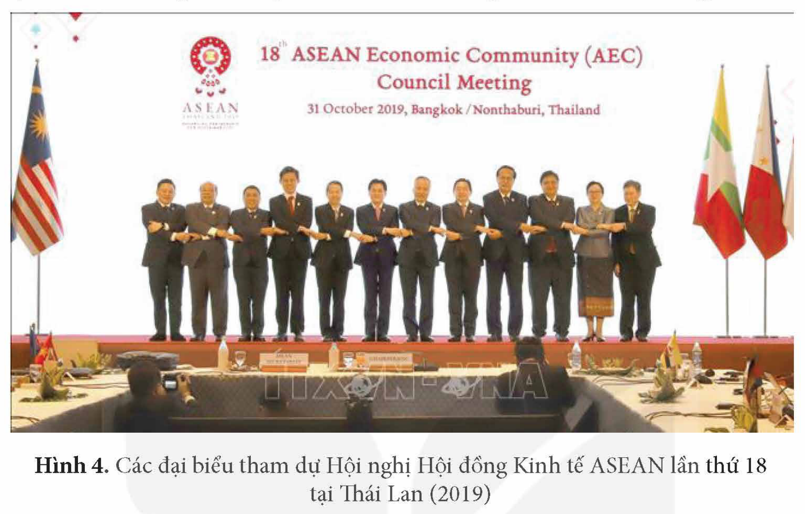
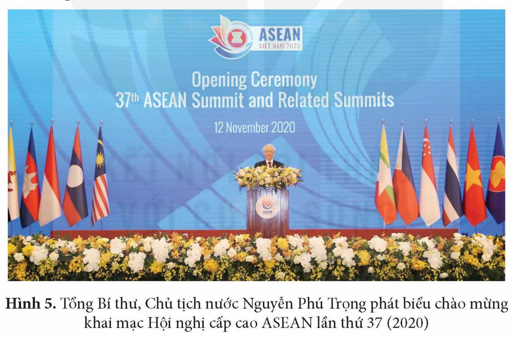

<!-- pdf:27 -->

# BÀI 5: CỘNG ĐỒNG ASEAN: TỪ Ý TƯỞNG ĐẾN HIỆN THỰC

## 🎯 Học xong bài này, em sẽ:

- Biết cách sưu tầm và sử dụng tài liệu để tìm hiểu về quá trình hình thành và mục tiêu của Cộng đồng ASEAN.
- Nêu được nét chính về ý tưởng, mục tiêu và kế hoạch xây dựng Cộng đồng ASEAN.
- Trình bày được nội dung ba trụ cột của Cộng đồng ASEAN.
- Nêu được những thách thức và triển vọng của Cộng đồng ASEAN. Có ý thức sẵn sàng tham gia vào các hoạt động xây dựng Cộng đồng ASEAN.

## 🔴 Mở đầu

Tem “Chào mừng Cộng đồng ASEAN” do các hoạ sĩ Việt Nam thiết kế, được phát hành đồng thời tại Việt Nam và các nước ASEAN vào năm 2015. Tem mang thông điệp: “Một Tầm nhìn, một Bản sắc, một Cộng đồng”. Vì sao tất cả các nước thành viên đều chào mừng Cộng đồng ASEAN? Cộng đồng ASEAN được hình thành như thế nào? Hãy chia sẻ những điều em biết về Cộng đồng ASEAN.

*Hình 1. Tem “Chào mừng Cộng đồng ASEAN” năm 2015*

## 1. Ý tưởng, mục tiêu và kế hoạch xây dựng Cộng đồng ASEAN

### a) Ý tưởng xây dựng Cộng đồng ASEAN

Ý tưởng xây dựng Cộng đồng ASEAN đã khởi nguồn từ khi ASEAN thành lập. *Tuyên bố Băng Cốc (1967)* đã nêu ra mục tiêu xây dựng một cộng đồng thịnh vượng và hoà bình ở Đông Nam Á.

<!-- term: Tầm nhìn ASEAN 2020 -->
Sau 30 năm phát triển và mở rộng, ASEAN chính thức khẳng định ý tưởng thành lập Cộng đồng ASEAN tại Hội nghị cấp cao ASEAN không chính thức được tổ chức tại Ma-lai-xi-a (1997). Các nước thành viên thông qua văn kiện *Tầm nhìn ASEAN 2020*, nêu rõ việc xây dựng Cộng đồng ASEAN, định hướng cho sự phát triển trong tương lai của ASEAN.

<!-- term: Tầm nhìn ASEAN 2020 -->
> TƯ LIỆU 1. Theo *Tầm nhìn ASEAN 2020*: “Toàn bộ Đông Nam Á sẽ là một cộng đồng ASEAN, nhận thức được các mối liên hệ lịch sử của mình, hiểu rõ di sản văn hoá của mình và gắn bó với nhau bằng một bản sắc chung của khu vực”.
>
> *(Nguồn: Cổng Thông tin ASEAN – Việt Nam)*

<!-- pdf:28 -->

*Hình 2. Hội nghị cấp cao ASEAN không chính thức tại Ma-lai-xi-a (15 – 12 – 1997)*

Với ý tưởng xây dựng Cộng đồng ASEAN, hợp tác về kinh tế, chính trị – an ninh, văn hoá – xã hội giữa các nước thành viên sẽ được phát triển lên một nấc thang mới, đáp ứng nguyện vọng của các quốc gia thành viên về một khu vực Đông Nam Á gắn kết, hữu nghị và hợp tác.

> ❓ Khai thác thông tin và Tư liệu 1 trong mục, hãy nêu những nét chính về ý tưởng xây dựng Cộng đồng ASEAN.

### b) Mục tiêu xây dựng Cộng đồng ASEAN

<!-- term: Mục tiêu xây dựng Cộng đồng ASEAN -->
Mục tiêu xây dựng Cộng đồng ASEAN là đưa ASEAN trở thành một cộng đồng với ba trụ cột có mức độ liên kết sâu rộng hơn, ràng buộc hơn trên cơ sở pháp lí là *Hiến chương ASEAN*, đồng thời mở rộng hợp tác với bên ngoài.

<!-- term: Thoả ước Ba-li II -->
> TƯ LIỆU 2. “Cộng đồng ASEAN sẽ được thành lập gồm ba trụ cột là hợp tác chính trị và an ninh, hợp tác kinh tế và hợp tác văn hoá – xã hội được gắn kết chặt chẽ và cùng tăng cường cho mục đích đảm bảo hoà bình, ổn định lâu dài và cùng thịnh vượng trong khu vực.”
>
> *(Trích Thoả ước Ba-li II (2003), Nguồn: Bộ Ngoại giao)*

> ❓ Khai thác thông tin và Tư liệu 2 trong mục, hãy nêu mục tiêu xây dựng Cộng đồng ASEAN.

### c) Kế hoạch xây dựng Cộng đồng ASEAN

Để thực hiện mục tiêu xây dựng Cộng đồng ASEAN, các nước thành viên đã thông qua kế hoạch triển khai cụ thể trên ba trụ cột: chính trị – an ninh, kinh tế, văn hoá – xã hội.

<!-- pdf:29 -->

<!-- term: Lộ trình xây dựng Cộng đồng ASEAN -->
Kế hoạch được nêu rõ trong văn bản “Lộ trình xây dựng Cộng đồng ASEAN (2009 – 2015)”, được thông qua tại Hội nghị cấp cao ASEAN 14 ở Thái Lan (2009), nhằm đưa ASEAN trở thành cộng đồng gắn kết hơn về kinh tế, chính trị – an ninh, có trách nhiệm về xã hội đối với người dân.

Về quan hệ đối ngoại, ASEAN tăng cường thực hiện các biện pháp mở rộng quan hệ hợp tác với bên ngoài, thông qua cơ chế hợp tác khu vực do ASEAN giữ vai trò chủ đạo.

<!-- term: Cộng đồng ASEAN -->
<!-- term: Tuyên bố Cu-a-la Lăm-pơ -->
Sau sáu năm thực hiện, đến năm 2015, ASEAN đã hoàn thành về cơ bản việc triển khai các kế hoạch xây dựng cộng đồng. Trên cơ sở đó, ngày 22 – 11 – 2015, các nhà lãnh đạo ASEAN đã kí *Tuyên bố Cu-a-la Lăm-pơ* chính thức thành lập Cộng đồng ASEAN kể từ ngày 31 – 12 – 2015.

*Hình 3. Lễ kí Tuyên bố Cu-a-la Lăm-pơ thành lập Cộng đồng ASEAN (2015)*

> ❓ Trình bày những nét chính về kế hoạch xây dựng Cộng đồng ASEAN.

## 2. Ba trụ cột của Cộng đồng ASEAN

<!-- term: Cộng đồng ASEAN -->
Ba trụ cột của Cộng đồng ASEAN bao gồm: Cộng đồng Chính trị – An ninh ASEAN (APSC), Cộng đồng Kinh tế ASEAN (AEC) và Cộng đồng Văn hoá – Xã hội ASEAN (ASCC).

### a) Cộng đồng Chính trị – An ninh ASEAN (APSC)

<!-- term: Cộng đồng Chính trị – An ninh ASEAN -->
Cộng đồng Chính trị – An ninh ASEAN được xây dựng trên nền tảng những thành quả hợp tác chính trị – an ninh đã đạt được, nhằm mục tiêu tạo dựng môi trường hoà bình và an ninh ở khu vực, nâng hợp tác chính trị – an ninh lên một nấc thang mới cao hơn và chặt chẽ hơn, trên cơ sở các nguyên tắc cơ bản của ASEAN.

<!-- term: Cộng đồng Chính trị – An ninh ASEAN -->
> TƯ LIỆU 3. *Kế hoạch Tổng thể xây dựng Cộng đồng Chính trị – An ninh ASEAN (2009 – 2015)* bao gồm ba nội dung chính: “Xây dựng một cộng đồng dựa trên các giá trị và chuẩn mực chung; Tạo dựng một khu vực gắn kết, hoà bình và tự cường với trách nhiệm chung đối với an ninh toàn diện; Hướng tới một khu vực năng động và rộng mở với bên ngoài trong một thế giới ngày càng liên kết và tuỳ thuộc”.
>
> *(Nguồn: Cổng Thông tin ASEAN – Việt Nam)*

> ❓ Khai thác thông tin và Tư liệu 3 trong mục, hãy trình bày nội dung chính của Cộng đồng Chính trị – An ninh ASEAN.

<!-- pdf:30 -->

### b) Cộng đồng Kinh tế ASEAN (AEC)

<!-- term: Cộng đồng Kinh tế ASEAN -->
Cộng đồng Kinh tế ASEAN là sự tiếp nối các chương trình hợp tác kinh tế của ASEAN trước đây, được mở rộng hơn về phạm vi, mức độ hợp tác kinh tế, thương mại,...

*Hình 4. Các đại biểu tham dự Hội nghị Hội đồng Kinh tế ASEAN lần thứ 18 tại Thái Lan (2019)*

<!-- term: Cộng đồng Kinh tế ASEAN -->
Nội dung chính của Cộng đồng Kinh tế ASEAN bao gồm: tạo ra một thị trường và cơ sở sản xuất chung, trong đó có sự lưu chuyển tự do của hàng hoá, dịch vụ, đầu tư, vốn và lao động có tay nghề; xây dựng khu vực kinh tế có sức cạnh tranh cao, năng động, phát triển đồng đều, hội nhập đầy đủ vào nền kinh tế toàn cầu.

> 💡 EM CÓ BIẾT ?

> Sau khi AEC thành lập, hợp tác kinh tế giữa các nước ASEAN gia tăng nhanh chóng. Thương mại giữa Việt Nam – ASEAN tăng từ hơn 41 tỉ USD (2016) lên hơn 70 tỉ USD (2021).

> ❓ Hãy trình bày nội dung chính của Cộng đồng Kinh tế ASEAN.

### c) Cộng đồng Văn hoá – Xã hội ASEAN (ASCC)

<!-- term: Cộng đồng Văn hoá – Xã hội ASEAN -->
Cộng đồng Văn hoá – Xã hội ASEAN là một khuôn khổ hợp tác chặt chẽ với các quy định và tiêu chuẩn chung để tạo sự hài hoà, bình đẳng và công bằng xã hội, nâng cao ý thức về cộng đồng và bản sắc chung ASEAN.

<!-- term: Cộng đồng Văn hoá – Xã hội ASEAN -->
> TƯ LIỆU 4. *Kế hoạch Tổng thể xây dựng Cộng đồng Văn hoá – Xã hội ASEAN (2009)* xác định sáu nội dung chính bao gồm: Phát triển con người; Phúc lợi và bảo hiểm xã hội; Bình đẳng xã hội và các quyền; Bảo đảm bền vững về môi trường; Xây dựng bản sắc ASEAN; Thu hẹp khoảng cách phát triển.
>
> *(Theo Bộ Công Thương, Cộng đồng Kinh tế ASEAN 2015, NXB Thế giới, 2016, tr. 10)*

<!-- pdf:31 -->

Có nền tảng từ sự phát triển các giá trị văn hoá truyền thống lâu đời, Cộng đồng Văn hoá – Xã hội ASEAN là một trụ cột quan trọng, gắn kết và tạo thuận lợi cho việc xây dựng hai trụ cột Kinh tế và Chính trị – An ninh.

> ❓ Khai thác thông tin và Tư liệu 4 trong mục, hãy trình bày nội dung chính của Cộng đồng Văn hoá – Xã hội ASEAN.

## 3. Cộng đồng ASEAN sau năm 2015

• *Tầm nhìn ASEAN sau năm 2015*

Sau khi thành lập Cộng đồng ASEAN, các nước ASEAN tiếp tục đưa ra định hướng cho một giai đoạn phát triển mới sau năm 2015 với nội dung định hướng là tiếp tục củng cố, làm sâu sắc hơn các lĩnh vực hợp tác.

<!-- term: Tầm nhìn Cộng đồng ASEAN sau năm 2025 -->
Hội nghị Cấp cao ASEAN lần thứ 37 tại Hà Nội (2020) đã nhất trí thông qua việc xây dựng Tầm nhìn Cộng đồng ASEAN sau năm 2025, hướng tới việc gắn kết chặt chẽ các nội dung hợp tác trên cả ba trụ cột (Cộng đồng Chính trị – An ninh, Cộng đồng Kinh tế và Cộng đồng Văn hoá – Xã hội), đồng thời bổ sung những nội dung mới như: hợp tác về chuyển đổi số, phát triển nền kinh tế số, kinh tế xanh,...

*Hình 5. Tổng Bí thư, Chủ tịch nước Nguyễn Phú Trọng phát biểu chào mừng khai mạc Hội nghị cấp cao ASEAN lần thứ 37 (2020)*

• *Những thách thức và triển vọng của Cộng đồng ASEAN*

Trong quá trình phát triển, Cộng đồng ASEAN phải đối mặt với những thách thức trong nội khối và từ bên ngoài.

Trong nội khối, những thách thức cơ bản đối với Cộng đồng ASEAN về chính trị là sự đa dạng về chế độ chính trị, tình hình chính trị ở một số nước còn phức tạp, còn tồn tại một số mâu thuẫn trong quan hệ song phương,... Về kinh tế, sự chênh lệch về thu nhập, trình độ phát triển,... giữa các nước gây khó khăn trong hợp tác nội khối; sự tương đồng trong sản xuất một số ngành nghề cũng tạo ra sự cạnh tranh trong xuất khẩu,...

<!-- pdf:32 -->

Bên cạnh đó, những thách thức từ bên ngoài cũng tác động đến Cộng đồng ASEAN như: cạnh tranh ảnh hưởng của các nước lớn đối với khu vực, diễn biến phức tạp của tình hình Biển Đông và tình hình quốc tế; biến đổi khí hậu, ô nhiễm môi trường, dịch bệnh,... Để vượt qua những thách thức, các nước ASEAN đã và đang đẩy nhanh quá trình triển khai các kế hoạch đã đề ra vì lợi ích chung, lâu dài của cả cộng đồng.

> 💡 EM CÓ BIẾT ?

> Năm 2021, ASEAN là nền kinh tế lớn thứ năm thế giới với GDP khoảng 3 300 tỉ USD, dự báo đến năm 2030 sẽ trở thành nền kinh tế thứ tư thế giới.

Về triển vọng, ASEAN sẽ tiếp tục phát triển với mức độ liên kết, hợp tác ngày càng sâu rộng trên cả ba trụ cột, tiếp tục là một trong những khu vực phát triển năng động nhất trên thế giới. Về đối ngoại, ASEAN có quan hệ rộng mở với các đối tác bên ngoài, đồng thời có uy tín, vị thế ngày càng cao trong khu vực và trên thế giới.

> ❓ Nêu những thách thức và triển vọng của Cộng đồng ASEAN.

## ✏️ Luyện tập và vận dụng

1. Tóm tắt nét chính về ý tưởng, mục tiêu và kế hoạch xây dựng Cộng đồng ASEAN.

2. Lập bảng thống kê (theo gợi ý dưới đây vào vở) về nội dung ba trụ cột của Cộng đồng ASEAN.

| Cộng đồng Chính trị – An ninh | Cộng đồng Kinh tế | Cộng đồng Văn hoá – Xã hội |
| --- | --- | --- |
| ? | ? | ? |

Sưu tầm tư liệu từ sách, báo, internet và vận dụng kiến thức đã học, hãy viết một bài giới thiệu ngắn về những hoạt động của em để góp phần xây dựng Cộng đồng ASEAN vững mạnh, phát triển.

## 📷 Danh sách hình trong bài

| Mã hình | Trang PDF | Vị trí trong bài | Chú thích gốc |
| --- | --- | --- | --- |
| H12-lich_su-b05-01 | 27 | Mở đầu | Hình 1. Tem “Chào mừng Cộng đồng ASEAN” năm 2015 |
| H12-lich_su-b05-02 | 28 | Mục 1.a | Hình 2. Hội nghị cấp cao ASEAN không chính thức tại Ma-lai-xi-a (15 – 12 – 1997) |
| H12-lich_su-b05-03 | 29 | Mục 1.c | Hình 3. Lễ kí Tuyên bố Cu-a-la Lăm-pơ thành lập Cộng đồng ASEAN (2015) |
| H12-lich_su-b05-04 | 30 | Mục 2.b | Hình 4. Các đại biểu tham dự Hội nghị Hội đồng Kinh tế ASEAN lần thứ 18 tại Thái Lan (2019) |
| H12-lich_su-b05-05 | 31 | Mục 3 | Hình 5. Tổng Bí thư, Chủ tịch nước Nguyễn Phú Trọng phát biểu chào mừng khai mạc Hội nghị cấp cao ASEAN lần thứ 37 (2020) |
