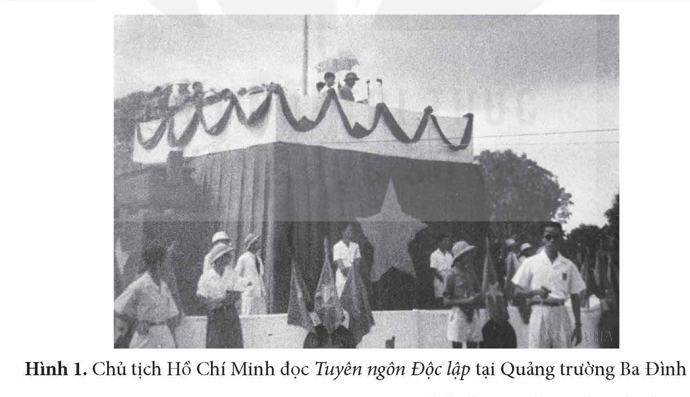
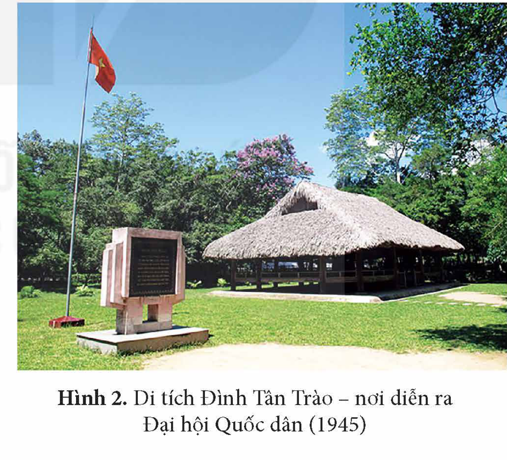
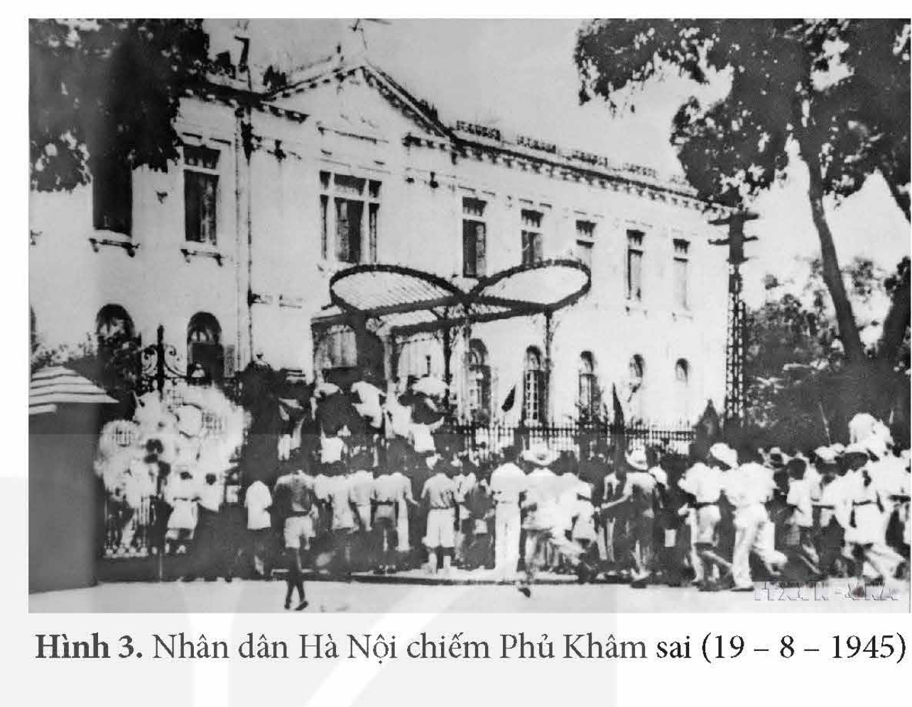
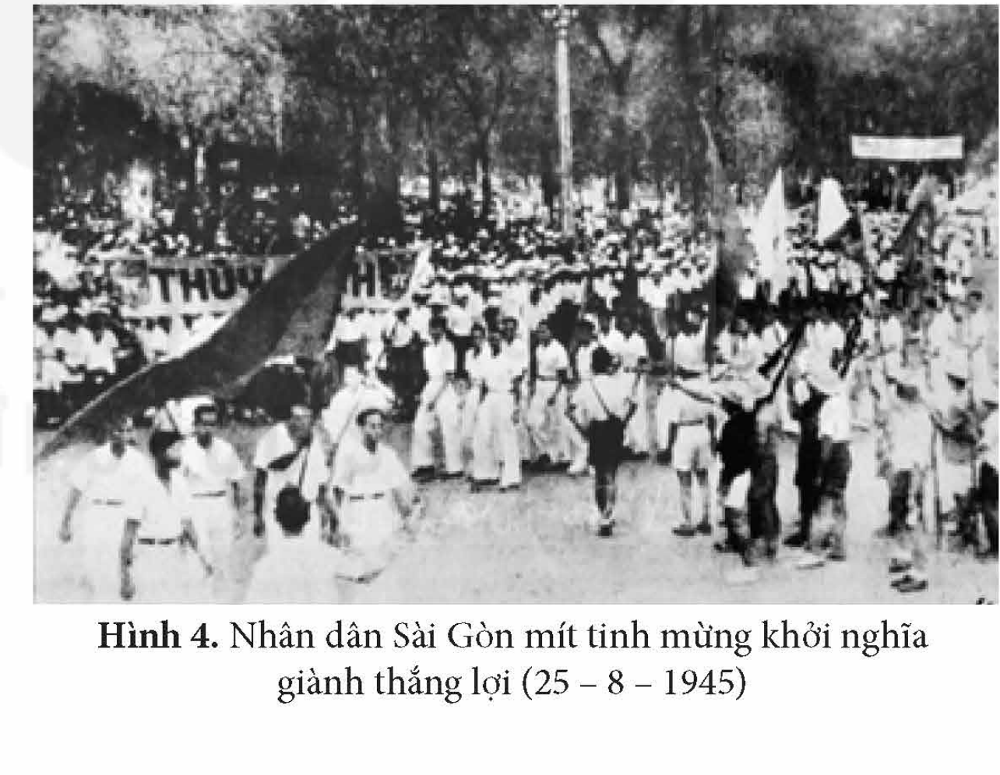

<!-- pdf:33 -->

# BÀI 6: CÁCH MẠNG THÁNG TÁM NĂM 1945

## 🎯 Học xong bài này, em sẽ:

- Trình bày được nét khái quát về bối cảnh lịch sử, diễn biến chính của Cách mạng tháng Tám năm 1945.
- Nêu được nguyên nhân thắng lợi của Cách mạng tháng Tám năm 1945.
- Phân tích được ý nghĩa và bài học kinh nghiệm của Cách mạng tháng Tám năm 1945.

## 🔴 Mở đầu

*Hình 1. Chủ tịch Hồ Chí Minh đọc Tuyên ngôn Độc lập tại Quảng trường Ba Đình*

Ngày 2 – 9 – 1945, tại Quảng trường Ba Đình lịch sử, Chủ tịch Hồ Chí Minh đọc *Tuyên ngôn Độc lập*, trịnh trọng tuyên bố với toàn thể quốc dân và thế giới: nước Việt Nam Dân chủ Cộng hoà thành lập.

*Tuyên ngôn Độc lập* là một văn kiện quan trọng, gắn với thắng lợi của Cách mạng tháng Tám năm 1945. Cách mạng tháng Tám đã diễn ra trong bối cảnh nào, diễn biến ra sao? Vì sao nói: Cách mạng tháng Tám là sự kiện vĩ đại trong lịch sử dân tộc?

<!-- pdf:34 -->

## 1. Bối cảnh lịch sử

Chiến tranh thế giới thứ hai bước vào giai đoạn kết thúc.

Từ ngày 17 – 7 – 1945 đến ngày 2 – 8 – 1945, Hội nghị Pốt-xđam quyết định giao việc giải giáp vũ khí của quân phiệt Nhật Bản ở Đông Dương cho quân Trung Hoa Dân quốc ở khu vực phía Bắc vĩ tuyến 16, cho quân Anh ở khu vực phía Nam vĩ tuyến 16. Ngày 6 và ngày 9 – 8 – 1945, Mỹ ném hai quả bom nguyên tử xuống thành phố Hi-rô-si-ma và Na-ga-xa-ki của Nhật Bản. Cũng trong ngày 9 – 8 – 1945, quân đội Xô viết tấn công đạo quân Quan Đông của Nhật Bản ở Đông Bắc Trung Quốc.

Đến ngày 15 – 8 – 1945, Nhật Bản tuyên bố đầu hàng Đồng minh không điều kiện. Ngay sau khi Nhật Bản tuyên bố đầu hàng Đồng minh, quân Nhật ở Đông Dương rệu rã, Chính phủ thân Nhật Trần Trọng Kim hoang mang. Điều kiện khách quan thuận lợi cho cuộc Tổng khởi nghĩa đã đến.

Trước đó, từ tháng 3 đến tháng 8 – 1945, cao trào kháng Nhật, cứu nước đã diễn ra trong cả nước, góp phần chuẩn bị lực lượng, tập dượt cho quần chúng đấu tranh, sẵn sàng tổng khởi nghĩa giành chính quyền khi thời cơ đến.

<!-- term: Uỷ ban Khởi nghĩa toàn quốc -->
<!-- term: Quân lệnh số 1 -->
Ngày 13 – 8 – 1945, Trung ương Đảng và Tổng bộ Việt Minh thành lập *Uỷ ban Khởi nghĩa toàn quốc*, ban bố *Quân lệnh số 1*, chính thức phát động Tổng khởi nghĩa trong cả nước.

<!-- term: Hội nghị toàn quốc của Đảng ở Tân Trào -->
Ngày 14, 15 – 8 – 1945, Hội nghị toàn quốc của Đảng họp ở Tân Trào (Sơn Dương, Tuyên Quang), thông qua kế hoạch lãnh đạo toàn dân Tổng khởi nghĩa và quyết định những vấn đề quan trọng về chính sách đối nội, đối ngoại sau khi giành được chính quyền.

<!-- term: Đại hội Quốc dân tại Tân Trào -->
<!-- term: Uỷ ban Dân tộc giải phóng Việt Nam -->
Ngày 16, 17 – 8 – 1945, Đại hội Quốc dân được triệu tập tại Tân Trào. Đại hội tán thành chủ trương Tổng khởi nghĩa của Đảng, thông qua 10 chính sách của Việt Minh, cử ra *Uỷ ban Dân tộc giải phóng Việt Nam* do Hồ Chí Minh làm Chủ tịch.

*Hình 2. Di tích Đình Tân Trào – nơi diễn ra Đại hội Quốc dân (1945)*

> ❓ Trình bày khái quát bối cảnh lịch sử của Cách mạng tháng Tám năm 1945.

## 2. Diễn biến chính của Cách mạng tháng Tám năm 1945

Đến giữa tháng 8 – 1945, khí thế cách mạng đã sục sôi trong cả nước. Từ ngày 14 – 8, một số cấp bộ Đảng và tổ chức Việt Minh căn cứ vào tình hình cụ thể của địa phương đã phát động nhân dân khởi nghĩa.

<!-- pdf:35 -->

Chiều ngày 16 – 8 – 1945, một đơn vị Giải phóng quân do Võ Nguyên Giáp chỉ huy, xuất phát từ Tân Trào tiến về giải phóng thị xã Thái Nguyên, mở đường tiến về Hà Nội.

Ngày 18 – 8 – 1945, nhân dân Bắc Giang, Hải Dương, Hà Tĩnh và Quảng Nam giành được chính quyền ở tỉnh lị sớm nhất trong cả nước.

Tại Hà Nội, ngày 19 – 8 – 1945, quần chúng cách mạng có sự hỗ trợ của các đội tự vệ chiến đấu lần lượt chiếm Phủ Khâm sai, Sở Cảnh sát Trung ương, Sở Bưu điện,… Đến tối, cuộc khởi nghĩa giành chính quyền thắng lợi.

*Hình 3. Nhân dân Hà Nội chiếm Phủ Khâm sai (19 – 8 – 1945)*

Tại Huế, ngày 23 – 8, hàng vạn nhân dân biểu tình thị uy, chiếm các công sở giành chính quyền về tay nhân dân.

Ngày 25 – 8, sau khi chiếm được các cơ quan đầu não của chính quyền cũ như: Sở Mật thám, Sở Cảnh sát,… nhân dân Sài Gòn và các vùng phụ cận đã tham gia cuộc mít tinh lớn do Mặt trận Việt Minh tổ chức, chính quyền cách mạng ra mắt nhân dân. Khởi nghĩa ở Sài Gòn giành thắng lợi.

*Hình 4. Nhân dân Sài Gòn mít tinh mừng khởi nghĩa giành thắng lợi (25 – 8 – 1945)*

Các địa phương khác trong cả nước từ rừng núi, nông thôn, thành thị nối tiếp nhau khởi nghĩa. Đến ngày 28 – 8, Đồng Nai Thượng và Hà Tiên là những địa phương cuối cùng giành chính quyền.

Trong Cách mạng tháng Tám, trước áp lực và hoạt động khôn khéo của lực lượng cách mạng, quân Nhật ở Hà Nội và các địa phương phải án binh bất động, không can thiệp vào tiến trình khởi nghĩa. Nhờ đó, khởi nghĩa diễn ra nhanh chóng và ít đổ máu.

<!-- term: Tuyên ngôn Độc lập -->
Ngày 2 – 9 – 1945, Chủ tịch Hồ Chí Minh thay mặt Chính phủ lâm thời đọc *Tuyên ngôn Độc lập*, tuyên bố với toàn thể nhân dân và thế giới sự ra đời của Nhà nước Việt Nam Dân chủ Cộng hoà.

<!-- pdf:36 -->

> TƯ LIỆU 1. “Mới từ 12 giờ trưa, những nẻo đường dẫn vào vườn hoa Ba Đình, nơi được chọn để cử hành lễ ngày độc lập đã thấy cuồn cuộn những dòng người chảy đến. Đủ mặt các giới, các đoàn thể… Tất cả, hôm đó, đều không còn giữ sự phân biệt của mọi ngày thường về đẳng cấp, về tín ngưỡng, về nam nữ, về thế hệ,… Đến đây, ai cũng chỉ còn là một người dân Việt Nam giữa những người dân Việt Nam khác đi đón nhận lời tuyên bố chính thức về nền độc lập của nước nhà...".
>
> *(Báo Cứu quốc số 36, ngày 5 – 9 – 1945)*

> ❓ Khai thác thông tin và Tư liệu 1 trong mục, hãy trình bày những diễn biến chính của Cách mạng tháng Tám năm 1945.

## 3. Nguyên nhân thắng lợi, ý nghĩa và bài học kinh nghiệm của Cách mạng tháng Tám năm 1945

### a) Nguyên nhân thắng lợi

• *Nguyên nhân chủ quan*

*Đường lối lãnh đạo cách mạng đúng đắn, sáng tạo*

Đảng Cộng sản Đông Dương và Chủ tịch Hồ Chí Minh đã vận dụng sáng tạo chủ nghĩa Mác – Lê-nin để lãnh đạo phong trào giải phóng dân tộc ở Việt Nam. Trung ương Đảng và Mặt trận Việt Minh đã linh hoạt, sáng tạo trong lãnh đạo chớp thời cơ, phát động quần chúng nổi dậy giành chính quyền trong cả nước.

*Truyền thống yêu nước, đoàn kết của nhân dân*

Dân tộc Việt Nam vốn có truyền thống yêu nước, đoàn kết, vì vậy khi Đảng Cộng sản Đông Dương và Mặt trận Việt Minh giương cao ngọn cờ giải phóng dân tộc thì toàn dân đã đoàn kết, đồng lòng đứng lên cứu nước.

*Quá trình chuẩn bị lực lượng lâu dài, chu đáo*

Đảng Cộng sản Đông Dương đã có quá trình chuẩn bị liên tục trong suốt 15 năm. Lực lượng chính trị, lực lượng vũ trang, căn cứ địa cách mạng từng bước được xây dựng, củng cố; quần chúng được tập dượt đấu tranh. Trong quá trình khởi nghĩa giành chính quyền, có sự phối hợp sáng tạo giữa các lực lượng và hình thức đấu tranh: lực lượng chính trị và lực lượng vũ trang; đấu tranh chính trị, đấu tranh vũ trang và đấu tranh ngoại giao.

<!-- pdf:37 -->

• *Nguyên nhân khách quan*

Thắng lợi của lực lượng Đồng minh và Hồng quân Liên Xô trong cuộc chiến tranh chống phát xít, đặc biệt là chiến thắng quân phiệt Nhật Bản, đã tạo ra thời cơ khách quan thuận lợi, củng cố niềm tin cho toàn Đảng, toàn dân vào thắng lợi của sự nghiệp giải phóng dân tộc Việt Nam.

> ❓ Nêu nguyên nhân thắng lợi của Cách mạng tháng Tám năm 1945.

### b) Ý nghĩa lịch sử

> TƯ LIỆU 2. “Chẳng những giai cấp lao động và nhân dân Việt Nam ta có thể tự hào, mà giai cấp lao động và những dân tộc bị áp bức nơi khác cũng có thể tự hào rằng: Lần này là lần đầu tiên trong lịch sử cách mạng của các dân tộc thuộc địa và nửa thuộc địa, một Đảng mới 15 tuổi đã lãnh đạo cách mạng thành công, đã nắm chính quyền toàn quốc".
>
> *(Hồ Chí Minh: Toàn tập, Tập 6, NXB Chính trị quốc gia, 2011, tr. 25)*

<!-- term: Cách mạng tháng Tám năm 1945 -->
Cách mạng tháng Tám năm 1945 là sự kiện lịch sử vĩ đại, đã lật đổ ách cai trị của thực dân Pháp trong hơn 80 năm, của quân phiệt Nhật Bản gần 5 năm; chấm dứt thời kì quân chủ hơn 1000 năm; lập nên nước Việt Nam Dân chủ Cộng hòa. Với thắng lợi của Cách mạng tháng Tám, Đảng Cộng sản Đông Dương từ một đảng bí mật trở thành đảng cầm quyền, nhân dân Việt Nam từ thân phận nô lệ trở thành người làm chủ đất nước.

Cách mạng tháng Tám đã đánh dấu một bước tiến nhảy vọt trong lịch sử dân tộc: mở ra kỉ nguyên độc lập, tự do và phát triển dưới chế độ dân chủ cộng hoà.

Cuộc cách mạng đã chứng tỏ năng lực lãnh đạo của Đảng Cộng sản, sự sáng tạo và tinh thần yêu nước của nhân dân; chuẩn bị điều kiện cho những thắng lợi tiếp theo của cách mạng Việt Nam.

Về mặt quốc tế, Cách mạng tháng Tám đã góp phần vào thắng lợi của các lực lượng hoà bình, dân chủ, tiến bộ trong cuộc đấu tranh chống phát xít, góp phần làm tan rã hệ thống thuộc địa của chủ nghĩa thực dân và cổ vũ tinh thần đấu tranh của nhân dân các dân tộc thuộc địa và phụ thuộc trên thế giới.

> ❓ Khai thác thông tin và Tư liệu 2 trong mục, phân tích ý nghĩa lịch sử của Cách mạng tháng Tám năm 1945.

### c) Bài học kinh nghiệm

– *Bài học về sự lãnh đạo của Đảng:* Đảng là nhân tố quyết định đối với thắng lợi của sự nghiệp cách mạng. Do đó, Đảng phải có đường lối đúng đắn trên cơ sở vận dụng sáng tạo chủ nghĩa Mác – Lê-nin vào thực tiễn Việt Nam; chủ động, linh hoạt, sáng tạo trong lãnh đạo cách mạng.

<!-- pdf:38 -->

– *Bài học về xây dựng và phát huy sức mạnh của khối đại đoàn kết dân tộc:* Thắng lợi của Cách mạng tháng Tám năm 1945 gắn liền với vai trò quan trọng của Mặt trận Việt Minh trong tập hợp, tổ chức và đoàn kết toàn dân. Thực tiễn đó cho thấy, cần có các hình thức phong phú, sáng tạo để tập hợp, tổ chức quần chúng, đẩy mạnh các phong trào thi đua để khơi dậy tinh thần yêu nước và sức mạnh đoàn kết dân tộc.

– *Bài học về nắm bắt thời cơ:* Thắng lợi của Cách mạng tháng Tám cho thấy cần xác định đúng thời cơ, chủ động và mau lẹ chớp thời cơ hành động nhằm đưa cách mạng đến thành công.

> ❓ Phân tích bài học kinh nghiệm của Cách mạng tháng Tám năm 1945.

## ✏️ Luyện tập và vận dụng

1. Lập trục thời gian (theo ý tưởng của em) về diễn biến chính của Cách mạng tháng Tám năm 1945.

2. Cách mạng tháng Tám năm 1945 có ý nghĩa bước ngoặt và để lại nhiều bài học đối với lịch sử dân tộc Việt Nam. Hãy dựa vào kiến thức trong bài học để làm rõ nhận định trên.

Vận dụng kiến thức đã học, hãy cho biết những bài học kinh nghiệm nào từ thắng lợi của Cách mạng tháng Tám năm 1945 có thể được vận dụng vào công cuộc xây dựng và bảo vệ Tổ quốc hiện nay?

## 📷 Danh sách hình trong bài

| Mã hình | Trang PDF | Vị trí trong bài | Chú thích gốc |
| --- | --- | --- | --- |
| H12-lich_su-b06-01 | 33 | Mở đầu | Hình 1. Chủ tịch Hồ Chí Minh đọc Tuyên ngôn Độc lập tại Quảng trường Ba Đình |
| H12-lich_su-b06-02 | 34 | Mục 1 | Hình 2. Di tích Đình Tân Trào – nơi diễn ra Đại hội Quốc dân (1945) |
| H12-lich_su-b06-03 | 35 | Mục 2 | Hình 3. Nhân dân Hà Nội chiếm Phủ Khâm sai (19 – 8 – 1945) |
| H12-lich_su-b06-04 | 35 | Mục 2 | Hình 4. Nhân dân Sài Gòn mít tinh mừng khởi nghĩa giành thắng lợi (25 – 8 – 1945) |
