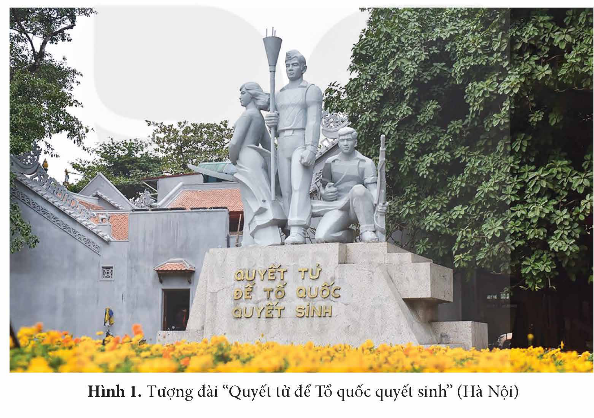
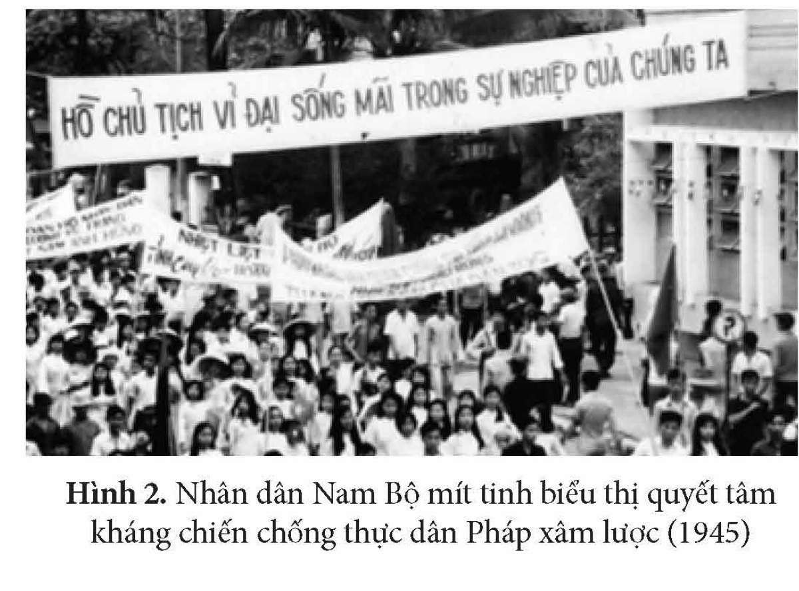
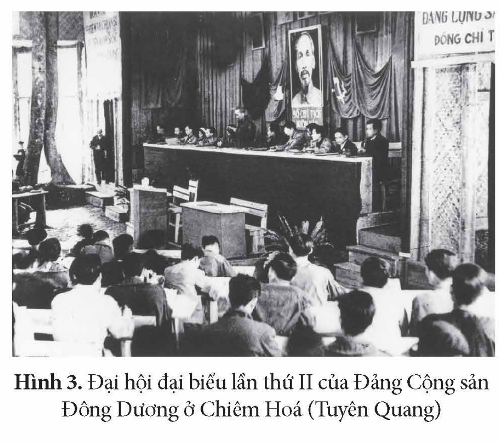
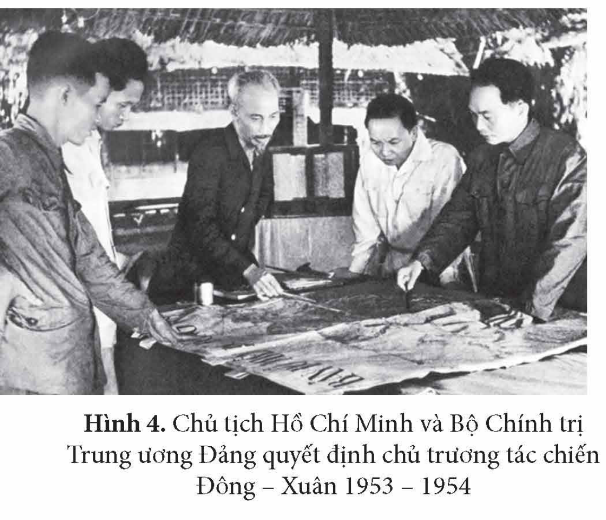
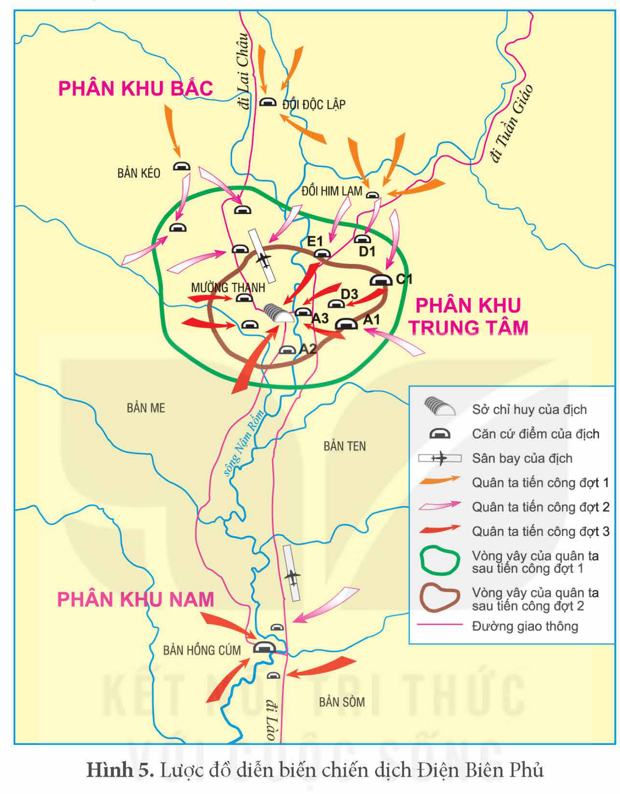
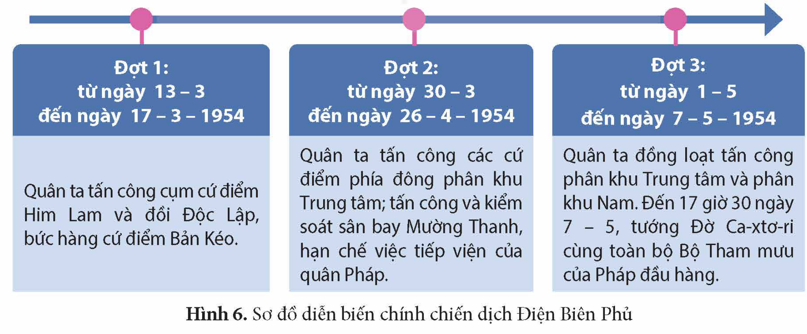
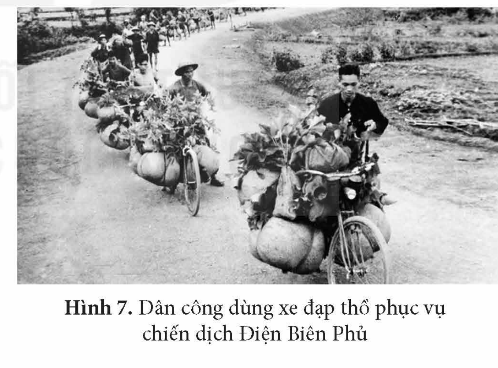

<!-- pdf:39 -->

# BÀI 7: CUỘC KHÁNG CHIẾN CHỐNG THỰC DÂN PHÁP (1945 – 1954)

## 🎯 Học xong bài này, em sẽ:

- Biết cách sưu tầm và sử dụng tư liệu lịch sử để tìm hiểu về cuộc kháng chiến chống thực dân Pháp.
- Trình bày được nét khái quát về bối cảnh lịch sử, diễn biến chính của cuộc kháng chiến chống thực dân Pháp.
- Nêu được nguyên nhân thắng lợi của cuộc kháng chiến chống thực dân Pháp.
- Phân tích được ý nghĩa lịch sử của cuộc kháng chiến chống thực dân Pháp.

## 🔴 Mở đầu

*Hình 1. Tượng đài “Quyết tử để Tổ quốc quyết sinh” (Hà Nội)*

“Quyết tử để Tổ quốc quyết sinh” là lời biểu dương trong bức thư Chủ tịch Hồ Chí Minh viết ngày 27 – 1 – 1947 gửi các chiến sĩ Cảm tử quân Thủ đô. Tượng đài “Quyết tử để Tổ quốc quyết sinh” được xây dựng ở trung tâm Thủ đô Hà Nội, là một trong những biểu tượng của tinh thần bất khuất, dũng cảm của quân dân Việt Nam trong những ngày đầu của cuộc kháng chiến toàn quốc chống thực dân Pháp. Cuộc kháng chiến chống thực dân Pháp bùng nổ trong bối cảnh lịch sử nào, diễn biến ra sao? Vì sao cuộc kháng chiến giành thắng lợi? Cuộc kháng chiến có ý nghĩa lịch sử như thế nào?

<!-- pdf:40 -->

## 1. Bối cảnh lịch sử của cuộc kháng chiến chống thực dân Pháp (1945 – 1954)

*Trên thế giới*, hệ thống xã hội chủ nghĩa đang hình thành. Phong trào giải phóng dân tộc dâng cao ở các nước thuộc địa và phụ thuộc. Phong trào đấu tranh vì hoà bình, dân chủ phát triển ở các nước tư bản. Sự hình thành Trật tự thế giới hai cực I-an-ta và tình trạng chiến tranh lạnh cũng tác động to lớn đến tình hình Việt Nam.

*Ở Việt Nam*, nhân dân đã giành quyền làm chủ, bước đầu được hưởng những quyền lợi do chế độ mới mang lại nên đồng lòng ủng hộ cách mạng. Tuy nhiên, cách mạng Việt Nam cũng đứng trước những thử thách to lớn như: Quân đội các nước đế quốc dưới danh nghĩa Đồng minh kéo vào Việt Nam, các thế lực phản động trong nước ra sức chống phá cách mạng, trên đất nước vẫn còn khoảng sáu vạn quân Nhật chờ giải giáp,… Trong khi đó, chính quyền và lực lượng vũ trang cách mạng còn non trẻ. Nền kinh tế nghèo nàn, lạc hậu, lại bị chiến tranh tàn phá, những tàn dư của chế độ cũ còn hết sức nặng nề.

Trong bối cảnh nước Việt Nam Dân chủ Cộng hoà ở vào tình thế “ngàn cân treo sợi tóc”, Chính phủ Pháp quyết định thành lập một đạo quân viễn chinh, đồng thời cử Đác-giăng-li-ơ làm Cao ủy ở Đông Dương nhằm thực hiện dã tâm xâm lược Việt Nam một lần nữa.

> ❓ Trình bày khái quát về bối cảnh lịch sử của cuộc kháng chiến chống thực dân Pháp (1945 – 1954).

## 2. Diễn biến chính của cuộc kháng chiến chống thực dân Pháp (1945 – 1954)

### a) Kháng chiến của nhân dân Nam Bộ chống thực dân Pháp trở lại xâm lược (1945)

Ngày 2 – 9 – 1945, trong khi nhân dân Sài Gòn – Chợ Lớn tổ chức mít tinh chào mừng ngày độc lập, quân Pháp đã bất ngờ xả súng vào đồng bào ta. Đêm 22, rạng sáng 23 – 9 – 1945, thực dân Pháp đánh úp trụ sở Uỷ ban hành chính Nam Bộ và cơ quan tự vệ thành phố Sài Gòn, mở đầu cuộc chiến tranh xâm lược Việt Nam lần thứ hai.

<!-- term: Uỷ ban kháng chiến Nam Bộ -->
Trước tình hình đó, ngày 23 – 9 – 1945, *Uỷ ban kháng chiến Nam Bộ* được thành lập. Quân dân Nam Bộ ra sức củng cố, xây dựng lực lượng vũ trang và tổ chức chiến đấu nhằm kìm chân quân Pháp trong các thành phố, thị xã ở phía Nam vĩ tuyến 16.

<!-- term: Nam tiến -->
Đảng và Chính phủ đã huy động cả nước chi viện cho Nam Bộ. Các đơn vị Nam tiến được thành lập và khẩn trương lên đường vào Nam chiến đấu.

*Hình 2. Nhân dân Nam Bộ mít tinh biểu thị quyết tâm kháng chiến chống thực dân Pháp xâm lược (1945)*

<!-- pdf:41 -->

Cuộc chiến đấu ở Nam Bộ bước đầu làm thất bại âm mưu “đánh nhanh, thắng nhanh” của thực dân Pháp, tạo điều kiện để nhân dân Nam Bộ và cả nước chuẩn bị lực lượng cho cuộc kháng chiến trường kì chống thực dân Pháp.

> ❓ Trình bày khái quát diễn biến chính của cuộc kháng chiến của nhân dân Nam Bộ chống thực dân Pháp xâm lược trở lại (1945).

### b) Những năm đầu của cuộc kháng chiến toàn quốc chống thực dân Pháp (1946 – 1950)

<!-- term: Hiệp ước Hoa – Pháp -->
<!-- term: Hiệp định Sơ bộ -->
<!-- term: Lời kêu gọi toàn quốc kháng chiến -->
Sau khi thực dân Pháp và Chính phủ Trung Hoa Dân quốc kí *Hiệp ước Hoa – Pháp* (28 – 2 – 1946), Chủ tịch Hồ Chí Minh thay mặt Chính phủ Việt Nam Dân chủ Cộng hoà kí với Pháp *Hiệp định Sơ bộ* (6 – 3 – 1946). Mặc dù Chính phủ Việt Nam luôn tỏ rõ thiện chí hoà bình, nhưng thực dân Pháp luôn tìm cách phá hoại những điều đã kí kết, đẩy mạnh xâm lược cả nước ta. Trước tình hình đó, ngày 19 – 12 – 1946, Chủ tịch Hồ Chí Minh ra *Lời kêu gọi toàn quốc kháng chiến*.

> TƯ LIỆU 1. “…Hỡi đồng bào!
>
> Chúng ta phải đứng lên!
>
> Bất kì đàn ông, đàn bà, bất kì người già, người trẻ không chia tôn giáo, đảng phái, dân tộc. Hễ là người Việt Nam thì phải đứng lên đánh thực dân Pháp để cứu Tổ quốc. Ai có súng dùng súng. Ai có gươm dùng gươm, không có gươm thì dùng cuốc, thuổng, gậy gộc. Ai cũng phải ra sức chống thực dân Pháp cứu nước…”
>
> *(Trích Lời kêu gọi toàn quốc kháng chiến trong Hồ Chí Minh: Toàn tập, Tập 4, NXB Chính trị quốc gia, 2011, tr. 534)*

<!-- term: Đường lối kháng chiến chống thực dân Pháp -->
Với đường lối kháng chiến toàn dân, toàn diện, trường kì, tự lực cánh sinh và tranh thủ sự ủng hộ của quốc tế, quân dân Việt Nam đã từng bước giành được những thắng lợi quân sự tiêu biểu.

*Bảng tóm tắt một số thắng lợi quân sự tiêu biểu trong những năm 1946 – 1950*

<!-- term: Cuộc chiến đấu ở các đô thị phía Bắc vĩ tuyến 16 -->
<!-- term: Chiến dịch Việt Bắc thu – đông năm 1947 -->
<!-- term: Chiến dịch Biên giới thu – đông năm 1950 -->
| Những thắng lợi quân sự tiêu biểu | Nội dung chính |
| --- | --- |
| Cuộc chiến đấu ở các đô thị phía Bắc vĩ tuyến 16 | – Diễn ra từ ngày 19 – 12 – 1946 đến 17 – 2 – 1947 ở các đô thị như: Nam Định, Vinh,… Đặc biệt, ở Hà Nội, các trận đánh ác liệt đã diễn ra tại khu vực Bắc Bộ Phủ, Bưu điện Bờ Hồ, ga Hàng Cỏ, phố Khâm Thiên,… – Kết quả: đã giam chân quân Pháp ở Hà Nội và các thành phố, thị xã; lực lượng quân chủ lực của ta đã chủ động rút lui an toàn ra căn cứ kháng chiến. – Ý nghĩa: làm thất bại một bước kế hoạch “đánh nhanh, thắng nhanh” của thực dân Pháp; có thêm thời gian để di chuyển cơ quan kháng chiến, cơ sở vật chất,… lên chiến khu; củng cố niềm tin của quân dân cả nước vào thắng lợi của cuộc kháng chiến. |
| Chiến dịch Việt Bắc thu – đông năm 1947 | – Diễn ra từ tháng 10 đến tháng 12 – 1947 khi thực dân Pháp mở cuộc tấn công lên Việt Bắc. Quân đội Việt Nam chủ động bao vây, tiến công đẩy lùi quân Pháp khỏi một số vị trí quan trọng: Chợ Đồn, Chợ Rã, Đoan Hùng,… – Kết quả: Sau hai tháng, đại bộ phận quân Pháp phải rút chạy khỏi Việt Bắc; cơ quan đầu não của cuộc kháng chiến được bảo vệ an toàn; bộ đội ta thu được nhiều vũ khí và ngày càng trưởng thành. – Ý nghĩa: Đây là chiến dịch phản công lớn đầu tiên, đã làm thất bại hoàn toàn chiến lược “đánh nhanh, thắng nhanh” của thực dân Pháp. |
| Chiến dịch Biên giới thu – đông năm 1950 | – Diễn ra từ tháng 9 đến tháng 10 – 1950 ở khu vực biên giới Việt – Trung. Quân đội Việt Nam tấn công cứ điểm Đông Khê, mai phục, chặn đánh quân Pháp ở nhiều nơi trên Đường số 4, buộc chúng phải rút chạy. – Kết quả: Sau gần một tháng, quân ta đã giải phóng được khu vực biên giới rộng lớn, mở đường liên lạc quốc tế, bảo vệ được căn cứ địa Việt Bắc, chọc thủng Hành lang Đông – Tây, làm phá sản Kế hoạch Rơ-ve của Pháp. – Ý nghĩa: Đây là chiến dịch tiến công lớn đầu tiên của bộ đội chủ lực Việt Nam. Từ đây, quân đội Việt Nam đã giành được thế chủ động trên chiến trường chính (Bắc Bộ), mở ra bước phát triển mới của cuộc kháng chiến. |

<!-- pdf:42 -->

> ❓ Khai thác thông tin và Tư liệu 1 trong mục, trình bày khái quát diễn biến chính của cuộc kháng chiến toàn quốc chống thực dân Pháp xâm lược giai đoạn 1946 – 1950.

### c) Bước phát triển mới của cuộc kháng chiến toàn quốc chống thực dân Pháp (1951 – 1953)

Trong những năm 1951 – 1953, cuộc kháng chiến toàn quốc chống thực dân Pháp có những bước phát triển mới trên các lĩnh vực: chính trị, kinh tế, văn hoá, quân sự.

<!-- term: Đại hội đại biểu lần thứ II của Đảng Cộng sản Đông Dương -->
Tháng 2 – 1951, Đại hội đại biểu lần thứ II của Đảng Cộng sản Đông Dương đã quyết định đổi tên Đảng là Đảng Lao động Việt Nam và khẳng định, bổ sung, hoàn chỉnh đường lối kháng chiến.

> TƯ LIỆU 2. “Vậy nhiệm vụ cơ bản của cách mạng Việt Nam là gì? Là:
>
> a. Đánh đuổi bọn đế quốc xâm lược, làm cho Việt Nam hoàn toàn thống nhất và độc lập (phản đế);
>
> b. Xoá bỏ những di tích phong kiến và nửa phong kiến, làm cho người cày có ruộng, phát triển chế độ dân chủ nhân dân (phản phong kiến);
>
> c. Gây dựng cơ sở cho chủ nghĩa xã hội.”
>
> *(Đảng Cộng sản Việt Nam, Văn kiện Đảng toàn tập, Tập 12, NXB Chính trị quốc gia, 2001, tr. 75)*

<!-- pdf:43 -->

*Hình 3. Đại hội đại biểu lần thứ II của Đảng Cộng sản Đông Dương ở Chiêm Hoá (Tuyên Quang)*

<!-- term: Mặt trận Liên Việt -->
Ngày 3 – 3 – 1951, Mặt trận Liên hiệp quốc dân Việt Nam (gọi tắt là Mặt trận Liên Việt) ra đời trên cơ sở hợp nhất Mặt trận Việt Minh và Hội Liên Việt.

Năm 1952, cuộc vận động sản xuất và tiết kiệm được phát động, đã trở thành một phong trào quần chúng sôi nổi, lôi cuốn mọi ngành, mọi giới tham gia. Các ngành kinh tế cơ bản đáp ứng được yêu cầu của cuộc kháng chiến và đời sống nhân dân. Sự nghiệp văn hoá, giáo dục, y tế được chú trọng phát triển.

<!-- term: Luật Cải cách ruộng đất -->
Tháng 12 – 1953, Quốc hội thông qua *Luật Cải cách ruộng đất* và quyết định tiến hành cải cách ruộng đất ở vùng tự do.

Quân đội Việt Nam liên tiếp mở những chiến dịch tiến công, tiếp tục giữ vững quyền chủ động trên chiến trường như: ba chiến dịch là Trần Hưng Đạo (Trung du), Hoàng Hoa Thám (Đường số 18), Quang Trung (Hà – Nam – Ninh) (từ cuối năm 1950 đến giữa năm 1951); sau đó là chiến dịch Hoà Bình (đông – xuân 1951 – 1952), chiến dịch Tây Bắc (thu – đông năm 1952), chiến dịch Thượng Lào (xuân – hè năm 1953).

> 💡 EM CÓ BIẾT ?

<!-- term: Đại hội Chiến sĩ thi đua và Cán bộ gương mẫu toàn quốc lần thứ nhất -->
> Giữa lúc cuộc kháng chiến đang diễn ra quyết liệt, Đại hội Chiến sĩ thi đua và Cán bộ gương mẫu toàn quốc lần thứ nhất được tổ chức tại chiến khu Việt Bắc (1952), đã tuyên dương những anh hùng đầu tiên tiêu biểu cho phong trào thi đua yêu nước của cả nước. Tại Đại hội, Chủ tịch Hồ Chí Minh khẳng định: “Thi đua là yêu nước, yêu nước thì phải thi đua”.

> ❓ Trình bày khái quát diễn biến chính của cuộc kháng chiến toàn quốc chống thực dân Pháp xâm lược giai đoạn 1951 – 1953.

### d) Cuộc kháng chiến toàn quốc chống thực dân Pháp thắng lợi (1953 – 1954)

<!-- term: Kế hoạch Na-va -->
Được sự thoả thuận của Mỹ, tháng 7 – 1953, thực dân Pháp đề ra *Kế hoạch Na-va* với hi vọng trong vòng 18 tháng giành một thắng lợi quân sự quyết định để kết thúc chiến tranh trong danh dự.

<!-- term: Cuộc Tiến công chiến lược Đông – Xuân 1953 – 1954 -->
Cuộc Tiến công chiến lược Đông – Xuân 1953 – 1954 của quân dân Việt Nam đã làm phá sản bước đầu Kế hoạch Na-va, đồng thời chuẩn bị về vật chất và tinh thần để mở chiến dịch Điện Biên Phủ.

*Hình 4. Chủ tịch Hồ Chí Minh và Bộ Chính trị Trung ương Đảng quyết định chủ trương tác chiến Đông – Xuân 1953 – 1954*

<!-- pdf:44 -->

<!-- term: Chiến dịch Điện Biên Phủ -->
Đầu tháng 12 – 1953, Bộ Chính trị Trung ương Đảng thông qua quyết định mở chiến dịch Điện Biên Phủ. Chiến dịch Điện Biên Phủ trải qua 56 ngày đêm (từ 13 – 3 – 1954 đến 7 – 5 – 1954) với ba đợt.

*Hình 5. Lược đồ diễn biến chiến dịch Điện Biên Phủ*

*Hình 6. Sơ đồ diễn biến chính chiến dịch Điện Biên Phủ*

- *Đợt 1 (từ ngày 13 – 3 đến ngày 17 – 3 – 1954):* Quân ta tấn công cụm cứ điểm Him Lam và đồi Độc Lập, bức hàng cứ điểm Bản Kéo.
- *Đợt 2 (từ ngày 30 – 3 đến ngày 26 – 4 – 1954):* Quân ta tấn công các cứ điểm phía đông phân khu Trung tâm; tấn công và kiểm soát sân bay Mường Thanh, hạn chế việc tiếp viện của quân Pháp.
- *Đợt 3 (từ ngày 1 – 5 đến ngày 7 – 5 – 1954):* Quân ta đồng loạt tấn công phân khu Trung tâm và phân khu Nam. Đến 17 giờ 30 ngày 7 – 5, tướng Đờ Ca-xtơ-ri cùng toàn bộ Bộ Tham mưu của Pháp đầu hàng.

<!-- term: Hiệp định Giơ-ne-vơ -->
Thắng lợi ở Điện Biên Phủ đã tạo cơ sở cho việc đàm phán và kí kết Hiệp định Giơ-ne-vơ về chấm dứt chiến tranh, lập lại hoà bình ở Đông Dương (21 – 7 – 1954).

<!-- pdf:45 -->

Pháp buộc phải rút quân về nước, Mỹ thất bại trong âm mưu kéo dài, mở rộng chiến tranh xâm lược Đông Dương. Miền Bắc được hoàn toàn giải phóng, chuyển sang thời kì cách mạng xã hội chủ nghĩa.

> 🔗 KẾT NỐI VỚI VĂN HỌC
>
> Kí ức về chiến dịch Điện Biên Phủ đã để lại ấn tượng sâu sắc đối với nhiều thế hệ người Việt Nam qua bài thơ *Hoan hô chiến sĩ Điện Biên* của Tố Hữu:
>
> *Hoan hô chiến sĩ Điện Biên*
> *Chiến sĩ anh hùng*
> *Đầu nung lửa sắt*
> *Năm mươi sáu ngày đêm,*
> *khoét núi, ngủ hầm, mưa dầm, cơm vắt*
> *Máu trộn bùn non*
> *Gan không núng*
> *Chí không mòn!*
> *…*

> ❓ 1. Trình bày khái quát diễn biến chính của cuộc kháng chiến toàn quốc chống thực dân Pháp xâm lược giai đoạn 1953 – 1954.
>
> 2. Chiến thắng Điện Biên Phủ có ý nghĩa như thế nào đối với cuộc kháng chiến chống thực dân Pháp ở Đông Dương?

## 3. Nguyên nhân thắng lợi, ý nghĩa lịch sử của cuộc kháng chiến chống thực dân Pháp (1945 – 1954)

### a) Nguyên nhân thắng lợi

• *Nguyên nhân chủ quan*

Thắng lợi của cuộc kháng chiến chống thực dân Pháp là do có sự lãnh đạo sáng suốt của Đảng, đứng đầu là Chủ tịch Hồ Chí Minh với đường lối kháng chiến đúng đắn, sáng tạo.

Toàn dân, toàn quân đã phát huy được tinh thần yêu nước, đoàn kết, sáng tạo trong chiến đấu và sản xuất.

Hệ thống chính quyền dân chủ nhân dân, mặt trận dân tộc thống nhất không ngừng được củng cố và mở rộng; lực lượng vũ trang được xây dựng không ngừng lớn mạnh; hậu phương rộng lớn, vững chắc về mọi mặt góp phần quan trọng vào thắng lợi của cuộc kháng chiến.

*Hình 7. Dân công dùng xe đạp thồ phục vụ chiến dịch Điện Biên Phủ*
<!-- ocr-ok: đã đối chiếu ảnh trang p045.png, OCR ghép lệch dòng chú thích Hình 7 với cột chữ bên trái -->

• *Nguyên nhân khách quan*

Cuộc kháng chiến của nhân dân Việt Nam nhận được sự ủng hộ, giúp đỡ của nhân dân Lào và Cam-pu-chia trong Liên minh nhân dân Việt – Miên – Lào cùng chiến đấu chống kẻ thù chung.

Cuộc kháng chiến có sự ủng hộ và giúp đỡ của Trung Quốc, Liên Xô và các nước dân chủ nhân dân, của nhân dân Pháp và các lực lượng yêu chuộng hoà bình trên thế giới.

> ❓ Hãy nêu nguyên nhân thắng lợi của cuộc kháng chiến chống thực dân Pháp (1945 – 1954).

<!-- pdf:46 -->

### b) Ý nghĩa lịch sử

> TƯ LIỆU 3. “Lần đầu tiên trong lịch sử, một nước thuộc địa nhỏ yếu đã đánh thắng một nước thực dân hùng mạnh. Đó là một thắng lợi vẻ vang của nhân dân Việt Nam, đồng thời cũng là một thắng lợi của các lực lượng hoà bình, dân chủ và xã hội chủ nghĩa trên thế giới”.
>
> *(Hồ Chí Minh: Toàn tập, Tập 12, NXB Chính trị quốc gia, 2011, tr. 410)*

Thắng lợi của cuộc kháng chiến chống thực dân Pháp đã chấm dứt cuộc chiến tranh xâm lược, đồng thời chấm dứt hoàn toàn ách thống trị của thực dân Pháp trên đất nước Việt Nam.

Với thắng lợi này, nhân dân Việt Nam đã bảo vệ và phát triển thành quả của Cách mạng tháng Tám, đưa cách mạng Việt Nam chuyển sang thời kì mới: miền Bắc được giải phóng, tiến lên xây dựng chủ nghĩa xã hội, tiếp tục nhiệm vụ giải phóng miền Nam, thống nhất đất nước.

Thắng lợi của Việt Nam trong cuộc kháng chiến chống thực dân Pháp đã giáng đòn nặng nề vào tham vọng xâm lược, nô dịch của chủ nghĩa đế quốc sau Chiến tranh thế giới thứ hai. Cùng với nhân dân Lào và Cam-pu-chia, cuộc kháng chiến của nhân dân Việt Nam đã đập tan ách thống trị của thực dân Pháp trên toàn bán đảo Đông Dương, góp phần làm tan rã hệ thống thuộc địa của chủ nghĩa đế quốc.

Thắng lợi này đã cổ vũ phong trào giải phóng dân tộc ở châu Á, châu Phi và khu vực Mỹ La-tinh, góp phần tăng cường sức mạnh của các lực lượng cách mạng trên thế giới.

> ❓ Khai thác thông tin và Tư liệu 3 trong mục, hãy phân tích ý nghĩa lịch sử của cuộc kháng chiến chống thực dân Pháp (1945 – 1954).

## ✏️ Luyện tập và vận dụng

1. Cuộc kháng chiến chống thực dân Pháp xâm lược (1945 – 1954) trải qua những giai đoạn nào? Hãy lập bảng thống kê (theo gợi ý dưới đây vào vở) về diễn biến chính của mỗi giai đoạn.

| STT | Giai đoạn | Diễn biến chính |
| --- | --- | --- |
| 1 | ? | ? |

2. Theo em, vì sao thắng lợi của nhân dân Việt Nam trong cuộc kháng chiến chống thực dân Pháp lại cổ vũ phong trào giải phóng dân tộc ở châu Á, châu Phi và khu vực Mỹ La-tinh?

Sưu tầm tư liệu từ sách, báo, internet, hãy giới thiệu về một di tích, một thắng lợi quân sự hoặc một nhân vật lịch sử tiêu biểu trong cuộc kháng chiến chống thực dân Pháp (1945 – 1954).

## 📷 Danh sách hình trong bài

| Mã hình | Trang PDF | Vị trí trong bài | Chú thích gốc |
| --- | --- | --- | --- |
| H12-lich_su-b07-01 | 39 | Mở đầu | Hình 1. Tượng đài “Quyết tử để Tổ quốc quyết sinh” (Hà Nội) |
| H12-lich_su-b07-02 | 40 | Mục 2.a | Hình 2. Nhân dân Nam Bộ mít tinh biểu thị quyết tâm kháng chiến chống thực dân Pháp xâm lược (1945) |
| H12-lich_su-b07-03 | 43 | Mục 2.c | Hình 3. Đại hội đại biểu lần thứ II của Đảng Cộng sản Đông Dương ở Chiêm Hoá (Tuyên Quang) |
| H12-lich_su-b07-04 | 43 | Mục 2.d | Hình 4. Chủ tịch Hồ Chí Minh và Bộ Chính trị Trung ương Đảng quyết định chủ trương tác chiến Đông – Xuân 1953 – 1954 |
| H12-lich_su-b07-05 | 44 | Mục 2.d | Hình 5. Lược đồ diễn biến chiến dịch Điện Biên Phủ |
| H12-lich_su-b07-06 | 44 | Mục 2.d | Hình 6. Sơ đồ diễn biến chính chiến dịch Điện Biên Phủ |
| H12-lich_su-b07-07 | 45 | Mục 3.a | Hình 7. Dân công dùng xe đạp thồ phục vụ chiến dịch Điện Biên Phủ |
